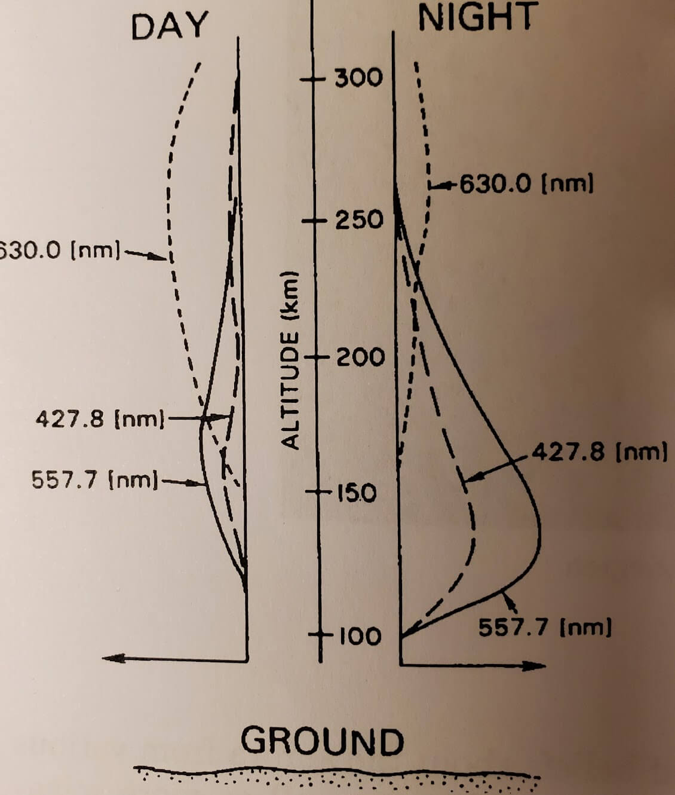
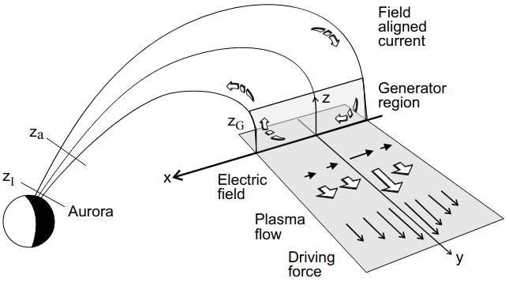

# 极光 {#sec-aurora}

极光是太阳风与地磁场相互作用所驱动的复杂磁层过程的一种可见而迷人的结果。极光可能表现为一条自东向西横贯天空、颜色暗淡的弥散带，也可能表现为快速移动、明亮多彩且覆盖大半天空的帘幕和光芒。我们不打算描述极光可能呈现的全部形态，只区分_弥散极光_和_分立极光_。导致这两种主要类型的粒子通过截然不同的物理过程沉降到大气中。磁层亚暴及导致分立极光形成的机制仍处于磁层研究的前沿。本章主要依据 Kjell Rönnmark 教授讲义的第 10 章。

## 极光发射

世界各地有许多关于极光的古老传说和信仰。许多神话观念以及十八世纪较为科学的理论，都将极光解释为阳光经由各种神力或自然过程反射、折射或散射而成。观测表明极光由分立谱线组成，这证明极光是由气体发射的，排除了反射或散射阳光的可能。极光光谱中最强的谱线位于 $557.7\,\mathrm{nm}$。

极光由能量在 10 eV 至 30 keV 范围内的带电粒子引起。这些粒子在高层大气中与原子和分子碰撞，使它们在碰撞后处于激发态。约 90% 的极光由电子引起，其余由质子引起。在约 100 km 的高度，极光的大部分光线从这里发出，大气主要由氮和氧组成，如图 ??? 所示。在这些气体中，产生强谱线的量子力学允许跃迁全部位于可见光谱之外——否则空气就不会透明无色。可见极光发射来自禁戒的亚稳态跃迁，其跃迁概率低、寿命长。如果气压过高，这些亚稳态会在通过发光衰变之前很久就通过碰撞弛豫到基态。然而，在 100 km 以上的高度，碰撞足够稀少，使原子氧的激发态能够衰变。该态的激发能为 4.17 eV，寿命为 0.8 s。它通过两步过程衰变。第一步发射绿线，使原子进入 1.96 eV 的状态。该中间态的寿命很长，为 110 s；使其回到基态的 630.0 nm 红线发射主要发生在 200 km 以上的高度。这条红线也可由低能电子碰撞直接激发到 1.96 eV 的状态而产生。极光光谱中的其他强谱线由氮发射。分子离子 $\mathrm{N}_2^+$ 在碰撞中以激发态产生，并通过发射 427.8 nm 的蓝紫色谱线衰变到基态。有时，强极光的最下部会因中性 $\mathrm{N}_2$ 分子在 600 nm 附近的发射而呈红色。

{#fig-aurora-altitude-dist}

@fig-aurora-altitude-dist 显示了极光发射的典型高度分布。不同谱线的激发截面取决于入射极光粒子的能量。通常，夜间沉降粒子的能量高于白天。低能电子在更高的高度释放能量，产生更多红色发射。白天与夜间的另一个区别是，阳光的共振散射相对于绿线增强了 427.8 nm 的 $\mathrm{N}_2^+$ 谱线。

## 弥散极光

极光带中几乎总能发现一些弥散极光。在晴朗漆黑的夜晚，它常表现为一条弥散带；如果强度低于人眼的颜色阈值，它可能呈灰色。即使从地面看不到极光，我们仍可从卫星对沉降粒子及紫外波段极光谱线的观测中得知，弥散极光在极光带周围形成一条相当连续的带。

经磁层顶尖瓣进入的磁鞘粒子是日侧弥散极光的一个来源。尖瓣中存在连接电离层与磁鞘的磁力线，俯仰角足够小的磁鞘粒子会沿这些磁力线沉降。在地方正午附近，存在持续的低能（$\le 100\,\mathrm{eV}$）粒子通量，它在 200 km 以上的高度产生一条 630 nm 发射的弥散带。

在夜侧以及远至傍晚和清晨的区域，弥散极光由源自等离子体片的粒子引起。这些粒子的能谱从低于 100 eV 延伸至高于 20 keV。来自等离子体片的电子持续沉降提出了一个尚未完全解决的问题。等离子体片的大部分位于闭合磁力线上，在静止磁层中损失锥应当是空的（因为粒子会损失）。为解释弥散极光，我们需要某种能够将粒子散射进入损失锥的机制。

如果赤道磁层中的等离子体波与粒子共振，就能引起强烈的俯仰角散射。这里的共振是指粒子的平行速度与波的相速度满足一定关系，使粒子感受到以回旋频率振荡的电场。由于粒子在共振期间持续获得或失去能量，其速度会发生显著变化。至少对于能量高于几个 keV 的电子，所需的俯仰角散射可由一种称为_磁层嘶声_的哨声模波提供。然而，哨声模波的相速度可能过高，无法与能量较低的电子共振。低能电子可以被上混杂模波有效散射。上混杂波是静电波，但尚不清楚这些波是否足够普遍，能够解释低能电子的弥散沉降。

## 极光波动与离子加热

等离子体波在极光过程中扮演着多种角色。如前所述，赤道附近的波提供导致弥散极光的俯仰角散射。在更靠近地球的地方，沉降并产生极光的强粒子通量会激发多种等离子体波。

分立极光是哨声模的强源，其产生的波与闪电产生的哨声波相当不同。极光发射的特征是覆盖几 kHz 至数百 kHz 的宽带频谱，并且持续产生，振幅仅缓慢变化。如果将信号放大并接到扬声器，就会听到嘶嘶声，因此这些波称为_极光嘶声_。极光嘶声从高层电离层传播到赤道磁层，在那里成为磁层嘶声的一部分。极光嘶声也会传播到地面，在极光纬度会使调谐到低频的无线电接收机产生噪声。

与分立极光弧相关的一种有趣的波发射称为极光千米波辐射（AKR）。这是一种强烈的无线电波辐射，强度峰值位于略低于 300 kHz 的频率，对应千米量级的波长。不过，其频率可以从 50 kHz 变化到 1 MHz。AKR 由低密度等离子体中涉及微妙相对论效应的机制产生，其频率非常接近局地电子回旋频率。最高频率产生于最靠近地球、磁场最强的地方。以 AKR 形式传输的最大功率估计为 1 GW，这使极光成为地球上最强的无线电波源。这些频率的电磁辐射可以自由传播到低密度的磁层之外，但在电离层中波频率等于 $\omega_{pe}$ 的高度会被反射。因此，地面无法接收到 AKR 信号，尽管这种发射很强，直到 1965 年才被发现。事实上，木星对应的极光发射称为木星十米波辐射，其频率较高，早在十年前就被射电天文学家观测到了。

极光弧上方也会产生静电等离子体振荡和其他静电波。离子回旋频率附近的低频静电波对磁层动力学有重要影响。这些波由极光电子产生，但被离子阻尼。离子吸收的波能主要进入其垂直速度。随后磁矩增大，离子被磁镜力 $\mu\nabla B$ 推出电离层。在极光活动期间，这一过程可使每秒至少 $10^{25}\,O^+$ 从极光电离层流出。这一流动使磁层含有大量电离层粒子，并降低极光弧上方高层电离层的等离子体密度。在离子加热挖出的极光空腔中，至少在电离层处于黑暗时，电子密度往往在低至 $1\,\mathrm{R}_\mathrm{E}$ 以下的高度都约为 $3\times10^5\,\mathrm{m}^{-3}$。这种密度降低对 AKR 的产生至关重要；正如后文所示，它对分立极光的产生也很重要。

## 亚暴与分立极光

_磁层亚暴_源于日侧和夜侧磁重联速率之间的不平衡。一个简单的例子是行星际磁场（IMF）突然从向北转为向南。向南的 IMF 会提高磁层顶的重联速率。随后，在 $\mathcal{O}(10^2)\,\mathrm{s}$ 内，更多等离子体和磁通量被输送到磁尾，尾瓣压力增大。等离子体片被压缩，在地面上可观察到已有弥散弧向赤道移动并变亮。受挤压的等离子体片中增强的沉降也会加强离子加热，导致极光弧上方高层电离层的密度降低。随着横贯磁尾的电流密度增大、中性片变薄，不稳定状态逐渐形成。此时，磁尾的某个部分开始重联（@fig-substorm）。这标志着磁层亚暴开始，而上述在磁尾储存能量的过程常称为_亚暴增长相_。

“亚暴”一词最初由 Akasofu 和 Chapman（1961）使用，用来描述磁暴主相期间的短时磁场变化。直到十年后，人们明确认识到亚暴和磁暴是截然不同的地磁现象，目前的定义才逐渐形成。包括极光爆发和扩展、亚暴电流楔、近地偶极化以及 Pi2 脉动在内的一系列现象，统称为磁层亚暴。

_亚暴电流楔_（SCW）的概念在理解亚暴期间磁尾与电离层的耦合方面发挥了重要作用。它为亚暴期间中低纬度观测到的磁扰动提供了简单解释，也有助于理解极光带的磁场变化。最简单的电流楔模型由一个单回路组成：沿偶极磁力线流入和流出电离层的线电流，由一条向西的电离层线电流和一条向东的磁层线电流连接（@fig-substorm）。

::: {.content-visible unless-format="pdf"}

{#fig-substorm}

:::

当磁尾中的磁力线开始重联时，等离子体片的一部分会从磁尾喷出，并以通常超过 400 km/s 的速度向地球流动。这股流在等离子体片内缘受到制动，需要相当大的 $\mathbf{j}\times\mathbf{B}$ 力，因而也需要相当大的从昏侧到晨侧的电流，这会导致磁场内部区域偶极化。在注入区域的边缘，这一电流转向形成场向电流，驱动极光电集流，即电离层中一股强烈的向西电流。注意，根据欧姆定律，极光电集流意味着向西的电场和电离层等离子体向赤道的流动。来自重联区的流动和磁场偶极化都伴随着与电离层耦合的场向电流，其综合效果即为 SCW。从能量储存到爆发性释放的这一系列变化称为_磁层亚暴_。重联过程随时间和空间变化，使流动形成尺度约为几个 $\mathrm{R}_\mathrm{E}$、时间尺度约为几分钟的结构。

观测到电离层中极光场向电流的电流密度为 $10\,\mathrm{\mu A}/\mathrm{m}^2$。仅考虑场向电流时，电流密度必然在磁通管变宽的更高处减小。在约 $1\,\mathrm{R}_\mathrm{E}$ 的高度，电流密度仍约为 $1\,\mathrm{\mu A}/\mathrm{m}^2$。在电子密度 $n_e$ 约为 $3\times10^5\,\mathrm{m}^{-3}$ 的极光空腔中，可估计电子承载这一电流所需的速度为 $v_\parallel=j_\parallel/en_e \sim 2\times10^7\,\mathrm{m/s}$，对应的动能略高于 1 keV。当重联从磁尾注入的快速流被阻止时，场向电流由必须加速到 keV 能量的电子承载。这些电子会产生极光，而这一电流的突然增强会导致亚暴增长相期间存在的平静极光弧发生爆发。

极光爆发发生在向上场向电流区域，即电集流的西端。向上电流由在约 $1\,\mathrm{R}_\mathrm{E}$ 高度被 $E_\parallel$ 加速的下行电子承载。当这些电子开始沉降时，极其明亮而动态的极光景象便开始了。位置合适的观测者可能看到天空大部分区域布满快速移动的极光形态。正如 Akasofu 1968 年所示的极光亚暴经典绘图（从北极上空观察）所示，极光向极地方向扩展，几分钟后，更稳定的分立极光弧开始形成。

从磁尾高速流入的等离子体由于惯性进入一个区域，该处环境压力主要为磁压，且高于注入等离子体的压力。随着流入持续，压力升高，注入的等离子体开始向磁层的傍晚侧和清晨侧扩展。这发生在距离地球稍远、环境磁压较低的地方，其磁力线到达电离层中初始爆发位置的极向一侧。与这种扩展相关的方位向等离子体流形成了爆发位置极向一侧的分立弧。

这里描述的简单亚暴电流楔模型只是对空间中实际电流的粗略近似。人们普遍认为，向上电流局限于午夜前区域，而向下电流在午夜后的极光卵上分布得更加广泛。[^direction] 向上电流由向下运动的电子承载，而向下电流由向上流动的电子和沉降的离子共同构成。实际电流可能不在同一个 L 壳层上流动。也有人提出，电流楔包含在子午面内闭合的电流。在这一更复杂的模型中，还有第二个方向相反、电流强度不同、流经较低 L 壳层的电流楔。该回路在地面的效果是降低较高纬度电流楔的表观强度。

[^direction]: 上下方向相对于电离层确定。

Dungey 循环是双胞（DP-2）电离层对流图样的来源。日侧和夜侧重联速率大致平衡的稳定磁层对流时段，接近 Dungey（1961）最初设想的理想化状态。然而，重联不是稳定过程；即使在太阳风驱动相对恒定的稳定磁层对流（SMC）时段，等离子体片对流也可能是间歇性和爆发性的。
对响应的详细考察表明，在每个现象学阶段都会形成一对电流楔形式的场向电流。因此，SCW 系统是与 Dungey 循环有关的所有磁层动力学中的关键现象，从弱活动到极端活动条件下都存在，并且是磁层动力学与电离层之间的联系。

### Knight 关系

通过研究电子在平行电场中的绝热运动，Knight [1973] 推导出了极光电流—电压（C-V）关系的公式。Lyons 等 [1979] 分析探空火箭数据发现，沉降电子的能量通量与电势降的平方成正比。不久之后，人们注意到，对于向上电流区域所关注的参数，Knight 关系可近似为 [Fridman and Lemaire, 1980]（我感觉这不是原始的 Knight 关系？？？Kosta 提到过场向电流和 B 之间的线性关系？）
$$
j_{z} \approx -K \Delta\phi
$$ {#eq-knight_relation}
其中，$j_z$ 是电势降下方的场向电流密度，$\Delta\phi$ 是电离层与赤道磁层之间的电势差。常数 $K$ 称为 Lyons-Evans-Lundin 常数，由下式给出：
$$
K=\frac{n_{G}e^2}{\sqrt{2\pi m T_G}}
$$
其中，$N_G$ 和 $T_G$ 分别是赤道发电区电子的密度和温度。注意，由于 $N_G$ 和 $T_G$ 可能随空间和时间变化，此处“常数”意味着“与 $\phi$ 无关”。此后，线性 C-V 关系 @eq-knight_relation 被纳入理论和数值模型。不过，既有支持这一关系的观测，也有反对它的观测。

Rönnmark [1999] 利用等离子体的流体描述表明，在纯静电准中性模型中，电势降应与向上场向电流的平方成正比：
$$
\Delta \phi = \frac{m_e}{2e^3}\frac{j_z^3}{n^2}
$$ {#eq-phi_jpar_electrostatic}
其中 $n$ 是电离层上方加速区的密度。

### 电流回路

与分立极光弧相连的电流回路如 @fig-discrete-auroral-arc-current 所示。与 @fig-substorm 比较可以看出，流动已从径向转为方位向。长度尺度也不同，因为极光电集流长达数百千米，而 @fig-discrete-auroral-arc-current 中穿过极光弧的电离层电流至多只有几千米。不过，物理过程非常相似。在指出一些细节时，我们使用 @fig-discrete-auroral-arc-current 所示的几何构型。

{#fig-discrete-auroral-arc-current}

假设从电离层延伸至赤道平面的极光磁通管可以分为三部分。

1. 在低高度是碰撞占主导的电离层，场向电流在这里与水平电流相连。
2. 电离层上方的磁层等离子体是无碰撞的。在稳态且没有碰撞时，磁矩 $\mu$ 和总能量 $H$ 沿粒子的相空间轨迹守恒。
这些假设意味着不存在垂直于磁力线的电流（???），并且在磁通管的第二部分，即主体部分，磁通管内的场向电流守恒。
3. 第三部分是赤道发电区。发电区中的垂直电流由动压和动力学压力梯度驱动，这些垂直电流的散度转为场向电流。在真实磁层中，这些部分之间的边界可能相当模糊，发电区也可能远离赤道平面延伸。

为简单起见，我们假设极光磁通管的主体部分通过明确的边界与电离层和发电区分开。由于准中性，轻而灵活的电子的密度由离子密度决定。在不同稳态之间的转变过程中，离子密度将保持近似恒定。这种转变，例如场向电流的增加，是通过沿磁力线上下传播的剪切阿尔芬波实现的。与这些阿尔芬波相关的 $E_\perp$ 的时间变化会产生_离子极化电流_ $j_\perp$，其表达式为
$$
k_\perp = \frac{n_i m_i}{B^2}\frac{\partial E_\perp}{\partial t}
$$

结合离子连续性方程
$$
e\frac{\partial n_i}{\partial t} \approx -\partial_\perp j_\perp = \frac{n_i m_i}{B^2}\frac{\partial \partial_\perp E_\perp}{\partial t}
$$
可以通过积分求出 $E_\perp$ 增长期间的密度变化 $\Delta n_i$。令 $L_\perp$ 为 $j_\perp$ 所连接的电流片的厚度。选取极光加速区的典型值 $E_\perp=0.1\,\mathrm{V}/\mathrm{m}$ 和 $B=10\,\mu\mathrm{T}$，得到
$$
\bigg\lvert \frac{\Delta n_i}{n_i} \bigg\rvert \sim \frac{m_i}{eB^2}|\partial_\perp E_\perp| \sim \frac{10\,\mathrm{m}}{L_\perp}
$$

显然，这一过程只能在极薄的电流片内显著增大等离子体密度。另一方面，如果电流片厚度为几百米或更大，密度将保持近乎恒定。因此，在电流和电压变化时，将磁通管主体部分的等离子体密度视为固定似乎是合理的。

在稳定场向电流状态下，质量为 $m_i$ 的离子对电流的贡献比质量为 $m_e$ 的电子的贡献约小 $\sqrt{m_e/m_i}$ 倍。如果作为一级近似将这一比值视为固定，离子电流和电子电流分别守恒。那么，在电流完全沿磁场方向的磁通管主体部分，等离子体密度将不受稳定电流的影响。然而，离子组成、电子和离子温度等等离子体性质随高度的变化可能导致离子电流与电子电流之比变化，从而使等离子体密度缓慢降低或升高。

赤道平面内的压力试图建立强速度剪切 $\partial_x u_y$，这意味着 @fig-discrete-auroral-arc-current 中存在强的 $\partial_x E_x$（$\mathbf{E} = -\mathbf{u}\times\mathbf{B}$）。回顾 eq-ionosphere_potential_derivation，可以发现电离层电场的梯度由场向电流决定：
$$
\frac{\partial E_x}{\partial x} = \frac{j_z}{\Sigma_P}
$$

只要沿磁力线没有电势降，磁层和电离层电场就具有简单的关系，将赤道平面中的强速度剪切映射到电离层需要强场向电流。然而，通过极光空腔的强电流意味着电子必须由电势降加速（例如 @eq-phi_jpar_electrostatic）。

在承载从电离层向上电流的磁力线上出现这一电势降，意味着电离层和磁层电场发生解耦。加速区中冻结条件不成立，而理想 MHD 的这一失效也意味着赤道等离子体可以自由流动而不拖动电离层。电势降 $\Delta\phi$ 限制了电流密度，从而也限制了制动的 $\mathbf{j}\times\mathbf{B}$ 力。注意，正是这一电势降中的低高度加速——在沉降电子能谱中表现为能量 $e\Delta\phi$ 处的峰——区分了分立极光和弥散极光。

承载从电离层向上电流的磁力线连接到驱动力具有强烈向内梯度的区域，即压力增强体积的外部。当该区域的制动被解除时，流动会在更大的 $y$ 处形成一个更窄的高压区域。??? 只有这个较小体积的外部会继续扩展，这一过程很快就在 $y$ 方向形成一条狭窄流道。该流道的外缘映射到电离层中的一条分立极光弧。

在上述模型中，流动被限制在 $y$ 方向。在真实磁层中，流动可以在径向 $x$ 方向偏转，形成旋卷和涡旋。正如 Akasofu 所示，真实极光弧的几何形态非常复杂。这些图样类似于河水流入湖泊时出现的湍流。

我对亚暴和 SCW 仍有许多疑问。阅读 [@kepko2015substorm] 的综述后情况更糟了：我的印象是，至今还没有一个模型能够解释整个电流系统。难怪用 MHD-EPIC 进行的锯齿事件研究最终得出了奇怪的结果。

### Ω 带极光

Akasofu 和 Kimball（1964）首次描述了弥散极光极向边界的极光亮度起伏，并因其形状类似倒置的（向极地一侧开口的）希腊字母 Ω 而将其命名为“Ω 带”。Ω 带通常在磁层亚暴恢复相期间于午夜后和清晨区域观测到。它们的典型尺度为 400–1000 km，通常以 0.3–2 km/s 的速度向东漂移。

### θ 极光

θ 极光（跨极极光弧）被认为与高纬度重联有关，后者通常发生在 IMF 向北的条件下。

IMF $B_y$ 也可能促成 θ 极光，因为磁力线扭转与高纬度重联共同作用可以形成强极光弧。

### 喉部极光

喉部极光因日侧的指状结构而得名，被认为由瞬态重联以及尖瓣区存在较大 $B_x$ 时磁层顶的凹陷引起。

### 脉动极光

## 第一区和第二区电流

第二区电流与低纬度区域周围的部分环电流有关。简单 MHD 模型没有环电流（@sec-ring-current），这意味着它不能具有第二区电流。然而，它可以产生第一区电流，因为第一区电流与极冠尖瓣区附近的日侧粒子沉降和磁层顶发生的重联有关。

观测表明，与第一区电流相比，极端磁暴可以使第二区电流显著增强。

## 极光卵

* 整体尺寸变化非常剧烈。
* 极光卵的大小与夜侧重联更为相关（由电势的夜侧贡献所表明）。它与日侧电势没有简单关系（CPCP？）。
* 流体模型不足以解释观测。

## 总结

* 日侧重联增强
* 磁尾电流片变薄
* 重联加速的电子
* 将电流带入极光空腔
