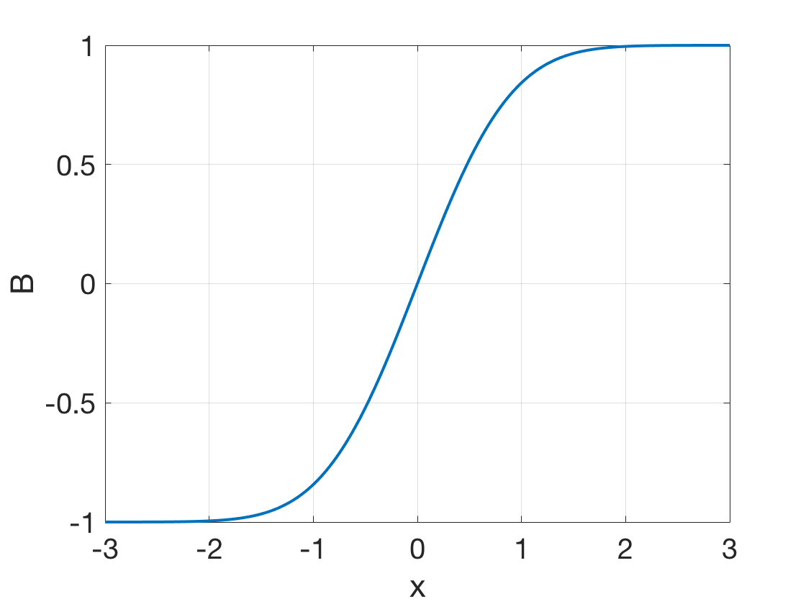
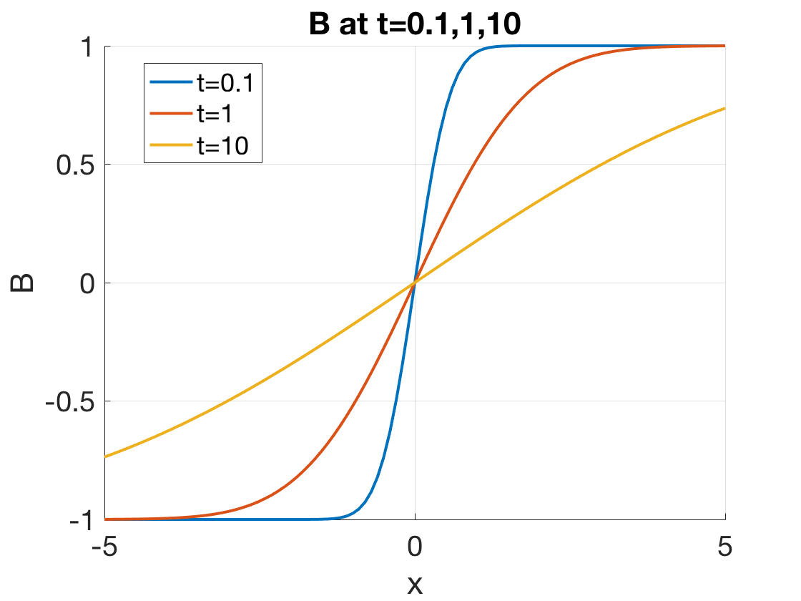
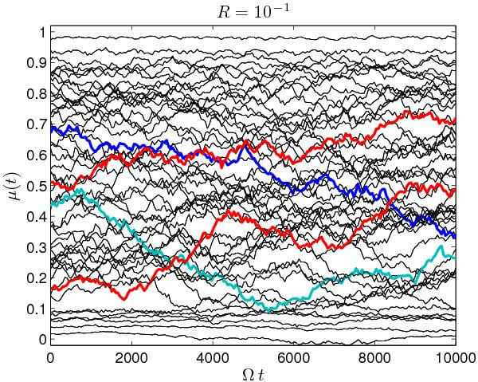

# 扩散与电阻率 {#sec-resisvity}

## 弱电离气体中的扩散和迁移率

上一章在讨论平衡条件时假设的无限均匀等离子体当然是高度理想化的。任何真实等离子体都有密度梯度，并倾向于向低密度区域扩散。例如，受控热核反应中的核心问题是利用磁场抑制扩散速率。不过，在处理磁场问题之前，我们先考虑无磁场时的扩散。若进一步假设等离子体为弱电离状态，带电粒子主要与中性原子碰撞，而不是相互碰撞，问题就更简单。完全电离等离子体的情况留待后面讨论，因为它产生的非线性方程很少有简单的示例解。不管怎样，部分电离气体并不罕见：高压电弧和电离层等离子体都属于这一类，而且早期的大多数气体放电研究涉及 $10^3$ 到 $10^6$ 之间的电离分数，此时与中性原子的碰撞占主导地位。

因此，这里的图像是离子和电子非均匀分布在稠密的中性粒子背景中（图 5.1，待补！）。当等离子体在压力梯度和电场力作用下扩散时，各粒子与中性原子频繁碰撞，进行随机游走。我们首先简要回顾原子理论中的一些定义。

## 碰撞参数

例如，当电子与中性原子碰撞时，它损失的初始动量比例取决于反弹角度。在与重原子正面碰撞时，电子的速度在碰撞后反向，因此它可以损失两倍于其初始动量的动量。动量损失的概率可以用等效截面 $\sigma$ 表示，即原子若是动量的完全吸收体时所具有的截面。

在图 5.2 中，电子入射到面积为 $A$、厚度为 $\mathrm{d}x$ 的薄层上，薄层每 $\text{m}^3$ 含有 $n_n$ 个中性原子。假设原子是不透明球体，其截面积为 $\sigma$；也就是说，每当电子进入原子遮挡的面积时，电子就损失其全部动量。薄层中的原子数为 $n_n A \mathrm{d}x$，被原子遮挡的面积比例为 $n_n A\sigma \mathrm{d}x / A = n_n \sigma \mathrm{d}x$。若电子通量 $\Gamma$ 入射到薄层，则另一侧的出射通量为 $\Gamma^\prime = \Gamma(1-n_n \sigma \mathrm{d}x)$。因此 $\Gamma$ 随距离的变化为 $\mathrm{d}\Gamma/\mathrm{d}x = -n_n \sigma\Gamma$，即
$$
\Gamma = \Gamma_0 e^{-n_n\sigma x} \equiv \Gamma_0 e^{-x/\lambda_m}
$$

经过距离 $\lambda_m$ 后，通量降至初始值的 $1/e$。$\lambda_m$ 称为碰撞的*平均自由程*：
$$
\lambda_m = 1/n_n\sigma
$$ {#eq-mean_free_path_collision}

粒子行进距离 $\lambda_m$ 后，发生碰撞的概率相当大。对于速度为 $v$ 的粒子，两次碰撞之间的平均时间为
$$
\tau = \lambda_m/v
$$
平均碰撞频率为
$$
\tau^{-1} = v/\lambda_m = n_n \sigma v
$$ {#eq-mean_freq_collision}

如果对麦克斯韦分布中所有速度 $v$ 的粒子取平均，就得到通常所说的碰撞频率 $\nu$：
$$
\nu = n_n \overline{\sigma v}
$$ {#eq-collision_freq}

## 扩散参数

对于任意粒子种类 $s$，包含碰撞的流体运动方程为
$$
mn\frac{\mathrm{d}\mathbf{v}}{\mathrm{d}t} = mn \Big[ \frac{\partial\mathbf{v}}{\partial t} + (\mathbf{v}\cdot\nabla)\mathbf{v} \Big] = q_sn\mathbf{E} - \nabla p - mn\nu\mathbf{v}
$$

计算 $\nu$ 时采用的平均过程使上式成立；我们不必关注其计算细节。不过，要使该方程有用，必须假设 $\nu$ 为常量。考虑 $\partial\mathbf{v}/\partial t = 0$ 的稳态。若 $\mathbf{v}$ 足够小（或 $\nu$ 足够大），流体元在一个碰撞时间内不会进入 $\mathbf{E}$ 和 $\nabla p$ 不同的区域，对流导数 $\mathrm{d}\mathbf{v}/\mathrm{d}t$ 也将消失。令左侧为零，对于等温等离子体有
$$
\mathbf{v} = \frac{1}{mn\nu}(q_sn\mathbf{E} - k_B T \nabla n) = \frac{q_s}{m\nu}\mathbf{E} - \frac{k_B T}{mv}\frac{\nabla n}{n}
$$

上面的系数分别称为*迁移率*和*扩散系数*：
$$
\mu\equiv |q|/m\nu\quad\text{迁移率}
$$ {#eq-mobility}

$$
D\equiv k_B T/ m\nu\quad\text{扩散系数}
$$ {#eq-diffusion_coef}

它们对不同粒子种类各不相同。注意，$D$ 的单位为 $\text{m}^2/s$。输运系数 $\mu$ 和 $D$ 由*爱因斯坦关系*联系：
$$
\mu = |q|D/k_B T
$$ {#eq-einstein_relation}
利用这些定义，第 $s$ 种粒子的通量 $\Gamma_s$ 可写为
$$
\Gamma_s = n\mathbf{v}_s = \pm \mu_s n\mathbf{E} - D_s\nabla n
$$ {#eq-species_flux}

菲克扩散定律是其特殊情况，适用于 $\mathbf{E}=0$ 或粒子不带电、因而 $\mu=0$ 的情况：
$$
\Gamma = -D\nabla n\quad\text{菲克定律}
$$

这一方程只是表达了扩散是随机游走过程这一事实：从高密度区域到低密度区域出现净通量，仅仅是因为高密度区域出发的粒子更多。该通量显然与密度梯度成正比。在等离子体中，菲克定律不一定成立。由于可能存在有组织的运动（等离子体波），等离子体可能以并非真正随机的方式扩散。

## 等离子体因扩散而衰减

### 双极扩散

双极扩散与准中性的概念有关。在大多数等离子体中，作用于离子的力与作用于电子的力不同，因此直观上可能认为，无论通过扩散、对流还是其他过程，一种粒子的输运速度会快于另一种。如果这种差异输运具有散度，就会导致电荷密度变化。电荷密度变化又会产生电场，改变一种或两种粒子的输运，使它们的输运变得相等。

最简单的例子是局限于无磁场真空中的等离子体（例如惯性约束聚变）。电子和离子都会以各自的热速度向外流动。如果离子相对较冷，其热速度就小。由于电子温度高、质量小，电子热速度很快：$v_{th,e}= \sqrt{k_B T_e / m_e}$。电子离开初始体积时，会留下离子形成的正电荷密度，从而产生向外的电场。这个电场使电子减速、离子加速。最终结果是离子和电子都以声速 $c_{s}\approx {\sqrt {k_{B}T_{e}/m_{i}}}$ 向外流动；这一速度远小于电子热速度，但通常远大于离子热速度。

现在考虑在容器中产生的等离子体如何因向壁面扩散而衰减。一旦离子和电子到达壁面，就在那里复合。因此，壁面附近的密度基本为零。流体运动方程和连续性方程控制等离子体的行为；但如果衰减缓慢，只需保留连续性方程中的时间导数。如果碰撞频率 $\nu$ 很大，运动方程中的时间导数可以忽略。于是有
$$
\frac{\partial n}{\partial t} + \nabla\cdot\Gamma_s = 0
$$ {#eq-diffusion_continuity}
其中 $\Gamma_s$ 由 @eq-species_flux 给出。显然，如果 $\Gamma_i$ 和 $\Gamma_e$ 不相等，很快就会出现严重的电荷不平衡。如果等离子体的尺度远大于德拜长度，它必须是准中性的；因而可以预期离子和电子的扩散速率会以某种方式自行调整，使两种粒子以相同速率离开。这个过程很容易理解。电子较轻，热速度较高，倾向于先离开等离子体。留下的正电荷产生一个电场，其极性使电子的损失减慢、离子的损失加快。令 $\Gamma_i=\Gamma_e=\Gamma$ 即可求得所需电场 $\mathbf{E}$。由 @@eq-species_flux，可以写出
$$
\Gamma = \mu_i n\mathbf{E} - D_i \nabla n = -\mu_e n\mathbf{E} - D_e\nabla n
$$

$$
\mathbf{E} = \frac{D_i - D_e}{\mu_i + \mu_e}\frac{\nabla n}{n}
$$

共同通量 $\Gamma$ 于是为
$$
\begin{aligned}
\Gamma &= \mu_i\frac{D_i - D_e}{\mu_i + \mu_e}\nabla n - D_i \nabla n \\
&=\frac{\mu_iD_i - \mu_iD_e - \mu_iD_i - \mu_eD_i}{\mu_i + \mu_e}\nabla n \\
&=-\frac{\mu_iD_e + \mu_eD_i}{\mu_i+\mu_e}\nabla n
\end{aligned}
$$

这就是具有新扩散系数的菲克定律：
$$
D_a \equiv \frac{\mu_iD_e + \mu_eD_i}{\mu_i+\mu_e}
$$ {#eq-ambipolar_diffusion_coef}
该系数称为_双极扩散系数_。如果它是常数，上面的连续性方程便简化为
$$
\frac{\partial n}{\partial t} = D_a \nabla^2 n
$$ {#eq-ambipolar_diffusion}

取 $\mu_e\gg\mu_i$，可以估计 Da 的大小。由 @eq-mobility 可看出这一条件成立。由于 $\nu$ 正比于热速度，而热速度正比于 $m^{-1/2}$，所以 $\mu$ 正比于 $m^{-1/2}$。由 @eq-mobility 和 @eq-ambipolar_diffusion_coef 得
$$
D_a \approx D_i + \frac{\mu_i}{\mu_e}D_e = D_i + \frac{T_e}{T_i}D_i
$$

对于 $T_e = T_i$，有
$$
D_a \approx 2D_i
$$

双极电场使离子的扩散增强两倍，而两种粒子共同的扩散速率主要由较慢的粒子种类控制。

### 平板中的扩散

扩散方程 @eq-ambipolar_diffusion 很容易用分离变量法求解。令
$$
n(\mathbf{r}, t) = T(t)S(\mathbf{r})
$$

于是，省略 $D_a$ 的下标后，@eq-ambipolar_diffusion 变为
$$
\begin{aligned}
S\frac{\mathrm{d}T}{\mathrm{d}t} &= DT\nabla^2 S \\
\frac{1}{T}\frac{\mathrm{d}T}{\mathrm{d}t} &= \frac{D}{S}\nabla^2 S
\end{aligned}
$$

由于左侧仅是时间的函数，右侧仅是空间的函数，两者必定等于同一个常数，记为 $-1/\tau$。于是函数 $T$ 满足方程
$$
\frac{\mathrm{d}T}{\mathrm{d}t} = -\frac{T}{\tau}
$$ {#eq-diffusion_temporal}

其解为
$$
T = T_0 e^{-t/\tau}
$$

空间部分 $S$ 满足方程
$$
\nabla^2 S = -\frac{1}{D\tau} S
$$ {#eq-diffusion_spatial}

在平板几何中，它变为
$$
\frac{\mathrm{d}^2 S}{\mathrm{d}x^2} = -\frac{1}{D\tau}S
$$ {#eq-diffusion_spatial_slab}

其解为
$$
S = A\cos\frac{x}{(D\tau)^{1/2}} + B\sin\frac{x}{(D\tau)^{1/2}}
$$ {#eq-slab_sol}

我们预期壁面处的密度近乎为零（图 5.3，添加插图！），中间有一个或多个峰。最简单的解只有一个极大值。根据对称性，可以舍去 @eq-slab_sol 中的奇函数（正弦）项。于是边界条件 $x=\pm L$ 处 $S=0$ 要求
$$
\frac{L}{(D\tau)^{1/2}} = \frac{\pi}{2}
$$
或
$$
\tau = \Big( \frac{2L}{\pi} \Big)^2 \frac{1}{D}
$$

综合上述方程，得到
$$
n = n_0 e^{-t/\tau} \cos\frac{\pi x}{2L}
$$

这称为_最低扩散模_。密度分布为余弦形式，峰值密度随时间指数衰减。正如预期，时间常数 $\tau$ 随 $L$ 增大而增大，并与 $D$ 成反比。

当然，还存在具有多个峰的更高扩散模。假设初始密度分布如图 5.4 中最上方的曲线所示，添加插图。这样一个任意分布可以展开为傅里叶级数：
$$
n = n_0 \Big( \sum_l a_l\cos\frac{(l+\frac{1}{2})\pi x}{L} \sum_m b_m\sin\frac{m\pi x}{L} \Big)
$$

我们选择指标，使 $x=\pm L$ 处的边界条件自动满足。为处理时间依赖性，可以尝试形式为下式的解：
$$
n = n_0 \Big( \sum_l a_l e^{-t/\tau_l}\cos\frac{(l+\frac{1}{2})\pi x}{L} \sum_m b_m e^{-t/\tau_m}\sin\frac{m\pi x}{L} \Big)
$$

将其代入扩散方程 @eq-ambipolar_diffusion，可以看到每个余弦项给出如下形式的关系：
$$
-\frac{1}{\tau_l} = -D\Big[ \Big(l+\frac{\pi}{2}\Big)\frac{\pi}{L} \Big]^2
$$

正弦项同理。因此，第 $l$ 模的衰减时间常数为
$$
\tau_l = \Big[ \frac{L}{(l+\frac{1}{2})\pi} \Big]^2 \frac{1}{D}
$$

对应较大 $l$ 值的密度分布精细结构衰减得更快，其时间常数 $\tau_l$ 更小。等离子体衰减过程如图 5.4 所示，添加插图。首先，精细结构被扩散抹平。随后达到最低扩散模，即图 5.3 中简单的余弦分布，添加插图。最后，峰值密度继续衰减，而等离子体密度剖面保持相同形状。

我想对此做一个模拟！试试 METHODOFLINES.JL？

### 圆柱中的扩散

扩散方程的空间部分 eq-diffusion_spatial 在圆柱几何中为
$$
\frac{\mathrm{d}^2 S}{dr^2} + \frac{1}{r}\frac{dS}{dr} + \frac{1}{D\tau}S = 0
$$ {#eq-diffusion_spatial_cylinder}

它与 @eq-diffusion_spatial_slab 的区别是增加了中间一项，这一项只是反映坐标变化。额外项的必要性可由图 5.5 简单说明，添加插图。如果将 (a) 中的一片等离子体向较大的 x 移动而不允许其膨胀，密度将保持不变。另一方面，如果将 (b) 中的等离子体壳层向较大的 $r$ 移动，同时保持壳层厚度不变，密度必然按 $1/r$ 降低。因此，可以预期 @eq-diffusion_spatial_cylinder 的解类似于阻尼余弦（图 5.6，添加插图）。这个函数称为_零阶贝塞尔函数_，而 eq-diffusion_spatial_cylinder 称为零阶贝塞尔方程。它使用符号 $J_0$ 而不是 cos。函数 $J0(r/[D\tau]^{1/2})$ 是 eq-diffusion_spatial_cylinder 的解，正如 $\cos[x/(\mathrm{d}\tau)^{1/2}]$ 是 eq-diffusion_spatial 的解一样。$\cos kx$ 和 $J_0(kr)$ 都可用无穷级数表示。

插图：平板等离子体在直线和圆柱几何中的运动，用以说明余弦函数与贝塞尔函数之间的区别。

为了满足 $r=a$ 处 $n=0$ 的边界条件，必须令 $a/(D\tau)^{1/2}$ 等于 $J_0$ 的第一个零点，即 2.4。这给出衰减时间常数 $\tau$。等离子体仍然指数衰减，因为扩散方程的时间部分 @eq-diffusion_temporal 不变。我们描述的是圆柱中的最低扩散模。圆柱内具有多个极大值的更高扩散模将用高阶贝塞尔函数表示，与平板几何的情况直接类比。

## 稳态解

在许多实验中，持续电离或注入等离子体以抵消损失，从而使等离子体维持稳态。为了计算这种情况下的密度剖面，必须在连续性方程中加入源项：
$$
\frac{\partial n}{\partial t} - D\nabla^2 n = Q(\mathbf{r})
$$

选择符号使得 $Q$ 为正时，它表示一个源，并对 $\partial n/\partial t$ 作正贡献。在稳态下，令 $\partial n/\partial t=0$，剩下一个关于 $n(\mathbf{r})$ 的泊松型方程。

### 常数电离函数

在许多弱电离气体中，电离由麦克斯韦分布尾部的高能电子产生。在这种情况下，源项 $Q$ 与电子密度 $n$ 成正比。令 $Q=Zn$，其中 $Z$ 是“电离函数”，有
$$
\nabla^2 n = -(Z/D)n
$$

这与 $S$ 的方程 @eq-diffusion_spatial 相同。因此，密度剖面与衰减等离子体的情况一样是余弦函数或贝塞尔函数，只是在这里密度保持恒定。将电子温度维持在恒定值的热源，以及补充被电离原子的少量中性原子流入，使等离子体得以维持并抵消扩散损失。

### 面源

接下来考虑平板几何中 $x=0$ 平面上有局域源时会得到什么剖面。例如，这样的源可以是经过狭缝准直、强度足以电离中性气体的紫外光束。此时稳态扩散方程为
$$
\frac{\mathrm{d}^n}{\mathrm{d}x^2} = -\frac{Q}{D}\delta(0)
$$

除 $x=0$ 处外，密度必须满足 $\partial^2 n/\partial x^2=0$。显然其解为（图 5.7，添加插图）
$$
n = n_0 \Big( 1-\frac{|x|}{L} \Big)
$$

等离子体具有线性剖面。源处斜率不连续是 $\delta$ 函数源的特征。

### 线源

最后，考虑源位于轴线上的圆柱形等离子体。例如，这样的源可以是一束沿轴线产生电离的高能电子。除 $r=0$ 处外，密度必须满足
$$
\frac{1}{r}\frac{\partial}{\partial r}\Big(r\frac{\partial n}{\partial r}\Big) = 0
$$

在 $r=a$ 处为零的解为
$$
n = n_0 \ln(a/r)
$$

密度在 $r=0$ 处变为无穷大（图 5.8）；如果不考虑源的有限宽度，就不可能准确确定轴线附近的密度。

## 复合

当离子和电子碰撞时，特别是在相对速度较低时，它们有有限的概率复合成中性原子。为了守恒动量，必须存在第三体。如果这个第三体是发射出的光子，该过程称为_辐射复合_；如果它是粒子，该过程称为_三体复合_。等离子体因复合而损失可以用连续性方程中的负源项表示。显然，这一项与 $n_en_i=n^2$ 成正比。没有扩散项时，连续性方程变为
$$
\frac{\partial n}{\partial t} = -\alpha n^2
$$

比例常数 $\alpha$ 称为复合系数，单位为 $\text{m}^3/\text{s}$。这是关于 $n$ 的非线性方程。这意味着不能直接通过解的线性叠加来满足初始条件和边界条件。幸运的是，这个非线性方程非常简单，可以直接观察得到解：
$$
\frac{1}{n(\mathbf{r},t)} = \frac{1}{n_0(\mathbf{r})} + \alpha t
$$
其中 $n_0(\mathbf{r})$ 是初始密度分布。密度降到远低于初始值后，它随时间按_倒数_衰减，$n\propto 1/\alpha t$。这与扩散的情况有根本区别，后者随时间指数变化。

图 5.9（添加插图！）展示了弱电离氢等离子体余辉中密度衰减的测量结果。密度高时，与 $n^2$ 成正比的复合占主导，密度按倒数衰减。密度降至较低值后，扩散占主导，此后的衰减是指数形式。

## 垂直磁场的扩散

磁场可以降低等离子体因扩散而损失的速率；这就是受控聚变研究中的约束问题。考虑磁场中的弱电离等离子体（fig-gyration-collision，添加插图！）。由于 $\mathbf{B}$ 不影响平行方向的运动，带电粒子将按照 @eq-species_flux 沿 $\mathbf{B}$ 通过扩散和迁移运动。因此，对于每种粒子，
$$
\Gamma_z = \pm\mu n E_z - D\frac{\partial n}{\partial z}
$$

如果没有碰撞，粒子在垂直方向上完全不会扩散——它们会继续绕同一条磁力线回旋。当然，由于电场或 $\mathbf{B}$ 的梯度，粒子会发生跨 $\mathbf{B}$ 漂移，但可以安排这些漂移平行于壁面。例如，在完全对称的圆柱中（fig-drift-cylinder，添加插图！），所有梯度都沿径向，因此导引中心漂移沿方位角方向。这样漂移就不会造成损失。

插图：磁场中的带电粒子将在同一条磁力线周围回旋，直到发生碰撞。#fig-gyration-collision

插图：圆柱对称等离子体柱中的粒子漂移不会导致损失。#fig-drift-cylinder

存在碰撞时，粒子通过随机游走过程沿梯度跨 $\mathbf{B}$ 向壁面迁移（fig-diffusion-collision-neutral，添加插图！）。例如，当一个离子与中性原子碰撞时，碰撞后的离子沿不同方向运动。它继续以相同方向绕磁场回旋，但回旋相位发生不连续变化。（拉莫尔半径也可能变化，但我们假设离子平均而言既不获得也不损失能量。）

插图：回旋粒子因与中性原子碰撞而扩散。#fig-diffusion-collision-neutral

因此，导引中心在碰撞中改变位置并进行随机游走。粒子将沿 $\nabla n$ 的反方向扩散。随机游走的步长不再像无磁场扩散中那样为 $\lambda_m$，而是具有拉莫尔半径 $r_L$ 的大小。因此，可以通过减小 $r_L$，即增大 B，减慢跨 $\mathbf{B}$ 扩散。

为了了解这一过程如何发生，将任一粒子种类的流体运动方程的垂直分量写成如下形式：

### 跨 B 的双极扩散

由于存在磁场时扩散系数和迁移率系数是各向异性的，双极扩散问题不像 $B = 0$ 时那样简单。考虑垂直于 $\mathbf{B}$ 的粒子通量（图 5.13，添加插图！）。通常，由于 $\Gamma_{e\perp}$ 小于 $\Gamma_{i\perp}$，会建立一个横向电场，以促进电子扩散并减缓离子扩散。然而，沿 $\mathbf{B}$ 的通量不平衡可以使这一电场被短路。也就是说，$\Gamma_{e\perp} < \Gamma_{i\perp}$ 产生的负电荷可以通过电子沿磁力线逃逸而消散。虽然总扩散必须是双极的，但垂直方向的损失不一定是双极的。离子可以主要沿径向扩散出去，而电子主要沿 $\mathbf{B}$ 扩散出去。这是否真的发生取决于具体实验。对于磁力线终止于导电板的短等离子体柱，可以预期双极电场会被短路。此时各粒子种类以不同速率沿径向扩散。对于以绝缘板封端的细长等离子体柱，由于沿 $\mathbf{B}$ 逃逸困难，可以预期径向扩散是双极的。

从数学上看，该问题是同时求解离子和电子的连续性方程 @eq-diffusion_continuity。必须令两者相等的不是通量 $\mathbf{\Gamma}_j$，而是散度 $\nabla\cdot\mathbf{\Gamma}_j$。将 $\nabla\cdot\mathbf{\Gamma}_j$ 分为垂直和平行分量，有
$$
\begin{aligned}
\nabla\cdot\mathbf{\Gamma}_i &= \nabla_\perp\cdot(\mu_i n \mathbf{E}_\perp - D_{i\perp}\nabla n) + \frac{\partial}{\partial z}\Big( \mu_inE_z - D_i\frac{\partial n}{\partial z} \Big) \\
\nabla\cdot\mathbf{\Gamma}_e &= \nabla_\perp\cdot(\mu_e n \mathbf{E}_\perp - D_{e\perp}\nabla n) + \frac{\partial}{\partial z}\Big( -\mu_enE_z - D_e\frac{\partial n}{\partial z} \Big)
\end{aligned}
$$

令 $\nabla\cdot\mathbf{\Gamma}_i = \nabla\cdot\mathbf{\Gamma}_e$ 得到的方程不容易分离为一维方程。此外，结果对磁力线两端的边界条件非常敏感。除非等离子体足够长，以至于平行扩散可以完全忽略，否则跨磁场双极扩散问题没有简单答案。

## 全电离等离子体中的碰撞 {#sec-collision_ionized}

当等离子体仅由离子和电子组成时，所有碰撞都是带电粒子之间的库仑碰撞。然而，以下两类碰撞有明显区别：

* 同类粒子之间的碰撞（离子－离子或电子－电子碰撞）；
* 不同类粒子之间的碰撞（离子－电子或电子－离子碰撞）。

考虑两个相同粒子的碰撞（图 5.16，添加插图！）。如果是正面碰撞，碰撞后粒子的速度反向；它们只是交换轨道，两个导引中心仍留在原处。结果与擦碰相同，在擦碰中轨迹几乎不受扰动。可能发生的最严重情况是 $90^\circ$ 碰撞，此时速度方向改变 $90^\circ$。碰撞后的轨道将是虚线圆，导引中心也会移动。然而，显然两个导引中心的“质心”保持静止。因此，同类粒子之间的碰撞只产生很少的扩散。这与离子和中性原子的碰撞形成对比。在后一种情况下，无需关心中性粒子的最终速度，离子从初始位置随机游走离开。然而，在离子－离子碰撞中，每次碰撞都有详细平衡；每当一个离子因碰撞向外移动，就有另一个向内移动。

然而，当两个带相反电荷的粒子碰撞时，情况完全不同（图 5.17，添加插图！）。此时最严重的是 $180^\circ$ 碰撞，粒子碰撞后速度反向。由于它们必须继续以正确的旋向绕磁力线回旋，两个导引中心都会沿同一方向移动。_不同类粒子之间的碰撞会产生扩散_。由于质量差异，离子和电子的物理图像略有不同。电子从几乎静止的离子上反弹，并以通常方式随机游走。离子在每次碰撞中受到轻微撞击，由于电子频繁轰击而四处移动。尽管如此，由于每次碰撞都守恒动量，离子和电子的扩散速率相同，下面将证明这一点。

### 等离子体电阻率

包含带电粒子碰撞效应的流体运动方程可写为
$$
\begin{aligned}
m_i n\frac{\mathrm{d}\mathbf{v}_i}{\mathrm{d}t} &= en(\mathbf{E}+\mathbf{v}_i\times\mathbf{B}) - \nabla p_i -\nabla\cdot\pmb{\pi}_i + \mathbf{P}_{ie} \\
m_e n\frac{\mathrm{d}\mathbf{v}_e}{\mathrm{d}t} &= -en(\mathbf{E}+\mathbf{v}_e\times\mathbf{B}) - \nabla p_e -\nabla\cdot\pmb{\pi}_e + \mathbf{P}_{ei}
\end{aligned}
$$ {#eq-resistivity_fluid_momentum}

$\mathbf{P}_{ie}$ 和 $\mathbf{P}_{ei}$ 分别表示离子流体因与电子碰撞获得的动量，以及电子流体因与离子碰撞获得的动量。应力张量 $\mathbf{P}_j$ 已分解为各向同性部分 $p_j$ 和各向异性黏性张量 $\pmb{\pi}_j$。同类粒子碰撞在各流体内部产生应力，包含在 $\pmb{\pi}_j$ 中。由于这些碰撞产生的扩散很少，我们忽略 $\nabla\cdot\pmb{\pi}_j$ 项。对于表示两种流体之间摩擦的 $\mathbf{P}_{ie}$ 和 $\mathbf{P}_{ei}$，动量守恒要求
$$
\mathbf{P}_{ie} = -\mathbf{P}_{ei}
$$

可以按通常方式用碰撞频率表示 $\mathbf{P}_{ei}$：
$$
\mathbf{P}_{ei} = mn(\mathbf{v}_i - \mathbf{v}_e)\nu_{ei}
$$

$\mathbf{P}_{ie}$ 也类似。由于这些碰撞是库仑碰撞，可以预期 $\mathbf{P}_{ei}$ 与库仑力成正比，而对于单电荷离子，库仑力正比于 $e^2$。此外，$\mathbf{P}_{ei}$ 必须与电子密度 $n_e$ 和散射中心密度 $n_i$ 成正比，后者当然等于 $n_e$。最后，$\mathbf{P}_{ei}$ 应与两种流体的相对速度成正比。因此，根据物理考虑，可将 $\mathbf{P}_{ei}$ 写为
$$
\mathbf{P}_{ei} = \eta e^2n^2(\mathbf{v}_i - \mathbf{v}_e)
$$ {#eq-coulomb_collision_momentum}

其中 $\eta$ 是比例常数。与前一个方程比较，可以看到
$$
\nu_{ei} = \frac{ne^2}{m}\eta
$$ {#eq-coulomb_collision_frequency}

常数 $\eta$ 是等离子体的_电阻率_；它与电阻率的通常含义一致，这一点很快就会清楚。

### 库仑碰撞力学 {#sec-coulomb_collision_mechanics}

电子与中性原子碰撞时，直到电子接近到原子尺寸尺度才会感受到力；这种碰撞类似台球碰撞。电子与离子碰撞时，电子被离子的长程库仑场逐渐偏转。尽管如此，仍可为这种碰撞推导有效截面。对我们的目的而言，估计截面的数量级就足够了。在图 5.18 中（添加插图！），速度为 $\mathbf{v}$ 的电子接近一个电荷为 $e$ 的固定离子。如果没有库仑力，电子的最近接距离为 $r_0$，称为碰撞参数。存在库仑吸引力时，电子将偏转一个与 $r_0$ 相关的角度 $\chi$。库仑力为

插图：电子与离子发生库仑碰撞时的轨道。#fig-coulomb-collision

$$
F = -\frac{e^2}{4\pi\epsilon_0 r^2}
$$

电子在离子附近时感受到这一力；这段时间大约为
$$
T \approx r_0 / v
$$

因此电子动量的变化约为
$$
\Delta(mv) = |FT| \approx \frac{e^2}{4\pi\epsilon_0r_0v}
$$

我们希望估计大角度碰撞（$\chi \ge 90^\circ$）的截面。对于 $90^\circ$ 碰撞，$mv$ 的变化与 $mv$ 本身同量级。因此
$$
\Delta(mv) \simeq mv \simeq e^2/4\pi\epsilon_0r_0v,\quad r_0 = e^2/4\pi\epsilon_0 mv^2
$$ {#eq-impact_parameter}

截面于是为
$$
\sigma = \pi r_0^2 = e^4 / 16\pi\epsilon_0^2 m^2v^4
$$

因此碰撞频率为
$$
\nu_{ei} = n\sigma v = ne^4/16\pi\epsilon_0^2 m^2 v^3
$$ {#eq-coulomb_collision_freq}

电阻率为
$$
\eta = \frac{m}{ne^2}\nu_{ei} = \frac{e^2}{16\pi\epsilon_0^2 mv^3}
$$ {#eq-coulomb_resistivity}

对于电子的麦克斯韦分布，在数量级估计中可以用 $k_B T_e/m$ 替换 $v^2$：
$$
\eta \approx \frac{\pi e^2m^{1/2}}{(4\pi\epsilon_0)^2 (k_B T_e)^{3/2}}
$$ {#eq-coulomb_resistivity_maxwellian}

这是仅基于大角度碰撞得到的电阻率。实际中，由于库仑力作用距离长，小角度碰撞频繁得多，许多小角度偏转的累积效应比大角度碰撞的效应更大。Spitzer 表明 @eq-coulomb_resistivity_maxwellian 应乘以因子 $\ln \Lambda$：
$$
\eta\approx\frac{\pi e^2m^{1/2}}{(4\pi\epsilon_0)^2 (k_B T_e)^{3/2}}\ln\Lambda
$$ {#eq-coulomb_resistivity_maxwellian_correction}
其中
$$
\Lambda = \overline{\lambda_D/r_0} = 12\pi n\lambda_D^3
$$

这一因子表示以 @eq-impact_parameter 给出的 $r_0$ 为单位、对麦克斯韦分布取平均的最大碰撞参数。最大碰撞参数取为 $\lambda_D$，因为德拜屏蔽抑制了更远距离上的库仑场。虽然 $\Lambda$ 依赖于 $n$ 和 $k_BT_e$，其对数对等离子体参数的确切值并不敏感。$\ln \Lambda$ 的典型值如下（$\lambda_D$ 定义于 @sec-debye）。

| $k_B T_e\,[\text{eV}]$ | $n\,[\text{m}^{-3}]$ | $\ln\Lambda$  |   |
|------------------------|----------------------|---------------|---|
| $0.2$  | $10^{15}$ | 10.7 | （Q 机） |
| $2$    | $10^{17}$ | 11.8 | （实验室等离子体） |
| $100$  | $10^{19}$ | 15.4 | （典型环形装置） |
| $10^4$ | $10^{21}$ | 20.0 | （聚变反应堆） |
| $10^3$ | $10^{27}$ | 9.6  | （激光等离子体） |

显然，当等离子体参数跨越许多数量级时，$\ln \Lambda$ 仅变化约两倍。对于大多数用途，不论涉及何种等离子体，取 $\ln \Lambda=10$ 都足够准确。

### η 的物理意义

假设等离子体中存在电场 $\mathbf{E}$，它驱动的电流全部由迁移能力远高于离子的电子携带。令 $B=0$、$k_BT_e=0$，使 $\nabla\cdot\mathbf{P}_e=0$。那么在稳态下，@eq-resistivity_fluid_momentum 中的电子运动方程简化为
$$
en\mathbf{E} = \mathbf{P}_{ei}
$$ {#eq-resistivity_momentum_steady}

由于 $\mathbf{j}=en(\mathbf{v}_i-\mathbf{v}_e)$，@eq-coulomb_collision_momentum 可写为
$$
\mathbf{P}_{ei} = \eta en\mathbf{j}
$$
因此 @eq-resistivity_momentum_steady 变为
$$
\mathbf{E} = \eta\mathbf{j}
$$ {#eq-ohm}

这就是欧姆定律，常数 $\eta$ 正是电阻率。@eq-coulomb_resistivity_maxwellian 或 @eq-coulomb_resistivity_maxwellian_correction 给出的等离子体电阻率表达式有几个值得指出的特点。

1. 在 @eq-coulomb_resistivity_maxwellian_correction 中可以看到，$\eta$ _与密度无关_（除 $\ln\Lambda$ 中的弱依赖外）。这是一个相当令人惊讶的结果，因为它意味着对等离子体施加电场 $\mathbf{E}$ 时，@eq-ohm 给出的电流 $\mathbf{j}$ 与载流子数目无关。原因是，虽然 $j$ 随 $n_e$ 增大，但离子造成的摩擦阻力也随 $n_i$ 增大。由于 $n_e=n_i$，这两种效应互相抵消。这种抵消可以从 @eq-coulomb_collision_freq 和 @eq-coulomb_resistivity 看出。碰撞频率 $\nu_{ei}$ 确实与 $n$ 成正比，但因子 $n$ 在 $\eta$ 中被约去。在这一点上，全电离等离子体与弱电离等离子体的行为截然不同。对于弱电离等离子体，有 $\mathbf{j}=-ne\mathbf{v}_e,\mathbf{v}_e=-\mu_e\mathbf{E}$，所以 $\mathbf{j}=ne\mu_e\mathbf{E}$。由于电子迁移率 $\mu_e$ 只依赖于_中性粒子_密度，电流与等离子体密度 $n$ 成正比。

2. @eq-coulomb_resistivity_maxwellian_correction 表明 $\eta$ 正比于 $T_e^{-3/2}$。等离子体受热时，库仑截面减小，电阻率随着温度升高而相当快地下降。热核温度（几十 keV）下的等离子体基本是无碰撞的；这就是为什么有如此多关于无碰撞等离子体的理论研究。当然，总会存在一些碰撞；否则也不会有聚变反应。加热等离子体的简单方法是直接让电流通过它。此时 $I^2R$ 或 $\eta j^2$ 损失转化为电子温度升高，称为_欧姆加热_。然而，$\eta$ 对 $(k_BT_e)^{-3/2}$ 的依赖使这种方法无法一直用于达到热核温度。温度超过 1 keV 时等离子体成为如此良好的导体，以至于在这个范围内欧姆加热过程非常缓慢。

3. @eq-coulomb_collision_freq 表明 $\nu_{ei}$ 随 $v^{-3}$ 变化。速度分布尾部的高速电子很少发生碰撞。因此，电流主要由这些电子而非分布主体中的大部分电子携带。对 $v$ 的强依赖还有另一个有趣的后果。如果突然对等离子体施加电场，可能发生称为_电子逃逸_的现象。施加电场时恰好沿 $-\mathbf{E}$ 方向高速运动的少数电子，在遇到离子之前获得了如此多的能量，以至于只能发生擦碰。这使它们能够从电场获得更多能量，并进一步减小碰撞截面。如果 E 足够大，截面下降得如此之快，以至于这些逃逸电子永远不会发生碰撞。它们形成一束与分布主体分离的加速电子束。

### η 的数值

考虑每次碰撞中离子反冲并对电子分布正确平均的 $\eta$ 精确计算，最早由 Spitzer 给出。下面针对氢的结果有时称为 Spitzer 电阻率：

$$
\eta_\parallel = 5.2\times 10^{-5}\frac{Z\ln\Lambda}{T^{3/2}[\text{eV}]}\, [\text{ohm}\cdot\text{m}]
$$ {#eq-spitzer_resistivity}

这里 $Z$ 是离子电荷数，在其他地方取为 1。由于对 $m_i$ 的依赖很弱，这些值也可用于其他气体。下标 $\parallel$ 表示此 $\eta$ 值用于平行于 $\mathbf{B}$ 的运动。对于垂直于 $\mathbf{B}$ 的运动，应使用

$$
\eta_\perp = 2.0 \eta_\parallel
$$

这并不意味着沿 $\mathbf{B}$ 的电导率仅为跨 $\mathbf{B}$ 电导率的两倍。仍须考虑类似 $\omega_c^2\tau^2$ 的因子。因子 2.0 源于电子分布中不同速度的权重差异。在垂直运动中，拉莫尔半径较小的慢电子对电阻率的贡献比在平行运动中更大。

对于 $k_BT_e=100\, \text{eV}$，@eq-spitzer_resistivity 给出

$$
\eta = 5\times 10^{-7}\, [\text{ohm}\cdot\text{m}]
$$

可以与各种金属导体比较：

| 材料 | $\eta\, [\text{ohm}\cdot\text{m}]$ |
|------------------------|----------------------|
| 铜 | $2\times10^{-8}$ |
| 不锈钢 | $7\times10^{-7}$ |
| 汞 | $1\times10^{6}$ |

因此，100 eV 等离子体的电导率与不锈钢相近。

### 脉冲电流

当沿磁场排列的两个电极之间流过稳态电流时，电子是主要载流子，阴极处建立鞘层，将电流限制在设定值。然而，当电流为脉冲时，建立电流分布需要时间。Stenzel 和 Urrutia 表明，这一时间由哨声波（R 波）控制；哨声波必须传播整个装置长度才能传递电压信息。

### 粒子种类之间的碰撞

Y.Y 在讲座中谈到，离子之间或电子之间的碰撞率远大于离子与电子之间的碰撞率。我需要回头看笔记。另见 [StackExchange 问答](https://physics.stackexchange.com/questions/143738/why-are-ions-and-electrons-at-different-temperatures-in-a-plasma)。

### 电导率张量 {#sec-conductivity}

电阻率是电导率的倒数。考虑将碰撞效应作为电子运动方程中的摩擦：
$$
m\frac{\mathrm{d}\mathbf{u}_e}{\mathrm{d}t} = q(\mathbf{E}+\mathbf{u}_e\times\mathbf{B}) - m\nu_c(\mathbf{u}_e - \mathbf{u}^\prime)
$$

其中 $\mathbf{u}^\prime$ 是碰撞靶粒子的速度。

* 在无磁化等离子体中，令 $\mathbf{B}=0$。

假设冷电子（$\mathbf{u}_e = \mathbf{v}_e$）和静止靶粒子 $\mathbf{u}^\prime = 0$ 构成稳态，容易得到

$$
\mathbf{E} = -\frac{m_e\nu_c}{e}\mathbf{u}_e
$$

由于电子电流定义为

$$
\mathbf{j} = -en_e\mathbf{u}_e
$$

由上两式得到

$$
\mathbf{j} = \frac{n_e e^2}{m_e\nu_c}\mathbf{E} \equiv \sigma\mathbf{E}
$$ {#eq-classical_conductivity}

其中 $\sigma$ 是经典电导率。

* 在磁化等离子体中，令 $\mathbf{B}=b\hat{z}$。

与无磁化稳态情况类似，

$$
0 = -e(\mathbf{E} + \mathbf{u}_e\times\mathbf{B}) - \nu_c m_e\mathbf{u}_e
$$

为避免混淆，令 $\sigma_0$ 表示 @eq-classical_conductivity 中的经典电导率。利用电流密度的定义并写成标量形式，得到

$$
\begin{aligned}
j_x &= \sigma_0 E_x - \frac{\Omega_e}{\nu_c}j_y \\
j_y &= \sigma_0 E_y - \frac{\Omega_e}{\nu_c}j_x \\
j_z &= \sigma_0 E_z
\end{aligned}
$$

求解得到

$$
\begin{aligned}
j_x &= \frac{\nu_c^2}{\nu_c^2 + \Omega_e^2}\sigma_0 E_x - \frac{\Omega_e \nu_c}{\nu_c^2 + \Omega_e^2}E_y \\
j_y &= \frac{\nu_c^2}{\nu_c^2 + \Omega_e^2}\sigma_0 E_y - \frac{\Omega_e \nu_c}{\nu_c^2 + \Omega_e^2}E_x \\
j_z &= \sigma_0 E_z
\end{aligned}
$$

或写为矩阵形式：

$$
\begin{pmatrix} j_x \\ j_y \\ j_z \end{pmatrix} =
\begin{pmatrix} \sigma_P & -\sigma_H & 0 \\ \sigma_H & \sigma_P & 0 \\ 0 & 0 & \sigma_\parallel \end{pmatrix}
\begin{pmatrix} E_x \\ E_y \\ E_z \end{pmatrix}
$$

其中

$$
\begin{aligned}
\sigma_P &= \frac{\nu_c^2}{\nu_c^2 + \Omega_e^2}\sigma_0\quad\text{佩德森电导率}&(\perp\mathbf{B}\&\parallel\mathbf{E}) \\
\sigma_H &= \frac{\Omega_e \nu_c}{\nu_c^2 + \Omega_e^2}\sigma_0\quad\text{霍尔电导率}&(\perp\mathbf{B}\&\perp\mathbf{E}) \\
\sigma_\parallel &= \sigma_0 = \frac{n_e e^2}{m_e\nu_c}\quad\text{平行电导率}&(\parallel\mathbf{B})
\end{aligned}
$$

沿磁场电流（FAC）在等离子体物理中非常重要。由 @fig-conductivity 可见，$\Omega_e \simeq \nu_c$ 是最复杂的区域，此时三种电导率相近；$\Omega_e \gg \nu_c$ 是各向异性最强的区域，因为粒子在垂直方向被紧密约束，却可沿 $\mathbf{B}$ 自由运动。

```jl
KeyNotes.plot_conductivity()
```

电导率研究与地球电离层最为相关；在离地约 100 km 高度处出现 $\Omega_e \simeq \nu_c$，$\sigma_0$ 约为 100 S/m。电离层通过电子碰撞电离和光电离机制在大气中形成，并对等离子体相互作用作出关键贡献。电离层导电，因此承载一个电流系统的一部分，该系统通过等离子体电流延续到电离层之外。电离层电流的性质通常用电离层的_电导率_描述。由于强背景磁场贯穿电离层，电导率具有很强的各向异性。沿磁场方向的电导率称为_平行_或_伯克兰_电导率。伯克兰电导率 $\sigma_\parallel$ 非常高，会将电离层电场的沿磁场分量短路；在准静态（$>1\,\text{min}$）大尺度电动力学条件下，等势面通常与电离层磁力线对齐。垂直于磁场方向，电导率有平行于电场的分量 $\sigma_P$ 和垂直于电场的分量 $\sigma_H$。

由于电场沿电离层磁场方向的分量为零（$\mathbf{E}_\parallel = 0$），沿磁场方向积分横向 $\sigma_P$ 和 $\sigma_H$ 来分别求佩德森电导和霍尔电导 $\Sigma_P$ 和 $\Sigma_H$ 是有意义的。对于任意 $\mathbf{E}$，

$$
\pmb{\Sigma}\cdot\mathbf{E} = \Sigma_P\mathbf{E} + \Sigma_H\hat{b}\times\mathbf{E}
$$

电流连续性给出

$$
\begin{aligned}
\nabla\cdot\mathbf{j} + \frac{\partial \rho^\ast}{\partial t} = 0 \\
\nabla\cdot(\pmb{\sigma}\cdot\mathbf{E}) = -\frac{\partial \rho^\ast}{\partial t} \\
\int \nabla\cdot(\pmb{\sigma}\cdot\mathbf{E}) dz = -\int \frac{\partial \rho^\ast}{\partial t} dz \\
\nabla\cdot(\int\pmb{\sigma}dz\cdot\mathbf{E}) = -\rho^\ast v_\parallel \\
\nabla\cdot(\pmb{\Sigma}\cdot\mathbf{E}) = - j_\parallel \\
\nabla\cdot(\pmb{\Sigma}\cdot\nabla\Phi) = j_\parallel
\end{aligned}
$$ {#eq-ionosphere_potential_derivation}

$\mathbf{E}=-\nabla\Phi$，且 $j_\parallel$ 定义为向上（$+z$）为正。这里假设 $\mathbf{B}$ 与 $\hat{z}$ 对齐；更真实的几何需要考虑倾角。参见 @eq-ionosphere_potential，并注意 $j_\parallel$ 定义中的符号差异。

作用于电离层磁通管的力可以用这些电导表示，因此力平衡表达式可用于推导电离层流动的其他性质，例如速度。（？？？）

质量加载对等离子体相互作用的电动力学贡献类似于电离层电导的贡献。拾取电离守恒动量。离子密度增大会导致流速及其相关电场降低。因此，在建立相互作用理论时，可以将拾取效应直接纳入上述电导，且相互作用区域延伸至大气外逸层底界之上。

佩德森电流（沿电场方向）施加使电离层流动减速的力。霍尔电流垂直于电场和磁场流动，从而破坏相互作用的对称性。霍尔电流使流动偏离共转方向，并产生电离层不对称。

## 全电离等离子体的扩散

磁感应方程可以由法拉第定律和欧姆定律导出。如果磁扩散率 $\eta$ 为常数，可将其写为

$$
\frac{\partial\mathbf{B}}{\partial t}=\nabla\times(\mathbf{u}\times\mathbf{B})+\eta\nabla^2\mathbf{B}
$$

定义_磁雷诺数_ $R_m$ 为对流项与扩散项之比：

$$
R_m\equiv \frac{\nabla\times(\mathbf{u}\times\mathbf{B})}{\eta\nabla^2\mathbf{B}}\sim \frac{uBL_0^2}{\eta L_0 B}=\frac{u L_0}{\eta}
$$

$R_m$ 有两种极端情况。应当记住，由于 $\mathbf{E}+\mathbf{u}\times\mathbf{B}\neq0$，这不再是理想 MHD。

### 小 $R_m$ 条件

如果 $R_m\ll1$，对流部分可以忽略（例如 $\mathbf{u}\approx 0$）：

$$
\frac{\partial\mathbf{B}}{\partial t}=\eta\nabla^2\mathbf{B}
$$

这是扩散方程，意味着与理想 MHD 不同，等离子体不再与磁场绑定。扩散时间尺度 $\tau_0$ 可如下导出：

$$
\begin{aligned}
\frac{B}{\tau_0}=\eta\frac{B}{{L_0}^2}\Rightarrow \tau_0=\frac{{L_0}^2}{\eta}=\mu\sigma {L_0}^2
\end{aligned}
$$

$\sigma$ 是电导率，是由欧姆定律导出的参数。对于全电离等离子体，$\sigma=\frac{n_i e^2 \tau_{ei}}{m_e}$。

磁扩散率可写为

$$
\eta=\frac{1}{\mu\sigma}=\frac{m_e}{\mu n_i e^2\tau_{ei}}=\frac{m_e n_e \ln\Lambda}{\mu n_i e^2 \cdot 5.45\times10^{5}T^{3/2}} =5.2\times10^7 \frac{\ln\Lambda}{T^{3/2}}
$$

其中 $\ln\Lambda$ 是库仑对数（通常为 $10\sim20$，对 $n$ 和 $T$ 不敏感，@sec-coulomb_collision_mechanics）。

_例子_：

1. 太阳日冕磁场的演化及日冕中太阳耀斑的能量释放。

$T=10^{7}K$, $n=10^{14}m^{-3}$，$\Rightarrow \eta=1\ m^2s^{-1}$

对于超米粒，$L_0=10^7m=10Mm$，($R_s=700Mm$)，扩散时间尺度 $\tau_d=10^{14}s\approx3\times10^6\text{yr}$，非常非常长。

对于耀斑，观测到的扩散时间尺度为 $\tau_d=1s\Rightarrow L_0=1m$。太阳日冕中磁重联的扩散时间尺度约为 $\tau_d=100s\Rightarrow L_0=10m$。从 1 AU 处看太阳的视角约为 $2000\ \text{arcsec}$，其中 $1\ \text{arcsecond}$ 对应太阳上的 $700\text{km}$。目前我们能达到的最佳分辨率约为 $0.2\sim0.5\ \text{arcsecond}$，即约 $100\text{km}$。这意味着我们距离观测太阳上电子扩散区所需的分辨率还差三个数量级！

2. 发电机效应的必要性

如果不存在磁发电机效应，地磁场早已消失。在地核中，$\eta\approx 1m^2s^{-1}$，地球半径 $L_0=6\times10^6m\Rightarrow \tau_d\approx 4\times10^{12}s\approx10^6\text{yr}$。然而，地球年龄约为 $10^9\text{yr}\gg 10^6\text{yr}$。这表明地核内部有什么东西在产生磁场。

3. 电流片

考虑一种理想磁场构型：

$$
\mathbf{B}=B(x,t)\widehat{y},
$$

其中

$$
B(x,0)=\left\{
\begin{array}{lr}
+B_0 & x>0 \\ -B_0 & x<0
\end{array}
\right.
$$

磁扩散方程可写为

$$
\frac{\partial B}{\partial t}=\eta \frac{\partial^2 B}{\partial x^2}
$$

其解析解为

$$
B(x,t)=B_0\ \text{erf}(\xi)
$$

其中

$$
\xi=\frac{x}{\sqrt{4\eta t}}
$$

且

$$
\text{erf}(\xi)=\frac{2}{\sqrt{\pi}}\int_0^\xi e^{-z^2}dz
$$

是_误差函数_。它具有以下一些基本性质：

$$
\text{erf}(\xi)\Rightarrow\left\{
\begin{array}{lr}
1 & ,\xi\rightarrow +\infty \\ -1 & ,\xi\rightarrow -\infty
\end{array}
\right.
$$

$$
\text{erf}(\xi)=\frac{2}{\sqrt{\pi}}\Big( \xi-\frac{\xi^3}{3}+\frac{\xi^5}{10}-\frac{\xi^7}{42}+... \Big)\approx \frac{2\xi}{\sqrt{\pi}},\ |\xi|\ll 1
$$

其形状如 @fig-erf 所示。

{#fig-erf}

$$
|B(x,t)|\approx\left\{
\begin{array}{lr}
\frac{x}{\sqrt{\pi\eta t}}B_0 & ,|\xi|\ll1\ \text{或}\ |x|\ll\sqrt{\pi\eta t} \\
B_0 & ,|\xi|\gg1\ \text{或}\ |x|\gg\sqrt{\pi\eta t} \\
0.995B_0 & ,|\xi|=2\ \text{或}\ |x|=2\sqrt{\pi\eta t} \\
\end{array}
\right.
$$

如果要画出这一随时间变化的磁场在两个不同时刻 $t_1$ 和 $t_2$（$t_1<t_2$）的情况，$t_2$ 时的线应比 $t_1$ 时稀疏。@fig-mag-diff-1d 给出了一个示例图。

{#fig-mag-diff-1d}

结论：

1. 经过一定时间，B 在近处区域减小，在远处区域保持不变。
2.

$$
\begin{aligned}
j_z = \frac{1}{\mu}\frac{\mathrm{d}B}{\mathrm{d}x}, \\
\delta=2\sqrt{4\eta t},\ (\text{特征宽度}) \\
\frac{\mathrm{d}\delta}{\mathrm{d}t}=2\sqrt{\frac{\eta}{t}}, (\text{特征速度})
\end{aligned}
$$

3.

$$
j=\int_{-\infty}^{\infty}j_z \mathrm{d}x=\frac{1}{\mu}\int_{-\infty}^{\infty}\mathrm{d}B=\frac{2B_0}{\mu}=\text{常数}
$$

电流片随时间变厚，但 $z$ 方向的总电流保持不变。

4. 磁能耗散，$W_B=\frac{B^2}{2\mu}$ ？？？

$$
\frac{\partial}{\partial t}\int_{-\infty}^{\infty}(W_0-W_B)\mathrm{d}x=-\frac{\partial}{\partial t}\int_{-\infty}^{\infty}\frac{B(x)^2}{2\mu}\mathrm{d}x
$$

### 大 $R_m$ 条件

如果 $R_m\ll1$，扩散部分可以忽略，
$$
\frac{\partial\mathbf{B}}{\partial t}=\nabla\times(\mathbf{u}\times\mathbf{B})
$$

当电导率很大时，扩散系数变得非常小，出现磁通冻结现象。

1. 磁通冻结定理

磁力线冻结在等离子体流中。穿过随等离子体运动的曲面的磁通守恒，
$$
\frac{\mathrm{d}\Phi}{\mathrm{d}t}=0,
$$
其中
$$
\Phi=\int\mathbf{B}\cdot \mathrm{d}\mathbf{A}.
$$

添加插图！！！

_证明_。

考虑边界为 $\Gamma$ 的曲面 $S$。穿过 $S$ 的磁通为
$$
\Phi = \iint_s \mathbf{B}\cdot \mathrm{d}\mathbf{A}
$$

磁通的时间导数可写为
$$
\begin{aligned}
\dot{\Phi}&=\iint_s \dot{\mathbf{B}}\cdot \mathrm{d}\mathbf{A} + \iint_s \mathbf{B}\cdot \mathrm{d}\dot{\mathbf{A}} \\
&=\iint_s (-\nabla\times\mathbf{E})\cdot\mathrm{d}\mathbf{A} + \iint_s \mathbf{B}\cdot \mathrm{d}\dot{\mathbf{A}} \\
&=\iint_s \nabla\times(\mathbf{u}\times\mathbf{B})\cdot\mathrm{d}\mathbf{l} + \iint_s \mathbf{B}\cdot \mathrm{d}\dot{\mathbf{A}} \\
&=\oint_\Gamma \mathbf{u}\times\mathbf{B}\cdot\mathrm{d}\mathbf{l} + \iint_s \mathbf{B}\cdot \mathrm{d}\dot{\mathbf{A}} \\
\end{aligned}
$$

面积变化可表示为
$$
\begin{aligned}
\Delta \mathbf{A}&=(\mathbf{u}\Delta t)\times\mathrm{d}\mathbf{l}, \\
\mathrm{d}\dot{\mathbf{A}}&=\mathbf{u}\times\mathrm{d}\mathbf{l}.
\end{aligned}
$$

代入上式，得到
$$
\begin{aligned}
\dot{\Phi}&=\oint_\Gamma \mathbf{u}\times\mathbf{B}\cdot\mathrm{d}\mathbf{l} + \oint_\Gamma \mathbf{B}\cdot(\mathbf{u}\times\mathrm{d}\mathbf{l})=0
\end{aligned}
$$

请记住，我们仍处于 MHD 近似下：
$$
\frac{\partial |\mathbf{B}|}{\partial t} \ll \Omega_i |\mathbf{B}|
$$

这看起来像磁矩守恒。

□

2. 磁力线的拉伸

$$
\frac{d\mathbf{B}}{\mathrm{d}t}=\frac{\partial\mathbf{B}}{\partial t}+(\mathbf{u}\cdot\nabla)\mathbf{B}=\nabla\times(\mathbf{u}\times\mathbf{B})+(\mathbf{u}\cdot\nabla)\mathbf{B}
=(\mathbf{B}\cdot\nabla)\mathbf{u}-\mathbf{B}(\nabla\cdot\mathbf{u})
$$
其中右侧第一项是剪切运动，第二项是与膨胀相关的变化。

结合连续性方程，
$$
\frac{\mathrm{d}\rho}{\mathrm{d}t}+\rho\nabla\cdot\mathbf{u}=0
$$
可以得到
$$
\frac{\mathrm{d}}{\mathrm{d}t}\Big( \frac{\mathbf{B}}{\rho} \Big)=\Big( \frac{\mathbf{B}}{\rho}\cdot\nabla \Big)\mathbf{u}
$$ {#eq-B_Rho_diff}

_证明_。

$$
\begin{aligned}
\frac{\mathrm{d}\mathbf{B}}{\mathrm{d}t}=(\mathbf{B}\cdot\nabla)\mathbf{u} +\frac{\mathbf{B}}{\rho}\frac{\mathrm{d}\rho}{\mathrm{d}t} \\
\frac{1}{\rho}\frac{\mathrm{d}\mathbf{B}}{\mathrm{d}t}-\frac{\mathbf{B}}{\rho^2}\frac{\mathrm{d}\rho}{\mathrm{d}t}=\Big( \frac{\mathbf{B}}{\rho} \cdot\nabla\Big)\mathbf{u}
\end{aligned}
$$
□

比较 @eq-B_Rho_diff 和 @eq-line_diff，得到
$$
\frac{\mathbf{B}}{\rho}\propto \mathbf{l}
$$

即 $\mathbf{B}/\rho$ 和 $\mathbf{l}$ 具有相同形式的变化。如果密度变化不大，磁场强度将与 $l$ 成正比。

## 俯仰角散射

本节首先遵循 @tautz2013pitch。该论文给出了用扩散系数表示的俯仰角散射定义、俯仰角散射的典型行为及由此产生的俯仰角分布。

俯仰角强烈各向异性的相空间分布函数无法用扩散近似恰当描述。例子包括太阳高能粒子（SEP）、日球层粒子群，如木星电子射流，以及在行星际传播激波处加速的超热离子种类。

这一问题的关键是确定出现在福克－普朗克输运方程中的俯仰角扩散系数 $D_{\mu\mu}$。一般而言，至少可以区分三种解决这一问题的方法。

第一，可以指定湍流功率谱 $G(k)$ 对波数 k 的依赖关系，以推导 $D_{\mu\mu}$ 的解析近似。Jokipii（1966）推导的准线性理论（QLT）一直是标准理论，直到人们认识到 QLT 不仅不准确，而且在某些情况下实际上无效。对于各向同性湍流，已知 QLT 无法正确描述俯仰角散射，因为它忽略了 90° 散射并导致平均自由程无限大。应用二阶 QLT（Shalchi 2005；Tautz 等，2008）解决了这一问题，该理论考虑了偏离 QLT 所假设的无扰动螺旋轨道的情况。

第二，为考虑更复杂的湍流性质并验证解析微扰理论的适用性，可以在指定的湍流磁场中进行测试粒子模拟。通过追踪粒子轨迹，可以得到均方位移及相关扩散参数。

第三，可以不完全指定湍流磁场，而是进行直接数值模拟以计算磁流体动力学方程的解，同时仍像前一种方法那样积分测试粒子轨迹。这类计算不需要假设高能粒子所感受到的湍流谱。然而，受计算能力限制，湍流谱惯性区的范围受到限制。

高能粒子也许最重要的输运过程是俯仰角散射，即范围为 $[-1,1]$ 的 $\mu = v_\parallel / v = \cos\theta$ 的随机变化，其中 $\theta$ 是平均磁场 $\mathbf{B}_0$ 与粒子速度 $\mathbf{v}$ 之间的夹角。这一过程与沿平均磁场的扩散有关，后者由平行扩散系数 $\kappa_\parallel$ 或平行平均自由程 $\lambda_\parallel = (3/v)\kappa_\parallel$ 描述，它们也与宇宙射线各向异性有关。

{#fig-pitch-angle-scattering}

@fig-pitch-angle-scattering 展示了一组典型单粒子轨迹的俯仰角时间演化。确实可以看到，$\mu\approx[0, \pm 1]$ 的粒子几乎保持其原始俯仰角。然而，也可能发生穿越 90° 的散射，而 QLT 不包含这一事实。

### 俯仰角散射的定义

俯仰角散射的通常定义可见于所谓的 Taylor-Green-Kubo（TGK）形式体系（Taylor 1922；Green 1951；Kubo 1957；Shalchi 2011）：
$$
\begin{aligned}
D_{\mu\mu}(\mu) &= \int_0^\infty \mathrm{d}t \left< \dot{\mu}(t)\dot{\mu}(0) \right> \\
&= \frac{1}{2}\frac{\mathrm{d}}{\mathrm{d}t}\left< \Delta \mu(t)^2 \right>
\end{aligned}
$$ {#eq-pitch-angle-diffusion-coef}
其中第二行使用了定义 $\Delta \mu(t) = \mu(t) - \mu(0)$。可以证明，如果 $t$ 足够大，使表达式渐近地不再依赖时间，两种形式彼此一致。

扩散（Fick 1855）与随机游走（Chandrasekhar 1943）的结合促成了用均方位移表示扩散的通常定义（例如 Tautz 2012）$\kappa = \left< \Delta x^2 \right> /(2t)$；它也可以给出 $D_{\mu\mu}$ 的第三种表达式，即
$$
D_{\mu\mu} = \frac{1}{2t}\left<  \Delta \mu(t)^2 \right>
$$ {#eq-pitch-angle-diffusion-coef3}
该式同样在 $t$ 足够大时有效。然而，形式上的极限 $t \rightarrow \infty$ 不允许使用，因为 $|\Delta \mu|$ 不可能超过 2。对于足够长的时间，不论选择哪种公式，$D_{\mu\mu}$ 最终总会由 $1/t$ 依赖关系支配。因此，当且仅当满足以下条件时，才能获得有意义的、与时间无关的 $D_{\mu\mu}$ 值：

1. $t$ 足够长，使初始条件的影响可以忽略；
2. $t$ 足够短，使 $D_{\mu\mu}$ 的行为尚未被与 $1/t$ 成正比的关系支配。

## 宇宙射线扩散

宇宙射线（CR）在湍流磁化介质中的扩散是空间物理和天体物理中的基本问题。CR 扩散强烈依赖于它们相互作用的磁流体动力学（MHD）湍流的性质。存在磁场时，需要分别处理垂直和平行于磁场的 CR 扩散。在 MHD 湍流的惯性区内，湍流磁场的超扩散导致 CR 的垂直超扩散。在平行磁场方向，早期大多数研究关注由回旋共振散射引起的扩散。由于 MHD 湍流中阿尔芬模和慢模具有尺度相关的各向异性，它们对回旋半径远小于湍流注入尺度的 CR 的散射效率很低，而快模被认为是更有效的散射作用者。2020 年代有人提出，MHD 湍流中尖锐的间歇性磁场弯折对 CR 的强散射可能对其平行扩散有重要影响。增强的局部散射可能与 MHD 湍流的间歇性和分形结构有关。

在准线性理论（QLT，Jokipii 1966）框架下，共振散射面临长期存在的 90° 问题。为解决该问题，人们研究了磁镜反射等非共振相互作用。考虑磁镜效应自然地解决了 90° 问题，并限制了回旋共振散射的俯仰角范围。由于磁场压缩，MHD 湍流中可以自然形成磁镜；这种压缩在不可压缩介质中由伪阿尔芬模引起，在可压缩介质中由慢模和快模引起。不同于针对可压缩 MHD 波所考虑的磁镜俘获效应，在 MHD 湍流中，由于湍流磁场的垂直超扩散，CR 不会被俘获。相反，它们在不同磁镜之间反弹，沿局部磁场作扩散运动，从而形成称为_磁镜扩散_的新扩散机制。磁镜扩散解释了满足磁镜条件时 CR 扩散受到抑制的现象。

### 发生磁镜反射的 CR 的垂直超扩散

CR 的垂直超扩散由湍流磁场的垂直超扩散引起，发生在 MHD 湍流的惯性区内（Lazarian 和 Yan 2014）。为模拟 CR 情况，每个 CR 可以用一束初始位置彼此接近且具有相同俯仰角余弦 $\mu_0$ 和 $r_L$ 的带电粒子表示。
超扩散通过以下方式获得：

1. 测量每对粒子轨迹的垂直间距，并求所有粒子对的均方根值；
2. 对所有粒子束求平均，得到所测垂直位移 $\left< \sqrt{\left< \delta x_\perp \right>} \right>$。

### 平行磁镜扩散

存在具有纵向磁场梯度的磁镜时，$r_L$ 小于磁镜尺度 $l_\parallel$ 且 $\mu$ 满足
$$
\mu < \sqrt{\frac{\delta B_\parallel}{B_0+\delta B_\parallel}}
$$ {#eq-mirror-diffusion-threshold}
的 CR 可在磁镜力作用下被磁镜反射，其中 $\delta B_\parallel$ 是 $l_\parallel$ 尺度上的平行磁场涨落，$B_0$ 是平均磁场强度。磁镜力为
$$
{F}_{\parallel }=-M\frac{\partial {B}_{\parallel }}{\partial {l}_{\parallel }}
$$
其中 M 是磁矩
$$
M = \frac{\gamma {{mu}}_{\perp }^{2}}{2B}
$$

对于沿磁场运动由磁镜反射主导的 CR，$\mu$ 不发生随机变化，M 是常数，称为第一绝热不变量。粒子在不同磁镜点（即 B 较强的区域）多次反射，并沿平行磁场方向来回运动。然而，在垂直于 $\mathbf{B}_0$ 的方向，由于湍流磁场的垂直超扩散，粒子不会被俘获（见上一小节）。正如预期，由于垂直超扩散，CR 不会被困在两个磁镜点之间，而是在 MHD 湍流中沿磁场扩散运动。

### 磁镜扩散与散射扩散之间的转变

$\mu$ 足够小的 CR（@eq-mirror-diffusion-threshold）受到非共振磁镜相互作用并经历磁镜扩散。对于 $\mu$ 较大的 CR，其平行扩散由共振俯仰角散射主导，经历散射扩散。随着 $\mu$ 因回旋共振散射而随机变化，磁镜扩散与散射扩散之间发生转变。预期两种扩散状态之间的转变发生在临界值 $\mu_c$ 处。

在可压缩 MHD 湍流中，考虑快模主要负责磁镜反射和散射时，μc 为（Lazarian 和 Xu，2021）
$$
{\mu }_{c}=\min \{{\mu }_{\max },{\mu }_{\mathrm{eq}}\}
$$
其中
$$
{\mu }_{\max }=\sqrt{\frac{\delta {B}_{f}}{{B}_{0}+\delta {B}_{f}}}
$$
且
$$
{\mu }_{\mathrm{eq}}\approx {\left[\frac{14}{\pi }{\left(\frac{\delta {B}_{f}}{{B}_{0}}\right)}^{2}{\left(\frac{{r}_{L}}{{L}_{\mathrm{inj}}}\right)}^{\tfrac{1}{2}}\right]}^{\tfrac{2}{11}}
$$
对应于磁镜反射与散射达到平衡时的俯仰角余弦，其中 $\delta B_f$ 是快模注入长度 $L_\mathrm{inj}$ 上的磁场涨落。

对于不可压缩 MHD 湍流，伪阿尔芬模负责磁镜反射。考虑到阿尔芬模和伪阿尔芬模对 $r_L \ll L_\mathrm{inj}$ 的 CR 散射效率低，有
$$
{\mu }_{\max }=\sqrt{\frac{\delta {B}_{s}}{{B}_{0}+\delta {B}_{s}}}
$$
其中 $\delta B_s$ 是伪阿尔芬模在 $L_\mathrm{inj}$ 处的磁场涨落。由于伪阿尔芬模从属于阿尔芬模（Beresnyak 和 Lazarian 2019），$\delta B_s /B_0$ 可近似为 MA。因此有
$$
\mu_c = \sqrt{\frac{MA}{1 + MA}}
$$

当 $μ\mu < \mu_c$ 时，磁镜反射占散射主导，预期 CR 经历磁镜扩散。当 $\mu > \mu_c$ 时，散射占主导，预期 CR 经历散射扩散。

## 扩散方程的解

### 时间依赖

### 与时间无关的解

## 玻姆扩散与新经典扩散
