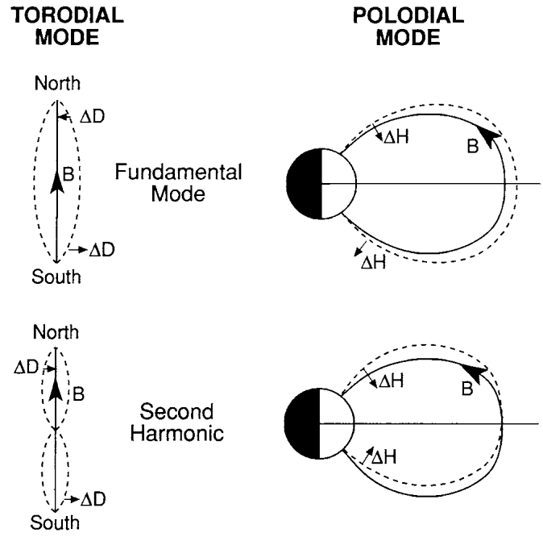
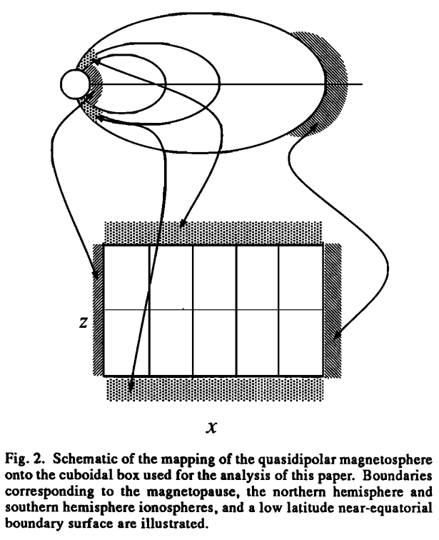
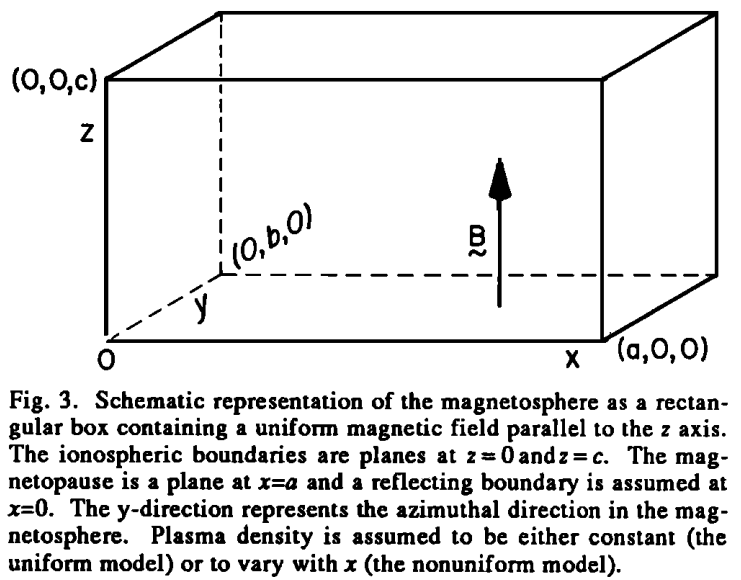
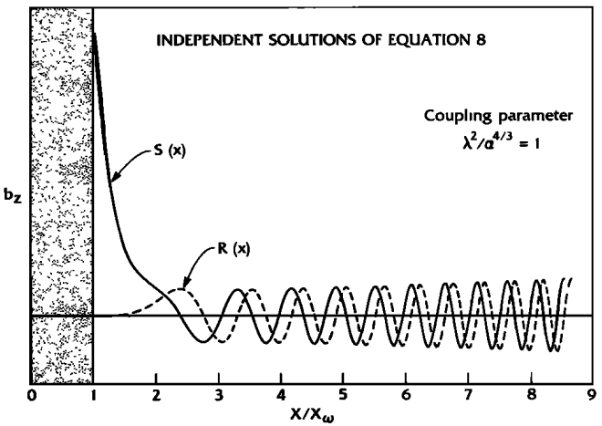
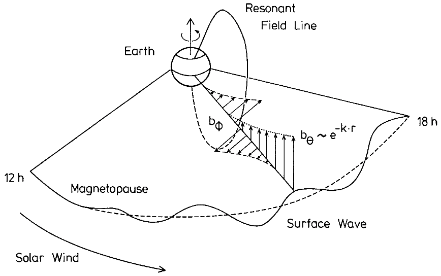
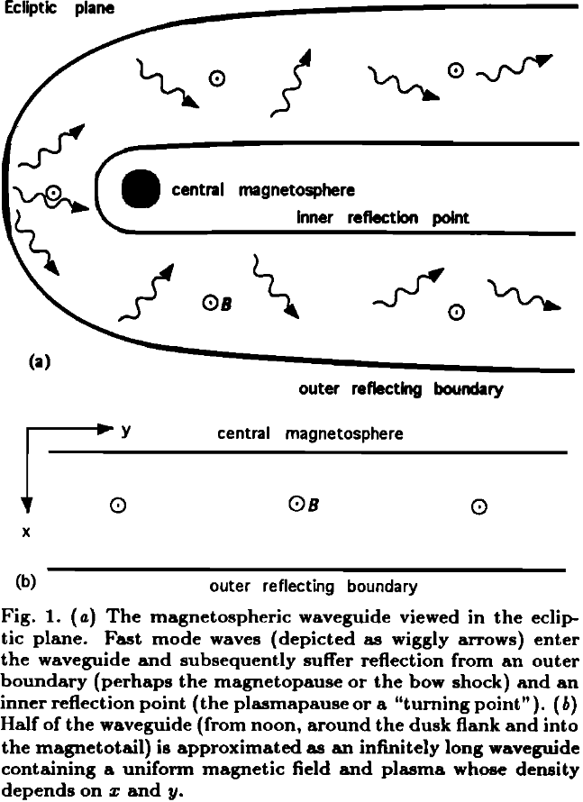

# 磁力线共振 {#sec-flr}

共振模耦合是空间等离子体中的主要物理过程之一，包括磁重联和无碰撞激波中的相关过程。磁力线共振描述的是 _非均匀等离子体中压缩快波与剪切阿尔芬波之间的共振相互作用_，例如地球磁层中的相互作用。Tsutomu Tamao 于 1961 年首次概述了这种共振模耦合的概念，后来又在其关于磁流体耦合共振的奠基性论文中加以讨论（Tamao, 1965）。John Samson 等（1971）的实验研究使共振模耦合成为目前行星磁层超低频（ULF）波研究的范式。可以把磁层想象成微波炉：我们不是用微波加热食物，而是用电磁波加热地球。

## 历史回顾

20 世纪 50 年代以前，人们没有考虑过空间中的驻波，因为当时假定那里是真空。太空时代刚刚开始，Dungey 就提出地磁场线上可以激发驻立阿尔芬波。

* 地面观测显示电磁波功率具有离散频率。在磁层中，阿尔芬速度通常约为 $\sim 1000\,\text{km/s}$，地磁脉动的典型周期为 10–600 s。因此典型波长为 $10^4-10^6\,\text{km}$，即 $1-100\,\text{R}_E$，与磁层本身的尺寸相当。显然均匀等离子体理论是不够的。
* 20 世纪 50 年代，人们认识到极向模和环向模的 MHD 波可以耦合；如果把这些模看作驻波，或许可以解释离散频率。然而，由于对磁层等离子体密度的估计不准，未能取得良好的一致性。
* 20 世纪 60 年代，[Sugiura 1961] 表明同一磁力线两端可以同时观测到波，说明波受到导引。[Nagata+ 1963] 表明共轭点处的脉动可以逐周期对应。比较相位可以推断驻波可能的谐波。[Patel 1965] 根据 Explorer 12 磁强计数据报告发现空间中的横向波和压缩波，它们与地面测量相关，证实了观测到的是同一波动。[Cummings+ 1969] 展示了持续时间长且频繁出现的波，并将其周期与极向模和环向模方程的数值结果进行了良好比较。
* 20 世纪 70 年代，人们提出了较简单的盒模型来解释磁力线共振。驻波的概念无法解释为什么只有某些磁力线优先受到激发（其足点靠近磁纬 $70^\circ$）。在盒模型中，离散频率被看作反映磁层顶厚度性质的源，并具有优选的 KHI 增长率。
* 20 世纪 80 年代，人们提出腔体模型，将磁层视为腔体，从而把离散频率与本征模联系起来。
* 1985 年代，人们在腔体思想的基础上提出波导模型，以放宽方位方向上的约束。这可以解释许多地面观测到的离散频率、大振幅 Pc5 波，但卫星测量经常看到小振幅 Pc3/4 波。与由单一本征数（$k_z$）描述的磁力线共振不同，腔体模有三个本征数，分别对应沿磁力线（$k_z$）、绕地球的方位方向（$k_y$）以及磁层顶（或弓激波）与内部反射点之间的径向（$n$）的波长数。20 世纪 90 年代有人提出，如果最低阶模的频率例如为 2 mHz，那么在大约 10 mHz 以上，高阶模将数量众多且频率非常接近，考虑到它们自身的频宽和典型频谱的频率分辨率，可能无法在数据中分辨，而会表现为连续谱。作为连续谱，它们无法激发这个较高频段（对应 Pc3/4）的离散频率。波导模型或许只与 Pc5 脉动有关？

现在关键的问题是：观测到的 ULF 波的量子化数值从何而来 [Kivelson & Southwood, 1986]？研究者借鉴电离层无线电传播、激光聚变和等离子体物理中的思想，提出了 _腔体_ 和 _波导_ 这两个名称。对于下一节要讨论的盒模型，如果 z 方向边界完全反射，波场必须在 z 方向具有驻波结构，允许的平行波数是量子化的（$k_z = m\pi/c$，见 @eq-flr_xz_quantized）。如果边界具有弱吸收，平行波数是复数，但其实部仍如上所述量子化。如果在 y 方向施加周期边界条件，$y$ 方向的波数 $k_y$ 也需要量子化。

另一个问题：如果这些离散频率对应沿磁力线传播的驻波，那么在足点处（即地面测量位置）振幅应该最小？为什么仍然能够在地面观测到它？

## 理论

理论从线性化冷 MHD 方程 @eq-mhd_cold_e_wave 和 @eq-mhd_cold_b_wave 出发。

### 轴对称球坐标

首先，如 [@radoski1966] 所做，在球坐标 $(r,\theta,\phi)$ 中处理这个问题。

假设背景密度只依赖于径向距离，$\rho = \rho(r)$。在下面的分析中，扰动变量 $\mathbf{B}_1$、$\mathbf{E}$、$\mathbf{j}$ 和 $\mathbf{u}$ 均视为轴对称，即球坐标中的任意扰动函数均具有形式
$$
\mathbf{\delta} = \delta_r(r,\theta)\hat{r} + \delta_\theta(r,\theta)\hat{\theta} + \delta_\phi(r,\theta)\hat{\phi}
$$

在此对称性下，变量可分为两组独立的变量，分别称为 _环向_ 和 _极向_ 变量：

* 环向变量

 $B_{1\phi}, E_r, E_\theta, u_\phi, j_r, j_\theta;\, \nabla\cdot\mathbf{u} = \frac{1}{r\sin\theta}\frac{\partial u_\phi}{\partial \phi}\equiv 0$（不可压缩）

* 极向变量

$B_{1r}, B_{1\theta}, E_\phi, u_r, u_\theta, j_\phi ;\, \nabla\cdot\mathbf{E} = \frac{1}{r\sin\theta}\frac{\partial E_\phi}{\partial \phi}\equiv 0$

这两组变量最初根据磁场扰动方向命名。可以通过 Poynting 矢量 $\mathbf{S}$ 理解这两组变量。最简单的 MHD 欧姆定律约束电场 $\mathbf{E}$ 垂直于背景磁场 $\mathbf{B}_0$。对于环向模，$\mathbf{E}$ 位于子午面内，$B_{1\phi}$ 垂直于该平面，因此 $\mathbf{S}$ 沿磁力线方向。对于极向模，$\mathbf{S}$ 位于子午面内且平行于波矢 $\mathbf{k}$，因为
$$\mathbf{B}_1 = -i\mathbf{k}\times\mathbf{E}\Rightarrow \mathbf{S}\parallel\mathbf{E}\times\mathbf{B}_1 \parallel \mathbf{E}\times(\mathbf{k}\times\mathbf{E})=E^2\mathbf{k} - \cancel{(\mathbf{E}\cdot\mathbf{k})}\mathbf{E} \parallel \mathbf{k}
$$
对于横向电磁波（$\mathbf{E}\perp\mathbf{k}$）。因此环向模是阿尔芬模，其色散关系为 $\omega = V_A k \cos\theta$，$\mathbf{S} \parallel \mathbf{B}_0$；极向模是快模，其色散关系为 $\omega = V_A k$，$\mathbf{S} \parallel \mathbf{k}$。

澄清我早先的误解：_环向模并不是沿环向传播的_！同样，_极向模并不是沿极向传播的_。实际上，更常见的情况是快极向模沿方位方向传播，然后耦合到沿环境磁场方向传播的阿尔芬环向模，继而在地面被观测到。[@zong2017interaction] 中的 @tbl-toroidal-poloidal-ULF 总结了环向和极向驻立 ULF 波模的性质。

| ULF 模 | 磁场 | 电场 | 波数 |
|:--------:|:--------------:|:--------------:|:-----------:|
| 环向波 | 方位磁场 ($B_\phi$) | 径向电场 ($E_r$) | 小波数 m |
| 极向波 | 径向磁场 ($B_r$) | 方位电场 ($E_\phi$) | 大波数 m |
| 压缩极向波 | 平行磁场 ($B_\parallel$) | 方位电场 ($E_\phi$) | 大波数 m |

: 环向和极向驻立 ULF 波模的性质 {#tbl-toroidal-poloidal-ULF}

对于轴对称极向电场 $E_\phi \sim e^{i\omega t}$，@eq-mhd_cold_e_wave 变为（我还没有推导过这个！）
$$
B_0^2[\nabla^2 - (r^2 \sin^2\theta)^{-1}] E_\phi = -\mu_0 \rho \omega^2 E_\phi
$$

这就是解耦的极向波方程。对于偶极场，$B_0^2 = \frac{M^2(1+3\mu^2)}{r^6}$，其中 $M$ 是磁矩，$\mu = \cos\theta$ 是余纬。通过以下形式分离未知量，寻求 $E_\phi$ 的解：
$$
E_\phi = \sum_{l=1}^{\infty} f_l(r) P_l^m(\mu)
$$
其中 $P_l^m$ 是整数指标 $l$ 和 $m$ 的缔合 Legendre 函数。你可能会问为什么采用这种形式？这是基于经验和天赋的数学假设。采用这种表示后，极向波方程变为
$$
\sum_{l=1}^{\infty}[(1+3\mu^2)O_l + 2K^2] f_l P_l^m = 0
$$ {#eq-poloidal_spherical_assump}
其中 $K^2 = \frac{\mu_0 \rho}{2}\big( \frac{\omega^2 r^2}{M^2}\big)^2$（系数可能有误），$O_l$ 是球 Bessel 算符
$$
O_l = \frac{1}{r}\frac{\partial^2}{\partial r^2}r - \frac{l(l+1)}{r^2}
$$

（现在几乎超出了我的掌握范围。如果想完全理解这一点，我需要回头学习物理中的数学方程！！！）Legendre 多项式的特殊性质使我们可以将波动方程的解写为
$$
\sum_{s = 0,\pm 2} a_{l+s} O_{l+s} f_{l+s} + K^2 f_l = 0
$$ {#eq-poloidal_spherical_sol}
其中常系数为
$$
\begin{aligned}
a_{l+2} &= \frac{3(l+2)(l+3)}{2(2l+3)(2l+5)} \\
a_{l} &= \frac{5l(l+1)-6}{(2l-1)(2l+3)} \\
a_{l-2} &= \frac{3(l-2)(l-1)}{2(2l-3)(2l-1)}
\end{aligned}
$$

由 @eq-poloidal_spherical_sol 可知，相反宇称的径向振幅不耦合。由于 @eq-poloidal_spherical_assump 中只有 $l\ge 1$，存在两个基本的未知径向振幅：一个对应奇数 $l$，另一个对应偶数 $l$。

假设边界完全反射，因此 $E$ 的横向分量，即 $E_\theta$ 和 $E_\phi$，均为零。假设壁面刚性，因此 $u_r = 0$。由控制方程，$\mathbf{B}_1$ 的法向分量也为零。

按照 Radoski 的推导，环向波方程对我来说似乎太复杂了……

{#fig-flr-harmonics}

根据边界条件，两个反射点之间的磁力线长度 $l$ 必须是半波长 $\lambda$ 的整数倍，这意味着
$$
n\lambda = 2l,\quad n = 1,2,3,...
$$

由色散关系，利用平均阿尔芬速度 $<V_A>$，得到：
$$
\omega_n = <V_A> k = <V_A>\frac{2\pi}{\lambda} = \frac{n\pi<V_A>}{l}
$$

### 柱坐标

在柱坐标 $(r,\phi,z)$ 中，假设扰动具有 $e^{i(m\phi - \omega t)}$ 的形式，可以分离线性化方程（[@hughes1994] 我还没有推导过这个！），
$$
\Big[ \omega^2 \mu_0 \rho - \frac{1}{r}(\mathbf{B}_0\cdot\nabla)r^2(\mathbf{B}_0\cdot\nabla) \Big]\frac{u_\phi}{r} = \omega m \frac{\mathbf{B}_0\cdot\mathbf{B}_1}{r}
$$ {#eq-cylindrical_mhd_toroidal}

$$
\Big[\omega^2 \mu_0 \rho - rB^2 (\mathbf{B}_0\cdot\nabla)\frac{1}{r^2 B^2}(\mathbf{B}_0\cdot\nabla) \Big]rE_\phi = i\omega B^2 (\mathbf{B}_0\times\nabla)_\phi \Big( \frac{\mathbf{B}_0\cdot\mathbf{B}_1}{B^2} \Big)
$$ {#eq-cylindrical_mhd_poloidal}

$$
i\omega \mathbf{B}_0\cdot\mathbf{B}_1 = \frac{1}{r}(\mathbf{B}\times\nabla)_\phi (rE_\phi) - imB^2\frac{u_\phi}{r}
$$

前两个方程来自动量方程。$\mathbf{B}_0\cdot\nabla$ 是沿 $\mathbf{B}$ 方向的导数。这些波动方程由右侧依赖于 $\mathbf{B}_0\cdot\mathbf{B}_1$（即磁扰动的压缩分量）的项耦合。第三个方程来自法拉第定律和欧姆定律，它表明 $\mathbf{B}_0\cdot\mathbf{B}_1$、$E_\phi$ 和 $u_\phi$ 之间的关系，并使方程组闭合。由于横向色散关系只依赖于 $k_\parallel$，很容易把 @eq-cylindrical_mhd_toroidal 和 @eq-cylindrical_mhd_poloidal 的左侧看作准横向模振荡，右侧则看作具有压缩分量的快模所引起的耦合。当 $m\neq 0$ 时，环向模在 $\phi$ 方向的相位变化会导致磁场中的压缩扰动。环向和极向振荡的偏振不再正交，因而发生耦合。

如果 $m = 0$，@eq-cylindrical_mhd_toroidal 的右侧消失。此时左侧描述一个电场完全沿径向、磁场和速度扰动沿方位方向的模。磁 L 壳解耦，各壳独立地沿方位方向振荡。这就是阿尔芬型 _环向_ 模。如果 $m\rightarrow\infty$，为了使右侧保持有限，必须有 $\mathbf{B}_0\cdot\mathbf{B}_1\rightarrow0$，因此 @eq-cylindrical_mhd_poloidal 的右侧消失。此时 @eq-cylindrical_mhd_poloidal 描述一个 $\mathbf{E}$ 沿方位方向而 $\mathbf{u}$ 和 $\mathbf{b}$ 位于子午面内的模。这就是压缩型 _极向_ 模。

### 笛卡尔盒模型

最早的理论将冷理想 MHD 方程 @eq-mhd_cold_e_wave 或 @eq-mhd_cold_b_wave 写在球坐标或柱坐标中，不容易求解。我们将看到，磁力线共振（FLR）的本质可以在笛卡尔坐标中得到。我们将实际的日侧磁层简化为可以解析求解的模型；实际日侧磁层类似受压缩的偶极场。设想一条两个足点都连接到导电电离层的磁力线，可以将这条弯曲磁力线映射为沿 $z$ 延伸的直线。在 $x$ 方向，外边界是磁层顶，内边界是反射点（等离子体层顶或电离层）。$y$ 方向代表方位方向，因此在磁层前方它更接近 GSE/GSM 坐标中的 $y$ 方向，在两翼则更接近 $x$ 方向。如果 $y$ 方向长度有限（$b < \infty$），称为 _腔体_；如果 $y$ 方向长度无限（$b\rightarrow \infty$），称为 _波导_。腔体和波导的名称沿用了电动力学术语。示意图见 @fig-box-mapping 和 @fig-box-config。

{#fig-box-mapping}

{#fig-box-config}

沿 $z$ 方向，对闭合磁力线施加电离层边界条件 $u_x = u_y = B_{1z} = 0$。由于采用理想 MHD 假设，沿磁力线的电场 $E_z = 0$。在 $y$ 方向，或者为腔体模型施加周期边界条件，从而得到量子化波数 $k_y$，或者采用无限边界。在 $x$ 方向，外边界 $x_m$（磁层顶）和内边界 $x_t$（等离子体层顶）处的巨大 $V_A$ 梯度提供了边界。我们在 $x = x_t, x_m$ 处施加反射边界条件 $u_x = 0$。_$x$ 方向的非均匀性意味着只能考虑 $y$ 和 $z$ 方向的 Fourier 分量_。因此，利用以下试探形式寻找 $\propto \exp[i(k_y y + k_z z - \omega t)]$ 的波模：

$$
\begin{aligned}
\mathbf{k} &= (0, k_y, k_z) \\
\mathbf{E} &= (E_x(x), E_y(x), 0) e^{i(k_y y + k_z z - \omega t)} \\
\mathbf{B}_1 &= (B_{1x}, B_{1y}, B_{1z}) e^{i(k_y y + k_z z - \omega t)} \\
\mathbf{B}_0 &= B_z \hat{z} = B\hat{z} \\
\rho &= \rho(x) \\
\mathbf{u} &= \mathbf{u}_0 + \mathbf{u}_1 = \mathbf{u}_1
\end{aligned}
$$

线性化动量方程 @eq-mhd_cold 给出

$$
\begin{aligned}
\rho\Big(\frac{\partial\mathbf{u}}{\partial t} + \cancel{\mathbf{u}\cdot\nabla\mathbf{u}}\Big) &= \mathbf{j}\times\mathbf{B} \\
\rho\frac{\partial\mathbf{u}}{\partial t} &= \frac{1}{\mu_0}(\nabla\times\mathbf{B})\times\mathbf{B}
\end{aligned}
$$

分离相互垂直的 $x$ 和 $y$ 方向并作平面波分解，

$$
\begin{aligned}
-i\omega\rho\mu_0 u_x &= (\nabla\times\mathbf{B}_1)_y B_z - (\nabla\times\mathbf{B}_1)_z \cancel{B_y} \\
&= \Big(\frac{\partial B_{1x}}{\partial z} - \frac{\partial B_{1z}}{\partial x}\Big) B \\
&= -\frac{\partial}{\partial x}\Big( B B_{1z} \Big) + i k_z B B_{1x}
\end{aligned}
$$

$$
\begin{aligned}
-i\omega\rho\mu_0 u_y &= (\nabla\times\mathbf{B}_1)_z \cancel{B_x} - (\nabla\times\mathbf{B}_1)_x B_z \\
&= \Big(\frac{\partial B_{1y}}{\partial z} - \frac{\partial B_{1z}}{\partial y}\Big) B \\
&= k_z B B_{1y} - k_y B B_{1z}
\end{aligned}
$$

由广义欧姆定律的最简单形式 $\mathbf{E} = -\mathbf{u}_1 \times\mathbf{B}_0$，

$$
\begin{aligned}
E_x &= - u_y B \\
E_y &= - u_x B
\end{aligned}
$$

代入线性化动量方程，得到

$$
\begin{aligned}
-i \omega \rho \mu_0 \frac{E_y}{B} &= -\frac{\partial}{\partial x}\Big( B B_{1z} \Big) + i k_z B B_{1x} \\
\omega \rho \mu_0 \frac{E_x}{B} &= - k_y B B_{1z} + k_z B B_{1y}
\end{aligned}
$$ {#eq-flr_momentum}

由线性化法拉第定律 $\nabla\times\mathbf{E} = -\dot{\mathbf{B}_1}$，

$$
\begin{aligned}
-\frac{\partial E_y}{\partial z} &= -\dot{B_{1x}} \\
\frac{\partial E_x}{\partial z} &= -\dot{B_{1y}} \\
\frac{\partial E_y}{\partial x} - \frac{\partial E_x}{\partial y} &= -\dot{B_{1z}}
\end{aligned}
$$

$$
\begin{aligned}
B_{1x} &= \frac{1}{\omega}(- k_z E_y) \\
B_{1y} &= \frac{1}{\omega}(k_z E_x) \\
B_{1z} &= \frac{1}{\omega}\Big(-i\frac{\partial E_y}{\partial x} - k_y E_x\Big)
\end{aligned}
$$ {#eq-flr_faraday_linear}

将 @eq-flr_faraday_linear 代入 @eq-flr_momentum，得到

$$
\begin{aligned}
-i \omega \rho \mu_0 \frac{E_y}{B} = -\frac{\partial}{\partial x}\Big[ B  \frac{1}{\omega}\Big(-i\frac{\partial E_y}{\partial x} - k_y E_x\Big) \Big] + i k_z B \frac{-k_z}{\omega} E_y \\
-i \big( \omega^2 \rho \mu_0 / B^2 - k_z^2 \big)E_y = k_y \frac{\partial E_x}{\partial x} - i \frac{\partial^2 E_y}{\partial x^2}
\end{aligned}
$$

$$
\begin{aligned}
-i \omega \rho \mu_0 \frac{E_x}{B} = k_z B \frac{k_z}{\omega} E_x - k_y B \frac{1}{\omega}\Big(-i\frac{\partial E_y}{\partial x} - k_y E_x\Big) \\
\big( \omega^2 \rho \mu_0 / B^2 - k_y^2 - k_z^2 \big)E_x + i k_y\frac{\partial E_y}{\partial x} = 0
\end{aligned}
$$

令 $R^2 = \mu_0 \rho(x) \omega^2 / B^2 = \omega^2/V_A(x)^2$，得到

$$
\begin{aligned}
-i (R^2 - k_z^2)E_y = k_y \frac{\partial E_x}{\partial x} - i \frac{\partial^2 E_y}{\partial x^2} \\
(R^2 - k_y^2 -k_z^2)E_x + i k_y\frac{\partial E_y}{\partial x} = 0
\end{aligned}
$$ {#eq-flr_ex_ey}

从 @eq-flr_ex_ey 中消去 $E_x$，得到

$$
\frac{\partial^2}{\partial x^2}E_y - k_y^2 \frac{\partial}{\partial x}R^2(x)\frac{1}{(R^2 - k_z^2)(R^2 - k_z^2 - k_y^2)}\frac{\partial E_y}{\partial x} + (R^2 - k_z^2 - k_y^2)E_y = 0
$$ {#eq-flr_wave_ey}

由 @eq-flr_ex_ey 可以得到关于偏振的一个非常重要的观察结果 [@southwood1974some]：
$$
\frac{E_x}{E_y} = -\frac{ik_y}{R^2-k_y^2-k_z^2}\frac{\partial E_y}{\partial x}\frac{1}{E_y}
$$ {#eq-flr_polarization}

我们熟悉的快 MHD 波在 _非均匀等离子体中不再是线偏振的_！右侧的关键是它依赖于 $k_y$ 和 $\partial E_y/\partial x$ 的符号。对于沿相反方向传播的快波（即方位方向上向东和向西），随着 $k_y$ 在地方正午两侧变号，偏振旋向（右旋、左旋）也会改变。恰在满足 $R^2 - k_z^2 - k_y^2 = 0$ 的共振点，得到线偏振阿尔芬波。$\partial E_y/\partial x$ 在共振点两侧变号，因此在不同 L 壳（或磁纬）处的地面观测还会发现另一次偏振变化。

![高纬度观测到的 Pc5 波振幅和偏振旋向随纬度及磁地方时的变化。（据 [Samson +, 1974]。）](../../images/FLR_ground_Pc5_1974.png){#fig-flr-polarization}

@eq-flr_wave_ey 也可以写成磁场压缩分量 $B_{1z}$ 的二阶微分方程（见 @eq-perturb_b），如 [@kivelson1985resonant] 在提出腔体模概念时所做：
$$
\frac{\partial^2 B_{1z}}{\partial x^2} - \frac{ \frac{\partial R^2}{\partial x}}{R^2 - k_z^2}\frac{\partial B_{1z}}{\partial x} + ( R^2 - k_y^2 - k_z^2 ) B_{1z} = 0
$$
或者等价地，
$$
\frac{\partial^2 B_{1z}}{\partial x^2} - \frac{\omega^2 \partial V_A^{-2}/\partial x}{\omega^2/V_A^2 - k_z^2}\frac{\partial B_{1z}}{\partial x} + \Big( \frac{\omega^2}{V_A^2} - k_y^2 - k_z^2 \Big) B_{1z} = 0
$$ {#eq-flr_wave_bz}

先对 @eq-flr_wave_ey 建立一些直观认识（遵循 [@glassmeier1999]，但注意原论文中存在符号错误和错误方程！）。该方程第二项的分母中出现了强奇异性，大体如 Tamao（1965）最先描述的那样。可能有以下解。如果 $R^2 - k_z^2 - k_y^2 > 0$，由此得出 $R^2 - k_z^2 > 0$，则不出现奇点。假设 $k_y \approx 0$，上式简化为
$$
\frac{\partial^2}{\partial x^2}E_y + (R^2 - k_z^2)E_y = 0
$$

对于线性密度剖面，即 $R^2 = \alpha_0^2 + \alpha^2 x$，通过 $R^2 = k_z^2$ 定义转折点 $x_t$，并作变换 $s = \alpha^{2/3}(x-x_t)>0$，
$$
\begin{aligned}
\frac{\partial E_y}{\partial x} &= \frac{\partial E_y}{\partial(\alpha^{-2/3}s+x_t)} = \alpha^{2/3}\frac{\partial E_y}{\partial s} \\
\frac{\partial^2 E_y}{\partial x^2} &=  \alpha^{4/3}\frac{\partial^2 E_y}{\partial s^2}
\end{aligned}
$$

$$
\frac{\partial^2 E_y}{\partial s^2} + sE_y = 0
$$

这是 Airy 或 Stokes 方程（@sec-airy），其两个主要解显示在 @fig-airy-flr 中。解 $Bi(s)$ 不符合物理，因为它意味着 $E_y$ 在 $s=0$ 转折点之后无限增长。因此所需的解是 $E_y(s) = Ai(s)$。转折点实际上是波场发生全反射的点。可以从以下角度理解它的出现：$x$ 方向的“有效”局部波数为
$$
k_x^2(x, \omega) = \frac{\omega^2}{V_A^2(x)} - k_y^2 - k_z^2
$$ {#eq-flr_kx_effective}

如果 $V_A^2$ 随 $x$ 增大，也就是随 Airy 函数图中的 $s$ 增大，而 $\omega, k_y$ 和 $k_z$ 保持不变，则 $k_x^2$ 必须减小。最终 $k_x^2$ 可能变为负值，意味着波数 $k_x$ 是虚数。波将在这个转折点反射。

```jl
KeyNotes.plot_airy_minus_x()
```

接下来，如果 $R^2 - k_z^2 - k_y^2 < 0$，可能出现 $R^2 - k_z^2 = 0$。再次假设线性密度剖面，通过 $R^2 = k_z^2$ 定义共振点 $x_r$，并令 $s = x-x_r$，电场扰动在共振点 $x - x_r = 0$ 附近变为
$$
\frac{\partial^2 E_y}{\partial s^2} - \frac{1}{s}\frac{s_t}{s-s_t}\frac{\partial E_y}{\partial s} + \alpha^2(s-s_t) E_y = 0
$$ {#eq-flr_wave_ey_perturbation}
其中 $s_t = k_y^2/\alpha^2$。

在共振点，该解表现出明显的奇异性，$E_y$ 无限增长。在转折点前方 $s>s_t$，解类似 Airy 函数；而在转折点后方的共振点 $s=0$ 处观察到奇异行为。我没有展示这个解，因为我不知道怎么把它写出来！现在让我们遵循 [@kivelson1985resonant]，考察 $B_{1z}$ 的等价扰动方程 @eq-flr_wave_bz。

当我们也在 @eq-flr_wave_bz 中假设质量密度随 $x$ 线性变化，使得
$$
\begin{aligned}
R^2 - k_z^2 &= \alpha^2(x - x_r) \\
R^2 - k_z^2 - k_y^2 &= \alpha^2(x-x_t)
\end{aligned}
$$
其中 $x_r = k_z^2/\alpha^2$，$x_t = (k_z^2 + k_y^2)/\alpha^2 = x_r + k_y^2/\alpha^2$，得到
$$
\frac{\partial^2 B_{1z}}{\partial x^2} - \frac{1}{x-x_r}\frac{\partial B_{1z}}{\partial x} + \alpha^2(x-x_t)B_{1z} = 0
$$ {#eq-flr_bz_perturbation}

[-@kivelson1986coupling] 讨论了 @eq-flr_bz_perturbation 的解。满足 $x=x_r$ 和 $R^2=k_z^2$ 的奇点对应于波频率与阿尔芬模频率匹配的 _共振点_。满足 $x=x_t$ 和 $R^2=k_y^2 + k_z^2$ 的点是方程的 _转折点_。当 $x>x_t$ 时，方程描述的任何波均随 $x$ 振荡；当 $x<x_t$ 时，在共振奇点 $x_r$ 两侧，独立解随 $x$ 增长或消逝。

许多作者推导了在 $x=x_r$ 和 $x=x_t$ 附近有效的级数解。可以用求解偏微分方程的 Frobenius 方法寻找在 $x_r$ 附近有效的解，其中解析解具有形式
$$
R_t(x) = k_y^2(x-x_r)^2 + \mathcal{O}[(x-x_r)^4]
$$ {#eq-flr_bz_analytic}
而奇异解具有形式
$$
s_t(x) = 1 + \frac{1}{2}R_t(x)\ln(x_r - x) + \mathcal{O}[(x-x_r)^2]
$$ {#eq-flr_bz_singular}

对于 $k_y^2=\alpha^{4/3}$，$B_{1z}$ 的两个解如 @fig-flr-b1z-solutions 所示。在图的最右侧，两个函数在空间上接近正交相位，其零点间距随 $x$ 增大而减小。如后面将提到的，在此区域 WKB 近似很好，振幅和相位分别正比于 $s^{1/4}$ 和 $s^{3/2}$。图中的振幅经过选择，使得指定时间变化 $e^{-i\omega t}$ 时，从大 $x$ 处入射的波可表示为 $R_t(x)+iS_t(x)$。相应地，向大 $x$ 传播的模为 $R_t(x)-iS_t(x)$。因此 $R_t(x), S_t(x)$ 表示驻波形式。然而，共振的存在（在图的最左侧）使完全反射或完美驻波解不可能出现。

{#fig-flr-b1z-solutions}

```jl
@sco KeyNotes.plot_b1z_ode()
```

可以给出如下直观的物理解释。传播进入磁层的 MHD 波是快模波，例如由磁层顶的等离子体不稳定性产生。波最终到达转折点并发生反射。如果条件有利，即存在共振点，部分快模波能量可以隧穿至共振处，在那里快模扰动耦合为阿尔芬模扰动。共振点 _总是_ 位于转折点之后，但能量会隧穿到共振点，因此反射不是完全的。@fig-flr-schematic 示意了这一情形，其中假设反射点或转折点与磁层顶重合。最大耦合点或“共振模耦合”由 $\omega = k_\parallel V_A(x)$ 给出，其中 $\omega$ 是快模波频率，$k_\parallel$ 是快模波矢沿磁场方向的分量，$V_A(x)$ 是局部阿尔芬速度。这也是阿尔芬色散关系。

{#fig-flr-schematic}

@eq-flr_wave_bz 有着悠久的历史：如 [@kivelson1986coupling] 所述，它早在 1951 年就首次出现在无线电波斜入射到电子密度逐渐增大的区域这一问题中。它也出现在计算等离子体对激光能量的吸收，以及通过注入无线电波激发内部阿尔芬波来加热等离子体的问题中。能量在等离子体中对应控制微分方程 @eq-flr-wave-bz 或其等价方程奇点的位置被吸收。如果不在共振附近引入耗散或色散等额外效应，微分方程中的奇异性意味着阿尔芬波振幅会长期持续增长。

一些研究（例如 [@kivelson1986coupling, @wright1994]）倾向于用等离子体位移 $\pmb{\xi}$ 代替 $\mathbf{u}$，其中 $\mathbf{u} = \dot{\pmb{\xi}}$，并用扰动磁场分量 $B_{1z}$ 描述模型：
$$
\begin{aligned}
\frac{1}{V_A^2}\frac{\partial^2 \xi_x}{\partial t^2} - \frac{\partial \xi_x}{\partial z^2} &= -\frac{1}{B_0}\frac{\partial B_{1z}}{\partial x} \\
\frac{1}{V_A^2}\frac{\partial^2 \xi_y}{\partial t^2} - \frac{\partial \xi_y}{\partial z^2} &= -\frac{1}{B_0}\frac{\partial B_{1z}}{\partial y} \\
B_{1z} &= - B_0 \Big( \frac{\partial \xi_x}{\partial x} + \frac{\partial \xi_y}{\partial y} \Big)
\end{aligned}
$$ {#eq-flr_box_displacement_b1z}

这组方程等价于 @eq-mhd_cold_b_wave。前两个方程是动量方程的 $x$ 和 $y$ 分量，最后一个方程是磁场平流方程（法拉第定律 + 欧姆定律）。回顾一下，$B_{1z}$ 是环境磁场的压缩扰动，$\xi_y$ 对应于环向阿尔芬扰动 $u_y$。第二个方程右侧是快模的方位梯度 $\partial B_{1z}/\partial y$，它驱动方位位移 $\xi_y$ 的响应；左侧是简单谐振子，右侧是驱动项。由于我们寻找 $e^{i(k_y y + k_z z - \omega t)}$ 形式的解，可以看到：

* 如果快模的 $k_y=0$，则没有方位梯度驱动 FLR，因此没有波耦合；
* 如果 $k_y \rightarrow \infty$，则 $\xi_y \rightarrow 0$，$\xi_x$ 描述一个解耦的极向阿尔芬波。
* 如果 $k_y \neq 0$ 或 $\infty$，各波模相互耦合，最初位于快模中的能量可以通过模转换，在局域磁力线上变为阿尔芬波能量。

__均匀密度和背景磁场__

令 $\rho = \text{const.}$，$V_A = \text{const.}$。由 @eq-flr_box_displacement_b1z，
$$
\begin{aligned}
\ddot{B_{1z}} &= - B_0 \Big( \frac{\partial \ddot{\xi_x}}{\partial x} + \frac{\partial \ddot{\xi_y}}{\partial y} \Big) = V_A^2 \Big( \frac{\partial^2}{\partial x^2} + \frac{\partial^2}{\partial y^2} + \frac{\partial^2}{\partial z^2} \Big) B_{1z} \\ &= V_A^2 \nabla^2 B_{1z}
\end{aligned}
$$

考虑形式为 $e^{\mathbf{k}\cdot\mathbf{r} - i\omega t}$ 的波导简正模，其中 $\mathbf{k} = (k_x, k_y, k_z)$。快模的色散关系为
$$
\omega^2 = V_A^2 (k_x^2 + k_y^2 + k_z^2)
$$ {#eq-flr_uniform_fast}

在无限介质中，这一关系给出无色散传播。由于我们主要关注沿波导的传播（即沿 $y$ 方向），将 $v_p$ 和 $v_g$ 定义为沿 $\hat{y}$ 的相速度和群速度。利用 @eq-flr_uniform_fast 得到
$$
\begin{aligned}
v_p &= \frac{\omega}{k_y} = \frac{k}{k_y}V_A \\
v_g &= \frac{\partial\omega}{\partial k_y} = \frac{k_y}{k}V_A
\end{aligned}
$$
由此得到熟悉的波导关系
$$
v_p v_g = V_A^2
$$ {#eq-flr_waveguide_relation}

剪切阿尔芬波沿磁力线方向具有相同的速度（因为等离子体是冷的）。然而，在波导中，$x$ 和 $z$ 方向的边界条件限制了波数的选择并引入色散。假设 $x$ 方向边界完全反射（例如 $\xi_x = \frac{\partial B_{1z}}{\partial y} = 0$），$z$ 方向边界也完全反射（$\xi_x = \xi_y = B_{1z} = 0$），后者代表闭合磁力线的电离层边界。那么
$$
\begin{aligned}
k_x &= \pm n \pi / a,\, &n = 1,2,3... \\
k_z &= \pm m \pi / c,\, &m = 1,2,3...
\end{aligned}
$$ {#eq-flr_xz_quantized}
其中 $a$ 是盒子在 x 方向的长度，$c$ 是盒子在 z 方向的长度（即磁力线长度）。

给定 $k_x$ 和 $k_z$，可以用 @eq-flr_uniform_fast 求出 $k_y$ 作为 $\omega$ 的函数，
$$
k_y^2 = \frac{\omega^2}{V_A^2} - k_x^2 - k_y^2
$$

如果 $k_y$ 是实数，该模可以沿波导传播。然而，如果认为 $x = x_m = a$ 处的边界不是反射边界，而是受驱动的边界，那么适合沿外边界指定波数 $k_y$，并在给定 $k_z$ 时求解 $k_x$。磁层顶受到 Kelvin-Helmholtz 不稳定性驱动时就是这种情况（即 $k_y$ 由表面波给出）；20 世纪 70 年代曾提出它是磁力线共振的驱动源。在这种情况下，求得的 $k_x$ 是虚数，该模在 $x$ 方向消逝（指数衰减）。

__非均匀密度和磁场__

在这种情况下，最简单的假设是 $\rho = \rho(x)$、$\mathbf{B}_0 = B_0\hat{z}$，并且阿尔芬速度 $V_A$ 随 $x$ 单调递减，$\partial V_A / \partial x < 0$。于是再次得到 @eq-flr_wave_bz。对给定的 $x$ 方向边界条件求解该方程，得到一组正交本征函数 $B_{1z}(x)$ 和本征频率。

首先注意，在 $x_r$ 处出现奇点／共振，其中
$$
\omega^2 = k_z^2 V_A^2(x_r)
$$ {#eq-flr_resonance_dispersion}

跨过 $x_r$ 时，扰动项将发生 $180^\circ$ 相移（@eq-flr_polarization）。在共振点，能量从快模转移至阿尔芬模并被吸收。必须存在耗散，否则阿尔芬波的振幅会长期持续增长。共振磁力线附近的电离层耗散可能是限制共振振幅增长的一个重要过程。

其次，存在通过 $k_x^2 = 0$ 定义的转折点 $x_t$（固定 $k_y, k_z, \omega$）：
$$
\omega^2 = (k_y^2 + k_z^2)V_A^2(x_t)
$$ {#eq-flr_turning_dispersion}

在 $x_t$ 右侧，正指数表示沿 $x$ 正方向向磁层顶传播的波，负指数表示远离磁层顶传播的波。这类似于不完全驻波解。跨过 $x_t$ 到左侧后，振荡解转变为一个衰减解和一个指数增长解（@sec-airy）。

如果阿尔芬速度 $V_A$ 随 $x$ 单调递减，由 @eq-flr_resonance_dispersion 和 @eq-flr_turning_dispersion 总有 $0 < x_r < x_t < x_m$。在低阿尔芬速度区域 $[x_t, x_m]$ 中快模可以传播，而在高阿尔芬速度区域 $[0, x_t]$ 中快模是消逝的。因此共振奇点 $x_r$ 位于快模的消逝尾部中。

@eq-flr_wave_bz 中的一阶导数项在 $x=x_r$ 附近占主导，但在传播区间 $[x_t, x_m]$ 内很小。在 WKB 极限（@sec-WKB）下尤其如此，此时考虑 $x$ 方向波长较短的波，即二阶导数项远大于一阶导数项。在最低阶 WKB 分析中，可以忽略一阶导数并求解
$$
\frac{\partial^2 B_{1z}}{\partial x^2} + \Big( \frac{\omega^2}{V_A^2} - k_y^2 - k_z^2 \Big) B_{1z} = 0
$$ {#eq-flr_wave_bz_wkb}
WKB 解的形式为
$$
B_{1z}(x) = A k_x^{-1/2} e^{i\int k_x dx} + B k_x^{-1/2}e^{-i\int k_x dx}
$$
其中 $A$ 和 $B$ 是常数，$k_x$ 是 @eq-flr_kx_effective 中定义的“有效”波数，是 $x$ 的显函数。

准驻波在 $x_t$ 和 $x_m$ 之间必须满足的 Bohr-Sommerfeld 条件（或相位积分条件，@sec-stokes_application）为
$$
\int_{x_t}^{x_m} k_x(x,\omega_n) dx = (n+\alpha)\pi\qquad n = 1,2,3...
$$ {#eq-cavity_eigen_wkb}
其中 $x_m = a$ 是 $x$ 方向外边界的位置，相位因子 $\alpha$ 由 $x$ 方向的边界条件确定。对于 $a$ 处的完全反射边界（$\xi_x=0$）以及小 x 处的消逝衰减，得到 $\alpha = -1/4$。如果波导中存在共振，它会修正 $\alpha$；然而，由于共振位于消逝尾部，$\alpha$ 不会发生主导阶变化。

@eq-cavity_eigen_wkb 是快模本征频率的积分关系：指定 $k_y$、$k_z$ 和 $n$（x 方向的模数），然后找到满足该条件的频率，作为第 n 个本征频率 $\omega_n$。计算出 $\omega_n$ 后，便可以由 @eq-flr_resonance_dispersion 计算受激磁力线的位置 $x_r$。这些是最容易观测到的离散模。

{#fig-flr-wright}

![引自 [@samson1992field]。](../../images/FLR_waveguides_Samson.png){#fig-flr-samson}

__受驱动的 FLR、腔体模与波导模的比较__

表面波驱动 FLR 的解释似乎合理。然而，这一假设面临的最大问题是，映射到磁层顶的相速度与原位测量相比过高。此外，尽管 ISEE 1 和 2 多次穿越磁层顶，却没有观测到与 Kelvin-Helmholtz 波对应的磁层顶规则振荡。这两个事实表明，我们应当为驱动源寻找新的解释。

20 世纪 80 年代，人们提出腔体模和波导模，以消除对受驱动 FLR 的限制。将磁层类比为腔体早于将其类比为波导。在腔体模型中，方位方向 $\phi$ 或盒模型中的 $y$ 方向是有限的，波数 $k_y$ 由给定尺度 $b$ 确定。在轴对称柱坐标 $(r,\phi,z)$ 中，其中 $\phi$ 是方位角，$z$ 是沿磁力线的坐标，场具有形式 $\sim e^{im\phi},\, m=0,1,2$。\footnote{$E(\phi=0)=E(\phi=2\pi)$} 这是该理论的弱点，因为磁层远非轴对称，也没有其他明显边界来定义腔体。如果系统类似波导，那么 $k_y$ 可以取连续值，波导允许宽频带传播。

如果改用波导模型，方位方向（或 $y$ 方向）不施加边界条件。
理论上，连续谱的波模 $k_y$ 可以激发 FLR，离散共振频率由 Bohr-Sommerfeld 条件 @eq-cavity_eigen_wkb 确定，其中环向和极向谐波由 $k_z$ 给出。快波导模的离散频谱适合驱动一系列阿尔芬共振；然而，模的连续频谱是否能够驱动离散频率处的共振并不明显。一个使波导模解释更有说服力的关键观察结果是 _只有小的 $k_y$ 对共振有贡献_。（[@walker1992spatial]、[Wright 1992]、[@wright1994]）。如果 $k_y$ 不固定（但 $k_z$ 固定），那么 @eq-cavity_eigen_wkb 就是波导的色散关系，将 $\omega$ 表示为 $k_y$ 的函数。阿尔芬速度强烈依赖于 L 壳，典型标度为 $\sim L^{-3}$。因此，如果转折点 $x_t$ 位于磁层内部足够深的地方，则满足 $\omega^2/V_A^2 \gg k_y^2 + k_z^2$ 的范围对积分 @eq-cavity_eigen_wkb 的贡献最大。结果是在很宽的波长范围内，频率对 $k_y$ 非常不敏感。只有当 $k_y$ 相当大时才不是如此，此时转折点接近磁层顶，波不会深入磁层。每个波导模具有相速度 $\omega/k_y$ 和群速度 $\mathrm{d}\omega/dk_y$。由于 @eq-cavity_eigen_wkb 将 $\omega$ 定义为 $k_y$ 的函数，可以将 @eq-flr_kx_effective 代入 @eq-cavity_eigen_wkb 并对 $k_y$ 求导（假设 $\alpha$ 为常数）：
$$
\begin{aligned}
\frac{\partial}{\partial k_y}\int_{x_t}^{x_m}\Big(\frac{\omega^2}{V_A(x)^2}-k_y^2 - k_z^2\Big)^{1/2}dx = 0 \\
\int_{x_t}^{x_m}\frac{1}{2}k_x^{-1}\Big( \frac{1}{V_A^2}\frac{\partial \omega^2}{\partial k_y} - 2k_y \Big)dx = 0 \\
\frac{\omega}{k_y}\frac{\partial\omega}{\partial k_y}\int_{x_t}^{x_m}k_x^{-1}V_A^{-2}dx = \int_{x_t}^{x_m} k_x^{-1}dx
\end{aligned}
$$

$$
v_p v_g \equiv \frac{\omega}{k_y}\frac{\mathrm{d}\omega}{dk_y} = \frac{\int_{x_t}^{x_m}k_x^{-1}dx}{\int_{x_t}^{x_m}V_A^{-2}k_x^{-1}dx}
$$

右侧是以 $k_x^{-1}$ 为权重函数的 $V_A^{-2}$ 加权平均值的倒数。因此可以写为
$$
v_p v_g = \left<V_A^{-2}\right>^{-1}
$$ {#eq-flr_waveguide_relation_modified}

在充满阿尔芬速度为 $V_A$ 的等离子体的均匀波导中，可以恢复著名的波导关系 @eq-flr_waveguide_relation。在阿尔芬速度并非在整个波导中恒定的更复杂情况下，@eq-flr_waveguide_relation_modified 的右侧是适当加权的 $V_A^{-2}$ 平均值。一般而言，相速度 $v_p$ 远大于波导内的平均阿尔芬速度，群速度 $v_g$ 则远小于它。这也与 $\omega$ 对 $k_y$ 的弱依赖、因而 $v_g$ 很小的结果一致。其结果是，即使波导两端开放，能量沿波导传播所需的时间也比振荡周期长。

因此，波导模型提出了如下解释。太阳风中的扰动沿磁层顶运动，在边界上产生以速度 $v_w$ 向磁尾传播的扰动。通常 $v_w \gg V_A$。这种扰动很可能激发相速度等于 $v_w$ 的波导模。由于这些模的频率对 $k_y$ 非常不敏感，无论速度如何，都会激发相同的频率（由 $x$ 和 $z$ 方向的本征模确定）。与波一起运动的扰动可以持续向波输入能量。这要求
$$
k_y = \frac{\omega}{v_w}
$$
即，_方位波数由源的速度决定，而不是由 $y$ 方向的边界条件决定_。
因此，无须依赖腔体模型的共振模，就得到了离散波数值和离散快模频谱。

这种扰动可能来自不止一种源。如果它来自太阳风中的脉冲，则预期波导响应是在其各模的固有频率上振铃，增长时间尺度为建立该模所需的时间，衰减时间尺度则由向共振泄漏及在电离层或其他地方的损失决定。另一种可能是波导模由 Kelvin-Helmholtz 不稳定性激发。在这种情况下，可以预期所有波导模都会被持续激发，并且只要太阳风速度和磁层顶特性保持不变，就会持续受到驱动。

## 能量分析

???

非导引快模横跨背景磁场带入磁层的能量以导引阿尔芬波的形式积累在共振模耦合平面内（即 @fig-box-config 中通过 $x_r$ 的 y–z 平面）。正是非导引模与导引模之间的共振模耦合所造成的这种局域能量积累构成了磁力线共振。这种波能积累可以描述为
$$
\frac{\partial w}{\partial t} + \nabla\cdot\mathbf{S} = -h
$$
其中 $w$ 是波能密度，$\mathbf{S}$ 是 Poynting 通量，$h$ 是耗散项，描述例如电离层焦耳加热造成的能量损失。由于背景参数只沿径向变化，该方程简化为
$$
\frac{\partial w}{\partial t} = -\frac{\mathrm{d}}{\mathrm{d}r}S_x - h
$$

沿径向对耦合区的宽度积分，得到以下速率方程：
$$
\frac{\partial W}{\partial t} = c_e S_{ng} - S_h^{\text{off}} - H
$$
其中 $W$ 是耦合过程中积累的单位面积能量，$c_e$ 是耦合效率，$S_{ng}$ 是非导引模的入射 Poynting 通量，$S_g^{\text{off}}$ 是非导引模所耦合到的模的 Poynting 通量“偏离导引方向”分量。加入 $S_g^{\text{off}}$ 项可以考虑耦合到非严格导引模所造成的能量损失。耦合波模具有有限的偏离导引方向分量时，能量积累效率会降低，甚至可能阻止共振建立。如果耦合波的横向尺度变得足够小，使有限离子回旋半径或有限电子惯性变得重要，就可能出现这样的分量。此时耦合模是 _动理学阿尔芬模_。参数 $c_e$ 表示耦合效率，即非导引模能量中转换为导引模的比例。最后，$H$ 给出沿 $x$ 方向积分的耗散损失。

现在考察理想 MHD 区域中的速率方程是有启发性的。由于阿尔芬模是严格导引的模，其 Poynting 通量恰好平行于背景磁场。换言之，$S_h^{\text{off}}=0$，方程变为
$$
\frac{\partial W}{\partial t} = c_e S_{\text{fast}}
$$
其中 $S_{\text{fast}} = S_{ng}$ 是非导引 MHD 模的 Poynting 通量。因此，由于没有向外的能量输运来平衡入射的快模 Poynting 通量，耦合区的能量密度持续增长。不过，电离层焦耳加热提供了显著的耗散机制，H 限制了能量密度。

共振模耦合只是发生磁力线共振的 _必要_ 条件。_充分_ 条件是与严格导引模发生临界耦合，且耗散缺失到足以使共振获得足够能量的程度。

## 非 MHD 效应 {#sec-flr-nonMHD}

如前面各节所示，使用冷流体方法可以简单地理解波吸收的某些特征。在冷等离子体描述中，阿尔芬共振是压缩波方程 @eq-flr_wave_bz 的一个奇点。可以通过绕过阿尔芬共振奇点进行解析延拓来求解压缩波方程；此时共振处存在 Poynting 通量损失，波能转换为阿尔芬波。另一种方法是对模转换过程进行动理学描述，其中涉及两个传播模，即压缩波和具有色散的动理学阿尔芬波；二者在共振位置附近耦合，能量从前者转换到后者。如果进一步考虑热等离子体，随着温度升高，_多普勒频移_ 会展宽共振，使耦合区更加延展。因此，计入有限温度和 KAW 中的 $E_\parallel$ 可以消除冷流体模型中的奇点，阿尔芬共振吸收的能量表现为共振附近的电子加热。

回顾一下，对于背景等离子体参数沿垂直于磁场方向具有一维非均匀性的等离子体，线性化 MHD 方程可以写成关于 $\delta p_1 = B_0\delta B_\parallel + \delta p$ 和 $\delta B_\perp$ 的耦合方程组
$$
-i k_\parallel\left( 1-\frac{k_\parallel^2 c_s^2}{\omega^2} \right) \delta p_1 = \left( 1+\frac{c_s^2}{v_A^2}-\frac{k_\parallel^2 c_s^2}{\omega^2} \right) B_0^2 \nabla_\perp\cdot\left( \frac{\delta \mathbf{B}_\perp}{B_0} \right)
$$ {#eq-mhd-1d-inhomogeneous-P-Bperp1}
以及
$$
\left( \omega^2 - k_\parallel^2 V_A^2 \right) B_0 \delta\mathbf{B}_\perp = ik_\parallel v_A^2 \nabla_\perp \delta p_1
$$ {#eq-mhd-1d-inhomogeneous-P-Bperp2}

在更高频率的情况下，阿尔芬共振条件 @eq-flr_resonance_dispersion 修正为
$$
\omega^2 = k_\parallel^2 V_A^2(1-\omega^2/\omega_{ci}^2)^2
$$ {#eq-alfven-resonance-2fluid}
这是由于有限离子拉莫尔半径效应 [Stix, 1992]。

计入电子惯性或离子拉莫尔半径修正等非 MHD 效应，可以消除阿尔芬共振奇点。[^nonMHD-resonance]

利用双流体理论，可以将 @eq-mhd-1d-inhomogeneous-P-Bperp2 替换为
$$
\left[ \omega^2(1-\lambda_e^2\nabla_\perp^2) -k_\parallel^2 v_A^2(1-r_{Ls}^2\nabla_\perp^2) \right] B_0\delta B_\perp = ik_\parallel v_A^2\nabla_\perp \delta p_1
$$ {#eq-2fluid-1d-inhomogeneous-P-Bperp3}
这包含电子惯性效应，其中 $\lambda_e = c/\omega_{pe}$ 是等离子体趋肤深度或电子惯性长度；也包含 _离子声拉莫尔半径尺度_ $r_{Ls}^2= k_B T_E/m_i\Omega_i^2$ 上的电子压强效应。电子压强与电子惯性效应的相对重要性由 $r_{Ls}/\lambda_e$ 决定：如果 $r_{Ls}/\lambda_e = nk_B T_e/\mu_0 B^2 \sqrt{m_i/m_e} > 1$，则压强效应占主导，这发生在 $\beta_e / 2 > \sqrt{m_e/m_i} = 0.02$ 时。在磁层顶附近，电子惯性效应通常不重要，除非在 $k_\parallel \rightarrow 0$ 的位置，例如剪切磁场或磁重联几何构型中。

[^nonMHD-resonance]: 查阅 Lin、Hasegawa、Chen、Johnson 和 Cheng 的论文。

因此，通常考虑用离子动理学效应消除奇点，最终得到快波与满足色散关系 @eq-kaw_dispersion_ion_approxi 的动理学阿尔芬波之间的耦合。利用动理学理论，@eq-mhd-1d-inhomogeneous-P-Bperp2 可以修正为
$$
\left[ \omega^2 \hat{K}_1 - k_\parallel^2 v_A^2\left( 1+\frac{T_e}{T_i}\hat{K}_2 \right) \right] B_0\delta B_\perp = ik_\parallel v_A^2\nabla_\perp \delta p_1
$$ {#eq-kinetic-1d-inhomogeneous-P-Bperp}
其中
$$
\begin{aligned}
\hat{K}_1 = ??? \\
\hat{K}_2 = ???
\end{aligned}
$$

可以证明，在某些近似（Padé 近似和 $\zeta_e\ll 1$）下，@eq-kinetic-1d-inhomogeneous-P-Bperp 的左侧变成动理学阿尔芬波：
$$
k_\parallel^2 v_A^2 \left[ 1 + \left(1+\frac{T_e}{T_i}\right)k_\perp^2 r_{iL}^2 \right] = ik_\parallel v_A^2\nabla_\perp \delta p_1
$$ {#eq-1d-kaw}

当 $\zeta_i = \omega/\sqrt{2}k_\parallel v_{i,th} \sim 1$ 时，离子朗道阻尼可能很重要（从 Bellan 的书中我能感觉到这一点，但究竟是怎样的???）。

根据冷 MHD 理论，非零方位／y 波数是波耦合的必要条件（@eq-flr_box_displacement_b1z）。然而，如 [-@karney1979alfven] 最初指出的，有限频率效应可以消除 $k_y=0$ 时的解耦。能量吸收率可以表示为 $k_y$ 和 $k_z$ 的函数，因此即使 $k_y=0$，只要 $k_z l^2 (\omega/\Omega_i)\neq 0$（$l$ 是与 $\omega, v_A, \Omega_i$ 和 $k_z$ 有关的长度尺度），仍然可以发生能量吸收。

## 非线性效应

冷离子理论及其对有限 $k_\perp r_{iL}$ 的扩展预言，泵浦 KAW 可以通过参数不稳定性（@sec-parametric）非线性衰变为一个离子声模和一个低边带子 KAW。

## 三维 FLR
