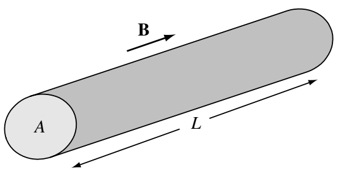
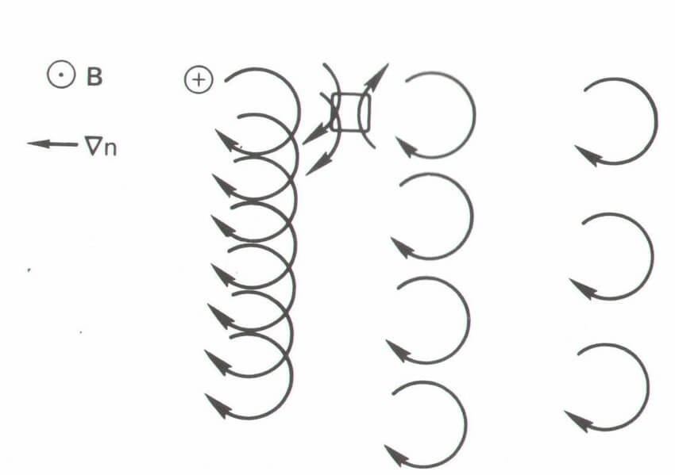
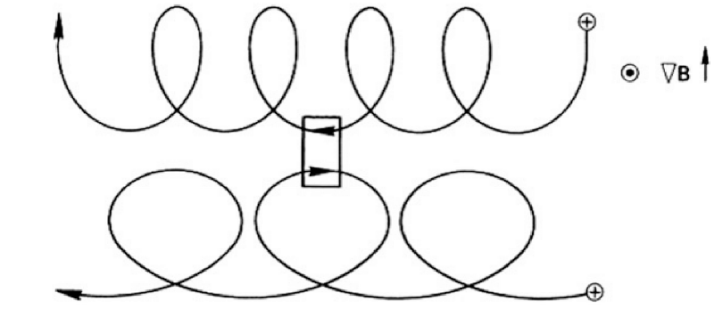
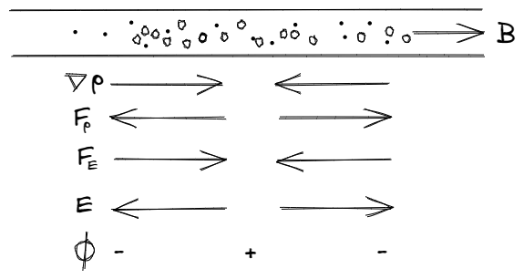

# 作为流体的等离子体 {#sec-fluid}

等离子体中的情况比单粒子轨道复杂得多；$\mathbf{E}$ 和 $\mathbf{B}$ 场并非预先给定，而是由电荷自身的位置和运动决定。我们必须求解一个自洽问题：找到一组粒子轨道和场分布，使得粒子沿这些轨道运动时产生这些场，而这些场又使粒子沿着恰好相同的轨道运动。而且这一切都必须在随时间变化的情况下完成。听起来很困难，但实际上并非如此。

我们已经看到，典型的等离子体密度可能为每 $\text{m}^3$ 有 $10^{18}$ 对离子–电子。如果每个粒子都沿复杂轨道运动，而且必须逐一追踪，那么预测等离子体行为将毫无希望。幸运的是，通常不必这样做，因为令人惊讶的是，真实实验中观察到的大多数等离子体现象——或许多达 80%——可以用一个相当粗略的模型解释。这就是流体力学中使用的模型：忽略单个粒子的身份，只考虑流体元的运动。当然，在等离子体中，流体含有电荷。在普通流体中，粒子之间频繁的碰撞使流体元中的粒子一起运动。这样的模型竟然适用于通常碰撞并不频繁的等离子体，令人惊讶。但我们将看到这是有原因的。

更精细的处理方法——等离子体动力学理论——需要更多数学计算。动力学理论的介绍见 @sec-kinetic。

在某些等离子体问题中，流体理论和动力学理论都不足以描述等离子体的行为。此时只能回到逐一追踪粒子轨道的繁琐过程。在即使动力学理论也远不能解释观察结果的情况下，穷举式计算机模拟可以在弥合理论与实验之间的差距方面发挥重要作用。

## 定义

| 变量 | 含义 |
|----------------|-------------------|
| $m_s$ | 质量 |
| $q_s$ | 电荷 |
| $n_s$ | 数密度 |
| $\rho_s$ | 质量密度 |
| $\sigma_s, \rho^\ast$ | 电荷密度（$=n_s q_s$） |
| $T_s$ | 温度 |
| $p_s$ | 标量压力 |
| $\mathbf{u}_s$ | 流动速度 |
| $\mathbf{J}_s$ | 电流密度（$=\rho_s^\ast \mathbf{u}_s$） |
| $e_s$ | 总能量密度（$=\frac{\rho_s\mathbf{u_s}^2}{2} + \frac{p_s}{\gamma - 1}$） |

其中 $s$ 表示粒子种类（例如 $\text{H}^+, \text{O}^+$）。不要将这里的 $\sigma$ 与电导率混淆。于是，不带下标的总量可写为
$$
\begin{aligned}
&n=\sum_s{n_s} \\
&\rho=\sum_{s}\rho_s=\sum_{s}{m_s n_s} \\
&p=\sum_s{p_s} \\
&T=\sum_s{\frac{n_s}{n}T_s} \\
&\mathbf{u}=\frac{1}{\rho}\sum_s \rho_s \mathbf{u}_s \\
&\mathbf{v}_s=\mathbf{u}_s -\mathbf{u},\quad \text{第 } s^{th} \text{ 种粒子的相对速度} \\
&\sigma = \sum_s{\sigma_s}=\sum_s{q_s n_s} \\
&\mathbf{J}=\sum_s{\mathbf{J}_s}=\sum_s{\sigma_s \mathbf{u}_s}=\sum_s{\sigma_s}\mathbf{v}_s+\mathbf{u}\sum_s{\sigma_s}=\sum_s{\sigma_s \mathbf{v}_s}+\sigma\mathbf{u}=\mathbf{J}_{cd}+ \mathbf{J}_{cv} \\
&\quad \text{其中 } \mathbf{J}_{cd}=\sum_s{\sigma_s}\mathbf{v}_s \text{ 是传导电流密度} \\
&\quad \quad \quad \quad\mathbf{J}_{cv}=\sigma \mathbf{u} \text{ 是对流电流密度} \\
&e=\frac{1}{\rho}\sum_s{\rho_s e_s} + e_f =\frac{\rho u^2}{2} + \frac{p}{\gamma - 1} + e_f \text{（动能 + 内能 + 场能）}
\end{aligned}
$$

其中 $\mathbf{v}_s$ 是第 $s$ 种粒子的相对速度，$\mathbf{J}_{cd}$ 是传导电流密度，$\mathbf{J}_{cv}$ 是对流电流密度，最后一式依次包含动能、内能和场能。

容易验证
$$
\sum_s{\rho_s\mathbf{v}_s}=0
$$

在本笔记中，我们尽量用 $\mathbf{v}$ 表示各粒子种类或单个粒子的速度，用 $\mathbf{u}$ 表示整体流动速度。

每种粒子有 5 个独立未知量：$n_j, \mathbf{u}_j, p_j$。压力可以用温度 $T_j$ 代替。此外，还有 6 个电磁场量：$\mathbf{B}, \mathbf{E}$。对于由离子和电子组成的双流体描述，总共有 $5*2+6=16$ 个未知量，因此需要 16 个方程来确定系统。

## 等离子体与普通电磁学的关系

### 麦克斯韦方程

在真空中：
$$
\begin{aligned}
\epsilon_0 \nabla\cdot\mathbf{E} &= \sigma \\
\nabla\times\mathbf{E} &= -\dot{\mathbf{B}} \\
\nabla\cdot\mathbf{B} &= 0 \\
\nabla\times\mathbf{B} &= \mu_0 (\mathbf{J}+\epsilon_0\dot{\mathbf{E}})
\end{aligned}
$$ {#eq-maxwell_vacuum}

在介质中：
$$
\begin{aligned}
\nabla\cdot\mathbf{D} &= \sigma \\
\nabla\times\mathbf{E} &= -\dot{\mathbf{B}} \\
\nabla\cdot\mathbf{B} &= 0 \\
\nabla\times\mathbf{H} &= \mathbf{J}+\dot{\mathbf{D}} \\
\mathbf{D} &= \epsilon\mathbf{E} \\
\mathbf{B} &= \mu\mathbf{H}
\end{aligned}
$$ {#eq-maxwell_medium}

$\sigma$ 和 $\mathbf{J}$ 表示“自由”电荷密度和电流密度。介质的极化和磁化所产生的“束缚”电荷密度和电流密度，已包含在通过 $\epsilon$ 和 $\mu$ 定义的 $\mathbf{D}$ 和 $\mathbf{H}$ 中。在等离子体中，构成等离子体的离子和电子相当于“束缚”电荷和电流。由于这些电荷的运动很复杂，试图将其影响归入 $\epsilon$ 和 $\mu$ 两个常数并不实际。因此，在等离子体物理中通常使用真空方程，其中 $\sigma$ 和 $\mathbf{J}$ 包含外部和内部的_全部_电荷及电流。

注意，在真空方程中我们使用了 $\mathbf{E}$ 和 $\mathbf{B}$，而非与其通过常数 $\epsilon_0$ 和 $\mu_0$ 关联的对应量 $\mathbf{D}$ 和 $\mathbf{H}$。这是因为力 $q\mathbf{E}$ 和 $\mathbf{J}\times\mathbf{B}$ 取决于 $\mathbf{E}$ 和 $\mathbf{B}$，而非 $\mathbf{D}$ 和 $\mathbf{H}$；只要处理真空方程，就没有必要引入后两个量。

### 磁性材料的经典处理

由于每个回旋粒子都有磁矩，合乎逻辑的做法似乎是将等离子体视为磁导率为 $\mu_m$ 的磁性材料。[^mu-notation] 为了了解实践中为什么_不_这样做，先回顾通常如何处理磁性材料。

[^mu-notation]: 我们给磁导率加上下标 m，以区别于绝热不变量 $\mu$。

例如，一块铁的铁磁畴具有磁矩 $\mu_i$，产生单位体积的整体磁化强度
$$
\mathbf{M} = \frac{1}{V}\sum_i\mu_i
$$
它的作用相当于束缚电流密度
$$
\mathbf{J}_b = \nabla\times\mathbf{M}
$$

在真空安培定律中，$\mathbf{J}$ 必须包括这一电流和“自由”电流，即外加电流 $\mathbf{J}_f$：
$$
\mu_0^{-1}\nabla\times\mathbf{B} = \mathbf{J}_f + \mathbf{J}_b + \epsilon_0 \dot{\mathbf{E}}
$$

我们希望通过将 $\mathbf{J}_b$ 包含在 $\mathbf{H}$ 的定义中，把方程写成简单形式
$$
\nabla\times\mathbf{H} = \mathbf{J}_f + \epsilon_0\dot{\mathbf{E}}
$$
为此可令
$$
\mathbf{H} = \mu_0^{-1}\mathbf{B} - \mathbf{M}
$$

为了得到 $\mathbf{B}$ 与 $\mathbf{H}$ 之间的简单关系，假设 $\mathbf{M}$ 与 $\mathbf{B}$ 或 $\mathbf{H}$ 成正比：
$$
\mathbf{M} = \chi_m \mathbf{H}
$$

常数 $\chi_m$ 是磁化率。于是有
$$
\mathbf{B} = \mu_0(1+\chi_m)\mathbf{H} \equiv \mu_m \mathbf{H}
$$

由于 $\mathbf{M}$ 与 $\mathbf{H}$ 之间存在线性关系，才可能得到 $\mathbf{B}$ 与 $\mathbf{H}$ 之间的这种简单关系。

在有磁场的等离子体中，每个粒子都具有磁矩 $\mu_\alpha$，而 $\mathbf{M}$ 是 1 $\text{m}^3$ 内所有这些 $\mu_\alpha$ 的和。但此时有
$$
\mu_\alpha = \frac{mv_{\perp\alpha}^2}{2B}\propto \frac{1}{B}\quad \mathbf{M}\propto \frac{1}{B}
$$

$\mathbf{M}$ 与 $\mathbf{H}$（或 $\mathbf{B}$）的关系不再是线性的，我们不能以常数 $\mu_m$ 写出 $\mathbf{B} = \mu_m\mathbf{H}$。因此，将等离子体视为磁性介质并无用处。

### 电介质的经典处理

单位体积的极化强度 $\mathbf{P}$ 是各个电偶极子的偶极矩 $\mathbf{p}_i$ 之和。它产生束缚电荷密度
$$
\sigma_b = -\nabla\cdot\mathbf{P}
$$ {#eq-bound_charge_polarization}

在真空方程中，必须同时计入束缚电荷和自由电荷：
$$
\epsilon_0\nabla\cdot\mathbf{E} = \sigma_f + \sigma_b
$$

我们希望通过将 $\sigma_b$ 包含在 $\mathbf{D}$ 的定义中，把方程写成简单形式
$$
\nabla\cdot\mathbf{D} = \sigma_f
$$
为此可令
$$
\mathbf{D} = \epsilon_0\mathbf{E} + \mathbf{P} \equiv \epsilon \mathbf{E}
$$

如果 $\mathbf{P}$ 与 $\mathbf{E}$ 线性正比，
$$
\mathbf{P} = \epsilon_0 \chi_e\mathbf{E}
$$
那么 $\epsilon$ 是常数，由下式给出：
$$
\epsilon = (1+\chi_e)\epsilon_0
$$

没有先验理由认为上述关系不能在等离子体中成立，因此可以尝试求出等离子体中 $\epsilon$ 的表达式。

### 等离子体的介电常数

我们在 @sec-time-varying_E 中看到，波动的 $\mathbf{E}$ 场会产生极化电流 $\mathbf{J}_p$。由连续性方程，这又会产生极化电荷：
$$
\frac{\partial \sigma_p}{\partial t} + \nabla\cdot\mathbf{J}_p = 0
$$

这相当于 @eq-bound_charge_polarization，不过如前所述，只有电场随时间变化时，等离子体中才会出现极化效应。由于我们有 $\mathbf{J}_p$ 的显式表达式，却没有 $\sigma_p$ 的显式表达式，使用安培定律更方便：
$$
\nabla\times\mathbf{B} = \mu_0(\mathbf{J}_f +\mathbf{J}_p + \epsilon\dot{\mathbf{E}})
$$

我们希望把它写成
$$
\nabla\times\mathbf{B} = \mu_0(\mathbf{J}_f + \epsilon\dot{\mathbf{E}})
$$

为此可令
$$
\epsilon = \epsilon_0 + \frac{j_p}{\dot{E}}
$$

由 $\mathbf{J}_p$ 的 @eq-polarization_current，得到
$$
\epsilon = \epsilon_0 + \frac{\rho}{B^2}\quad \text{或}\quad \epsilon_R\equiv \frac{\epsilon}{\epsilon_0} = 1+\frac{\mu_0\rho c^2}{B^2}
$$ {#eq-dielectric_constant_low-frequency}

这就是_横向运动的低频等离子体介电常数_。这些限定是必要的，因为我们的 $\mathbf{J}_p$ 表达式只适用于 $\omega^2\ll\omega_c^2$ 且 $\mathbf{E}$ 垂直于 $\mathbf{B}$ 的情况。当然，$\epsilon$ 的一般表达式非常复杂，几乎一页纸都写不下。

注意，当 $\rho\rightarrow 0$ 时，$\epsilon_R$ 趋于其真空值 1，正如它应该的那样。当 $B\rightarrow\infty$ 时，$\epsilon_R$ 也趋于 1。这是因为此时极化漂移 $\mathbf{v}_p$ 消失，粒子不会响应横向电场而运动。在普通实验室等离子体中，@eq-dielectric_constant_low-frequency 的第二项远大于 1。例如，如果 $n=10^{16}\,\text{m}^{-3}$ 且 $B=0.1\,\text{T}$，对于氢有
$$
\frac{\mu_0\rho c^2}{B^2} = \frac{(4\pi\times 10^{-7})(10^{16})(1.67\times 10^{-27})(3\times 10^8)^2}{(0.1)^2} = 189
$$

这意味着等离子体中粒子产生的电场会大幅改变外加场。具有较大 $\epsilon$ 的等离子体会屏蔽交变场，正如具有较小 $\lambda_D$ 的等离子体会屏蔽直流场一样。

## 流体方程

在 [@chen2016introduction] 中，这部分是在关于扩散的第 5.7 章介绍的，这有点奇怪。在 [@bellan2008fundamentals] 中，这部分是在第 2 章介绍的：先推导弗拉索夫方程，再进行简化，得到双流体和磁流体力学模型。

### 连续性方程

每种粒子的质量守恒积分形式为
$$
\frac{\mathrm{d}}{\mathrm{d}t}\int_V \rho_s dx^3=0
$$

物质守恒要求体积 V 中的粒子总数 $N_s$ 只能在粒子穿过该体积边界表面 S 存在净通量时发生变化。由于粒子通量密度为 $n_s\mathbf{u}_s$，根据散度定理有
$$
\frac{\partial N_s}{\partial t} = \int_V\frac{\partial n_s}{\partial t}dV = -\oint n\mathbf{u}_s\cdot \mathrm{d}\mathbf{S} = - \int_V \nabla\cdot(n_s\mathbf{u}_s)dV
$$

由于这对任意体积 V 都必须成立，被积函数必定相等：
$$
\frac{\partial n_s}{\partial t} + \nabla\cdot(n_s\mathbf{u}_s) = 0
$$ {#eq-continuity-species}

每种粒子都有一个这样的_连续性方程_。粒子的源或汇应加在右侧。

### 动量方程

麦克斯韦方程告诉我们，对于给定的等离子体状态，$\mathbf{E}$ 和 $\mathbf{B}$ 是什么。为了求解自洽问题，我们还需要一个给出等离子体对给定 $\mathbf{E}$ 和 $\mathbf{B}$ 响应的方程。在流体近似中，我们认为等离子体由两种或更多种相互贯穿的流体组成，每种粒子对应一种流体。在最简单的情况，即只有一种离子时，需要两个运动方程：一个对应带正电的离子流体，另一个对应带负电的电子流体。在部分电离的气体中，还需要一个中性原子流体的方程。中性流体仅通过碰撞与离子和电子相互作用。离子和电子流体由于各自产生的 $\mathbf{E}$ 和 $\mathbf{B}$ 场，即使没有碰撞也会相互作用。

单个粒子的运动方程为
$$
m\frac{\mathrm{d}\mathbf{v}}{\mathrm{d}t} = q(\mathbf{E}+\mathbf{v}\times\mathbf{B})
$$ {#eq-single_motion}

首先假设没有碰撞和热运动。于是流体元中的所有粒子一起运动，粒子的平均速度 $\mathbf{u}$ 与单个粒子的速度 $\mathbf{v}$ 相同。只需将 @eq-single_motion 乘以密度 $n$，即可得到流体方程：
$$
mn\frac{\mathrm{d}\mathbf{u}}{\mathrm{d}t} = qn(\mathbf{E}+\mathbf{u}\times\mathbf{B})
$$ {#eq-single_fluid1}

然而，这种形式使用起来并不方便。在 @eq-single_motion 中，时间导数是在_粒子的位置_求取的。另一方面，我们希望得到针对_空间中固定位置_的流体元的方程，因为否则处理起来不切实际。考虑一杯咖啡中的一滴奶油，将其视为流体元。搅拌咖啡时，这滴奶油变形成细丝，最终散布到整杯咖啡中，失去自身的形态。然而，杯中固定位置的流体元虽然不断有粒子进出，却保持其位置上的身份。

为了变换到固定参考系中的变量，考虑一维 x 空间中流体的任意性质 $\mathbf{G}(x,t)$。$\mathbf{G}$ 在_随流体运动的参考系中_随时间的变化是两项之和：
$$
\frac{\mathrm{d}\mathbf{G}(x,t)}{\mathrm{d}t} = \frac{\partial \mathbf{G}}{\partial t} + \frac{\partial \mathbf{G}}{\partial x}\frac{\partial x}{\partial t} = \frac{\partial \mathbf{G}}{\partial t} + u_x\frac{\partial \mathbf{G}}{\partial x}
$$

右侧第一项表示空间中固定点处 $\mathbf{G}$ 的变化，第二项表示观察者随流体进入 $\mathbf{G}$ 不同的区域时所看到的变化。在三维中，这推广为
$$
\frac{\mathrm{d}\mathbf{G}}{\mathrm{d}t} = \frac{\partial \mathbf{G}}{\partial t} + (\mathbf{u}\cdot\nabla)\mathbf{G}
$$

这称为_对流导数_（@eq-convective-derivative）。

对于等离子体，取 $\mathbf{G}$ 为流体速度 $\mathbf{u}$，将 @eq-single_fluid1 写为
$$
mn\Big[\frac{\partial\mathbf{u}}{\partial t} + (\mathbf{u}\cdot\nabla)\mathbf{u}\Big] = qn(\mathbf{E}+\mathbf{u}\times\mathbf{B})
$$

其中 $\partial\mathbf{u}/\partial t$ 是固定参考系中的时间导数。

**应力张量** --> 标量压力

$$
mn\Big[\frac{\partial\mathbf{u}}{\partial t} + (\mathbf{u}\cdot\nabla)\mathbf{u}\Big] = qn(\mathbf{E}+\mathbf{u}\times\mathbf{B}) - \nabla p
$$ {#eq-single_fluid2}

这里所展示的只是一个特例：通过 x 方向的运动传递 x 方向的动量；我们假设流体各向同性，因此相同的结果适用于 y 和 z 方向。但例如也可以通过 x 方向的运动传递 y 方向的动量。这种剪切应力不能用标量 $p$ 表示，而必须用张量 $\mathbf{P}$，即应力张量表示；其分量 $P_{ij}= mn\overline{v_i v_j}$ 同时指定运动方向和所涉及的动量分量。一般情况下，$\nabla p$ 项由 $-\nabla\cdot\mathbf{P}$ 代替。

当分布函数为各向同性的麦克斯韦分布时，$\mathbf{P}$ 写为
$$
\mathbf{P} = \begin{pmatrix}p & 0 & 0 \\ 0 & p & 0 \\ 0 & 0 & p\end{pmatrix}
$$

$-\nabla\cdot\mathbf{P} = \nabla p$。在磁场存在时，等离子体可以有两个温度 $T_\perp$ 和 $T_\parallel$。在这种情况下，存在两个压力 $T_\perp$ 和 $T_\parallel$。此时会有两个压力 $p_\perp = nk_B T_\perp$ 和 $p_\parallel = nk_B T_\parallel$。应力张量于是为
$$
\mathbf{P} = \begin{pmatrix}p_\perp & 0 & 0 \\ 0 & p_\perp & 0 \\ 0 & 0 & p_\parallel\end{pmatrix}
$$

其中第三行或第三列的坐标方向是 $\mathbf{B}$ 的方向。这仍是对角张量，表明在垂直于 $\mathbf{B}$ 的平面内各向同性。

在普通流体中，$\mathbf{P}$ 的非对角分量通常与黏性有关。粒子发生碰撞后，其平均速度方向与最后一次碰撞地点的流体速度 $\mathbf{u}$ 方向一致。这一动量在下一次碰撞时传递给另一个流体元。这倾向于使不同位置的 $\mathbf{u}$ 相等，由此产生的对剪切流动的阻力就是我们直观理解的黏性。平均自由程越长，动量传递得越远，黏性也越大。在等离子体中，即使没有碰撞，也会出现类似效应。粒子（特别是离子）的拉莫尔回旋使它们进入等离子体的不同区域，并倾向于使这些区域的流体速度相等。拉莫尔半径而非平均自由程决定了这种无碰撞黏性的尺度。它是一种_有限拉莫尔半径效应_，除碰撞黏性之外还会出现，并与非均匀 $\mathbf{E}$ 场中的 $\mathbf{v}_E$ 漂移密切相关（@eq-vE）。

#### 碰撞

如果存在中性气体，带电流体将通过碰撞与之交换动量。每次碰撞损失的动量与相对速度 $\mathbf{u}-\mathbf{u}_0$ 成正比，其中 $\mathbf{u}_0$ 是中性流体速度。如果平均碰撞间隔时间 $\tau$ 近似为常数，产生的力项可以粗略写为 $-mn(\mathbf{u}-\mathbf{u}_0)/\tau$。运动方程可以推广为包含各向异性压力和中性粒子碰撞：
$$
mn\Big[\frac{\partial\mathbf{u}}{\partial t} + (\mathbf{u}\cdot\nabla)\mathbf{u}\Big] = qn(\mathbf{E}+\mathbf{u}\times\mathbf{B}) - \nabla\cdot\overleftrightarrow{P} - \frac{mn(\mathbf{u}-\mathbf{u}_0)}{\tau}
$$ {#eq-momentum_single}

它也可以写为（包括压力项和其他力）
$$
\rho\frac{\mathrm{d}\mathbf{u}}{\mathrm{d}t}=(\rho^\ast \mathbf{E}+\mathbf{J}\times\mathbf{B})-\nabla\cdot\overleftrightarrow{P}+\mathbf{f}_n
$$

或者写为等价的守恒形式：
$$
\frac{\partial (\rho\mathbf{u})}{\partial t}+\nabla\cdot(\rho\mathbf{u}\mathbf{u})=(\rho^\ast \mathbf{E}+\mathbf{J}\times\mathbf{B})-\nabla\cdot\overleftrightarrow{P}+\mathbf{f}_n
$$

这里尚未计入带电粒子之间的碰撞；将在 sec-collision 中讨论，添加该节！

#### 与普通流体力学的比较

普通流体遵循纳维–斯托克斯方程

$$
\rho\Big[ \frac{\partial\mathbf{u}}{\partial t} + (\mathbf{u}\cdot\nabla)\mathbf{u} \Big] = -\nabla p + \rho\nu\nabla^2\mathbf{u}
$$ {#eq-navier_stokes}

除了没有电磁力和不同粒子种类之间的碰撞（因为只有一种粒子）之外，这与 @eq-momentum_single 相同。黏性项 $\rho\nu\nabla^2\mathbf{u}$ 中，$\nu$ 是运动黏性系数；在没有磁场时，该项正是 $\nabla\cdot\overleftrightarrow{P} - \nabla p$ 的碰撞部分。

@eq-navier_stokes 描述粒子间频繁碰撞的流体。另一方面，推导 @eq-momentum_single 时没有对碰撞率作出任何明确说明。既然这两个方程除 $\mathbf{E}$ 和 $\mathbf{B}$ 项外相同，@eq-momentum_single 真的可以描述一种等离子体粒子吗？答案是有条件的肯定，原因也会告诉我们流体理论的局限。这一点极需澄清——仍有相当多的人认为流体理论假定了碰撞，因此不相信磁流体力学可以用来描述等离子体。

在推导 @eq-momentum_single 时，我们实际上隐含地假设了存在大量碰撞。这个假设出现在应力张量的推导中（@sec-kinetic-fluid-moments），当时我们将速度分布取为麦克斯韦分布。这种分布一般由频繁碰撞产生。然而，这个假设仅用于对 $v^2$ 取平均。任何具有相同平均值的其他分布都会给出相同答案。因此，流体理论对偏离麦克斯韦分布并不十分敏感，但在某些情况下这些偏离很重要，此时必须使用动力学理论。

Irving Langmuir 的一项经验观察也支持流体理论。在使用以他的名字命名的静电探针时，Langmuir 发现电子分布函数比碰撞率所能解释的情况更接近麦克斯韦分布。这一现象称为_朗缪尔佯谬_，有时被归因于高频振荡。这一佯谬尚无令人满意的解决方法，但它似乎是等离子体物理中自然条件对我们有利的少数例子之一。

流体模型适用于等离子体的另一个原因是，磁场如果存在，在某种意义上可以起到碰撞的作用。当粒子受到例如 $\mathbf{E}$ 场的加速时，如果允许其自由流动，它的速度会不断增加。碰撞频繁时，粒子达到与 $\mathbf{E}$ 成正比的极限速度。例如，铜导线中的电子以速度 $\mathbf{v}=\mu\mathbf{E}$ 一起漂移，其中 $\mu$ 是迁移率。磁场也通过迫使粒子沿拉莫尔轨道回旋来限制自由流动。等离子体中的电子也以与 $\mathbf{E}$ 成正比的速度一起漂移，即 $\mathbf{v}_E=\mathbf{E}\times\mathbf{B}/B^2$。在这个意义上，无碰撞等离子体的行为类似于有碰撞流体。当然，粒子确实可以_沿_磁场自由流动，而流体图像并不特别适合描述该方向的运动。_对于垂直于 $\mathbf{B}$ 的运动，流体理论是很好的近似_。

### 状态方程

还需要一个关系来闭合方程组。完整的描述需要能量方程。然而，最简单的方法是使用联系 $p$ 和 $n$ 的热力学状态方程：
$$
p = C\rho^\gamma
$$ {#eq-eos_adiabatic}

其中 $C$ 是常数，$\gamma$ 是比热比 $C_p/C_\nu$。因此 $\nabla p$ 项由下式给出：
$$
\frac{\nabla p}{p} = \gamma \frac{\nabla n}{n}
$$ {#eq-eos_nabla_p}

对于等温压缩，有
$$
\nabla p = \nabla(nk_B T) = k_B T\nabla n
$$

因此显然 $\gamma=1$。对于绝热压缩，$k_B T$ 也会变化，使 $\gamma$ 的值大于 1。如果 $N$ 是自由度数，$\gamma$ 由下式给出：
$$
\gamma = (2+N)/N
$$

状态方程的有效性要求热流可以忽略，即热导率低。同样，这一条件在垂直于 $\mathbf{B}$ 的方向上比平行方向更容易成立。幸运的是，大多数基本现象都可以通过状态方程的粗略假设得到充分描述。

## 双流体模型 {#sec-2fluid}

除了弗拉索夫理论（@sec-kinetic），我们还可以使用更简单但同样强大的双流体模型，其中电子和离子被视为两种不同的流体。根据压力项的形式，可以得到五矩、六矩或十矩方程。

### 五矩

五矩指 $(\rho, \mathbf{u}, p)$。在绝热或等温假设下，可以不使用压力或能量方程，而用状态方程取代。为简单起见，令等离子体只有两种粒子：离子和电子；推广到更多种粒子很简单。此时电荷密度和电流密度为
$$
\begin{aligned}
\sigma &= n_i q_i + n_e q_e \\
\mathbf{J} &= n_i q_i \mathbf{v}_i + n_e q_e \mathbf{v}_e
\end{aligned}
$$

我们将忽略碰撞和黏性。完整方程组为：
$$
\begin{aligned}
\epsilon_0\nabla\cdot\mathbf{E} = n_i q_i + n_e q_e \\
\nabla\times\mathbf{E} = -\dot{\mathbf{B}} \\
\nabla\cdot\mathbf{B} = 0 \\
\mu_0^{-1}\nabla\times\mathbf{B} = n_i q_i \mathbf{u}_i + n_e q_e \mathbf{u}_e + \epsilon_0\dot{\mathbf{E}} \\
m_jn_j\Big[ \frac{\partial\mathbf{u}_j}{\partial t}+(\mathbf{u}_j\cdot\nabla)\mathbf{u}_j\Big] = q_j n_j (\mathbf{E}+\mathbf{u}_j\times\mathbf{B}) - \nabla p_j\quad j=i,e \\
\frac{\partial n_j}{\partial t} + \nabla\cdot(n_j\mathbf{u}_j) = 0\quad j=i,e \\
p_j = C_j n_j^\gamma\quad j=i,e
\end{aligned}
$$ {#eq-fluid_set}
其中 $C_j$ 是常数，$\gamma$ 是绝热指数，所用近似见 @tbl-eos-approx。

| 条件 | 状态方程 | 名称 |
|--------|-------------------|------|
| $v_\mathrm{ph} \gg v_{ts}$ | $p_s\sim n_s^\gamma$ | 绝热 |
| $v_\mathrm{ph} \ll v_{ts}$ | $p_s=n_s k_B T_s$, $T_s=\mathrm{const.}$ | 等温 |

: 状态方程近似。{#tbl-eos-approx}

有 16 个标量未知量：$n_i, n_e, p_i, p_e, \mathbf{u}_i, \mathbf{u}_e, \mathbf{E}$ 和 $\mathbf{B}$。如果将每个矢量方程算作三个标量方程，表面上共有 18 个标量方程。然而，两个麦克斯韦方程是多余的，因为其中两个方程可以由另外两个方程的散度得到。联立求解这组含 16 个未知量的 16 个方程，即可在流体近似下得到自洽的场和运动。

### 六矩

对于单原子气体，所有带电流体（以 $s$ 为下标）的六矩方程可写为：
$$
\begin{aligned}
\frac{\partial \rho_s}{\partial t} + \nabla\cdot(\rho_s\mathbf{u}_s) = 0 \\
\frac{\partial (\rho_s\mathbf{u}_s)}{\partial t} + \nabla\cdot\left[ \rho_s\mathbf{u}_s\mathbf{u}_s + p_{s\perp}\pmb{I} + (p_{s\parallel} - p_{s\perp})\hat{b}\hat{b} \right] = \frac{q_s}{m_s}\rho_s(\mathbf{E} + \mathbf{u}_s\times\mathbf{B}) \\
\frac{\partial p_{s\parallel}}{\partial t} + \nabla\cdot(p_{s\parallel}\mathbf{u}_s) = -2p_{s\parallel}\hat{b}\cdot(\hat{b}\cdot\nabla)\mathbf{u}_s \\
\frac{\partial p_{s\perp}}{\partial t} + \nabla\cdot(p_{s\perp}\mathbf{u}_s) = -p_{s\perp}(\nabla\cdot\mathbf{u}_s) + p_{s\perp}\hat{b}\cdot(\hat{b}\cdot\nabla)\mathbf{u}_s
\end{aligned}
$$ {#eq-6-moment-fluids}

@eq-6-moment-fluids 中的两个压力方程可以合并，得到平均压力 $p=(2p_\perp + p_\parallel)/3$ 的方程：
$$
\frac{\partial p_s}{\partial t} + \nabla\cdot(p_s\mathbf{u}_s) = (p_s - p_{s\parallel})\hat{b}\cdot(\hat{b}\cdot\nabla)\mathbf{u}_s - \left( p_s - \frac{p_{s\parallel}}{3} \right)\nabla\cdot\mathbf{u}_s
$$ {#eq-6-moment_average_p}

也可以求解每种粒子的流体力学能量密度 $e = \frac{\rho_s\mathbf{u}^2}{2} + \frac{p_s}{\gamma - 1}$：
$$
\frac{\partial e_s}{\partial t} + \nabla\cdot\left[ \mathbf{u}_s(e_s+p_s) + \mathbf{u}_s\cdot(p_{s\parallel} - p_{s\perp})\hat{b}\hat{b} \right] = \frac{q_s}{m_s}\rho_s \mathbf{u}_s\cdot\mathbf{E}
$$

这更接近守恒形式，有助于得到更好的激波跃迁条件。但要注意，平行压力方程仍在绝热假设下求解，因此不能正确捕捉非绝热加热。此外，能量密度中没有包含磁能，所以跃迁条件只是近似的（我认为这更多是数值方面的考虑）。一般来说，上述方程的右侧还可以有许多对应于重力、电荷交换、化学反应、碰撞等的源项。

电场 $\mathbf{E}$ 和磁场 $\mathbf{B}$ 由麦克斯韦方程得到：
$$
\begin{aligned}
\frac{\partial \mathbf{B}}{\partial t} + \nabla\times\mathbf{E} &= 0 \\
\frac{\partial \mathbf{E}}{\partial t} - c^2\nabla\times\mathbf{B} &= -c^2\mu_0\mathbf{J} \\
\nabla\cdot\mathbf{E} &= \frac{\rho_c}{\epsilon_0} \\
\nabla\cdot\mathbf{B} &= 0
\end{aligned}
$$
其中 $\rho_c = \sum_s (q_s/m_s)\rho_s$ 是总电荷密度，$\mathbf{J}=\sum_s(q_s/m_s)\rho_s\mathbf{u}_s$ 是电流密度。

最后两个方程是对初始条件的约束；在数值计算中不能保证它们始终成立。经典方法包括双曲或抛物清理，以及面心配置的 Yee 型网格。

### 五矩／十矩

[@wang2020exact]

* 每种粒子的连续性方程
$$
\frac{\partial(m_s n_s)}{\partial t} + \frac{\partial(m_sn_su_{j,s})}{\partial x_j} = 0
$$

* 每种粒子的动量方程
$$
n_s m_s\frac{\mathrm{d}\mathbf{u}_s}{\mathrm{d}t} = n_s q_s(\mathbf{E}+\mathbf{u}\times\mathbf{B}) - \nabla\cdot\overleftrightarrow{P}_s - \mathbf{R}_{s\alpha}
$$
或者用爱因斯坦记号表示，
$$
\begin{aligned}
\frac{\partial(m_s n_s u_{i,s})}{\partial t} = n_s q_s (E_i + \epsilon_{ijk}u_{j,s}B_k) -\frac{\partial \mathcal{P}_{ij,s}}{\partial x_j} - R_{i,s\alpha}
\end{aligned}
$$
其中 $\epsilon_{ijk}$ 是列维–奇维塔符号。各阶矩定义为
$$
\begin{aligned}
n_s(\mathbf{x}) &\equiv \int f_s \mathrm{d}\mathbf{v} \\
u_{i,s}(\mathbf{x}) &\equiv \frac{1}{n_s(\mathbf{x})}\int v_i f_s \mathrm{d}\mathbf{v} \\
\mathcal{P}_{ij,s}(\mathbf{x}) &\equiv m_s \int v_i v_j f_s \mathrm{d}\mathbf{v}
\end{aligned}
$$
其中 $f_s(\mathbf{x},\mathbf{v},t)$ 是相空间分布函数。为方便起见，下文省略下标 $s$。为完整起见，$\mathcal{P}_{ij}$ 与更熟悉的热压力张量
$$
P_{ij} \equiv m\int(v_i - u_i)(v_i - u_i)f\mathrm{d}\mathbf{v}
$$
之间的关系为
$$
\mathcal{P}_{ij} = P_{ij} + nm u_i u_j
$$

为简单起见，忽略黏性耗散等非理想效应。电场和磁场 $\mathbf{E}$ 与 $\mathbf{B}$ 根据麦克斯韦方程演化：
$$
\begin{aligned}
\frac{\partial\mathbf{B}}{\partial t} + \nabla\times\mathbf{E} = 0 \\
\frac{\partial\mathbf{E}}{\partial t} - c^2\nabla\times\mathbf{B} = -\frac{1}{\epsilon_0}\sum_s q_s n_s \mathbf{u}_s \\
\nabla\cdot\mathbf{B} = 0 \\
\nabla\cdot\mathbf{E} = \epsilon_0^{-1}\sum_s n_s q_s
\end{aligned}
$$
其中 $c=1/\sqrt(\mu_0\epsilon_0)$ 是光速。

为了闭合方程组，必须指定二阶矩 $\mathcal{P}_{ij}$ 或 $P_{ij}$。例如，冷流体闭合直接令 $P_{ij}=0$，而等温状态方程（EOS）假设温度为常数。或者，假设热通量为零且压力张量各向同性，可以对 $P_{ij} = p I_{ij}$ 写出绝热状态方程，
$$
\frac{\partial\mathcal{\epsilon}}{\partial t} + \nabla\cdot\left[ (p+\mathcal{\epsilon})\mathbf{u} \right] = nq\mathbf{u}\cdot\mathbf{E}
$$
其中
$$
\mathcal{\epsilon} \equiv \frac{p}{\gamma-1} + \frac{1}{2}mn\mathbf{u}^2
$$
是流体总能量（热能加动能），$\gamma$ 是绝热指数，对于完全电离的等离子体取 $5/3$。对于包含 $S$ 种粒子（$s=1,...,S$）的等离子体，这个系统是闭合的，共有 $5S+6$ 个方程，这里称为_五矩_模型。通过保留压力张量全部六个分量的演化方程，可以得到更一般的模型，即所谓的_十矩_模型：
$$
\frac{\mathcal{P}_{ij,s}}{\partial t} + \frac{\partial \mathcal{Q}_{ijm,s}}{\partial x_m} = n_sq_su_{i,s}E_j + \frac{q_s}{m_s}\epsilon_{iml}\mathcal{P}_{mj,s}B_l
$$ {#eq-ten-moment}
其中三阶矩
$$
\mathcal{Q}_{ijm,s}(\mathbf{x}) \equiv m_s\int v_i v_j v_m f_s\mathrm{d}\mathbf{v}
$$
与流体参考系中定义的热通量张量
$$
Q_{ijm} \equiv m\int (v_i-u_i)(v_j-u_j)(v_m-u_m)\mathrm{d}\mathbf{v}
$$
之间的关系为
$$
\mathcal{Q}_{ijm} = Q_{ijm} + u_i\mathcal{P}_{jm} - 2nm u_i u_j u_m
$$

同样，必须通过对热通量张量作某种近似来闭合这里的方程。另一种方法是纳入更高阶矩的演化方程，例如热通量张量的十个独立分量的演化方程。

理论上，在电子质量趋于零（$m_e \rightarrow 0$）和光速趋于无穷大（$c\rightarrow\infty$）的渐近极限下，多流体–麦克斯韦方程趋于霍尔磁流体力学（MHD）。双流体图像中的所有波和效应都被保留，例如光波、电子和离子惯性效应，包括离子回旋波和哨声波。特别是，通过适当设计热通量闭合，十矩模型可以类似回旋动理学模型，部分捕捉朗道阻尼等非局域动力学效应。

尽管多流体–麦克斯韦模型比磁流体力学等约化的渐近模型提供了更完整的等离子体描述，它们的使用却不那么频繁。原因是涉及快速的动力学尺度。保留电子惯性会引入等离子体频率和回旋时间尺度，而非中性会引入德拜长度的空间尺度。此外，当使用显式格式时，纳入位移电流意味着必须分辨电磁波。幸运的是，动力学尺度造成的限制_只通过动量方程、安培定律和压力方程中的非双曲源项引入_。因此，可以_单独精确更新源项_或_使用隐式算法_，从而消除这些限制（注意：BATSRUS 使用点隐式格式）。这允许采用更大的时间步长并显著加速计算，特别是在使用真实的电子／离子质量比时。光速约束仍然存在，但可以通过使用较小的光速值和／或对麦克斯韦方程使用子步进来大幅放宽。当然，隐式麦克斯韦求解器，或者达尔文近似[^darwin]等约化电磁方程组，也可以放宽时间步长限制。

[^darwin]: 达尔文近似通过忽略安培定律中的 $\partial\mathbf{E}\partial t$ 来忽略光波。

### 特征波速

五矩／六矩／十矩方程中最快的波速是光速 $c$。理论上，特征波速应当彼此一致，并在各向同性的五矩情形下退化为磁流体力学的结果。

然而，在数值计算中，在数值通量中使用 $c$ 会使格式产生相当大的数值扩散（？）。离散时间步长受到基于光速的 Courant–Friedrichs–Lewy（CFL）条件限制。实际计算中，可以把光速降低到比最快流速和快波速度快 2–3 倍的值，以加快模拟。

## 广义欧姆定律

广义欧姆定律可以从双流体方程推导出来。朗道曾指出，用双流体方程描述等离子体行为的有效性基于这样的事实：离子和电子各自达到平衡麦克斯韦分布的时间尺度，远小于不同粒子种类之间热交换的时间尺度。欧姆定律建立在电子、离子和中性粒子之间的碰撞之上，用于描述 $\mathbf{J}$ 与 $\mathbf{E},\,\mathbf{B},\,\mathbf{u}$ 之间的关系。

### 基本定义和假设

假设等离子体由电子和电离的 $\textrm{H}^+$ 组成。分别用 $e,\, i,\, a$ 作为电子、离子和中性粒子的下标。
$$
\begin{aligned}
q_e=-q_i=-e \\
m_e\ll m_i \approx m_a
\end{aligned}
$$

利用 @eq-saha 中的电离度定义，
$$
\alpha=\frac{n_i}{n_i+n_a}
$$ {#eq-ionization_degree}
得到
$$
\begin{aligned}
\frac{n_i}{n_a}&=\frac{\alpha}{1-\alpha}\\
\frac{n_i}{2n_i+n_a}&=\frac{\alpha}{1+\alpha}\\
\frac{n_a}{2n_i+n_a}&=\frac{1-\alpha}{1+\alpha}
\end{aligned}
$$

准中性假设给出
$$
\begin{aligned}
\rho_e^\ast+\rho_i^\ast =0\ \Rightarrow\ n_e=n_i \\
\rho_e=m_e n_e \ll \rho_i=m_i n_i
\end{aligned}
$$

假设系统是处于热平衡的理想气体，
$$
\begin{aligned}
T_e=T_i=T_a \\
p=p_e+p_i+p_a
\end{aligned}
$$

利用 @eq-ionization_degree 中定义的电离度，得到
$$
\begin{aligned}
p_e = p_i = \frac{n_i}{2n_i+n_a} p = \frac{\alpha}{1+\alpha} p \\
p_a = \frac{n_a}{2n_i+n_a}p = \frac{1-\alpha}{1+\alpha}p
\end{aligned}
$$
此外，有
$$
v_{e,th}\gg v_{i,th}
$$

假设流动速度远小于热速度，
$$
|\mathbf{v}_s|\ll |\mathbf{v}_{s,th}|,\quad s=e,\, i,\, a.
$$

特征时间尺度必须满足 $\tau_0\gg \tau_{\text{collision}}$。

最后，在推导中忽略黏性和非电磁力。

质子相对于等离子体整体速度的平均速度、电子与离子的速度差以及中性粒子的平均速度分别为
$$
\begin{aligned}
\mathbf{v}_i&=\mathbf{u}_i-\mathbf{u} \\
\mathbf{v}_{ei}&=\mathbf{u}_e-\mathbf{u}_i \\
\mathbf{u}_a&=\mathbf{u}-\frac{n_i}{n_a}\left(\mathbf{v}_i+\frac{m_e}{m_i}\mathbf{v}_{ei}\right)
\end{aligned}
$$

电子相对于质子和中性粒子的平均动量为
$$
\begin{aligned}
\mathbf{I}_{ei}&=m_e\mathbf{v}_{ei} \\
\mathbf{I}_{ea}&=m_e\left[\left( 1+\frac{n_im_e}{n_a m_i}\right)\mathbf{v}_{ei}+\left( 1+\frac{n_i}{n_a}\right)\mathbf{v}_i\right]\approx m_e\left[ \mathbf{v}_{ei}+\left(\frac{1}{1-\alpha}\right)\mathbf{v}_i \right] \\
\mathbf{I}_{ia}&=m_i(\mathbf{u}_i-\mathbf{u}_a)=m_i (\mathbf{v}_i+\mathbf{u}-\mathbf{u}_a)=\frac{1}{1-\alpha}m_i\mathbf{v}_i+\frac{\alpha}{1-\alpha}m_e\mathbf{v}_{ei}
\end{aligned}
$$

注意，根据牛顿第三定律，$\Delta \mathbf{I}_{sk}=-\Delta \mathbf{I}_{ks}$。

### 各种粒子的运动方程

#### 电子
$$
\begin{aligned}
m_en_e\frac{d\mathbf{u}_e}{dt}&=m_en_i\frac{d}{dt}\left(\mathbf{v}_{ei}+\mathbf{v}_i+\mathbf{u}\right) \\
&=-\nabla p_e - n_i e \left[ \mathbf{E}+(\mathbf{v}_{ei}+\mathbf{v}_i+\mathbf{u})\times\mathbf{B} \right]+\mathbf{f}_e^c
\end{aligned}
$$ {#eq-electron_motion_ohm}
其中碰撞力为
$$
\mathbf{f}_e^c=-n_i m_e\mathbf{v}_{ei}\left(\tau_{ei}^{-1}+\tau_{ea}^{-1}\right)-\frac{1}{1-\alpha}n_i m_e\mathbf{v}_i\tau_{ea}^{-1}
$$ {#eq-electron_motion_ohm_f}

_证明_：

$\mathbf{f}_{sk}^c\cdot\tau_{sk}=n_s\Delta \mathbf{I}_{sk}$，其中 $\tau_{sk}$ 是平均碰撞间隔。
$$
\Delta \mathbf{I}_{sk}=-\Delta \mathbf{I}_{ks}
$$

假设为弹性碰撞，有
$$
\begin{aligned}
\Delta\mathbf{I}_{sk}&=-\frac{m_sm_k}{m_s+m_k}\mathbf{v}_{sk} \\
\Rightarrow \Delta\mathbf{I}_{ek}&=-\frac{m_k}{m_e+m_k}m_e\mathbf{v}_{ek}\approx -\mathbf{I}_{ek}\text{（忽略电子质量）}\\
\Delta\mathbf{I}_{ia}&=-\frac{m_a}{m_a+m_i}m_i\mathbf{v}_{ia}\approx -\frac{1}{2}\mathbf{I}_{ia}\text{（离子质量=中子质量）}
\end{aligned}
$$

因此电子的碰撞力为
$$
\mathbf{f}_e^c=-n_i\mathbf{I}_{ei}\tau_{ei}^{-1}-n_i\mathbf{I}_{ea}\tau_{ea}^{-1}=-n_i m_e\mathbf{v}_{ei}\left(\tau_{ei}^{-1}+\tau_{ea}^{-1}\right)-\frac{1}{1-\alpha}n_i m_e\mathbf{v}_i\tau_{ea}^{-1}
$$
离子与中性粒子之间的碰撞力为
$$
\mathbf{f}_{ia}^c=-\frac{1}{2}n_i\mathbf{I}_{ia}\tau_{ia}^{-1}
$$
□

#### 质子

$$
m_i n_i\frac{d\mathbf{u}_i}{dt}=m_i n_i\frac{d}{dt}(\mathbf{v}_i+\mathbf{u})=-\nabla p_i+n_i e\left[ \mathbf{E}+\left(\mathbf{v}_i+\mathbf{u}\times\mathbf{B}\right) \right]+\mathbf{f}_i^c
$$ {#eq-proton_motion_ohm}
其中碰撞力为
$$
\mathbf{f}_{i}^c=\mathbf{f}_{ia}^c+\mathbf{f}_{ie}^c=n_im_e\mathbf{v}_{ei}\tau_{ei}^{-1}-\frac{\alpha}{2(1-\alpha)}n_im_e\mathbf{v}_{ei}\tau_{ia}^{-1}-\frac{1}{2(1-\alpha)}n_i m_i\mathbf{v}_i\tau_{ia}^{-1}
$$ {#eq-proton_motion_ohm_f}

#### 整个等离子体

如果不考虑其他力对等离子体的作用，并忽略电子质量（$m_en_e\ll m_in_i$），
$$
m_i(n_i+n_a)\frac{d\mathbf{u}}{dt}=-\nabla p+\mathbf{J}\times\mathbf{B}=-\nabla p-n_i e\mathbf{v}_{ei}\times\mathbf{B}
$$ {#eq-plasma_motion_ohm}
其中总电流密度为
$$
\mathbf{J}=\sum_s{n_s q_s\mathbf{u}_s}=-n_i e(\mathbf{v}_{ei}+\mathbf{v}_i+\mathbf{u})+n_i e(\mathbf{v}_i+\mathbf{u})=-n_i e\mathbf{v}_{ei}
$$
从物理上说，我们通常将等离子体中的电流看作电子和离子之间的速度差。

### 前提

如果存在外加磁场，而导体并非静止，而是以速度 $\mathbf{u}$ 运动，则必须添加一项，以计入载流子所受洛伦兹力引起的电流：
$$
\mathbf{J}=\sigma(\mathbf{E}+\mathbf{u}\times\mathbf{B})
$$
其中 $\sigma$ 是电导率。

在运动导体的静止参考系中，由于 $\mathbf{u}=0$，这一项消失。这并不矛盾，因为静止参考系中的电场与实验室参考系中的电场不同：$\mathbf{E}^\prime = \mathbf{E} + \mathbf{u}\times\mathbf{B}$。电场和磁场具有相对性，并通过洛伦兹变换相联系。

如果由于外加电压或电场随时间变化，电流 $\mathbf{J}$ 是交变的，那么必须在电阻之外加入电抗，以计入自感（见电阻抗）。如果频率很高或导体呈线圈状，电抗可能很强。（hyzhou：这与有质动力有关。我对此有一些疑问，因为这里忽略了所有速度的时间导数，这又使该推导仅适用于定常系统。显然的问题是，广义欧姆定律可能不适用于随时间变化的系统！）

### 推导

可以忽略的项：

* @eq-electron_motion_ohm 中的 $\frac{d\mathbf{v}_e}{dt}$ 和 @eq-proton_motion_ohm 中的 $\frac{d\mathbf{v}_i}{dt}$，因为 $|\mathbf{v}|\ll |\mathbf{v}_\mathrm{th}|$。

* @eq-electron_motion_ohm 中的 $\frac{d\mathbf{u}}{dt}$。根据 @eq-plasma_motion_ohm 和 $m_e \ll m_i$，
$$
m_en_i\frac{d\mathbf{u}}{dt}=\frac{m_e}{m_i}\frac{n_i}{n_i+n_a}\left(-\nabla p-n_i e\mathbf{v}_{ei}\times\mathbf{B}\right)\ll 1
$$

由 @eq-electron_motion_ohm，
$$
m_e n_i\frac{d\mathbf{u}}{dt}=-\nabla p_e -n_i e\mathbf{v}_{ei}\times\mathbf{B}-n_ie [\mathbf{E}+(\mathbf{v}_i+\mathbf{u})\times\mathbf{B}]+\mathbf{f}_e^c
$$

上面两个方程给出
$$
\begin{aligned}
0=&-\nabla p_e -n_i e\mathbf{v}_{ei}\times\mathbf{B}-n_ie [\mathbf{E}+(\mathbf{v}_i+\mathbf{u})\times\mathbf{B}] \\
& -n_i m_e\mathbf{v}_{ei}\left(\tau_{ei}^{-1}+\tau_{ea}^{-1}\right)-\frac{1}{1-\alpha}n_i m_e\mathbf{v}_i\tau_{ea}^{-1}
\end{aligned}
$$ {#eq-Ohm_derivation1}

@eq-proton_motion_ohm、@eq-plasma_motion_ohm 和 @eq-Ohm_derivation1 是推导广义欧姆定律所需的三个主要方程。

如果将回旋周期与碰撞时间的比值定义为
$$
\begin{aligned}
\kappa_{ei} &\equiv \frac{1}{\Omega_e \tau_{ei}}=\frac{m_e}{eB}\tau_{ei}^{-1} \\
\kappa_{ea} &\equiv \frac{1}{\Omega_e \tau_{ea}}=\frac{m_e}{eB}\tau_{ea}^{-1} \\
\kappa_{ia}&\equiv \frac{1}{2\Omega_i \tau_{ia}}=\frac{m_i}{2eB}\tau_{ia}^{-1}
\end{aligned}
$$
并将离子电流密度定义为
$$
\mathbf{J}_i=n_i e\mathbf{v}_i
$$
则可将上述三个主要方程写为
$$
0=-\nabla p_e -n_i e(\mathbf{E}+\mathbf{u}\times\mathbf{B}) + \mathbf{J}\times\mathbf{B}-\mathbf{J}_i\times\mathbf{B}+(\kappa_{ei}+\kappa_{ea})B\mathbf{J}-\frac{1}{1-\alpha}\kappa_{ea}B\mathbf{J}_i
$$ {#eq-Ohm_derivation2}

$$
\begin{aligned}
m_in_i\frac{d\mathbf{u}}{dt}=&-\nabla p_i+n_i e(\mathbf{E}+\mathbf{u}\times\mathbf{B})+\mathbf{J}_i\times\mathbf{B} \\ &-(\kappa_{ei}-\frac{\alpha}{1-\alpha}\frac{m_e}{m_i}\kappa_{ia})B\mathbf{J}-\frac{1}{1-\alpha}\kappa_{ia}B\mathbf{J}_i
\end{aligned}
$$ {#eq-Ohm_derivation3}

$$
\frac{1}{\alpha}m_i n_i\frac{d\mathbf{u}}{dt}=-\nabla p+\mathbf{J}\times\mathbf{B}
$$ {#eq-Ohm_derivation4}

从 @eq-Ohm_derivation4 和 @eq-Ohm_derivation2 中减去 @eq-Ohm_derivation3，得到离子电流密度
$$
\begin{aligned}
\mathbf{J}_i&=\frac{1-\alpha}{(\kappa_{ea}+\kappa_{ia})B}\left[ \alpha\nabla p -\nabla(p_e+p_i)+(1-\alpha)\mathbf{J}\times\mathbf{B}+(\kappa_{ea}+\frac{\alpha}{1-\alpha}\frac{m_e}{m_i}\kappa_{ia})B\mathbf{J}\right] \\
&=\frac{1-\alpha}{(\kappa_{ea}+\kappa_{ia})B}\left[ \frac{\alpha(\alpha-1)}{\alpha+1}\nabla p+(1-\alpha)\mathbf{J}\times\mathbf{B}+(\kappa_{ea}+\frac{\alpha}{1-\alpha}\frac{m_e}{m_i}\kappa_{ia})B\mathbf{J}\right]
\end{aligned}
$$

接着可以从三个主要方程中消去 $\frac{d\mathbf{u}}{dt}$ 和 $\mathbf{J}_i$，得到广义欧姆定律
$$
\begin{aligned}
\nabla p_e +\frac{\alpha(\alpha-1)}{\alpha+1}r_e \nabla p=&-n_i e(\mathbf{E}+\mathbf{u}\times\mathbf{B})
+\left[1-2r_e(1-\alpha)-\alpha\frac{m_e}{m_i}r_i\right]\mathbf{J}\times\mathbf{B} \\
&+\left[\kappa_{ei}-(1-r_e)\kappa-\frac{\alpha}{1-\alpha}\frac{m_e}{m_i}r_e\kappa_{ia}\right]B\mathbf{J} \\
&+\frac{(1-\alpha)^2}{(\kappa_{ea}+\kappa_{ia})B}\left[ \frac{\alpha}{\alpha+1}\nabla p\times\mathbf{B}-\mathbf{J}\times\mathbf{B}\times\mathbf{B} \right]
\end{aligned}
$$
其中
$$
r_e=\frac{\kappa_{ea}}{\kappa_{ea}+\kappa_{ia}},\quad r_i=\frac{\kappa_{ia}}{\kappa_{ea}+\kappa_{ia}}
$$

### 广义欧姆定律的简化

1. 如果质子的平均自由程远小于电子的平均自由程，即质子的截面远小于电子的截面，
$$
\begin{aligned}
&\frac{\tau_{ia}}{\tau_{ea}}=\frac{l_{ia}\cdot v_{e,th}}{l_{ea}\cdot v_{i,th}}\propto \Big(\frac{m_i}{m_e}\Big)^{1/2}\cdot\frac{l_{ia}}{l_ea}\ll  \Big(\frac{m_i}{m_e}\Big)^{1/2} \\
\Rightarrow &\frac{\kappa_{ea}}{\kappa_{ia}}=2\frac{\Omega_i \tau_{ia}}{\Omega_e\tau_{ea}}\propto 2\frac{m_e}{m_i}\cdot\frac{\tau_{ia}}{\tau_{ea}}\propto2\Big( \frac{m_e}{m_i}\Big)^{1/2}\cdot\frac{l_{ia}}{l_{ea}}\ll 1 \\
\Rightarrow &r_e=\frac{\kappa_{ea}}{\kappa_{ea}+\kappa_{ia}}\ll1\quad 
r_i=\frac{\kappa_{ia}}{\kappa_{ea}+\kappa_{ia}}\approx 1
\end{aligned}
$$

因此有
$$
\begin{aligned}
\nabla p_e=&-n_i e(\mathbf{E}+\mathbf{u}\times\mathbf{B})+\mathbf{J}\times\mathbf{B}+(\kappa_{ei}+\kappa_{ea})B\mathbf{J}+
\frac{(1-\alpha)^2}{\kappa_{ia}B}\left[ \frac{\alpha}{\alpha+1}\nabla p\times\mathbf{B}-\mathbf{J}\times\mathbf{B}\times\mathbf{B} \right] \\
\mathbf{J}=&\frac{n_i e}{(\kappa_{ei}+\kappa_{ea})B}\left(\mathbf{E}+\mathbf{u}\times\mathbf{B}\right)+
\frac{1}{(\kappa_{ei}+\kappa_{ea})B}\left( \nabla p_e-\mathbf{J}\times\mathbf{B}\right) \\
&-\frac{(1-\alpha)^2}{\kappa_{ia}(\kappa_{ei}+\kappa_{ea})B}\left[ \frac{\alpha}{\alpha+1}\nabla p\times\mathbf{B}-\mathbf{J}\times\mathbf{B}\times\mathbf{B} \right]
\end{aligned}
$$

2. 如果电磁场占主导地位，即电磁力 $\gg$ 热压力梯度，$|\mathbf{J}\times\mathbf{B}|\gg |\nabla p|\sim |\nabla p_e|$，则
$$
\mathbf{J}=\sigma(\mathbf{E}+\mathbf{u}\times\mathbf{B})-\frac{\sigma}{n_i e}\mathbf{J}\times\mathbf{B}+
\frac{\sigma}{n_i e}\frac{2(1-\alpha)^2 \Omega_i\tau_{ia}}{B}\mathbf{J}\times\mathbf{B}\times\mathbf{B}
$$
其中 $\sigma$ 是电导率，
$$
\sigma=\frac{n_i e^2}{m_e(\tau_{ei}^{-1}+\tau_{ea}^{-1})}
$$

3. 对于完全电离的等离子体，$\alpha=1\ \Rightarrow\ \kappa_{ea}=\kappa_{ia}=0$，有
$$
\mathbf{J}=\sigma(\mathbf{E}+\mathbf{u}\times\mathbf{B})+\frac{\sigma}{n_i e}\left(\nabla p_e -\mathbf{J}\times\mathbf{B}\right)
$$
其中
$$
\sigma=\frac{n_i e^2\tau_{ei}}{m_e}
$$

注意，这里的电子压力梯度项展示了一个惊人的效应：它可以从无到有地产生电磁场！这是天体物理学中描述电磁场起源的一种理论。

4. 对于完全电离的等离子体，如果电磁场占主导地位，有
$$
\begin{aligned}
\mathbf{J}=\sigma(\mathbf{E}+\mathbf{u}\times\mathbf{B}) -\frac{\sigma}{n_i e}\mathbf{J}\times\mathbf{B}=
\sigma(\mathbf{E}+\mathbf{u}\times\mathbf{B}) -\Omega_e \tau_{ei}\mathbf{J}\times\mathbf{b}
\end{aligned}
$$

5. 如果磁场很弱且等离子体密度很高，即 $n_i \gg 1,\ |\mathbf{B}|\ll 1$，
$$
\mathbf{J}=\sigma(\mathbf{E}+\mathbf{u}\times\mathbf{B})
$$

### 讨论

在 @sec-mhd-ohm 中，我们将看到，通过假设电子惯性远小于洛伦兹力可以得到相对简单的形式；当只考虑垂直于磁场的速度时，这是一个很好的近似。

$$
\mathbf{E} = -\mathbf{u}\times\mathbf{B} + \eta\mathbf{J} + \frac{1}{en}\mathbf{J}\times\mathbf{B}-\frac{1}{en}\nabla\cdot\overleftrightarrow{P}_e +\frac{m_e}{ne^2}\Big[ \frac{\partial \mathbf{J}}{\partial t}+\nabla\cdot(\mathbf{J}\mathbf{u}+\mathbf{u}\mathbf{J}) \Big]
$$ {#eq-genearlized_ohm_law}

右侧第一项是_对流项_，第二项是_电阻率项_（_传导项_），第三项称为_霍尔项_，第四项是_电子压力项_，第五项称为_电子惯性项_，因为它与电子质量成正比。

注意，$\mathbf{u}$ 和 $\mathbf{J}$ 都是一阶矩：$\mathbf{u}$ 是电子和离子一阶矩的（加权）和，而 $\mathbf{J}$ 是它们的差。广义欧姆定律实际上是电子和离子一阶矩方程的差。_广义欧姆定律是控制 $\mathbf{J}$ 随时间演化的方程_。还要注意，保留位移电流的安培定律是控制 $\mathbf{E}$ 随时间演化的方程。然而，在电阻性磁流体力学近似中，分别忽略安培定律和欧姆定律中的时间导数项 $\partial \mathbf{E}/\partial t$ 和 $\partial \mathbf{J} /\partial t$。在这种近似下，直接求解欧姆定律确定 $\mathbf{E}$，直接求解安培定律确定 $\mathbf{J}$。[Introduction to plasma physics: with space and laboratory applications, D. A. Gurnett and A. Bhattacharjee.]

$$
\underbrace{\mathbf{E}}_{a} + \underbrace{\mathbf{u}\times\mathbf{B}}_{b} - \underbrace{\frac{1}{\sigma}\mathbf{J}}_{c} - \underbrace{\frac{\mathbf{J}\times\mathbf{B}}{en_e}}_{d} + \underbrace{\frac{1}{n_e e}\nabla(n_e k_B T_e)}_{e} = 0
$$

将上式各项记为 a 至 e。根据单流体磁流体力学动量方程，令 $\omega$ 为扰动速度的振荡频率，标量形式的变量表示相应量的特征大小，
$$
\begin{aligned}
\rho\big( \frac{\partial \mathbf{u}}{\partial t}+\mathbf{u}\cdot\nabla\mathbf{u}\big) = \mathbf{J}\times\mathbf{B} - \nabla p +\rho\mathbf{g} \\
\Rightarrow \omega\rho U\sim J B
\end{aligned}
$$ {#eq-mhd_scale}

利用磁流体力学的假设，广义欧姆定律中各项之间的关系为
$$
\begin{aligned}
\frac{b}{d} &= \frac{UB}{JB/en_e} = \frac{en_eUB}{\omega \rho U} = \frac{en_e B}{\omega n_e m_i} = \frac{\Omega_i}{\omega} \gg 1 \\
\frac{c}{d} &= \frac{J/\sigma}{JB/en_e} = \frac{en_e}{B\sigma} = \frac{en_e}{Be^2 n_e/\nu_{ei} m_e} = \frac{\nu_{ei}}{\Omega_e} \ll 1 \\
\frac{b}{d} &= \frac{U}{J/en_e} \ll 1,\ \text{如果 } \mathbf{J} \text{ 由 } \mathbf{u}_e \text{ 承载}
\end{aligned}
$$
如果电流主要由电子承载，这就与磁流体力学中 $\mathbf{u}\ll \mathbf{u}_e$ 的假设产生直接矛盾。（压力项的尺度如何？梯度意味着它与系统大小有关；压力是否意味着它也与热运动有关？）

电子压力项还有一个有趣之处。如果假设等离子体各向同性，$n_i=n_e$，并假设绝热过程满足 $P/n^\gamma=C$，其中 $C$ 是常数，$\gamma$ 是绝热指数，则有
$$
\begin{aligned}
\mathbf{E}_{\nabla P_e} &= \frac{\nabla P_e}{n} = \frac{\nabla P_i}{n} = \frac{\nabla(Cn^\gamma)}{n} \\
&= C\gamma n^{\gamma-2}\nabla n = C\frac{\gamma}{\gamma-1}\nabla n^{\gamma-1}
\end{aligned}
$$ {#eq-E_grad_pe}

@eq-E_grad_pe 表明，相应的电场是只与密度有关的势场。

### 多离子系统中的欧姆定律

$$
\begin{aligned}
\mathbf{E} &= -\sum_i\mathbf{u}_i\times\mathbf{B} + \eta\mathbf{J} + \frac{1}{en_e}\mathbf{J}\times\mathbf{B}-\frac{1}{en_e}\nabla\cdot\overleftrightarrow{P}_e \\
&+\frac{m_e}{n_e e^2}\Big[ \frac{\partial \mathbf{J}}{\partial t}+\nabla\cdot(\mathbf{J}\mathbf{u}+\mathbf{u}\mathbf{J}) \Big]
\end{aligned}
$$ {#eq-genearlized_ohm_law_multiion}

其中准中性条件成立：
$$
en_e = \sum_i q_i n_i
$$

## 磁流体力学 {#sec-mhd}

在双流体系统中，粒子运动由各粒子种类的平均速度 $\mathbf{u}_e, \mathbf{u}_i$ 和压力 $\overleftrightarrow{P}_e, \overleftrightarrow{P}_i$ 描述；压力反映了速度相对于平均值的随机偏离的均方。磁流体力学是对等离子体的另一种描述，其中不再用 $\mathbf{u}_e,\mathbf{u}_i$ 描述平均运动，而是使用由它们线性组合得到的两个新速度变量。如下面所示，这也意味着必须采用稍有不同的压力定义。

这些类似速度的新变量是：

1. 电流密度
$$
\mathbf{J} = \sum_s n_s q_s\mathbf{u}_s
$$
它本质上是离子和电子之间的相对速度；以及

2. 质心速度
$$
\mathbf{u} = \frac{1}{\rho}\sum_s m_s n_s \mathbf{u}_s
$$
其中
$$
\rho = \sum_s m_s n_s
$$
是总质量密度。

磁流体力学主要关注等离子体的_低频_、_长波长_、_磁性_行为。磁流体力学有三个基本假设：
$$
\begin{aligned}
\epsilon\omega/4\pi\sigma& \ll 1, \\
(v/c)^2&\ll 1,\\
\lambda/ L& \ll 1,
\end{aligned}
$$
其中 $\omega$ 是等离子体频率，$v$ 是等离子体整体速度，$\lambda$ 是平均自由程，$L$ 是系统特征长度。

理想磁流体力学的标准量级关系也可以写为
$$
\epsilon \sim \omega/\Omega_c \sim k\rho
$$
其中等离子体变化的频率尺度 $\omega$ 远小于回旋频率 $\Omega_c$，变化的空间尺度 $1/k$ 远大于回旋半径 $\rho$。（这里 $\epsilon$ 表示一个“小”值。）因此它涵盖与压缩阿尔芬波、剪切阿尔芬波及其不稳定性、离子声波，以及朗道阻尼等离子和电子动力学效应有关的现象。然而，它不包括漂移波或其他微观不稳定性，因为这些现象来自有限拉莫尔半径（FLR）效应，而此类效应在通常的磁流体力学量级关系中消失。

单流体磁流体力学在某种程度上并不一致，因为只有一个速度。不能使用通过速度定义电流的方法，电流只能由安培定律（不含位移电流）给出，即 $\mathbf{J}=\nabla\times\mathbf{B}/\mu_0$。

将 @eq-continuity-species 乘以 $m_s$ 并对粒子种类求和，得到磁流体力学连续性方程
$$
\frac{\partial\rho}{\partial t} + \nabla\cdot(\rho\mathbf{u}) = 0
$$ {#eq-continuity-mhd}

为了得到磁流体力学运动方程，对弗拉索夫方程求一阶矩，将单种粒子的动量方程乘以 $m_s$ 并对粒子种类求和，
$$
\frac{\partial}{\partial t}\sum_s m_s \int\mathbf{v}f_s\mathrm{d}\mathbf{v} + \frac{\partial}{\partial\mathbf{x}}\cdot\sum_s\int m_s \mathbf{v}\mathbf{v}f_s\mathrm{d}\mathbf{v} + \sum_s q_s \int\mathbf{v}\frac{\partial}{\partial\mathbf{v}}\cdot [(\mathbf{E}+\mathbf{v}\times\mathbf{B})f_s] = 0
$$ {#eq-1st-moment-vlasov-MHD}

右侧为零，因为 $\mathbf{R}_{ei} + \mathbf{R}_{ie}=0$，即整个等离子体不能对自身施加阻力。现在定义相对于 $\mathbf{u}$ 的随机速度（而不是像双流体方程中那样相对于 $\mathbf{u}_s$），以便将第二项写为
$$
\sum_s\int m_s \mathbf{v}\mathbf{v}f_s\mathrm{d}\mathbf{v} = \sum_s\int m_s (\mathbf{v}^\prime + \mathbf{u})(\mathbf{v}^\prime + \mathbf{u})f_s\mathrm{d}\mathbf{v} = \sum_s\int m_s \mathbf{v}^\prime\mathbf{v}^\prime f_s\mathrm{d}\mathbf{v} + \rho\mathbf{u}\mathbf{u}
$$ {#eq-momentum-flux-vlasov-MHD}
这里利用了 $\sum_s\int m_s \mathbf{v}^\prime f\mathrm{d}\mathbf{v} = 0$ 来消去关于 $\mathbf{v}^\prime$ 的一次项。现在根据相对于 $\mathbf{u}$ 的随机速度定义磁流体力学压力张量：
$$
\overleftrightarrow{P}^{\mathrm{MHD}} = \sum_s \int m_s \mathbf{v}^\prime\mathbf{v}^\prime f_s\mathrm{d}\mathbf{v}
$$ {#eq-pressure-def-MHD}

将 @eq-momentum-flux-vlasov-MHD 和 @eq-pressure-def-MHD 代入 @eq-1st-moment-vlasov-MHD，对加速度项分部积分，并对粒子种类求和，得到磁流体力学运动方程
$$
\frac{\partial(\rho\mathbf{u})}{\partial t} + \nabla\cdot(\rho\mathbf{u}\mathbf{u}) = \left( \sum_s n_s q_s \right)\mathbf{E} + \mathbf{J}\times\mathbf{B} - \nabla\cdot\overleftrightarrow{P}^{\mathrm{MHD}}
$$ {#eq-momentum-MHD}

磁流体力学通常用于描述空间尺度足够大、使等离子体基本呈中性的现象，即 $\sum_s n_s q_s = 0$，因此可以去掉 $\mathbf{E}$ 项。与双流体情形一样，@eq-momentum-MHD 左侧包含一个因子乘以磁流体力学连续性方程，因为左侧可以展开为
$$
\begin{aligned}
\frac{\partial(\rho\mathbf{u})}{\partial t} + \nabla\cdot(\rho\mathbf{u}\mathbf{u}) &= \left[ \cancel{\frac{\partial\rho}{\partial t} + \nabla\cdot(\rho\mathbf{u})} \right]\mathbf{u} + \rho\frac{\partial\mathbf{u}}{\partial t} + \rho\mathbf{u}\cdot\nabla\mathbf{u} \\
&= \rho \left( \frac{\partial\mathbf{u}}{\partial t} + \mathbf{u}\cdot\nabla\mathbf{u} \right)
\end{aligned}
$$

由此得到磁流体力学运动方程的标准形式，
$$
\rho\frac{\mathrm{D}\mathbf{u}}{\mathrm{D}t} = \mathbf{J}\times\mathbf{B} - \nabla\cdot\overleftrightarrow{P}^{\mathrm{MHD}}
$$ {#eq-motion-MHD}
其中
$$
\frac{\mathrm{D}}{\mathrm{D}t} \equiv \frac{\partial}{\partial t} + \mathbf{u}\cdot\nabla
$$
是使用质心速度定义的对流导数。这种记号用于强调与单种粒子处理方法的区别。对磁流体力学压力张量的标量近似，将推迟到讨论磁流体力学欧姆定律及其含义之后再进行。

### 磁流体力学欧姆定律 {#sec-mhd-ohm}

@eq-motion-MHD 提供了一个联系 $\mathbf{J}$ 和 $\mathbf{u}$ 的方程；现在来寻找另一个方程。为此，考虑双流体电子运动方程，
$$
m_e\frac{\mathrm{d}\mathbf{u}_e}{\mathrm{d}t} = -e(\mathbf{E}+\mathbf{u}_e\times\mathbf{B}) - \frac{1}{n_e}\nabla(n_e k_B T_e) - \nu_{ei}m_e(\mathbf{u}_e - \mathbf{u}_i)
$$ {#eq-electron-momentum-mhd}

在磁流体力学中，我们关注大空间尺度的低频现象。如果现象的特征时间尺度比电子回旋运动的时间尺度长，那么电子惯性项 $m_e \mathrm{d}\mathbf{u}_e/\mathrm{d}t$ 与磁力项 $-e(\mathbf{u}_e\times\mathbf{B})$ 相比很小，可以去掉。这一假设对于垂直于 $\mathbf{B}$ 的速度是合理的，但对于平行于 $\mathbf{B}$ 的速度分量可能是很差的近似，因为平行速度不会产生磁力。由于 $\mathbf{u}_e - \mathbf{u}_i = -\mathbf{J}/n_e e$ 且 $\mathbf{u}_i\simeq \mathbf{u}$，@eq-electron-momentum-mhd 简化为广义欧姆定律
$$
\mathbf{E} + \mathbf{u}\times\mathbf{B} - \frac{1}{n_e e}\mathbf{J}\times\mathbf{B} + \frac{1}{n_e e}\nabla(n_e k_B T_e) = \eta\mathbf{J}
$$ {#eq-ohm-law-mhd}

（如果考虑电荷大于 1 的离子种类会怎样？）左侧的 $-\mathbf{J}\times\mathbf{B}/n_e e$ 项称为_霍尔项_，在以下两种情况中的任意一种下都可以忽略：

1. 磁流体力学运动方程 @eq-motion-MHD 中的压力项与另外两项相比较小，可以忽略，因而另外两项必须平衡，得到
$$
|\mathbf{J}|\sim \omega\rho|\mathbf{u}|/|\mathbf{B}|
$$

其中 $\omega\sim\mathrm{D}/\mathrm{D}t$ 是该现象的特征频率。此时将霍尔项与 U×B 项比较可知，霍尔项小一个 $\sim \omega/\omega_{ci}$ 的因子，其中 $\omega_{ci}=q_i B/m_i$ 是离子回旋频率。因此，对于特征频率远小于 $\omega_{ci}$ 的现象，忽略霍尔项是合理的。

2. 电子–离子碰撞频率远大于电子回旋频率 $\omega_{ce}=q_e B /m_e$。此时霍尔项与右侧电阻项 $\eta\mathbf{J}=(m_e\nu_{ei}/n_e e^2)\mathbf{J}$ 相比小一个 $\omega_{ce}/\nu_{ei}$ 的因子，因此可以忽略。

### 理想磁流体力学

如果忽略霍尔项，系统称为理想磁流体力学。通常不直接使用 @eq-ohm-law-mhd，而是利用其旋度得到感应方程
$$
-\frac{\partial\mathbf{B}}{\partial t} + \nabla\times(\mathbf{u}\times\mathbf{B}) - \frac{1}{n_e e}\nabla n_e\times\nabla k_B T_e = \nabla\times\left( \frac{\eta}{\mu_0}\nabla\times\mathbf{B} \right)
$$

通常密度梯度与温度梯度平行，因此可以去掉热电动势项 $(n_e e)^{-1}\nabla n_e\times\nabla k_B T_e$，或者常常直接忽略热项；此时感应方程简化为
$$
-\frac{\partial\mathbf{B}}{\partial t} + \nabla\times(\mathbf{u}\times\mathbf{B}) = \nabla\times\left( \frac{\eta}{\mu_0}\nabla\times\mathbf{B} \right)
$$ {#eq-mhd-induction}
或者写成欧姆定律的形式
$$
\mathbf{E} + \mathbf{u}\times\mathbf{B} = \eta\mathbf{J}
$$ {#eq-ideal-mhd-ohm-law}

如果电阻项 $\eta\mathbf{J}$ 与 @eq-ideal-mhd-ohm-law 中其他项相比小到可以忽略，那么称等离子体为_理想的_或_完全导电的_。由电磁理论的洛伦兹变换可知
$$
\mathbf{E}+\mathbf{u}\times\mathbf{B} = \mathbf{E}^\prime
$$
其中 $\mathbf{E}^\prime$ 是以速度 $\mathbf{u}$ 运动的参考系中观测到的电场。这意味着，在以速度 $\mathbf{u}$ 运动的参考系中，理想等离子体的磁通不随时间变化，否则法拉第定律将意味着运动参考系中存在电场。磁通冻结概念是理想磁流体力学的基本“基石”。虽然这个概念通常是极好的近似，但必须记住，当电子惯性项、电子压力项或霍尔项中的任何一项变得重要时，这一概念就会失效，并导致不同的、更复杂的行为。

磁通冻结概念常以稍有不同的形式表述为磁场冻结，即常说磁力线冻结在等离子体中，使等离子体和磁力线作为一个整体一起运动。虽然这种观点相当直观且有用，但它存在一些歧义，因为在某些情况下理想等离子体实际上可以穿过磁力线运动。在这些情况下，尽管等离子体穿过磁力线运动，其内部磁通仍然守恒。

下面通过直接计算穿过表面 $S(t)$ 的磁通变化率，正式证明磁通冻结性质。该表面由物质线 $C(t)$ 界定，即由随等离子体运动的闭合曲线界定。磁通为
$$
\Phi(t) = \int_{S(t)} \mathbf{B}(\mathbf{x},t)\cdot\mathrm{d}\mathbf{s}
$$
磁通随时间变化的原因可以是：（i）$\mathbf{B}(t)$ 显式依赖时间；或（ii）等离子体运动导致表面 $S(t)$ 变化。因此磁通变化率为
$$
\frac{\mathrm{D}\Phi}{\mathrm{D}t} = \lim_{\delta t\rightarrow 0}\left( \frac{ \int_{S(t+\delta t)} \mathbf{B}(\mathbf{x},t+\delta t)\cdot\mathrm{d}\mathbf{s} - \int_{S(t)} \mathbf{B}(\mathbf{x},t)\cdot\mathrm{d}\mathbf{s} }{\delta t} \right)
$$

边界曲线 $C$ 的线元 $\mathrm{d}\mathbf{l}$ 的位移为 $\mathbf{u}\delta t$，其中 $\mathbf{u}$ 是该线元的速度。此位移引起的面积增量为 $\Delta S = \mathbf{u}\delta t\times\mathrm{d}\mathbf{l}$。因此磁通变化率可表示为
$$
\begin{aligned}
\frac{\mathrm{D}\Phi}{\mathrm{D}t} &= \lim_{\delta t\rightarrow 0}\left( \frac{ \int_{S(t+\delta t)} \left(\mathbf{B}+\delta t\frac{\partial\mathbf{B}}{\partial t}\right)\cdot\mathrm{d}\mathbf{s} - \int_{S(t)} \mathbf{B}\cdot\mathrm{d}\mathbf{s} }{\delta t} \right) \\
&= \lim_{\delta t\rightarrow 0}\left( \frac{ \int_{S(t)} \left(\mathbf{B}+\delta t\frac{\partial\mathbf{B}}{\partial t}\right)\cdot\mathrm{d}\mathbf{s} + \oint_C\mathbf{B}\cdot\mathbf{u}\delta t\times\mathrm{d}\mathbf{l} - \int_{S(t)} \mathbf{B}\cdot\mathrm{d}\mathbf{s} }{\delta t} \right) \\
&= \int_{S(t)}\frac{\partial\mathbf{B}}{\partial t}\cdot\mathrm{d}\mathbf{s} + \oint_C\mathbf{B}\cdot\mathbf{u}\times\mathrm{d}\mathbf{l} \\
&= \int_{S(t)}\frac{\partial\mathbf{B}}{\partial t}\cdot\mathrm{d}\mathbf{s} + \oint_C\mathrm{d}\mathbf{l}\cdot(\mathbf{B}\cdot\mathbf{u}) \\
&= \int_{S(t)}\left[ \frac{\partial\mathbf{B}}{\partial t} + \nabla\times(\mathbf{B}\times\mathbf{u}) \right]\cdot\mathrm{d}\mathbf{S}
\end{aligned}
$$

因此，如果
$$
\frac{\partial\mathbf{B}}{\partial t} + \nabla\times(\mathbf{B}\times\mathbf{u}) = 0
$$ {#eq-induction-ideal-mhd}
那么
$$
\frac{\mathrm{D}\Phi}{\mathrm{D}t} = 0
$$
所以与任意闭合物质线相交链的磁通保持不变。因此，磁通冻结在理想等离子体中，因为当 $\eta = 0$ 时，@eq-mhd-induction 简化为 @eq-induction-ideal-mhd。@eq-induction-ideal-mhd 称为理想磁流体力学感应方程。

#### 状态方程

**双绝热定律**

采用与推导 @eq-eos_adiabatic 或 @eq-adiabatic1 类似的方法，可得到磁流体力学绝热关系
$$
\frac{p^{\mathrm{MHD}}}{\rho^\gamma} = \mathrm{const}.
$$
其中仍有 $\gamma=(N+2)/N$，$N$ 是系统的维数。上一节已经证明，磁通在等离子体参考系中守恒。这意味着，如 @fig-b-flux-tube 所示，最初与磁通管占据相同体积的等离子体管，其演化受到约束，使得穿过等离子体管横截面的 $\int\mathbf{B}\cdot\mathrm{d}\mathbf{s}$ 保持不变。对于横截面无限小的磁通管，横截面上的磁场近似均匀，可以写成 $BA = \mathrm{const}$，其中 $A$ 是横截面积。

{#fig-b-flux-tube}

为这一磁化等离子体定义两个温度：$T_\perp$，对应垂直于磁场方向的运动；以及 $T_\parallel$，对应平行于磁场方向的运动。如果由于某种原因（例如各向异性加热或压缩），温度出现 $T_\perp \neq T_\parallel$ 的各向异性，而且碰撞不频繁，那么这种各向异性将持续很长时间，因为碰撞是使两个温度达到平衡的机制。因此，我们不假设磁流体力学压力完全各向同性，而考虑限制较少的情形，其压力张量为
$$
\overleftrightarrow{P}^{\mathrm{MHD}} =
\begin{bmatrix}
p_\perp & 0 & 0 \\ 0 & p_\perp & 0 \\ 0 & 0 & p_\parallel
\end{bmatrix} =
p_\perp\mathbf{I} + (p_\parallel - p_\perp)\hat{b}\hat{b}
$$

上面矩阵的前两个坐标（类似 $x, y$）表示垂直于局部磁场 $\mathbf{B}$ 的方向，第三个坐标（类似 $z$）表示平行于 $\mathbf{B}$ 的方向。右侧的张量表达式与之等价（这里 $\mathbf{I}$ 是单位张量），但允许任意曲线几何。现在分别为垂直和平行方向建立绝热关系：

* 平行方向：此时维数为 $N = 1$，因此 $\gamma = 3$，绝热定律给出
$$
\frac{p_\parallel^{1D}}{\rho_{1D}^3}=\mathrm{const.}
$$ {#eq-parallel-p-rho-1D}
其中 $\rho_{1D}$ 是_一维_质量密度，即 $\rho_{1D}\sim 1/L$，其中 $L$ 是 @fig-b-flux-tube 中沿磁通管方向的长度。此前一直隐含使用的三维质量密度满足 $\rho\sim 1/LA$，其中 $A$ 是磁通管的横截面积；类似地，三维压力满足 $p_\parallel \sim \rho T_\parallel$。但必须注意，$p_\parallel^{1D}\sim\rho_{1D}T_\parallel$，因此利用 $BA=\mathrm{const.}$，可以将 @eq-parallel-p-rho-1D 改写为
$$
\mathrm{const.} = \frac{p_\parallel^{1D}}{\rho_{1D}^3} \sim \frac{\rho_{1D}T_\parallel}{\rho_{1D}^3} \sim T_\parallel \rho_{1D}^2 \sim \left( \frac{1}{LA} \right) T_\parallel (LA)^3 B^2
$$
或者
$$
\frac{p_\parallel B^2}{\rho^3} = \mathrm{const.}
$$ {#eq-CGL-par}

* 垂直方向：此时维数为 $N = 2$，因此 $\gamma = 2$，绝热定律给出
$$
\frac{p_\perp^{2D}}{\rho_{2D}^2}=\mathrm{const.}
$$ {#eq-perpendicular-p-rho-2D}
其中 $p_\perp^{2D}$ 是二维垂直压力，其量纲是单位面积的能量；$\rho_{2D}$ 是二维质量密度，其量纲是单位面积的质量。因此 $\rho_{2D}\sim 1/A$，所以 $p_\perp^{2D}\sim\rho_{2D}T_\perp \sim T_\perp/A$，此时可将 @eq-perpendicular-p-rho-2D 改写为
$$
\mathrm{const.} = \frac{p_\parallel B^2}{\rho^3} = T_\perp A \sim \left( \frac{1}{LA} \right) T_\perp \frac{LA}{B}
$$
或者
$$
\frac{p_\perp}{\rho B} = \mathrm{const.}
$$ {#eq-CGL-perp}

@eq-CGL-par 和 @eq-CGL-perp 称为双绝热定律或 CGL 定律，以最先建立这些定律的 Chew、Goldberger 和 Low [@cgl1956] 的名字命名。

**单绝热定律**

如果碰撞足够频繁，使垂直和平行温度达到平衡，那么压力张量变为完全各向同性，系统维数为 $N = 3$，因此 $\gamma = 5/3$。此时只有一个压力和一个温度，绝热关系变为
$$
\frac{p}{\rho^{5/3}} = \mathrm{const.}
$$ {#eq-single-adiabatic}

#### 麦克斯韦方程的磁流体力学近似

磁流体力学的各种假设使麦克斯韦方程可以作简化近似。特别是，磁流体力学中的电中性假设使泊松方程成为多余，因为泊松方程规定非中性与电场静电分量之间的关系。电中性假设也对电流密度有影响。为了说明这一点，将双流体连续性方程乘以 $q_s$，再对粒子种类求和，得到电荷守恒方程
$$
\frac{\partial}{\partial t}\left( \sum_s n_s q_s \right) + \nabla\cdot\mathbf{J} = 0
$$ {#eq-charge-conservation}

因此，电中性意味着
$$
\nabla\cdot\mathbf{J} = 0
$$

现在考虑安培定律
$$
\nabla\times\mathbf{B} = \mu_0\mathbf{J} + \mu_0\epsilon_0\dot{\mathbf{E}}
$$

取散度得到
$$
\nabla\cdot
$$
如果使用泊松方程，这与 @eq-charge-conservation 等价。

最后，磁流体力学限于特征速度 $V_{\mathrm{ph}}$ 远小于真空光速 $c=(\mu_0 \epsilon_0)^{-1/2}$ 的现象。同样，假设 $t_{\mathrm{char}}$ 表示给定现象的特征时间尺度，$l_{\mathrm{char}}$ 表示相应的特征长度尺度，因此 $V_{\mathrm{ph}}\sim l_{\mathrm{char}}/t_{\mathrm{char}}$。法拉第方程给出量级关系
$$
\nabla\times\mathbf{E} = -\dot{\mathbf{B}} \rightarrow E \sim B l_{\mathrm{char}}/t_{\mathrm{char}}
$$
比较安培定律中位移电流项与左侧的大小，可得
$$
\frac{\mu_0\epsilon_0|\dot{\mathbf{E}}|}{|\nabla\times\mathbf{B}|} \sim \frac{c^{-2} E/t_{\mathrm{char}}}{B/l_{\mathrm{char}}} \sim \left( \frac{V_{\mathrm{ph}}}{c} \right)^2
$$

因此，如果 $V_{\mathrm{ph}} \ll c$，可以从安培定律中去掉位移电流项，得到所谓的“前麦克斯韦”形式（即达尔文近似）
$$
\nabla\times\mathbf{B} = \mu_0 \mathbf{J}
$$ {#eq-ampere-pre-maxwell}

对 @eq-ampere-pre-maxwell 取散度得到 $\nabla\cdot\mathbf{J}=0$，因此不需要单独指定它。

#### 完整的理想磁流体力学方程组

在最通常的意义上，理想磁流体力学包含可压缩、绝热、无黏性流体的方程：
$$
\begin{aligned}
\frac{\partial \rho}{\partial t} + \nabla\cdot(\rho\mathbf{u}) = 0 \\
\frac{\partial \rho\mathbf{u}}{\partial t} + \nabla\cdot\left( \rho\mathbf{u}\mathbf{u} - \frac{1}{\mu_0}\mathbf{B}\mathbf{B} + \frac{\mathbf{B}^2}{2\mu_0} + p \right) = 0 \\
\frac{\partial e}{\partial t} + \nabla\cdot\left[ (e + p_\text{tot})\mathbf{u} - \frac{1}{\mu_0}\mathbf{B}(\mathbf{B}\cdot\mathbf{u}) \right] = 0 \\
\frac{\partial \mathbf{B}}{\partial t} - \nabla\times(\mathbf{u}\times\mathbf{B}) = 0 \\
e = \frac{\rho \mathbf{u}^2}{2} + \frac{p}{\gamma - 1} + \frac{\mathbf{B}^2}{2\mu_0}
\end{aligned}
$$ {#eq-ideal-mhd}
其中 $\rho$ 是质量密度，$\mathbf{u}$ 是速度，$e$ 是总能量密度，$\mathbf{B}$ 是磁场，$p$ 是热压力，$p_\text{tot} = p + p_B = p + \mathbf{B}^2/(2\mu_0)$ 是总压力，$\gamma$ 是绝热指数（比热比）。
理想磁流体力学不包含任何类型的微观耗散（黏性、电阻或传导）。注意 @eq-ideal-mhd 中只出现一个常数 $\mu_0$。引入温度时又出现一个新常数 $R\equiv 2k_B/m$：
$$
p = \rho\, R\, T
$$

模拟中经常使用无量纲单位。无量纲单位下的 @eq-ideal-mhd 可写为
$$
\begin{aligned}
\frac{\partial \rho_\ast}{\partial t_\ast} + \nabla_\ast\cdot(\rho_\ast\mathbf{u}_\ast) = 0 \\
\frac{\partial \rho_\ast\mathbf{u}_\ast}{\partial t_\ast} + \nabla_\ast\cdot\left( \rho_\ast\mathbf{u}_\ast\mathbf{u}_\ast - \mathbf{B}_\ast\mathbf{B}_\ast + \frac{\mathbf{B}_\ast^2}{2} + p_\ast \right) = 0 \\
\frac{\partial e_\ast}{\partial t_\ast} + \nabla_\ast\cdot\left[ (e_\ast + p_\ast)\mathbf{u}_\ast - \mathbf{B}_\ast(\mathbf{B}_\ast\cdot\mathbf{u}_\ast) \right] = 0 \\
\frac{\partial \mathbf{B}_\ast}{\partial t_\ast} - \nabla_\ast\times(\mathbf{u}_\ast\times\mathbf{B}_\ast) = 0 \\
\mathcal{E}_\ast = \frac{\rho_\ast \mathbf{u}_\ast\cdot\mathbf{u}_\ast}{2} + \frac{p_\ast}{\gamma - 1} + \frac{\mathbf{B}_\ast^2}{2}
\end{aligned}
$$ {#eq-ideal-mhd-dimensionless}
其中下标 $\ast$ 表示无量纲单位中的变量，绝热状态方程为
$$
p_\ast = \rho_\ast T_\ast
$$

在更偏理论的推导中，为简单起见，能量方程被单绝热定律 @eq-single-adiabatic 或双绝热定律 @eq-CGL-par 和 @eq-CGL-perp 取代。[^energy-or-adiabatic] 如果去掉各向同性假设，转而像 @eq-6-moment-fluids 中那样分别使用平行和垂直分量的压力方程，就得到各向异性磁流体力学方程：[^adiabatic-perp]
$$
\begin{aligned}
\frac{\partial \rho_s}{\partial t} + \nabla\cdot(\rho_s\mathbf{u}_s) = 0 \\
\frac{\partial (\rho_s\mathbf{u}_s)}{\partial t} + \nabla\cdot\left[ \rho_s\mathbf{u}_s\mathbf{u}_s + p_{s\perp}\pmb{I} + (p_{s\parallel} - p_{s\perp})\hat{b}\hat{b} - \frac{1}{\mu_0}\left( \mathbf{B}\mathbf{B} - \frac{B^2}{2}\pmb{I} \right) \right] = 0 \\
\frac{\partial\mathbf{B}}{\partial t} - \nabla\times\left( \mathbf{u}_s \times\mathbf{B} \right) = 0 \\
\frac{\partial p_{s\parallel}}{\partial t} + \nabla\cdot(p_{s\parallel}\mathbf{u}_s) + 2p_{s\parallel}\hat{b}\cdot(\hat{b}\cdot\nabla)\mathbf{u}_s = \frac{\delta p_{s\parallel}}{\delta t} \\
\frac{\partial p_{s}}{\partial t} + \nabla\cdot(p_{s}\mathbf{u}_s) + \frac{2}{3}p_{s\perp}(\nabla\cdot\mathbf{u}_s) + \frac{2}{3}(p_\parallel - p_\perp)\hat{b}\cdot(\hat{b}\cdot\nabla)\mathbf{u}_s = 0
\end{aligned}
$$ {#eq-aniso-mhd}

[^energy-or-adiabatic]: 在存在不连续面时，绝热定律无法描述跃变，必须利用能量方程的守恒性质。

[^adiabatic-perp]: 其中某些项与 @eq-6-moment-fluids 稍有不同。Meng Xing 在 BATSRUS 各向异性磁流体力学论文中提到，多方指数取为 5/3。还要注意，这里的未知量是总压力 $p$，而不是垂直压力 $p_\perp$。

为了捕捉不连续面两侧的跃迁条件，需要用守恒形式的能量方程代替总压力方程：
$$
\frac{\partial e}{\partial t} + \nabla\cdot\left[ \mathbf{u}\left( e+p_\perp + \frac{\mathbf{B}^2}{2\mu_0} + \mathbf{u}\cdot\left( (p_\parallel - p_\perp)\hat{b}\hat{b} - \frac{\mathbf{B}\mathbf{B}}{2\mu_0}  \right) \right) \right]
$$ {#eq-aniso-energy}
其中总能量密度为
$$
e = \frac{\rho \mathbf{u}^2}{2} + \frac{p}{\gamma - 1} + \frac{\mathbf{B}^2}{2\mu_0}
$$ {#eq-aniso-e}

与各向异性压力极限有关的等离子体不稳定性，即消防水管不稳定性、镜像不稳定性和离子回旋不稳定性，可能包含磁流体力学无法完全描述的动力学效应（@sec-kmhd）。此外，普通全局磁流体力学模拟的网格分辨率可能甚至不足以分辨磁流体不稳定性。

* 消防水管不稳定性的判据
$$
\frac{p_\parallel}{p_\perp} > 1 + \frac{\mathbf{B}^2}{\mu_0 p_\perp}
$$ {#eq-firehose-threshold}

* 镜像不稳定性的判据
$$
\frac{p_\perp}{p_\parallel} > 1 + \frac{\mathbf{B}^2}{2\mu_0 p_\perp}
$$ {#eq-mirror-threshold}

* 离子回旋不稳定性的判据
$$
\frac{p_\perp}{p_\parallel} > 1 + C_1\left(\frac{\mathbf{B}^2}{2\mu_0 p_\parallel}\right)^{C_2}
$$ {#eq-aic-threshold}
其中，根据磁层观测 [Anderson+ 1996; Gary+ 1995]，可以取平均值 $C_1 = 0.3$ 和 $C_2 = 0.5$。

这些不稳定性的影响由 @eq-aniso-mhd 第四个方程右侧的平行压力碰撞项表示：
$$
\frac{\delta p_\parallel}{\delta t} = \frac{\bar{p}_\parallel - p_\parallel}{\tau}
$$ {#eq-aniso-relaxation}
其中 $\bar{p}_\parallel$ 是由 @eq-firehose-threshold、@eq-mirror-threshold 和 @eq-aic-threshold 得到的边际稳定平行压力。@eq-aniso-relaxation 称为不稳定性引起的压力弛豫项，弛豫时间 $\tau$ 与其增长率有关。

这些方程自洽地描述了满足我们所作全部假设的现象，即：

1. 由于特征长度远大于德拜长度，等离子体是电中性的；
2. 所研究现象的特征速度远小于光速；
3. 压力梯度和密度梯度平行，因此没有电热电动势；
4. 时间尺度远长于电子和离子的回旋周期。

尽管这些假设是自洽的，它们未必能准确描述真实等离子体，因此磁流体力学模型虽然直观易懂，使用时仍必须谨慎。

最后还可以按另一种方式对磁流体力学等离子体分类，即按照磁力 $\mathbf{J}\times\mathbf{B}$ 与流体力学力 $\nabla\cdot\overleftrightarrow{P}$ 的相对重要性分类。如果磁力与流体力学力相比可以忽略，那么使用磁流体力学就没有多大意义，因为此时方程组只是经典流体力学。因此，磁流体力学中有实际意义的情况是磁力和流体力学力的重要性相当，或者磁力远比流体力学力重要。利用 @eq-ampere-pre-maxwell，将流体力学力与磁力的标称比值定义为
$$
\beta = \frac{p}{B^2/2\mu_0} \sim \frac{\nabla\cdot\overleftarrow{P}}{\mathbf{J}\times\mathbf{B}} \sim \frac{p/L}{B^2/2\mu_0 L}
$$

假设两种力的特征梯度尺度长度 $L$ 相当，因此在比较时可以约去。在低 $\beta$ 等离子体中，$B^2/2\mu_0$ 远大于 $p$，因此流体力学力与磁力相比可以忽略；而在 $\beta = \mathcal{O}(1)$ 的等离子体中，磁力和流体力学力相当。不同的 $\beta$ 区域对后续章节中许多近似的有效性有重要影响。

### 霍尔磁流体力学

作为理想／电阻性磁流体力学模型的扩展，霍尔磁流体力学通过在广义欧姆定律中重新引入霍尔项，将电子和离子的运动解耦：
$$
\mathbf{E} = -\mathbf{u}\times\mathbf{B}+\eta\mathbf{J}+\frac{1}{en}\mathbf{J}\times\mathbf{B} - \frac{\nabla p_e}{ne}
$$ {#eq-ohm-law-hall}
右侧第一项是对流项，第二项是电阻项，第三项是霍尔项，第四项是电子压力梯度项。标量电子压力由电子压力张量简化而来，而后者由独立的电子压力方程得到。

霍尔磁流体力学方程为
$$
\begin{aligned}
\frac{\partial\rho}{\partial t}&=-\nabla\cdot \left(\rho \mathbf{u} \right) \\
\frac{\partial (\rho\mathbf{u})}{\partial t}&=-\nabla\cdot \left(\rho\mathbf{u}\mathbf{u}+(p+p_e)\bar{\bar{I}}+\frac{B^2}{2\mu_0}\bar{\bar{I}}-\frac{\mathbf{B}\mathbf{B}}{\mu_0} \right) \\
\frac{\partial e}{\partial t}&=-\nabla\cdot\left[ \left(\epsilon+p\right)\mathbf{u} +(\epsilon_e + p_e)\mathbf{u}_e+\mathbf{u}_e\cdot\left(\frac{\mathbf{B}^2}{\mu_0}\bar{\bar{I}}-\frac{\mathbf{B}\mathbf{B}}{\mu_0}\right) - \mathbf{B}\times\eta\mathbf{J} \right] \\
\frac{\partial \mathbf{B}}{\partial t} &= -\nabla\times\left[ \mathbf{u}_e \times\mathbf{B} + \eta\mathbf{J} - \frac{\nabla p_e}{ne}\right] \\
\frac{\partial p_e}{\partial t} + \nabla\cdot \left(p_e\mathbf{u}_e \right)&=-(\gamma-1)p_e\nabla\cdot\mathbf{u}_e
\end{aligned}
$$ {#eq-hall_mhd}
其中 $\bar{\bar{I}}$ 是单位矩阵，$\rho$ 是质量密度，$\mathbf{u}$ 是等离子体整体速度，$\mathbf{B}$ 是磁场，$p_e$ 是电子压力，$p$ 是离子热压力，$\mathbf{J}=\nabla\times\mathbf{B}/\mu_0$ 是电流密度，$\epsilon=\rho\mathbf{u}^2/2 + p / (\gamma - 1)$ 是流体力学能量密度，$\epsilon_e=\rho\mathbf{u}_e^2/2 + p_e / (\gamma - 1)$ 是电子流体力学能量密度。霍尔速度定义为
$$
\mathbf{v}_H=-\frac{\mathbf{J}}{ne}
$$ {#eq-hall-velocity}
电子整体速度为
$$
\mathbf{u}_e = \mathbf{u} + \mathbf{v}_H
$$ {#eq-hall-electron-velocity}

总能量密度为
$$
e = \epsilon + \epsilon_e + \frac{\mathbf{B}^2}{2\mu_0} = \frac{1}{2}\rho \mathbf{u}^2+\frac{1}{\gamma-1}(p+p_e)+\frac{\mathbf{B}^2}{2\mu_0}
$$
其中 $\gamma$ 是绝热指数。注意，在霍尔磁流体力学中，只有 $(\rho,\mathbf{u},\mathbf{B},p,p_e)$ 是未知量；其他都是派生量。

为了回到理想磁流体力学方程，只需忽略霍尔速度 @eq-hall-velocity，并在能量守恒方程和感应方程中用 $\mathbf{u}$ 代替 $\mathbf{u}_e$。_注意，这并不意味着理想磁流体力学中的电流密度为零：它只是在推导坡印廷通量中的电场以及感应方程时被忽略的项。_

需要认识到的重要一点是，理想磁流体力学没有固有尺度，而霍尔磁流体力学给系统引入了一个新的特征长度尺度——离子惯性长度 $d_i$。在理想磁流体力学中，当等离子体 beta 较低时，剪切阿尔芬模式和快磁声模式的速度变得近似相等。这称为_简并_，意味着很难区分这两种模式，因为它们基本上以相同速度传播。在霍尔磁流体力学中，当波长与 $d_i$ 可比时，剪切阿尔芬模式与快磁声模式之间的区别变得清晰：

1. 快磁声波（哨声波）受电子动力学影响，在霍尔磁流体力学框架内以较高频率传播。
2. 剪切阿尔芬波（动力学阿尔芬波或阿尔芬–离子回旋波）主要由离子动力学驱动，倾向于以较低频率传播。

## 垂直于 B 的流体漂移 {#sec-fluid-drift-perp}

由于流体元由许多单个粒子组成，如果各个导引中心存在垂直于 $\mathbf{B}$ 的漂移，我们会预期流体也存在这样的漂移。然而，由于 $\nabla p$ 项只出现在流体方程中，因此存在一种与其相关的漂移，流体元有这种漂移，而粒子没有。对于每种粒子，有运动方程
$$
mn\Big[ \underbrace{\frac{\partial\mathbf{u}}{\partial t}}_{1}+\underbrace{(\mathbf{u}\cdot\nabla)\mathbf{u}}_{2}\Big] = q n (\mathbf{E}+\underbrace{\mathbf{u}\times\mathbf{B}}_{3}) - \nabla p
$$ {#eq-momentum_single_fluid_ratio}

考虑第 1 项与第 3 项之比：
$$
\frac{\text{第 }1\text{ 项}}{\text{第 }3\text{ 项}} \approx \bigg\lvert\frac{mni\omega v_\perp}{qnv_\perp B}\bigg\rvert \approx \frac{\omega}{\omega_c}
$$

这里取 $\partial/\partial t=i\omega$，只关注 $\mathbf{v}_\perp$。对于相对于 $\omega_c$ 所对应时间尺度而言缓慢的漂移，可以忽略第 1 项。我们还将忽略 $(\mathbf{u}\cdot\nabla)\mathbf{u}$ 项，并在事后证明这样做是合理的。令 $\mathbf{E}$ 和 $\mathbf{B}$ 均匀，但 $n$ 和 $p$ 具有梯度。这是磁约束等离子体柱中的通常情形（图 3.4，添加插图！）。将 @eq-momentum_single_fluid_ratio 与 B 叉乘，得到（忽略左侧）

$$
\begin{aligned}
0 &= qn[\mathbf{E}\times\mathbf{B}+(\mathbf{u}_\perp\times\mathbf{B})\times\mathbf{B}] - \nabla p\times\mathbf{B} \\
&= qn[\mathbf{E}\times\mathbf{B}+\mathbf{B}(\cancel{\mathbf{u}_\perp\cdot\mathbf{B}})-\mathbf{u}_\perp\mathbf{B}^2] - \nabla p\times\mathbf{B} \\
&= qn[\mathbf{E}\times\mathbf{B}-\mathbf{u}_\perp\mathbf{B}^2] - \nabla p\times\mathbf{B}
\end{aligned}
$$

因此，
$$
\mathbf{u}_\perp = \frac{\mathbf{E}\times\mathbf{B}}{B^2} -\frac{\nabla p \times\mathbf{B}}{qnB^2} \equiv \mathbf{u}_E + \mathbf{u}_D
$$
其中
$$
\mathbf{u}_E\equiv\frac{\mathbf{E}\times\mathbf{B}}{B^2}\quad\mathbf{E}\times\mathbf{B}\,\text{漂移}
$$

$$
\mathbf{u}_D\equiv-\frac{\nabla p\times\mathbf{B}}{qnB^2}\quad\text{抗磁漂移}
$$ {#eq-diamagnetic_drift}

$\mathbf{u}_E$ 是 $\mathbf{E}\times\mathbf{B}$ 漂移，与导引中心的漂移相同；现在还有一种新的漂移 $\mathbf{u}_D$，称为抗磁漂移。由于 $\mathbf{u}_D$ 垂直于梯度方向，如果 $\mathbf{E}=0$，忽略 $(\mathbf{u}\cdot\nabla)\mathbf{u}$ 是合理的。如果 $\mathbf{E}=-\nabla\phi\neq 0$（即势场），当 $\nabla\phi$ 和 $\nabla p$ 方向相同时，$(\mathbf{u}\cdot\nabla)\mathbf{u}$ 仍为零；否则可能出现涉及 $(\mathbf{u}\cdot\nabla)\mathbf{u}$ 的更复杂解。

借助 @eq-eos_nabla_p，可以将抗磁漂移写为
$$
\mathbf{u}_D = \pm \frac{\gamma k_B T}{eB}\frac{\hat{z}\times\nabla n}{n}
$$ {#eq-diamagnetic_drift_eos}

特别是，对于图 3.4（添加该图！）所示几何形状中的等温等离子体，其中 $\nabla n = \partial n\partial r\hat{r} = n^\prime\hat{r}$（$n^\prime < 0$），有以下使用过 Q 装置的实验人员熟悉的公式：
$$
\begin{aligned}
\mathbf{u}_{Di} &= \frac{k_B T_i}{eB}\frac{n^\prime}{n}\hat{\theta} \\
\mathbf{u}_{De} &= -\frac{k_B T_e}{eB}\frac{n^\prime}{n}\hat{\theta}
\end{aligned}
$$

这种漂移的物理原因可从 @fig-diamagnetic-drift 看出。图中画出了离子在磁场中的回旋轨道。轨道的密度表明密度梯度指向左侧。穿过任何固定体积元时，向下运动的离子比向上运动的离子多，因为向下运动的离子来自密度更高的区域。因此，存在垂直于 $\nabla n$ 和 $\mathbf{B}$ 的流体漂移，_尽管导引中心是静止的_。抗磁漂移随 $q$ 的符号反转，因为回旋方向反转。$\mathbf{u}_D$ 的大小与质量无关，因为速度对质量的 $m^{-1/2}$ 依赖被拉莫尔半径的 $m^{1/2}$ 依赖抵消——质量较小时，一次回旋所采样的密度梯度更少。

{#fig-diamagnetic-drift}

由于离子和电子向相反方向漂移，因此存在抗磁电流。对于 $\gamma=Z=1$，它由下式给出：
$$
\mathbf{J}_D = ne(\mathbf{u}_{Di} + \mathbf{u}_{De}) = \frac{\mathbf{B}}{B^2}\times\nabla\left( p_i + p_e \right) = (k_B T_i + k_B T_e)\frac{\mathbf{B}\times\nabla n}{B^2}
$$ {#eq-diamagnetic_curent}

在粒子图像中，如果导引中心不漂移，人们不会预期测到电流。在流体图像中，只要存在压力梯度，就有电流 $\mathbf{J}_D$ 流动。如果考虑所有实验都必须在有限大小的等离子体中进行，这两种观点就可以协调。假设等离子体处在一个刚性盒子中（图 3.6，添加该图！）。如果从单粒子图像计算电流，就必须计入边缘处沿摆线轨道运动的粒子。由于左边的粒子比右边多，存在向下的净电流，与流体图像一致。

读者可能对这种解释不满意，因为它要求指定反射壁。如果壁面吸收粒子或者被移除，就会发现由于两种粒子中一种——拉莫尔半径较大的那种——比另一种收集得更多，会形成电场。于是导引中心将发生漂移，模型也就失去了简单性。另一种方法是想象用电流探针测量抗磁电流（图 3.7，添加该图！）。它不过是一个带磁性材料铁芯的变压器。初级绕组是穿过铁芯的等离子体电流，次级绕组是绕铁芯的多匝线圈。令整个装置无限薄，使其不截获任何粒子。从图 3.7 可以清楚看出，由于左侧密度高于右侧，将测得向上的净电流，因此抗磁电流是真实电流。从这个例子可以看出，使用单粒子图像可能相当棘手。流体理论直接应用时通常能给出正确结果，尽管其中包含抗磁漂移之类的“虚构”漂移。

单粒子图像中出现的梯度 B 漂移和曲率漂移又如何？曲率漂移也存在于流体图像中，因为流体元中的所有粒子沿弯曲磁场运动时都会感受到离心力。必须在流体运动方程右侧增加一项 $\bar{F}_{cf} = \overline{nmv_\parallel^2}/R_c = nk_B T_\parallel / R_c$。这相当于重力 $mng$，其中 $g = k_BT_\parallel/m R_c$，并导致漂移 $\mathbf{u}_g=(m/q)(\mathbf{g}\times\mathbf{B})/B^2$，与粒子图像相同（@eq-gravity_drift）。

{#fig-nonuniform-B-no-grad-drift}

然而，流体不存在梯度 B 漂移。可以从热力学角度证明，磁场不会影响麦克斯韦分布。这是因为洛伦兹力垂直于 $\mathbf{v}$，不能改变任何粒子的能量。没有 $\mathbf{B}$ 时最可能的分布 $f(\mathbf{v})$，在有 $\mathbf{B}$ 时仍然是最可能的分布。如果 $f(\mathbf{v})$ 在非均匀 $\mathbf{B}$ 场中仍为麦克斯韦分布，且没有密度梯度，那么带入任何固定流体元的净动量为零。尽管各个导引中心发生漂移，流体却没有漂移；任何固定流体元中的粒子漂移相互抵消。为了直观地看出这一点，考虑在非均匀 $\mathbf{B}$ 场中穿过一个流体元的两个粒子的轨道（@fig-nonuniform-B-no-grad-drift）。由于没有 $\mathbf{E}$ 场，拉莫尔半径只因 B 的梯度而变化；粒子没有加速，运动期间能量保持不变。如果两个粒子的能量相同，它们在流体元内部将具有相同的速度和拉莫尔半径。因此，将它们的速度相加得到流体速度时，每对粒子的贡献完全抵消。

当存在非均匀 $\mathbf{E}$ 场时，不容易协调流体图像和粒子图像。此时 @sec-nonuniform_E 中的有限拉莫尔半径效应既引起导引中心漂移，也引起流体漂移，但二者并不相同；事实上，它们的符号相反！粒子漂移已在 @sec-single 中计算，而流体漂移可以由 $\mathbf{P}$ 的非对角分量计算。要解释有限拉莫尔半径效应如何不同极其困难。图 3.6 那样的简单图像行不通，因为必须考虑如下微妙之处：在没有密度梯度时，导引中心的密度与粒子的密度并不相同！（？？？）

（我需要仔细思考这些图像。）

## 平行于 B 的流体漂移

流体运动方程的 $z$ 分量为
$$
mn\left[ \frac{\partial u_z}{\partial t} + (\mathbf{u}\cdot\nabla)u_z\right] = qn E_z - \frac{\partial\phi}{\partial z}
$$ {#eq-fluid_momentum_parallel}

对流项通常可以忽略，因为它比 $\partial u_z/\partial t$ 项小得多。这里避免复杂的论证，只考虑 $u_z$ 在空间上均匀的情况。利用 @eq-fluid_momentum_parallel，得到
$$
\frac{\partial u_z}{\partial t} = \frac{q}{m}E_z - \frac{\gamma k_B T}{mn}\frac{\partial n}{\partial z}
$$ {#eq-fluid_momentum_parallel_simple}

这表明流体在静电力和压力梯度力的共同作用下沿 $\mathbf{B}$ 加速。将 @eq-fluid_momentum_parallel_simple 应用于无质量电子，可以得到一个特别重要的结果。取极限 $m\rightarrow 0$，并指定 $q=-e$ 和 $\mathbf{E}=-\nabla\phi$，得到
$$
qE_z = e\frac{\partial\phi}{\partial z} = \frac{\gamma k_B T_e}{n}\frac{\partial n}{\partial z}
$$

电子的迁移性很高，其热导率几乎无限大。因此可以假设电子等温并取 $\gamma = 1$。积分得到
$$
e\phi = k_B T_e \ln n + C
$$
或者
$$
n = n_0 \exp(e\phi/k_B T_e)
$$ {#eq-boltzmann_relation}

这正是电子的_玻尔兹曼关系_。

其物理含义是：电子质量小、迁移性很高，如果受到净力，会很快被加速到高能量。由于电子不能大批离开某一区域而不留下大量离子电荷，电子受到的静电力和压力梯度力必须高度平衡。这一条件导致玻尔兹曼关系。注意，@eq-boltzmann_relation _分别适用于每一条磁力线_。除非存在使电子跨越 $\mathbf{B}$ 运动的机制，否则不同磁力线可以任意带有不同电势。磁力线终止处的导体可以提供这样的机制，实验人员必须仔细考虑这些端部效应。

{#fig-boltzmann-relation}

@fig-boltzmann-relation 以图示方式说明等离子体中存在局部密度团块时发生的情况。令密度梯度指向图中央，并假设 $k_B T$ 为常数。于是压力梯度也指向中央。由于等离子体准中性，电子和离子流体都存在这一梯度。考虑作用在电子流体上的压力梯度力 $\mathbf{F}_p$。它将迁移性高的电子从中心向外驱走，留下离子。由此产生的正电荷形成电场 $\mathbf{E}$，该电场对电子施加的力 $\mathbf{F}_E$ 与 $\mathbf{F}_p$ 方向相反。只有当 $\mathbf{F}_E = -\mathbf{F}_p$ 时才能达到稳态。如果 $\mathbf{B}$ 是常数，$\mathbf{E}$ 是静电场 $\mathbf{E}=-\nabla\phi$，则在 $n$ 较大的中心处 $\phi$ 必须较大。这正是 @eq-boltzmann_relation 告诉我们的结果。对严格中性的偏离会自行调整，恰好产生足够的电荷来建立平衡电子受力所需的 $\mathbf{E}$ 场。

## 等离子体近似 {#sec-plasma_approximation}

前面的例子揭示了等离子体一个应用广泛的重要特征。我们习惯于在给定电荷密度 $\sigma$ 时，通过泊松方程求解 $\mathbf{E}$。在等离子体中，一般采用相反的过程：从运动方程求出 $\mathbf{E}$，泊松方程只用于求出 $\sigma$。原因是等离子体具有保持中性的强烈倾向。如果离子运动，电子就会跟随。$\mathbf{E}$ 必须自行调整，使电子和离子的轨道保持中性。电荷密度处于次要地位；它会自行调整，使泊松方程得到满足。当然，这只适用于电子惯性不起作用的低频运动。

在等离子体中，通常可以同时假设 $n_i=n_e$ 和 $\nabla\cdot\mathbf{E}\neq 0$。我们将其称为_等离子体近似_。它是等离子体的一个基本特征，初学者很难理解。_除非无法避免，否则不要用泊松方程求 $\mathbf{E}$！_ 在流体方程组 @eq-fluid_set 中，现在可以去掉泊松方程，并通过令 $n_i = n_e = n$ 消去一个未知量。

_等离子体近似_与前面讨论的准中性条件几乎相同，但具有更精确的含义。准中性是指等离子体处于静止状态时保持中性的一般趋势，而等离子体近似是一种甚至可以用于波动的数学捷径。只要这些运动足够慢，使离子和电子都有时间运动，用方程 $n_i=n_e$ 代替泊松方程就是一个很好的近似。当然，如果只有一种粒子能运动，另一种不能跟随，例如在高频电子波中，那么等离子体近似不成立，必须由麦克斯韦方程 @eq-maxwell_vacuum 而非离子和电子运动方程求出 $\mathbf{E}$。保留位移电流的安培定律给出 $\mathbf{E}$ 随时间的演化：

$$
\frac{\mathrm{d}\mathbf{E}}{\mathrm{d}t} = \frac{1}{\epsilon_0}\left( \frac{\nabla\times\mathbf{B}}{\mu_0} - \mathbf{J} \right)
$$

在讨论离子波理论时，我们将回到等离子体近似有效性的问题。届时将清楚为什么在推导德拜屏蔽时必须使用泊松方程。对于电子波，我们还可以证明，使用一个简单的“修正”电子测试粒子模型，在保持磁场不变的同时更新电场，可以保留等离子体振荡和电子伯恩斯坦波。
