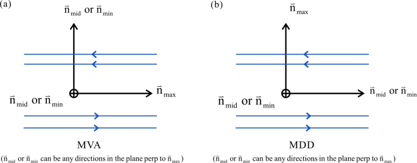
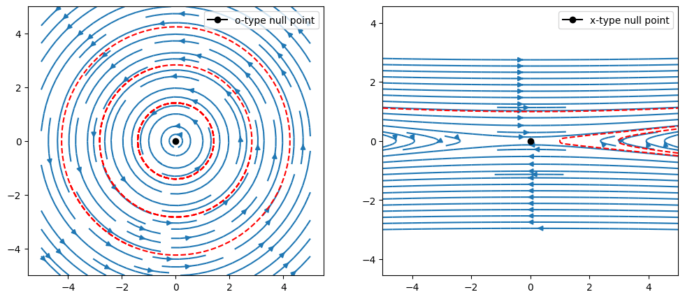
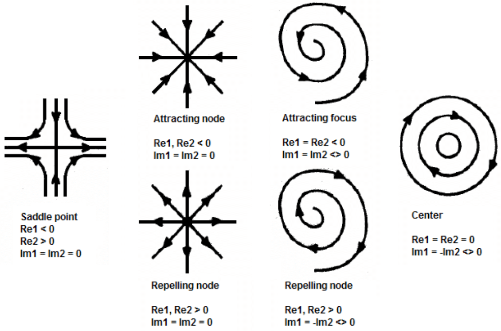
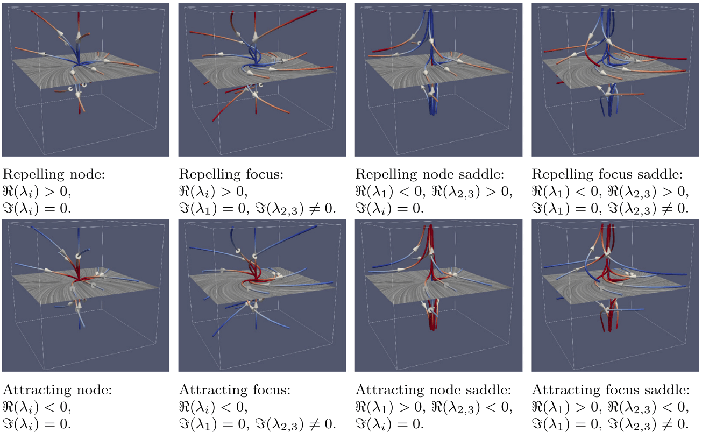
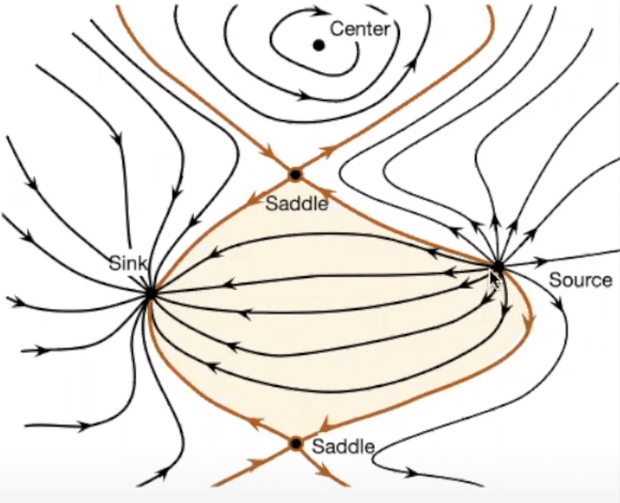

# 几何 {#sec-geometry}

本章介绍等离子体物理中与拓扑相关的概念，包括磁绳、结、边界和零点。通常，由于手头工具不同，观测研究者和建模研究者对拓扑的看法也不同：观测者利用探测器获得随时间和空间变化的测量数据，而建模者在给定分辨率下拥有完整的时空信息。观测者能够用如此有限的数据推断出等离子体结构的总体图景，总是令我惊叹。将观测经验融入物理研究，以及运用物理知识诊断数值模拟，是我们研究几何的主要目标。

一般而言，处理几何问题有两类方法：基于物理的方法和统计方法（经典统计与机器学习）。结合这两类方法或许能够相辅相成，取得最佳结果。

## 局部坐标系

定义磁场的雅可比矩阵 $\overleftrightarrow{G} = \nabla\mathbf{B}$。

* 最小方向导数（MDD）法：在 MDD 方法中，局部正交坐标方向可以由 $\overleftrightarrow{G}^\intercal\overleftrightarrow{G}$ 的特征向量得到。

* 最小梯度分析（MGA）：在 MGA 中，局部正交坐标方向可以由 $\overleftrightarrow{G}\overleftrightarrow{G}^\intercal$ 的特征向量得到。

MGA 给出一组与最小方差分析（[MVA](https://henry2004y.github.io/VisAnaJulia/dev/man/analysis/#Minimum-Variance-Analysis-1)）所得基向量类似的基向量：最大特征值对应的特征向量沿最大变化的向量方向（记为 $\hat{L}_\mathrm{MGA}$），第二个对应中等变化（$\hat{M}_\mathrm{MGA}$），第三个对应最小变化（$\hat{N}_\mathrm{MGA}$）。MDD 给出的基向量中，最大特征值对应的特征向量表示产生最大 $\mathbf{B}$ 变化的位移方向（在 Harris 电流片中为穿过电流片的方向；$\hat{L}_\mathrm{MDD}$）；较小特征值的情况类似（分别为 $\hat{M}_\mathrm{MDD}$ 和 $\hat{N}_\mathrm{MDD}$）。这两个特征系统具有相同的特征值，但特征向量不同，不一定彼此平行。这里要注意，对于一维结构，两个特征系统都只有一个明确定义的特征向量；对于一维电流片结构，不同基底中明确定义的特征向量相互正交，如 图~\ref{fig:shirepro} 所示。

{#fig-mva-mdd}

### 维数

MDD 提供了一种根据矩阵 $\overleftrightarrow{G}\overleftrightarrow{G}^\intercal$ 的特征值定义结构局部维数的方法。描述磁场一维、二维或三维程度的度量 $D_1$、$D_2$、$D_3$ 由 MDD 矩阵 $\overleftrightarrow{G}\overleftrightarrow{G}^\intercal$ 的特征值 $\lambda_i$（$i=1,2,3$，按降序排列）的平方根之比得到。

$D_1$、$D_2$、$D_3$ 的一种定义如下：
$$
\begin{aligned}
   D_1 &= \frac{\sqrt{\lambda_1}-\sqrt{\lambda_2}}{\sqrt{\lambda_1}}\\
   D_2 &= \frac{\sqrt{\lambda_2}-\sqrt{\lambda_3}}{\sqrt{\lambda_1}}\\
   D_3 &= \frac{\sqrt{\lambda_3}}{\sqrt{\lambda_1}}.
\end{aligned}
$$
这些量定义在 [0,1] 范围内，且其和为一。当 $D_1 \approx 1$ 时，磁场结构主要是一维的，例如具有 $\mathbf{B} \approx \mathbf{B}(z)$ 的电流片，其中 $z$ 方向垂直于电流片。相应地，当 $D_2 \approx 1$ 时，结构主要是两个坐标的函数，以此类推。这些度量使我们能够定量判断对中性线进行局部二维处理是否有充分依据。

如果特征值没有明显分离，从 MGA 和 MDD 得到的方向便存在歧义 [@shi2019]。例如，对于维数为 1 的电流片，MGA 得到沿磁场方向（在电流片上下方），而 MDD 得到电流片的法向；另外两个方向则不确定。[^question_d]

[^question_d]: 我还没有仔细思考 Markku 在这里的说法。在他提出的方法中，取自 MDD 和 MGA 的两个 L 方向被用来构造局部坐标系。

常见的代表性结构：

* 一维：电流片
* 二维：等离子体团、磁通绳
* 三维：罕见[^question_3d]

[^question_3d]: 文献中很少提及三维结构。Markku 也发现它们在 Vlasiator 模拟中很少见。

## 重联识别

这里分别给出 X 点构型和 O 点构型的解析场。

{#fig-x-o-points}

### 二维

识别二维重联位置很容易。假设平面外方向为 y，且 $B_y = \mathrm{const}$。无散条件给出
$$
\frac{\partial B_x}{\partial x} + \frac{\partial B_z}{\partial z} = 0
$$

在 X-Z 平面中，可以定义磁通函数
$$
\psi = \int B_x dz = - \int B_z dx
$$
于是
$$
\mathbf{B} = B_x\hat{x} + B_z\hat{z} = \hat{y}\times\nabla\psi
$$

零点就是磁通函数的简单鞍点和极值点。

{#fig-mva-mdd}

### 三维

识别三维重联位置并不容易。

实现 Lapenta 的方法。

四场交汇（FFJ）方法由 Laitinen 等于 2006 年提出。它在稳态重联情形下表现尚可，但在情况剧烈变化时则不然。

### 临界点

让我们讨论拓扑定义的问题（参照 Kenneth Rohde Christiansen 和 Aard Keimpema）。临界点是向量为零的点（即 $\mathbf{v}=0$）。更严格地说，临界点是雅可比矩阵或向量梯度 $\nabla\mathbf{v}$ 非奇异（即没有零特征值）的驻点。临界点有 6 种不同类型，以附近切曲线的行为为特征。可以通过搜索流场中的所有网格单元来找到这些临界点的位置。临界点只出现在向量的所有分量都经过零值的单元中。为了找到临界点的确切位置，需要进行插值。

然后可以通过考察雅可比矩阵的特征值对其分类。二维向量 $(u,v)$ 的雅可比矩阵为
$$
\frac{\partial(u,v)}{\partial(x,y)}\Bigg\rvert_{x_0, y_0} =
\begin{pmatrix}
\partial_x u & \partial_y u \\ \partial_x v & \partial_y v
\end{pmatrix}\Bigg\rvert_{x_0, y_0}
$$ {#eq-Jacobian-2d}

如 @fig-critical-pts-2d 所示，这 6 种类型根据特征值实部和虚部的符号分类。特征值的实部产生吸引（若 $RE < 0$）或排斥（若 $RE > 0$）。特征值的虚部使矢量场绕临界点旋转。当特征值为纯虚数时，临界点周围的矢量场完全呈旋转状。

{#fig-critical-pts-2d}

最重要的临界点是_鞍点_，在这里，一个方向上的吸引与另一个方向上的排斥并存。正如下一节所示，鞍点的重要性在于临界点附近的切曲线决定了流动的全局结构。

如果一个临界点没有实部为零的特征值，就称它为_双曲_临界点。双曲临界点在结构上是稳定的，即小扰动不会改变其拓扑。

除了临界点，还有所谓的附着／脱离节点。这些点位于物体壁面上，是切曲线终止或开始的地方。

在三维中，最常见（即非退化）的临界点类型是源、汇、排斥鞍点和吸引鞍点，如 @fig-critical-pts-3d 所示（[@bujack2021open]）。根据是否存在虚部非零的特征值，这些类型中的每一种都可能在某个平面内表现出旋转图样，由此产生图中所示的八种情况。一个二维分离面和两条一维分离线从鞍点出发或终止于鞍点（如果二维分离面从鞍点出发，则一维分离线终止于鞍点，反之亦然）。分离线或分离面接近鞍点的方向由 $\nabla v$ 的特征向量给出。一维分离线的计算方法是：沿 $\nabla v$ 中对应符号只出现一次的特征值的特征向量方向，在距鞍点一个用户定义的小偏移处放置两个种子点。随后按上述方式积分这些种子点的轨迹。二维分离面的计算方法是：在对应符号出现两次的特征值的 ∇v 特征向量所张成的平面内，在距鞍点一个用户定义的小偏移处放置八个种子点。这些种子点是积分出一个曲面——分离面——的基础。

{#fig-critical-pts-3d}

最重要的输入参数包括分离线或分离面的种子点距鞍点的距离，以及传递给流线和流面积分器的参数，例如步长和最大步数。

### 分离线

在科学可视化中，我们处理定义在网格离散点集上的矢量场，并在单元内进行线性或多线性插值。由于分段线性或多线性函数满足 Lipschitz 连续性，流线总是唯一存在的。

流场骨架是一幅包含流场临界点和连接它们的所谓积分曲线的图。积分曲线可以理解为测试粒子在离临界点无穷近处释放后所经过的路径。通过添加例如箭头，可以显示积分曲线的方向，从而给出流动的全局图像。在拓扑学语境中，骨架称为[分离线](https://en.wikipedia.org/wiki/Separatrix_(mathematics))。分离线是其极限集（？）或整体行为（？）不同于邻近解的解。分离线包括临界点、周期轨道和鞍点的不变流形。

实际中，分离线通过以下步骤构造：

* 在每个单元中解析地检测临界点
* 根据其雅可比矩阵的特征值对其分类
* 沿鞍点特征向量的方向，在距鞍点稍有偏移的位置设置分离线种子点

{#fig-separatrices-2d}

在三维中，除了线，还可能有分离面。

## 螺度

在流体动力学中，螺度在适当条件下是流动欧拉方程的一个不变量，其拓扑解释是衡量流动中涡线的_链接程度_和_成结程度_（Moffatt 1969）。

设 $\mathbf{u}(x,t)$ 为速度场，$\nabla\times\mathbf{u}$ 为对应的涡度场。在以下三个条件下，涡线随流动输运（或“冻结”在流动中）：

1. 流体无黏性；
2. 流动不可压缩（$\nabla\cdot\mathbf{u}=0$），或者流动可压缩但压力 $p$ 与密度 $\rho$ 之间满足正压关系 $p=p(\rho)$；
3. 作用在流体上的所有体力都是保守力。在这些条件下，任何满足 $n\cdot(\nabla\times\mathbf{u})=0$ 的闭曲面 $S$ 都像涡度一样随流动输运。

设 $V$ 为这样一个曲面内部的体积，则 $V$ 中的螺度定义为
$$
H=\int_{{V}}{\mathbf{u}}\cdot\left(\nabla\times\mathbf{u}\right)\,dV
$$ {#eq-helicity}

对于无界流体中的局域涡度分布，$V$ 可以取为整个空间，此时 $H$ 是流动的总螺度。正如 Kelvin 勋爵（1868）所认识到的，$H$ 的不变性恰恰源于涡线冻结在流动中，因此其链接和／或成结程度守恒。螺度是一个赝标量：当参考系从右手系变为左手系时，它会改变符号；它可以看作流动的旋向（或手性）的度量。螺度是欧拉方程四个已知积分不变量之一；另外三个是能量、动量和角动量。

螺度的不变性为拓扑流体动力学和 MHD 这一领域提供了重要基石，该领域研究流动的全局性质及其拓扑特征。

## 磁螺度

定义在三维空间某一区域上的光滑矢量场的螺度，是衡量场线相互环绕和缠绕程度的标准量。对于磁螺度，这个“矢量场”就是磁场。它将拓扑学中的[链接数](https://en.wikipedia.org/wiki/Linking_number)概念推广到描述磁场所需的微分量。与电磁学中的许多量一样，用来描述磁力线的磁螺度与用来描述流体流线的流体力学螺度密切相关。

如果磁力线沿着一根扭绞绳索的各股线分布，这种构型就具有非零磁螺度；左手绳索的值为负，右手绳索的值为正。

形式上，
$$
H=\int\mathbf{A}\cdot\mathbf{B}\mathrm{d}\mathbf{r}^3
$$ {#eq-magnetic_helicity}
其中

* $H$ 是整个磁场的螺度
* $\mathbf{B}$ 是磁场强度
* $\mathbf{A}$ 是 $\mathbf{B}$ 的矢势，且 $\mathbf{B}=\nabla\times\mathbf{A}$

在 SI 单位制中，磁螺度的单位是 $\text{Wb}^2$；在高斯单位制中，其单位是 $\text{Mx}^2$。注意，由于规范自由度，不应将 $\mathbf{A}\cdot\mathbf{B}$ 视为“螺度密度”。

它是电磁场中的守恒量，即使磁重联耗散能量时也是如此 [@woltjer1958theorem]。这一概念在太阳动力学和发电机理论中很有用。磁重联和拓扑变化期间，螺度近似守恒。螺度可以被注入日冕等系统。当积累过多时，最终会通过日冕物质抛射被排出。理想 MHD 中的简单证明可在维基百科上找到。

磁螺度是一个依赖规范的量，因为可以通过向 $\mathbf{A}$ 添加梯度来重新定义它（规范变换）：
$$
\mathbf{A}^\prime = \mathbf{A} + \nabla\phi
$$

然而，对于完全导电边界或没有净磁通量的周期系统，磁螺度是规范不变的。对于边界面上磁通量非零的体积，已经定义了规范不变的相对螺度。如果磁场是湍流的且非均匀性较弱，可以根据场线链接的密度定义磁螺度密度及其相应通量。

磁场的拓扑性质可以用磁螺度解释。一组磁通管的总螺度来自磁通管之间的链接（互螺度）以及每根磁通管的内部磁结构（自螺度）。重联改变磁通管的拓扑和磁连接关系。这也可以看作自螺度和互螺度的重新分配。如果总磁螺度近似守恒，就可以对自螺度和互螺度的变化给出定量限制。这可以解释为磁通管链接的变化（由重联导致）以及重联后磁通管中存在的扭转量。[Wright & Berger, 1989]

简单例子：

1. 一条没有扭转的闭合磁通环具有 $H=0$。
2. 一根磁通量为 $\phi$、自身扭转 $T$ 圈的磁通绳具有螺度 $H = T\phi^2$。
3. 两条相互链接但没有扭转、磁通量分别为 $\phi_1$ 和 $\phi_2$ 的磁通环具有 $H=\pm2\phi_1\phi_2$，其符号取决于链接方向。

经过推广，可以给出螺度的规范不变定义。[Berger & Field (1984)] 将相对磁螺度定义为
$$
H = \int_V \mathbf{A}\cdot\mathbf{B} - \mathbf{A}_0\cdot\mathbf{B}_0 dV
$$ {#eq-relative_magnetic_helicity}
其中 $\mathbf{B}_0=\nabla\times\mathbf{A}_0$ 是 $V$ 内部的势场，在 $V$ 外部与该磁场相同（另见 Finn & Antonsen 1985）。

在环形实验室实验中，自然会考虑由导电壁面边界包围的体积，这些边界与闭合磁通面重合（即壁面上的磁场平行于边界）。

磁螺度的时间演化由下式给出：
$$
\frac{\mathrm{d}H}{\mathrm{d}t} = -2c\int_V \mathbf{E}\cdot\mathbf{B}dV + 2c\int_S \mathbf{A}_p\times\mathbf{E}\cdot \mathrm{d}\mathbf{S}
$$
其中，在 $S$ 上选取 $\nabla\times\mathbf{A}_p=0$ 和 $\mathbf{A}_p\cdot \mathrm{d}\mathbf{S}=0$。第一项表示 $E_\parallel\neq 0$ 时的螺度耗散，在理想 MHD 中始终为零。第二项表示进出系统的螺度通量，例如，从太阳光球层浮现的磁通对应于向日冕注入螺度。

## 交叉螺度 {#sec-cross_helicity}

交叉螺度衡量相互作用的波之间的不平衡，这在 MHD 湍流中很重要（@sec-turbulence_cross_helicity）。其表达式为
$$
H_C = \int_V \mathbf{v}\cdot\mathbf{B} dV
$$ {#eq-cross_helicity}

在理想 MHD 中，$H_C$ 的变化率为
$$
\frac{\mathrm{d}H_C}{\mathrm{d}t} = -\oint_S \mathrm{d}\mathbf{S}\cdot \Big[ \Big(\frac{1}{2}v^2 + \frac{\gamma}{\gamma-1} \frac{p}{\rho}\Big)\mathbf{B} - \mathbf{v}\times(\mathbf{v}\times\mathbf{B}) \Big]
$$

当边界 $S$ 上满足 $\mathrm{d}\mathbf{S}\cdot\mathbf{B} = d\mathbf{S}\cdot\mathbf{V}=0$，或者边界条件为周期性时，该式为零。当这一积分为零时，交叉螺度是理想 MHD 不变量。

从观测角度看，交叉螺度有离散化形式。如果想了解更多，可以查阅相关资料。

## 磁通绳识别

利用湍流参数寻找磁通绳 [@zhao2020identification]：
$$
\begin{aligned}
\sigma_r &< -0.5 \\
|\sigma_c| &< 0.4 \\
|\sigma_m| &> 0.7
\end{aligned}
$$
其中 $\sigma_m$ 是_归一化约化磁螺度_，用于衡量 $\mathbf{B}$ 的旋转。严格来说，磁螺度取决于磁场拓扑的空间性质，因此无法直接由单颗航天器的测量数据计算。然而，Matthaeus 等（1982）描述了一种磁螺度的约化形式，可以基于磁功率谱利用单颗航天器的测量数据进行估计。归一化约化磁螺度可估计为
$$
\sigma_m(\nu, t) = \frac{2\Im[W_T^\ast(\nu, t)\cdot W_N(\nu, t)]}{|W_R(\nu, t)|^2 + |W_T(\nu, t)|^2 + |W_N(\nu, t)|^2}
$$ {#eq-reduced_magnetic_helicity}
其中 $\nu$ 是与小波函数及径向—切向—法向（RTN）坐标系中所测磁场的采样周期相关的频率。谱 $W_R(\nu, t)$、$W_T(\nu, t)$ 和 $W_N(\nu, t)$ 分别是 $\mathbf{B}_{1R}$、$\mathbf{B}_{1T}$ 和 $\mathbf{B}_{1N}$ 时间序列的小波变换；$W_T^\ast(\nu,t)$ 是 $W_T(\nu,t)$ 的共轭。从所得磁螺度 $\sigma_m$ 的频谱图中，可以确定特定尺度下底层涨落的大小和旋向（手性）。$\sigma_m$ 的正值对应右手手性，负值对应左手手性。

## 磁层顶识别

根据压力平衡论证，令 $\beta^\ast = (p_\text{th}+p_\text{dyn})/p_B$，可以得到一个简单判据：
$$
\beta^\ast\simeq 1
$$
