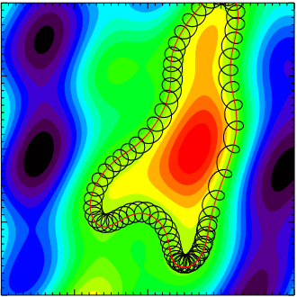
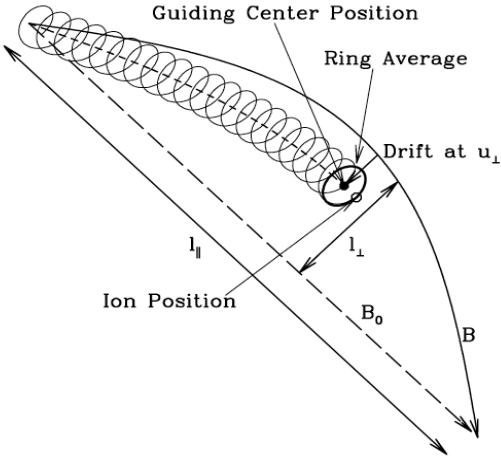

# 回旋动理学 {#sec-gyrokinetics}

本文取材于马克斯·普朗克等离子体物理研究所 Frank Jenko 的幻灯片。

回旋动理学是在精细得多的层次上描述等离子体的理论。如果动理学效应（例如有限拉莫尔半径、朗道阻尼、磁俘获等）发挥作用，MHD 就不再适用，必须采用动理学描述。

我们再次从 Vlasov-Maxwell 方程出发。在 $\omega\ll\Omega$ 的假设下去除快速回旋运动，能够大幅提高计算速度。因此可以将带电环这一基本单元看作准粒子：它由回旋中心坐标描述，并能保留动理学效应。

## 简要历史回顾

“回旋动理学”一词于 20 世纪 60 年代末出现在文献中，最初由 Rutherford、Frieman、Taylor 和 Hastie 提出。其目的是为研究一般磁场构型中的线性动理学漂移波提供适当的形式体系，其中包括有限拉莫尔半径效应。1982 年，Friemann 和 Liu Chen 给出了第一组关于扰动分布函数 $\delta f$ 的非线性方程，并引入了回旋动理学的量级排序。回旋动理学理论基于 Hamilton 方法，即从 Lagrange 描述出发，通过变换坐标系消除回旋角依赖性，以描述运动方程。

## 坐标变换

我们进行以下坐标变换，从带电粒子的相空间（$\mathbf{x},\mathbf{v}$）变换到相应的导引中心相空间（$\mathbf{X},\mathbf{V}$），其中：

$$
\begin{aligned}
\mathbf{X} = \mathbf{X}_\perp + X_\parallel \mathbf{b}_0,\quad \mathbf{X}_\perp = \mathbf{x}_\perp + \mathbf{r}_L,\quad \mathbf{r}_L = \mathbf{v}\times\mathbf{b}_0 / \Omega_c
\end{aligned}
$$

$$
\mathbf{V} = [\epsilon=v^2/2, \mu=v_\perp^2/2B_0, \sigma=\text{sgn}(v_\parallel)]
$$

这里，$\mathbf{b}_0 = \mathbf{B}_0/B_0$，$\mathbf{r}_L$ 是回旋半径矢量，$v_\parallel=\mathbf{v}\cdot\mathbf{b}_0$，$\mu$ 是磁矩绝热不变量；假设不存在平衡静电势，$\epsilon$ 是平衡运动常数。

在导引中心相空间中，带电粒子动力学自然分为快速回旋运动和缓慢的导引中心运动。随后可以应用回旋动理学量级排序，系统地将快速回旋运动平均掉（即回旋相位平均），得到按小参数 $\epsilon$ 衡量渐近占主导的扰动分布函数响应。导引中心相空间中的这一扰动分布函数随后可以 _逆变换_ 回带电粒子相空间，并代入场方程（即 Maxwell 方程），得到自洽的动理学描述。

* 得到导引中心坐标中的 Vlasov 方程。
* 得到导引中心坐标中的 Maxwell 方程。

为什么使用 Maxwell 方程之前还需要额外步骤？因为 Maxwell 方程中的粒子信息（$\rho, \mathbf{j}$）并不是在导引中心坐标中描述的。从 Vlasov 方程得到的分布必须先变换回普通坐标，然后才能进行矩积分。

在导引中心坐标中，密度和电流密度可表示为

$$
n = \bar{N}_0 + \bar{\nabla}\cdot\Big( \frac{c\bar{N}_0}{B\Omega}\bar{\nabla}_\perp \delta\phi \Big) + \frac{\bar{N}_0\delta B_\parallel}{B} + \int \bar{F}_1d\mathbf{p}
$$ {#eq-gk_density}

$$
\begin{aligned}
\mathbf{j} &= -\frac{\bar{N}_0 q^2}{cm}\delta A_\parallel\hat{b} + \int\frac{q \bar{\mathbf{P}}_\parallel}{m}\hat{b}\mathrm{d}\bar{\mathbf{P}} + \frac{cq\bar{N}_0}{B}\hat{b}\times\bar{\nabla}\delta\phi + \frac{3c^2\bar{N}_0\bar{T}}{2B^2\Omega}\hat{b}\times\bar{\nabla}\bar{\nabla}_\perp^2\delta\phi \\
&+ \frac{2c\bar{N}_0 \bar{T}}{B^2}\hat{b}\times\bar{\nabla}\delta B_\parallel + \frac{\hat{b}}{B}\times\bar{\nabla}(c\bar{N}_0\bar{T}) + \hat{b}\times\bar{\nabla}\int c\bar{\mu}\bar{F}_1 \mathrm{d}\bar{\mathbf{P}}
\end{aligned}
$$ {#eq-gk_current_density}

注意

* 在导引中心坐标中的 Vlasov 方程里，$\mathbf{E}\times\mathbf{B}$ 漂移、梯度漂移和曲率漂移都出现了，但极化漂移没有出现。
* 在 @eq-gk_density 中，只有极化项修正出现。根据 Hamilton 力学，所有显含时间的项在这里都没有贡献，因为它们会破坏系统的能量守恒。

## 回旋动理学量级排序

### 从动理学到回旋动理学

{#fig-kinetics2gk}

@fig-kinetics2gk 展示了回旋动理学近似的基本思想。强磁场指向纸面内，彩色等值线表示静电势涨落。粒子轨道由两部分组成：快速回旋运动和缓慢的 $\mathbf{E}\times\mathbf{B}$ 漂移。在回旋动理学中，我们直接去除快速回旋运动，引入带电环作为准粒子，即从粒子坐标转到回旋中心坐标。

{#fig-gk-approximation}

* 与回旋运动时间尺度相比，时间变化缓慢：

$$
\omega/\Omega_i \ll 1
$$

* 空间平衡尺度远大于拉莫尔半径：

$$
r_L/L\ll 1
$$

* 强各向异性，即只有涨落量的垂直分量可以较大：

$$
k_\parallel/k_\perp \ll 1
$$

* 小振幅扰动，即扰动能量远小于热能：

$$
e\phi/k_BT_e \ll 1
$$

存在一个自然的小参数 $\epsilon=r_L/L$，我们将在量级排序中使用它。在磁约束等离子体中，通常有 $\epsilon\lesssim\mathcal{O}(10^{-2})\ll 1$。

$$
\frac{\omega}{\Omega}\sim\frac{r_L}{L}\sim\frac{k_\parallel}{k_\perp}\sim\frac{\delta F}{F_0}\sim\frac{\delta T}{T_0}\sim\frac{\delta n}{n_0}\sim\frac{|\delta \mathbf{B}|}{|\mathbf{B}_0|}\sim\frac{q\delta\phi}{T}\sim\epsilon
$$

回旋动理学通常关注低频（$|\omega/\Omega_i|\sim\epsilon$）但短波长（$k_\perp r_L \sim 1$）的涨落。为纳入朗道共振（???），

$$
k_\parallel v_\parallel\sim \omega,\quad\text{or}\quad |k_\perp r_i|\sim 1
$$

进一步注意，对于 $|k_\perp r_i|\sim 1$，且等离子体离子压强与背景磁场能量密度之比 $\beta_i \lesssim 1$：

$$
\beta = \frac{P_{0i}}{P_{0B}} = \frac{m_i n_i v_{\perp i}^2/2}{B_0^2/2\mu_0} = \frac{v_{\perp i}^2}{v_A^2}
$$

$$
\bigg\lvert \frac{\omega}{k_\perp v_A} \bigg\rvert \sim \bigg\lvert \frac{\omega}{\Omega_i} \bigg\rvert \bigg\lvert \frac{1}{k_\perp r_{iL}} \bigg\rvert \beta_i^{1/2} \lesssim \epsilon
$$

即快波在回旋动理学量级排序中被系统地抑制。

## Lagrange 方法

如果已知一个动力系统的 Lagrangian，例如非正则坐标 $(\mathbf{x},\mathbf{v})$ 中的带电粒子运动：

$$
\begin{aligned}
L &= \Big(\frac{e}{c}\mathbf{A}(\mathbf{x},t) + m\mathbf{v}\Big)\cdot\dot{\mathbf{x}} - H(\mathbf{x},\mathbf{v}) \\
H &= \frac{m}{2}v^2 + e\phi(\mathbf{x},t)
\end{aligned}
$$

其中 $\mathbf{B} = \nabla\times\mathbf{A}$，$\mathbf{E} = -\nabla\phi - \partial_t \mathbf{A}/c$。运动方程由 Lagrange 方程给出（我几乎把理论力学忘光了……）：

$$
\frac{\mathrm{d}}{\mathrm{d}t}\frac{\partial L}{\partial \dot{q}_i} - \frac{\partial L}{\partial q_i} = 0,\quad i=1,...,6
$$

对于带电粒子，

$$
\frac{\mathrm{d}}{\mathrm{d}t}\frac{\partial L}{\partial\dot{\mathbf{v}}} - \frac{\partial L}{\partial\mathbf{v}} = 0 ?
$$

$$
\begin{aligned}
\dot{\mathbf{x}} &= \mathbf{v} \\
\dot{\mathbf{v}} &= \frac{e}{m}(\mathbf{E} + \mathbf{v}\times\mathbf{B})
\end{aligned}
$$

在回旋动理学中，我们加入低频、各向异性、小振幅涨落：

$$
\frac{\omega}{\Omega_i} \sim \frac{k_\parallel}{k_\perp}\sim\frac{e\phi}{T_e} \sim \epsilon
$$

我们需要从粒子坐标 $(\mathbf{x},\mathbf{v})$ 转换到导引中心坐标 $(\mathbf{R},v_\parallel, \mu, \varphi)$。简便方法是利用 Lie 变换构造新的 Lagrangian（???）

$$
\Gamma = \Big( mv_\parallel\hat{b}_0 + \frac{e}{c}\bar{\mathbf{A}}_{1\parallel}\hat{b}_0 + \frac{e}{c}\mathbf{A}_0 \Big)\cdot \mathrm{d}\mathbf{X} + \frac{mc}{e}\mu \mathrm{d}\theta - \Big( \frac{m}{2}v_\parallel^2 + \mu B_0 + \mu \bar{B}_{1\parallel} + e\bar{\phi}_1 \Big)\mathrm{d}t
$$

其中 $\mu$ 是磁矩，$\theta$ 是回旋角，上横线表示回旋平均操作。这给出 Euler-Lagrange 方程

$$
\begin{aligned}
\dot{\mathbf{X}} &= v_\parallel\hat{b} + \frac{B}{B_\parallel^\ast}\Big[ \frac{v_\perp}{B}\bar{\mathbf{B}}_{1\perp} + \frac{c}{B^2}\bar{\mathbf{E}}_1\times\mathbf{B} + \frac{\mu}{m\Omega}\hat{b}\times\nabla(B+\bar{B}_{1\parallel}) + \frac{v_\parallel^2}{\Omega}(\nabla\times\hat{b})_\perp \Big] \\
\dot{v}_\parallel &= \frac{\dot{\mathbf{X}}}{mv_\parallel}\cdot\big( e\bar{\mathbf{E}}_1 - \mu\nabla(B+\bar{B}_{1\parallel}) \big) \\
\dot{\mu} &= 0
\end{aligned}
$$ {#eq-gk_euler_lagrange}

@eq-gk_euler_lagrange 包含了我们在 @sec-single 中见到的所有漂移。

应用回旋动理学近似，一个回旋周期内经过回旋平均的有效势可用 Fourier 变换写为（???）：

$$
\begin{aligned}
\phi^{\text{eff}}(\mathbf{x},r_L) &= \frac{1}{2\pi} \int_0^{2\pi}\mathrm{d}\theta \phi(\mathbf{x}+\mathbf{r}_L) \\
&= \frac{1}{(2\pi)^2}\int_{-\infty}^{\infty}\mathrm{d}\mathbf{k}e^{i\mathbf{k}\cdot\mathbf{x}}\phi(\mathbf{k})J_0(kr_L)
\end{aligned}
$$

其中 $J_0$ 是零阶 Bessel 函数。

### 线性回旋动理学

我们只考虑具有各向同性 Maxwell 平衡分布函数的简单均匀等离子体。进一步假设 $\beta$（等离子体压强与磁压之比）$\ll 1$，使得磁压缩可以忽略，则粒子速度分布为：

$$
f(\mathbf{x},\mathbf{v},t) = f_M(\epsilon) + \delta f(\mathbf{x},\mathbf{v},t)
$$

其中 $f_M(\epsilon)=n_0/(\pi^{3/2}v_t^3)\exp(-\epsilon/v_t^2)$ 是 Maxwell 分布函数，$v_t$ 是热速度（如何理解这一点???）：

$$
\delta f = \frac{q}{T}f_M(\epsilon)\delta\phi + e^{-\mathbf{r}_L\cdot\nabla}\delta g
$$

$T=mv_t^2/2$，$\delta g$ 满足以下线性回旋动理学方程：

$$
\begin{aligned}
\Big( \frac{\partial}{\partial t}+v_\parallel\mathbf{b}_0\cdot\nabla \Big)\delta g = \frac{q}{T}f_M(\epsilon)\frac{\partial} {\partial t}\left< \delta L_g \right>_\alpha \\
\delta L_g = e^{-\mathbf{r}_L\cdot\nabla}\delta L \\
\delta L = \delta \phi - v_\parallel \delta A_\parallel/c
\end{aligned}
$$ {#eq-gk_linear}

而 $<...>_\alpha$ 表示对回旋相位角 $\alpha$ 取平均。这里场变量是标势和矢势 $\delta\phi$ 和 $\delta\mathbf{A}$，其中 $\delta A_\parallel=\delta\mathbf{A}\cdot\mathbf{b}_0$，并采用 Coulomb 规范 $\nabla\cdot\delta\mathbf{A}=0$。算符 $e^{-\mathbf{r}_L\cdot\nabla}$ 则表示粒子位置与导引中心位置之间的变换。

相应的场方程是 Poisson 方程和平行 Ampère 定律 $\nabla^2 \delta A_\parallel = -4\pi\delta J_\parallel/c$。在低频且 $|k\lambda_D|^2\ll 1$ 的极限下，其中 $\lambda_D$ 为 Debye 长度，Poisson 方程可近似为准中性条件 $\sum_j n_{0j}q_j<\delta f_j>_v\simeq 0$。这里 $<...>_v = \int \mathrm{d}\mathbf{v} (...)$ 是速度空间积分，下标 $j$ 遍历各粒子组分。同时，将平行 Ampère 定律代入由 @eq-gk_linear 导出的准中性条件 $\nabla\cdot\delta\mathbf{J}\simeq 0$，得到广义线性回旋动理学涡度方程，它常便于研究剪切／动理学阿尔芬波动力学。

__线性动理学阿尔芬波的性质__

（警告：非常难理解！）
对于 $\omega,\mathbf{k}$ 平面波扰动，@eq-gk_linear 给出：

$$
\delta g_\mathbf{k} = -\frac{q}{T}f_M J_0(k_\perp \mathbf{r}_L) \frac{\omega}{k_\parallel v_\parallel - \omega}\Big( \delta\phi - \frac{v_\parallel}{c}\delta A_\parallel \Big)_\mathbf{k}
$$

$J_0$ 是 Bessel 函数，而 $J_0(k_\perp \mathbf{r}_L)$ 对应于坐标变换的回旋平均，即：

$$
<\exp(-\mathbf{r}_L\cdot\nabla)>_\alpha = J_0(k_\perp r_L)
$$

在 SAW/KAW 分析中，有时引入由 $\mathbf{b}_0\cdot\nabla\delta\Psi = -\partial_t \delta A_\parallel/c$ 定义的 _有效感应平行势_ 较为方便，即：

$$
\delta\Psi_\mathbf{k} = \omega\delta A_{\parallel\mathbf{k}} / (ck_\parallel)
$$

因此，$\delta\Psi$ 产生感应平行电场；也就是说，净平行电场为：

$$
\begin{aligned}
\delta E_\parallel &= -\mathbf{b}_0\cdot\nabla(\delta\phi-\delta\Psi)\quad\text{or} \\
\delta E_{\parallel\mathbf{k}} &= -ik_\parallel(\delta\phi-\delta\Psi)_\mathbf{k}
\end{aligned}
$$

由准中性条件直接得到：（Chen 和 Hasegawa 1991）

$$
\sum_j\Big( \frac{n_0 q^2}{T_0} \Big)_j \{ \delta\phi_\mathbf{k} + \Gamma_{0kj}[\xi_{kj}Z_{kj}\delta\phi_\mathbf{k} - (1+\xi_{kj}Z_{kj}\delta\Psi_\mathbf{k})] \} = 0
$$ {#eq-gk_linear_quasi_neutrality_derive}

这里 $\xi_{kj}=\omega/|k_\parallel|v_{tj},Z_{kj}=Z(\xi_{kj})$，其中 $Z$ 是著名的等离子体色散函数（@eq-plasma_dispersion_function）；$\Gamma_{0kj} = I_0(b_{kj})\exp(-b_{kj})$，其中 $I_0$ 是修正 Bessel 函数，$b_{kj}=k_\perp^2 r_{Lj}/2 = k_\perp^2(T_j/m_j)/\Omega_j^2$。线性回旋动理学涡度方程则为：（Chen 和 Hasegawa 1991）

$$
i\frac{c^2}{4\pi\omega}k_\parallel^2 k_\perp^2 \delta\Psi_\mathbf{k} - i \sum_j\Big( \frac{n_0q^2}{T_0} \Big)_j (1-\Gamma_{0kj})\omega\delta\phi_\mathbf{k} = 0
$$ {#eq-gk_linear_vorticity}

注意，对于 KAW，$|k_\perp r_{Li}| \sim\mathcal{O}(1)$ 且 $|k_\perp r_{Le}|\ll 1$，因此 $\Gamma_{0ke}\simeq 1$，于是 @eq-gk_linear_quasi_neutrality_derive 和 @eq-gk_linear_vorticity 变为

$$
\begin{aligned}
\epsilon_{s\mathbf{k}} \delta\phi_\mathbf{k} &= [1+\xi_{ke}Z_{ke}+\tau(1+\Gamma_k \xi_{ki}Z_ki)]\delta\phi_\mathbf{k} \\
&= [1+\xi_{ke}Z_{ke}+\tau\Gamma_k(1+\xi_{ki}Z_{ki})]\delta\Psi_\mathbf{k}
\end{aligned}
$$ {#eq-gk_linear_par_potential}

以及

$$
\omega^2 \delta\phi_\mathbf{k} = k_\parallel^2 v_A^2 \frac{b_k}{1-\Gamma_k}\delta\Psi_\mathbf{k}
$$ {#eq-gk_linear_vorticity_approxi}

这里 $\tau=T_{0e}/T_{0i}, b_k=b_{ki}, \Gamma_k=\Gamma_{0ki}$，而 $\epsilon_{s\mathbf{k}}$ 是慢声波（离子声波，SSW）的介电常数。

如某些文献所做的那样，定义有效平行势 $\delta\phi_{\parallel\mathbf{k}}=\delta\phi_\mathbf{k} - \delta\Psi_\mathbf{k}$ 并将 @eq-gk_linear_par_potential 和 @eq-gk_linear_vorticity_approxi 改写为以下形式，也很有启发性：

$$
\epsilon_{s\mathbf{k}} \delta\phi_{\parallel\mathbf{k}} = -\tau(1-\Gamma_k)\delta\Psi_\mathbf{k}
$$ {#eq-gk_linear_par_potential2}

以及

$$
\Big[ \omega^2 - k_\parallel^2v_A^2\frac{b_k}{1-\Gamma_k} \Big] \delta\Psi_\mathbf{k} = -\omega^2\delta\phi_{\parallel\mathbf{k}}
$$ {#eq-gk_linear_vorticity_approxi2}

@eq-gk_linear_par_potential2 和 @eq-gk_linear_vorticity_approxi2 展示了 SAW 与 SSW 通过有限的 $|k_\perp r_{Ls}|$ 项耦合。在 $|k_\perp r_{Li}|\sim\mathcal{O}(1)$ 的短波长极限下，由于有限 $|k_\perp r_{Li}|$ 和 $|k_\perp r_{Ls}|$ 效应，SAW 演化为 KAW。（???）更具体地，耦合 KAW-SSW 色散关系变为

$$
\omega_\mathbf{k}^2\Big[ 1-\frac{\tau(1-\Gamma_k)}{\epsilon_{s\mathbf{k}}} \Big] = k_\parallel^2 v_A^2 \frac{b_k}{1-\Gamma_k}
$$ {#eq-gk_linear_SAW_SSW}

我们关注 KAW 分支，并为进一步简化分析，假设 $1\gg \beta_i\sim\beta_e\gg m_e/m_i$。由 $|\omega|\sim|k_\parallel v_A|$，得到 $|\xi_{ki}|=|\omega/k_\parallel v_{ti}|\sim\beta_i^{-1/2}\gg 1 \gg |\xi_{ke}|\sim(m_e/m_i\beta_e)^{1/2}$，只保留最低阶 $\mathbf{O}(1)$ 项：

$$
\epsilon_{s\mathbf{k}} \simeq 1+\tau(1-\Gamma_k) \equiv \sigma_k
$$

由 @eq-gk_linear_SAW_SSW，得到

$$
\omega_{\mathbf{k}}^2 \simeq k_\parallel^2 v_A^2\frac{\sigma_k b_k}{1-\Gamma_k}
$$ {#eq-gk_linear_SAW_SSW_approxi}

至于有助于在观测中识别波的波偏振，可以直接推导：

$$
\bigg\lvert \frac{c\delta\mathbf{E}_\perp}{\delta\mathbf{B}_\perp} \bigg\rvert = v_A \Big[ \frac{b_k}{\sigma_k(1-\Gamma_k)}\Big]^{1/2}
$$ {#eq-gk_linear_polarization_perp}

以及

$$
\bigg\lvert \frac{c\delta E_\parallel}{\delta\mathbf{B}_\perp} \bigg\rvert = v_A \bigg\lvert \frac{k_\parallel}{k_\perp}\tau \bigg\rvert\Big[ \frac{b_k(1-\Gamma_k)}{\sigma_k} \Big]^{1/2}
$$ {#eq-gk_linear_polarization_par}

为 @eq-gk_linear_SAW_SSW_approxi、@eq-gk_linear_polarization_perp 和 @eq-gk_linear_polarization_par 添加图！！！

@eq-gk_linear_polarization_par 表明，对于固定的 $|k_\parallel/k_\perp|, |\delta E_\parallel/\delta\mathbf{B}_\perp|$ 随 $b_k$ 增大而增大。由于波粒能量和动量交换与 $|\delta E_\parallel|$ 成正比，因此预计短波长 KAW 在带电粒子的加热、加速和输运中起关键作用。

除了具有显著的 $\delta E_\parallel$，KAW 与 SAW 不同的另一个重要性质是它具有有限的垂直于 $\mathbf{B}_0$ 的群速度 $\mathbf{v}_{g\perp}$。假设 $|k_\perp r_{Li}|^2\ll 1$，并令 $\omega_A^2\equiv k_\parallel^2 v_A^2$，得到：

$$
\omega_\mathbf{k}^2 \simeq \omega_A^2(1+k_\perp^2 \hat{r}^2)
$$ {#eq-gk_linear_KAW_kperp_large}

其中

$$
\hat{r}^2 = (3/4 + \tau)r_{Li}^2
$$ {#eq-gk_linear_KAW_scale}

因此

$$
\mathbf{v}_{g\perp}=\frac{\partial \omega_\mathbf{k}}{\partial \mathbf{k}_\perp}\simeq \frac{\omega_A^2}{\omega_\mathbf{k}}\hat{r}^2\mathbf{k}_\perp
$$ {#eq-gk_linear_KAW_group}

__KAW 的线性模转换__

@eq-gk_linear_KAW_kperp_large 对非均匀等离子体有重要意义。再次考虑平板等离子体，其中 $\omega_A^2(x)$ 非均匀，$k_\perp^2 = k_x^2(x)$ 是非均匀 $x$ 方向上的 WKB 波数。于是 @eq-gk_linear_KAW_kperp_large 表明，KAW 在 $\omega_\mathbf{k}^2>\omega_A^2(x)$ 区域传播（$k_x^2>0$），而在 $\omega_\mathbf{k}^2<\omega_A^2(x)$ 区域截止（$k_x^2<0$）。$\mathbf{v}_{g\perp}$ 有限也说明，与 SAW 不同，初始平滑扰动不仅会演化到短波长，还会向 $\omega_A^2(x)$ 较低的区域传播。这些特征如 @fig-gk-KAW-evolution(b) 所示；其中 KAW 的时空演化根据以下波动方程显式求解：（自己做！！！）

$$
\Big[ \hat{r}^2\frac{\partial^2}{\partial x^2} - 1 - \frac{1}{\omega_A^2(x)}\frac{\partial^2}{\partial t^2} \Big] \delta B_y(x,t) = 0
$$ {#eq-gk_linear_KAW_governing}

在 @eq-gk_linear_KAW_kperp_large 中令 $\omega_\mathbf{k}=i\partial/\partial t$ 和 $k_\perp=-i\partial/\partial x$，即可直接推导出 @eq-gk_linear_KAW_governing。$\omega_A^2(x)/\omega^2 = 1/(1+x^2/L^2)$ 的空间剖面如
@fig-gk-KAW-evolution(a) 所示，其中 $L$ 表示剖面长度尺度；因此假设 KAW 波包频率与 $x=0$ 处的 SAW 频率一致。@fig-gk-KAW-evolution(b) 显示了 KAW 波包沿径向非均匀方向的传播，与 @eq-gk_linear_KAW_group 一致。

::: {.content-visible unless-format="pdf"}

{#fig-gk-KAW-evolution}

:::

有限的垂直群速度还意味着，在稳态下“奇异”共振被消除，并出现线性模转换过程（Hasegawa 和 Chen 1976，另见 @sec-flr）。更具体地，相应的波动方程为：

$$
\Big[\hat{r}^2\frac{\partial^2}{\partial x^2} + \Big( \frac{\omega_0^2}{\omega_A^2(x)} - 1 \Big) \Big]\delta\hat{B}_y(x) = \delta\hat{B}_{y0}
$$ {#eq-gk_linear_KAW_governing2}

这里 $\omega_0$ 是外部驱动频率。在理想 SAW（$\hat{r}\rightarrow 0$）极限下，$x_0$ 处存在共振奇点，其中 $\omega_0^2 = \omega_A^2(x_0)$。注意在 $x=x_0$ 附近，$\omega_A^2(x)\simeq \omega_0^2 + (\omega_A^2)^\prime(x_0)(x-x_0)\equiv \omega_0^2 - (\omega_0^2/L_A)(x-x_0)$，因此 @eq-gk_linear_KAW_governing2 可以近似为非齐次 Airy 方程并作解析求解。在适当边界条件下，利用 $x=x_0$ 附近有效的非齐次 Airy 方程解析解，连接远离 $x=x_0$ 共振层时有效的解，便可求解 @eq-gk_linear_KAW_governing2（Hasegawa 和 Chen 1975，1976）。远离奇异层的解为：
$$
\delta\hat{B}_y(x) = \left\{
\begin{array}{lr}
\frac{\delta\hat{B}_{y0}}{\epsilon_A(x)} & \text{当 }\omega_0^2 < \omega_A^2(x) \\
\frac{\delta\hat{B}_{y0}}{\epsilon_A(x)} - \frac{\sqrt{\pi}\delta\hat{B}_{y0}}{(\hat{r}/L_A)^{1/2}}\Big( \frac{\hat{r}^2}{\epsilon_A(x)} \Big)^{1/4}\exp\Big[ i\int_{x_0}^x \Big( \frac{\epsilon_A(x^\prime)}{\hat{r}^2} \Big)^{1/2} \mathrm{d}x^\prime +i\frac{\pi}{4} \Big] & \text{当 }\omega_0^2 > \omega_A^2(x)
\end{array}
\right.
$$ {#eq-inhomogeneous_by_sol}

其中
$$
\epsilon_A(x) = \frac{\omega_0^2}{\omega_A^2(x)} - 1
$$

相应的数值解绘于 @fig-gk-KAW-MHD。（我不明白！！！）

::: {.content-visible unless-format="pdf"}

{#fig-gk-KAW-MHD}

:::

解析结果和模转换过程都呈现出两个重要特征。其一，在 $x=x_0$（其中 $\omega_A(x_0) = \omega_0$）处，振幅并非奇异，而是由 Airy 增幅因子 $(L_A/\hat{r})^{2/3}$ 放大。这里回顾一下，$L_A$ 是 $\omega_A$ 的长度尺度，由 @eq-gk_linear_KAW_scale，$\hat{r}$ 的量级为 $\mathcal{O}(r_{Li})$，因而 $|L_A/\hat{r}|\gg 1$。其二，$x=x_0$ 处的奇点被 Airy 尺度长度 $\Delta_0=(\hat{r}^2L_A)^{1/3}$ 所取代。回顾 @eq-mhd_alfven_wavenumber_nonuniform 给出的 $|k_x|\simeq |\omega_A^\prime| t\simeq (\omega/L_A)t$，于是存在由 $(\omega_0/L_A)t_0\simeq 1/\Delta_0$ 给出的 KAW 形成时间尺度，即 $\omega_0 t_0\simeq (L_A/\hat{r})^{2/3}$。例如，对于典型实验室等离子体，$L_A/\hat{r}\simeq\mathcal{O}(10^3)$，则有 $\omega_0 t_0\simeq\mathcal{O}(10^2)$，这说明在存在 SAW 连续谱时，预期这类等离子体中出现 KAW 是合理的。

识别 KAW 的主要方法基于测量波的偏振 $|c\delta\mathbf{E}_\perp/v_A\delta\mathbf{B}_\perp|$。可在地球内磁层的 _Van Allen Probes_ 和太阳风中的 _Cluster_ 卫星观测中找到相关结果。

### 非线性回旋动理学

推导回旋动理学方程的思路与推导 5／10 矩方程非常相似。由于要变换到导引中心坐标，需要格外小心。对于组分 $\alpha$，
$$
\frac{\partial f_\alpha}{\partial t} + \mathbf{v}\cdot\frac{\partial f_\alpha}{\partial\mathbf{x}} + \frac{q_\alpha}{m_\alpha}\Big( \mathbf{E}+\frac{\mathbf{v}\times\mathbf{B}}{c} \Big)\cdot\frac{\partial f_\alpha}{\partial \mathbf{v}} = \sum_{\alpha^\prime} C_{\alpha\alpha^\prime}(f_\alpha, f_\alpha^\prime)
$$

将 $f$ 按不同阶展开：
$$
f = f_0 + \delta f = f_0 + f_1 + f_2 + ...
$$
并将速度视为一阶量。为简单起见，现在忽略组分下标 $\alpha$。分离平衡项和扰动项，得到

$$
\begin{aligned}
&\frac{\partial f_0}{\partial t} + \frac{\partial \delta f}{\partial t} \\
&+ \mathbf{v}_\perp\cdot\frac{\partial \delta f}{\partial\mathbf{x}} + \mathbf{v}_\parallel\cdot\frac{\partial \delta f}{\partial\mathbf{x}} \\
&+ \frac{q}{m}\Big( \delta\mathbf{E}+\frac{\mathbf{v}\times\mathbf{B}_0}{c} + \frac{\mathbf{v}\times\delta\mathbf{B}_0}{c} \Big)\cdot\frac{\partial f_0}{\partial \mathbf{v}} + \frac{q}{m}\Big( \delta\mathbf{E}+\frac{\mathbf{v}\times\mathbf{B}_0}{c}+\frac{\mathbf{v}\times\delta\mathbf{B}}{c} \Big)\cdot\frac{\partial \delta f}{\partial \mathbf{v}} = \\
&C(f_0, f_0) + C(f_0, \delta f) + C(\delta f, f_0) + C(\delta f, \delta f)
\end{aligned}
$$

根据回旋动理学量级排序，

$$
\begin{aligned}
\frac{\partial f_0}{\partial t} \sim \omega_{\text{heat}}f_0 \sim \epsilon^3\Omega f_0 \\
\frac{\partial \delta f}{\partial t}\sim \omega\delta f\sim \epsilon^2\Omega f_0 \\
\mathbf{v}_\perp\cdot\frac{\partial \delta f}{\partial\mathbf{x}}\sim v_{\text{th}}k_\perp\delta f\sim\epsilon\Omega f_0 \\
\mathbf{v}_\parallel\cdot\frac{\partial \delta f}{\partial\mathbf{x}}\sim v_{\text{th}}k_\parallel\delta f\sim\epsilon^2\Omega f_0 \\
\frac{q}{m}\nabla_\perp\delta\phi\cdot\frac{\partial f_0}{\partial \mathbf{v}}\sim \frac{q}{m}k_\perp \delta\phi\frac{f_0}{v_{\text{th}}} \sim \epsilon\Omega f_0 \\
\frac{q}{m}\nabla_\parallel\delta\phi\cdot\frac{\partial f_0}{\partial \mathbf{v}}\sim \frac{q}{m}k_\parallel \delta\phi\frac{f_0}{v_{\text{th}}} \sim \epsilon^2\Omega f_0 \\
\frac{q}{mc}\frac{\partial\delta\mathbf{A}}{\partial t}\cdot\frac{\partial f_0}{\partial\mathbf{v}}\sim\frac{q}{m}\omega\delta A\frac{f_0}{v_{\text{th}}}\sim \epsilon^2\Omega f_0 \\
\frac{q}{mc}(\mathbf{v}\times\mathbf{B}_0)\cdot\frac{\partial f_0}{\partial \mathbf{v}}\sim\frac{q}{mc}v_{\text{th}}B_0 \frac{f_0}{v_{\text{th}}}\sim \Omega f_0 \\
\frac{q}{mc}(\mathbf{v}\times\delta\mathbf{B})\cdot\frac{\partial f_0}{\partial \mathbf{v}}\sim\frac{q}{mc}v_{\text{th}}\delta B \frac{f_0}{v_{\text{th}}}\sim \epsilon\Omega f_0 \\
\frac{q}{m}\nabla_\perp \delta\phi\cdot\frac{\partial\delta f}{\partial\mathbf{v}}\sim\frac{q}{m}k_\perp\delta\phi\frac{\delta f}{v_{\text{th}}}\sim\epsilon^2\Omega f_0 \\
\frac{q}{m}\nabla_\parallel \delta\phi\cdot\frac{\partial\delta f}{\partial\mathbf{v}}\sim\frac{q}{m}k_\parallel\delta\phi\frac{\delta f}{v_{\text{th}}}\sim\epsilon^3\Omega f_0 \\
\frac{q}{mc}\frac{\partial\delta\mathbf{A}}{\partial\mathbf{v}}\sim\frac{q}{m}\omega\delta A\frac{\delta f}{v_{\text{th}}}\sim \epsilon^3\Omega f_0 \\
\frac{q}{mc}(\mathbf{v}\times\mathbf{B}_0)\cdot\frac{\partial \delta f}{\partial\mathbf{v}}\sim\frac{q}{mc}v_{\text{th}}B_0\frac{\delta f}{v_{\text{th}}}\sim\epsilon\Omega f_0 \\
\frac{q}{mc}(\mathbf{v}\times\delta\mathbf{B})\cdot\frac{\partial \delta f}{\partial\mathbf{v}}\sim\frac{q}{mc}v_{\text{th}}\delta B\frac{\delta f}{v_{\text{th}}}\sim\epsilon^2\Omega f_0
\end{aligned}
$$

$\omega_{\text{heat}}$ 是什么???

零阶方程为

$$
\frac{q}{mc}(\mathbf{v}\times\mathbf{B}_0)\cdot\frac{\partial f_0}{\partial\mathbf{v}} = \Omega(\mathbf{v}_\perp\times\hat{b}_0)\cdot\frac{\partial f_0}{\partial\mathbf{v}} = 0
$$

如果变换到速度空间的柱坐标（@eq-kmhd_cylindrical_vspace），可写为

$$
(\mathbf{v}_\perp\times\hat{b}_0)\cdot\frac{\partial f_0}{\partial\mathbf{v}} = -\frac{\partial f_0}{\partial\theta} = 0
$$

这意味着平衡分布函数 $f_0$ 不依赖于回旋相位，即具有回旋对称性。

一阶方程为

$$
\mathbf{v}_\perp\cdot\frac{\partial \delta f_1}{\partial\mathbf{x}} + \frac{q}{m}\Big( -\nabla_\perp\delta\phi+\frac{\mathbf{v}\times\delta\mathbf{B}}{c} \Big)\cdot\frac{\partial f_0}{\partial\mathbf{v}} + \frac{q}{mc}(\mathbf{v}\times\mathbf{B}_0)\cdot\frac{\partial \delta f_1}{\partial\mathbf{v}} = C(f_0, f_0)
$$

乘以 $(1+\ln f_0)$ 并在相空间积分，得到

$$
\int \ln(f_0)C(f_0, f_0)\mathrm{d}\mathbf{x}\mathrm{d}\mathbf{v} = 0
$$

根据 Boltzmann H 定理的证明，得出：

$$
\begin{aligned}
f_0 = f_{0,M}(v) = \frac{n_0}{\pi^{3/2}v_{\text{th}}^3}e^{-v^2/v_{\text{th}}^2} \\
C(f_{0,M}, f_{0,M}) = 0 \\
\frac{\partial f_{0,M}}{\partial\mathbf{v}} = -2f_{0,M}\frac{\mathbf{v}}{v_\text{th}^2} = -f_{0,M}m\frac{\mathbf{v}}{T}
\end{aligned}
$$

平衡分布是 Maxwell 分布。因此一阶方程变为（???）

$$
\mathbf{v}_\perp\cdot\frac{\partial \delta f_1}{\partial\mathbf{x}} - \Omega\frac{\partial\delta f_1}{\partial\theta} = -f_{0,M}\mathbf{v}\cdot\nabla_\perp\Big(\frac{q\delta\phi}{T}\Big)
$$

其解是齐次解与特解的组合。对于齐次部分，

$$
\mathbf{v}_\perp\cdot\frac{\partial h}{\partial\mathbf{x}} - \Omega\frac{\partial h}{\partial\theta}\bigg\rvert_\mathbf{x} = 0,\, \mathbf{x} = \mathbf{X} + \mathbf{r}_L,\quad \Omega\frac{\partial h}{\partial\theta}\bigg\rvert_\mathbf{X}=0
$$

对于特解部分，解为

$$
-q\delta \phi(\mathbf{x},t)f_0(\mathbf{v})/T
$$

因此完整解为

$$
\delta f_1(\mathbf{x},\mathbf{v},t) = h(\mathbf{X},v_\parallel,v_\perp,t) - q\delta\phi(\mathbf{x},t)f_0(\mathbf{v})/T
$$

为了闭合，我们仍需要一个关于 $h$ 的方程。因此必须考虑二阶方程

$$
\begin{aligned}
\frac{\partial\delta f_1}{\partial t}+v_\parallel\hat{b}_0\cdot\nabla\delta f_1 + \frac{q}{m}\Big( -\nabla_\perp \delta\phi + \frac{\mathbf{v}\times\delta\mathbf{B}}{c} \Big)\cdot\frac{\partial\delta f_1}{\partial\mathbf{v}} \\
- \frac{q}{m}(\nabla_\parallel \delta\phi)\frac{\partial f_0}{\partial v_\parallel} - \frac{q}{mc}\frac{\partial\delta\mathbf{A}}{\partial t}\cdot\frac{\partial f_0}{\partial \mathbf{v}} \\
+ \mathbf{v}_\perp\cdot\nabla\delta f_2 + \frac{q}{mc}(\mathbf{v}\times\mathbf{B}_0)\cdot\frac{\partial\delta f_2}{\partial\mathbf{v}} \\
= C(\delta f_1, f_0) + C(f_0,\delta f_1)
\end{aligned}
$$

从粒子坐标变换到导引中心坐标

$$
\begin{aligned}
\frac{\partial h}{\partial t} + \frac{\mathrm{d}\mathbf{X}}{\mathrm{d}t}\cdot\frac{\partial h}{\partial\mathbf{X}} + \frac{q}{m}\Big( -\nabla_\perp\delta\phi + \frac{\mathbf{v}\times\delta\mathbf{B}}{c} \Big)\cdot\frac{\partial h}{\partial\mathbf{v}} = \\
C(h,f_0) + C(f_0, h) + \frac{q}{T}f_0\frac{\partial \chi}{\partial t} + \Omega\frac{\partial\delta f_2}{\partial\theta}\bigg\rvert_\mathbf{X}
\end{aligned}
$$

其中 $\xi\equiv\delta\phi - \mathbf{v}\cdot\delta\mathbf{A}/c$。

对于任意量 $Q$，在固定导引中心位置处的回旋相位平均为

$$
\left< Q(\mathbf{x},\mathbf{v},t) \right>_\mathbf{X} \equiv \frac{1}{2\pi}\int_0^{2\pi}Q\Big( \mathbf{X}-\frac{\mathbf{v}\times\hat{b}_0}{\Omega},\mathbf{v},t \Big)\mathrm{d}\theta
$$

得到

$$
\begin{aligned}
\left< h(\mathbf{x},\mathbf{v},t) \right>_\mathbf{X} = h \\
\left< \mathbf{v}_\perp\cdot\nabla Q \right>_\mathbf{X} = -\Omega \left<  \frac{\partial Q}{\partial\theta}\bigg\rvert_\mathbf{X} \right>_\mathbf{X} = 0
\end{aligned}
$$

于是回旋中心分布函数 $h$ 的方程为

$$
\frac{\partial h}{\partial t} + v_\parallel\hat{b}_0\cdot\frac{\partial h}{\partial\mathbf{X}} + \frac{c}{B_0}\Big( \hat{b}_0\times\frac{\partial\left<\chi\right>_\mathbf{X}}{\partial \mathbf{X}} \Big)\cdot\frac{\partial h}{\partial\mathbf{X}} = \left< C(h) \right>_\mathbf{X} + \frac{q}{T}f_0\frac{\partial <\chi>_\mathbf{X}}{\partial t}
$$

准中性条件 $\sum_\alpha q_\alpha\delta n_\alpha = 0$ 现在变为

$$
\begin{aligned}
\sum_\alpha\Big[ -\frac{q_\alpha^2 n_{0\alpha}}{T_{0\alpha}}\delta\phi(\mathbf{x},t) + q_\alpha\int h_\alpha\Big( \mathbf{x}+\frac{\mathbf{v}\times\hat{b}_0}{\Omega_\alpha},\mathbf{v},t \Big)\mathrm{d}\mathbf{v} \Big] = 0 \\
\sum_\alpha\Big( -\frac{q_\alpha^2 n_{0\alpha}}{T_{0\alpha}}\delta\phi(\mathbf{x},t) + q_\alpha \int <h_\alpha>\mathrm{d}\mathbf{v}\Big) = 0
\end{aligned}
$$

最后，我们还需要修正的 Ampère 定律：

$$
\nabla\times\delta\mathbf{B}(\mathbf{x},t) = \frac{4\pi}{c}\sum_\alpha q_\alpha
$$

现在分布函数依赖于 6 个变量，$f = f(\mathbf{X},v_\parallel,\mu;t)$。Vlasov 方程可写为

$$
\frac{\partial f}{\partial t} + \dot{\mathbf{X}}\cdot\frac{\partial f}{\partial \mathbf{X}} + \dot{v_\parallel}\frac{\partial f}{\partial v_\parallel} = 0
$$

其中 $\mathbf{X}$ 是回旋中心位置，$v_\parallel$ 是平行速度，$\mu$ 是磁矩。相应的场方程现在为

$$
\begin{aligned}
\frac{n_1}{n_0} &= \frac{\bar{n}_1}{n_0} - (1- |I_0^2|)\frac{e\phi_1}{T} + |eI_0I_1|\frac{B_{1\parallel}}{B} \\
\nabla_\perp^2 A_{1\parallel} &= -\frac{4\pi}{c}\sum\bar{J}_{1\parallel} \\
\frac{B_{1\parallel}}{B} &= -\sum \epsilon_\beta\Big( \frac{\bar{p}_{1\perp}}{n_0 T} + |xI_0I_1|\frac{e\phi_1}{T} + |x^2I_1^2|\frac{B_{1\parallel}}{B} \Big)
\end{aligned}
$$

这些方程去除了无关的时空尺度，由六维方程变成非线性五维方程。

## 应用

回旋动理学已成为研究等离子体湍流的标准方法。它揭示了若干新认识：

* 边际稳定性和临界梯度的重要性
* 带状流的重要性（适当的 Boltzmann 电子响应）
* 微小的电子尺度 ETG 湍流有时可能很重要

回旋动理学可能有助于阐明的一些正在研究的问题：

* 微湍流在空间物理中的作用？
* 跨边界层的输运
* 快速磁重联
* 日冕和太阳风加热
* MHD 湍流如何耗散能量？
* 快粒子如何与湍流相互作用？

## 局限性

回旋动理学无法解析的现象：

* 回旋共振
* 与回旋运动有关的现象

至少回旋动理学的原始形式无法包含 EMIC 波和哨声波。
