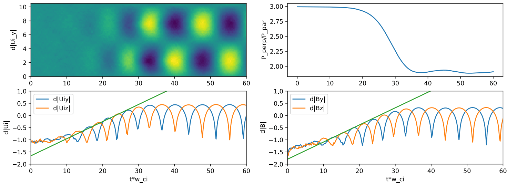
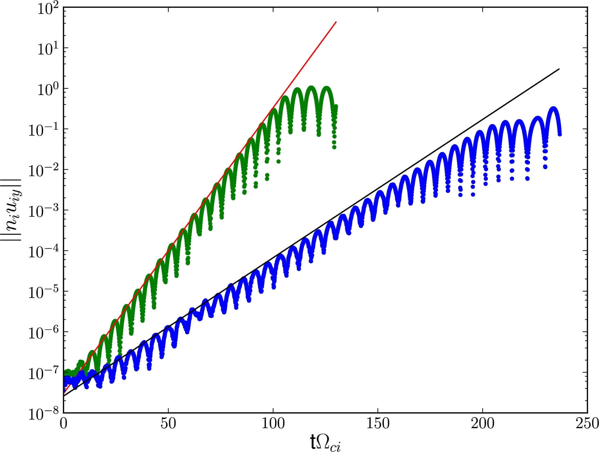

# 混合方法 {#sec-hybrid}

混合模型适用于 $\omega\sim\Omega_i$、$kr_{Li}\sim 1$（波长 $\lambda\sim 6r_{Li}$）的低频物理，其中 $\omega$ 是波频率，$k$ 是波数，$\Omega_i$ 是离子回旋频率，$r_{Li}$ 是离子拉莫尔半径。对于这一频率和波长范围，采用 $\sim r_{Li}$ 或离子惯性长度 $d_i$ 的网格尺寸，可以分辨近地空间不稳定性中的离子动理学过程。采用远小于回旋周期的粒子时间步长 $\Delta t$，可以分辨离子有限回旋半径效应。

全球磁层混合模型的典型时间步长为 $0.05\,\Omega_0^{-1}$，其中 $\Omega_0$ 是上游（太阳风）离子回旋频率。对于行星际磁场 $B_0\sim10\,\text{nT}$，$\Omega_0 \sim 1\,\text{rad/s}$，对应 $f_0\sim 1/2\pi\,\text{s}^{-1}$。根据原位观测，磁尾中典型的离子惯性长度约为 $\sim 0.2\,\text{R}_\text{E}$，但在日侧磁层顶附近更小。因此，离散网格尺寸 $\Delta x = 0.1\,d_i$ 通常勉强足以分辨磁尾离子动理学动力过程，却不足以分辨日侧动理学结构。

## 经典混合模型

将电荷密度 $\rho$ 和电流密度 $\mathbf{J}$ 定义为
$$
\rho = \sum_s q_s n_s - en_e
$$

$$
\mathbf{J} = \sum_s q_s n_s \mathbf{u}_s - e n_e \mathbf{u}_e
$$
其中 $q_s, n_s, \mathbf{U}_s$ 是离子组分 s 的电荷、数密度和整体速度，通过对分布函数取矩计算
$$
n_s = \int \mathrm{d}^3 v f_s(\mathbf{r}_s,\mathbf{v}_s,t)
$$
$$
\mathbf{u}_s = \frac{1}{n_s}\int \mathrm{d}^3 v \mathbf{v}_s f_s(\mathbf{r}_s,\mathbf{v}_s,t)
$$
也可以使用相应的离散形式，此时分布函数表示为一组具有特定形状函数的宏粒子。这样它表现得更像一个粒子云。

混合模型的关键假设是_准中性_，即电子运动足够快，能够抵消任何电荷密度涨落，并始终满足 $\rho=0$。通过假设准中性，我们可以

* 避免求解电子的守恒方程
* 完全避免求解麦克斯韦方程，转而使用广义欧姆定律

因此电子密度可用离子密度表示为 $n_e \approx n_i \equiv \sum_s q_s n_s /e$。
此外，还可以利用安培定律消去电子整体速度
$$
\mathbf{J} = \mu_0^{-1}\nabla\times\mathbf{B}
$$ {#eq-hybrid_ampere}
以及关系式
$$
\mathbf{u}_e = \mathbf{u}_i - \mathbf{J}/n_e e
$$ {#eq-hybrid_Je}

常规 PIC 混合模型使用的基本方程首先包含针对各个离子的粒子推进方程
$$
\frac{\mathrm{d}\mathbf{x}_j}{\mathrm{d}t} = \mathbf{v}_j
$$

$$
\frac{\mathrm{d}\mathbf{v}_j}{\mathrm{d}t} = \frac{q_j}{m_j}\big( \mathbf{E} + \mathbf{v}_j \times \mathbf{B} \big)
$$
其中下标 $j$ 和 $e$ 分别表示单个离子和电子流体，其他符号均为常规记法。小写速度表示各个宏粒子的速度。

或者，如果使用 Vlasov 系统，则直接从 Vlasov 方程求解分布函数 $f(\mathbf{r}_s, \mathbf{v}_s, t)$
$$
\frac{\partial f_s}{\partial t} + \mathbf{v}_s\frac{\partial f_s}{\partial \mathbf{r}_s} + \mathbf{a}_s\cdot \frac{\partial f_s}{\partial \mathbf{v}_s} = 0
$$
其中
$$
\mathbf{a}_s = \frac{q_s}{m_s}(\mathbf{E}+\mathbf{v}_s\times\mathbf{B})
$$

广义欧姆定律用于确定电场的时间演化，它由电子动量方程在假设 $m_e \rightarrow 0$ 下导出，
$$
\mathbf{E} = - \mathbf{u}_i \times \mathbf{B} + \frac{1}{\mu_0 n_e e}(\nabla\times\mathbf{B})\times\mathbf{B} - \frac{1}{n_e e}\nabla\cdot\overleftrightarrow{P}_e + \mathbf{R}_{ei}
$$ {#eq-hybrid_ohm}
其中霍尔项中的电流已被 B 的旋度替换。注意，这里使用电子数密度而非离子密度，以避免准中性条件下多个离子组分引起的混淆。最后一项 $\mathbf{R}_{ei}$ 可以表示碰撞／物理电阻率，也可以表示人为电阻率／数值扩散。对于电磁问题，它可以包含如下形式的电阻和超电阻项
$$
\mathbf{R}_{ei} = \eta \mathbf{J} + \eta_H\nabla^2\mathbf{J}
$$
其中电阻率 $\eta$ 可以看作对电子—离子碰撞的简单描述，超电阻率 $\eta_H$ 可以表示电子黏性，并通过阻尼网格尺度振荡来帮助维持数值稳定性。此外，$\mathbf{R}_{ei}$ 还可以包含粒子碰撞模型中显式摩擦或其他动量交换项的贡献。

磁场根据法拉第定律演化
$$
\frac{\partial \mathbf{B}}{\partial t} = -\nabla\times\mathbf{E}
$$

霍尔项支持哨声波，它通常对混合 PIC 代码的时间步长施加最严格的限制。哨声波的 Courant–Friedrichs–Lewy（CFL）时间步长条件通常为 $\Omega_{ci}\Delta t < (\Delta x/ d_i)^2/\pi$。包含霍尔项的磁场更新是一个刚性问题，因此许多实际情况需要使用更小时间步长的子循环。当网格分辨率很高、满足 $\Delta x\ll d_i$ 时，这尤其有用。

最后，通过适当的状态方程确定电子压力张量，就可以跟踪系统随时间的演化。例如，令 $\overleftrightarrow{P}_e = P_e \overleftrightarrow{I}$，其中 $P_e$ 是各向同性的电子标量压力。最简单的形式为
$$
P_e = n_e k_B T_e
$$
其中 $n_e \approx n_i$ 且 $T_e=T_i$。但要注意，在等离子体中电子压力通常高于离子温度，因此这是非常粗略的假设。另一个常用假设是绝热过程
$$
P_e = n_e^\gamma k_B T_e = n_0(n/n_0)^\gamma k_B T_{e0}
$$
其中 $\gamma=5/3$ 是单原子理想气体的绝热指数。

对于初始条件存在梯度的更复杂系统，需要单独的电子能量演化方程，其形式为
$$
\frac{\partial P_e}{\partial t} = -\gamma \nabla\cdot(P_e \mathbf{u}_e) + (\gamma-1)\mathbf{u}_e\cdot\nabla P_e + (\gamma-1)(-\nabla\cdot\mathbf{Q}_e + H_{ei})
$$ {#eq-hybrid_pe_evolution}
其中电子整体速度由 @eq-hybrid_Je 推得，电流由 @eq-hybrid_ampere 给出。如果使用 @eq-hybrid_pe_evolution 代替简单状态方程，则在与磁场演化相同的数值循环中对它进行时间积分。对于许多问题，电子热通量可以用热导率 $\kappa$ 建模为
$$
\mathbf{Q_e} = -\kappa \nabla T_e
$$
其中 $\kappa = \kappa_e + \kappa_0$，$\kappa_e$ 由物理模型给出，可能取决于局部等离子体条件；$\kappa_0$ 是为方便而单独设置的较小常数数值扩散系数（对于具有物理热导率的模型，$\kappa_0\sim 0.01 - 0.1 \kappa_e$；对于磁化模拟，$\kappa_0\sim 0.01 n_0 d_i V_A$），有助于保持数值稳定性。电子与离子能量交换模型可通过 $H_{ei}$ 项纳入：可以将碰撞模型中各单元离子损失的能量加回局部电子流体单元，从而描述这一过程。（？？？）

当然，也可以纳入完整的电子压力张量效应，以更好地处理特别是重联物理。

关于假设电子无质量的混合动理学模型，更完整的综述见 [@winske2023hybrid]。
所有混合算法的核心问题是如何计算下一时间步的电场。

### 优点与局限

优点：

* 对离子物理不作近似。
* 适用于 $\omega/\Omega_i \sim kr_i \sim 1$。
* 在高 $\beta$ 区域没有问题。
* 粒子推进的实现简单，易于优化。
* 去除了刚性最强的电子尺度。忽略电子动理学尺度通常使每个空间维度的计算成本和内存需求（相对于全 PIC）降低 $\sqrt{m_i/m_e}$ 倍，时间步长通常也可以增大类似的倍数。

局限：

* 需要分辨离子回旋频率。
* 刚性的 EMHD 哨声波使 $\Delta t_{CFL}\sim \Delta x^2$。
* 没有电子朗道阻尼。
* 显式时间推进格式可能很复杂。
* 现有方法均不守恒动量或能量。

### 电子的作用

「无质量」电子的解释比较微妙。如果从全粒子模型出发，考察 $m_e\to 0$ 时的渐近行为，并不会直接得到混合方程。原因是：

1. 混合模型从运动方程中完全消去了电子惯性项。_这不仅是小质量近似；它从根本上改变了电子对场的响应方式_。
2. 混合模型经常（但并非总是）假设准中性，即电子和离子密度近乎相等。这是独立于电子无质量的另一项假设。
3. 两种模型计算电场和磁场的方式不同。混合模型通常直接结合广义欧姆定律和法拉第定律求解电场，而全粒子模型会完整求解麦克斯韦方程。同样，结合第 1 点，两种模型中电子对场的响应方式完全不同。

### 最小分辨尺度限制

有趣的是，混合模型对模拟网格尺寸 $\Delta L$ 设有下限（通常 $\Delta L \gtrsim 10 \delta_e$），主要是为了确保「无质量电子」近似在物理上的一致性并保持数值稳定性。
在标准混合等离子体模型（动理学离子、无质量流体电子）中，分辨电子惯性长度 $\delta_e$ 可能违反模型的基本假设，并对时间步长施加严苛限制。

#### 混合近似的有效性

标准混合模型假设电子是无质量的电荷中和流体（$m_e \to 0$）。在物理上，这一近似意味着相对于离子时间尺度，电子响应是瞬时的，且关注的频率远低于电子回旋频率 $\Omega_{ce}$。

然而，广义欧姆定律中的霍尔项将哨声模引入系统。短波长哨声波的色散关系具有色散性，即频率 $\omega$ 与波数 $k$ 的平方成正比：
$$
\omega \propto k^2
$$

具体而言，当空间尺度接近电子惯性长度（$k \sim 1/\delta_e$）时，哨声波频率趋近电子回旋频率（$\omega \rightarrow \Omega_{ce}$）。

如果模拟网格足够细，能够分辨 $\delta_e$（即 $\Delta L \sim \delta_e$），网格就能支持频率接近 $\Omega_{ce}$ 的波。这造成了矛盾：
- 模型在假设 $\omega \ll \Omega_{ce}$（无质量流体极限）的条件下推导方程。
- 网格分辨率却允许 $\omega \sim \Omega_{ce}$ 的模态。

通过要求 $\Delta L \gg \delta_e$，可以有效滤除这些高频模态，确保模拟保持在混合流体电子方程物理上有效的低频区域。

#### 哨声波灾难

从数值角度看，哨声模的二次色散（$\omega \propto k^2$）对显式时间推进格式施加严格的 Courant–Friedrichs–Lewy（CFL）条件。最大稳定时间步长 $\Delta t$ 与网格间距的平方成正比：
$$
\Delta t \propto \Delta L^2
$$
如果减小 $\Delta L$ 以分辨非常小的尺度 $\delta_e$，允许的最大 $\Delta t$ 会变得极小，使模拟的计算成本难以承受。

由于无质量流体近似本来就无法正确模拟 $\delta_e$ 尺度上的物理（电子惯性、电子有限拉莫尔半径），分辨这一尺度不会带来物理上的好处，却会产生巨大的计算成本。

#### 数值加热与稳定性

在基于粒子网格法（PIC）的方法中，有限的粒子数通常会带来数值噪声。在混合代码中，如果网格分辨了电子在理论上具有惯性的尺度（但模型忽略了它），霍尔项就可能将网格尺度的噪声耦合到高频哨声模。

在缺少完整电子动理学模型中存在的物理阻尼机制（如电子朗道阻尼）时，这些非物理高频模态可能在网格尺度上增长或积累能量，从而导致数值不稳定或离子的人为加热。保持较粗的网格（$\Delta L \gg \delta_e$）可起到低通滤波器的作用，抑制这种噪声。

## 低密度处理

由于混合模型包含与 $1/n_e$ 成正比的项，低密度和真空区域需要进行修正。最简单的方法是在场求解器中设置密度下限 $n_f$，使推进场时使用的密度为 $n_e = \max(n_e, n_f)$。密度下限的典型值为 $n_f/n_0 \sim 0.01 - 0.05$，其中 $n_0$ 是参考背景密度。参考密度 $n_0$ 通常是用于定义离子趋肤深度 $d_i=V_A/\omega_{ci}$ 的值。 

[@amano2014robust] 提出了另一种求解电场的方法
$$
(\omega_{pe}^2 - c^2\nabla^2)\mathbf{E} = \frac{e}{m_e}\big( \mathbf{J}_e \times\mathbf{B} - \nabla\cdot\overleftrightarrow{P}_e \big) + (\mathbf{V}_e\cdot\nabla)\mathbf{J}_e + \eta\mathbf{J}
$$
它在近真空区域可以退化为拉普拉斯方程，不会带来数值困难。

此外，电子速度重新定义为
$$
\mathbf{V}_e = \frac{\mathbf{J}_e}{\text{max}(\rho_e, \rho_{e,min})}
$$
其中最小密度 $\rho_{e,min}$ 是人为设定的值。

在混合系统中，最大相速度是电子阿尔芬速度，当 $m_e \approx 0$ 时它趋于无穷大。然而，计算时我们只有离子阿尔芬速度
$$
v_{p,max} \simeq \frac{1}{2}\frac{B}{\sqrt{\mu_0 n_e m_e}} = \frac{1}{2}V_{A,i} \sqrt{\frac{m_i}{m_e}}
$$

为了使最大相速度始终低于 CFL 条件所允许的值，可以使用修正的电子质量比 $m_e^\prime$，定义为
$$
\frac{m_e^\prime}{m_i}=\text{max}\Big( \frac{m_e}{m_i}, V_A^2\big( \frac{\Delta t}{2\alpha \Delta x} \big)^2 \Big)
$$
以代替物理电子质量 $m_e$。这里 $V_A$ 是根据局部密度和磁场计算的阿尔芬速度，$\alpha$ 是允许的最大 Courant 数（$\le 0.5$）。

## 有限电子惯性 {#sec-finite_e_mass}

常规混合模拟模型处理动理学离子和无质量的电荷中和电子流体，已知它容易因哨声模波色散发散以及低密度区域中的除以密度运算而产生数值不稳定。波长与离子惯性长度相当的短波长阿尔芬波由于离子与电子动力学解耦而具有色散。因此出现了频率按 $\omega \propto k^2$ 发散的哨声模。这意味着系统中的最大相速度快速、无界地增大，导致数值困难。除以密度的问题源自 @eq-hybrid_Je，出现在霍尔项和电子压力梯度项中。因此，除非采用某种特别设计的技术，否则模拟区域不能存在纯真空区域。

另一方面，这也可以表述为：如果涉及哨声波，采用无质量电荷中和电子的混合模拟是不现实的。人们或者使用全粒子模型，或者尝试在常规混合模型中纳入有限电子质量。

为解决哨声模波的色散问题，人们提出了有限电子惯性修正。在混合模型中纳入有限电子惯性修正的常规方法是引入如下所谓的广义电磁场 $\widehat{\mathbf{E}}, \widehat{\mathbf{B}}$，定义为
$$
\widehat{\mathbf{E}} = \mathbf{E} - \frac{\partial}{\partial t}\big( \frac{c}{\omega_{pe}^2}\nabla\times\mathbf{B} \big)
$$

$$
\widehat{\mathbf{B}} = \mathbf{B} + \nabla\times\big( \frac{c^2}{\omega_{pe}^2}\nabla\times\mathbf{B} \big)
$$
其中与 $\nabla\times\mathbf{B}$ 成正比的项表示电子惯性修正。

由电子流体的运动方程可以证明
$$
\widehat{\mathbf{E}} = - \mathbf{V}_i \times \mathbf{B} + \frac{1}{n_i e}(\nabla\times\mathbf{B})\times\mathbf{B} - \frac{1}{n_i e}\nabla\cdot\overleftrightarrow{P}_e - \frac{m_e}{e}(\mathbf{V}_e\cdot\nabla)\mathbf{V}_e
$$
它与广义欧姆定律类似，但现在多了最后一项，该项也表示修正。$\mathbf{V}_e$ 由 @eq-hybrid_Je 得到。

给定广义电场 $\widehat{\mathbf{E}}$，可以利用法拉第定律推进广义磁场 $\widehat{\mathbf{B}}$；容易验证它满足
$$
\frac{\partial \widehat{\mathbf{B}}}{\partial t} = -\nabla\times\widehat{\mathbf{E}}
$$

通常还会采用进一步的简化；例如，经常忽略电场修正项以及密度在电子尺度上的空间变化。此时，可以通过求解以下方程恢复磁场
$$
\widehat{\mathbf{B}} = \big( 1 - \frac{c^2}{\omega_{pe}^2}\nabla^2 \big)\mathbf{B}
$$
并假设 $\widehat{\mathbf{E}} = \mathbf{E}$。这一方法的优点是，可以将修正作为标准过程每一步积分之后的后处理来实现。

## 与霍尔 MHD 的比较

离子 Vlasov 方程的零阶矩和一阶矩为
$$
\begin{aligned}
\frac{\partial n}{\partial t} + \nabla\cdot(n\mathbf{u}_i) = 0 \\
\frac{\partial mn\mathbf{u}_i}{\partial t} + \nabla\cdot\Big[ mn\mathbf{u}_i\mathbf{u}_i - \frac{\mathbf{B}\mathbf{B}}{\mu_0} + \frac{B^2}{2\mu_0}\mathbf{I} + \overleftrightarrow{P} \Big] = 0
\end{aligned}
$$

霍尔 MHD 与混合模型的区别在于对压力张量项的处理。对于 $T_{i0}/T_{e0}$ 为常数的霍尔 MHD，
$$
\overleftrightarrow{P} = p_e(1 + T_{i0}/T_{e0})\mathbf{I}
$$

对于混合模型，
$$
\overleftrightarrow{P} = p_e\mathbf{I} + \int m_i f_i \mathbf{w}\mathbf{w}\mathrm{d}\mathbf{w}
$$

因此，从不包含离子有限拉莫尔半径（FLR）效应或温分布函数产生的其他动理学效应这一意义上说，霍尔 MHD 是「冷离子」模型。

## 归一化

混合模型中有五个基本量（长度、质量、时间、电流密度和数密度？？？）以及三个物理常数（$\mu_0,q,m$）。如果加入温度，相应地还会出现 $k_B$。通常虽然粒子质量是常数，我们仍将其视为参数，以表示质子系统、电子系统或其他粒子系统。因此，混合模型的归一化单位需要三个（$5-2$）独立的参考量。例如，可以取磁场尺度 $B_0$、数密度尺度 $n_0$ 和质量尺度 $m_0$。从原始单位转换到归一化单位的一般变量变换为
$$
\chi = \chi_0\tilde{\chi}
$$
其中 $\tilde{\chi}$ 表示归一化单位中的变量，尺度 $\chi_0$ 应使用原始单位（例如国际单位制）。

通常使用回旋频率的倒数作为时间尺度
$$
t_0 = \Omega_{c0}^{-1} = \frac{m_0}{e B_0}
$$

使用阿尔芬速度作为速度尺度
$$
v_0 = v_A = \frac{B_0}{\sqrt{\mu_0 n_0 m_0}}
$$

然后长度尺度取为离子趋肤深度，即惯性长度
$$
L_0 = d_i = \frac{c}{\Omega_{c0}} = \sqrt{\frac{m_0}{\mu_0 e^2 n_0}}
$$

加速模拟的一个常用技巧是人为增大离子质量，使长度尺度按 $\propto \sqrt{m_0}$ 增大。例如，在许多全球地球磁层混合模型中，上游太阳风的 $d_i$ 通过增大离子质量被人为增大到 $0.1\,\text{R}_E$，这是 $n_{sw}=6\,\text{amu/cc}$ 时真实值 $d_i=0.015\,\text{R}_E$ 的 6.8 倍。如果网格分辨率为 $0.05\,\text{R}_E\approx 300\,\text{km}$（这在 2020 年代很常见），每个离子尺度波约有 10 个点，足以分辨离子尺度动理学过程。

然而，必须强调这种因计算限制而采用的缩放所带来的一个后果。参考阿尔芬速度
$$
V_{A0} = d_{i0}\Omega_{i0}
$$

也会大于真实值，因为我们人为增大了 $d_{i0}$，却没有增大 $\Omega_{i0}$。

注意回旋频率与频率的区别，二者相差一个 $2\pi$ 因子：
$$
\omega = 2\pi f
$$

我曾在处理使用国际单位制的代码时犯过错误。你可能会疑惑，为什么离子惯性长度定义为光速除以单位为 $[\text{rad}/\text{s}]$ 的等离子体离子频率，而时间尺度的单位是 $\Omega_i^{-1}$，即 $[\text{s}/\text{rad}]$。实际上，两者都不包含 $2\pi$！

压力尺度既可以从磁压导出，也可以从动压导出
$$
P_0 = \frac{B_0^2}{\mu_0} = \rho_0 v_0^2
$$
注意这里去掉了因子 2：它保留在无量纲方程中，例如 $p_B^\prime = {B^\prime}^2/2$。

温度尺度则为
$$
T_0 = \frac{p_0}{n_0 k_B} = \frac{B_0^2}{2\mu_0 k_B n_0}
$$

注意压力和温度尺度中出现的因子 2：这是为了使推导保持一致。
单位换算汇总于 @tbl-hybrid-unit-conversion。

::: {#tbl-hybrid-unit-conversion layout-nrow=2}
| 基本变量 | 符号 | 定义 | 数值 |
|----------------|----------|------------|-------|
| 磁场           | $B_0$    | $B_0=B_\mathrm{ref}$ | $1\times10^{-8}\,\mathrm{T}$ |
| 数密度         | $n_0$    | $n_0=n_\mathrm{ref}$ | $1\times10^{6}\,\mathrm{m}^{-3}$ |
| 质量           | $m_0$    | $m_0=m_i$  | $1.67\times10^{-27}\,\mathrm{kg}$ |

: 混合模型中的基本量示例

| 导出变量 | 符号          | 定义 | 数值 |
|------------------|---------------|------------|-------|
| 长度             | $l_0$         | $l_0=\sqrt{m_0/(\mu_0 e^2 n_0)}$ | $2.28\times10^5\,\mathrm{m}$ |
| 速度             | $v_0$         | $v_0=B_0/\sqrt{\mu_0m_in_0}$| $2.18\times10^5\,\mathrm{m}\cdot\mathrm{s}^{-1}$|
| 时间             | $t_0$         | $t_0=m_i/(e*B_0)$ | $1.04\,\mathrm{s}$ |
| 质量密度         | $\rho_0$      | $\rho_0=n_0/m_i$ | $1.67\times10^{-21}\,\mathrm{m}^{-3}$ |
| 压力             | $p_0$         | $p_0=\rho_0v_0^2$ | $7.96\times10^{-11}\,\mathrm{N}\cdot\mathrm{m}^{-2}$ |
| 温度             | $T_0$         | $T_0=p_0*m_i/(k_B\,\rho_0)$ | $5.76\times10^6\,\mathrm{K}$ |

: 混合模型中的导出量示例

混合模型单位换算。
:::

## 数值稳定性

非线性数值模拟通常需要一定的耗散以保持稳定。这可以通过以下方式实现：

1. 方程中的显式项（「物理耗散」）。
2. 对流项的迎风处理（通过离散化引入隐式耗散）。

混合模型通常采用方法 1），在欧姆定律中加入耗散：
$$
\mathbf{E} = \underbrace{\mathbf{E}^\ast}_{\text{无摩擦的 }\mathbf{E}} + \underbrace{\eta\mathbf{j}}_{\text{电阻率}} - \underbrace{\eta_H \nabla^2\mathbf{j}}_{\text{超电阻率}}
$$

需要超电阻率的原因是霍尔项表现不佳（刚性？）。Stainer 的第 33 张幻灯片？？？
超电阻率项与电子碰撞黏性 $\eta_H\nabla^2\mathbf{u}_e$ 的形式类似。但其系数对空间环境而言过大，有时被称为「反常黏性」。

加入摩擦项时应特别注意守恒。为守恒动量，应在宏粒子推进器或 Vlasov 求解器中使用 $\mathbf{E}^\ast$，只使用 $\mathbf{E}$ 更新 $\mathbf{B}$。为守恒能量，需要一个单独的电子压力方程，其中包含摩擦加热 $H_e = \eta j^2 + \eta_H \nabla \mathbf{j}:\nabla\mathbf{j}$ 和热通量 $\mathbf{q}_e$：
$$
(\gamma-1)^{-1}\Big[\frac{\partial p_e}{\partial t} + \nabla\cdot(\mathbf{u}_e p_e) \Big] + p_e\nabla\cdot\mathbf{u}_e = H_e - \nabla\cdot\mathbf{q}_e
$$

### 有限网格不稳定性

设想冷离子束穿过均匀空间网格的情形。[@rambo1995finite] 表明，对于 Ti /Te << 1，非守恒（显式）格式无论空间分辨率如何都是不稳定的。$T_i /T_e$ 和束流速度的精确阈值取决于宏粒子的形状函数。这种不稳定性使离子发生不稳定的（指数）加热，直至达到某个饱和值，同时也违反动量守恒。隐式动量和能量守恒格式对这些不稳定性是稳定的。

## 边界条件

### 开放边界条件

开放边界条件允许等离子体和磁通流入或流出模拟区域。离子粒子在开放边界被吸收，必要时注入新粒子。注入的粒子通量从漂移的多麦克斯韦速度分布中采样，该分布与边界上指定的密度、速度和压力矩相匹配。

形式上，将磁场分为两个分量 $\mathbf{B} = \mathbf{B}_0 + \mathbf{B}_1$，即固定外场 $\mathbf{B}_0$ 和随时间变化的分量 $\mathbf{B}1$。外场是由等离子体外部的电流系统产生的真空场（$\nabla\times\mathbf{B}_0 = 0$）。例如，全球磁层模拟中的行星际磁场和行星偶极场，或磁镜装置中由外部线圈产生的约束场。粒子在总磁场 $\mathbf{B}$ 中推进；在场求解器中，仅对 $\mathbf{B}_1$ 进行时间推进，并且在根据 $\mu_0\mathbf{J}=\nabla\times\mathbf{B}=\nabla\times\mathbf{B}_1$ 计算霍尔项中的等离子体电流密度时，可以省略 $\mathbf{B}_0$。以这种方式分解 $\mathbf{B}$ 的优点是，在开放边界条件下，边界虚拟单元中的 $\mathbf{B}_0$ 保持固定。否则外场可能因边界处的扩散而随时间变化。对于 $\mathbf{B}$ 中随时间变化分量的开放边界条件，将每个虚拟单元中的场 $\mathbf{B}_1$ 设为与模拟区域内相邻单元的值相等。

电场的处理方式不同。开放边界沿线虚拟单元中的电场与内部单元中的电场一起进行时间推进。但使用欧姆定律 @eq-hybrid_ohm 计算虚拟单元中的电场时，假设 $\mathbf{B}$ 和等离子体矩（$n$ 和 $\mathbf{u}_i$）均没有垂直于边界的梯度。虚拟单元中的等离子体矩与磁场一样，被设为相邻单元的值。例如，$x$ 方向的开放边界可能有来自 $P_e$ 的 $y$ 和 $z$ 方向梯度的压力梯度电场 $E_y$ 和 $E_z$，但没有压力梯度驱动的 $E_x$ 分量。关键是，对于开放的 $x$ 边界，霍尔项 $\propto(\nabla\times\mathbf{B})\times\mathbf{B}$ 中保留 $y$ 和 $z$ 方向的梯度，但不保留 $x$ 方向的梯度。这种开放边界电场处理方式显著提高了数值稳定性。不过，通常还需要设置一个宽度为数个单元、具有增强超电阻率 $η_H$ 的缓冲区，以耗散残余振荡。

### 磁层内边界条件

内边界条件通常是磁层建模中最棘手的部分。在 Angeo3D [Lin+ 2014] 中，假设内磁层（$r<6\,\text{R}_\text{E}$）由与离子粒子共存的冷不可压缩离子流体主导。冷离子流体的数密度假设为
$$
n_f = \frac{n_\text{eq}}{r^3}[1-\tanh(r-6.5)]
$$
其中 $r$ 的单位为 $\text{R}_\text{E}$，且 $n_\text{eq}=1000\,\text{cm}^{-3}$。

在内磁层中加入冷离子流体，简化了流体占主导的低高度内边界条件。离子粒子在磁层内边界（例如 $r=3.5\,\text{R}_\text{E}$）被设为反射。对离子平行速度 $\mathbf{v}_{i\parallel}$ 的这种简单反射意味着忽略了损失锥效应。对于偶极场中俯仰角各向同性的粒子分布，完整损失锥中的粒子仅占总数的 0.3%，因此可以合理地忽略。假设内边界处的 $\mathbf{B}$ 保持偶极场的值。与全球 MHD 模型 [@raeder1995] 一样，电离层条件（高度 1000 km）被纳入混合代码。见 @sec-MI_coupling。

## 测试

### 质子回旋各向异性不稳定性

这是一个电磁和多离子验证测试。我们考虑由 $p_{i\perp}/p_{i\parallel} > 1$ 驱动的一维空间、三维速度电磁不稳定性。最大增长发生在 $\mathbf{k}\times\mathbf{B}=0$，具有有限的实频率。不稳定性阈值为
$$
\frac{P_\perp}{P_\parallel} - 1 \approx \frac{S}{\beta_\parallel^{0.4}}
$$
其中 $S\sim 1$ [@gary1993theory]。  

$\mathbf{k}$ 和 $\mathbf{B}_0$ 均平行于 x 轴。对于初始扰动，选择 $k_x \Delta x = 0.065$。设置一个具有 64 个单元的一维模拟，$\Delta t \Omega_{ci} = 0.01$，耗散为 0。标称模拟参数为：
$$
\beta_\parallel = 1, \frac{T_\perp}{T_\parallel} = 3, \frac{L_x}{d_i} = 10.5, \frac{T_e}{T_\parallel} = 1, \gamma = \frac{5}{3}
$$

::: {.content-visible unless-format="pdf"}

{#fig-vpic-pcai}

:::

PCAI 结果：

* 横向速度和磁场分量从噪声中增长（左旋阿尔芬波）。
* 对于这些参数，与线性理论一致（$\gamma/\Omega_{ci} =0.162$）。
* 压力各向异性通过波粒相互作用减小，直至饱和。

加入密度占比为 20% 的少数 α 粒子组分（$\text{He}^{2+}$）时，发现增长率更小。
$$
Z_\alpha = 2, M_\alpha = 4, \frac{T_{\alpha\parallel}}{T_{p\parallel}} = 2, \frac{T_{\alpha\perp}}{T_{\alpha\parallel}} = \frac{T_{p\perp}}{T_{p\parallel}} = 3, \frac{N_\alpha}{N_p} = 0.2, Z_\alpha N_\alpha + Z_p N_p = 1
$$

::: {.content-visible unless-format="pdf"}

{#fig-vpic-cai-growth}

:::

可以计算一系列 $\beta$ 和各向异性条件下的增长率，并与线性色散求解器（例如 [HYDROS](https://github.com/dtold/HYDROS)）比较。

### 朗道阻尼离子声波

混合 PIC 模型中的基本静电模是离子声波，它也由压力扰动驱动。在流体模型（如霍尔 MHD）中，这种波不受阻尼。然而，在混合 PIC 中，朗道共振使波受到阻尼，并使离子速度分布函数在局部变平，类似于朗缪尔振荡的电子朗道阻尼。

色散关系为
$$
\frac{dZ(\zeta)}{\mathrm{d}\zeta} = 2\frac{T_i}{T_e},\quad \zeta\equiv \frac{\omega-i\gamma}{kv_{\text{th},i}}
$$

::: {.content-visible unless-format="pdf"}

{#fig-vpic-ldiaw}

:::

标称模拟参数为：
$$
T_i = 1/3,\, \gamma=5/3,\, c_s = \sqrt{\gamma T_e/m_i} = 1,\, k_x = \pi/8,\, \delta n = 2\times 10^{-2}
$$

标称参数下的结果

* 阻尼率：$\gamma = -0.0932$。
* 初始扰动衰减至噪声底。可以通过以下方法降低噪声：
  1. 增加每个单元的粒子数（噪声 $\sim 1/\sqrt(N_p)$）。
  2. 二项式平滑／更高阶形状函数。
  3. 使用低差异准随机数初始化粒子（噪声 $\sim 1/N_p$）。
  4. 最有效的方法：Delta-F（见 @sec-delta_f）。

### 磁重联中的磁岛合并

磁岛是磁通绳的二维形式。这里设置一个自驱动重联问题，研究理想磁岛运动与微观尺度重联物理的耦合。离子动理学效应对重联研究至关重要。

不稳定的 Fadeev 磁岛平衡：磁场 $\mathbf{B}$ 由 $\nabla\times\mathbf{A}$ 给出，在此设置中只需要
$$
A_y = -\lambda B_0 \ln[\text{cosh}(z/\lambda) + \epsilon\cos(z/\lambda)]
$$
密度由下式给出
$$
n = n_0(1-\epsilon^2)/[\text{cosh}(z/\lambda) + \epsilon\cos(z/\lambda)]^2 + n_b
$$

压力平衡给出
$$
\beta = \frac{2\mu_0 n_0 k_B (T_{i0}+ T_{e0})}{B_0^2} = 1
$$

标称模拟参数为：
$$
\lambda = 5d_i,\, \epsilon = 0.4,\, n_b = 0.2n_0,\, T_i/T_e = 1,\, \eta = 10^{-3},\, \eta_H = 5\times10^{-3},\, \gamma = 1
$$
数值参数为：二维空间包含 $256\times128$ 个单元，每个单元 50 个粒子，$\Delta t\Omega_{ci} = 0.005$。

::: {.content-visible unless-format="pdf"}

{#fig-vpic-reconnection2d}

:::

### 无碰撞激波

这是一个二维磁层激波问题：从右侧开放边界注入一个 $M_A = 11.4$ 的激波，左侧为反射边界，以驱动无碰撞激波。

