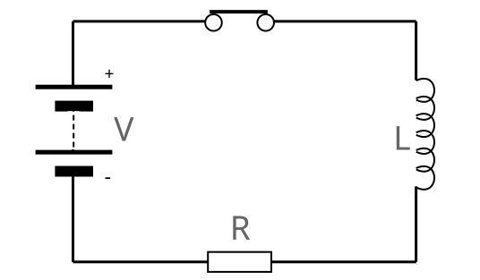
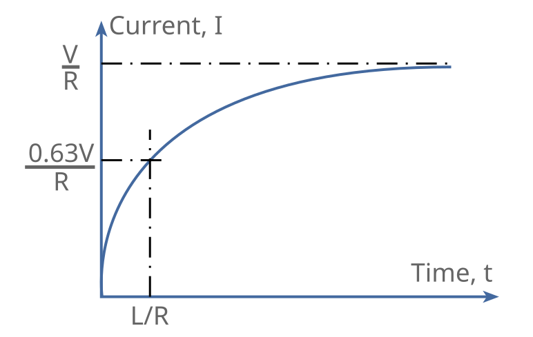

# 电感 {#sec-inductance}

电感是电感器储存能量的能力，能量储存在电流产生的磁场中。建立磁场需要能量，而磁场衰减时能量会释放出来。由于电流伴随磁场，电感器会产生一个与电路中电流变化率成正比的反向电压。电感由电路中流动的电流产生的磁场引起。通常使用线圈，因为线圈能增强磁场耦合，从而增强这一效应。

电感有两种应用方式：

* _自感_：自感是电路（通常是线圈）的一种性质，电流变化通过电流产生的磁效应使同一电路中的电压发生变化。可以看出，自感适用于单个电路——换言之，它通常是单个线圈内的电感。这种效应用于单个线圈或扼流圈。

* _互感_：互感是一种感应效应，一个电路中的电流变化通过连接两个电路的磁场，使第二个电路两端的电压发生变化。这种效应用于变压器。

## 单位定义

在电路图或方程中表示电感器时，通常使用符号「L」。在电路图上，电感器通常编号为 L1、L2 等。

电感的国际单位制单位是亨利，记为 H，可根据电流变化率和电压来定义。如果电路中的电流变化率为每秒一安培，并由此产生一伏特的电动势，则该电路的电感为一亨利。$1\mathrm{H} = 1 \mathrm{Wb}/\mathrm{A}$。

## 现象

当电流流过导体时，无论导体是直的还是绕成线圈，其周围都会建立磁场，这会影响电路接通后电流增长的方式。

为了理解电感对电路的影响，可以先看看电路在直流（DC）下如何工作，再看看交流（AC）下的情况。尽管它们遵循相同的规律并产生相同的效应，直流例子更简单，便于解释，然后可以用它作为解释交流情况的基础。

### 直流

接通电路时，电流开始流动。随着电流增大到稳定值，它产生的磁场也逐渐建立至最终形态。在这一过程中，磁场不断变化，因此正如楞次定律所预期的那样，在线圈自身感应出一个反向电压。

::: {.content-visible unless-format="pdf"}

{#fig-inductance-dc}

:::

包含电感值为 $L$ 亨利的电感器和相应电路电阻 $R$ 欧姆的电路，其时间常数 $T$（秒）可计算为 $T = L/R$。$T$ 是电流 $I$（安培）上升至其最终稳态值 V/R 的 0.63 倍所需的时间。磁场中储存的能量为 $\frac{1}{2}L\,I^2$。

::: {.content-visible unless-format="pdf"}

{#fig-inductance-dc-current-t}

:::

断开电流时，电路电阻实际上会突然增大至无穷大。这意味着比值 $L / R$ 变得很小，磁场迅速衰减。磁场发生了很大变化，因此电感试图维持电流，并利用磁场中储存的能量产生反向_电动势_（EMF）来阻碍这一变化。

产生反电动势时，所形成的极高电压可能导致开关触点之间出现火花，尤其是在触点刚刚断开时。这会使触点产生凹坑，并造成机械开关磨损。在电子电路中，反电动势可能损坏半导体器件，因此通常会采取措施减小它。

### 交流

交流电通过电感器时，同样适用这些基本原理；但由于波形周期性重复，为方便起见，我们倾向于从稍有不同的角度考察电感器的响应。

交流波形本身始终在变化。这意味着产生的磁场也始终在变化，并不断产生感应反电动势。因此，电感器由于电感作用而阻碍交流电流通过。这种阻碍是在线材欧姆电阻造成的阻碍之外额外产生的。

这意味着，如果电感器的欧姆电阻很低，直流电通过时损耗很小，但它可以对高频信号呈现很高的阻抗。利用电感器的这一特性，可以防止高频信号通过电感器。

电感的另一个方面是，电感器与电容器的电抗可以在电路中共同作用、相互抵消。这称为_谐振_，广泛用于带通滤波器。

## 电感器

电感器是在电子电路中利用电感的电子元件。这些电感器通常由多匝导线绕制而成，以增大电感。也可以将它们绕在铁磁芯上，进一步增大电感。

### 导线和线圈的电感

直导线和线圈都具有电感。电感器通常采用线圈，因为线圈不同匝之间的磁场交链会增大电感，并使导线能够容纳在较小的体积内。

如果导线不绕成线圈，通常需要很长的导线，使这种电子元件变得不可行。将导线绕成线圈可以使电感最大化，从而使电感器能够用于许多电子电路。

然而，即使直导线的电感也可能影响某些电子电路。对于大多数低频应用，直导线的电感可以忽略；但随着频率升至甚高频及更高频段，导线自身的电感可能变得不可忽略，因此需要缩短互连线以尽量减小其影响。

有一些计算方法可以相当准确地计算导线的电感，但线圈的电感稍微复杂一些，它取决于多种因素，包括线圈的形状，以及线圈内部和周围材料的常数。

### 应用

电感是电子电路设计中非常重要的一个方面。虽然为了获得所需电感值，电感器元件的尺寸会比较大，因此它们在低频电子电路设计中并不那么常用，但它们广泛用于频率高得多的射频设计，也用于电磁兼容（EMC）领域——在其中，滤波常使用电感器确保干扰无法沿电线和电缆传播。例如，在计算机电缆上常能看到一种简单的电感器：在电缆周围加装铁氧体以增大电感，防止信号沿电缆传播并辐射出去，从而避免可能对其他系统产生干扰。
