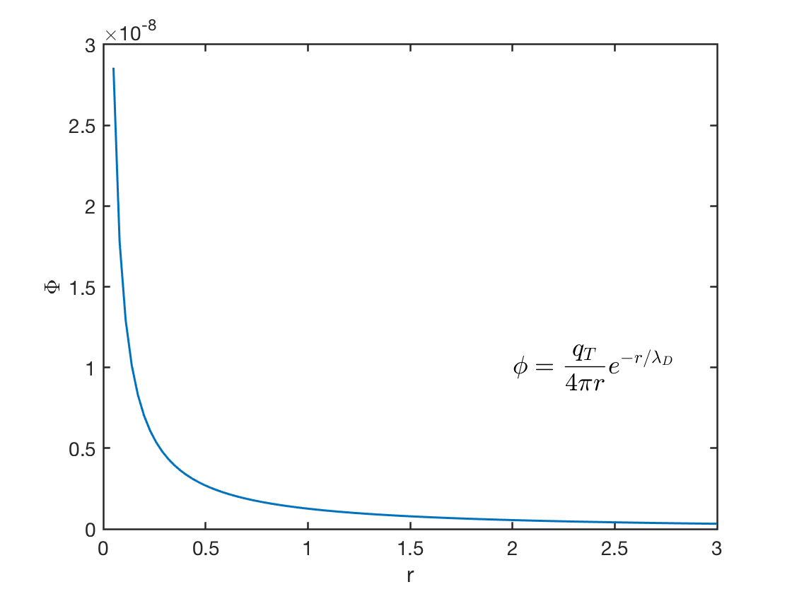

# 绪论 {#sec-intro}

* 什么是等离子体？

准中性的电离气体。物质的第四种状态：固态、液态、气态、__等离子体__。

* 等离子体存在于哪里？
  * 天体物理与地球物理
    * 发电机效应
    * 激波
    * 磁重联
    * 粒子加速
  * 工程与应用
    * 受控聚变
    * 能量转换
    * 洲际弹道导弹和航天器再入
    * 等离子体射流作为航天器的新型推进方式
    * 全球变暖

* 等离子体物理中采用的方法
  * 动理学理论
    * 微观视角
    * 正、负和中性粒子
    * 电磁力、碰撞
    * 普通气体与等离子体
      * 二体碰撞
      * 碰撞之间自由运动

$$
\begin{aligned}
&nf(\mathbf{x}+\mathrm{d}\mathbf{x},\mathbf{p}+\mathrm{d}\mathbf{p},t+\mathrm{d}t)\mathrm{d}\mathbf{x}\mathrm{d}\mathbf{p}-nf(\mathbf{x},\mathbf{p},t)\mathrm{d}\mathbf{x}\mathrm{d}\mathbf{p} \\
=&\frac{\partial (nf(\mathbf{x},\mathbf{p},t))}{\partial t}\Big|_{\text{碰撞}}\mathrm{d}\mathbf{x}\mathrm{d}\mathbf{p}\mathrm{d}t \nonumber \\
=&\frac{\partial (nf)}{\partial t}+\frac{\partial nf}{\partial \mathbf{x}}\cdot\frac{\mathbf{p}}{m}+\frac{nf}{\partial \mathbf{p}}\cdot\mathbf{F}
\end{aligned}
$$

这也称为 _Fokker-Planck_ 项。

* 连续介质理论
  * 宏观视角，整体运动
  * 由守恒定律得到的基本方程
  * 电磁流体动力学（EMHD）

定义：等离子体 = _电离气体_

在等离子体物理中，我们通常使用能量单位“eV”代替温度。电子伏特是一个较小的单位，多用于粒子，因为日常尺度上的 1 焦耳对电子来说太大了。给定玻尔兹曼常数 $k_B=1.38\times10^{-23}J/K$，
$$
1\text{eV}=(11600\text{K})\times k_B=1.602\times 10^{-19}\text{J} ([V]=[J]/[C])
$$

等离子体一般分为两类：

1. 高温（$>1\text{keV}$）：聚变等离子体
2. 低温（$\sim 1\text{eV}-100\text{eV}$）：等离子体加工、空间推进

开始时，建立尺度的概念十分重要。先从两个基本长度尺度出发：

* $a_0\equiv \text{原子尺度 }$（$\sim 10^{-10}\text{m}$）
* n = 数密度（$\sim 1/\text{cm}^3$ 至 $10^{20}/\text{cm}^3$）

在物理上，$n$ 表示单位体积内的粒子数，由此可知 $n^{-1/3}$ 的单位是长度。它表示单个粒子的典型长度尺度。
电离态意味着 $k_B T\gg E_i=$ 电离势能 $\sim \frac{e^2}{4\pi\epsilon_0 a_0}\approx 14\textrm{eV}$。

气态意味着 $n^{-1/3}\gg a_0$。
$$
\begin{aligned}
n^{-1/3}\gg a_0\sim\frac{e^2}{4\pi\epsilon_0 E_i}\gg \frac{e^2}{4\pi\epsilon_0(k_B T)} \\
4\pi n^{-1/3} n \Big( \frac{\epsilon_0 k_B T}{e^2 n} \Big) \gg 1 \nonumber
\end{aligned}
$$

$n^{2/3}$ 的单位为 $\text{长度}^{-2}$，这表明另一项的单位应为 $\text{长度}^{2}$。利用量纲分析可得
$$
\lambda_{D}=\sqrt{\frac{\epsilon_0 k_B T}{e^2 n}}\equiv \textrm{德拜长度}=740(\text{cm})\sqrt{\frac{T(\text{eV})}{n(\text{cm}^{-3})}}
$$

$$
\begin{split}
(4\pi)^{3/2}n{\lambda_{D}}^3 &\gg 1 \\
n{\lambda_D}^3 &\gg 1 \Rightarrow \text{球体内有大量粒子}
\end{split}
$$

根据前面的定义，等离子体必然满足这一条件。

等离子体定义的含义：

1. 德拜球中存在大量粒子。

$\underline{\text{例}.1}$ 实验室等离子体 $10^{8}\text{cm}^{-3}\rightarrow 10^{20}\text{cm}^{-3}$。托卡马克 $n=10^{14}\text{cm}^{-3}$，$k_B T=10\text{keV}=10^4\text{eV}$，$n^{-1/3}=2.15\times10^{-5}\text{cm}$，$\lambda_D=7.4\times10^{-3}\text{cm} \gg n^{-1/3}$，$n{\lambda_{D}}^3\gg 1$。

$L\gg\lambda_{D}\gg n^{-1/3}$，其中 $L$ 是物理系统的尺度（$\sim 1\text{mm}\text{ 至 }10\text{m}$）。

换句话说，电离气体成为等离子体的一个判据是它足够稠密，使 $\lambda_D$ 远小于 $L$。

$\underline{\text{例}.2}$ 星际等离子体 $n=1 \text{cm}^{-3}, T=1eV$，$\lambda_D=740\text{cm}\sqrt{\frac{1}{1}}=740\text{cm} \gg n^{-1/3}$，$n{\lambda_D}^3\gg1$。

2. 粒子动能 $\gg$ 平均库仑相互作用能。
$$
\begin{split}
KE&\sim k_B T \\
PE&\sim \frac{e^2}{4\pi\epsilon_0(n^{-1/3})}
\end{split}
$$

根据定义，可以容易地知道
$$
k_B T\gg \frac{e^2}{4\pi\epsilon_0 n^{-1/3}}\Rightarrow KE\gg PE
$$

这意味着粒子不易被相邻粒子偏转。

3. 粒子主要受到累积的多次小角度碰撞散射，而非大角度碰撞散射。这自然地由上面的能量讨论得出，后面将进一步详细解释。

4. 集体相互作用（所有不稳定性的基础）比单个粒子之间的库仑相互作用占主导地位。这与经济有一个类比：个人对整体几乎没有影响，但整体对个人有巨大影响。电磁场在粒子之间起桥梁作用。

## 自然界中的等离子体

现在人们认为，宇宙由 69% 的暗能量、27% 的暗物质和 1% 的普通物质组成。我们在天空中看到的一切，都是处于等离子体状态并发出辐射的那部分普通物质。物理学中的等离子体（不要与血浆混淆）是一种“电离”气体，其中原子中至少一个电子被剥离，留下带正电的原子核，称为离子。有时等离子体被称为“物质的第四态”。固体受热后变成液体，液体受热后变成气体。进一步加热时，气体电离成等离子体。由于等离子体由带电的离子和电子组成，电场无处不在，粒子不仅在彼此撞击时会“碰撞”，即使相隔一定距离、能够感受到彼此电场时也会发生作用。描述例如水流过管道、帆船比赛中水绕船流动或飞机机翼行为的流体动力学，已经是一门复杂的学科。加入等离子体的电场后，可能的运动范围大大扩展，尤其是在存在磁场时。

等离子体通常只存在于真空中。否则，空气会冷却等离子体，使离子和电子复合成普通中性原子。在实验室中，我们需要抽出真空室内的空气。然而，在太空真空中，大部分气体处于等离子体状态，我们可以看到它。恒星内部和大气、气态星云以及整个星系之所以可见，是因为它们处于等离子体状态。然而，在地球上，大气使我们接触到的等离子体现象仅限于几个例子：闪电的闪光、北极光柔和的辉光、荧光灯管的光或等离子电视的像素。我们生活在宇宙中一个不会自然出现等离子体的小区域；否则，我们就无法生存。

其原因可以从萨哈方程看出，该方程给出热平衡气体中预期的电离程度：
$$
\frac{n_i}{n_n}\approx 2.4\times 10^{21}\frac{T^{3/2}}{n_i} \exp\left(-\frac{U_i}{k_B T}\right)
$$ {#eq-saha}

这里 $n_i$ 和 $n_n$ 分别是电离原子和中性原子的密度（每 $\text{m}^3$ 中的数量），T 是以开尔文为单位的气体温度，$k_B$ 是玻尔兹曼常数，$U_i$ 是气体的电离能，即从原子中移除最外层电子所需的焦耳数。对于室温下的普通空气，可以取 $n_n\approx 3\times 10^{25}\,\text{m}^{-3}$、$T\approx 300\, \text{K}$ 和 $U_i = 14.5\,\text{eV}$（氮），其中 $1\,\text{eV} = 1.6\times 10^{19}\,\text{J}$。电离比例 $n_i/(n_n + n_i) \approx n_i/n_n$ 低得惊人：
$$
\frac{n_i}{n_n}\approx 10^{-122}
$$

随着温度升高，电离程度保持很低，直到 $U_i$ 仅为 $k_B T$ 的几倍。随后 $n_i/n_e$ 急剧上升，气体进入等离子体状态。温度进一步升高使 $n_n$ 小于 $n_i$，等离子体最终变为完全电离。这就是为什么等离子体存在于温度达数百万度的天体中，而不存在于地球上。生命很难与等离子体共存——至少与我们所讨论的这类等离子体共存很难。等离子体在高温下自然出现，是它被称为“物质的第四态”的原因。

虽然我们无意着重讨论萨哈方程，但应指出它的物理意义。气体中的原子具有分布不一的热能；当某个原子偶然遭遇能量足以击出一个电子的碰撞时，它便发生电离。在冷气体中，这类高能碰撞很少发生，因为原子必须通过一系列“有利的”碰撞被加速至远高于平均能量。@eq-saha 中的指数因子体现了高速原子的数量随 $U_i/k_BT$ 指数下降这一事实。原子一旦电离，就会保持带电，直到遇到一个电子；此时它极有可能与电子复合，再次成为中性原子。复合率显然取决于电子密度，我们可以将其视为等于 $n_i$。因此，平衡时的离子比例应随 $n_i$ 增大而降低；这就是 @eq-saha 右侧出现因子 $n_i^{-1}$ 的原因。星际介质中的等离子体得以存在，是因为 $n_i$ 很低（每 $\text{cm}^3$ 约 1 个），因而复合率也很低。

## 等离子体的定义

当然，并非任何电离气体都能称为等离子体；任何气体都总会有一定程度的微弱电离。一个有用的定义如下：

**等离子体是由带电粒子和中性粒子组成、表现出集体行为的准中性气体。**

现在必须定义“_准中性_”和“_集体行为_”。准中性的含义将在第 1.4 节中阐明。链接？“集体行为”的含义如下。

考虑例如普通空气中的一个分子所受的力。由于分子是中性的，它所受的净电磁力为零，而重力可以忽略。分子不受干扰地运动，直到与另一个分子碰撞；这些碰撞控制着粒子的运动。施加于中性气体的宏观力，例如扬声器产生声波时施加的力，通过碰撞传递给各个原子。含有带电粒子的等离子体中，情况完全不同。这些电荷运动时可以形成局部正电荷或负电荷聚集，从而产生电场。电荷运动还产生电流，进而产生磁场。这些场会影响远处其他带电粒子的运动。

考虑相距 $r$ 的两个略微带电的等离子体区域之间的相互作用。添加插图！A 与 B 之间的库仑力按 $1/r^2$ 衰减。然而，对于给定的立体角（即 $\Delta r/r =$ 常数），B 中能够影响 A 的等离子体体积按 $r^3$ 增长。因此，即使相距很远，等离子体的各部分也会相互施力。正是这种长程库仑力使等离子体具有丰富多样的可能运动，并使被称为等离子体物理的研究领域更加丰富。事实上，最有趣的结果涉及所谓的“无碰撞”等离子体，其中长程电磁力远大于普通局部碰撞产生的力，以至于后者可以完全忽略。“集体行为”指的不仅取决于局部条件，还取决于远处区域等离子体状态的运动。

“plasma”一词似乎不太贴切。它源自希腊语 πλάσμα, ατoς, τo，意为被塑造或制造出来的东西。由于集体行为，等离子体并不倾向于顺从外部影响；相反，它的行为常常仿佛有自己的意志。

## 温度的概念

继续之前，有必要回顾并扩展我们对“温度”的物理概念。热平衡气体中的粒子具有各种速度，这些速度最可能的分布称为麦克斯韦分布。为简单起见，考虑一种粒子只能沿一个维度运动的气体。（这并非完全不切实际；例如，强磁场可以将电子约束为只能沿磁力线运动。）一维麦克斯韦分布为
$$
f(v) = A \exp\left( -\frac{1}{2}mv^2/k_B T \right)
$$ {#eq-maxwellian_1d}
其中 $f\mathrm{d}u$ 是每 $\text{m}^3$ 中速度介于 $u$ 和 $u+\mathrm{d}u$ 之间的粒子数，$\frac{1}{2}mu^2$ 是动能，$k_B$ 是玻尔兹曼常数。密度 $n$，即每 $\text{m}^3$ 中的粒子数，为
$$
n = \int_{-\infty}^\infty f(v)\mathrm{d}v
$$

常数 $A$ 与密度 $n$ 的关系为
$$
A = n\left( \frac{m}{2\pi k_B T} \right)^{1/2}
$$

分布的宽度由常数 $T$ 表征，我们称之为温度。为了了解 $T$ 的确切含义，可以计算这一分布中粒子的平均动能：
$$
E_\text{av} = \frac{\int_{-\infty}^\infty \frac{1}{2}mv^2f(v)\mathrm{d}v}{\int_{-\infty}^\infty f(v)\mathrm{d}v}
$$ {#eq-average_kinetic_energy}

定义 $y=v/v_\text{t}$ 和
$$
v_\text{t} = \left( 2k_B T/m \right)^{1/2}
$$ {#eq-thermal_speed}

则可将 @eq-maxwellian_1d 写为
$$
f(v) = A \exp(-v^2/v_\text{t}^2)
$$
并将 @eq-average_kinetic_energy 写为
$$
E_\text{av} = \frac{\frac{1}{2}mA v_\text{t}^3 \int_{-\infty}^\infty [\exp(-y^2)]y^2\mathrm{d}y}{A v_\text{t}\int_{-\infty}^\infty [\exp(-y^2)]\mathrm{d}y}
$$

分子中的积分可以分部积分：
$$
\begin{aligned}
\int_{-\infty}^\infty y\cdot[\exp(-y^2)]y\mathrm{d}y &= \left[ -\frac{1}{2}[\exp(-y^2)]y \right]_{-\infty}^\infty -\int_{-\infty}^\infty -\frac{1}{2}[\exp(-y^2)]\mathrm{d}y \\
&= \frac{1}{2}\int_{-\infty}^\infty [\exp(-y^2)]\mathrm{d}y
\end{aligned}
$$

约去积分，得到
$$
E_\text{av} = \frac{\frac{1}{2}mA v_\text{t}^3\frac{1}{2}}{A v_\text{t}} = \frac{1}{4}m v_\text{t}^2 = \frac{1}{2}k_B T
$$

因此平均动能为 $\frac{1}{2}k_B T$。

这一结果很容易推广到三维。此时麦克斯韦分布为
$$
f(v_x, v_y, v_z) = A_3 \exp\left[ -\frac{1}{2}m(v_x^2 + v_y^2 + v_z^2)/k_B T \right]
$$
其中
$$
A_3 = n\left( \frac{m}{2\pi k_B T} \right)^{3/2}
$$

由于麦克斯韦分布各向同性（即其形式对 $v_x,v_y,$ 和 $v_z$ 对称），我们可以分离各个维度。平均动能于是为单个维度结果的 3 倍：
$$
E_\text{av} = \frac{3}{2}k_B T
$$

一般结果是，每个自由度对应的 $E_\text{av}$ 等于 $\frac{1}{2}k_B T$。

由于 $T$ 和 $E_\text{av}$ 的关系如此密切，等离子体物理中习惯用能量单位表示温度。为避免涉及的维数引起混淆，表示温度时使用的是与 $k_B T$ 对应的能量，而不是 $E_\text{av}$。对于 $k_B T = 1\,\text{eV}=1.6\times 10^{-19}\,\text{J}$，有
$$
T = \frac{q}{k_B} = 11600
$$

因此换算关系为
$$
1\,\text{eV} = 11600\,\text{K}
$$

2 eV 的等离子体是指 $k_B T=2\,\text{eV}$，或在三维情况下 $E_\text{av}=3\,\text{eV}$。

有趣的是，等离子体可以同时具有多个温度。离子和电子常常分别具有不同温度 $T_i$ 和 $T_e$ 的麦克斯韦分布。这可能是因为离子之间或电子之间的碰撞率高于离子与电子之间的碰撞率。于是每种粒子都可以处于各自的热平衡，但等离子体的存在时间可能不足以让两种温度达到相等。当存在磁场 $\mathbf{B}$ 时，即使是单一粒子种类，例如离子，也可以有两个温度。这是因为沿 $\mathbf{B}$ 作用于离子的力与垂直于 $\mathbf{B}$ 的力不同（由于洛伦兹力）。垂直和平行于 $\mathbf{B}$ 的速度分量于是可以属于温度分别为 $T_\perp$ 和 $T_\parallel$ 的不同麦克斯韦分布。

在结束对温度概念的回顾之前，我们应当消除一个普遍误解：高温必然意味着大量热。人们得知荧光灯管内的电子温度约为 $20000\, \text{K}$ 时通常会很惊讶：“天哪，摸起来没那么烫！”当然，还必须考虑热容量。荧光灯管内的电子密度远小于大气压下气体的密度，以热速度撞击管壁的电子传递给管壁的总热量并不大。例如，烟灰的温度足以造成烫伤，但所涉及的总热量不足以造成烫伤。许多实验室等离子体的温度约为 $1,000,000\,\text{K}$（$100\,\text{eV}$），但由于密度仅为每 $\text{m}^3$ 中 $10^{18}-10^{19}$ 个粒子，管壁受热并不是严重问题。

## 德拜屏蔽 {#sec-debye}

（第 27 页第 4 题 [@bellan2008fundamentals]）

等离子体行为的一个基本特征是它能够屏蔽施加于其上的电势。假设我们试图通过插入两个与电池相连的带电球，在等离子体内部建立电场（图 1.3，添加插图！）。小球会吸引带相反电荷的粒子，几乎立刻，一个离子云会围绕负电球，一个电子云会围绕正电球。（我们假定一层电介质阻止等离子体在表面实际复合，或者电池足够大，能够尽管存在复合仍维持电势。）如果等离子体是冷的且没有热运动，云中的电荷量就会与小球中的电荷量相等，屏蔽将是完全的，云外的等离子体主体中不会存在电场。另一方面，如果温度有限，位于云边缘、电场较弱处的粒子有足够的热能逃离静电势阱。于是云的“边缘”位于势能约等于粒子热能 $k_BT$ 的半径处，屏蔽并不完全。量级为 $k_BT/e$ 的电势可以渗入等离子体，使其中存在有限电场。

下面计算这种电荷云的大致厚度。将点电荷 $q_T$ 放入由带电粒子组成的准中性气体中。气体处于_局部热力学平衡_（LTE），离子和电子温度为 $T_e$ 和 $T_i$（它们不一定相同，实际上性质相当不同）。（添加插图！）我们希望计算 $\phi(x)$。为简单起见，假设离子与电子的质量比 $M/m$ 为无穷大，使离子不运动，而是形成均匀的正电荷背景。更准确地说，可以认为 $M/m$ 足够大，使离子的惯性阻止它们在实验时间尺度上发生显著运动。

麦克斯韦分布：
$$
f(\mathbf{v})=n_0\Big( \frac{m}{2\pi kT}\Big)^{3/2}\exp\Big( -\frac{mv^2}{2kT}\Big)
$$

存在势能 $q\phi$ 时，分布函数遵循玻尔兹曼分布：
$$
f(\mathbf{x},\mathbf{v})=n_0\Big( \frac{m}{2\pi kT}\Big)^{3/2}\exp\Big( -\frac{\frac{1}{2}mv^2+q\phi(\mathbf{x})}{kT}\Big)
$$

这里不必证明这一点。方程所表达的内容在直觉上显而易见：势能大的地方粒子较少，因为并非所有粒子都有足够能量到达那里。

注意，温度的概念在局部热力学平衡中有效。由玻尔兹曼方程，
$$
\begin{aligned}
\frac{\mathrm{d}f}{\mathrm{d}t}=\frac{\partial f}{\partial t}+\nabla_x\cdot(f\mathbf{v})+\nabla_v\cdot(f\mathbf{a})=0 \\
\Rightarrow \frac{\partial f}{\partial t}+\mathbf{v}\cdot\nabla_x f+\frac{\mathbf{F}}{m}\cdot\nabla_v f=0
\end{aligned}
$$

如果忽略时间导数，得到
$$
(\mathbf{v}_j\cdot\nabla)f(\mathbf{r},\mathbf{v}_j)+\big[-\frac{1}{m_j}\nabla(q_j\phi)\cdot\nabla_v\big]f(\mathbf{r},\mathbf{v}_j)=0
$$ {#eq-LTE_Vlasov}

LTE 分布具有麦克斯韦形式：
$$
f(\mathbf{r},\mathbf{v}_j)=n_j(\mathbf{r})\Big( \frac{m}{2\pi k_BT}\Big)^{3/2}\exp\Big( -\frac{mv^2}{2k_BT}\Big)
$$

代入 @eq-LTE_Vlasov，得到
$$
\begin{aligned}
(\mathbf{v}_j\cdot\nabla)n_j +\frac{\mathbf{v}_j\cdot\nabla(q\phi)}{k_BT_j}n_j=0 \\
\Rightarrow n_j(\mathbf{r}) = n_{j0} \exp\Big[ -\frac{q_j\phi_j(\mathbf{r})}{k_BT_j} \Big]
\end{aligned}
$$

于是得到各粒子种类的玻尔兹曼分布，每种粒子各有其温度。

考虑均匀等离子体，满足 $n_i=n_{i0}e^{-e\phi/k_B T_i}$、$n_e=n_{e0}e^{e\phi/k_BT_e}$，根据准中性假设，$n_{e0}=n_{i0}=n_0$。在初始电中性的等离子体中引入点电荷 $q_T$。泊松方程给出
$$
\nabla^2 \phi=-\frac{\rho}{\epsilon_0}=-\frac{1}{\epsilon_0}\Big[ e(n_e-n_i) +q_T \delta(\mathbf{r})\Big]
$$

由对称性，$\phi=\phi(r)$。温度高时，$q\phi(r)\ll kT$，指数很小，可以进行泰勒展开并只保留一阶项。在球坐标中，
$$
\begin{aligned}
\nabla^2\phi=\frac{1}{r^2}\frac{\partial}{\partial r}\Big( r^2\frac{\partial \phi}{\partial r} \Big)& \nonumber \\
\frac{1}{r^2}\frac{\partial}{\partial r}\Big( r^2\frac{\partial \phi}{\partial r} \Big)+\frac{e}{\epsilon_0}\Big( \underbrace{ n_{e0}e^{e\phi/k_BT_e} - n_{i0}e^{-e\phi/k_B T_i} }_{\approx n_0\big[ e\phi/k_BT_e +e\phi/k_BT_i  \big]}\Big)&= -\frac{q_T}{\epsilon_0}\delta(\mathbf{r}) \\
\frac{1}{r^2}\frac{\partial}{\partial r}\Big( r^2\frac{\partial \phi}{\partial r} \Big) -\underbrace{\frac{e^2n_0}{\epsilon_0}\Big( \frac{1}{k_B T_e}+\frac{1}{k_BT_i}\Big) }_{ \frac{1}{{\lambda_D}^2}\equiv \frac{1}{{\lambda_{Di}}^2}+\frac{1}{{\lambda_{De}}^2}}\phi&=-\frac{q_T}{\epsilon_0}\delta(\mathbf{r}) \\
\frac{1}{r^2}\frac{\partial}{\partial r}\Big( r^2\frac{\partial \phi}{\partial r} \Big) -\frac{1}{{\lambda_D}^2}\phi&=-\frac{q_T}{\epsilon_0}\delta(\mathbf{r})
\end{aligned}
$$
其中
$$
\lambda_D=\sqrt{\frac{\epsilon_0 k_BT^\ast}{n_0e^2}}
$$ {#eq-debye_length}

是德拜长度，$T^\ast=\Big( \frac{1}{T_e}+\frac{1}{T_i} \Big)^{-1}$。德拜长度衡量屏蔽距离或鞘层厚度。注意，密度越大，屏蔽效果越好，这是符合预期的，因为每一层等离子体都含有更多电子。此外，$\lambda_D$ 随 $k_B T^\ast$ 增大而增大。如果没有热扰动，电荷云会塌缩为无限薄的一层。最后，定义 $\lambda_D$ 时最常用的是_电子_温度（$T^\ast\approx T_e$），因为电子比离子更易运动，通常通过运动造成负电荷的过剩或不足来实现屏蔽。只有在特殊情况下才并非如此。

对于 $r>0$（远离电荷），
$$
\frac{1}{r^2}\frac{\partial}{\partial r}\Big( r^2\frac{\partial \phi}{\partial r} \Big) -\frac{1}{{\lambda_D}^2}\phi=0
$$

令 $\phi(r)=\frac{F(r)}{r}$，得到
$$
\begin{aligned}
\frac{\mathrm{d}^2F}{\mathrm{d}r^2}-\frac{F}{{\lambda_D}^2}&=0 \\
\Rightarrow F&=Ae^{-r/\lambda_D}+\cancel{Be^{r/\lambda_D}} (r>0) \nonumber \\
&=Ae^{-r/\lambda_D}
\end{aligned}
$$

预期当 $r\rightarrow 0$ 时，$\phi(r)\rightarrow \frac{q_T}{4\pi\epsilon_0 r}\approx \frac{A}{r}$。因此
$$
\phi(r)=\frac{q_t}{4\pi\epsilon_0r}e^{-r/\lambda_D}
$$

{#fig-electric-potential}

电势下降得非常快（@fig-electric-potential）。换言之，如果将一个电荷放入中性等离子体，它的电势只在很小的范围内起作用。回顾高斯定律：
$$
\oint\mathbf{E}\cdot \mathrm{d}\mathbf{A}=\frac{Q_T}{\epsilon_0}\rightarrow\textrm{ 当 }R\rightarrow \infty, \textrm{ E 趋于零。}
$$

@eq-debye_length 的以下形式很有用：
$$
\begin{aligned}
\lambda_D &= 69 (T_e/n)^{1/2}\,\text{m},\quad T_e\,\text{以 K 为单位} \\
\lambda_D &= 7430 (k_B T_e/n)^{1/2}\,\text{m},\quad k_BT_e\,\text{以 eV 为单位}
\end{aligned}
$$

现在可以定义“准中性”。如果系统的尺寸 $L$ 远大于 $\lambda_D$，那么每当出现局部电荷聚集或将外部电势引入系统时，它们都会在与 $L$ 相比很短的距离内被屏蔽，使等离子体主体中不存在大的电势或电场。在壁面或障碍物上的鞘层之外，$\nabla^2\phi$ 很小，且 $n_i$ 等于 $n_e$。只需很小的电荷不平衡就能产生量级为 $k_BT/e$ 的电势。等离子体是“准中性”的；也就是说，它足够中性，可以取 $n_i\simeq n_e\simeq n$，其中 $n$ 是称为_等离子体密度_的共同密度，但又没有中性到使所有有趣的电磁力都消失。在大于德拜长度的长度尺度上，可以认为等离子体是中性的。

补充说明：

1. 等离子体的行为类似电介质。
2. 材料接触处附近存在等离子体鞘层，其中电荷中性被破坏。这将在 @sec-sheath 中讨论。

## 等离子体的判据

我们已经给出了电离气体要称为等离子体必须满足的两个条件。第三个条件与碰撞有关。例如，飞机喷气尾流中的弱电离气体不符合等离子体的条件，因为带电粒子与中性原子碰撞过于频繁，其运动受普通流体动力学力而非电磁力控制。如果 $\omega$ 是典型等离子体振荡的频率，$\tau$ 是与中性原子碰撞之间的平均时间，则要求 $\omega \tau > 1$，气体才表现得像等离子体而不是中性气体。

1. $\lambda_D \ll L$
2. $N_D \gg 1$
3. $\omega\tau > 1$

在课堂上，人们常认为条件 1 和条件 2 等价；它们并不完全等价。其理由是：条件 1 在分布为麦克斯韦分布时成立，而麦克斯韦分布恰好是大量粒子的平衡分布；条件 2 是这一分布成立的统计先决条件。

## 等离子体频率

除了长度尺度，我们也关心时间尺度。等离子体频率
$$
\omega_p = \sqrt{\frac{n\,e^2}{\epsilon_0\,m}}
$$ {#eq-plasma_frequency}
是等离子体物理中最基本的时间尺度。显然，每种粒子都有不同的等离子体频率。然而，频率相对较高的电子频率最为重要，大多数教科书中提到“等离子体频率”时，一般都指电子等离子体频率。

$\omega_p$ 对应于给定粒子种类响应微小电荷分离时的典型静电振荡频率。例如，考虑一维情况下，一块完全由某一种带电粒子组成的薄板从其准中性位置偏移无穷小距离 $\delta x$。由此在薄板前表面产生的电荷密度为 $\sigma=e\,n\,\delta x$，在相对表面产生大小相等、符号相反的电荷密度。薄板内部产生的沿 $x$ 方向电场为 $E_x= -\sigma/\epsilon_0 =- e\,n\,\delta x/\epsilon_0$。因此，对薄板内部的单个粒子应用牛顿定律得到
$$
m\,\frac{\mathrm{d}^2 \delta x}{\mathrm{d}t^2} = e\,E_x = -m\,\omega_p^{~2}\,\delta x
$$
从而得到 $\delta x = \delta x_0\,\cos\omega_p t$。

等离子体频率与等离子体振荡和波密切相关。@sec-oscillations 给出了更完整的推导。注意，只有在研究等离子体系统的时间 $\tau$ 长于等离子体周期 $\tau_p\equiv 1/\omega_p$，且外部作用改变系统的速率不快于 $\omega_p$ 时，才能观察到等离子体振荡。反之，所研究的显然不是等离子体物理（例如核反应），将系统视为等离子体也就没有实际意义。同样，如果观测的长度尺度 $L$ 小于典型等离子体粒子在一个等离子体周期内走过的距离 $v_t\,\tau_p$，也检测不到等离子体行为。在这种情况下，粒子在完成一次等离子体振荡之前就会离开系统。这个距离是 $\tau_p$ 在空间上的对应量，称为_德拜长度_，其形式为
$$
\lambda_D \equiv \sqrt{T/m}\,\,\omega_p^{-1}.
$$

注意
$$
\lambda_D = \sqrt{\frac{\epsilon_0\,T}{n\,e^2}}
$$
与质量无关，因此不同粒子种类的德拜长度通常可以相互比较。显然，只有满足下列条件时，才能有效地将我们的理想化系统视为等离子体：
$$
\frac{\lambda_D}{L} \ll 1
$$ {#eq-length_limit}
以及
$$
\frac{\tau_p}{\tau}\ll 1
$$

这里，$\tau$ 和 $L$ 分别表示所研究过程的典型时间尺度和长度尺度。
应当指出，尽管通常要求满足 @eq-length_limit，等离子体物理仍能够研究德拜尺度上的结构。最重要的例子是德拜鞘层，即包围由材料表面约束的等离子体的边界层。

令 $V_A=B/\sqrt{\mu_0 \rho}$ 为阿尔芬速度，$\omega_{c}=q\, B/m$ 为离子回旋频率。有以下方便的关系：
$$
\frac{\omega_p}{\omega_{c}} = \frac{c}{V_A}
$$ {#eq-frequency-ratio}

## 空间尺度

- _离子惯性长度_：离子与电子解耦、磁场冻结于电子流体而非整体等离子体中的尺度。
$$
d_i = \frac{c}{\omega_{pi}} = \frac{V_{Ai}}{\omega_{ci}}
$$ {#eq-i-inertial-length}
其中 $V_{Ai}$ 是离子阿尔芬速度。

- _电子惯性长度（等离子体趋肤深度）_：电子分布函数能够发生显著变化的尺度，或电磁辐射能够穿透等离子体的深度。
$$
d_e = \frac{c}{\omega_{pe}} = \frac{V_{Ae}}{\omega_{ce}}
$$ {#eq-e-inertial-length}
其中 $V_{Ae}$ 是电子阿尔芬速度。

- _离子回旋半径_：也称拉莫尔半径，是离子绕磁场回旋的尺度。
$$
r_L = \frac{v_{\perp, ti}}{\omega_{c}} = \frac{mv_{\perp, ti}}{qB}
$$ {#eq-gyroradius-i}
其中 $v_{\perp, ti} = \sqrt{p_{\perp i}/\rho}$ 是垂直方向的离子热速度。

- _电子回旋半径_：电子绕磁场回旋的尺度。
$$
r_L = \frac{v_{\perp, te}}{\omega_{c}} = \frac{mv_{\perp, te}}{qB}
$$ {#eq-gyroradius-e}
其中 $v_{\perp, te} = \sqrt{p_{\perp e}/\rho}$ 是垂直方向的离子热速度。

惯性长度与回旋半径之间一个方便的关系是
$$
\frac{r_L}{d_i} = \frac{v_{ti}}{v_A} = \sqrt{\beta/2}
$$ {#eq-length-ratio}

在相对论情况下，回旋半径为
$$
r_L = \frac{p}{qB} = \frac{\gamma m v_\perp}{qB}
$$ {#eq-gyroradius-relativistic}
其中 $\gamma$ 是洛伦兹因子。在天体粒子研究中，人们喜欢用 [GeV] 表示粒子能量，并分别用 c 和 e 归一化速度和电荷。因此，
$$
\begin{aligned}
\frac{r_L}{[\mathrm{m}]} &= \frac{\gamma m c^2/ [\mathrm{J}] \cdot v_\perp / c}{q/e \cdot B/[\mathrm{T}]}\cdot\frac{1}{ce} \\
&= \frac{\gamma m c^2 / [\mathrm{GeV}]\cdot v_\perp/c}{q/e \cdot B/[\mathrm{T}]}\cdot \frac{10^9}{c} \\
&= 3.3 \frac{\gamma m c^2 / [\mathrm{GeV}]\cdot v_\perp/c}{q/e \cdot B/[\mathrm{T}]}
\end{aligned}
$$ {#eq-gyroradius-astro}

- _德拜长度_：电子重新分布将电场屏蔽掉的尺度：
$$
\lambda_{D}=\sqrt{\frac{\epsilon_0 k_B T^\ast}{e^2 n_e}} = \frac{v_\text{th}^\ast}{\omega_{pe}}
$$ {#eq-debye-length}
其中 $T^\ast=\Big( \frac{1}{T_e}+\frac{1}{T_i} \Big)^{-1}$，$v_\text{th}^\ast$ 是相应的热速度。即使在准中性冷等离子体中，离子贡献实际上似乎因离子温度较低而更大，离子项实际上仍常被忽略，得到
$$
\lambda_{D}=\sqrt{\frac{\epsilon_0 k_B T_e}{e^2 n}}= \frac{m_e}{q_e}\frac{\sqrt{\epsilon_0 P_e}}{\rho_e} = \sqrt{\frac{\epsilon_0 v_{te}}{e^2 n_e}} = \frac{v_{te}}{\omega_{pe}}
$$ {#eq-debye-length2}
其中 $v_{te} = \sqrt{P_e/\rho_e} = \sqrt{k_B T_e/m_e}$；这仅在与过程时间尺度相比，离子的运动可以忽略时有效。

比较 @eq-e-inertial-length 和 @eq-debye-length2，得到电子惯性长度与德拜长度之间的一个有用关系：
$$
\frac{\lambda_D}{d_e} = \frac{v_{te}}{c}
$$ {#eq-de-lambdaD}

## 如何学习等离子体物理

由于涉及多尺度问题，等离子体物理不存在普适理论。所有有用的方程都是在一定的尺度近似下推导出来的。关键是理解对于给定问题，何时适合应用某种理论。

## 常用缩写

* **HD**：流体动力学、流体动力学的
* **MHD**：磁流体动力学、磁流体动力学的
* **EM**：电磁的、电磁学
* **PIC**：粒子网格法
* **CR**：宇宙射线
* **GC**：导引中心
* **GK**：回旋动理学、回旋动理学的
* **FLR**：有限拉莫尔半径、磁力线共振
* **RD**：旋转间断
* **TD**：切向间断
* **CD**：接触间断
* **RH**：兰金－雨果尼奥
* **dHT**：德霍夫曼－特勒
