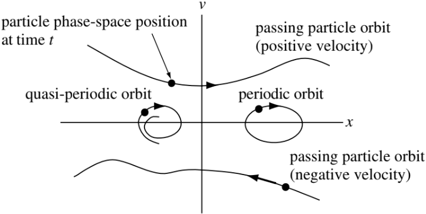
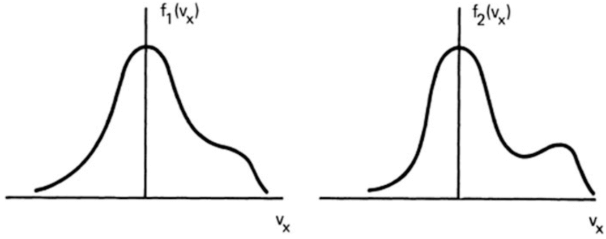
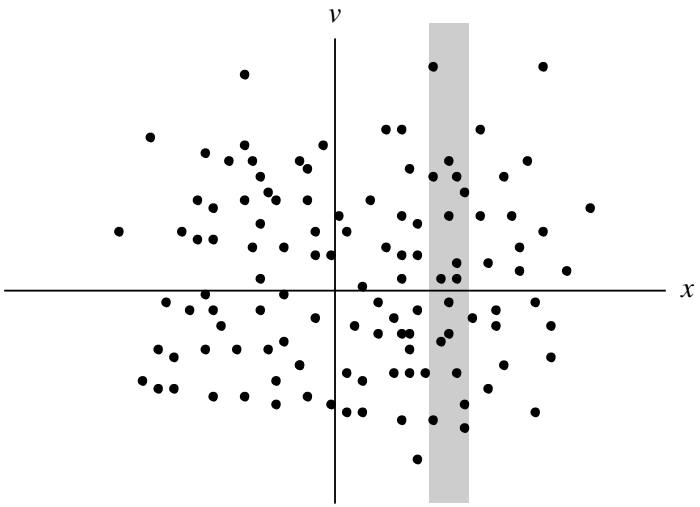
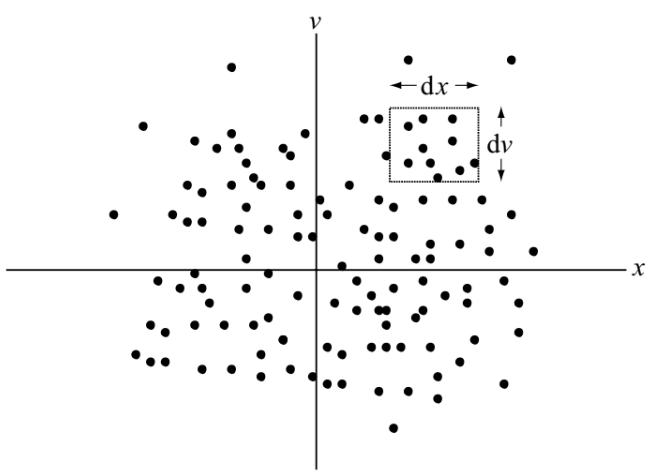
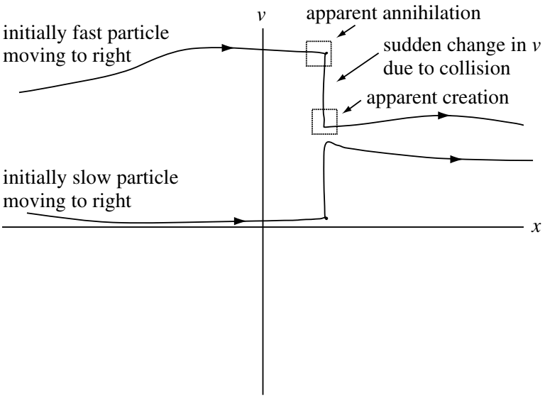

# 动力学理论 {#sec-kinetic}

## 相空间

考虑一个在一维空间中运动的粒子，设其位置为 $x = x(t)$，速度为 $v = v(t)$。一种同时观察 $x$ 和 $v$ 轨迹的方法，是在二维图上以参数形式绘制这些轨迹，其中横坐标为 $x(t)$，纵坐标为 $v(t)$。这个 $x$-$v$ 平面称为_相空间_。多个粒子的轨迹（或轨道）可以表示为相空间中的一组曲线。@fig-phase-space 展示了几种性质不同的相空间轨道。

{#fig-phase-space}

上半平面中的粒子速度为正，因此总是向右运动；下半平面中的粒子则总是向左运动。作严格周期运动的粒子（例如 $x = A\cos t,\, v = −A\sin t$）交替向右和向左运动，因此在相空间中描绘出一个椭圆。作准周期运动的粒子具有近似椭圆形或螺旋形的轨道。不改变运动方向的粒子称为通过粒子，而被限制在相空间某一区域内的粒子（例如作周期运动的粒子）称为俘获粒子。

## 分布函数

到目前为止，我们一直使用的流体理论是对等离子体最简单的描述；幸运的是，这种近似足够精确，能够描述所观察到的大多数现象。然而，对某些现象而言，流体处理方法并不充分。在任意给定时刻，每个粒子都有确定的位置和速度。因此，我们可以通过指定相空间中每一点 $x, v$ 处的粒子密度，来表征大量粒子的瞬时状态。描述相空间中粒子瞬时密度的函数称为_分布函数_，记为 $f(x, v, t)$。因此，$f(x, v, t)\mathrm{d}x\mathrm{d}v$ 是在时刻 $t$ 位置处于 $x$ 与 $x+\mathrm{d}x$ 之间、速度处于 $v$ 与 $v+\mathrm{d}v$ 之间的粒子数。随着时间推移，粒子的运动和加速使这些 $x$ 和 $v$ 范围内的粒子数发生变化，因此 $f$ 也会改变。$f$ 的这种时间演化提供了比流体描述更详细、但比追踪每个粒子的轨迹更粗略的系统描述。利用 $f$ 的演化来表征系统，并不追踪各个粒子的轨迹，而是表征具有相同 $x, v$ 的粒子群。

在流体理论中，因变量仅是四个自变量 $x, y, z,$ 和 $t$ 的函数。这是因为假定每一种粒子的速度分布在各处都是麦克斯韦分布，因而可以由其整体速度 $\vec{U}$ 和温度 $T$ 唯一确定。由于高温等离子体中的碰撞可能很少，偏离热平衡的状态可以保持相对较长的时间。例如，考虑一维系统中的两个速度分布 $f_1(v_x)$ 和 $f_2(v_x)$（@fig-distributions-1d）。这两个分布的行为会完全不同，但只要曲线下的面积相同，流体理论就无法区分它们。

{#fig-distributions-1d}

考虑三维速度分布时，我们有七个自变量：$f = f(\mathbf{r}, \mathbf{v}, t)$。
$f(\mathbf{r}, \mathbf{v}, t)$ 的含义是，在位置 $\mathbf{r}$ 和时刻 $t$，速度分量分别处于 $v_x$ 与 $v_x + \mathrm{d}v_x$、$v_y$ 与 $v_y + \mathrm{d}v_y$、$v_z$ 与 $v_z + \mathrm{d}v_z$ 之间的粒子，其每立方米的数量为
$$
f(x, y, z, v_x, v_y, v_z, t) \mathrm{d}v_x \mathrm{d}v_y \mathrm{d}v_z
$$

### 分布函数的矩

{#fig-distribution-moments}

让我们计算 @fig-distribution-moments 中阴影竖条内的粒子数。该竖条中的粒子数就是位置处于 $x$ 与 $x + \mathrm{d}x$ 之间的粒子数，其中 $x$ 是竖条左侧的位置，$x + \mathrm{d}x$ 是右侧的位置。竖条中的粒子数也可定义为 $n(x, t)\mathrm{d}x$，其中 $n(x)$ 是 $x$ 处的粒子密度。因此可知 $\int f(x, v)\mathrm{d}v = n(x)$。从相空间描述（即 $x, v$ 是自变量）过渡到通常的描述（即只有 $x$ 是自变量），需要通过积分消去速度依赖性，得到只依赖位置的量（例如密度）。由于粒子数有限，且 $f$ 为正，当 $v\rightarrow\pm\infty$ 时，$f$ 必须趋于零。

在三维情况下，密度是四个标量变量的函数 $n=n(\mathbf{r}, t)$，它等于分布函数在速度空间上的积分：
$$
\begin{aligned}
n(\mathbf{r}, t) &= \int_{-\infty}^{\infty} \mathrm{d}v_x \int_{-\infty}^{\infty} \mathrm{d}v_y \int_{-\infty}^{\infty} \mathrm{d}v_z f(\mathbf{r}, \mathbf{v}, t) \\
&= \int_{-\infty}^{\infty}f(\mathbf{r}, \mathbf{v}, t)\mathrm{d}^3v \\
&= \int_{-\infty}^{\infty}f(\mathbf{r}, \mathbf{v}, t)\mathrm{d}\mathbf{v}
\end{aligned}
$$ {#eq-distribution-density}

注意，$\mathrm{d}\mathbf{v}$ 不是矢量；它表示速度空间中的三维体积元。若将 $f$ 归一化，使得
$$
\int_{-\infty}^{\infty} \hat{f}(\mathbf{r}, \mathbf{v}, t) \mathrm{d}\mathbf{v} = 1
$$ {#eq-f_normalization}

则
$$
\hat{f}(\mathbf{r}, \mathbf{v}, t) = f(\mathbf{r}, \mathbf{v}, t) / n(\mathbf{r}, t)
$$ {#eq-f_normalization_dimensionless}
表示在位置 $\mathbf{r}$ 随机选取的粒子在时刻 $t$ 具有速度 $\mathbf{v}$ 的概率。从这个角度看，对 $x$ 处所有粒子的速度取平均便得到平均速度
$$
u(\mathrm{x},t)=\frac{\int\mathbf{v}f(\mathbf{x},\mathbf{v},t)\mathrm{d}\mathbf{v}}{n(\mathbf{x},t)}
$$ {#eq-distribution-velocity}

类似地，将 $\hat{f}$ 乘以 $mv^2/2$，再对速度积分，就能得到所有粒子平均动能的表达式。这种将 $f$ 乘以 $\mathbf{v}$ 的不同幂次，再对速度积分的过程，称为_求分布函数的矩_。

注意，$\hat{f}$ 仍然是七个变量的函数，因为分布的形状以及密度都可以随空间和时间变化。由 @eq-f_normalization 可知，$\hat{f}$ 的量纲为 $(\text{m}/\text{s})^{-3}$；因此，由 @eq-f_normalization_dimensionless 可知，$f$ 的量纲为 $\text{s}^3 \text{m}^{-6}$。

### 麦克斯韦分布

一个特别重要的分布函数是麦克斯韦分布：
$$
\hat{f}_m = \left(\frac{m}{2\pi k_B T}\right)^{3/2}\exp\left(-\frac{v^2}{v_{th}^2}\right)
$$ {#eq-maxwellian-distribution-normalized}
其中
$$
v\equiv(v_x^2 + v_y^2 + v_z^2)^{1/2}\quad\text{且}\quad v_{th}\equiv(2k_B T/m)^{1/2}
$$

这是归一化形式，其中 $\hat{f}_m$ 相当于概率：利用定积分
$$
\int_{-\infty}^{\infty}\exp(-x^2)dx = \sqrt{\pi}
$$
可以容易地验证，$\hat{f}_m$ 对 $\mathrm{d}v_x \mathrm{d}v_y \mathrm{d}v_z$ 的积分等于 1。

一个常见的问题是：

> 为什么麦克斯韦分布／高斯分布／正态分布在自然界中无处不在？

这与统计学中的[中心极限定理](https://en.wikipedia.org/wiki/Central_limit_theorem)有关：在许多情况下，当独立随机变量相加时，即使原来的变量本身不服从正态分布（例如一枚正面出现概率为 95%、反面出现概率为 5% 的不均匀硬币），适当归一化后的和也趋向于正态分布。在统计物理中，这与以下事实有关：在能量守恒的约束下，麦克斯韦分布代表系统熵最高的状态。

麦克斯韦分布有几种常用的平均速度。均方根速度为
$$
(\overline{v^2})^{1/2} = (3k_B T/m)^{1/2}
$$

速度的平均大小 $|v|$，简称 $\bar{v}$，可按下式求出：
$$
\bar{v} = \int_{-\infty}^{\infty}v\hat{f}(\mathbf{v})d^3v
$$

由于 $\hat{f}_m$ 是各向同性的，最容易在速度空间的球坐标中计算这个积分。每个球壳的体积元为 $4\pi v^2 \mathrm{d}v$，所以
$$
\begin{aligned}
\bar{v} &= (m/2\pi k_B T)^{3/2}\int_0^\infty v[\exp(-v^2/v_{th}^2)]4\pi v^2 \mathrm{d}v \\
&= (\pi v_{th}^2)^{-3/2} 4\pi v_{th}^4 \int_0^\infty [\exp(-y^2)]y^3 dy
\end{aligned}
$$

通过分部积分可得该定积分的值为 1/2。因此
$$
\bar{v} = 2\sqrt{\pi}v_{th} = 2(2k_B T/\pi m)^{1/2}
$$

_单一方向_上的速度分量，例如 $v_x$，有不同的平均值。当然，对于各向同性分布，$\bar{v}_x$ 为零；但 $|\bar{v}_x|$ 不为零：
$$
|\bar{v}_x| = \int |v_x|\hat{f}_m(\mathbf{v})\mathrm{d}^3 v = \pi^{-1/2}v_{th} = (2k_B T/\pi m)^{1/2}
$$

总之，对于麦克斯韦分布，
$$
\begin{aligned}
v_{rms} &= (3k_B T/m)^{1/2} \\
|\bar{v}| &= 2(2k_B T/\pi m)^{1/2} \\
|\bar{v}_x| &= (2k_B T/\pi m)^{1/2} \\
\bar{v}_x &= 0
\end{aligned}
$$

对于麦克斯韦分布这样的各向同性分布，我们可以另定义一个函数 $g(v)$，它是 $\mathbf{v}$ 的标量大小的函数，并且满足
$$
\int_0^\infty g(v) \mathrm{d}v = \int_{-\infty}^{\infty} f(\mathbf{v})\mathrm{d}v
$$

对于麦克斯韦分布，我们有
$$
g(v) = 4\pi n (m/2\pi k_B T)^{3/2} v^2 \exp(-v^2/v_{th}^2)
$$ {#eq-g_dist}

（添加图片？）注意 $g(v)$ 与一维麦克斯韦分布 $f(v_x)$ 的区别。虽然 $f(v_x)$ 在 $v_x=0$ 时达到最大值，但 $g(v)$ 在 $v=0$ 时为零。这只是 $v=0$ 时相空间体积消失的结果。有时人们不够严谨地将 $g(v)$ 记作 $f(v)$，以区别于 $f(\mathbf{v})$；但 $g(v)$ 和 $f(\mathbf{v})$ 是各自变量的不同函数。由 @eq-g_dist 可知，$g(v)$ 的量纲为 $\text{s}/\text{m}^4$。

（添加分布示例！）

* 各向同性分布
* 各向异性（饼状）分布

$$
f(v_\perp, v_\parallel) = \frac{n}{T_\perp T_\parallel^{1/2}}\Big( \frac{m}{2\pi k_B} \Big)^{3/2} \exp\Big( -\frac{mv_\perp^2}{2k_B T_\perp} - \frac{m(v_\parallel - v_{0\parallel})^2}{2k_B T_\parallel} \Big)
$$

* 束流分布
* 新月形分布

将分布函数表示为能量而非速度的函数通常很方便。如果所有能量都是动能，则能量直接由 $W=mv^2/2$ 得到。当粒子处于外加电势场 $U=-q\varphi$ 中时，粒子的总能量为 $W=mv^2/2+U$，麦克斯韦分布为
$$
f(v) = n\Big(\frac{m}{2\pi k_B T}\Big)^{3/2}\exp\Big(-\frac{W}{k_B T}\Big)
$$

这可以写成能量分布（？？？）：
$$
g(W) = 4\pi\Big[ \frac{2(W-U)}{m^3} \Big]^{1/2} f(v)
$$

归一化因子由能量分布对所有能量积分后等于密度这一要求确定。

速度和能量分布函数无法直接测量。实际上观测到的量是_到达探测器的粒子通量_。粒子通量定义为粒子数密度乘以垂直于表面的速度分量。我们将单位时间、单位立体角（在球坐标中，立体角微元为 $d\Omega = \sin\theta d\theta d\phi$）和单位能量内穿过单位面积的粒子_微分通量_定义为 $J(W,\Omega, \alpha, \mathbf{r},t)$。（$\alpha$ 是粒子种类？）$J$ 的单位通常写作 $(\text{m}^2\text{sr}\,\text{s}\,\text{eV})^{-1}$。注意，文献中常用 $\text{cm}$ 代替 $\text{m}$，而且根据所考虑的实际能量范围，电子伏特也常被 keV、MeV 或 GeV 取代。

接下来定义粒子微分通量与分布函数之间的关系。速度微元内的数密度（在球坐标中 $\mathrm{d}^3v=v^2\mathrm{d}v\mathrm{d}\Omega$）可写为（$\mathrm{d}n=f(\alpha,\mathbf{r},t)v^2\mathrm{d}v\mathrm{d}\Omega$）。将其乘以 $v$，得到微分通量的另一个表达式 $f(\alpha,\mathbf{r},t)v^3dvd\Omega$。与前面微分通量的定义比较，得到
$$
J(W,\Omega, \alpha, \mathbf{r},t)\mathrm{d}W\mathrm{d}\Omega = f(\alpha,\mathbf{r},t)v^3\mathrm{d}v\mathrm{d}\Omega
$$

由于 $\mathrm{d}W=mv\mathrm{d}v$，微分通量与分布函数之间的关系可写为
$$
J(W,\Omega, \alpha, \mathbf{r},t) = \frac{v^2}{m}f
$$ {#eq-diff_flux_dist}

微分通量的一个应用是_粒子沉降通量_。根据损失锥的概念，存在一个沿磁力线运动并能向下传播至电离层的粒子锥，其中从 $v$ 到 $v+\mathrm{d}v$ 的每个壳层都对应特定的能量范围。这是我们可以在接近地面处测量，并用来推断磁层中等离子体性质的量。

### Kappa 分布

麦克斯韦分布在理论上或许是研究最多的分布，但在无碰撞空间等离子体系统中，它未必是最常观测到的分布。近年来，另一种称为 [Kappa 分布](https://link.springer.com/article/10.1007/s11214-013-9982-9)的分布受到更多关注。

分布函数在低能量下通常接近麦克斯韦分布，但在高能量下下降得更慢。在较高能量下，幂律比麦克斯韦分布的指数衰减更适合描述该分布。想到库仑碰撞频率随温度升高按 $T^{-3/2}$ 减小（@eq-coulomb_resistivity_maxwellian_correction），这种行为就不足为奇了。因此，快粒子比慢粒子需要更长时间才能达到麦克斯韦分布。Kappa 分布的形式为
$$
f_\kappa(W) = n\Big( \frac{m}{2\pi\kappa W_0} \Big)^{3/2}\frac{\Gamma(\kappa + 1)}{\Gamma(\kappa-1/2)}\Big( 1+\frac{W}{\kappa W_0} \Big)^{-(\kappa+1)}
$$

这里 $W_0$ 是粒子通量达到峰值时的能量，$\Gamma$ 是伽马函数。当 $\kappa\gg 1$ 时，Kappa 分布趋近于麦克斯韦分布。当 $\kappa$ 较小但 $>1$ 时，分布具有高能尾部。详尽的综述见 [@livadiotis2013]。

### 分布的熵

碰撞使分布函数趋向一个简单的最终状态，该状态的特点是在给定约束条件（例如总能量固定）下具有最大熵。为了说明这一点，我们简要讨论熵，并说明它与分布函数的关系。

假设我们掷两枚骰子，分别标记为 $A$ 和 $B$，并用 $R$ 表示一次投掷的结果。因此 $R$ 的范围是 2 到 12。得到这些 $R$ 值的全部 (A,B) 组合列于 @tbl-dice：

| $R$ | $(A,B)$ |
|-----|---------|
| 2   | (1,1)   |
| 3   | (1,2),(2,1) |
| 4   | (1,3),(2,2),(3,1) |
| 5   | (1,4),(2,3),(3,2),(4,1) |
| 6   | (1,5),(2,4),(3,3),(4,2),(5,1) |
| 7   | (1,6),(2,5),(3,4),(4,3),(5,2),(6,1) |
| 8   | (2,6),(3,5),(4,4),(5,3),(6,2) |
| 9   | (3,6),(4,5),(5,4),(6,3) |
| 10  | (4,6),(5,5),(6,4) |
| 11  | (5,6),(6,5) |
| 12  | (6,6)   |

: 掷两枚骰子的所有可能组合。 {#tbl-dice}

有六对 $(A, B)$ 给出 $R = 7$，但给出 $R = 2$ 的只有一对，给出 $R = 12$ 的也只有一对。因此，对应于 $R = 7$ 的微观状态（不同的 $(A, B)$ 对）有六个，而对应于 $R = 2$ 或 $R = 12$ 的微观状态各只有一个。因此，当 $R=2$ 或 $R=12$ 时，我们对系统微观状态的了解比 $R=7$ 时更多。我们将熵 $S$ 定义为_对应于给定宏观状态的微观状态数的自然对数_。因此，对于骰子，熵就是对应于给定 $R$ 的 $(A, B)$ 对数的自然对数。$R = 2$ 或 $R = 12$ 时熵为零，因为 $S = \ln(1) = 0$；而 $R = 7$ 时熵为 $S = \ln(6)$，因为得到 $R = 7$ 有六种不同方式。

如果掷骰子的次数在统计意义上足够大，那么任何一次投掷最可能的结果是 $R = 7$；这是具有最多微观状态的宏观状态。由于每一种可能的微观状态出现的概率都相同，大量投掷后最可能出现的宏观状态就是熵最高的宏观状态。

现在考虑一种与分布函数概念关系更密切的情况。为此，我们首先提出以下简单问题：假设有一块带有 $\mathcal{N}$ 个孔的插板，孔分别标记为 $h_1$、$h_2$、...、$h_{\mathcal{N}}$；我们还有 $\mathcal{N}$ 个插钉，分别标记为 $p_1$、$p_2$、...、$p_{\mathcal{N}}$。把所有插钉放入所有孔中有多少种方法？从孔 $h_1$ 开始，我们可以选择 $\mathcal{N}$ 个不同的插钉；但到孔 $h_2$ 时，只剩下 $\mathcal{N}-1$ 个插钉，因此只有 $\mathcal{N}-1$ 种选择。对后续的孔使用同样的推理，可知把所有插钉放入所有孔中有 $\mathcal{N}!$ 种方法。

让我们进一步增加问题的复杂性。假设我们把孔分成 $\mathcal{M}$ 组。例如，组 $G_1$ 包含前 10 个孔，组 $G_2$ 包含接下来的 19 个孔，组 $G_3$ 包含再接下来的 4 个孔，依此类推，直至第 $\mathcal{M}$ 组。我们用 $f$ 表示一组中的孔数，因此 $f(1)=10$、$f(2)=19$、$f(3)=4$，等等。组内排列插钉的方法数恰好是该组插钉数的阶乘；例如，第 1 组内排列插钉的方法数恰好是 10!，因此一般来说，第 j 组内排列插钉的方法数是 $[f(j)]!$。

令 $C$ 表示将所有插钉放入各组、而_不考虑_组内排列的方法数。考虑所有组内排列时，将插钉放入各组的方法数为 $C\times f(1)!\times f(2)\times f(3)!\times ... f(4)!$，但这恰好等于将所有插钉放入所有孔中的方法数，即
$$
C\times f(1)!\times f(2)\times f(3)!\times ... f(4)! = \mathcal{N}!
$$
或者
$$
C = \frac{\mathcal{N}!}{C\times f(1)!\times f(2)\times f(3)!\times ... f(4)!}
$$

现在，$C$ 恰好是与指定分组 $f(1) = 10$、$f(2) = 19$、$f(3) = 4$ 等所对应的宏观状态相对应的微观状态数，因此熵为 $S = \ln C$，即
$$
\begin{aligned}
S &= \ln\left( \frac{\mathcal{N}!}{C\times f(1)!\times f(2)\times f(3)!\times ... f(4)!} \right) \\
&= \ln\mathcal{N}! - \ln f(1)! - \ln f(2)! - ... - \ln f(\mathcal{M})!
\end{aligned}
$$

斯特林公式表明，阶乘函数在自变量很大时的渐近极限为
$$
\lim_{k\rightarrow\infty} \ln k! = k\ln k - k
$$

注意到 $f(1)+f(2)+...+f(\mathcal{M})=\mathcal{N}$，熵变为
$$
\begin{aligned}
S &= \mathcal{N}\ln\mathcal{N} - f(1)\ln f(1) - f(2)\ln f(2) - ... - f(\mathcal{M})\ln f(\mathcal{M}) \\
&= \mathcal{N}\ln\mathcal{N} - \sum_{j=1}^{\mathcal{M}}\ln f(j)
\end{aligned}
$$

常数 $\mathcal{N}\ln\mathcal{N}$ 常被省略，从而得到
$$
S = -\sum_{j=1}^{\mathcal{M}} f(j)\ln f(j)
$$

如果将 $j$ 变成连续变量，例如 $j \rightarrow v$，使得 $f(v)\mathrm{d}v$ 是标记为 $v$ 的组中的项目数，那么熵可写为
$$
S = -\int\mathrm{d}v f(v)\ln f(v)
$$

至此可以看出，$f$ 可以是速度分布函数，此时 $f(v)\mathrm{d}v$ 恰好是速度处于 $v$ 与 $v+\mathrm{d}v$ 之间的粒子组中的粒子数。由于插钉的组对应不同的速度范围坐标，增加维度只意味着增加组数，因此在三维情况下熵推广为
$$
S = -\int\mathrm{d}\mathbf{v} f(\mathbf{v})\ln f(\mathbf{v})
$$

如果分布函数还依赖位置，这就对应更多的插钉组，因此同时依赖速度和位置的分布函数具有如下熵：
$$
S = -\int\mathrm{d}\mathbf{x}\int\mathrm{d}\mathbf{v} f(\mathbf{x},\mathbf{v})\ln f(\mathbf{x},\mathbf{v})
$$ {#eq-distribution-entropy}

### 碰撞对熵的影响 {#sec-collision-entropy}

最高熵状态是系统最可能的状态，因为与该宏观状态相对应的微观状态数最多。碰撞（或其他随机化形式）会使某个给定的初始微观状态中粒子的相空间位置发生混乱，从而将系统转变为另一个微观状态。原则上，这个新状态可以是任何微观状态，但它最可能属于最高熵宏观状态对应的微观状态类别。因此，碰撞等任何随机化过程都会使系统向具有最大熵的宏观状态演化。

这一论证的一个重要缺陷是，它忽略了必须满足的守恒关系。为说明这一点，注意如果将所有粒子放入同一组，就可以使熵的表达式达到最大值，此时 $C = \mathcal{N}!$，这是 $C$ 的最大可能值。因此，$\mathcal{N}$ 个等离子体粒子的最大熵构型对应于所有粒子具有相同的速度。然而，这将使系统具有特定的能量，而该能量通常不同于初始微观状态的能量。因此，孤立系统无法达到这一最大熵状态，因为如果系统从初始微观状态转变到该最大熵状态，能量就不会守恒。

因此，必须对上述论证加以限定。随机化过程将打乱系统，使其达到与系统所受各种约束相容的最大熵状态。此类约束例如要求系统总能量和粒子总数守恒。因此，我们将问题重新表述为：给定一个处于固定体积 $V$ 内、具有 $\mathcal{N}$ 个粒子和初始单粒子平均能量 $\left<E\right>$ 的孤立系统，与能量守恒和粒子数守恒相容的最大熵状态是什么？这是一个变分问题，因为目标是在 $\mathcal{N}$ 和 $\mathcal{N}\left<E\right>$ 均固定的约束下使 $S$ 最大。然后可以利用_拉格朗日乘数法_考虑这些约束。使用该方法，变分问题变为
$$
\delta S - \lambda_1\delta\mathcal{N} - \lambda_2\delta(\mathcal{N}\left<E\right>) = 0
$$
其中 $\lambda_1$ 和 $\lambda_2$ 是尚待确定的拉格朗日乘数。粒子数为
$$
\mathcal{N} = V\int f\mathrm{d}v
$$

单个粒子的能量为 $E = mv^2/2$，其中 $v$ 是在全部 $\mathcal{N}$ 个粒子所组成系统的质心静止系中测得的速度。因此，在此静止系中所有粒子的总动能为
$$
\mathcal{N}\left<E\right> = V\int\frac{mv^2}{2}f(v)\mathrm{d}v
$$
于是变分问题变为
$$
\delta\int\mathrm{d}v\left( f\ln f - \lambda_1 Vf - \lambda_2 V\frac{mv^2}{2}f \right) = 0
$$

将体积 $V$ 并入拉格朗日乘数，并提出系数 $\delta f$，得到
$$
\int\mathrm{d}v \delta f \left( 1+\ln f - \lambda_1 - \lambda_2\frac{mv^2}{2} \right) = 0
$$

由于 $\delta f$ 是任意的，被积函数必须为零，得到
$$
\ln f = \lambda_2\frac{mv^2}{2} - \lambda_1
$$
其中“1”已并入 $\lambda_1$。

因此，一个能量和粒子数守恒的孤立系统的最大熵分布函数为
$$
f = \lambda_1\exp\left( -\lambda_2 mv^2/2 \right)
$$
这就是麦克斯韦分布函数。我们常常假设等离子体在局部服从麦克斯韦分布，因此
$\lambda_1 = \lambda_1(\mathbf{x},t), \lambda_2 = \lambda_2(\mathbf{x},t)$。我们将温度定义为
$$
k_B T_s(\mathbf{x},t) = \frac{1}{\lambda_2(\mathbf{x},t)}
$$

归一化因子设为
$$
\lambda_1(\mathbf{x},t) = n_s(\mathbf{x},t)\left( \frac{m_s}{2\pi k_B T_s(\mathbf{x},t)} \right)^{N/2}
$$
其中 $N$ 是维数（1、2 或 3），使得 $\int f_s(\mathbf{x},\mathbf{v},t)\mathrm{d}^N\mathbf{v}=n_s(\mathbf{x},t)$。
由于单个粒子的动能是用在整个粒子系统的质心静止系中测得的速度定义的，如果该质心在实验室参考系中以速度 $\mathbf{u}_s$ 运动，那么在实验室参考系中麦克斯韦分布的形式为
$$
f_s(\mathbf{x},\mathbf{v},t) = n_s\left( \frac{m_s}{2\pi k_B T_s} \right)^{N/2} \exp\left( -\frac{m_s(\mathbf{v}-\mathbf{u}_s)^2}{2k_B T_s} \right)
$$ {#eq-maxwellian-distribution-N}

@eq-maxwellian-distribution-N 等价于三维情况下的 @eq-maxwellian-distribution-normalized 乘以数密度。

## 动力学理论的方程

### 弗拉索夫方程 {#sec-vlasov}

{#fig-phase-space-box}

现在考虑相空间中一个小方框内粒子数的变化率，如 @fig-phase-space-box 所示。将粒子的加速度定义为 $a(x, v, t)$，可知水平方向的粒子通量为 $fv$，竖直方向的粒子通量为 $fa$。因此，流入方框四个边界的粒子通量分别为：

1. 流入方框左侧的通量为 $f(x, v, t)v\mathrm{d}v$
2. 流入方框右侧的通量为 $-f(x+\mathrm{d}x, v, t)v\mathrm{d}v$
3. 流入方框底部的通量为 $f(x, v, t)a(x, v, t)\mathrm{d}x$
4. 流入方框顶部的通量为 $-f(x, v+dv, t)a(x, v+dv, t)dx$

方框内的粒子数为 $f(x, v, t)\mathrm{d}x\mathrm{d}v$，因此方框内粒子数的变化率为
$$
\begin{aligned}
\frac{\partial f(x,v,t)}{\partial t}\mathrm{d}x\mathrm{d}v &= -f(x+\mathrm{d}x,v,t)v\mathrm{d}v + f(x,v,t)v\mathrm{d}v \\
& -f(x,v+\mathrm{d}v,t)a(x,v+\mathrm{d}v,t)\mathrm{d}x \\
& +f(x,v,t)a(x,v,t)\mathrm{d}x
\end{aligned}
$$
或者，将右侧各量作泰勒展开，得到一维_弗拉索夫方程_：
$$
\frac{\partial f}{\partial t} + v\frac{\partial f}{\partial x} + \frac{\partial}{\partial v}(a f) = 0
$$ {#eq-vlasov-1d}

很容易将 @eq-vlasov-1d 推广到三维，得到三维弗拉索夫方程：
$$
\frac{\partial f}{\partial t} + \mathbf{v}\cdot\nabla f +\frac{\partial}{\partial\mathbf{v}}\cdot(\mathbf{a}f) = 0
$$ {#eq-vlasov}

符号 $\nabla$ 与通常一样，表示 $(x, y, z)$ 空间中的梯度。符号 $\partial/\partial\mathbf{v}$ 或 $\nabla_\mathbf{v}$ 表示速度空间中的梯度：
$$
\nabla_\mathbf{v} = \frac{\partial}{\partial \mathbf{v}} = \hat{x}\frac{\partial}{\partial v_x} + \hat{y}\frac{\partial}{\partial v_y} + \hat{z}\frac{\partial}{\partial v_z}
$$

由于 $\mathbf{x},\mathbf{v}$ 是相空间中的独立变量，空间导数项具有交换性质：
$$
\mathbf{v}\cdot\frac{\partial f}{\partial\mathbf{x}} = \frac{\partial}{\partial\mathbf{x}}\cdot(\mathbf{v}f)
$$

粒子的加速度由洛伦兹力给出：
$$
\mathbf{a}=\frac{q}{m}(\mathbf{E}+\mathbf{v}\times\mathbf{B})
$$

由于 $(\mathbf{v}\times\mathbf{B})_i=v_jB_k - v_kB_j$ 与 $v_i$ 无关，$\partial(\mathbf{v}\times\mathbf{B})_i/\partial v_i$ 项为零。因此，即使洛伦兹加速度 $\mathbf{a}$ 依赖于速度，它仍与矢量速度导数满足如下交换关系：
$$
\mathbf{a}\cdot\frac{\partial f}{\partial\mathbf{v}} = \frac{\partial}{\partial\mathbf{v}}\cdot(\mathbf{a}f)
$$

由于这一交换性质，弗拉索夫方程还可以写为
$$
\frac{\partial f}{\partial t} + \mathbf{v}\cdot\frac{\partial f}{\partial\mathbf{x}} + \mathbf{a}\cdot\frac{\partial f}{\partial\mathbf{v}} = 0
$$ {#eq-vlasov}

如果我们“坐在”一个相空间轨迹为 $\mathbf{x} = \mathbf{x}(t),\, \mathbf{v} = \mathbf{v}(t)$ 的粒子上，随粒子一起运动并测量分布函数，观测到的分布函数变化率将是 $\mathrm{d}f(\mathbf{x}(t), \mathbf{v}(t), t)/\mathrm{d}t$，其中 $\mathrm{d}/\mathrm{d}t$ 表示在运动参考系中测量的导数。由于 $\mathrm{d}\mathbf{x}/\mathrm{d}t = \mathbf{v}$ 且 $\mathrm{d}\mathbf{v}/\mathrm{d}t = \mathbf{a}$，这一观测到的变化率为
$$
\left( \frac{\mathrm{d}f(\mathbf{x}(t), \mathbf{v}(t), t)}{\mathrm{d}t} \right)_\mathrm{orbit} = \frac{\partial f}{\partial t} + \mathbf{v}\cdot\frac{\partial f}{\partial\mathbf{x}} + \mathbf{a}\cdot\frac{\partial f}{\partial\mathbf{v}} = 0
$$

因此，沿粒子轨迹（轨道）运动时测得的分布函数 $f$ 是常数。这为求解弗拉索夫方程提供了一种强有力的方法。由于 $f$ 在随轨道运动的参考系中测量时为常数，我们可以选择让 $f$ 依赖于任何沿轨道保持不变的量（Jeans 1915，Watson 1956）。

例如，如果粒子的能量 $E$ 沿其轨道保持不变，那么 $f = f(E)$ 就是弗拉索夫方程的一个解。另一方面，如果能量和动量 $\mathbf{p}$ 沿粒子轨道都保持不变，那么任何具有函数依赖关系 $f = f(E, \mathbf{p})$ 的分布函数都是弗拉索夫方程的解。根据具体情况，能量和／或动量沿轨道可能守恒，也可能不守恒，因此 $f = f(E, \mathbf{p})$ 是否为弗拉索夫方程的解取决于所考虑的具体问题。然而，任何轨迹都至少存在一个运动常量，因为正如每个人都有一个不变的生日一样，粒子轨迹的初始条件沿该轨迹保持不变。作为一个简单例子，考虑没有电磁场的情况，此时 $\mathbf{a}=0$，粒子轨迹就是 $\mathbf{x}(t) = \mathbf{x}_0+ \mathbf{v}_0(t),\, \mathbf{v}(t) = \mathbf{v}_0$，其中 $\mathbf{x}_0, \mathbf{v}_0$ 分别是初始位置和速度。
让我们检验 $f(\mathbf{x}_0)$ 是否是弗拉索夫方程的解。写出 $\mathbf{x}_0 = \mathbf{x}(t) - \mathbf{v}_0 t$，因此 $f(\mathbf{x}_0) = f(\mathbf{x}(t)-\mathbf{v}_0 t)$，我们看到 $f = f(\mathbf{x}_0)$ 确实是一个解，因为
$$
\frac{\partial f}{\partial t} + \mathbf{v}\cdot\frac{\partial f}{\partial\mathbf{x}} + \mathbf{a}\cdot\frac{\partial f}{\partial\mathbf{v}} = \mathbf{v}_0\cdot\frac{\partial f}{\partial(\mathbf{x}-\mathbf{x}_0)} + \mathbf{v}\cdot\frac{\partial f}{\partial\mathbf{x}} = \mathbf{v}_0\cdot\frac{\partial f}{\partial\mathbf{x}} + \mathbf{v}\cdot\frac{\partial f}{\partial\mathbf{x}} = 0
$$

### 玻尔兹曼方程

??? 中已表明，掠射碰撞的累积效应超过发生频率较低的大角度碰撞的累积效应。为了了解碰撞如何影响弗拉索夫方程，现在暂时设想将掠射碰撞替换为一系列等效的、散射角突然变大的碰撞，如 @fig-phase-space-collision 所示。参与碰撞的两个粒子在碰撞过程中位置不会发生显著变化，但速度会发生很大变化。例如，一个粒子与一个质量相等的静止粒子发生正碰后会停下来，而靶粒子将获得入射粒子的速度。如果画出两个粒子发生碰撞的详细相空间轨迹，就会看到每个粒子的竖直坐标（即速度）突然变化，但水平坐标（即位置）不变。碰撞引起的速度跳变发生得非常快，因此，如果用帧率不足以捕捉跳变细节的“电影摄影机”记录相空间轨迹，所得影片将显示粒子在相空间的给定体积内（例如 @fig-phase-space-collision 中的方框内）自发产生或湮灭。

{#fig-phase-space-collision}

这些相空间中单次跳变的细节很复杂，但意义不大，因为我们真正想知道的是许多次碰撞的累积效应。因此，在慢时间尺度上追踪轨迹，同时通过在弗拉索夫方程右侧引入碰撞算符来计入粒子表观上的“产生”或“湮灭”，既高效又充分。在这里所示的例子中可以看到，当一个粒子在某个方框内表观上被“产生”时，另一个粒子必然同时在具有相同 $x$ 坐标但不同 $v$ 坐标的另一个方框内被“湮灭”（当然，实际发生的是一个粒子突然从一个方框移动到另一个方框）。不同方框中湮灭率与产生率的这种耦合限制了碰撞算符的形式。本章不会尝试推导碰撞算符，而只讨论对这些算符的约束。从更形式化的角度看，碰撞由相空间中受约束的粒子源和汇来表征；将碰撞纳入弗拉索夫方程后，方程具有如下形式：
$$
\frac{\partial f_s}{\partial t} + \frac{\partial}{\partial\mathbf{x}}\cdot(\mathbf{v}f_s) + \frac{\partial}{\partial\mathbf{v}}\cdot(\mathbf{a}f_s) = \sum_\alpha C_{s\alpha}(f_s)
$$ {#eq-boltzmann}
其中 $C_{s\alpha}(f_s)$ 是由于粒子种类 $s$ 与种类 $\alpha$ 发生碰撞而引起的 $f_s$ 变化率[^numerical_diffusion]。这称为_玻尔兹曼方程_。

[^numerical_diffusion]: 在模拟中，数值扩散的效应可以视为一种“碰撞”。

碰撞算符 $C_{s\alpha}(f_s)$ 必须满足以下约束：

* 粒子数守恒——碰撞不能改变特定位置处的粒子总数，因此
$$
\int \mathrm{d}\mathbf{v} C_{s\alpha}(f_s) = 0
$$ {#eq-distribution_particle_cons}

* 动量守恒——同一种类粒子之间的碰撞不能改变该种类的总动量，因此
$$
\int \mathrm{d}\mathbf{v} m_s\mathbf{v}C_{ss}(f_s) = 0
$$ {#eq-distribution_momentum_cons_self}
而不同种类之间的碰撞必须使两种粒子的总动量守恒，因此
$$
\int \mathrm{d}\mathbf{v} m_i\mathbf{v}C_{ie}(f_i) + \int \mathrm{d}\mathbf{v} m_e\mathbf{v}C_{ei}(f_e) = 0
$$ {#eq-distribution_momentum_cons_mutual}

* 能量守恒——同一种类粒子之间的碰撞不能改变该种类的总能量，因此
$$
\int \mathrm{d}\mathbf{v} m_s\mathbf{v}^2C_{ss}(f_s) = 0
$$ {#eq-distribution_energy_cons_self}
而不同种类之间的碰撞必须使两种粒子的总能量守恒，因此
$$
\int \mathrm{d}\mathbf{v} m_i\mathbf{v}^2C_{ie}(f_i) + \int \mathrm{d}\mathbf{v} m_e\mathbf{v}^2C_{ei}(f_e) = 0
$$ {#eq-distribution_energy_cons_mutual}

在温度足够高的等离子体中，可以忽略碰撞。如果力 $\mathbf{F}$ 也完全是电磁力，@eq-boltzmann 就取 @eq-vlasov 的特殊形式。由于它相对简单，这是动力学理论中最常研究的方程。当存在与中性原子的碰撞时，@eq-boltzmann 中的碰撞项可近似为
$$
\Big( \frac{\partial f}{\partial t} \Big)_c = \frac{f_n - f}{\tau}
$$
其中 $f_n$ 是中性原子的分布函数，$\tau$ 是常数碰撞时间。这称为 _Krook 碰撞项_。它是 [@chen2016introduction] 中式 (5.5) 的碰撞项在动力学理论中的推广。当存在库仑碰撞时，@eq-boltzmann 可以近似为
$$
\frac{\mathrm{d}f}{\mathrm{d}t} = -\frac{\partial}{\partial\mathbf{v}}\cdot(f\left<\Delta\mathbf{v}\right>)\frac{1}{2}\frac{\partial^2}{\partial\mathbf{v}\partial\mathbf{v}}:(f\left<\Delta\mathbf{v}\Delta\mathbf{v}\right>)
$$ {#eq-fokker_planck}

这称为_福克–普朗克方程_；它只考虑二体库仑碰撞。这里，$\Delta\mathbf{v}$ 是一次碰撞中的速度变化，@eq-fokker_planck 是一个相当复杂的表达式的简写形式。
冒号算符 $\mathbf{a}\mathbf{b}:\mathbf{c}\mathbf{d} = a_ib_jc_id_j$。

无碰撞时 $\mathrm{d}f/\mathrm{d}t$ 为常数这一事实意味着粒子在相空间中运动时沿 $f$ 的等值线运动。为了举例说明如何使用这些等值线，考虑第 ??? 节的束流–等离子体不稳定性。在未受扰动的等离子体中，电子都具有速度 $v_0$，而 $f$ 的等值线是一条直线。函数 $f(x, v_x)$ 是在 $v_x=v_0$ 处从纸面升起的一面墙。电子沿图示轨迹运动。当波形成时，电场 $\mathbf{E}_1$ 使电子在流动过程中 $v_x$ 发生变化。轨迹于是出现正弦形波纹（@fig-beam-e-dist-1d B）。这一波纹以相速度而非粒子速度传播。粒子相对于波运动时仍留在曲线上。如果随着波的增长 $\mathbf{E}_1$ 变得很大，且存在少量碰撞，一些电子就会被俘获在波的静电势中。在坐标空间中，波势如 @fig-wave-potential 所示。在相空间中，$f(x, v_x)$ 在每个势阱处都会出现峰值（@fig-contour-dist）。由于 $f$ 的等值线也是电子轨迹，可以看出有些电子在相空间中沿闭合轨道运动；这些就是被俘获的电子。

::: {.content-visible unless-format="pdf"}

{#fig-beam-e-dist-1d}

{#fig-wave-potential}

{#fig-contour-dist}

:::

电子俘获是一种非线性现象，不能通过直接求解弗拉索夫方程来处理。不过，可以用计算机追踪电子轨迹，结果通常以类似 @fig-contour-dist 的图形表示。

添加双流不稳定性的相空间动画！

## 流体方程的推导 {#sec-kinetic-fluid-moments}

现在，我们不再只对分布函数 $f$ 本身求矩，而是对整个弗拉索夫方程求矩，以得到一组联系平均量 $n(\mathbf{x}),\mathbf{u}(\mathbf{x})$ 等的偏微分方程。首先对每个粒子种类的弗拉索夫方程 @eq-vlasov 按速度积分。这一过程的第一步也是最简单的一步称为求“零阶”矩，因为乘以 1 的操作可以看作将整个弗拉索夫方程乘以 $\mathbf{v}$ 的零次幂。将弗拉索夫方程乘以 1，再对速度积分，得到
$$
\int\left[ \frac{\partial f_s}{\partial t} + \frac{\partial}{\partial\mathbf{x}}\cdot(\mathbf{v}f_s) + \frac{\partial}{\partial\mathbf{v}}\cdot(\mathbf{a}f_s) \right]\mathrm{d}\mathbf{v} = \sum_\alpha \int C_{s\alpha}(f_s)\mathrm{d}\mathbf{v}
$$

由于 $\mathbf{x}, \mathbf{v}$ 和 $t$ 是独立变量，速度积分与左侧的时间导数和空间导数都可以交换次序；而左侧第三项是速度空间中一个散度的体积分。根据高斯定理（即 $\int_V\mathrm{d}\mathbf{x}\nabla\cdot\mathbf{Q}=\int_A\mathrm{d}\mathbf{s}\cdot\mathbf{Q}$），得到在 $v=\infty$ 的曲面上取值的 $f_s$。但是，由于 $v\rightarrow\infty$ 时 $f_s\rightarrow 0$，这一速度空间中的面积分为零。将 @eq-distribution-density、@eq-distribution-velocity 和 @eq-distribution_particle_cons 代入上式，得到该粒子种类的连续性方程：
$$
\frac{\partial n_s}{\partial t} + \nabla\cdot(n_s\mathbf{u}_s)=0
$$ {#eq-vlasov-0th-moment}

现在将 @eq-vlasov 乘以 $\mathbf{v}$，并对速度积分，以求取“一阶矩”：
$$
\int \mathbf{v}\left[ \frac{\partial f_s}{\partial t} + \frac{\partial}{\partial\mathbf{x}}\cdot(\mathbf{v}f_s) + \frac{\partial}{\partial\mathbf{v}}\cdot(\mathbf{a}f_s) \right]\mathrm{d}\mathbf{v} = \sum_\alpha \int \mathbf{v}C_{s\alpha}(f_s)\mathrm{d}\mathbf{v}
$$

通过以下操作，可以将其整理成更便于处理的形式：

1. 将时间导数和空间导数都移到速度积分之外；
2. 写成 $\mathbf{v} = \mathbf{v}^\prime(\mathbf{x},t) + \mathbf{u}(\mathbf{x},t)$，其中 $\mathbf{v}^\prime(\mathbf{x},t)$ 是给定速度的_随机_部分，即偏离平均值的部分（注意 $\mathbf{v}$ 与 $\mathbf{x}$ 和 $t$ 均无关，但 $\mathbf{v}^\prime$ 并非如此；另外，由于 $\mathbf{u}$ 与 $\mathbf{v}$ 无关，$\mathrm{d}\mathbf{v}=\mathrm{d}\mathbf{v}^\prime$）；
3. 对加速度项在三维速度空间中进行分部积分，并使用
$$
\partial_i\mathbf{v}_j = \delta_{ij}
$$

进行上述处理后，弗拉索夫方程的一阶矩变为
$$
\begin{aligned}
\frac{\partial(n_s\mathbf{u}_s)}{\partial t} + \frac{\partial}{\partial\mathbf{x}}\cdot\int\left( \mathbf{v}^\prime\mathbf{v}^\prime + \mathbf{v}^\prime\mathbf{u}_s + \mathbf{u}_s\mathbf{v}^\prime +\mathbf{u}_s\mathbf{u}_s \right)f_s \mathrm{d}\mathbf{v}^\prime \\
- \frac{q_s}{m_s}\int \left( \mathbf{E}+\mathbf{v}\times\mathbf{B} \right)f_s\mathrm{d}\mathbf{v}^\prime = -\frac{1}{m_s}\mathbf{R}_{s\alpha}
\end{aligned}
$$ {#eq-vlasov-1st-moment}
其中 $\mathbf{R}_{s\alpha}$ 是种类 $s$ 与种类 $\alpha$ 碰撞所产生的净摩擦阻力。
注意 $\mathbf{R}_{ss} = 0$，因为一种粒子不能对自身施加净阻力。摩擦项的形式为
$$
\begin{aligned}
\mathbf{R}_{ei} &= \nu_{ei}m_e n_e (\mathbf{u}_e - \mathbf{u}_i) \\
\mathbf{R}_{ie} &= \nu_{ie}m_i n_i (\mathbf{u}_i - \mathbf{u}_e)
\end{aligned}
$$
因此，在离子参考系中，电子受到的阻力就是在该参考系中测得的电子总动量 $m_e n_e\mathbf{u}_e$ 乘以这一动量因与离子碰撞而损失的速率 $\nu_{ei}$。这种形式的摩擦阻力具有以下性质：（i）$\mathbf{R}_{ei} + \mathbf{R}_{ie} = 0$，表明等离子体不能对自身施加摩擦阻力；（ii）摩擦使较快的粒子种类受到较慢种类的减速作用；（iii）如果两种粒子的平均速度相同，它们之间就没有摩擦。

将 $\mathbf{u}$ 从速度积分中提出，并注意到根据定义 $\int \mathbf{v}^\prime f_s \mathrm{d}\mathbf{v}^\prime=0$，可以进一步简化 @eq-vlasov-1st-moment。因此 @eq-vlasov-1st-moment 化为
$$
m_s\left[ \frac{\partial(n_s\mathbf{u}_s)}{\partial t} + \frac{\partial}{\partial\mathbf{x}}\cdot(n_s\mathbf{u}_s\mathbf{u}_s) \right] = n_s q_s (\mathbf{E} + \mathbf{u}_s\times\mathbf{B}) - \frac{\partial}{\partial\mathbf{x}}\cdot\overleftrightarrow{P}_s - \mathbf{R}_{s\alpha}
$$
其中_压力张量_定义为
$$
\overleftrightarrow{P}_s \equiv m_s\int \mathbf{v}^\prime \mathbf{v}^\prime f_s \mathrm{d}\mathbf{v}^\prime
$$ {#eq-tensor-pressure}

如果 $f_s$ 是 $\mathbf{v}^\prime$ 的各向同性函数，那么 $\overleftrightarrow{P}_s$ 的非对角项为零，三个对角项相同。此时，将对角项定义为_标量压力_ $p_s$ 是有用的，即
$$
\begin{aligned}
p_s &= m_s \int v_x^\prime v_x^\prime f_s \mathrm{d}\mathbf{v}^\prime = m_s \int v_y^\prime v_y^\prime f_s \mathrm{d}\mathbf{v}^\prime = m_s \int v_z^\prime v_z^\prime f_s \mathrm{d}\mathbf{v}^\prime \\
&= \frac{m_s}{3} \int \mathbf{v}^\prime\cdot \mathbf{v}^\prime f_s \mathrm{d}\mathbf{v}^\prime
\end{aligned}
$$ {#eq-scalar-pressure}

@eq-scalar-pressure 定义了三维各向同性系统的压力。然而，我们常常要处理维数减少的系统，即只有一维或二维的系统。因此，可以引入标量压力的一般 N 维定义，将 @eq-scalar-pressure 推广到这些情况：
$$
p_s = \frac{m_s}{N}\int \mathbf{v}^\prime\cdot \mathbf{v}^\prime f_s \mathrm{d}^N\mathbf{v}^\prime
$$ {#eq-pressure-def}
其中 $\mathbf{v}^\prime$ 是 N 维随机速度。

将 @eq-pressure-def 改写如下，可以看出标量压力与广义麦克斯韦分布有简单的关系：
$$
\begin{aligned}
p_s &= \frac{m_s}{N}\int \mathbf{v}^\prime\cdot \mathbf{v}^\prime f_s \mathrm{d}^N\mathbf{v}^\prime \\
&= \frac{n_s m_s}{N}\left( \frac{m_s}{2\pi k_B T_s} \right)^{N/2} \int {\mathbf{v}^\prime}^2 \exp \left( -\frac{m_s {\mathbf{v}^\prime}^2}{2k_B T_s} \right) \mathrm{d}^N\mathbf{v}^\prime \\
&= -\frac{n_s m_s}{N}\left( \frac{\alpha}{\pi} \right)^{N/2} \frac{\mathrm{d}}{\mathrm{d}\alpha}\int e^{-\alpha {v^\prime}^2}\mathrm{d}^N\mathbf{v}^\prime,\, \alpha \equiv m_s/2k_B T_s \\
&= -\frac{n_s m_s}{N}\left( \frac{\alpha}{\pi} \right)^{N/2} \frac{\mathrm{d}}{\mathrm{d}\alpha}\left( \frac{\alpha}{\pi} \right)^{-N/2} \\
&= n_s k_B T_s
\end{aligned}
$$
这正是理想气体定律。因此，所提出的压力和温度定义与这些量的日常概念一致。

需要强调的是，假设各向同性主要是为了数学上的方便，而在真实系统中，分布函数往往具有相当强的各向异性。碰撞具有随机化作用，会促使分布函数趋于各向同性；与此同时，与之竞争的过程则促使分布函数趋于各向异性。因此，必须逐一考虑每种情况，以确定碰撞是否足够频繁，能使 $f$ 各向同性。由于完全电离的高温等离子体中碰撞往往不足以使 $f$ 各向同性，常用的各向同性假设是一种过度简化，其是否可以接受取决于所研究的现象。

展开 @eq-vlasov-1st-moment 左侧的导数，可以看到其中两项组合成 $\mathbf{u}$ 乘以 @eq-vlasov-0th-moment。消去这个包含在内的连续性方程后，E@eq-vlasov-1st-moment 化为
$$
n_s m_s\frac{\mathrm{d}\mathbf{u}_s}{\mathrm{d}t} = n_s q_s(\mathbf{E} + \mathbf{u}_s\times\mathbf{B}) - \nabla p_s - \mathbf{R}_{s\alpha}
$$
其中算符 $\mathrm{d}/\mathrm{d}t$ 是对流导数（@eq-convective-derivative）。

进行到这里，可以明显看到，对弗拉索夫方程依次求各阶矩时会反复出现某种规律。求零阶矩时，得到密度 $\int f\mathrm{d}\mathbf{v}$ 的方程，但同时引入了涉及下一阶矩的项，即平均速度 $\sim\int\mathbf{v}f\mathrm{d}\mathbf{v}$。接着，求一阶矩以获得速度方程时，所得方程又包含涉及下一阶矩的项，即压力 $\sim\int \mathbf{v}\mathbf{v}f\mathrm{d}\mathbf{v}$。因此，每次对弗拉索夫方程求矩时，都会得到所需矩的方程，但由于弗拉索夫方程中的 $\mathbf{v}\cdot\nabla f$ 项，也会出现下一阶矩。因此，求矩永远不会产生封闭的方程组；总会有一个“未完结的部分”，即没有确定方程的最高阶矩。必须引入某种专门的封闭方法来终止这个链条（如下所示，典型的封闭方法包括引入绝热或等温假设）。求矩的另一个特点是，每个较高阶矩中都包含一些项，它们是完整的低阶矩方程乘以某个因子。通过代数运算可以识别并消去这些低阶矩方程，从而得到简化的高阶矩方程。
现在来求弗拉索夫方程的二阶矩。与零阶矩和一阶矩不同，系统的维数现在显式地进入方程，因此将使用 @eq-pressure-def 给出的更一般的压力定义。将弗拉索夫方程乘以 $m_s v^2/2$ 并对速度积分，得到
$$
\begin{Bmatrix}
\frac{\partial}{\partial t}\int \frac{m_s v^2}{2}f_s\mathrm{d}^N\mathbf{v} \\
+\frac{\partial}{\partial\mathbf{x}}\cdot\int\frac{m_s v^2}{2}\mathbf{v}f_s\mathrm{d}^N\mathbf{v} \\
+q_s\int\frac{v^2}{2}\frac{\partial}{\partial\mathbf{v}}\cdot(\mathbf{E}+\mathbf{v}\times\mathbf{B})f_s\mathrm{d}^N\mathbf{v}
\end{Bmatrix} =
\sum_\alpha \int m_s \frac{v^2}{2}C_{s\alpha}f_s\mathrm{d}^N \mathbf{v}
$$ {#eq-vlasov-2nd-moment}

下面分别考察此方程中的各项：

1. 时间导数项变为
$$
\frac{\partial}{\partial t}\int \frac{m_s v^2}{2}f_s\mathrm{d}^N\mathbf{v} = \frac{\partial}{\partial t}\int \frac{m_s(\mathbf{v}^\prime + \mathbf{u}_s)^2}{2} f_s\mathrm{d}^N\mathbf{v}^\prime = \frac{\partial}{\partial t}\left( \frac{Np_s}{2} + \frac{m_sn_su_s^2}{2} \right)
$$

2. 再次利用 $\mathbf{v}=\mathbf{v}^\prime + \mathbf{u}_s$，空间导数项变为
$$
\frac{\partial}{\partial\mathbf{x}}\cdot\int\frac{m_s v^2}{2}\mathbf{v}f_s\mathrm{d}^N\mathbf{v} = \nabla\cdot\left( \mathbf{Q}_s + \frac{2+N}{2}p_s\mathbf{u}_s + \frac{m_sn_su_s^2}{2}\mathbf{u}_s \right)
$$
其中
$$
\mathbf{Q}_s = \int\frac{m_s{v^\prime}^2}{2}\mathbf{v}^\prime f_s\mathrm{d}^N\mathbf{v}
$$
称为_热通量_。

3. 分部积分后，加速度项变为
$$
q_s\int\frac{v^2}{2}\frac{\partial}{\partial\mathbf{v}}\cdot(\mathbf{E}+\mathbf{v}\times\mathbf{B})f_s\mathrm{d}^N\mathbf{v} = -q_s\int\mathbf{v}\cdot\mathbf{E} f_s\mathrm{d}\mathbf{v} = -q_s n_s\mathbf{u}_s\cdot\mathbf{E}
$$

4. 碰撞项变为（使用 @eq-distribution_energy_cons_self）
$$
\sum_\alpha \int m_s \frac{v^2}{2}C_{s\alpha}f_s\mathrm{d}^N \mathbf{v} = \int_{s\neq \alpha}m_s\frac{v^2}{2}C_{s\alpha} f_s\mathrm{d}\mathbf{v} = -\left( \frac{\partial W}{\partial t} \right)_\mathrm{Es\alpha}
$$
其中 $(\partial W/\partial t)_\mathrm{Es\alpha}$ 是种类 $s$ 通过碰撞向种类 $\alpha$ 传递能量的速率。

将上述四个关系合并，@eq-vlasov-2nd-moment 变为
$$
\begin{aligned}
\frac{\partial}{\partial t}\left( \frac{Np_s}{2} + \frac{m_sn_su_s^2}{2} \right) + \nabla\cdot\left( \mathbf{Q}_s +\frac{2+N}{2}p_s\mathbf{u}_s + \frac{m_sn_su_s^2}{2}\mathbf{u}_s \right) - q_s n_s \mathbf{u}_s\cdot\mathbf{E} \\
= -\left( \frac{\partial W}{\partial t} \right)_\mathrm{E\sigma s}
\end{aligned}
$$ {#eq-vlasov-2nd-moment2}

利用两个数学恒等式可以简化此方程，第一个是
$$
\frac{\partial}{\partial t}\left( \frac{m_s n_s u_s^2}{2} \right) + \nabla\cdot\left( \frac{m_sn_su_s^2}{2}\mathbf{u}_s \right) = n_s\left( \frac{\partial}{\partial t} + \mathbf{u}_s\cdot\nabla \right)\frac{m_su_s^2}{2} = n_s\frac{\mathrm{d}}{\mathrm{d}t}\left( \frac{m_su_s^2}{2} \right)
$$

将运动方程与 $\mathbf{u}_s$ 点乘，可得到第二个恒等式：
$$
\begin{aligned}
n_s m_s\left[ \frac{\partial}{\partial t}\left( \frac{u_s^2}{2}\right) + \mathbf{u}_s\cdot\left( \nabla\left( \frac{u_s^2}{2} \right) - \mathbf{u}_s\times\nabla\times\mathbf{u}_s \right) \right] \\
= n_s q_s \mathbf{u}_s\cdot\mathbf{E} - \mathbf{u}_s\cdot\nabla p_s - \mathbf{R}_{s\alpha}\cdot\mathbf{u}_s
\end{aligned}
$$
或者
$$
n_s\frac{\mathrm{d}}{\mathrm{d}t}\left( \frac{m_su_s^2}{2} \right) = n_sq_s\mathbf{u}_s\cdot\mathbf{E} - \mathbf{u}_s\cdot\nabla p_s - \mathbf{R}_{s\alpha}\cdot\mathbf{u}_s
$$

将这两个恒等式代入 @eq-vlasov-2nd-moment2，得到能量演化方程
$$
\frac{N}{2}\frac{\mathrm{d}p_s}{\mathrm{d}t} + \frac{2+N}{2}p_s\nabla\cdot\mathbf{u}_s = -\nabla\cdot\mathbf{Q}_s + \mathbf{R}_{s\alpha}\cdot\mathbf{u}_s - \left(\frac{\partial W}{\partial t}\right)_\mathrm{Es\alpha}
$$ {#eq-vlasov-2nd-moment3}

右侧第一项表示热通量，第二项表示种类 $s$ 因受到种类 $\alpha$ 的摩擦阻力而产生的摩擦加热，最后一项则表示种类 $s$ 通过碰撞向其他种类传递能量的速率。尽管 @eq-vlasov-2nd-moment3 很复杂，如果令 $t_\mathrm{char}$ 为给定现象的特征时间尺度，$l_\mathrm{char}$ 为其特征长度尺度，就可以看出两种重要的极限情形。于是可为该现象定义特征速度 $V_\mathrm{ph}\sim l_\mathrm{char}/t_\mathrm{char}$，在 @eq-vlasov-2nd-moment3 中用 $t_\mathrm{char}^{-1}$ 代替时间导数、用 $l_\mathrm{char}^{-1}$ 代替空间导数，可以看出这两种极限情形为：

1. _等温极限_——热通量项占据主导地位，此时温度在空间中变得均匀。当以下条件成立时即为这种情形：（i）$v_{Ts}\gg V_\mathrm{ph}$，因为左侧各项与热通量项之比为 $\sim V_\mathrm{ph}/v_{Ts}$；（ii）碰撞项足够小，可以忽略。

2. _绝热极限_——与左侧各项相比，热通量项和碰撞项足够小，可以忽略；当 $V_\mathrm{ph} \gg  v_{Ts}$ 时即为这种情形。绝热一词源自希腊语，意为“不可通过”，这里用它表示没有热量流动，即所考虑的体积与外界热隔离。

这两种极限都使我们能够避免求解涉及三阶矩的 $\mathbf{Q}_s$，因此绝热极限和等温极限都为矩方程提供了一种闭合方法。

在绝热极限下，可以先重新排列连续性方程，得到
$$
\nabla\cdot\mathbf{u}_s = -\frac{1}{n_s}\frac{\mathrm{d}n_s}{\mathrm{d}t}
$$
再将此式代入 @eq-vlasov-2nd-moment3 左侧，从而大大简化能量方程，得到
$$
\frac{1}{p_s}\frac{\mathrm{d}p_s}{\mathrm{d}t} = \frac{\gamma}{n_s}\frac{\mathrm{d}n_s}{\mathrm{d}t}
$$ {#eq-adiabatic1}
其中
$$
\gamma = \frac{N+2}{N}
$$

@eq-adiabatic1 表明
$$
\frac{\mathrm{d}}{\mathrm{d}t}\left( \frac{p_s}{n_s^\gamma} \right) = 0
$$
因此，在运动等离子体的参考系中，$p_s/n_s^\gamma$ 是常数。这构成了基于几何和统计力学而非热力学论证的绝热性推导。

能量方程的推导也可见 [An introductory guide to fluid models with anisotropic temperatures](https://arxiv.org/abs/1901.09354)。

简要总结一下，我们一直使用的流体方程实际上就是玻尔兹曼方程的各阶矩。由 @eq-vlasov 可以看出一个有趣的现象：为了得到流体力学方程，并不需要加速度项 $\mathbf{a}\cdot\partial_\mathbf{v}f$；驱动流动的压力梯度来自平流项 $\mathbf{v}\cdot\partial_\mathbf{x}f$ 中所包含的热运动。

我们必须谨慎，不要对流体观点的描述能力过于自信，因为这种观点存在弱点。例如，如上所述，当 $V_\mathrm{ph}\sim v_{Ts}$ 时，绝热近似和等温近似都不适用。在这种情形下，流体描述失效，必须使用弗拉索夫描述。此外，只有当碰撞足够频繁或存在其他随机化过程时，分布函数才是麦克斯韦分布。由于等离子体的碰撞较弱，情况往往并非如此。特别是，由于碰撞频率按 $v^{-3}$ 缩放（@eq-coulomb_collision_freq），快速粒子达到麦克斯韦分布所需的时间比慢速粒子长得多。真实等离子体中，低速粒子已达到麦克斯韦分布，而快速粒子形成非麦克斯韦尾部的状态并不罕见。

## 等离子体振荡与朗道阻尼 {#sec-landau}

作为运用弗拉索夫方程的一个初步例子，我们将推导电子等离子体振荡的色散关系；此前这一问题是从流体观点处理的。推导需要用到围道积分的知识。

在零阶近似中，假定等离子体均匀，其分布为 $f_0(\mathbf{v})$，并令 $\mathbf{B}_0 = \mathbf{E}_0 = 0$。在一阶近似中，用 $f_1(\mathbf{r},\mathbf{v},t)$ 表示 $f(\mathbf{r},\mathbf{v},t)$ 的扰动：

$$
f(\mathbf{r},\mathbf{v},t) = f_0(\mathbf{v}) + f_1(\mathbf{r},\mathbf{v},t)
$$

由于 $\mathbf{v}$ 现在是独立变量，不需要线性化，电子的一阶弗拉索夫方程为

$$
\frac{\partial f_1}{\partial t} + \mathbf{v}\cdot\nabla f_1 - \frac{e}{m}\mathbf{E}_1\cdot\frac{\partial f_0}{\partial \mathbf{v}} = 0
$$ {#eq-vlasov_1st}

与前面一样，假设离子质量很大且固定不动，波是沿 x 方向传播的平面波，$f_1 \propto e^{i(kx - \omega t)}$。于是线性化的弗拉索夫方程变为

$$
\begin{aligned}
-i\omega f_1 + ikv_x f_1 x &= \frac{e}{m}E_x\frac{\partial f_0}{\partial v_x} \\
f_1 &= \frac{ieE_x}{m}\frac{\partial f_0/\partial v_x}{\omega - kv_x}
\end{aligned}
$$

泊松方程给出
$$
\epsilon_0\nabla\cdot\mathbf{E}_1 = ik\epsilon_0 E_x = -en_1 = -e\int f_1 d^3v
$$

代入 $f_1$ 并除以 $ik\epsilon_0 E_x$，得到
$$
1 = -\frac{e^2}{km\epsilon_0}\int \frac{\partial f_0/\partial v_x}{\omega - k v_x}d^3v
$$

如果用归一化函数 $\hat{f}_0$ 代替 $f_0$，就可以提取出因子 $n_0$：
$$
1 = -\frac{\omega_p^2}{k}\int_{-\infty}^{\infty}dv_z\int_{-\infty}^{\infty}dv_y\int_{-\infty}^{\infty}\frac{\partial \hat{f}_0(v_x, v_y, v_z)/\partial v_x}{\omega- k v_x}dv_x
$$

如果 $f_0$ 是麦克斯韦分布或其他可分解的分布，就可以容易地完成对 $v_y$ 和 $v_z$ 的积分，剩下的是一维分布 $\hat{f}_0(v_x)$。例如，一维麦克斯韦分布为
$$
\hat{f}_m(v_x) = \sqrt{\frac{m}{2\pi k_B T}} \exp\left(\frac{-mv_x^2}{2 k_B T}\right)
$$

由于我们处理的是一维问题，可以省略下标 x，但要注意不要将 $v$（实际上是 $v_x$）与前面使用的总速度 $v$ 混淆：
$$
1 = \frac{\omega_p^2}{k^2}\int_{-\infty}^{\infty}\frac{\partial \hat{f}_0/\partial v}{v - \omega/k}\mathrm{d}v
$$ {#eq-dispersion_0th}

这里，$\hat{f}_0$ 是已对 $v_y$ 和 $v_z$ 积分后的一维分布函数。这个方程对任何平衡分布 $\hat{f}_0(v)$ 都成立。

由于 $v=\omega/k$ 处存在奇点，方程中的积分并不容易求出。人们可能认为这个奇点不必担心，因为实际中 $\omega$ 几乎从来不是实数；波通常会受到碰撞的轻微阻尼，或者由某种不稳定机制放大。由于速度 $v$ 是实数，分母永远不为零。朗道首次正确处理了这个方程。他发现，尽管奇点不在积分路径上，它的存在仍会对等离子体波的色散关系产生重要修正——这是流体理论没有预言的效应。

考虑一个初值问题：等离子体受到正弦扰动，因此 $k$ 为实数。如果扰动增长或衰减，$\omega$ 就是复数。这个积分必须作为复 $v$ 平面上的围道积分处理。图中给出了可能的围道：（a）不稳定波，$\Im(\omega) > 0$；（b）受阻尼的波，$\Im(\omega) < 0$。通常，可以用留数定理计算沿实 $v$ 轴的线积分：
$$
\int_{C_1} G \mathrm{d}v + \int_{C_2} G \mathrm{d}v = 2\pi i R(\omega/k)
$$
其中 $G$ 是被积函数，$C_1$ 是沿实轴的路径，$C_2$ 是无穷远处的半圆，$R(\omega/k)$ 是 $\omega/k$ 处的留数。如果沿 $C_2$ 的积分为零，这种方法就成立。不幸的是，对于包含下列因子的麦克斯韦分布，情况并非如此：
$$
\exp(-v^2/v_{th}^2)
$$

当 $v\rightarrow \pm i \infty$ 时，这个因子变大，不能忽略 $C_2$ 的贡献。朗道证明，正确地将此问题作为初值问题处理时，应使用的围道是从奇点下方经过的曲线 $C_1$。一般必须用数值方法计算这个积分。

尽管对此问题的精确分析很复杂，我们可以针对相速度大、阻尼弱的情况得到近似色散关系。此时 $\omega/k$ 处的极点靠近实 $v$ 轴。朗道规定的围道便是沿 $\Re(v)$ 轴的一条直线，并以一个小半圆绕过极点。绕过极点时得到 $2\pi i$ 乘以该处留数的一半。于是 @eq-dispersion_0th 变为
$$
1 = \frac{\omega_p^2}{k^2} \left[ P\int_{-\infty}^{\infty}\frac{\partial\hat{f}_0/\partial v}{v - (\omega/k)}\mathrm{d}v + i\pi \frac{\partial\hat{f}_0}{\partial v}\biggr\rvert_{v=\omega/k} \right]
$$ {#eq-landau_residue}
其中 $P$ 表示柯西主值。为了计算它，我们沿实 $v$ 轴积分，但在到达极点之前停止。如果如我们假设的那样，相速度 $v_\phi = \omega/k$ 足够大，那么被忽略的围道部分贡献不大，因为 $\hat{f}_0$ 和 $\partial\hat{f}_0/\partial v$ 在那里都很小。上面的积分可以通过分部积分计算：
$$
\int_{-\infty}^{\infty}\frac{\partial\hat{f}_0}{\partial v}\frac{\mathrm{d}v}{v - v_\phi} = \left[ \frac{\hat{f}_0}{v-v_\phi} \right]_{-\infty}^{\infty} - \int_{-\infty}^{\infty}\frac{-\hat{f}_0 \mathrm{d}v}{(v-v_\phi)^2} = \int_{-\infty}^{\infty}\frac{\hat{f}_0 \mathrm{d}v}{(v-v_\phi)^2}
$$

由于这只是 $(v-v_\phi)^{-2}$ 对分布的平均，色散关系的实部可以写成
$$
1 = \frac{\omega_p^2}{k^2} \overline{(v-v_\phi)^{-2}}
$$

由于已经假设 $v_\phi \gg v$，可以展开 $(v-v_\phi)^{-2}$：
$$
(v-v_\phi)^{-2} = v_\phi^{-2}\Big( 1 - \frac{v}{v_\phi} \Big)^{-2} = v_\phi^{-2}\Big( 1 + \frac{2v}{v_\phi} + \frac{3v^2}{v_\phi^2} + \frac{4v^3}{v_\phi^3} + ... \Big)
$$

取平均后奇数项消失，得到
$$
\overline{(v-v_\phi)^{-2}} \approx v_\phi^{-2} \Big( 1 + \frac{3\overline{v^2}}{v_\phi^2} \Big)
$$

现在令 $\hat{f}_0$ 为麦克斯韦分布，并计算 $\overline{v^2}$。注意这里的 $v$ 是 $v_x$ 的简写，可以写出
$$
\frac{1}{2}m\overline{v_x^2} = \frac{1}{2}k_B T_e
$$
因为只有一个自由度。色散关系于是变为
$$
\begin{aligned}
1 &= \frac{\omega_p^2}{k^2}\frac{k^2}{\omega^2}\Big( 1+ 3\frac{k^2}{\omega^2}\frac{k_B T_e}{m} \Big) \\
\omega^2 &= \omega_p^2 + \frac{\omega_p^2}{\omega^2}\frac{3k_B T_e}{m}k^2
\end{aligned}
$$

如果热修正很小（即右侧第二项很小，使得 $\omega \approx \omega_p$），就可以将第二项中的 $\omega^2$ 替换为 $\omega_p^2$。于是得到
$$
\omega^2 = \omega_p^2 + \frac{3k_B T_e}{m}k^2
$$
这与取 $\gamma=3$ 时由流体方程得到的结果相同。

现在回到色散关系的虚数项。在计算这个小项时，忽略 $\omega$ 实部的热修正并令 $\omega^2\approx \omega_p^2$ 就已足够精确。由上面对实部的计算可知，积分的主值近似为 $k^2/\omega^2$。色散关系现在变为
$$
1 = \frac{\omega_p^2}{\omega^2} + i\pi\frac{\omega_p^2}{k^2}\frac{\partial\hat{f}_0}{\partial v}\biggr\rvert_{v=v_\phi}
$$

$$
\omega^2 \Big( 1 - i\pi\frac{\omega_p^2}{k^2}\frac{\partial\hat{f}_0}{\partial v}\biggr\rvert_{v=v_\phi} \Big) = \omega_p^2
$$

将虚数项视为小量，可以把它移到右侧并通过泰勒级数展开求平方根，于是得到
$$
\omega = \omega_p\Big( 1 + i\frac{\pi}{2}\frac{\omega_p^2}{k^2}\frac{\partial\hat{f}_0}{\partial v}\biggr\rvert_{v=v_\phi} \Big)
$$ {#eq-landau}

如果 $\hat{f}_0$ 是一维麦克斯韦分布，则有
$$
\frac{\partial\hat{f}_0}{\partial v} = (\pi v_{th}^2)^{-1/2} \left( \frac{-2v}{v_{th}^2} \right) \exp\left( \frac{-v^2}{v_{th}^2} \right) = -\frac{2v}{\sqrt{\pi}v_{th}}\exp\left( \frac{-v^2}{v_{th}^2} \right)
$$

在系数中可以用 $\omega_p/k$ 近似 $v_\phi$，但在指数中必须保留色散关系实部的热修正。阻尼于是由下式给出：
$$
\begin{aligned}
\Im(\omega) &= -\frac{\pi}{2}\frac{\omega_p^2}{k^2}\frac{2\omega_p}{k\sqrt{\pi}}\frac{1}{v_{th}^3}\exp\left( \frac{-\omega^2}{k^2 v_{th}^2} \right) \\
&= -\sqrt{\pi}\omega_p \left( \frac{\omega_p}{kv_{th}} \right)^3 \exp\left( \frac{-\omega_p^2}{k^2 v_{th}^2}\right)\exp\left( \frac{-3}{2} \right) \\
\Im\left(\frac{\omega}{\omega_p}\right) &= -0.22 \sqrt{\pi}\left( \frac{\omega_p}{kv_{th}} \right)^3 \exp\left( \frac{-1}{2k^2\lambda_D^2} \right)
\end{aligned}
$$

由于 $\Im(\omega)$ 为负，等离子体波存在无碰撞阻尼，称为_朗道阻尼_。从表达式可以看出，当 $k\lambda_D$ 很小时，这种阻尼极小；但当 $k\lambda_D = \mathcal{O}(1)$ 时，它就变得重要。这种效应与 $f_1$ 有关，即与波造成的分布函数畸变有关。

## 朗道阻尼的意义 {#sec-landau_damping}

__从理论上发现波可以在没有碰撞耗散能量的情况下受到阻尼，或许是等离子体物理研究中最令人惊奇的结果__。实验室已经证明这是一种真实的效应。虽然现在已有对这种阻尼的简单物理解释，但这一出人意料的效应最初是在仔细分析围道积分的过程中纯粹通过数学方法发现的，这是应用数学的一项胜利。朗道阻尼是无碰撞等离子体的特征，但也可能应用于其他领域。例如，在用动力学方法处理星系形成时，可以把恒星视为等离子体中的原子，只不过它们通过引力而非电磁力相互作用。恒星气体的不稳定性可以导致旋臂形成，但这一过程受到朗道阻尼的限制。

为了了解朗道阻尼的成因，首先注意 $\Im(\omega)$ 来自 $v=v_\phi$ 处的极点。因此，这一效应与分布中速度接近相速度的粒子——“共振粒子”——有关。这些粒子随波一起运动，不会看到快速波动的电场，因此可以有效地与波交换能量。理解这种能量交换最容易的方法，是想象冲浪者试图追上海浪。（注意：这个图像只能将我们的思路引向正确方向，不能正确解释阻尼。）如果冲浪板不动，波经过时它只会上下起伏，平均而言不会获得能量。同样，一艘行驶速度远高于波速的船也不能与波交换多少能量。然而，如果冲浪板的速度几乎与波速相同，它就可能被波带上并向前推动；毕竟这正是冲浪的主要目的。在这种情况下，冲浪板获得能量，因此波必然失去能量并受到阻尼。另一方面，如果冲浪板运动得比波稍快，它在向波峰上方运动时会推动波，波就可能获得能量。在等离子体中，有些电子比波快，有些比波慢。然而，麦克斯韦分布中的慢电子比快电子多。因此，从波中获取能量的粒子比向波传递能量的粒子多，波便受到阻尼。当 $v\approx v_\phi$ 的粒子被波俘获时，$f(v)$ 在相速度附近变平。这种畸变就是我们计算的 $f_1(v)$。如图所示（添加该图！），受扰动的分布函数所含粒子数相同，但总能量增加了（以波的能量为代价）。

由此可以推测，如果 $f_0(v)$ 中的快粒子比慢粒子多，就可以激发波。事实上，从上面 $\omega$ 的表达式可以明显看出，如果 $\partial\hat{f}_0/\partial v$ 在 $v=v_\phi$ 处为正，那么 $\Im(\omega)$ 就为正。图 7-19 给出了这样的分布（添加该图！）。$v_\phi$ 位于正斜率区域的波将不稳定，以粒子的能量为代价获得能量。这正是双流不稳定性的有限温度对应情形。当两股冷电子流（$k_B T=0$）运动时，$f_0(v)$ 由两个 $\delta$ 函数组成。这显然是不稳定的，因为 $\partial f_0/\partial v$ 是无穷大；事实上，我们也从流体理论得到了这种不稳定性。当流具有有限温度时，动力学理论告诉我们，两股流的相对密度和温度必须使它们之间存在 $\partial f_0(v)/\partial v$ 为正的区域；更准确地说，要产生不稳定性，总分布函数必须具有一个极小值。

__冲浪者追上海浪的物理图像很吸引人，但它不够精确，不能使我们真正理解朗道阻尼__。实际上朗道阻尼有两种。两种都与耗散性碰撞机制无关。如果粒子被波的势阱捕获，这种现象称为“俘获”。与冲浪者的情况一样，粒子在俘获过程中确实可以获得或失去能量。然而，俘获不属于线性理论的范围。从运动方程可以看出这一点：
$$
m\ddot{x} = qE(x)
$$

如果代入 $x$ 的精确值来计算 $E(x)$，方程就是非线性的，因为 $E(x)$ 类似于 $\sin kx$。在线性理论中，使用的是 $x$ 的未扰动轨道，即 $x=x_0 + v_0 t$。这样方程就成为线性的。然而，粒子被俘获时，这种近似不再有效。当粒子遇到足以将它反射的势垒时，它的速度和位置当然会受到波的强烈影响，不再接近未扰动值。在流体理论中，运动方程为
$$
m\left[ \frac{\partial\mathbf{v}}{\partial t}+(\mathbf{v}\cdot\nabla)\mathbf{v} \right] = q\mathbf{E}(x)
$$

这里，$\mathbf{E}(x)$ 要在实验室参考系中计算，这很容易；但作为代价，方程中出现了 $(\mathbf{v}\cdot\nabla)\mathbf{v}$ 项。在线性理论中忽略 $(\mathbf{v}_1\cdot\nabla)\mathbf{v}_1$，相当于使用未扰动轨道。在动力学理论中，根据一阶弗拉索夫方程 @eq-vlasov_1st，被忽略的非线性项是
$$
\frac{q}{m}E_1\frac{\partial f_1}{\partial v}
$$

粒子被俘获时，它们相对于波的运动方向会反转，因此分布函数 $f(v)$ 在 $v=\omega/k$ 附近受到强烈扰动。这意味着 $\partial f_1/\partial v$ 与 $\partial f_0/\partial v$ 可比，上述项不能忽略。因此，俘获不属于线性理论。

当波增长到大振幅时，确实会出现伴随俘获的无碰撞阻尼。此时会发现，波并非单调衰减；相反，由于被俘获粒子在势阱中来回反弹，振幅在衰减期间会发生波动。这是_非线性_朗道阻尼。既然前面的结果是从_线性_理论推导出来的，它必然来自另一种物理效应。问题是：速度接近波的相速度但未被俘获的电子，能否与波交换能量？在回答之前，先来考察这些电子的能量。

### 一束电子的动能

我们可以将电子分布 $f_0(v)$ 分成大量单能束流。考虑其中一束：它的未扰动速度为 $u$，密度为 $n_u$。速度 $u$ 可能接近 $v_\phi$，因此这束流可能由共振电子组成。现在引入等离子体振荡 $E(x,t)$，考察束流穿过波峰和波谷时的动能。这个波由所有束流共同的自洽运动产生。如果 $n_u$ 足够小（束流数量足够多），所考察的束流对波的影响可以忽略，可以认为它在给定的场 $E(x,t)$ 中运动。令
$$
\begin{aligned}
E &= E_0\sin(kx-\omega t) = -d\phi/\mathrm{d}t \\
\phi &= (E_0/k)\cos(kx-\omega t)
\end{aligned}
$$

束流的线性化流体方程为
$$
m\left(\frac{\partial v_1}{\partial t} + u\frac{\partial v_1}{\partial x} \right) = -eE_0\sin(kx-\omega t)
$$

一个可能的解为
$$
v_1 = -\frac{eE_0}{m}\frac{\cos(kx-\omega t)}{\omega-ku}
$$

这是束流电子经过时波所引起的速度调制。为了守恒粒子通量，密度也相应地发生振荡，由线性化连续性方程给出：

$$
\frac{\partial n_1}{\partial t} + u\frac{\partial n_1}{\partial x} = -n_u\frac{\partial v_1}{\partial x}
$$

由于 $v_1$ 与 $\cos(kx-\omega t)$ 成正比，可以尝试令 $n_1 = \bar{n}_1 \cos(kx-\omega t)$。将其代入上式，得到
$$
n_1 = -n_u\frac{eE_0 k}{m}\frac{\cos(kx-\omega t)}{(\omega-ku)^2}
$$

（可以用一系列相位关系图表示 $n_1$ 和 $v_1$，如图 7-21 所示）（添加该图！）束流电子所看到的 $E$ 和势能 $-e\phi$ 的一个波长。

现在可以计算束流的动能 $W_k$：
$$
\begin{aligned}
W_k &= \frac{1}{2}m(n_u+n_1)(u+v_1)^2 \\
&= \frac{1}{2}m(n_u u^2 + n_uv_1^2 +2un_1v_1 + n_1u^2 + 2n_uuv_1 + n_1v_1^2)
\end{aligned}
$$

最后三项含有振荡量的奇数次幂，因此在对一个波长取平均时会消失。减去表示原始能量的第一项，就得到波引起的 $W_k$ 变化。平均能量变化为
$$
\left<\Delta W_k \right> = \frac{1}{2}m\left<n_uv_1^2 + 2un_1v_1\right>
$$

由 $v_1$ 的形式可得
$$
n_u\left< v_1^2 \right> = \frac{1}{2}n_u\frac{e^2E_0^2}{m^2(\omega-ku)^2}
$$
因子 $\frac{1}{2}$ 表示 $\left< \cos^2(kx-\omega t) \right>$。类似地，由 $n_1$ 的形式得到
$$
2u\left< n_1v_1 \right> = n_u\frac{e^2E_0^2 ku}{m^2(\omega - ku)^3}
$$

因此，
$$
\begin{aligned}
\left<\Delta W_k \right> &= \frac{1}{4}mn_u \frac{e^2E_0^2}{m^2(\omega - ku)^2}\Big[ 1+\frac{2ku}{\omega-ku} \Big] \\
&= \frac{n_u}{4}\frac{e^2E_0^2}{m}\frac{\omega+ku}{m^2(\omega - ku)^3}
\end{aligned}
$$

这一结果表明，$\left<\Delta W_k\right>$ 取决于观察者的参考系，而且不会随时间发生长期变化。想象一个无摩擦的物块在类似搓衣板的表面上滑动。（添加插图！）在搓衣板参考系中，取 $\omega = 0$ 可知 $\left<\Delta W_k \right>$ 与 $-(ku)^{-2}$ 成正比。直观上很清楚：（1）$\left<\Delta W_k \right>$ 为负，因为物块在峰顶停留的时间比在谷底长；（2）_振荡开始后_，物块平均而言既不获得也不失去能量（没有时间依赖性）。现在进入一个参考系，在其中搓衣板以恒定速度 $\omega/k$ 运动（这一速度不受物块运动的影响，因为我们已假定 $n_u$ 与整个等离子体的密度相比可以忽略）；振荡开始后，物块平均而言仍然既不获得也不失去能量。但上式告诉我们，$\left<\Delta W_k\right>$ 取决于速度 $\omega/k$，因而取决于观察者的参考系。具体来说，当 $\omega - ku<0$ 或 $u>u_\phi$ 时，束流在有波存在时的能量比无波时少；当 $\omega - ku>0$ 或 $u<u_\phi$ 时，其能量则更大。其原因可以追溯到 $n_1$ 与 $v_1$ 之间的相位关系。如图 7-23 所示（添加该图！），$W_k$ 是 $v$ 的抛物线函数。当 $v$ 在 $u-|v_1|$ 与 $u+|v_1|$ 之间振荡时，只要粒子在振荡的每一半周期内停留的时间相等，$W_k$ 的平均值就会大于平衡值 $W_{k0}$。这就是第一项 $\frac{1}{2}m\left< n_uv_1^2 \right>$ 的含义，它是正定的。第二项 $\frac{1}{2}m\left< 2un_1v_1 \right>$ 是对粒子在两半周期中停留时间不等这一事实的修正。在图 7-21 中（添加该图！），可以看到电子 a 和 b 在势垒顶部停留的时间都比在底部长，但电子 a 是经过一段减速后到达该处的，所以那里的 $v_1$ 为负；电子 b 则是经过一段向右加速后到达该处的，所以那里的 $v_1$ 为正。这一效应使 $\left<W_k\right>$ 在 $u=v_\phi$ 处改变符号。

### 初始条件的影响

然而，我们刚刚推导出的结果仍然与线性朗道阻尼无关。阻尼要求 $W_k$ 以波能为代价持续增加，但我们发现未被俘获粒子的 $\left<\Delta W_k\right>$ 随时间保持不变。如果未被俘获的粒子和被俘获的粒子都不是线性朗道阻尼的原因，那么原因是什么？下面的观察可以提供答案：假如 $\left<\Delta W_k\right>$ 为正，那么必定曾有一段时间它在增加。事实上，原始分布中有一些粒子的速度非常接近 $v_\phi$，以至于在时刻 $t$，它们相对于波尚未走过半个波长。对于这些粒子，不能取平均 $\left<\Delta W_k\right>$。这些粒子可以从波中吸收能量，恰当地称为“共振”粒子。随着时间推移，共振电子的数量减少，因为越来越多的电子已从原来的位置移动了超过 $\frac{1}{2}\lambda$。不过，阻尼率可以保持不变，因为此时振幅更小，需要更少的电子就能维持恒定的阻尼率。

初始条件的影响最容易从相空间图中看出来（图 7-24）（用 Luxor 添加该图？）。

## 朗道阻尼的物理推导

现在我们可以推导朗道阻尼率，而不必借助围道积分。虽然朗道对无碰撞阻尼的推导简短而巧妙，但直到 J. M. Dawson 给出较长而直观的推导之后，人们才清楚它涉及一种可以通过物理观测发现的现象；本节将转述该推导。与前面一样，我们将等离子体分成速度为 $u$、密度为 $n_u$ 的束流，并考察它们在波

$$
E = E_1 \sin(kx-\omega t)
$$

中的运动。根据上一节的推导，每束流的速度为

$$
v_1 = -\frac{eE_1}{m}\frac{\cos(kx-\omega t)}{\omega-ku}
$$

这个解满足运动方程，但不满足 $t = 0$ 时 $v_1 = 0$ 的初始条件。显然必须施加这一初始条件；否则，在 $u=\omega/k$ 附近 $v_1$ 会非常大，等离子体初始时就处于一种经过特殊制备的状态。我们可以添加一个关于 $kx-kut$ 的任意函数，修正这个解以满足初始条件。组合后的解仍满足运动方程，因为左侧的算符作用于 $f(kx-kut)$ 时结果为零。显然，为使 $t=0$ 时 $v_1 = 0$，函数 $f(kx-kut)$ 必须取为 $-\cos(kx-kut)$。因此，上式应改为

$$
v_1 = \frac{-eE_1}{m}\frac{\cos(kx-\omega t) - \cos(kx-kut)}{\omega-ku}
$$

接下来必须求解 $n_1$ 的连续性方程，同样要求满足 $t=0$ 时 $n_1=0$ 的初始条件。由于我们现在比之前聪明得多，可以尝试如下形式的解：

$$
n_1 = \bar{n}_1[\cos(kx-\omega t) - \cos(kx-kut)]
$$

将它代入连续性方程，并使用上面 $v_1$ 的表达式，得到

$$
\bar{n}_1 \sin(kx-\omega t) = -n_u\frac{eE_1 k}{m}\frac{\sin(kx-\omega t) - \sin(kx-kut)}{(\omega - ku)^2}
$$

显然，我们还不够聪明，因为 $\sin(kx-\omega t)$ 因子并未消去。为了得到来自 $v_1$ 中所添加项的 $\sin(kx-kut)$ 形式的项，可以给 $n_1$ 增加一个 $At\sin(kx-kut)$ 形式的项。此项在 $t=0$ 时显然为零；当连续性方程左侧的算符作用于 $t$ 因子时，它会给出 $\sin(kx-kut)$ 项。当算符作用于 $\sin(kx-kut)$ 因子时，结果为零。为了与 $\partial v_1/\partial x$ 中的相同因子匹配，系数 $A$ 必须与 $(\omega-ku)^{-1}$ 成正比。因此取

$$
\begin{aligned}
n_1 =& -n_u\frac{eE_1 k}{m}\frac{1}{(\omega-ku)^2} \\
&\times[\cos(kx-\omega t) - \cos(kx-kut) - (\omega - ku)t\sin(kx-kut)]
\end{aligned}
$$

它在 $t=0$ 时显然为零，而且容易验证它满足连续性方程。

利用 $v_1$ 和 $n_1$ 的这些表达式，现在可以计算波对每束流所做的功。作用于每束流单位体积的力为

$$
F_u = -eE_q\sin(kx-\omega t)(n_u+n_1)
$$

因此，其能量变化率为

$$
\frac{\mathrm{d}W}{\mathrm{d}t} = F_u(u+v_1) = -eE_1\sin(kx-\omega t)(\underbrace{n_u u}_{1} +\underbrace{n_uv_1}_{2} + \underbrace{n_1 u}_{3} + \underbrace{n_1 v_1}_{4})
$$

现在对一个波长取空间平均。第一项消失，因为 $n_u u$ 是常数。第四项是二阶项，可以忽略；无论如何，也可以证明其平均值为零。第二项和第三项可借助以下恒等式计算：

$$
\begin{aligned}
\left< \sin(kx-\omega t)\cos(kx-kut) \right> &= -\frac{1}{2}\sin(\omega t-kut) \\
\left< \sin(kx-\omega t)\sin(kx-kut) \right> &= \frac{1}{2}\cos(\omega t-kut)
\end{aligned}
$$

结果为

$$
\begin{aligned}
\left< \frac{\mathrm{d}W}{\mathrm{d}t}\right>_u = \frac{e^2E_1^2}{2m}n_u\Big[ &\frac{\sin(\omega t - kut)}{\omega - ku} \\
& + ku\frac{\sin(\omega t-kut) - (\omega-ku)t\cos(\omega t-kut)}{(\omega-ku)^2} \Big]
\end{aligned}
$$

对所有束流求和，就得到对粒子所做的总功：

$$
\sum_u \left< \frac{\mathrm{d}W}{\mathrm{d}t}\right>_u = \int \frac{f_0(u)}{n_u}\left< \frac{\mathrm{d}W}{\mathrm{d}t}\right>_u dy = n_0\int\frac{\hat{f}_0(u)}{n_u}\left< \frac{\mathrm{d}W}{\mathrm{d}t}\right>_u du
$$

代入 $\left< \frac{\mathrm{d}W}{\mathrm{d}t}\right>_u$ 的表达式并使用 $\omega_p$ 的定义，得到动能变化率

$$
\begin{aligned}
\left< \frac{dW_k}{\mathrm{d}t}\right> =& \frac{\epsilon_0 E_1^2}{2}\omega_p^2 \Big[ \int\hat{f}_0(u)\frac{\sin(\omega t - kut)}{\omega - ku} du \\
& + \int\hat{f}_0(u) \frac{\sin(\omega t-kut) - (\omega-ku)t\cos(\omega t-kut)}{(\omega-ku)^2}ku du \Big] \\
=& \frac{1}{2}\epsilon_0 E_1^2 \omega_p^2 \int_{-\infty}^{\infty}\hat{f}_0(u) du \Big\{ \frac{\sin(\omega t - kut)}{\omega - ku} + u\frac{d}{du}\Big[\frac{\sin(\omega t - kut)}{\omega - ku} \Big] \Big\} \\
=& \frac{1}{2}\epsilon_0 E_1^2 \omega_p^2 \int_{-\infty}^{\infty}\hat{f}_0(u) du \frac{d}{du}\Big[u\frac{\sin(\omega t - kut)}{\omega - ku} \Big]
\end{aligned}
$$

这个变化率应等于波能量密度 $W_w$ 的损失率。波能由两部分组成。第一部分是静电场的能量密度：

$$
\left< W_E \right> = \frac{\epsilon \left< E^2 \right>}{2} = \frac{\epsilon E_1^2}{4}
$$

第二部分是粒子振荡的动能。如果再次将等离子体分成束流，每束流的能量仍如前面所给：

$$
\left<\Delta W_k \right>_u = \frac{1}{4}\frac{n_u}{m} \frac{e^2E_1^2}{(\omega - ku)^2}\Big[ 1+\frac{2ku}{\omega-ku} \Big]
$$

推导这一结果时，我们没有使用对共振粒子很重要的正确初始条件；不过，共振粒子对波总能量的贡献很小。对各束流求和，得到

$$
\left<\Delta W_k \right> = \frac{1}{4}\frac{e^2E_1^2}{m}\int_{-\infty}^{\infty} \frac{f_0(u)}{(\omega - ku)^2}\Big[ 1+\frac{2ku}{\omega-ku} \Big] du
$$

在 $\omega/k \gg v_{th}$ 的极限下，可以忽略方括号中的第二项；为了与先前的结果比较，我们将采用这一极限。（？？？）由泊松方程求出色散关系：

$$
k\epsilon_0 E_1\cos(kx-\omega t) = -e\sum_u n_1
$$

使用上一节中初始条件不正确的 $n_1$ 表达式，得到

$$
1 = \frac{e^2}{\epsilon_0 m}\sum_u \frac{n_u}{(\omega-ku)^2} = \frac{e^2}{\epsilon_0 m}\int_{-\infty}^{\infty} \frac{f_0(u)du}{(\omega-ku)^2}
$$

将它与 $\left< \Delta W_k \right>$ 的表达式比较，得到

$$
\left< \Delta W_k \right> = \frac{1}{4}\frac{e^2E_1^2}{m}\frac{\epsilon_0 m}{e^2} = \frac{\epsilon_0 E_1^2}{4} = \left< W_E \right>
$$

因此

$$
W_w = \frac{\epsilon E_1^2}{2}
$$

波能量密度 $W_w$ 的变化率由 $-\left< \frac{dW_k}{\mathrm{d}t} \right>$ 给出：

$$
\frac{dW_w}{\mathrm{d}t} = -W_w \omega_p^2 \int_{-\infty}^{\infty}\hat{f}_0(u) du \frac{d}{du}\Big[u\frac{\sin(\omega t - kut)}{\omega - ku} \Big]
$$

分部积分得到

$$
\begin{aligned}
\frac{dW_w}{\mathrm{d}t} =& W_w \omega_p^2 \Big\{ \Big[ u\hat{f}_0(u)\frac{\sin(\omega-ku)t}{\omega - ku} \Big]_{-\infty}^{\infty} \\
&- \int_{-\infty}^{\infty} u\frac{d\hat{f}_0}{du}\frac{\sin(\omega-ku)t}{\omega-ku} du \Big\}
\end{aligned}
$$

对于性质良好的函数 $\hat{f}_0(u)$，积分所得的边界项消失，于是有

$$
\frac{dW_w}{\mathrm{d}t} = W_w\frac{\omega}{k}\omega_p^2 \int_{-\infty}^{\infty} \frac{d\hat{f}_0}{du}\Big[\frac{\sin(\omega-ku)t}{\omega-ku}\Big] du
$$

这里将 $u$ 取为 $\omega/k$（常数），因为只有非常接近这个值的速度才会对积分有贡献。事实上，当 $t$ 足够大时，方括号中的量可以近似为 $\delta$ 函数：

$$
\delta\Big( u - \frac{\omega}{k}\Big) = \frac{k}{\pi}\lim_{t\rightarrow\infty}\Big[ \frac{\sin(\omega-ku) t}{\omega-ku} \Big]
$$

（原始形式是 $\delta(x) = \lim_{\epsilon\rightarrow 0}\frac{\sin(x/\epsilon)}{\pi x}$，其中右侧的函数称为 sinc 函数。）

因此

$$
\frac{dW_w}{\mathrm{d}t} = W_w\frac{\omega}{k}\omega_p^2 \frac{\pi}{k}\frac{\omega}{k}\hat{f}_0\Big(\frac{\omega}{k}\Big) = W_w \pi \omega\frac{\omega_p^2}{k^2}\hat{f}_0^\prime\Big(\frac{\omega}{k}\Big)
$$

由于 $\Im(\omega)$ 是 $E_1$ 的增长率，而 $W_w$ 与 $E_1^2$ 成正比，必有

$$
\frac{dW_w}{\mathrm{d}t} = 2\Im(\omega)W_w
$$

因此

$$
\Im(\omega) = \frac{\pi}{2}\omega\frac{\omega_p^2}{k^2}\hat{f}_0^\prime\Big(\frac{\omega}{k}\Big)
$$

当 $\omega=\omega_p$ 时，这与先前的结果一致。

### 共振粒子

现在我们可以准确地看出哪些共振粒子对线性朗道阻尼有贡献。图 7-25（sinc 函数，添加该图！）绘出了被积函数中乘以 $\hat{f}_0^\prime(u)$ 的因子。可以看到，最大的贡献来自满足 $|\omega - ku| < \pi/t$ 或 $|v-v_\phi| < \pi/k = \lambda/2$ 的粒子；也就是说，来自初始分布中相对于波尚未走过半个波长的粒子。如预期的那样，中央峰的宽度随时间变窄。图 7-25 的“衍射图样”中的次峰来自已进入波势相邻半波长的粒子。这些粒子的相位很快分散开来，因此它们的平均贡献很小；初始分布的影响被遗忘。注意，中央峰的宽度与波的初始振幅无关，因此共振粒子可以同时包括被俘获和未被俘获的粒子。这一现象与粒子俘获无关。

### 两个佯谬的解决

图 7-25 表明，被积函数中的 sinc 函数是 $\omega-ku$ 的偶函数，因此比波快和比波慢的粒子都对朗道阻尼有贡献。这就是我们在图 7-24 中发现的物理图像。另一方面，图 7-25 中曲线的斜率表示前面一个方程（我们需要编号！）的被积函数中的因子，它是 $\omega-ku$ 的奇函数；由此可以推断，比波快的粒子向波传递能量，而比波慢的粒子从波中获取能量。这两种描述相差一次分部积分。两种描述都是正确的；选择哪一种取决于希望被积函数中出现 $\hat{f}_0(u)$ 还是 $\hat{f}_0(u)^\prime$。

第二个佯谬涉及伽利略不变性的问题。如果认为阻尼要求比波快的粒子少于比波慢的粒子，那么只要处在等离子体静止的参考系中，就没有问题。然而，如果进入另一个以速度 $V$ 运动的参考系，似乎比波快的粒子会比慢的粒子多，于是人们会预期波增长而非衰减。将我们忽略的式（？？？）中的第二项 $\frac{2ku}{\omega-ku}$ 重新代入，就可以消除这个佯谬。如上一节所示，这一项可以使 $\left< \Delta W_k \right>$ 为负。事实上，在运动参考系中，第二项不可忽略，$\left< \Delta W_k \right>$ 为负，波表现为具有负能量（也就是说，平静的漂移麦克斯韦分布所含的能量比存在振荡时更多）。波会“增长”，但向负能量波增加能量会使其振幅减小。

## BGK 模式与 Van Kampen 模式

我们已经看到，朗道阻尼与要求 $f_0(v)$ 初始时在空间中均匀直接相关。（它倾向于使负斜率变为零。）另一方面，如果使 $f(v, t=0)$ 初始时沿粒子轨迹保持常数，就可以产生无阻尼电子波。（？？？）从图 7-24 容易看出，如果等离子体的初始状态被制备成沿每条轨迹密度都保持不变，那么粒子平均而言既不获得也不失去能量。这样的波称为 BGK 模式，因为 I. B. Bernstein、J. M. Greene 和 M. D. Kruskal 首先证明了任意 $\omega$、$k$、振幅和波形的无阻尼波都是可能的。在调整 $f(v,t=0)$ 以形成 BGK 模式时，需要调整的关键参数是被俘获粒子和未被俘获粒子的相对数量。如果取 BGK 模式的小振幅极限，就得到所谓的 Van Kampen 模式。在这一极限下，只有 $v=v_\phi$ 的粒子被俘获。通过向 $f(v,t=0)$ 添加一个与 $\delta(v-v_\phi)$ 成正比的项，可以改变被俘获粒子的数量。考察图 7-24 可以看出，沿 $v=v_\phi$ 线增加粒子不会产生阻尼——在之后的某个时刻，获得能量和失去能量的粒子数量恰好相同。事实上，通过选择在其他 $v_\phi$ 值处具有 $\delta$ 函数的分布，可以产生任意 $v_\phi$ 的无阻尼 Van Kampen 模式。然而，这样的奇异初始条件是不符合物理实际的。为了得到平滑变化的 $f(v,t=0)$，必须对具有不同 $v_\phi$ 分布的 Van Kampen 模式求和。虽然每个模式都无阻尼，总扰动却会表现出朗道阻尼，因为各模式之间逐渐失去相位同步。（？？？）

## 离子朗道阻尼

电子并不是唯一的共振粒子。如果波的相速度足够低，能够与离子的热速度相匹配，就会出现离子朗道阻尼。例如，离子声波受朗道阻尼的影响很大。回顾流体理论，离子波的色散关系为
$$
\frac{\omega}{k} = v_s = \Big( \frac{k_BT_e + \gamma_i k_B T_i}{m_i} \Big)^{1/2}
$$

如果 $T_e \le T_i$，相速度位于 $f_{0i}(v)$ 斜率为负的区域，如图 7-30(A) 所示（添加该图！！！）。因此，当 $T_e \le T_i$ 时，离子波受到很强的朗道阻尼。只有当 $T_e \gg T_i$（图 7-30(B)），使相速度远远落在离子速度分布的尾部时，才能观测到离子波。Alexeff、Jones 和 Montgomery 曾采用一种巧妙的方法，以受控方式引入朗道阻尼。他们在 $T_e \gg T_i$ 的重离子等离子体（例如氙等离子体）中产生了一种弱阻尼离子波，然后加入少量轻原子（氦）。由于氦的温度与氙大致相同，但质量小得多，其分布函数宽得多，如图 7-30(B) 中的虚线所示。共振氦离子于是使波受到阻尼。

### 等离子体色散函数

为了介绍动力学理论的一些标准术语，现在计算无磁场时离子声波的离子朗道阻尼。离子和电子都遵循弗拉索夫方程，其扰动具有 $f_1\propto\exp(ikx-i\omega t)$ 的形式，表示沿 x 方向传播的平面波。对线性化动量方程作适当修改，就可得到 $f_1$ 的解：
$$
f_{1j} = -\frac{iq_jE}{m_j}\frac{\partial f_{oj}/\partial v_j}{\omega-kv_j}
$$
其中 $E$ 和 $v_j$ 分别表示 $E_x, v_{xj}$；第 $j$ 种粒子的电荷为 $q_j$，质量为 $m_j$，粒子速度为 $v_j$。第 $j$ 种粒子的密度扰动为
$$
n_{1j} = \int_{-\infty}^{\infty}f_{1j}(v_j)dv_j = -\frac{iq_jE}{m_j}\int_{-\infty}^{\infty}\frac{\partial f_{oj}/\partial v_j}{\omega-kv_j}dv_j
$$

令平衡分布 $f_{0j}$ 为一维麦克斯韦分布：
$$
f_{0j} = \frac{n_{0j}}{v_{thj}\pi^{1/2}}e^{-v_j^2/v_{th}^2},\quad v_{thj}\equiv (2k_B T_j/m_j)^{1/2}
$$

引入积分哑变量 $s = v_j/v_{thj}$，可以将 $n_{1j}$ 写为
$$
n_{1j} = \frac{iq_j E n_{0j}}{km_j v_{thj}^2}\frac{1}{\pi^{1/2}}\int_{-\infty}^{\infty}\frac{(d/ds)(e^{-s^2})}{s -\zeta_j}ds
$$
其中
$$
\zeta\equiv \omega/k v_{thj}
$$

现在定义_等离子体色散函数_ $Z(\zeta)$：
$$
Z(\zeta) = \frac{1}{\pi^{1/2}}\int_{-\infty}^{\infty}\frac{e^{-s^2}}{s -\zeta}ds\quad \Im(\zeta)>0
$$ {#eq-plasma_dispersion_function}

（为什么虚部为正？？？）如前几节所述，这是一个围道积分；如果 $\Im(\zeta)<0$，必须使用向下半平面的解析延拓。$Z(\zeta)$ 是复变量的复函数（因为 $\omega$ 或 $k$ 通常有虚部）。当不能用渐近公式近似 $Z(\zeta)$ 时，可以用数值方法计算。

为了用 $Z(\zeta)$ 表示 $n_{1j}$，对 $\zeta$ 求导：
$$
Z^\prime(\zeta) = \frac{1}{\pi^{1/2}}\int_{-\infty}^{\infty}\frac{e^{-s^2}}{(s -\zeta)^2}ds
$$

分部积分得到
$$
Z^\prime(\zeta) = \frac{1}{\pi^{1/2}}\Big[ \frac{-e^{-s^2}}{s-\zeta} \Big]_{-\infty}^{\infty} + \frac{1} {\pi^{1/2}}\int_{-\infty}^{\infty}\frac{(d/ds)(e^{-s^2})}{s -\zeta}ds
$$

第一项消失，任何性质良好的分布函数都必须如此。现在有
$$
n_{1j} = \frac{iq_j E n_{0j}}{km_j v_{thj}^2}Z^\prime(\zeta_j)
$$

泊松方程为
$$
\epsilon\nabla\cdot\mathbf{E} = ik\epsilon_0E = \sum_j q_j n_{1j}
$$

结合最后两个方程，显式分离出电子项，并定义
$$
\Omega_{pj}\equiv(n_{oj}Z_j^2 e^2/\epsilon_0 m_j)^{1/2}
$$

得到色散关系
$$
k^2 = \frac{\omega_p^2}{v_{the}^2}Z^\prime(\zeta_e) + \sum_j\frac{\Omega_{pj}^2}{v_{thj}^2}Z^\prime(\zeta_j)
$$

令 $\Omega_{pj}=0$（离子质量无限大），即可得到电子等离子体波。定义
$$
k_D^2 = 2\omega_p^2/v_{the}^2 = \lambda_D^{-2}
$$
于是得到
$$
k/k_D^2 = \frac{1}{2}Z^\prime(\zeta_e)
$$
当 $f_{0e}$ 为麦克斯韦分布时，这与 @eq-dispersion_0th 相同。

### 离子波及其阻尼

为了得到离子波，回到等离子体色散关系，并利用其相速度 $\omega/k$ 远小于 $v_{the}$ 这一事实；因此 $\zeta_e$ 很小，可以将 $Z(\zeta_e)$ 展开为幂级数：
$$
Z(\zeta_e) = i\sqrt{\pi}e^{-\zeta_e^2} - 2\zeta_e(1-\frac{2}{3}\zeta_e^2 + ...)
$$

虚数项来自靠近实 $s$ 轴的极点处的留数，表示电子朗道阻尼。当 $\zeta_e \ll 1$ 时，对上式求导得到
$$
Z^\prime(\zeta_e) = -2i\sqrt{\pi}\zeta_e e^{-\zeta_e^2} - 2 + ... \simeq -2
$$

在离子波中通常可以忽略电子朗道阻尼，因为 $f_e(v)$ 在峰值附近的斜率很小。在色散关系中用 -2 替换 $Z^\prime(\zeta_e)$，得到
$$
\lambda_D\sum_j \frac{\Omega_{pj}^2}{v_{thj}^2}Z^\prime(\zeta_j) = 1+k^2\lambda_D^2 \simeq 1
$$

$k^2\lambda_D^2$ 项表示对准中性的偏离。（$1/k\sim L,k^2\lambda_D^2 \sim\lambda_D^2/L^2\ll 1$，其中 $L$ 是系统长度尺度。）

现在专门考虑只有一种离子的情况。由于 $n_{0e}=Z_in_{0i}$，上式中的系数为
$$
\lambda_D\frac{\Omega_{p}^2}{v_{thi}^2}=\frac{\epsilon k_B T_e}{n_{0e}e^2}\frac{n_{0i}Z^2e^2}{\epsilon m_i}\frac{m_i}{2k_B T_i} = \frac{1}{2}\frac{ZT_e}{T_i}
$$

当 $k_2\lambda_D^2\ll 1$ 时，色散关系变为
$$
Z^\prime(\frac{\omega}{kv_{thi}}) = \frac{2T_i}{ZT_e}
$$

求解这个方程并非易事。假设取实数 $k$ 和复数 $\omega$ 来研究时间阻尼。那么必须调整 $\omega$ 的实部和虚部，使 $\Im(Z^\prime)=0$ 且 $\Re(Z^\prime) = 2T_i/ZT_e$。一般有许多满足条件的根 $\omega$，它们均有 $\Im(\omega)<0$。阻尼最弱、占主导地位的根是 $|\Im(\omega)|$ 最小的根。空间阻尼通常通过取实数 $\omega$ 和复数 $k$ 来处理。同样会得到一系列满足 $\Im(k)>0$ 的根 $k$，表示空间阻尼。然而，占主导地位的根对应的 $\zeta_i$ 值与复数 $\omega$ 的情况并不相同。事实表明，空间问题的处理需要特别注意边界处的激发机制，并更仔细地处理电子项 $Z^\prime(\zeta_e)$。

为了得到解析结果，考虑 $\zeta_i \gg 1$ 的极限，它对应于较大的温度比 $\theta\equiv ZT_e/T_i$。（？？？）$Z^\prime(\zeta_i)$ 的渐近表达式为
$$
Z^\prime(\zeta_i) = -2i\sqrt{\pi}\zeta_i e^{-\zeta_i^2} + \zeta_i^{-2} + \frac{3}{2}\zeta_i^{-4} + ...
$$

（我认为这可以在等离子体手册中找到；也可以在[这里](https://farside.ph.utexas.edu/teaching/plasma/lectures/node87.html)找到。）如果阻尼很小，在第一近似中可以忽略朗道项。方程变为
$$
\frac{1}{\zeta_i^2}\Big( 1+\frac{3}{2}\frac{1}{\zeta_i^2} \Big) = \frac{2}{\theta}
$$

由于假设 $\theta$ 很大，$\zeta_i^2$ 也很大；因此可以在第二项中用 $\theta/2$ 近似 $\zeta_i^2$。于是
$$
\frac{1}{\zeta_i^2}\Big( 1+\frac{3}{\theta} \Big) = \frac{2}{\theta},\quad \zeta_i^2 = \frac{3}{2} + \frac{\theta}{2}
$$
或者
$$
\frac{\omega^2}{k^2} = \frac{2k_B T_i}{m_i}\Big( \frac{3}{2} + \frac{ZT_e}{2T_i} \Big) = \frac{Zk_B T_e + 3k_B T_i}{m_i}
$$

这是 $\gamma_i=3$ 时的离子波色散关系，推广到了任意 $Z$。

现在将上述近似代回色散关系，并保留朗道项：
$$
\begin{aligned}
\frac{1}{\zeta_i^2}\Big( 1+\frac{3}{\theta} \Big) - 2i\sqrt{\pi}\zeta_i e^{-\zeta_i^2} = \frac{2}{\theta} \\
\frac{1}{\zeta_i^2}\Big( 1+\frac{3}{\theta} \Big) = \frac{2}{\theta}(1+i\sqrt{\pi}\theta\zeta_i e^{-\zeta_i^2}) \\
\zeta_i^2 = \Big(\frac{3+\theta}{2}\Big)^{1/2}(1+i\sqrt{\pi}\theta\zeta_i e^{-\zeta_i^2})^{-1}
\end{aligned}
$$

展开平方根，得到
$$
\zeta_i \simeq \Big(\frac{3+\theta}{2}\Big)^{1/2}\Big(1-\frac{1}{2}i\sqrt{\pi}\theta\zeta_i e^{-\zeta_i^2}\Big)
$$

在虚数项中使用上述近似，得到近似阻尼率：
$$
-\frac{\Im(\zeta_i)}{\Re(\zeta_i)} = \frac{\Im(\omega)}{\Re(\omega)} = \Big(\frac{\pi}{8} \Big)^{1/2}\theta (3+\theta)^{1/2} e^{-(3+\theta)/2}
$$

这个在 $\theta$ 较大时准确的渐近表达式表明，阻尼随 $\theta$ 增大而指数下降。当 $\theta$ 低于 10 时，此表达式变得不准确，必须使用包含 Z 函数的原始表达式计算阻尼。对于实验上感兴趣的区域 $1<\theta<10$，以下简单公式是对精确解的解析拟合：
$$
-\Im(\omega)/\Re(\omega) = 1.1\theta^{7/4}\exp(-\theta^2)
$$

如果在离子朗道阻尼中加入碰撞，会发生什么？影响小得惊人。离子和电子流体几乎一起运动，彼此间产生的摩擦很小，因此离子–电子碰撞很弱。离子–离子碰撞（离子黏性）可以阻尼离子声波，但我们知道，尽管碰撞占主导地位，空气中的声波仍能良好传播。实际上，碰撞会破坏导致朗道阻尼的粒子共振，结果发现除非碰撞率极大，总阻尼反而_小于_朗道阻尼。总之，离子朗道阻尼几乎总是离子波中的主导过程，它随比值 $ZT_e/T_i$ 呈指数变化。

## 磁场中的动力学效应

当直流磁场 $\mathbf{B}_0$ 或振荡磁场 $\mathbf{B}_1$ 不为零时，必须计入无碰撞等离子体弗拉索夫方程中的 $\mathbf{v}\times\mathbf{B}$ 项。线性化方程于是变为
$$
\frac{\mathrm{d}f_1}{\mathrm{d}t} = \frac{\partial f_1}{\partial t} + \mathbf{v}\cdot\nabla f_1 +\frac{q}{m}(\mathbf{v}\times\mathbf{B}_0)\cdot\frac{\partial f_1}{\partial \mathbf{v}} = -\frac{q}{m}(\mathbf{E}_1 + \mathbf{v}\times\mathbf{B}_1)\cdot\frac{\partial f_0}{\partial \mathbf{v}}
$$ {#eq-vlasov-linear}

如果 $\omega/k\simeq v_{th}$，沿 $\mathbf{B}_0$ 运动的共振粒子仍会产生朗道阻尼，但现在还出现两种与垂直于 $\mathbf{B}_0$ 的速度分量 $\mathbf{v}_\perp$ 有关的新动力学效应。一种是后面将讨论的回旋阻尼；另一种是回旋谐波的产生，由此可能出现通常称为伯恩斯坦波的振荡。

当粒子的圆形拉莫尔轨道受到波场 $\mathbf{E}_1$ 和 $\mathbf{B}_1$ 的扰动时，就会产生回旋频率的谐波。普通流体理论忽略这些有限 $r_L$ 效应，但通过计入黏性可以考虑到 $k^2r_L^2$ 阶。即使当 $k^2r_L^2 = \mathcal{O}(1)$ 时，动力学处理也可以是精确的。为了理解谐波如何产生，考虑粒子在电场中的运动：
$$
\mathbf{E} = E_x e^{i(kx-\omega t)}\hat{\mathbf{x}}
$$

运动方程为
$$
\ddot{x} + \omega_c^2 x = \frac{1}{m}E_x e^{i(kx-\omega t)}
$$

如果 $kr_L$ 不小，指数从轨道的一侧到另一侧会发生变化。可以代入未扰动轨道 $x=r_L\sin\omega_c t$ 来近似 $kx$：
$$
\ddot{x} + \omega_c^2 x = \frac{1}{m}E_x e^{i(kr_L\sin\omega_c t-\omega t)}
$$

贝塞尔函数 $J_n(z)$ 的生成函数为
$$
e^{z(t-1/t)/2} = \sum_{n=-\infty}^{\infty} t^n J_n(z)
$$

令 $z=kr_L$、$t = \exp(i\omega_c t)$，得到
$$
e^{ikr_L\sin\omega_c t} = \sum_{n=-\infty}^{\infty} J_n(kr_L) e^{in\omega_c t}
$$

$$
\ddot{x} + \omega_c^2 x = \frac{q}{m}E_x \sum_{n=-\infty}^{\infty}J_n(kr_L) e^{i(\omega-n\omega_c) t}
$$

可以通过直接代入验证下列解：
$$
x = \frac{q}{m}E_x \sum_{n=-\infty}^{\infty} \frac{J_n(kr_L)e^{i(\omega-n\omega_c) t}}{\omega_c^2 - (\omega - n\omega_c)^2}
$$

这表明运动具有与驱动频率相差 $\omega_c$ 整数倍的频率分量，而且这些分量的振幅与 $J_n(kr_L)/[\omega_c^2 - (\omega - n\omega_c)^2]$ 成正比。当分母为零时，振幅变大。这发生在 $\omega-n\omega_c = \pm \omega_c$，或 $\omega=(n\pm 1)\omega_c,\ n=0,\pm 1, \pm 2, ...$ 时；也就是说，当场 $\mathbf{E}(x,t)$ 与 $\omega_c$ 的任意谐波共振时。在流体极限 $kr_L\rightarrow 0$ 下，$J_n(kr_L)$ 可以近似为 $(kr_L/2)^n/n!$，除 $n=0$ 外所有 $n$ 的该值都趋于 0。对于 $n=0$，系数变为 $(\omega_c^2-\omega^2)^{-1}$，这就是只包含基频回旋频率的流体结果。

### 热等离子体介电张量 {#sec-HPDR}

对 $f_1(\mathbf{r},\mathbf{v},t)$ 在空间和时间上进行傅里叶分析后，可以针对麦克斯韦分布 $f_0(\mathbf{v})$ 求解线性化弗拉索夫方程，并用得到的表达式 $f_1(\mathbf{k},\mathbf{v},\omega)$ 计算每种粒子的密度和电流。结果通常表示为等效介电张量 $\overleftrightarrow{\epsilon}$ 的形式，使电位移矢量 $\mathbf{D}=\overleftrightarrow{\epsilon}\cdot\mathbf{E}$ 可以用于麦克斯韦方程，从而计算各种波的色散关系。代数运算极为繁琐，因此省略。我们只引用一个受限制的结果，它适用于压力各向同性 $T_\perp = T_\parallel$ 且没有零阶漂移 $\mathbf{v}_{0j}$ 的非相对论等离子体；这些限制容易解除，但一般公式过于繁杂，不适合这里的目的。进一步假设 $\mathbf{k} = k_x\hat{\mathbf{x}} + k_z\hat{\mathbf{z}}$，其中 $\hat{\mathbf{z}}$ 是 $\mathbf{B}_0$ 的方向；由于等离子体在垂直于 $\mathbf{B}_0$ 的平面中各向同性，令 $k_y$ 等于零不会损失一般性。于是 $\overleftrightarrow{\epsilon}_R = \overleftrightarrow{\epsilon}/\epsilon_0$ 的各分量为

$$
\begin{aligned}
\epsilon_{xx} &= \\
\epsilon_{yy} &= \\
\epsilon_{zz} &= \\
\epsilon_{xz} &= \\
\epsilon_{yz} &= \\
\epsilon_{zx} &=
\end{aligned}
$$

其中 $Z(\zeta)$ 是等离子体色散函数，$I_n(b)$ 是虚变量的 $n$ 阶贝塞尔函数，其他符号定义为

$$
\begin{aligned}
\omega_{ps}^2 &= n_{0s} Z_s^2 e^2 / \epsilon_0 m_s \\
\zeta_s &= (\omega+n\omega_{cs})/k_z v_{ths} \\
\omega_{cs} &= |Z_seB_0/m_s| \\
v_{ths}^2 &= 2k_B T_s/m_s \\
b_s &= \frac{1}{2}k_\perp^2 r_{Ls} = k_x^2 k_B T_s / m_s \omega_{cs}^2
\end{aligned}
$$

第一个求和对粒子种类 $s$ 进行，其中 $\omega_p, b, \zeta_0$ 和 $\zeta_n$ 都依赖于 $s$，$\pm$ 表示电荷的符号。第二个求和对谐波数 $n$ 进行。撇号表示对函数的自变量求导。

正如预期，出现了以有限 $r_L$ 参数 $b$ 为变量的贝塞尔函数。（从 $J_n(b)$ 变为 $I_n(b)$ 是在对速度积分时发生的。）$\overleftrightarrow{\epsilon}$ 中涉及沿 $\hat{\mathbf{z}}$ 方向运动的分量包含 $Z^\prime(\zeta_n)$，当 $n=0$ 且 $\omega/k_z\simeq v_{th}$ 时，它会产生朗道阻尼。$n\neq 0$ 的项现在使另一种无碰撞阻尼机制——回旋阻尼——成为可能，它发生在 $(\omega_c \pm n\omega_c)/k_z\simeq v_{th}$ 时。

### 伯恩斯坦波

以回旋频率的各次谐波垂直于 $\mathbf{B}_0$ 传播的静电波称为伯恩斯坦波。将上一节给出的介电张量分量代入泊松方程 $\nabla\cdot\overleftrightarrow{\epsilon}\cdot\mathbf{E}=0$，即可求出色散关系。如果假设静电扰动满足 $\mathbf{E}_1=-\nabla\phi_0$，并考虑形式为 $\phi_1=\phi_1\exp i(\mathbf{k}\cdot\mathbf{r}-\omega t)$ 的波，泊松方程可以写为

$$
k_x^2 \epsilon_{xx} + 2k_x k_z \epsilon_{xz} + k_z^2 \epsilon_{zz} = 0
$$

注意，我们选择的坐标系使 $\mathbf{k}$ 位于 x-z 平面，因此 $k_y=0$。接下来代入介电张量表达式中的 $\epsilon_{xx},\epsilon_{xz}$ 和 $\epsilon_{zz}$，并用通过分部积分得到的恒等式

$$
Z^\prime(\zeta_n) = -2[1+\zeta Z(\zeta_n)]
$$

将 $Z^\prime(\zeta_n)$ 表示为 $Z(\zeta_n)$。方程变为

$$
\begin{aligned}
k_x^2 + &k_z^2 + \sum_s\frac{\omega_p^2}{\omega^2}e^{-b}\zeta_0 \sum_{n=-\infty}^{\infty} I_n(b) \\
&\times \big[ k_x^2\frac{n^2}{b}Z - 2\big(\frac{2}{b}\big)^{1/2}nk_xk_z(1+\zeta_n Z)-2k_z^2 \zeta_n(1+\zeta_n Z) \big] = 0
\end{aligned}
$$

利用定义 $b = k_x^2 v_{th}^2/2\omega_c^2$ 和 $\zeta_n=(\omega+n\omega_c)/k_zv_{th}$，通过几步代数运算即可将方括号中的表达式简化为 $2k_z^2[\zeta_{-n} + \zeta_0^2 Z(\zeta_n)]$。进一步注意到，对每种粒子都有 $2k_z^2 \omega_p^2 \zeta_0/\omega^2 = 2\omega_p^2/v_{th}^2\equiv k_D^2$，于是可以将方程写为

$$
k_x^2 + k_z^2 + \sum_s k_D^2 e^{-b}\sum_{n=-\infty}^{\infty} I_n(b)[\zeta_{-n}/\zeta_0 + \zeta_0 Z(\zeta_n)] = 0
$$

$\zeta_{-n}/\zeta_0=1-n\omega_c/\omega$。由于 $I_n(b)=I_{-n}(b)$，当 $n$ 从 $-\infty$ 到 $\infty$ 求和时，$I_n(b)n\omega_c/\omega$ 项的和为零；因此，可以用 1 代替 $\zeta_{-n}/\zeta_0$。定义 $k^2 = k_x^2 + k_z^2$，得到伯恩斯坦波的一般色散关系：

$$
1+ \sum_s\frac{k_D^2}{k_\perp^2}e^{-b}\sum_{n=-\infty}^{\infty} I_n(b)[1 + \zeta_0 Z(\zeta_n)] = 0
$$

（A）_电子伯恩斯坦波_。首先考虑离子不运动的高频波。这些波对偏离垂直传播方向的小偏差不敏感，可以令 $k_z=0$，于是 $\zeta_n\rightarrow\infty$。因此不存在回旋阻尼；我们将发现的频谱间隙并非由这种阻尼造成。当 $\zeta_n$ 很大时，可以用 $-1/\zeta_n$ 代替 $Z(\zeta_n)$。（？？？）上式第二个求和中的 $n=0$ 项于是相互抵消，可以将求和分成两部分，如下所示：

$$
k_\perp^2 + \sum_s k_D^2 e^{-b}\Big[ \sum_{n=1}^{\infty} I_n(b)(1 - \zeta_0 /\zeta_n) + \sum_{n=1}^{\infty} I_{-n}(b)(1 - \zeta_0 /\zeta_{-n})\Big] = 0
$$

或者

$$
k_\perp^2 + \sum_s k_D^2 e^{-b}\sum_{n=1}^{\infty} I_n(b)\Big[ 2-\frac{\omega}{\omega+n\omega_c} - \frac{\omega}{\omega-n\omega_c} \Big] = 0
$$

通分后，方括号合并为一项：

$$
1 = \sum_s \frac{k_D^2}{k_\perp^2}e^{-b}\sum_{n=1}^\infty I_n(b)\frac{2n^2\omega_c^2}{\omega^2 - n^2\omega_c^2}
$$

利用 $k_D$ 和 $b$ 的定义，得到众所周知的（我可不知道！！！）$k_z=0$ 色散关系

$$
1 = \sum_s \frac{\omega_p^2}{\omega_c^2}\frac{2}{b}e^{-b}\sum_{n=1}^\infty \frac{I_n(b)}{(\omega/n\omega_c)^2-1}
$$

现在专门考虑电子振荡。去掉对粒子种类的求和，得到

$$
\frac{k_\perp^2}{k_D^2} = 2\omega_c^2 \sum_{n=1}^\infty \frac{e^{-b}I_n(b)}{\omega^2 - n\omega_c^2}n^2 \equiv \alpha(\omega, b)
$$

……（添加图 7-33！！！）

为了得到流体极限，用 $I_n(b)$ 在小 $b$ 时的值 $(b/2)^n/n!$ 代替它。在极限 $b\rightarrow 0$ 下只剩下 $n=1$ 项，得到

$$
1 = \frac{\omega_p^2}{\omega_c^2}\frac{2}{b}\frac{b}{2}\Big( \frac{\omega^2}{\omega_c^2} - 1\Big)^{-1} = \frac{\omega_p^2}{\omega^2 - \omega_c^2}
$$

或者 $\omega^2 = \omega_p^2 + \omega_c^2 = \omega_h^2$，这就是上杂化振荡。当 $k_\perp\rightarrow 0$ 时，这个频率必定是其中一个根。如果 $\omega_h$ 落在 $\omega_c$ 的两个高次谐波之间，$\omega-k$ 曲线的形状会在 $\omega = \omega_h$ 附近改变，以使这一情况能够发生。
……

（B）_离子伯恩斯坦波_。对于处于离子回旋谐波频率的波，必须区分 $k_z=0$ 的_纯_离子伯恩斯坦波与 $k_z$ 具有较小但非零值的_中和_离子伯恩斯坦波。正如前面在讨论下杂化振荡时所见，其区别在于有限的 $k_z$ 允许电子沿 $\mathbf{B}_0$ 流动，从而消除电荷分离。虽然 $k_z=0$ 的情况已在……中处理过
