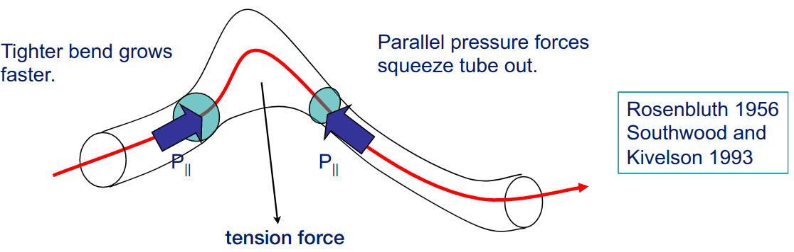
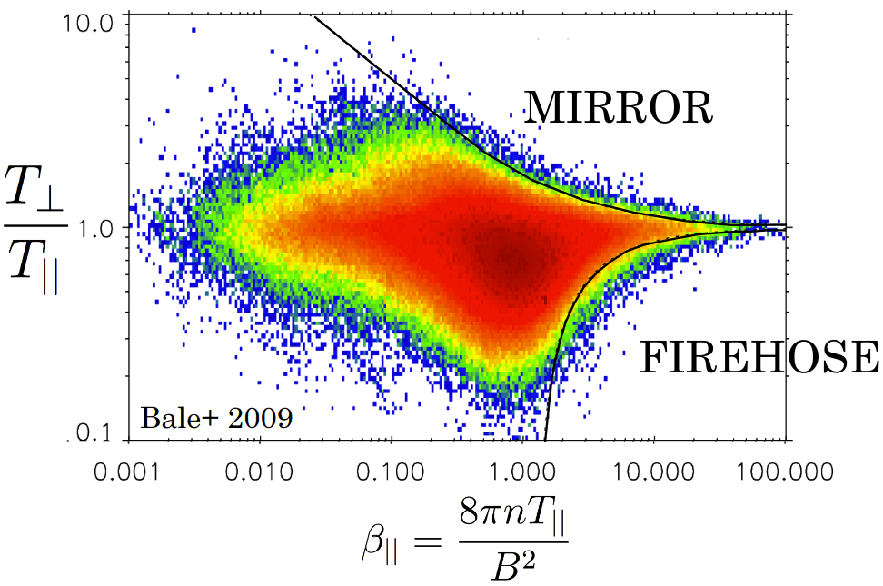

# 动理学磁流体力学 {#sec-kmhd}

本文取材于 Alexander Schekochihin 教授的手写讲义。理论物理学家喜欢 CGS 单位制，但我在此倾向于使用 SI 单位制。笔记后面的部分可能混用单位，因此请注意。

首先，我们说明对于磁化、弱碰撞等离子体（$\nu_\text{colli} \ll \Omega_s$，$r_L\ll \lambda_\text{mfp}$，其中 $\lambda_\text{mfp}$ 是平均自由程），低频（$\omega \ll \Omega_s$）、长波长（$kr_L\ll 1$）动力学如何由一组与熟悉的 MHD 方程十分相似的方程决定。我们稍后会看到，它们与 MHD 的不同之处会深刻影响动力学 --- 实际上，我们尚未完全理解这对高-$\beta$ 等离子体的全部影响。因此，这也是理论等离子体天体物理学的前沿课题之一。

从第一性原理出发。我们感兴趣的任何等离子体都由 Vlasov-Maxwell-Landau 方程组描述：
$$
\frac{\partial f_s}{\partial t} + \mathbf{v}\cdot\nabla f_s + \frac{q_s}{m_s}\Big[\mathbf{E} + \mathbf{v}\times\mathbf{B} \Big]\frac{\partial f_s}{\partial\mathbf{v}} = C(f_s)
$$ {#eq-kmhd_boltzmann}

根据我们的假设，Maxwell 方程可以简化。
$$
\nabla\cdot\mathbf{E} = \epsilon_0 \sum_s q_s n_s,\, n_s=\int \mathrm{d}\mathbf{v}f_s
$$

当 $k^2\lambda_{De}\ll 1$ 时，$\nabla\cdot\mathbf{E}$ 很小，这直接给出准中性条件。

$$
\nabla\cdot\mathbf{B} = 0
$$

$$
\frac{\partial\mathbf{B}}{\partial t} = -\nabla\times\mathbf{E}
$$

$$
\nabla\times\mathbf{B} = \mu_0\mathbf{j} + \cancel{\epsilon_0\mu_0 \frac{\partial\mathbf{E}}{\partial t}},\, \mathbf{j} = \sum_s n_s q_s \mathbf{u}_s, \mathbf{u}_s = \frac{1}{n_s}\int \mathrm{d}\mathbf{v}\mathbf{v} f_s
$$

对于低频波和非相对论运动，由于 $\omega\ll kc$，位移电流可以忽略。

直观上，我们倾向于把等离子体看作具有密度 $n_s$、速度 $\mathbf{u}_s$，以及可能的压强、温度等量的流体（或由若干粒子组分构成的多流体）。这源于我们对碰撞气体（$\nu\gg \omega$）的经验：它们处于局域 Maxwell 平衡：
$$
f_s = \frac{n_s}{(\pi v_{\text{th},s}^2)^{3/2}}e^{-\frac{(\mathbf{v}-\mathbf{v}_s)^2}{v_{\text{th},s}^2}},\, v_{\text{th},s} = \sqrt{\frac{2k_B T_s}{m_s}}
$$
其中 $n_s, \mathbf{u}_s$ 和 $T_s$ 由流体方程支配。

为了将等离子体视为流体，我们把粒子运动分成两部分：
$$
\mathbf{v} = \mathbf{u}_s(t,\mathbf{r}) + \mathbf{w}
$$
其中 $\mathbf{u}_s$ 表示组分 $s$ 的平均速度（类流体描述），$\mathbf{w}$ 表示“无规”速度或内部运动（动理学描述）。这相当于变量变换
$$
(t,\mathbf{r},\mathbf{v}) \rightarrow (t,\mathbf{r},\mathbf{w}),\quad\mathbf{w} = \mathbf{v} - \mathbf{u}_s(t,\mathbf{r})
$$
在此变换下，新基底中的导数写为
$$
\begin{aligned}
\frac{\partial}{\partial t}&\rightarrow \frac{\partial}{\partial t} - \frac{\partial\mathbf{u}_s}{\partial t}\cdot\frac{\partial}{\partial\mathbf{w}} \\
\nabla&\rightarrow \nabla-(\nabla\mathbf{u}_s)\cdot\frac{\partial}{\partial\mathbf{w}} \\
\frac{\partial}{\partial\mathbf{v}}&\rightarrow \frac{\partial}{\partial\mathbf{w}}
\end{aligned}
$$ {#eq-kmhd_change_of_var}

这可以利用链式法则和下列关系推导：
$$
\begin{aligned}
t^\prime &= t \\
\mathbf{r}^\prime &= \mathbf{r} \\
\mathbf{w} &= \mathbf{v} - \mathbf{u}_s(t,\mathbf{r})
\end{aligned}
$$

注意这三个变量相互独立，对于任意量 $f$，有
$$
\begin{aligned}
\frac{\partial f}{\partial t} &= \frac{\partial f}{\partial t^\prime}\cdot\frac{\partial t^\prime}{\partial t} + \frac{\partial f}{\partial \mathbf{r}^\prime}\cdot\frac{\partial\mathbf{r}^\prime}{\partial t} + \frac{\partial f}{\partial\mathbf{w}}\cdot\frac{\partial\mathbf{w}}{\partial t} \\
&= \frac{\partial f}{\partial t} - \frac{\partial\mathbf{u}_s}{\partial t}\cdot\frac{\mathbf{\partial f}}{\partial \mathbf{w}}
\end{aligned}
$$

类似地可以推导 @eq-kmhd_change_of_var 中的另外两个关系。于是 Boltzmann 方程变为
$$
\Big( \frac{\partial}{\partial t} + \mathbf{u}_s\cdot\nabla\Big)f_s + (\mathbf{w}\cdot\nabla)f_s + \Big(\frac{q_s}{m_s}\mathbf{w}\times\mathbf{B} +\mathbf{a}_s -\mathbf{w}\cdot\nabla\mathbf{u}_s )\cdot\frac{\partial f_s}{\partial\mathbf{w}} = C(f_s)
$$ {#eq-boltzmann_change_of_var}
其中
$$
\mathbf{a}_s = \frac{q_s}{m_s}\Big(\mathbf{E} + \mathbf{u}_s\times\mathbf{B} \Big) - \frac{\mathrm{d}\mathbf{u}_s}{\mathrm{d}t}
$$
由定义，现在恒有 $\int \mathrm{d}\mathbf{w}\mathbf{w}f_s = 0$。接下来对 @eq-boltzmann_change_of_var 求各阶矩。零阶矩（$\int \mathrm{d}\mathbf{w}$）给出
$$
\begin{aligned}
\int \frac{df_s}{\mathrm{d}t} \mathrm{d}\mathbf{w} + \int (\mathbf{w}\cdot\nabla)f_s \mathrm{d}\mathbf{w} + \int \Big[... \Big]\cdot\frac{\partial f_s}{\partial\mathbf{w}} \mathrm{d}\mathbf{w} = 0 \\
\frac{\mathrm{d}}{\mathrm{d}t}\int f_s \mathrm{d}\mathbf{w} + \cancel{\nabla\cdot\int \mathbf{w}f_s \mathrm{d}\mathbf{w}} - \int (\mathbf{w}\cdot\nabla\mathbf{u}_s)\cdot\frac{\partial f_s}{\partial\mathbf{w}} \mathrm{d}\mathbf{w} = 0 \\
\frac{dn_s}{\mathrm{d}t} + \int f_s \frac{\partial}{\partial\mathbf{w}}\big(\mathbf{w}\cdot\nabla\mathbf{u}_s \big)\mathrm{d}\mathbf{w} = 0 \\
\frac{dn_s}{\mathrm{d}t} + \int f_s \frac{\partial}{\partial w_j}\big(w_i \frac{\partial}{\partial x_i}u_{sj} \big)dw_j = 0 \\
\frac{dn_s}{\mathrm{d}t} + \int f_s \delta_{ij}\frac{\partial}{\partial x_i}u_{sj}dw_j + \int f_s  w_i \cancel{\frac{\partial^2 u_{sj}}{\partial x_i \partial w_j}}dw_j = 0 \\
\frac{dn_s}{\mathrm{d}t} + \int f_s \frac{\partial}{\partial x_i}u_{si}dw_i = 0 \\
\frac{dn_s}{\mathrm{d}t} + \nabla\cdot\mathbf{u}_s\int f_s \mathrm{d}\mathbf{w} = 0 \\
\frac{dn_s}{\mathrm{d}t} + (\nabla\cdot\mathbf{u}_s)n_s = 0
\end{aligned}
$$
或
$$
\frac{\partial n_s}{\partial t} + \nabla\cdot(n_s\mathbf{u}_s) = 0
$$ {#eq-kmhd_continuity}

一阶矩（$\int \mathrm{d}\mathbf{w}m_s\mathbf{w}$）给出
$$
\nabla\cdot\int \mathrm{d}\mathbf{w}m_s\mathbf{w} \mathbf{w}f_s - m_sn_s\mathbf{a}_s = \int \mathrm{d}\mathbf{w}m_s\mathbf{w}C(f_s) \equiv \mathbf{R}_s
$$
其中 $\int \mathrm{d}\mathbf{w}m_s\mathbf{w} \mathbf{w}f_s = \mathbf{P}_s$ 是压强张量，$\mathbf{R}_s$ 是碰撞摩擦力。展开 $\mathbf{a}_s$，得到每个组分 $s$ 的动量方程
$$
m_sn_s\frac{\mathrm{d}\mathbf{u}_s}{\mathrm{d}t} = -\nabla\cdot\mathbf{P}_s + q_s n_s(\mathbf{E} +\mathbf{u}_s\times\mathbf{B}) + \mathbf{R}_s
$$ {#eq-kmhd_momentum_species}

对所有组分求和，
$$
\begin{aligned}
\sum_s m_sn_s\frac{\mathrm{d}\mathbf{u}_s}{\mathrm{d}t} = -\nabla\cdot\sum_s\mathbf{P}_s + \cancel{\sum_s q_s n_s\mathbf{E}} + \sum_s q_s n_s\mathbf{u}_s\times\mathbf{B} + \cancel{\sum_s\mathbf{R}_s} \\
\rho\frac{\mathrm{d}\mathbf{u}}{\mathrm{d}t} = -\nabla\cdot\mathbf{P} + \mathbf{j}\times\mathbf{B} \\
\rho\frac{\mathrm{d}\mathbf{u}}{\mathrm{d}t} = -\nabla\cdot\mathbf{P} + \mu_0^{-1}(\nabla\times\mathbf{B})\times\mathbf{B} \\
\rho\frac{\mathrm{d}\mathbf{u}}{\mathrm{d}t} = -\nabla\cdot\Big[\mathbf{P} + \frac{B^2}{2\mu_0}\mathbf{I} - \mathbf{B}\mathbf{B}\Big]
\end{aligned}
$$

值得强调的是，$\mathrm{d}/\mathrm{d}t = \partial/\partial t + \mathbf{u}\cdot\nabla$。后面我们将看到记号 $D/Dt$，用以提醒我们其中涉及 $\mathbf{w}$。

我们还需要一个磁场方程，即法拉第定律：
$$
\frac{\partial\mathbf{B}}{\partial t} = -\nabla\times\mathbf{E}
$$

由 @eq-kmhd_momentum_species，
$$
\mathbf{E} = -\mathbf{u}_s\times\mathbf{B} + \frac{\nabla\cdot\mathbf{P}_s}{q_sn_s} - \frac{\mathbf{R}_s}{q_sn_s} + \frac{m_s}{q_s}\frac{\mathrm{d}\mathbf{u}_s}{\mathrm{d}t}
$$

根据以下论证：

* $\nabla\cdot\mathbf{P}_s/(q_sn_s)$ 很小，因为 $kr_s/M_A \ll 1$（长波 + 不可压缩等离子体???）；
* $\mathbf{R}_s/(q_sn_s)$ 很小，因为 $\nu_s/\Omega_s\ll 1$；
* $(m_s/q_s) \mathrm{d}\mathbf{u}_s/\mathrm{d}t$ 很小，因为 $\omega/\Omega_s\ll 1$。

得到最简单的欧姆定律，进而得到 $\mathbf{u}_s = \mathbf{E}\times\mathbf{B}/B^2 = \mathbf{u}_\perp$，即所有组分的垂直速度分量相同。然后由法拉第定律得到感应方程：
$$
\frac{\partial\mathbf{B}}{\partial t} = \nabla\times(\mathbf{u}\times\mathbf{B})
$$ {#eq-kmhd_induction}
或
$$
\frac{\mathrm{d}\mathbf{B}}{\mathrm{d}t} = \mathbf{B}\cdot\nabla\mathbf{u} - \mathbf{B}\nabla\cdot\mathbf{u}
$$ {#eq-kmhd_induction2}

除了压强张量之外，迄今得到的三个方程与 MHD 非常相似。显然，动理学的奥妙都藏在 $\mathbf{P}$ 中。

回到 @eq-boltzmann_change_of_var，关键是注意到
$$
\frac{q_s}{m_s}\mathbf{w}\times\mathbf{B}\cdot\frac{\partial f_s}{\partial\mathbf{w}} = -\Omega_s\Big( \frac{\partial f_s}{\partial\mathbf{\theta}}\Big)_{w_\perp,w_\parallel}
$$
其中 $\theta$ 是垂直平面内的回旋角。通过变换到柱坐标可以证明这一点：
$$
\mathbf{w} = (w_\perp\cos\theta, w_\perp\sin\theta, w_\parallel)
$$
作变量变换：
$$
\begin{aligned}
\frac{\partial f_s}{\partial \theta} &= \frac{\partial f_s}{\partial w_{\perp 1}}\frac{\partial w_{\perp 1}}{\partial \theta} + \frac{\partial f_s}{\partial w_{\perp 1}}\frac{\partial w_{\perp 1}}{\partial \theta} + \frac{\partial f_s}{\partial w_{\parallel}}\cancel{\frac{\partial w_{\parallel}}{\partial \theta}} \\
&= \frac{\partial f_s}{\partial w_{\perp 1}}\frac{\partial w_\perp \cos\theta}{\partial \theta} + \frac{\partial f_s}{\partial w_{\perp 2}}\frac{\partial w_\perp \sin\theta}{\partial \theta} \\
&= -\frac{\partial f_s}{\partial w_{\perp 1}}w_\perp \sin\theta + \frac{\partial f_s}{\partial w_{\perp 2}}w_\perp \cos\theta \\
&= -w_{\perp 2}\frac{\partial f_s}{\partial w_{\perp 1}} + w_{\perp 1}\frac{\partial f_s}{\partial w_{\perp 2}} \\
&= \mathbf{w}\times\hat{b}\cdot\frac{\partial f_s}{\partial \mathbf{w}}
\end{aligned}
$$ {#eq-kmhd_cylindrical_vspace}

这就是为什么说 @eq-kmhd_boltzmann 中的第三项表示速度空间中的旋转，更确切地说，是垂直速度平面中的旋转。

对 @eq-boltzmann_change_of_var 采用最低阶近似，
$$
\Omega_s\Big( \frac{\partial f_s}{\partial\mathbf{\theta}}\Big)_{w_\perp,w_\parallel} = \underbrace{\frac{\mathrm{d} f_s}{\mathrm{d}t}}_{\substack{\omega/\Omega_s\ll 1 \\ kr_su_s/v_{th,s}\ll 1}} + \underbrace{\mathbf{w}\cdot\nabla f_s}_{kr_s\ll 1} + (\underbrace{\mathbf{a}_s}_{kr_s\ll 1} - \underbrace{\mathbf{w}\cdot\nabla\mathbf{u}_s}_{kr_sM_A\ll 1})\cdot\frac{\partial f_s}{\partial \mathbf{w}} - \underbrace{C(f_s)}_{\nu_s\ll\Omega_s} = 0
$$ {#eq-kmhd_kinetic}
这实质上告诉我们 $f_s=f_s(w_\perp,w_\parallel,\theta) = f_s(w_\perp,w_\parallel)$ 具有回旋对称性。用 $<>$ 表示对一个回旋周期的平均：
$$
\left< A \right> = \int_0^{2\pi} A \mathrm{d}\theta
$$

我们可以利用回旋对称性简化压强张量：
$$
\begin{aligned}
\mathbf{P}_s &= \int \mathrm{d}\mathbf{w}m_s\left< \mathbf{w}\mathbf{w} \right>f_s(\mathbf{r},w_\perp,w_\parallel,t) \\
&= \int \mathrm{d}\mathbf{w}m_s \big[\frac{w_\perp^2}{2}(\mathbf{I} - \hat{b}\hat{b}) + w_\parallel^2\hat{b}\hat{b} \big] f_s(\mathbf{r},w_\perp,w_\parallel,t) \\
&= (\mathbf{I} - \hat{b}\hat{b})\int \mathrm{d}\mathbf{w}\frac{m_sw_\perp^2}{2}f_s + \hat{b}\hat{b}\int \mathrm{d}\mathbf{w}m_sw_\parallel^2 f_s \\
&= \begin{pmatrix} p_{\perp s} & 0 & 0 \\ 0 & p_{\perp s} & 0 \\ 0 & 0 & p_{\parallel s} \end{pmatrix}
\end{aligned}
$$
其中
$$
\begin{aligned}
p_\perp &= \int \mathrm{d}\mathbf{w}\frac{m_sw_\perp^2}{2}f_s \\
p_\parallel &= \int \mathrm{d}\mathbf{w}m_sw_\parallel^2 f_s
\end{aligned}
$$

@eq-kmhd_momentum_species 变为
$$
\rho\frac{\mathrm{d}\mathbf{u}}{\mathrm{d}t} = -\nabla\Big( \underbrace{p_\perp + \frac{B^2}{2\mu_0}}_{\text{总标量压力}} \Big) + \nabla\cdot\Big[ \hat{b}\hat{b}\big( \underbrace{p_\perp - p_\parallel}_{\text{压力各向异性应力}} + \underbrace{\frac{B^2}{\mu_0}}_{\text{Maxwell 应力}} \big) \Big]
$$ {#eq-kmhd_momentum_species_gyrotropic}

压强各向异性应力是相对于通常 MHD 的关键新特征。当 $p_\perp - p_\parallel \gtrsim B^2/\mu_0$，即 $(p_\perp - p_\parallel)/p \gtrsim 2/\beta$ 时，它应当重要。因此，它更可能在高-$\beta$ 等离子体中发挥作用。

总结目前的结果：为了求出等离子体中的运动和磁场，求解 @eq-kmhd_momentum_species_gyrotropic 得到 $\mathbf{u}$，并求解 @eq-kmhd_induction 得到 $\mathbf{B}$，其中
$$
\begin{aligned}
\rho &= \sum_s m_s \int \mathrm{d}\mathbf{w}f_s \\
p_\perp &= \sum_s \int \mathrm{d}\mathbf{w}\frac{m_sw_\perp^2}{2}f_s \\
p_\parallel &= \sum_s \int \mathrm{d}\mathbf{w}m_sw_\parallel^2 f_s
\end{aligned}
$$

我们仍需要动理学方程来计算 $f_s$ --- 需要对该方程作一定约化，才能求得最低阶、回旋对称的 $f_s(w_\perp, w_\parallel)$。为了尽快说明其意义，可以暂时推迟这一步，首先推导一些不需要 $f_s$ 方程的结果，即 @sec-firehose 中的消防水管不稳定性。对于镜像模，我们从动理学方程 @eq-kmhd_kinetic 继续推导更高阶结果。我们已经知道，最低阶近似给出回旋对称分布。

在一阶近似下，
$$
\Omega_s\Big( \frac{\partial f_s^1}{\partial\theta} \Big)_{w_\perp, w_\parallel} = \frac{\mathrm{d} f_s^0}{\mathrm{d}t} + \mathbf{w}\cdot\nabla f_s^0 + ( \mathbf{a}_s -\mathbf{w}\cdot\nabla\mathbf{u}_s )\cdot\frac{\partial f_s^0}{\partial\mathbf{w}} - C(f_s^0)
$$

对 $\theta$ 积分可以消去左侧，因此得到
$$
\left< \frac{\mathrm{d} f_s}{\mathrm{d}t} + \mathbf{w}\cdot\nabla f_s + (\mathbf{a}_s - \mathbf{w}\cdot\nabla\mathbf{u}_s)\cdot\frac{\partial f_s}{\partial\mathbf{w}} - C(f_s) \right> = 0
$$
其中 $f_s = f_s(w_\perp,w_\parallel)$。为了进行这一平均，将变量从 $(t,\mathbf{r},\mathbf{w}) \rightarrow(t,\mathbf{r},w_\perp,w_\parallel,\theta)$ 变换。利用
$$
\begin{aligned}
w_\parallel &= \mathbf{w}\cdot\hat{b}(t,\mathbf{r}) \\
w_\perp &= |\mathbf{w} - w_\parallel\hat{b}|
\end{aligned}
$$
再经过一些代数运算（??? 查阅在线笔记。），得到
$$
\frac{D f_s}{Dt} + \frac{1}{B}\frac{D B}{Dt}\frac{w_\perp}{2}\frac{\partial f_s}{\partial w_\perp} + \Big( \frac{q_s}{m_s}E_\parallel - \frac{D\mathbf{u}_s}{Dt}\cdot\hat{b} - \frac{w_\perp^2}{2}\frac{\nabla_\parallel B}{B} \Big)\frac{\partial f_s}{\partial w_\parallel} = C(f_s)
$$ {#eq-kmhd_boltzmann_1storder}
其中
$$
D/Dt = \mathrm{d}/\mathrm{d}t + w_\parallel \hat{b}\cdot\nabla = \partial/\partial t + \mathbf{u}_s\cdot\nabla + w_\parallel \hat{b}\cdot\nabla
$$

这并不十分直观，也许用另一组“更有物理意义”的变量来写这个方程更好。令
$$
f_s(w_\perp, w_\parallel) = F_s(\mu, \epsilon)
$$
其中 $\mu = m_sw_\perp^2/2B$ 是回旋粒子的磁矩，$\epsilon=m_sw^2/2 = m_s(w_\perp^2+w_\parallel^2)/2$。由于 $\omega\ll\Omega_s$ 时 $\mu$ 守恒，$F_s$ 满足（???）
$$
\frac{D F_s}{Dt} + \Big[ m_sw_\parallel\Big( \frac{q_s}{m_s}E_\parallel - \frac{D\mathbf{u}_s}{Dt}\cdot\hat{b} \Big) +\mu\frac{\mathrm{d}B}{\mathrm{d}t} \Big]\frac{\partial F_s}{\partial\epsilon} = C(F_s)
$$ {#eq-kmhd_kinetic_1storder}

* 第一项是导引中心坐标中的对流导数。
* 第二项是平行电场造成的加速，其中 $E_\parallel$ 由条件 $\sum_s q_s n_s = 0$ 确定。
* 第三项考虑了 $\epsilon$ 不包含整体速度这一事实。
* 第四项是由 $\mu$ 守恒导致的 _电子感应加速_（betatron acceleration）：

$$
\begin{aligned}
\epsilon &= \mu B + \frac{m_sw_\parallel^2}{2} \\
\dot{\epsilon} &= \mu \dot{B}\,(w_\parallel\text{ 为常数？？？})
\end{aligned}
$$

电子感应加速是指磁场强度随时间缓慢增加（相对于回旋周期），使 $\mu$ 保持不变，但由于存在与时变磁场相关的电场，粒子动能并不守恒的情况。此时，由于 $\mu$ 不变，垂直能量增加。如我们即将在 @sec-mirror 中看到的，这是解释镜像模的关键。

## 消防水管不稳定性：线性理论 {#sec-firehose}

假设我们已经得到某个（尚未完整推导的）平衡态的“宏观”解。考虑此解的低频、短波长扰动（$\omega\ll u/l, kl \gg 1$），并寻找形式为 $\mathbf{X} +\delta\mathbf{X}$ 的解，其中无穷小扰动 $\propto e^{i(\mathbf{k}\cdot\mathbf{r}-\omega t)}$。注意速度 $\mathbf{u}$ 被视为扰动项（背景速度只是漂移）。

由 @eq-kmhd_induction
$$
\begin{aligned}
-\omega\delta\mathbf{B} &= \mathbf{B}\cdot\mathbf{k}\delta\mathbf{u} - \mathbf{B}\mathbf{k}\cdot\delta\mathbf{u} \\
&= B(k_\parallel\delta\mathbf{u}_\perp - \hat{b}\mathbf{k}_\perp\cdot\delta\mathbf{u}_\perp)
\end{aligned}
$$ {#eq-kmhd_induction_perturb}

将 @eq-perturb_k_bhat 代入 @eq-kmhd_momentum_species_gyrotropic，得到
$$
\begin{aligned}
-\omega\rho\delta\mathbf{u} &= -\mathbf{k}\Big(\delta p_\perp + \frac{B\delta B}{\mu_0}\Big) + \mathbf{k}\cdot\Big[ \Big(\delta\hat{b}\hat{b} + \hat{b}\delta\hat{b}\Big)\Big( p_\perp - p_\parallel + \frac{B^2}{\mu_0} \Big) +\hat{b}\hat{b}\Big( \delta p_\perp - \delta p_\parallel + \frac{2B\delta B}{\mu_0} \Big) \Big] \\
&= -\mathbf{k}_\perp \Big(\delta p_\perp + \frac{B\delta B}{\mu_0}\Big) - \hat{b}k_\parallel \Big[ \delta p_\parallel + (p_\perp - p_\parallel)\frac{\delta B}{B} \Big] + \delta\hat{b} k_\parallel \Big( p_\perp - p_\parallel + \frac{B^2}{\mu_0} \Big)
\end{aligned}
$$ {#eq-kmhd_momentum_perturb}

$\delta\hat{b}$ 包含两部分：阿尔芬分量 $\delta\mathbf{B}_\perp/B$ 和压缩分量 $\delta\mathbf{B}_\parallel/B$。由 @eq-kmhd_induction_perturb，$\hat{b}$ 的阿尔芬扰动可写为
$$
\delta\hat{b} = \frac{\delta\mathbf{B}_\perp}{B} = -\frac{k_\parallel}{\omega}\delta\mathbf{u}_\perp
$$

与 $\mathbf{k}_\perp$ 取叉积，从 @eq-kmhd_momentum_perturb 中分离出阿尔芬响应：
$$
\begin{aligned}
-\omega\rho \mathbf{k}_\perp \times\delta\mathbf{u}_\perp = k_\parallel\Big(p_\perp - p_\parallel +\frac{B^2}{\mu_0} \Big) \mathbf{k}_\perp\times\delta\hat{b} \\
\omega\rho \mathbf{k}_\perp \times\delta\mathbf{u}_\perp = k_\parallel\Big(p_\perp - p_\parallel +\frac{B^2}{\mu_0} \Big) \mathbf{k}_\perp\times\frac{k_\parallel}{\omega}\delta\mathbf{u}_\perp \\
\omega^2 = k_\parallel^2 \Big( \frac{B^2}{\mu_0 \rho} + \frac{p_\perp - p_\parallel}{\rho} \Big) = k_\parallel^2 v_{th\parallel}^2 \Big( \frac{p_\perp - p_\parallel}{p_\parallel} + \frac{2}{\beta_\parallel} \Big)
\end{aligned}
$$

令 $A = (p_\perp - p_\parallel)/p_\parallel$。如果 $A<-2/\beta_\parallel$，系统将不稳定，即
$$
p_\perp - p_\parallel > 2 p_B
$$ {#eq-kmhd_firehose_criterion}
这给出增长率
$$
\gamma = k_\parallel v_{th\parallel}\sqrt{\bigg\lvert A+\frac{2}{\beta_\parallel}\bigg\rvert}
$$ {#eq-kmhd_firehose_growth_rate}

因此，负的 $A$（$p_\parallel > p_\perp$）在局部削弱张力，即减慢阿尔芬波，并使弯曲磁力线在能量上更容易。当 $A<-2/\beta_\parallel$ 时，磁力线失去弹性，出现消防水管不稳定性。

{#fig-firehose}

要点：

* $p_\parallel > p_\perp$ 导致不稳定性并不奇怪：这是非平衡状态，因此是自由能的来源。

* $\gamma\propto k_\parallel$ 导致紫外灾变：在 KMHD 的适用范围内（$\omega\ll\Omega_i, kr_i\ll 1$），无法得到 $\gamma$ 达到峰值时的波数。计入有限拉莫尔半径得到（Oxford MNRAS 405, 291? 这些表达式正确吗？）
$$
\begin{aligned}
\gamma_{\text{peak}}\sim \bigg\lvert A + \frac{2}{\beta_\parallel} \bigg\rvert \Omega_i \\
k_{\parallel\text{peak}}r_i\sim \bigg\lvert A + \frac{2}{\beta_\parallel} \bigg\rvert^{1/2}
\end{aligned}
$$
因此该不稳定性在微观尺度上非常快（$\gamma \propto \Omega_i$，强磁场下很大）。任何具有 $p_\parallel > p_\perp$ 的高-$\beta$ 宏观解都会立即发散。之后发生什么取决于消防水管不稳定性的非线性饱和。Justin Kasper 在 2002 年发现消防水管稳定性边界约束了大多数观测到的太阳风状态，这是一个转折性时刻；Hellinger 在 2006 年继续了这项研究。Bale 在 2009 年表明，边界处的涨落水平升高。

添加关于消防水管稳定区域的图！

## 镜像不稳定性：线性理论 {#sec-mirror}

回到 @eq-kmhd_induction_perturb 和 @eq-kmhd_momentum_perturb，研究除阿尔芬扰动外还有哪些扰动以及它们何时稳定。我们已经考察了阿尔芬扰动 $\delta\hat{b}=\delta \mathbf{B}_\perp/B$。现在考虑
$$
\frac{\delta B}{B} = \frac{\delta B_\parallel}{B}
$$ {#eq-kmhd_B_perturb}

由 @eq-kmhd_induction_perturb，垂直压缩使 B 增大：
$$
\omega\frac{\delta B}{B} = \mathbf{k}_\perp\cdot\delta\mathbf{u}_\perp
$$

对 @eq-kmhd_momentum_perturb 取 $\mathbf{k}_\perp\cdot$：
$$
\omega\rho\mathbf{k}_\perp\cdot\delta\mathbf{u}_\perp = \rho\omega^2 \frac{\delta B}{B} = k_\perp^2\Big( \delta p_\perp + \frac{B\delta B}{\mu_0} \Big) + k_\parallel^2\Big( p_\perp - p_\parallel + \frac{B^2}{\mu_0} \Big) \frac{\delta B}{B}
$$ {#eq-kmhd_momentum_perturb_perp}

注意这里的 $p_\perp$ 项：我们需要动理学理论来计算它！所幸已有 @eq-kmhd_kinetic_1storder 可用于计算
$$
\delta p_\perp = \int \mathrm{d}\mathbf{w}\frac{m_sw_\perp^2}{2}\delta f_s(w_\perp, w_\parallel)
$$

可通过计算 $F_s(\mu,\epsilon)$ 并变换回 $w_\perp,w_\parallel$ 得到 $\delta f_s(w_\perp, w_\parallel)$。

这里有个微妙之处：我们展开分布函数所围绕的宏观平衡态是
$$
F_{0s}(\mu,\epsilon) = f_{0s}(w_\perp,w_\parallel) = f_{0s}\Big( \sqrt{\frac{2B_0\mu}{m_s}},\sqrt{\frac{2(\epsilon-\mu B_0)}{m_s}} \Big)
$$
其中包含未扰动磁场 $B_0$。$F_0$ 中的 $\mu$ 包含 $B_0+\delta B$，变换到 $w_\perp,w_\parallel$ 时必须考虑这一点。现在对所有量施加扰动：
$$
\begin{aligned}
F_s(\mu,\epsilon) &= F_{0s}(\mu,\epsilon) + \delta F_s \\
&= f_{0s}(w_\perp,w_\parallel) + \delta f_s \\
&= f_{0s}\Big( \sqrt{\frac{2\mu(B_0+\delta B)}{m_s}},\sqrt{\frac{2[\epsilon-\mu(B_0+\delta B)]}{m_s}} \Big) + \delta f_s \\
&= f_{0s}\Big( \sqrt{\frac{2\mu B_0}{m_s}}\sqrt{1+\frac{\delta B}{B_0}},\sqrt{\frac{2(\epsilon-\mu B_0)}{m_s}}\sqrt{1-\frac{m_s\mu\delta B}{(\epsilon-\mu B_0)}} \Big) + \delta f_s \\
&\approx f_{0s}\Big( \sqrt{\frac{2\mu B_0}{m_s}},\sqrt{\frac{2(\epsilon-\mu B_0)}{m_s}} \Big) + \frac{2\mu}{m_s}\delta B\Big(\frac{\partial f_{0s}}{\partial w_\perp^2}-\frac{\partial f_{0s}}{\partial w_\parallel^2} \Big) + \delta f_s
\end{aligned}
$$

因此
$$
\delta f_s = \delta F_s - w_\perp^2\frac{\delta B}{B}\Big(\frac{\partial f_{0s}}{\partial w_\perp^2}-\frac{\partial f_{0s}}{\partial w_\parallel^2} \Big)
$$

如果 $f_{0s}$ 是双 Maxwell 分布，
$$
f_{0s} = \frac{n_s}{\pi^{3/2}v_{\text{th}\perp s}^2 v_{\text{th}\parallel s}}\exp\Big(-\frac{w_\perp^2}{v_{\text{th}\perp s}^2}-\frac{w_\parallel^2}{v_{\text{th}\parallel s}^2}\Big)
$$
则可进一步写为
$$
\delta f_s = \delta F_s + w_\perp^2\frac{\delta B}{B}\Big(\frac{1}{v_{\text{th}\perp s}^2} - \frac{1}{v_{\text{th}\parallel s}^2} \Big) f_{0s} = \delta F_s + w_\perp^2\frac{\delta B}{B}\frac{m_sn_s}{2}\Big(\frac{1}{p_{\perp s}} - \frac{1}{p_{\parallel s}} \Big) f_{0s}
$$

可以通过分部积分消去偏导数：
$$
\begin{aligned}
\int \mathrm{d}\mathbf{w}\frac{\partial f_{0s}}{\partial w_\parallel^2} &= \int_0^{2\pi}\mathrm{d}\theta \int dw_\perp\int \frac{1}{2w_\parallel}\frac{\partial f_{0s}}{\partial w_\parallel}dw_\parallel \\
&= \int_0^{2\pi}\mathrm{d}\theta \int dw_\perp\int\frac{1}{2w_\parallel}\mathrm{d} f_{0s} \\
&= \int_0^{2\pi}\mathrm{d}\theta \int dw_\perp\Big[\cancel{\frac{f_{0s}}{2w_\parallel}\bigg\rvert_{-\infty}^{\infty}} - \int f_{0s}\mathrm{d}\frac{1}{2w_\parallel}\Big] \\
&= \int_0^{2\pi}\mathrm{d}\theta \int dw_\perp\int\frac{1}{2w_\parallel^2}f_{0s}dw_\parallel \\
&= \int \mathrm{d}\mathbf{w} \frac{1}{2w_\parallel^2}f_{0s} \\
\int \mathrm{d}\mathbf{w}w_\perp w_\perp^4\frac{\partial f_{0s}}{\partial w_\perp^2} &= 2\pi\int dw_\parallel \Big[ \cancel{\frac{1}{2}w_\perp^4f_{0s}\bigg\rvert_{-\infty}^{+\infty}} - \frac{1}{2}\int f_{0s}dw_\perp^4 \Big] \\
&= -2\pi\int dw_\parallel 2w_\perp^2 f_{0s}w_\perp dw_\perp \\
&= -2 \int \mathrm{d}\mathbf{w} w_\perp^2 f_{0s}
\end{aligned}
$$

于是得到
$$
\begin{aligned}
\delta p_{\perp s} &= \int \mathrm{d}\mathbf{w}\frac{m_s w_\perp^2}{2}\delta f_s \\
&= \int \mathrm{d}\mathbf{w}\frac{m_s w_\perp^2}{2}\delta F_s - \int \mathrm{d}\mathbf{w}\frac{m_s w_\perp^4}{2}\Big(\frac{\partial f_{0s}}{\partial w_\perp^2}-\frac{\partial f_{0s}}{\partial w_\parallel^2} \Big)\frac{\delta B}{B} \\
&= \int \mathrm{d}\mathbf{w}\frac{m_s w_\perp^2}{2}\delta F_s - \int_0^{2\pi}\mathrm{d}\theta \int dw_\perp w_\perp \int \mathrm{d} w_\parallel \frac{m_s w_\perp^4}{2}\Big(\frac{\partial f_{0s}}{\partial w_\perp^2}-\frac{\partial f_{0s}}{\partial w_\parallel^2} \Big)\frac{\delta B}{B} \\
&= \int \mathrm{d}\mathbf{w}\frac{m_s w_\perp^2}{2}\delta F_s + 2\int \mathrm{d}\mathbf{w}\frac{m_s w_\perp^2}{2}\delta f_{0s}\frac{\delta B}{B} + \int \mathrm{d}\mathbf{w}\frac{2(\frac{1}{2}m_sw_\perp^2)^2}{m_sw_\parallel^2}f_{0s}\frac{\delta B}{B} \\
&= \int \mathrm{d}\mathbf{w}\frac{m_s w_\perp^2}{2}\delta F_s + \frac{\delta B}{B}\Big( 2p_{\perp s} - \frac{2 p_{\perp s}^2}{p_{\parallel s}} \alpha_s )
\end{aligned}
$$ {#eq-kmhd_pperp_perturb}
如果 $f_{0s}$ 不是双 Maxwell 分布，则 $\alpha_s$ 是量级为 1 的系数。

忽略碰撞，对 @eq-kmhd_kinetic_1storder 线性化并作 Fourier 变换（$\mathbf{u}_s=0$），即可得到 $\delta F_s$：
$$
\begin{aligned}
-i(\omega - k_\parallel w_\parallel)\delta F_s = - \Big[ m_sw_\parallel\Big( \frac{q_s}{m_s}E_\parallel - i(\omega-k_\parallel w_\parallel) \delta u_{\parallel s}\Big) -i\omega\mu\delta B \Big]\frac{\partial F_{0s}}{\partial \epsilon} \\
\delta F_s = -i\frac{w_\parallel q_s E_\parallel}{\omega-k_\parallel w_\parallel}\frac{\partial F_{0s}}{\partial \epsilon} - \delta u_{\parallel s}m_sw_\parallel\frac{\partial F_{0s}}{\partial\epsilon} - \frac{\omega}{\omega-k_\parallel w_\parallel}\mu\delta B\frac{\partial F_{0s}}{\partial\epsilon}
\end{aligned}
$$

当 $\beta\gg 1$ 时第一项可以忽略（??? 完整计算见另一份笔记！）；否则可由条件 $\sum_s q_s n_s = 0$ 得到 $E_\parallel$。可以证明第二项等价于 $\delta u_{\parallel s}\partial f_{0s}/\partial w_\parallel$：
$$
\begin{aligned}
\frac{\partial f_{0s}}{\partial w_\parallel} &= \frac{\partial f_{0s}}{\partial \epsilon}\frac{\partial \epsilon}{\partial w_\parallel} + \frac{\partial f_{0s}}{\partial\mu}\cancel{\frac{\partial \mu}{\partial w_\parallel}} \\
&= \frac{\partial F_{0s}}{\partial\epsilon}m_s w_\parallel
\end{aligned}
$$
因此它对 $\delta p_\perp$ 没有贡献，因为其积分为 0。

第三项可写为
$$
\frac{\omega}{\omega-k_\parallel w_\parallel}\mu\delta B\frac{\partial F_{0s}}{\partial\epsilon} = \frac{\omega}{\omega-k_\parallel w_\parallel}\frac{m_sw_\perp^2}{2}\frac{\delta B}{B}\frac{1}{w_\parallel}\frac{\partial f_{0s}}{\partial w_\parallel} = \frac{\omega}{\omega-k_\parallel w_\parallel} m_sw_\perp^2\frac{\delta B}{B}\frac{\partial f_{0s}}{\partial w_\parallel^2}
$$

因此，$\delta F_s$ 的“相关”部分为
$$
\delta F_s = -\frac{\omega}{\omega-k_\parallel w_\parallel} m_sw_\perp^2\frac{\delta B}{B}\frac{\partial f_{0s}}{\partial w_\parallel^2}
$$
它对 $\delta p_{\perp s}$ 的贡献为
$$
\int \mathrm{d}\mathbf{w}\frac{m_sw_\perp^2}{2}\delta F_s = \frac{\delta B}{B}\frac{\omega}{|k_\parallel|}\int\frac{dw_\parallel}{w_\parallel - \frac{\omega}{|k_\parallel|}} \Big[ \frac{\partial}{\partial w_\parallel^2}\int \mathrm{d}\mathbf{w}_\perp \frac{m_s^2w_\perp^4}{2} f_{0s} \Big]
$$

这里使用 $|k_\parallel|$，因为若 $k_\parallel <0$，可以变换变量 $w_\parallel \rightarrow -w_\parallel$。这里涉及朗道积分：在复平面上沿实轴和上半平面的大半圆积分，唯独在极点下方绕过一个小半圆时，可用留数定理 @eq-residual_thm 计算（添加图片！）：
$$
\frac{1}{w_\parallel - \frac{\omega}{|k_\parallel|}} = P\frac{1}{w_\parallel - \frac{\omega}{|k_\parallel|}} + i\pi\delta\Big(w_\parallel - \frac{\omega}{|k_\parallel|} \Big)
$$
因此
$$
\begin{aligned}
\int \mathrm{d}\mathbf{w}\frac{m_sw_\perp^2}{2}\delta F_s &= \frac{\delta B}{B}\Big[ \cancel{\frac{\omega}{|k_\parallel|}P\int\frac{dw_\parallel}{w_\parallel - \frac{\omega}{|k_\parallel|}} \big[ ... \big]} + i\pi\frac{\omega}{|k_\parallel|}\big[ ... \big]_{w_\parallel}=\omega/|k_\parallel| \Big]
\end{aligned}
$$

假设 $\omega\ll k_\parallel v_{\text{th}s\parallel}$ 时第一项很小；第二项必须保留，因为它是导致不稳定性的最低阶虚部。

对于双 Maxwell 分布，
$$
\Big[ \frac{\partial}{\partial w_\parallel^2}\int \mathrm{d}\mathbf{w}_\perp\frac{m_s^2w_\perp^4}{2}f_{0s} \Big]_{w_\parallel=\omega/|k_\parallel|} = -\frac{2p_{\perp s}^2}{p_{\parallel s}}\frac{e^{-\frac{\omega^2}{k_\parallel^2 v_{\text{th}\parallel s}^2}}}{\sqrt{\pi}v_{\text{th}\parallel s}}
$$

指数项近似为 1。如果不是双 Maxwell 分布，则需要乘以系数 $\alpha_s \sim 1$。

@eq-kmhd_pperp_perturb 变为
$$
\delta p_{\perp s} = \frac{\delta B}{B}\Big[ 2p_{\perp s} - \frac{2p_{\perp s}^2}{p_{\parallel s}}\Big( \alpha_s + i\sqrt{\pi}\frac{\omega}{|k_\parallel|v_{\text{th}\parallel s}}\sigma_s \Big) \Big]
$$

将其代入 @eq-kmhd_momentum_perturb_perp：
$$
\rho \omega^2 = k_\perp^2\frac{B^2}{\mu_0}\Big[ \sum_s(1 - \frac{p_{\perp s}}{p_{\parallel s}}\alpha_s)\beta_{\perp s} - i\sum_s \sigma_s\frac{p_{\perp s}}{p_{\parallel s}}\beta_{\perp s}\sqrt{\pi}\frac{\omega}{|k_\parallel| v_{\text{th} \parallel s}} + 1 \Big] + k_\parallel^2 \frac{B^2}{\mu_0}\Big[ \sum_s\frac{\beta_{\perp s}}{2}\big( 1 - \frac{p_{\parallel s}}{p_{\perp s}} \big) + 1 \Big]
$$

由于 $\omega\ll k_\parallel v_{\text{th}\parallel s}$，左侧可以忽略。由于 $v_{\text{th}\parallel e} \gg v_{\text{th}\parallel i}$，分母中的电子热速度 $v_{\text{th}\parallel e}$ 的贡献可以忽略。增长率 $\gamma$ 是 $\omega$ 的虚部。整理上式：
$$
\sigma_i\frac{p_{\perp i}}{p_{\parallel i}}\beta_{\perp i}\sqrt{\pi}\frac{\gamma}{|k_\parallel|v_{\text{th}\parallel i}} = \sum_s \Big(\frac{p_\perp s}{p_\parallel s}\alpha_s - 1 \Big)\beta_{\perp s} - 1 -\frac{k_\parallel^2}{k_\perp^2}\Big[ \sum_s\frac{\beta_{\perp s}}{2}\big( 1-\frac{p_{\parallel s}}{p_{\perp s}}\big) + 1 \Big]
$$ {#eq-kmhd_mirror_dispersion}
其中 $\Lambda\equiv \frac{k_\parallel^2}{k_\perp^2}\sum_s \Big(\frac{p_\perp s}{p_\parallel s}\alpha_s - 1 \Big)\beta_{\perp s} - 1$，如果它为正则触发不稳定性：
$$
\sum_s \Big(\frac{p_\perp s}{p_\parallel s}\alpha_s - 1 \Big)\beta_{\perp s} > 1
$$

考察其来源可以看出，这相当于 $\delta p_\perp$ 改变磁压强力，使其由正变负：
$$
\delta p_\perp + \frac{B\delta B}{\mu_0} = \frac{B\delta B}{\mu_0}\Big[ \underbrace{1}_{\text{磁压}} - \underbrace{\sum_s\Big( \frac{p_{\perp s}}{p_{\parallel s}}\alpha_s - 1 \Big)\beta_{\perp s}}_{\substack{\text{非共振} \\ \text{粒子压力}}} + \underbrace{...}_{\substack{\text{共振粒子} \\ \text{压力}}} \Big]
$$

因此，从根本上说，压强各向异性使压缩或稀疏磁场变得更容易 --- 当压强的符号翻转、产生压缩和稀疏在能量上有利时，系统便不稳定。（添加图片！）色散关系 @eq-kmhd_mirror_dispersion 基本上表述了磁压、非共振粒子压强 $\delta p_\perp$ 和共振粒子压强 $\propto\gamma$ 之间的压强平衡；后者来自 @eq-kmhd_kinetic_1storder 中的 _电子感应加速_ $\mu \mathrm{d}B/\mathrm{d}t$。（另见 @southwood1993mirror 的式 21）

电子感应加速项描述稳定情况下发生的过程。当磁压阻碍 $\delta B$ 扰动（例如波谷）的形成时，为了补偿它，必须有 $\gamma<0$，能量从 $\delta B$ 转移到共振粒子，而这些粒子由镜力加速。相应的 $\delta B$ 衰减就是著名的 _Barnes 阻尼_。[^Barnes]

[^Barnes]: “镜场”的朗道阻尼，Barnes 1966；在 Stix 的书中也称为渡越时间阻尼。

@southwood1993mirror 对其中的物理过程进行了更多讨论。他们指出，尽管该不稳定性是共振的，共振粒子所起的作用却不同寻常。不稳定性源于等离子体主体与磁场之间的压强失衡。要发生这一过程，主体（非共振）压强响应必须与磁压反相，如同低频下磁矩和粒子能量守恒时那样。然而，共振粒子产生的压强扰动与磁场压强变化同相。由此推论，与非共振粒子不同，共振粒子的能量会随着不稳定性发展而改变。
大多数共振不稳定性的线性增长率与共振粒子数成正比。然而，对于镜像不稳定性，增长率与共振粒子数（及其压强贡献）成反比。这一反常结果的原因是：平行速度较小的粒子越少，平衡非共振分布产生的压强失衡所需的增长率就越高。

最后注意，对给定的 $k_\perp$，由 @eq-kmhd_mirror_dispersion（添加图片！）得到
$$
\frac{\partial\gamma}{\partial k_\parallel}\bigg\rvert_{k_\perp} \propto \Lambda - \frac{k_\parallel^2}{k_\perp^2}\Big[\sum_s\frac{\beta_{\perp s}}{2}\Big(1-\frac{p_\parallel s}{p_\perp s} \Big) + 1 \Big]
$$

当右侧趋于 0 时达到最大增长率，这等价于 $\frac{2}{3}\Lambda$，因此最大增长率为
$$
\gamma_{\text{max}} = \frac{|k_\parallel|v_{\text{th}\parallel i}}{\sqrt{\pi}}\frac{2}{3}\Lambda \frac{p_{\parallel i}}{p_{\perp i}}\frac{1}{\sigma_i\beta_{\perp i}}
$$

我们假设 $\gamma\ll k_\parallel v_{\text{th}\parallel s}$；如果满足下式，这确实成立：
$$
\Lambda\frac{1}{\beta_{\perp i}} = \big(\sum_s A_s \beta_{\perp s} - 1 \big)\frac{1}{\beta_{\perp i}}\ll 1
$$
因此我们的近似是自洽的。

如果接近边际不稳定状态，
$$
\frac{k_\parallel}{k_\perp}\sim\sqrt{\Lambda}\ll 1
$$
因此镜像模在阈值附近高度倾斜。

另一个重要问题是，由于 $\gamma\propto k_\parallel$，我们再次遇到紫外灾变。镜像模是一种快速的微观尺度不稳定性，其峰值增长率位于 KMHD 适用范围之外。计入有限拉莫尔半径得到（Hellinger 2007 PoP 14, 082105?）
$$
\gamma_{\text{peak}}\sim\Big(A-\frac{1}{\beta}\Big)^2\beta\Omega_i,\quad k_{\text{peak}}r_i\sim\Big( A-\frac{1}{\beta}\Big)\beta
$$

因此，任何具有 $p_\perp>p_\parallel$ 的高-$\beta$ KMHD 宏观解都会发散，就像 $p_\parallel > p_\perp$ 的情况一样；之后的演化同样取决于镜像不稳定性如何饱和。注意，由于 $A_e\ll A_i$（?），这里忽略了 $A_e$。镜像不稳定性的条件为
$$
\begin{aligned}
\frac{p_{\perp i}}{p_{\parallel i}} - 1 > \frac{1}{\beta_{\perp i}} = \frac{1}{\beta_{\parallel i}}\frac{p_{\parallel i}}{p_{\perp i}} \\
\frac{p_{\perp i}}{p_{\parallel i}}\Big( \frac{p_{\perp i}}{p_{\parallel i}}-1\Big) > \frac{1}{\beta_{\parallel i}}
\end{aligned}
$$

@fig-instability-mirror-firehose 展示了 Wind 航天器的观测结果。太阳风似乎确实保持在这些边界之内。（添加参考文献！）

{#fig-instability-mirror-firehose}

### 与慢模的比较

* 驱动机制
  - 镜像模：主要由高 beta 等离子体中的压强各向异性（$T_\perp/T_\parallel > 1$）驱动。
  - MHD 慢模：由低至中等 beta 等离子体中的压强梯度和磁力线曲率驱动。
* 传播特征
  - 镜像模：主要沿背景磁场平行传播，但可以有较小的垂直分量。在流体极限下它是不传播的模（零频率），但动理学效应可使其具有有限频率。
  - MHD 慢模：相对于磁场倾斜传播，具有平行和垂直分量。它是具有有限频率的传播模。
* 等离子体条件
  - 镜像模：通常见于高 beta（$\gtrsim 1$）等离子体，如地球磁鞘和太阳风。
  - MHD 慢模：更常见于磁压占主导的低至中等 beta（$\ll 1$）等离子体，如太阳日冕和地球磁层。

## 压强各向异性的起源

到目前为止我们看到，任何具有 $p_\perp\neq p_\parallel$ 的高-$\beta$ 宏观 KMHD 解（更准确地说，$|p_\perp - p_\parallel|/p \gtrsim 1/\beta$）都会对消防水管或镜像不稳定性发生剧烈不稳定 --- 这两者都是快速微观尺度模，会产生 KMHD 范围之外的涨落（顺便说，也超出了回旋动理学的范围 --- 太接近回旋频率，$k_\parallel/k_\perp$ 不够小，$\delta\mathbf{B}/B$ 也不够小）。对于碰撞不足以使其完全成为流体的高-$\beta$ 等离子体（即 $\nu\ll\Omega_s$），这应当让我们多么担忧 KMHD 的适用性？

答案是，_非常担忧_！低频、弱碰撞动力学的一个关键性质是粒子的磁矩 $\mu=m_sw_\perp^2/2B$ 守恒。组分 $s$ 的粒子平均磁矩 $\mu$ 为
$$
<\mu>_w = \frac{1}{n_s}\int \mathrm{d}\mathbf{w}\mu f_s = \frac{p_{\perp s}}{n_s B} = \text{const.}
$$

为了定性讨论，暂且假设 $n_s=\text{const}$（不可压缩等离子体，$\beta\gg 1$）。那么上述守恒关系表明，在一个流体元的局部（$\mathbf{w}$ 是无规速度），每当 $\mathbf{B}$ 改变时，$p_{\perp s}$ 必须按比例改变（但 $p_{\parallel s}$ 不必）。因此我们预期（?）
$$
\frac{1}{p_{\perp s}}\frac{\mathrm{d} p_{\perp s}}{\mathrm{d}t}\sim\underbrace{\frac{1}{B}\frac{\mathrm{d}B}{\mathrm{d}t}}_{\mu\text{ 守恒}} - \underbrace{\nu_s\frac{p_{\perp s}-p_{\parallel s}}{p_{\perp s}}}_{\substack{\text{碰撞引起的压力} \\ \text{各向异性弛豫}}}
$$ {#eq-kmhd_pressure_change}

值得提醒的是，$\mathrm{d}/\mathrm{d}t$ 位于 $\mathbf{u}_s$ 参考系中。
令右侧的两个效应平衡，
$$
\Delta_s = \frac{p_{\perp s} - p_{\parallel s}}{p_{\perp s}} \sim\frac{1}{\nu_s}\frac{1}{B}\frac{\mathrm{d}B}{\mathrm{d}t}
$$ {#eq-kmhd_pressure_balance}

这个表达式仅在 $\Delta_s\ll 1$，即 $\nu_s\gg \frac{1}{B}\frac{\mathrm{d}B}{\mathrm{d}t}$ 时有效；否则，随着 B 改变，$\Delta_s$ 会随时间增长。因此

* B 在局部增大 $\rightarrow \Delta_s >0 \rightarrow$ 镜像不稳定性
* B 在局部减小 $\rightarrow \Delta_s <0 \rightarrow$ 消防水管不稳定性

由于几乎所有大尺度动力学都涉及 $\mathbf{B}$ 的局部变化，这意味着高-$\beta$ 区域中几乎任何 KMHD 宏观解都不稳定。一个很好的例子是发电机问题：当磁场被湍流随机拉伸时，（在 MHD 中）磁能指数增长（最终形成我们观测到的饱和磁场），在局部会发现这类结构：（添加图片！）

一般而言，为了理解长期演化，我们需要某种平均场理论来描述微观尺度不稳定性对动力学的大尺度影响。据推测，这会保持各向异性，使不稳定性处于边际状态（?）（太阳风测量结果似乎确实证实了这一点 --- 见 Bale 等，2009）。

这可能通过两种方式发生 --- 消防水管和镜像涨落可能散射粒子，提高有效碰撞率并（?）控制压强各向异性：
$$
-\frac{2}{\beta}\lesssim \frac{p_\perp - p_\parallel}{p}\lesssim \frac{1}{\beta}
$$

它们也可能抑制 B 的变化，这是控制 $\Delta$ 的另一种方式。关于哪种机制对动力学重要，参见 MNRAS 440, 3226 (2014) 中对这两种机制可能后果的推测性综述。

* 非线性消防水管不稳定性：Rosin 等，MNRAS 413，2011
* 非线性镜像不稳定性：Rincon 等，MNRAS 447，2015
* PIC 模拟：Kunz 等，PRL，2014

## 备注

### 备注 I

如果假设不可压缩，磁感应方程 @eq-kmhd_induction2 变为
$$
\begin{aligned}
\frac{\mathrm{d}\mathbf{B}}{\mathrm{d}t} = \mathbf{B}\cdot\nabla\mathbf{u} \\
\frac{1}{B}\frac{\mathrm{d}B}{\mathrm{d}t} = \hat{b}\hat{b}:\nabla\mathbf{u}
\end{aligned}
$$

然后，由 @eq-kmhd_pressure_balance，
$$
p_{\perp s} - p_{\parallel s}\sim\frac{p_s}{\nu_c}\hat{b}\hat{b}:\nabla\mathbf{u}
$$
其中 $p_s/\nu_c$ 是平行动力黏度。将其代回 @eq-kmhd_momentum_species_gyrotropic，得到最低阶 ??? MHD 方程。因此，从大尺度角度看，压强各向异性是黏性应力 --- 但得到的方程是不适定的（通过具有 $\gamma\propto k_\parallel$ 的不稳定性发散）。

### 备注 II

更严格地说，可以通过“CGL 方程”，即 $p_{\perp s}$ 和 $p_{\parallel s}$ 的演化方程，得到 @eq-kmhd_pressure_change。即对 @eq-kmhd_boltzmann_1storder 取 $\int \mathrm{d}\mathbf{w}\frac{m_sw_\perp^2}{2}$：
$$
p_{\perp s}\frac{\mathrm{d}}{\mathrm{d}t}\ln\frac{p_{\perp s}}{n_s B} = -\nabla\cdot(q_{\perp s}\hat{b}) - q_{\perp s}\nabla\cdot\hat{b} - \nu_s(p_{\perp s} - p_{\parallel s})
$$ {#eq-kmhd_cgl_perp}

$\int \mathrm{d}\mathbf{w}m_sw_\parallel^2$ @eq-kmhd_boltzmann_1storder:
$$
p_{\parallel s}\frac{\mathrm{d}}{\mathrm{d}t}\ln\frac{p_{\parallel s}B^2}{n_s^3} = -\nabla\cdot(q_{\parallel s}\hat{b}) + 2q_{\perp s}\nabla\cdot\hat{b} - 2\nu_s (p_{\parallel s} - p_{\perp s})
$$ {#eq-kmhd_cgl_par}

左侧表示 $J=\oint dl w_\parallel$ 守恒，即“弹跳不变量”。这里的新特征是热通量：
$$
\begin{aligned}
q_{\perp s} = \int \mathrm{d}\mathbf{w}\frac{m_sw_\perp^2}{2}w_\parallel f_s \\
q_{\parallel s} = \int \mathrm{d}\mathbf{w}m_sw_\parallel^3 f_s
\end{aligned}
$$

之所以出现热通量，是因为粒子可以流入和流出流体元，从而影响其中 $<\mu>_w$ 和 $<J^2>_w$ 是否守恒。

最后，由 @eq-kmhd_cgl_perp 和 @eq-kmhd_cgl_par，
$$
\begin{aligned}
\frac{\mathrm{d}}{\mathrm{d}t}(p_{\perp s} - p_{\parallel s}) &= (p_{\perp s} + 2p_{\parallel s})\frac{1}{B}\frac{\mathrm{d}B}{\mathrm{d}t} + (p_{\perp s} - 3p_{\parallel s})\frac{1}{n_s}\frac{dn_s}{\mathrm{d}t} \\
&-\nabla\cdot[(q_{\perp s}-q_{\parallel s})\hat{b}] - 3q_{\perp s}\nabla\cdot\hat{b} - 3\nu_s(p_{\perp s} - p_{\parallel s})
\end{aligned}
$$

???

$$
\begin{aligned}
\Delta_s &= \frac{p_{\perp s}-p_{\parallel s}}{p_s} \\
&\approx \frac{1}{\nu_s}\Big\{ \frac{1}{B}\frac{\mathrm{d}B}{\mathrm{d}t} - \frac{2}{3}\frac{1}{n_s}\frac{dn_s}{\mathrm{d}t} - \frac{\nabla\cdot[((q_{\perp s} - q_{\parallel s})\hat{b})] + 3q_{\perp s}\nabla\cdot\hat{b}}{3p_s} \Big\}
\end{aligned}
$$

通常这里显著的是电子热通量。因此热通量也可以导致各向异性，包含温度梯度的 KMHD 宏观解也会在微观尺度上变得不稳定！

结果就是，我们既不能在大尺度上改变 B，也不能压缩或稀疏等离子体，还不能有温度梯度，否则就必须处理一切发散的问题并需要新的方程。慢慢享受吧！
