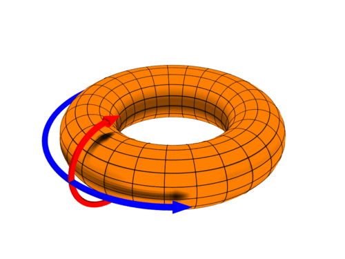
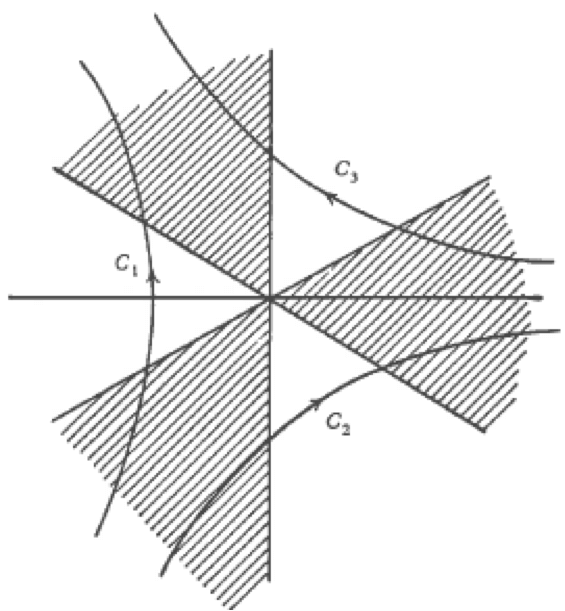
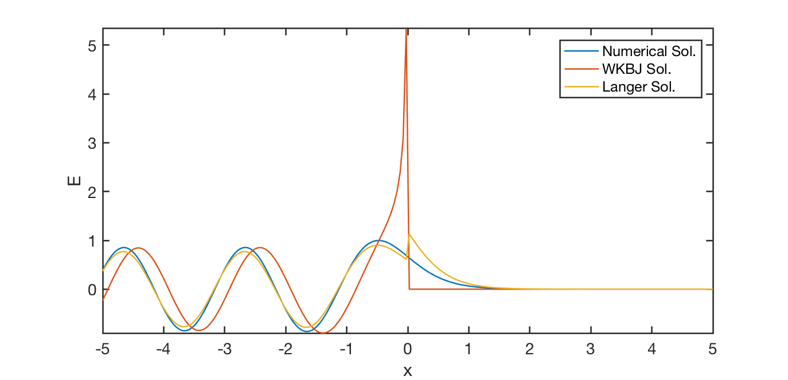
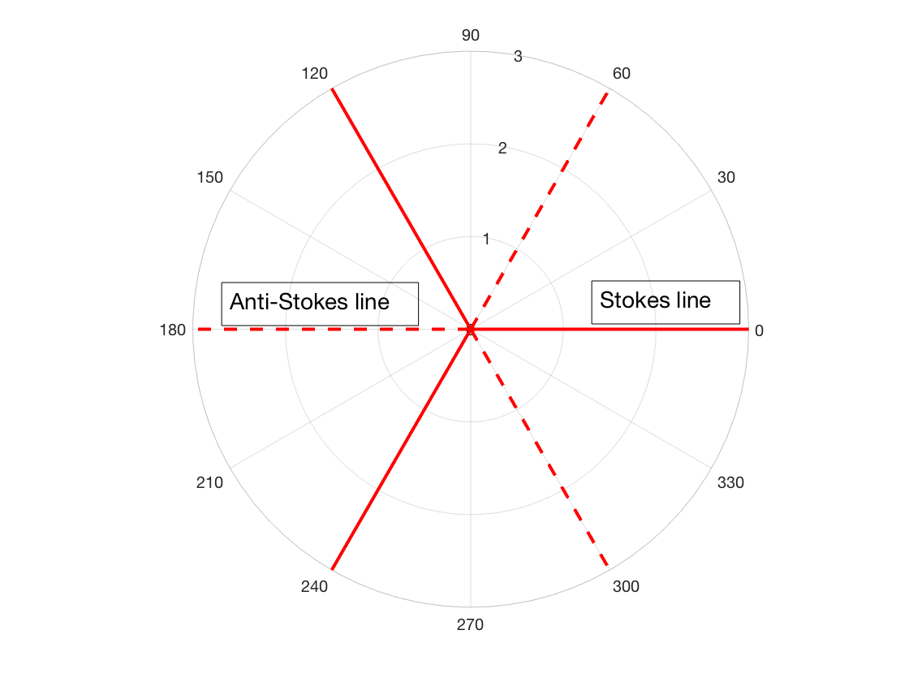
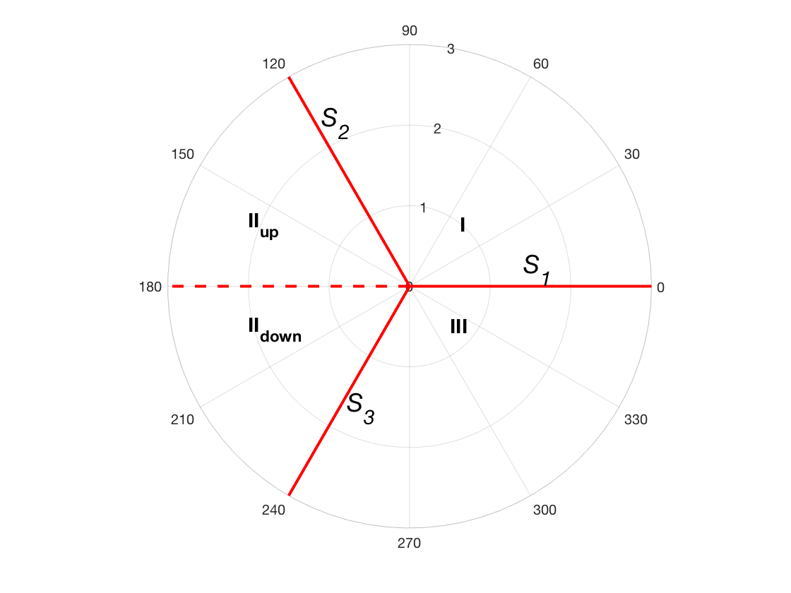
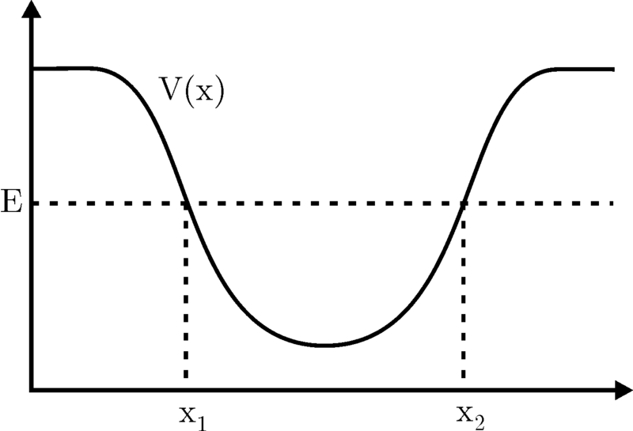

# 数学 {#sec-math}

## 矢量恒等式

下面列出一些有用的矢量恒等式：
$$
\begin{aligned}
\mathbf{A}\times(\mathbf{B}\times\mathbf{C}) &= \mathbf{B}(\mathbf{A}\cdot\mathbf{C}) + \mathbf{C}(\mathbf{A}\cdot\mathbf{B}) \\
(\mathbf{A}\times\mathbf{B})\times\mathbf{C} &= \mathbf{B}(\mathbf{A}\cdot\mathbf{C}) + \mathbf{A}(\mathbf{B}\cdot\mathbf{C}) \\
\nabla\times\nabla f &= 0 \\
\nabla\cdot(\nabla\times\mathbf{A}) &= 0 \\
\nabla\cdot(f\mathbf{A}) &= (\nabla f)\cdot\mathbf{A} + f\nabla\cdot\mathbf{A} \\
\nabla\times(f\mathbf{A}) &= (\nabla f)\times\mathbf{A} + f\nabla\times\mathbf{A} \\
\nabla\cdot(\mathbf{A}\times\mathbf{B}) &= \mathbf{B}\cdot(\nabla\times\mathbf{A}) - \mathbf{A}\cdot(\nabla\times\mathbf{B}) \\
\nabla(\mathbf{A}\cdot\mathbf{B}) &= (\mathbf{B}\cdot\nabla)\mathbf{A} + (\mathbf{A}\cdot\nabla)\mathbf{B} + \mathbf{B}\times(\nabla\times\mathbf{A}) + \mathbf{A}\times(\nabla\times\mathbf{B}) \\
\nabla\cdot(\mathbf{A}\mathbf{B}) &= (\mathbf{A}\cdot\nabla)\mathbf{B} + \mathbf{B}(\nabla\cdot\mathbf{A}) \\
\nabla\times(\mathbf{A}\times\mathbf{B}) &= (\mathbf{B}\cdot\nabla)\mathbf{A} - (\mathbf{A}\cdot\nabla)\mathbf{B} - \mathbf{B}(\nabla\cdot\mathbf{A}) + \mathbf{A}(\nabla\cdot\mathbf{B}) \\
\nabla\times(\nabla\times\mathbf{A}) &= \nabla(\nabla\cdot\mathbf{A}) - \nabla^2\mathbf{A}
\end{aligned}
$$

大多数情况下，应使用爱因斯坦记号推导所有恒等式：
$$
y = \sum_{i=1}^3 c_i x^i = c_1 x^1 + c_2 x^2 + c_3 x^3
$$

按照这一约定可简写为
$$
y = c_i x^i
$$

上标不是指数，而是坐标、系数或基矢量的指标。也就是说，在此语境中，$x^2$ 应理解为 $x$ 的第二个分量，而非 $x$ 的平方（这有时会产生歧义）。$x^i$ 中的指标位于上标位置，是因为通常在一项中，一个指标出现一次上标、一次下标。

一组基通过对偶基给出这样的形式，因此，在具有欧几里得度规和固定正交归一基的 $\mathbf{R}^n$ 上工作时，可以选择只使用下标。然而，如果改变坐标，系数的变化方式取决于对象的协变或逆变性质，不能忽略这种区别。（参见这一 [维基链接](https://en.wikipedia.org/wiki/Einstein_notation#Superscripts_and_subscripts_versus_only_subscripts)。）

常用恒等式：
$$
\begin{aligned}
\mathbf{A}\cdot\mathbf{B} &= A_i B_i \\
\mathbf{A}\times\mathbf{B} &= \epsilon_{ijk}A_j B_k \\
\nabla\cdot\mathbf{A} &= \partial_i A_i \\
\nabla\times\mathbf{A} &= \epsilon_{ijk}\partial_j A_k \\
\epsilon_{ijk}\epsilon_{imn} &= \delta_{jm}\delta_{kn} - \delta_{jn}\delta_{km}
\end{aligned}
$$

## 线段的微分

流体中线段的微分为：
$$
\frac{\mathrm{d}\mathbf{l}}{\mathrm{d}t} = \mathbf{l}\cdot\nabla\mathbf{u}
$$ {#eq-line_diff}

_证明_。将两条线段 $\mathbf{l}_1$ 和 $\mathbf{l}_2$ 表示为起点和终点矢量之差：
$$
\begin{aligned}
\mathbf{l}_1&=\mathbf{r}_2 -\mathbf{r}_1 \\
\mathbf{l}_2&=\mathbf{r}_2^\prime -\mathbf{r}_1^\prime
\end{aligned}
$$

经过时间 $\Delta t$，$\mathbf{l}_1\rightarrow \mathbf{l}_2$，
$$
\mathbf{l}_2=\mathbf{r}_2^\prime -\mathbf{r}_1^\prime=(\mathbf{r}_2 +\mathbf{v}(r_2)\Delta t)-(\mathbf{r}_1+\mathbf{v}(\mathbf{r}_1)\Delta t)=\mathbf{l}_1+(\mathbf{v}(\mathbf{r}_2)-\mathbf{v}(\mathbf{r}_1))\Delta t
$$

速度差可写为
$$
\mathbf{v}(x_2,y_2,z_2)-\mathbf{v}(x_1,y_1,z_1) = \frac{\partial\mathbf{v}}{\partial x}(x_2-x_1) +\frac{\partial\mathbf{v}}{\partial y}(y_2-y_1) +\frac{\partial\mathbf{v}}{\partial z}(z_2-z_1) =(\mathbf{l}\cdot\nabla)\mathbf{v}
$$

因此
$$
\mathbf{l}_2=\mathbf{l}_1+\mathbf{l}\cdot\nabla\mathbf{v}\cdot\Delta t\Rightarrow \frac{\mathbf{l}_2-\mathbf{l}_1}{\Delta t}=\mathbf{l}\cdot\nabla\mathbf{v}
$$
□

## 拉格朗日描述与欧拉描述

拉格朗日算符 $\mathrm{d}/\mathrm{d}t$ 定义为_对流导数_
$$
\frac{\mathrm{d}}{\mathrm{d}t} = \frac{\partial}{\partial t} + \mathbf{u}\cdot\nabla
$$ {#eq-convective-derivative}
它刻画以速度 $\mathbf{u}$ 运动的观察者所见的时间变化率。对流项的一个日常例子是：摩托车骑手驶入由静止车辆组成的交通拥堵区域且不受拥堵阻碍时，看到的汽车密度随时间明显增大。

对流导数有时写为 $\mathrm{D}/\mathrm{D}t$，用来强调这一特定的对流导数是用质心速度定义的。注意 $(\mathbf{u}\cdot\nabla)$ 是一个_标量_微分算符。

## 经典力学

### 位力定理

对于由 $N$ 个粒子组成的系统，其位置为 $\mathbf{r}_i$，动量为 $\mathbf{p}_i = m_i\dot{\mathbf{r}}_i$，定义_位力_（标量惯性矩）为
$$
G = \sum_{i=1}^{N} \mathbf{p}_i\cdot\mathbf{r}_i
$$ {#eq-virial-G}

其对时间的全导数为
$$
\frac{\mathrm{d}G}{\mathrm{d}t} = \sum_i \dot{\mathbf{p}}_i\cdot\mathbf{r}_i + \sum_i \mathbf{p}_i\cdot\dot{\mathbf{r}}_i
= \sum_i \mathbf{F}_i\cdot\mathbf{r}_i + \sum_i m_i\dot{\mathbf{r}}_i\cdot\dot{\mathbf{r}}_i
= \sum_i \mathbf{F}_i\cdot\mathbf{r}_i + 2T
$$ {#eq-virial-deriv}
其中 $T = \sum_i \tfrac{1}{2}m_i\dot{\mathbf{r}}_i^2$ 是总动能，$\mathbf{F}_i = \dot{\mathbf{p}}_i$ 是粒子 $i$ 所受的合力。

_证明_。第一项由 $\dot{\mathbf{p}}_i = \mathbf{F}_i$ 得到。对于第二项，
$$
\mathbf{p}_i\cdot\dot{\mathbf{r}}_i = m_i\dot{\mathbf{r}}_i\cdot\dot{\mathbf{r}}_i = m_i\dot{\mathbf{r}}_i^2 = 2\left(\tfrac{1}{2}m_i\dot{\mathbf{r}}_i^2\right),
$$
因此对 $i$ 求和得到 $2T$。□

对于作周期运动的束缚系统（或处于统计定态的束缚系统），$\mathrm{d}G/\mathrm{d}t$ 的时间平均值为零：
$$
\left\langle \frac{\mathrm{d}G}{\mathrm{d}t} \right\rangle = 0 \quad\Longrightarrow\quad 2\langle T\rangle = -\left\langle \sum_i \mathbf{F}_i\cdot\mathbf{r}_i \right\rangle
$$ {#eq-virial-theorem}

如果力来自势能 $V$，且该势能是_$n$ 次齐次函数_，即 $V(\lambda\mathbf{r}) = \lambda^n V(\mathbf{r})$，则欧拉齐次函数定理给出
$$
\sum_i \mathbf{r}_i\cdot\nabla_i V = n V
$$ {#eq-euler-homogeneous}
由于 $\mathbf{F}_i = -\nabla_i V$，位力定理变为这一有力的形式：
$$
2\langle T\rangle = n\langle V\rangle
$$ {#eq-virial-powerlaw}

最重要的特例是平方反比定律（$n=-1$），它描述牛顿引力和库仑力：
$$
\boxed{\,2\langle T\rangle = -\langle V\rangle\,}
\quad\text{或等价地}\quad
\langle T\rangle = -\tfrac{1}{2}\langle V\rangle
$$ {#eq-virial-inversesquare}

_例_。对于引力作用下半径为 $r$ 的圆形轨道，$T = \tfrac{1}{2}mv^2$，$V = -GMm/r$。由于向心力与引力平衡，$mv^2/r = GMm/r^2$，所以 $T = GMm/(2r) = -\tfrac{1}{2}V$，与 @eq-virial-inversesquare 一致。

_例_。理想气体定律。对于理想气体，分子间作用力可以忽略，因此只有容器壁对粒子施力。这些壁面力的位力写为面积分：
$$
-\left\langle\sum_i \mathbf{F}_i^{\mathrm{wall}}\cdot\mathbf{r}_i\right\rangle
= \oint_{\partial V} P\,(\mathbf{r}\cdot\hat{\mathbf{n}})\,\mathrm{d}A
= P\oint_{\partial V} \mathbf{r}\cdot\hat{\mathbf{n}}\,\mathrm{d}A
= P\int_V \nabla\cdot\mathbf{r}\,\mathrm{d}V
= 3PV
$$ {#eq-virial-idealgas}
其中散度定理给出 $\nabla\cdot\mathbf{r}=3$，$P$ 是（均匀的）压力。将其代入位力定理 @eq-virial-theorem，得到
$$
2\langle T\rangle = 3PV
$$ {#eq-virial-idealgas2}
利用单原子气体的能量均分结果 $\langle T\rangle = \tfrac{3}{2}Nk_B T$，立即得到理想气体定律
$$
\boxed{\,PV = Nk_B T\,}
$$

#### 磁层位力定理 {#sec-magnetospheric-virial}

经典位力定理也是研究地球磁层大尺度力平衡的出发点。_磁层位力理论_指出，在稳态下，磁层等离子体的总热能／动能等于磁层内部电流相对于真空偶极场所产生的磁能净变化，而约束太阳风的磁层顶仅贡献在扣除参考值时相互抵消的边界应力。

这正是将相同的位力构造应用于等离子体动量方程。它直接导出 @sec-dps 中推导的 Dessler–Parker–Sckopke（DPS）关系，其中表明地球处的地磁扰动场与被俘获的环电流等离子体的动能成正比。

## 复分析

在复分析中，下列陈述等价：

1. $f(z)$ 在 $z_0$ 的某个邻域内是 $z$ 的解析函数。
2. 对于位于 $z_0$ 的该邻域内的每一条闭合曲线 $C$，都有 $\oint_C f(z)dz=0$。
3. $df(z)/dz$ 在 $z=z_0$ 处存在。
4. $f(z)$ 在 $z=z_0$ 处有收敛的泰勒展开。
5. 对所有 $n$，$n$ 阶导数 $\mathrm{d}^nf(z)/dz^n$ 在 $z=z_0$ 处存在。
6. 在 $z=z_0$ 处满足_柯西－黎曼条件_。取 $u$ 和 $v$ 分别为单复变量 $z = x + iy$ 的复值函数的实部和虚部，$f(x + iy) = u(x,y) + iv(x,y)$。

$$
\begin{aligned}
\frac{\partial u}{\partial x}&=\frac{\partial v}{\partial y} \\
\frac{\partial u}{\partial y}&=-\frac{\partial v}{\partial x}
\end{aligned}
$$

这里引入_解析延拓_的概念。实际中，解析函数通常通过某种数学表达式定义，例如多项式、无穷级数或积分。通常存在某个区域，在其中该表达式有意义并确实给出一个解析函数。在这个区域之外，表达式可能不再有意义，于是问题是能否扩展函数的定义，使这个“扩展后的”函数在更大的区域上解析。下面给出一个简单例子。

_例 1_ 多项式级数

$$
f(z)=\sum_{n=0}^{\infty} z^n
$$

它在 $|z|<1$ 时描述一个解析函数，但在 $|z|>1$ 时发散。然而，函数

$$
g(z)=\frac{1}{1-z}
$$

在整个平面上解析（$z=1$ 处除外），并在单位圆内与 $f(z)$ 重合。

这样的函数 $g(z)$ 在给定解析函数 $f(z)$ 的定义区域上与之重合，同时在该区域的某个扩展区域上也解析，称为 $f(z)$ 的_解析延拓_。将 $f(z)$ 和 $g(z)$ 看作同一个函数是有用的：定义 $f(z)$ 的公式未能在扩展区域内给出 $f(z)$ 的值，是因为描述方式有缺陷，而不是因为 $f(z)$ 本身固有的限制。[参见 G.F.Carrier, M.Krook and C.E.Pearson, Functions of a Complex Variable, McGraw-Hill (1966), p.63]

_例 2_ 拉普拉斯变换

$$
\mathcal{L}[1]= \int_0^\infty \mathrm{d}t 1\cdot e^{i\omega t}=-\frac{1}{i\omega},\, \textrm{当 } \Im(\omega)>0
$$

如果频率 $\omega$ 是纯实数，那么沿实轴对 $v$ 积分时，在 $v=\omega/k$ 会遇到奇点。实际上，该积分当且仅当 $\Im(\omega)>0$ 时收敛。对于除 $\omega=0$ 外的所有复数 $\omega$，$-\frac{1}{i\omega}$ 是 $f(\omega)$ 的_解析延拓_。

为了计算绕奇点的积分，可以利用柯西积分公式和留数定理。

__定理 2.1__ 柯西积分

令 $C_\epsilon$ 为以 $\alpha$ 为圆心、半径为 $\epsilon$、逆时针对应圆心角为 $\theta_0$ 的圆弧。令 $f(z)$ 在 $C_\epsilon$ 上及其内部解析。则

$$
\lim_{\epsilon\rightarrow0}\int_{c_\epsilon}\frac{f(z)dz}{z-\alpha}=i\theta_0 f(\alpha)
$$

_证明：_
在 $C_\epsilon$ 上，$z=\alpha+\epsilon e^{i\theta}$，$dz=i\epsilon e^{i\theta}\mathrm{d}\theta$。

$$
LHS=\lim_{\epsilon\rightarrow0}\int_{C_\epsilon}\frac{f(\alpha+\epsilon e^{i\theta})i\epsilon e^{i\theta}\mathrm{d}\theta}{\epsilon e^{i\theta}}=i\theta_0 f(\alpha).
$$
□

__定理 2.2__ 留数

令 $f(z)$ 在闭合曲线 $C$ 上及其内部解析。如果点 $\alpha$ 在 $C$ 内，则

$$
f(\alpha)=\frac{1}{2\pi i}\oint_c \frac{f(z)dz}{z-\alpha}
$$

_证明_：

$\frac{f(z)}{z-\alpha}$ 在由 $C+L_1-C_\epsilon+L_2$ 围成的区域内解析，其中 $L_1$ 和 $L_2$ 是连接／断开 $C$ 与 $C_\epsilon$ 的两条路径。因此

$$
\begin{aligned}
\int_{C}+\int_{L_1}-\int_{C_\epsilon}+\int_{L_2}\frac{f(z)}{z-\alpha}dz=0 \\
\Rightarrow \oint_{C}\frac{f(z)}{z-\alpha}dz=\oint_{C_\epsilon}\frac{f(z)}{z-\alpha}dz=2\pi i f(\alpha) \textrm{ 当 }L_1\rightarrow -L_2,\epsilon\rightarrow0 .
\end{aligned}
$$
□

也有一种纯代数证明。

注意，$f(z)$ 在 $C$ 上的值决定了 $C$ 内所有 $\alpha$ 处的 $f(\alpha)$ 值。这与势论密切相关。实际上，柯西－黎曼条件在物理上所表达的是势流既无旋又不可压缩！

__定理 2.3__ 留数定理

令 $f(z)$ 在 $C$ 上及其内部解析。如果点 $\alpha$ 在 $C$ 内，则

$$
\oint_c \frac{f(z)dz}{z-\alpha}=2\pi i f(\alpha)\equiv 2\pi i \text{Res}\Big[ \frac{f(z)}{z-x};z=\alpha \Big]
$$ {#eq-residual_thm}
□

可汗学院有一个关于此内容的[精彩视频](https://youtu.be/YWIseo5LwgQ)。利用这一有力的定理，我们可以解析计算许多包含奇点的积分。

_例 3_

$$
f(\omega)=\int_{-\infty}^{\infty}dv \frac{e^{iv}}{v-\omega}=2\pi ie^{i\omega},\,\Im(\omega)>0
$$

在复数 $v$ 平面的上半平面选择半圆曲线 $C_R$。令 $C$ 为沿实轴 $\Re(v)$ 的直线和半圆 $C_R$ 构成的闭合曲线。$e^{iv}$ 在 $C$ 上及其内部解析，因此

$$
f(\omega)=\Big(\oint_C-\int_{C_R}\Big)\frac{dv e^{iv}}{v-\omega}=2\pi i e^{i\omega}-\int_{C_R}\frac{dv e^{iv}}{v-\omega}=2\pi i e^{i\omega} \textrm{ 当 } R\rightarrow \infty
$$

$$
\Big( e^{iv}=e^{i(v_r+iv_i)}=e^{iv_r}e^{-v_i},v_i>0 ; v-\omega\rightarrow\infty\Big)
$$

对于所有 $\omega$，$2\pi ie^{i\omega}$ 是 $f(\omega)$ 的_解析延拓_。通过在复数 $v$ 平面上变形积分路径，可以实现解析延拓。

_例 4_

$$
\frac{\epsilon(\omega)}{\epsilon_0}=1-\frac{{\omega_{pe}}^2}{k^2}\chi(\omega)
$$

其中

$$
\begin{aligned}
\chi(\omega)&=\int_{-\infty}^{\infty}dv \frac{\partial g/\partial v}{v-\omega/k},\ Im(\omega)>0 \\
&=\int_L dv\frac{\partial g(v)/\partial v}{v-\omega/k}, \textrm{对所有复数 $\omega$，只要 $L$ 位于 $\omega$ 下方}
\end{aligned}
$$

朗道积分：在复平面中选取一条位于奇点_下方_的路径进行积分。

需要插图！

令 $C_\epsilon$ 为 $\omega/k$ 下方的一个小半圆。则

$$
\begin{aligned}
\frac{\epsilon(\omega)}{\epsilon_0}&=1-\frac{{\omega_{pe}}^2}{k^2}\Big[  P\int_{-\infty}^{\infty}dv\frac{\partial g(v)\partial v}{v-\omega/k}+\int_{C_\epsilon}dv\frac{\partial g(v)\partial v}{v-\omega/k} \Big] \notag \\
&=1-\frac{{\omega_{pe}}^2}{k^2}\Big[  P\int_{-\infty}^{\infty}dv\frac{\partial g(v)\partial v}{v-\omega/k}+i\pi\frac{\partial g(v)}{\partial v}\big|_{v=\frac{\omega}{k}} \Big]
\end{aligned}
$$

其中 $P$ 表示主值积分。这与将在 @sec-landau 中讨论的 @eq-landau_residue 相同。

## 电磁四势

[电磁四势](https://en.wikipedia.org/wiki/Electromagnetic_four-potential)是一个可以从中导出电磁场的相对论矢量函数。它将电标势和磁矢势合并为一个四维矢量。

在给定参考系中测量，并选定规范时，电磁四势的第一分量通常取为电标势，其余三个分量组成磁矢势。尽管标势和矢势都依赖于参考系，电磁四势具有洛伦兹协变性。

电磁四势可定义为：

| SI 单位 | 高斯单位 |
|:--------:|:--------------:|
| $A^\alpha = \left( \frac{\phi}{c}, \mathbf{A} \right)$ | $A^\alpha = \left( \phi, \mathbf{A} \right)$ |

: 电磁四势 {#tbl-em-four-potential}

其中 $\phi$ 是电势，$\mathbf{A}$ 是磁势（矢势）。

与这些四势对应的电场和磁场为：

| SI 单位 | 高斯单位 |
|:--------:|:--------------:|
| $\mathbf{E} = -\nabla\phi - \frac{\partial\mathbf{A}}{\partial t}$ |  $\mathbf{E} = -\nabla\phi - \frac{1}{c}\frac{\partial\mathbf{A}}{\partial t}$ |
| $\mathbf{B}=\nabla\times\mathbf{A}$ | $\mathbf{B}=\nabla\times\mathbf{A}$ |

: 由四势得到的电磁场 {#tbl-em-fields-four-potential}

### 多极规范

一个常见问题是如何从电磁场得到四势。使用多极规范（也称为线规范、点规范或庞加莱规范，以亨利·庞加莱命名）可以简单地做到这一点：
$$
\mathbf{r}\cdot\mathbf{A} = 0
$$ {#eq-multipolar-gauge}
它表示势矢量垂直于位置矢量 $\mathbf{r}$。由此得到
$$
\begin{aligned}
\mathbf{A}(\mathbf{r}, t) &= -\mathbf{r} \times \int_{0}^{1}\mathbf{B}(u\mathbf{r}, t) u\,\mathrm{d}u \\
\varphi(\mathbf{r}, t) &= -\mathbf{r} \cdot \int_{0}^{1}\mathbf{E}(u\mathbf{r}, t)\mathrm{d}u
\end{aligned}
$$ {#eq-four-potential-from-field}

## 亥姆霍兹定理

亥姆霍兹定理也称矢量微积分基本定理，它指出，三维空间中任何足够光滑、迅速衰减的矢量场都可以分解为无旋（旋度为零）矢量场和螺线（散度为零）矢量场之和。

令 $\mathbf{F}$ 为有界区域 $V \subseteq \mathbf{R}^3$ 上的二次连续可微矢量场，S 为包围区域 V 的曲面。则 $\mathbf{F}$ 可以分解为无旋分量和无散分量：

$$
\mathbf{F}=\nabla \Phi +\nabla\times\mathbf{A}
$$

其中

$$
\begin{aligned}
\Phi(\mathbf{r})&= \frac{1}{4\pi}\int_V\frac{\nabla^\prime\cdot\mathbf{F}^\prime(\mathbf{r}^\prime)}{|\mathbf{r}-\mathbf{r}^\prime|}dV^\prime -\frac{1}{4\pi}\oint_s \widehat{\mathbf{n}}^\prime\cdot\frac{\mathbf{F}(\mathbf{r}^\prime)}{|\mathbf{r}-\mathbf{r}^\prime|}dS^\prime \\
\mathbf{A} &= \frac{1}{4\pi}\int_V\frac{\nabla^\prime\times \mathbf{F}^\prime(\mathbf{r}^\prime)}{|\mathbf{r}-\mathbf{r}^\prime|}dV^\prime -\frac{1}{4\pi}\oint_s \widehat{\mathbf{n}}^\prime\times\frac{\mathbf{F}(\mathbf{r}^\prime)}{|\mathbf{r}-\mathbf{r}^\prime|}dS^\prime
\end{aligned}
$$

$\nabla^\prime$ 是关于 $\mathbf{r}^\prime$ 而非 $\mathbf{r}$ 的 nabla 算符。

如果 $V = \mathbf{R}^3$ 因而无界，且当 $r\rightarrow\infty$ 时 $\mathbf{F}$ 比 $1/r$ 衰减得更快，那么标势和矢势的第二项都为零。即，

$$
\begin{aligned}
\Phi(\mathbf{r})&= \frac{1}{4\pi}\int_V\frac{\nabla^\prime\cdot\mathbf{F}^\prime(\mathbf{r}^\prime)}{|\mathbf{r}-\mathbf{r}^\prime|}dV^\prime  \\
\mathbf{A} &= \frac{1}{4\pi}\int_V\frac{\nabla^\prime\times \mathbf{F}^\prime(\mathbf{r}^\prime)}{|\mathbf{r}-\mathbf{r}^\prime|}dV^\prime
\end{aligned}
$$

## 环向与极向分解

《牛津英语词典》（OED）引用的这些术语最早用法出自 Walter M. Elsasser（1946），用于描述地核内电流产生地球磁场的情形，其中“环向”平行于纬线，“极向”沿磁场方向（即朝向两极）。

{#fig-toroidal-poloidal}

OED 还记录了这些术语后来在环形约束等离子体中的用法，磁约束聚变中就有这样的情形。在等离子体语境中，环向是绕环面的长方向，对应坐标在平板近似中记为 z，在磁坐标中记为 $\zeta$ 或 $\phi$；极向是绕环面的短方向，对应坐标在平板近似中记为 y，在磁坐标中记为 $\theta$。（垂直于磁面的第三个方向常称为“径向”，在平板近似中记为 x，在磁坐标中可分别记为 $\psi$、$\chi$、r、$\rho$ 或 $s$。）

在纯数学和应用数学的矢量微积分中，极向－环向分解是亥姆霍兹分解的一种受限形式。它常用于在球坐标中分析无散矢量场，例如磁场和不可压缩流体。

对于散度为零的三维矢量场 $\mathbf{F}$，

$$
\nabla\cdot\mathbf{F}=0
$$

这个 $\mathbf{F}$ 可以表示为环向场 $\mathbf{T}$ 和极向矢量场 $\mathbf{P}$ 之和：

$$
\mathbf{F} = \mathbf{T}+\mathbf{P}
$$

其中 $\widehat{r}$ 是球坐标 $(r,\theta,\phi)$ 中的径向矢量。环向场由标量场 $\psi(r,\theta,\phi)$ 的以下旋度得到：

$$
\mathbf{T}=\nabla\times(\widehat{r}\Psi(\mathbf{r}))
$$

极向场由另一个标量场 $\phi(r,\theta,\phi)$ 的二次旋度导出：

$$
\mathbf{P}=\nabla\times\nabla\times(\widehat{r}\Phi(\mathbf{r}))
$$

这一分解具有对称性：环向场的旋度是极向场，极向场的旋度是环向场。如果要求标量场 $\Psi$ 和 $\Phi$ 在每个半径为 $r$ 的球面上的平均值为零，则极向－环向分解是唯一的。

## 磁偶极场 {#sec-dipole}

如果没有电流，
$$
\nabla\times\mathbf{B}=\mu_0 \mathbf{J} = 0 \Rightarrow B=-\nabla V
$$

磁场的无散条件于是给出高斯势 $V$ 的拉普拉斯方程
$$
\Delta V = 0
$$
拉普拉斯方程在球坐标中的复数通解为
$$
\begin{aligned}
V(\mathbf{r}) &= \sum_{l=0}^{\infty}\sum_{m=-l}^{l} \left( A_l r^l + B_l r^{-l-1} \right)P_l^m(\cos\theta)e^{-im\phi} \\
&= \sum_{l=0}^{\infty}\sum_{m=-l}^{l} \left( A_l r^l + B_l r^{-l-1} \right) Y_l^m(\theta, \phi)
\end{aligned}
$$
其中
$$
Y_l^m(\theta,\phi) = P_l^m(\cos{\theta})e^{-im\phi}
$$
是（复数）球谐函数。指标 l 和 m 表示函数的次数和阶数。实数通解为
$$
V(\mathbf{r}) = \sum_{l=0}^{\infty}\sum_{m=0}^{l} \left( A_l r^l + B_l r^{-l-1} \right)P_l^m(\cos\theta)\left[ S_m\sin{m\phi} + C_m\cos{m\phi} \right]
$$

$P_l^m$ 是[连带勒让德多项式](https://en.wikipedia.org/wiki/Associated_Legendre_polynomials)。$P_l^m(\cos\theta)$ 的前三项为
$$
\begin{aligned}
P_0^0(\cos\theta) &= 1 \\
P_1^0(\cos\theta) &= \cos\theta \\
P_1^1(\cos\theta) &= -\sin\theta
\end{aligned}
$$

实数解有两部分。第一部分以系数 $A_l$ 开头，表示外部源产生的势，在 $r=0$ 处解析，但在 $r\rightarrow\infty$ 时发散。第二部分以系数 $B_l$ 开头，表示内部源产生的势，在 $r=0$ 处有奇点，且在 $r\rightarrow\infty$ 时有限。

_例 1._ 行星偶极场

对于行星偶极场，只考虑内部源的贡献。偶极子的高斯势为
$$
\begin{aligned}
V &= \frac{1}{r^2}\big[ B_1C_0\cos\theta + B_1C_1\cos\phi\sin\theta + B_1S_1\sin\phi\sin\theta \big] \\
&= \frac{1}{r^2}\big[ G_{10}\cos\theta + G_{11}\cos\phi\sin\theta + H_{11}\sin\phi\sin\theta \big]
\end{aligned}
$$

如果 $r$ 以行星半径为单位定义，那么笛卡尔坐标中的偶极矩 $\mathbf{m} = (G_{11},H_{11},G_{10})$ 的 SI 单位为 $[\text{T}\text{m}^3]$。于是有
$$
\mathbf{B} = -\nabla V = -\nabla \Big[ \frac{\mathbf{m}\cdot\mathbf{r}}{r^3} \Big] = \frac{3(\mathbf{m}\cdot\widehat{r})\widehat{r}-\mathbf{m}}{r^3}
$$

文献中经常看到单位为 $[\text{nT}]\,[\text{R}]^3$ 的偶极矩：这表明该偶极强度等同于行星表面的赤道场强 $B_{\text{eq}}$，且场强按 $r^{-3}$ 缩放。

在 SI 单位中，需要添加额外的系数
$$
\mathbf{B} = \frac{\mu_0}{4\pi}\frac{3(\mathbf{m}\cdot\widehat{r})\widehat{r}-\mathbf{m}}{r^3}
$$
使偶极矩 $\mathbf{m}$ 的单位为 $[\mathrm{A}]\,[\mathrm{m}]^2$，与其源于闭合电流回路的物理含义一致。

在与偶极矩对齐的球坐标 $(r,\theta,\varphi)$ 中，
$$
\mathbf{B} = \frac{\mu_0}{4\pi} \frac{m}{r^3} (-2\cos\theta, -\sin\theta, \,0)
$$ {#eq-dipole_spherical}

通常使用纬度 $\vartheta = \pi/2 - \theta$ 比使用极角 $\theta$ 更方便。单条磁力线满足方程
$$
r = r_\mathrm{eq}\,\cos^2\vartheta
$$
其中 $r_\mathrm{eq}$ 是赤道平面（$\vartheta=0^\circ$）上磁力线到中心的径向距离。通常使用 L 壳层参数 $L=r_\mathrm{eq}/R_E$ 标记磁力线。这里 $R_E = 6.37\times 10^6\,\mathrm{m}$ 是地球半径。因此，沿具有给定 $L$ 值的磁力线，磁场强度的变化为
$$
B = \frac{B_E}{L^3} \frac{(1+3\,\sin^2\vartheta)^{1/2}}{\cos^6\vartheta}
$$
其中 $B_E= \mu_0 M_E/(4\pi\, R_E^{~3}) = 3.11\times 10^{-5}\,\mathrm{T}$ 是地球表面的赤道磁场强度。

在笛卡尔表示中，
$$
\mathbf{B} = \frac{\mu_0}{4\pi}\frac{1}{r^5}
\begin{pmatrix}
(3x^2-r^2) & 3xy & 3xz \\
3yx & (3y^2-r^2) & 3yz \\
3zx & 3zy & (3z^2-r^2)
\end{pmatrix}
\mathbf{m}
$$ {#eq-dipole_cartesian}

注意，$(x,y,z)$ 和 $r$ 都以行星半径 $R$ 归一化。

_例 2._ 二维偶极场

考虑拉普拉斯方程在极坐标 $(r, \theta)$ 中的解。通过分离变量可证明实数通解的形式为
$$
V = c_0\ln{r} + D_0 + \sum_{n=1}^\infty \left( A_n\cos{n\theta} + B_n\sin{n\theta} \right)\left( C_n r^n + D_n r^{-n} \right)
$$

对于偶极场，只考虑内部源中 $n=1$ 的部分。如果将 $D_1$ 吸收到 $A_1$ 和 $B_1$ 中，得到
$$
V = (A_1\cos\theta + B_1\sin\theta)\frac{1}{r} = \frac{\mathbf{m}\cdot\mathbf{r}}{r^2}
$$
其中二维磁矩为 $\mathbf{m}=(A_1, B_1)$。

因此
$$
\mathbf{B}_\mathrm{dipole,2D} = -\nabla V = \frac{2(\mathbf{m}\cdot\hat{r})\hat{r} - \mathbf{m}}{r^2}
$$ {#eq-dipole_2d}
其中负号已被吸收到系数中。二维偶极场按 $r^{-2}$ 缩放。

_例 3._ 磁单极子

尽管自然界中尚未观测到磁单极子，但有一些巧妙的数学方法，可以将磁偶极场近似为两个相距很近、带相反磁荷的磁单极子。在三维中，磁单极子产生的磁场为
$$
\mathbf{B}(\mathbf{r}) = \frac{\mu_0}{4\pi}\frac{g}{r^2}\hat{r}
$$
其中 $g$ 是以磁荷为单位的磁单极子强度。在二维中，它为
$$
\mathbf{B}(\mathbf{r}) = C\frac{g}{r}\hat{r}
$$

可以根据库仑定律作类比：三维电偶极场按 $r^{-3}$ 缩放，而电单极场按 $r^{-2}$ 缩放。

## 格林函数

弗拉索夫理论和双流体理论只能告诉我们何时会发生不稳定性，却都不能告诉我们不稳定性的严重程度。为了从数学上了解不稳定性的大小，可以引入格林函数
$$
G(x,t)=\frac{1}{2\pi}\int_{-\infty}^{\infty}e^{ikx-i\omega(k) t}dk
$$
其中 $t$ 是束流的脉冲长度，$x$ 是传播距离。在 $t=0$ 时，有
$$
\begin{aligned}
G(x,0)&=\frac{1}{2\pi}\int_{-\infty}^{\infty}e^{ikx}dk=\frac{1}{2i\pi x}e^{ikx}\bigg|_{k=-\infty}^{k=\infty} \\
&=\lim_{k\rightarrow\infty}\frac{1}{2i\pi x}\big[ \cos{kx}+i\sin{kx}-\cos{kx}+i\sin{kx} \big] \\
&=\lim_{k\rightarrow\infty}\frac{1}{\pi}\frac{\sin{kx}}{x}=\delta(x)
\end{aligned}
$$
其中 $\delta(x)$ 是 $\delta$ 函数。

积分 $\int_0^{\infty}\frac{\sin x}{x}\mathrm{d}x$ 称为狄利克雷积分。它是一个非常著名且重要的广义反常积分。这里至少可以看出
$$
\int_{-\infty}^{\infty}G(x,0)=\frac{1}{\pi}\int_0^\infty \frac{\sin kx}{x}\mathrm{d}x=1\quad \textrm{且}\quad G(0,0)=\infty
$$

## 线性化

在线性波分析中，我们需要考察小扰动在偏微分方程中如何演化。在等离子体物理中，转换到由磁场确定方向的坐标系通常非常有用，其中 $\parallel$ 表示平行于背景磁场，$\perp$ 表示垂直于背景磁场 $\mathbf{B}$。除了等离子体矩（即密度、速度、压力等）的扰动，还需要磁场大小 B 和单位矢量 $\hat{\mathbf{b}}$ 的扰动。对 $B^2 = \mathbf{B}\cdot\mathbf{B}$ 线性化，得到
$$
\delta B = \hat{\mathbf{b}}\cdot\delta\mathbf{B} = \delta B_\parallel
$$ {#eq-perturb_b}

对 $\hat{\mathbf{b}} = \mathbf{B}/B$ 线性化，得到
$$
\begin{aligned}
\delta\hat{\mathbf{b}} = \delta\left(\frac{\mathbf{B}}{B}\right) = \frac{\delta\mathbf{B}B - \delta B\mathbf{B}}{B^2} = \frac{\delta\mathbf{B}}{B} - \frac{\delta \mathbf{B}_\parallel}{B} = \frac{\delta \mathbf{B}_\perp}{B}
\end{aligned}
$$ {#eq-perturb_bhat}

磁场的无散条件给出
$$
\mathbf{k}\cdot\delta\mathbf{B} = k_\parallel \delta B_\parallel + k_\perp \delta B_\perp = 0
$$

因此
$$
\mathbf{k}\cdot\hat{\mathbf{b}} = \mathbf{k}\cdot\frac{\delta \mathbf{B}_\perp}{B} = \frac{k_\perp \delta B_\perp}{B} = -k_\parallel\frac{\delta B_\parallel}{B} = -k_\parallel\frac{\delta B}{B}
$$ {#eq-perturb_k_bhat}

这些看似简单的关系有深刻的物理意义。@eq-perturb_b 表明磁场强度的扰动只来自平行分量，这就是为什么卫星观测压缩波模时人们只考察平行扰动。@eq-perturb_bhat 表明单位矢量的扰动只与垂直涨落有关。

## 波动方程 {#sec-WKB}

等离子体物理中的波由二阶常微分方程控制。这里列出等离子体物理中研究较多的一些二阶常微分方程。

* 薛定谔方程：

$$
\frac{\mathrm{d}^2\varphi}{\mathrm{d}x^2} + \frac{2m}{\hbar^2}\big[ E-U(x)\big]\varphi= 0
$$

薛定谔方程出现在非线性波研究中（@sec-nonlinear）。

* 剪切阿尔芬波：

$$
\frac{\mathrm{d}}{\mathrm{d}x}\Big\{ \rho_0 \big[ \omega^2 - (\mathbf{k}\cdot\mathbf{v}_A(x))^2 \big]\frac{dE}{\mathrm{d}x} \Big\} - k^2\rho_0 \big[ \omega^2 - (\mathbf{k}\cdot\mathbf{v}_A)^2 - g\frac{1}{\rho_0}\frac{\mathrm{d}\rho_0}{\mathrm{d}x} \big]E = 0
$$

剪切阿尔芬波方程出现在非均匀理想 MHD 中（@eq-mhd_cold_e_wave、@eq-flr_wave_ey）。

* 非磁化等离子体中的电磁波，O 模：

$$
\frac{\mathrm{d}^2 E}{\mathrm{d}x^2} + \frac{\omega^2}{c^2} \Big[ 1-\frac{{\omega_{pe}(x)}^2}{\omega^2} \Big]E = 0
$$ {#eq-ODE_Omode}

* 电子回旋共振加热（ECRH）：

$$
\frac{\mathrm{d}^2 E}{\mathrm{d}x^2} + \frac{\omega^2}{c^2} \Big[ 1-\frac{{\omega_{pe}(x)}^2}{\omega(\omega-\Omega_e(x))} \Big]E = 0
$$

一般而言，二阶常微分方程
$$
\frac{\mathrm{d}^2 u(x)}{\mathrm{d}x^2} + a_1(x)\frac{du(x)}{\mathrm{d}x} + a_2(x)u(x) = 0
$$
可以改写以消去一阶导数。令
$$
u(x) = E(x) e^{-\frac{1}{2}\int^x a_1(x)\mathrm{d}x}
$$
得到
$$
\frac{\mathrm{d}^2 E(x)}{\mathrm{d}x^2} + k^2(x) E(x) = 0
$$ {#eq-2nd_ODE}
其中
$$
k^2(x) = a_2(x) - \frac{{a_1}^2}{4} -\frac{1}{2}\frac{\mathrm{d} a_1(x)}{\mathrm{d}x}
$$

注意，积分下限有意留空，以容纳一个常数。我们将重点关注特殊点，即 $k^2(x)\equiv \frac{\omega^2}{c^2}n^2(x)$ 的零点（截止）和极点（共振）。

首先，我们介绍 @eq-2nd_ODE 的 _Wentzel–Kramers–Brillouin-Jeffreys_（[WKBJ](https://en.wikipedia.org/wiki/WKB_approximation)）解：
$$
E(x) \sim \frac{1}{\sqrt{k(x)}}e^{\pm i\int^x k(x^\prime)\mathrm{d}x^\prime}.
$$

_证明_。

为简单起见，这里使用简谐振动的类比。考虑
$$
\frac{\mathrm{d}^2 x(t)}{\mathrm{d}t^2} + \Omega^2(t)x(t) = 0
$$

假设 $\Omega \gg 1$，$T$ 是 $\Omega$ 发生显著变化的时间尺度。预期解具有如下形式：
$$
\begin{aligned}
&x(t)\sim e^{\pm i \Phi(t)} \\
&\dot{x}(t) \sim \pm i \dot{\Phi}(t) x(t) \\
&\ddot{x}(t) \sim - \dot{\Phi}^2(t) x(t) \cancel{\pm i \ddot{\Phi}(t)x(t)} \\
\Rightarrow &\dot{\Phi}(t) = \Omega(t),\ \text{或 } \Phi(t) = \int^t \Omega(t^\prime) \mathrm{d}t^\prime + \text{常数}
\end{aligned}
$$

写作 $x(t) = A(t)\sin{[\Phi(t)]}$，其中 $A(t)$ 随时间缓慢变化，$\dot{A}(t)\ll \Omega A$，这几乎是周期运动。由经典力学中的绝热理论，$\oint pdq \simeq \text{常数}$，有
$$
\begin{aligned}
\oint mv_x \mathrm{d} x \simeq \text{常数} \\
\oint m\dot{x}\dot{x}\mathrm{d}t \simeq \text{常数}
\end{aligned}
$$

于是，在一个周期 $2\pi/\Omega$ 内，
$$
\frac{2\pi}{\Omega}\oint m\dot{x}^2dt =\frac{2\pi}{\Omega}\oint mA^2 \Omega^2\cos^2\Phi \mathrm{d}t \simeq \text{常数}
$$
由此得到
$$
mA^2\Omega \simeq \text{常数},\ A\sim\frac{1}{\sqrt{\Omega}}
$$

因此解的一般形式可写为
$$
x(t)\sim\frac{1}{\sqrt{\Omega}}e^{\pm i \Phi(t)} \sim\frac{1}{\sqrt{\Omega}} e^{\pm i \int^t \Omega(t^\prime)\mathrm{d}t^\prime+\text{常数}}
$$

□

注意：

1. 积分没有下限，因为下限相当于添加一个常数。
2. 当 $k\cdot L > O(3)$ 时该解有效，其中 $L$ 是 $k^2(x)$ 显著变化的长度尺度。（？？？）严格地说条件应为 $kL\gg 1$。显然在共振附近（$k\rightarrow\infty$）条件失效，那么应如何协调这一解？后面将进一步讨论，应用见 @sec-waves 和 @sec-flr。

### 艾里函数 {#sec-airy}

我们希望为截止和共振发展一种一般方法。远离转折点 $x_t$ 时，
$$
E_{\text{WKBJ}}(x) \sim \frac{1}{\sqrt{k(x)}}e^{\pm i\int^x k(x)\mathrm{d}x}
$$

在 $x=x_t$ 附近，可以对 $k^2(x)$ 使用线性近似（泰勒展开的第一项）：
$$
k^2(x) \approx -{k_0}^2 a(x-x_t)
$$

于是
$$
\begin{aligned}
\frac{\mathrm{d}^2 E}{\mathrm{d}x^2} + k^2(x)E &= 0 \\
\frac{\mathrm{d}^2 E}{\mathrm{d}x^2} - {k_0}^2 a (x-x_t) E &= 0
\end{aligned}
$$

令 $\frac{x-x_t}{l}=\zeta$，得到
$$
\frac{\mathrm{d}^2 E}{\mathrm{d}\zeta^2} - l^2 {k_0}^2 a l \zeta E(\zeta) = 0
$$

如果选择 $l$ 使 $l^3 {k_0}^2 a =1$（无量纲化处理），得到
$$
\frac{\mathrm{d}^2 E}{\mathrm{d}\zeta^2} - \zeta E(\zeta) = 0
$$ {#eq-stokes}

这等价于体现线性近似的 $k^2(\zeta)=-\zeta$ 的情况。@eq-stokes 称为_艾里方程_或_斯托克斯方程_，是具有转折点的最简单的二阶线性微分方程；转折点是解的性质从振荡变为指数变化的点。由 WKBJ 理论，得到解
$$
E_{\text{WKBJ}} \sim \frac{1}{\sqrt{k(x)}}e^{\pm i\int^x k(x^\prime)\mathrm{d}x^\prime}
= \left\{
\begin{array}{rl}
\zeta^{-1/4}e^{\mp\frac{2}{3}\zeta^{3/2}} & \text{若 } \zeta > 0 \\
(-\zeta)^{-1/4}e^{\pm i \frac{2}{3}(-\zeta)^{3/2}} & \text{若 } \zeta < 0
\end{array} \right.
$$

注意，该解在 $\zeta=0$（转折点）处严重发散。对于 $\zeta>0$，一个解指数衰减，另一个解指数增长；对于 $\zeta<0$，两个解都是振荡的。也可以用标准方法将解表示为 $\zeta$ 的升幂级数。假设解为 $E=a_0+a_1\zeta+a_2\zeta^2+...$，将其代入斯托克斯方程并令 $\zeta$ 的同次幂系数相等，可得到常数 $a_0,a_1,a_2$ 等之间的关系，最终得到
$$
\begin{aligned}
E = &a_0\Big\{ 1+\frac{\zeta^3}{3\cdot2} +\frac{\zeta^6}{6\cdot5\cdot3\cdot2} + \frac{\zeta^9}{9\cdot8\cdot6\cdot5\cdot3\cdot2} + ... \Big\} \\
&+a_1\Big\{ \zeta+\frac{\zeta^4}{4\cdot3} +\frac{\zeta^7}{7\cdot6\cdot4\cdot3} + \frac{\zeta^{10}}{10\cdot9\cdot7\cdot6\cdot4\cdot3} + ...  \Big\}
\end{aligned}
$$
它包含两个任意常数 $a_0$ 和 $a_1$，因此是最一般的解。级数对所有 $\zeta$ 都收敛，这证实斯托克斯方程的每一个解都是有限、连续且单值的。

这种形式通常不容易作物理解释。此外，可以使用积分表示找到 @eq-stokes 的一个更有用的解。一种等价但可能更直观的方法是用傅里叶变换求解 @eq-stokes；系数 $2\pi$ 会自然出现。两种方法得到相同结果。

写作
$$
E(\zeta) = \int_a^b \mathrm{d}t e^{t\zeta} f(t)
$$
其中积分表示复数 t 平面上从 $a$ 到 $b$ 的一条路径。于是
$$
\begin{aligned}
\frac{\mathrm{d}^2 E}{\mathrm{d}\zeta^2} &= \int_a^b \mathrm{d}t\ t^2 e^{t\zeta} f(t) \\
\zeta E(\zeta) &= \int_a^b \mathrm{d}t \zeta e^{t\zeta} f(t) = \int_a^b \mathrm{d}t \frac{\mathrm{d}}{\mathrm{d}t}(e^{t\zeta}) f(t) \\
&=e^{t\zeta} f(t) \Big|_a^b -\int_a^b dte^{t\zeta} f^\prime(t)
\end{aligned}
$$

选择积分限 $a,b$，使第一项在两个端点都为零。那么，在下列条件下满足 @eq-stokes：

$$
\left\{
\begin{array}{l}
e^{t\zeta} f(t) \Big|_a^b  = 0\\
t^2 f(t) = -\frac{\mathrm{d} f(t)}{\mathrm{d}t} \Rightarrow f(t) = Ae^{-\frac{1}{3}t^3}
\end{array} \right.
$$

其中 $A$ 是常数。现在将解写为

$$
E(\zeta) = \int_a^b \mathrm{d}t Ae^{t\zeta-\frac{1}{3}t^3}
$$

因此必须选择积分限 $a$ 和 $b$，使 $e^{t\zeta-\frac{1}{3}t^3}$ 在两端均为零。（注意 $\zeta$ 是常数。）这只有在 $t=\infty$ 且 $t^3$ 的实部为正时才有可能：

$$
\begin{aligned}
\Re(t^3) > 0 \Leftrightarrow 2\pi n -\frac{1}{2}\pi < \arg{t^3} < 2\pi n + \frac{1}{2}\pi \\
\Leftrightarrow 2\pi n -\frac{1}{2}\pi < 3 \arg{t} < 2\pi n + \frac{1}{2}\pi
\end{aligned}
$$

其中 $n$ 是整数。@fig-stokes-sol 是复数 t 平面的示意图，$a$ 和 $b$ 各自必须位于某个阴影扇区的 $\infty$ 处。它们不能同时位于同一个扇区，否则积分将为零。因此，积分路径可以有三种选择，如三条曲线 $C_1,C_2,C_3$ 所示，解为

$$
E(\zeta) = \int_{C_1,C_2,C_3} \mathrm{d}t\ e^{t\zeta-\frac{1}{3}t^3}
$$

乍看之下这似乎给出三个独立解，但路径 $C_1$ 可以变形，使其与两条路径 $C_2+C_3$ 重合，因此

$$
\int_{C_1} = \int_{C_2} + \int_{C_3}
$$

所以只有两个独立解。

{#fig-stokes-sol}

_证明_。

注意：

1. $e^{A}\neq 0\ \forall |A|<\infty$；
2. $e^{A}=0 \Leftrightarrow\, A\rightarrow \infty\,\text{且}\,\Re(A)<0$。

因此有

$$
e^{-\frac{1}{3}t^3}\rightarrow 0\,\text{当}\, t\rightarrow \infty\,\text{且}\,\Re\Big(\frac{1}{3}t^3\Big)>0
$$
在极坐标中，令 $t=|t|e^{i\theta}$。则

$$
t^3 = |t|^3 e^{i3\theta} = |t|^3 \big( \cos{3\theta} + i\sin{3\theta} \big)
$$

$$
\Re\Big(\frac{1}{3}t^3\Big)>0 \iff \cos{3\theta}>0 \iff 3\theta \in (-\frac{\pi}{2},\frac{\pi}{2}),\ (\frac{3\pi}{2},\frac{5\pi}{2}),\ (-\frac{3\pi}{2},-\frac{5}{2}\pi)
$$

□

Jeffreys（1956）定义了两个特殊的[艾里函数](https://en.wikipedia.org/wiki/Airy_function) $Ai(x), Bi(x)$：

$$
\begin{aligned}
Ai(\zeta) &= \frac{1}{2\pi i}\int_{C_1} \mathrm{d}t e^{-\frac{1}{3}t^3 + \zeta t} \\
Bi(\zeta) &= \frac{1}{2\pi} \Big[\int_{C_2}+\int_{C_3}\Big]\mathrm{d}t e^{-\frac{1}{3}t^3 + \zeta t}
\end{aligned}
$$ {#eq-airy_func}

显然，他采用了傅里叶变换，因此系数 $2\pi$ 自然出现。在 @eq-airy_func 中，路径 $C_1$ 可以变形，使其几乎全程与 t 虚轴重合。为了在无穷远处保持在阴影区域内，其两端必须稍微向该轴左侧偏移。令 $t=is$，则 @eq-airy_func 中的第一类艾里函数变为

$$
\begin{aligned}
Ai(\zeta) &= \frac{1}{2\pi}\int_{-\infty}^{\infty}e^{i(\zeta s+\frac{1}{3}s^3)}ds \\
&=\frac{1}{\pi}\int_{0}^{\infty}\cos\Big(\zeta s+\frac{1}{3}s^3\Big)ds
\end{aligned}
$$

它称为艾里积分，是满足当 $x\rightarrow\infty$ 时 $y\rightarrow 0$ 的解。另一个线性独立解，即第二类艾里函数，记为 $Bi(x)$，定义为当 $x\rightarrow -\infty$ 时与 $Ai(x)$ 的振荡振幅相同、相位相差 $\pi/2$ 的解：

$$
Bi(\zeta) = \frac{1}{\pi}\int_{0}^{\infty}\Big[e^{-\frac{s^3}{3}+s\zeta} + \sin\Big(\zeta s+\frac{1}{3}s^3\Big)\Big]ds
$$

$Ai(x)$ 和 $Bi(x)$ 如 @fig-airy 所示。

```jl
KeyNotes.plot_airy()
```

作为一个有趣的实验，可以检验通过数值求解二阶常微分方程是否能得到 $Ai(x)$：

```jl
@sco KeyNotes.plot_airy_ode()
```

这里我们从右边界开始向左移动。

现在，为求艾里函数的近似，使用_最陡下降法_。这种近似基于积分的主要贡献来自[鞍点](https://en.wikipedia.org/wiki/Saddle_point)附近这一假设。作为鞍点的例子，考虑复函数 $\exp{f(z)}=e^{-z^2}$，其中 $z=x+i y$。

* 如果 $z=\text{实数} = x$，则 $e^{-z^2}=e^{-x^2}$；
* 如果 $z=\text{纯虚数}=iy$，则 $e^{-z^2}=e^{y^2}$。

步骤如下：

1. 改变积分路径，使其沿最陡下降方向通过积分的鞍点。
2. 通过积分高斯函数得到主要贡献。

$$
I=\int_C \mathrm{d}t e^{f(t)},\quad f(t) = f(t_s) + (t-t_s)f^\prime(t_s) + \frac{1}{2}(t-t_s)^2 f^{\prime\prime}(t_s) + ...
$$
其中鞍点 $t=t_s$ 处的 $f^\prime(t_s)=0$ 将 $I$ 简化为高斯函数的积分。

对于 $Ai(\zeta)$，
$$
\begin{aligned}
f(t) &= t\zeta -\frac{1}{3}t^3 \\
f^\prime(t_s)& = \zeta - {t_s}^2 = 0 \\
f^{\prime\prime}(t_s)& = -2t_s
\end{aligned}
$$

考虑 $\zeta>0$（此处解是指数衰减或指数增长）。则
$$
\begin{aligned}
t_{s1} = -\sqrt{\zeta},\quad t_{s2} = \sqrt{\zeta} \\
f(t_{s1}) = -\frac{2}{3}\zeta^{3/2},\quad f^{\prime\prime}(t_{s1}) = 2\zeta^{1/2}
\end{aligned}
$$
所以
$$
\begin{aligned}
Ai(\zeta) &= \frac{1}{2\pi i} \int_{C_1} \mathrm{d}t\ e^{-\frac{2}{3}\zeta^{3/2}+\zeta^{1/2}(t-t_s)^2}+... \\
&\approx\frac{1}{2\pi i} e^{-\frac{2}{3}\zeta^{3/2}}\int_{C_1}\mathrm{d}t\ e^{\sqrt{\zeta}(t-t_s)^2}
\end{aligned}
$$

令 $e^{\sqrt{\zeta}(t-t_s)^2}=e^{-\rho^2}$，其中 $\rho=\text{实数}$ 是最陡下降方向，$\rho=\text{纯虚数}$ 是最陡上升方向。

$$
\begin{aligned}
i\rho &= \pm \zeta^{1/4} (t-t_s) \\
\mathrm{d}t&=\frac{i \mathrm{d}\rho}{\zeta^{1/4}} \Rightarrow\ \mathrm{d}t \text{ 沿最陡下降方向为纯虚数。}
\end{aligned}
$$

于是对于 $\zeta>0$，
$$
\begin{aligned}
Ai(\zeta) &= \frac{1}{2\pi i}e^{-\frac{2}{3}\zeta^{3/2}}\int_{-\infty}^{\infty}\frac{id\rho}{\zeta^{1/4}}e^{-\rho^2} \nonumber \\
&=\frac{1}{2\sqrt{\pi}\zeta^{1/4}}e^{-\frac{2}{3}\zeta^{3/2}} \text{ 当}\ \zeta\rightarrow \infty
\end{aligned}
$$ {#eq-airy_approxi_positive}

精度比值见下表（标签？？？）。实际中，当 $\zeta>3$ 时近似已经很好。（想想 WKBJ 解的 $kL\gg 3$！？？？）

|$\zeta$ | 1 | 2 | 3 | 6 | $\infty$ |
|--------|---|---|---|---|---|
|比值 | 0.934 | 0.972 | 0.983 | 0.993 | 1|

现在考虑 $\zeta<0$。当 $\zeta\rightarrow-\infty$ 时，预期 $Ai(\zeta)$ 表现为振荡。$\zeta=-|\zeta|$，
$$
\begin{aligned}
&\left\{
\begin{array}{rl}
f(t) &= \zeta t-\frac{1}{3}t^3 = -t|\zeta| - \frac{1}{3}t^3 \\
f^\prime(t) &= -|\zeta| - t^2 = 0 \\
f^{\prime\prime}(t) &= -2t
\end{array} \right. \\
\Rightarrow &f(t_{s1}) = i\frac{2}{3}|\zeta|^{3/2} \\
&f^{\prime\prime}(t_{s1}) = 2i\sqrt{|\zeta|}
\end{aligned}
$$
所以 $t_{s1}$ 的贡献为
$$
\frac{1}{2\pi i}e^{i\frac{2}{3}|\zeta|^{3/2}}\int_{t_{s1}} e^{\frac{1}{2}(2i\sqrt{|\zeta|})(t-t_s)^2+...}
$$

令 $-\rho^2=i\sqrt{|\zeta|}(t-t_{s1})^2$，对两边求微分得到
$$
\mathrm{d}t = \pm\frac{e^{i\pi/4}}{|\zeta|^{1/4}}\mathrm{d}\rho
$$

同样，$\rho=\text{实数}$ 是 $t=t_{s1}$ 处的最陡下降方向。对 $t_{s2}$ 作同样处理并将两者相加，对于 $\zeta<0$ 得到
$$
\begin{aligned}
Ai(\zeta) &\approx \frac{1}{2\pi i} \Big[ e^{i\frac{2}{3}|\zeta|^{3/2}}\int_{-\infty}^{\infty}\frac{e^{i\pi/4}}{|\zeta|^{1/4}}\mathrm{d}\rho e^{-\rho^2} - e^{-i\frac{2}{3}|\zeta|^{3/2}}\int_{-\infty}^{\infty}\frac{e^{-i\pi/4}}{|\zeta|^{1/4}}\mathrm{d}\rho e^{-\rho^2} \Big] \\
&= \frac{1}{2\pi i} \Big[ \frac{e^{i\frac{2}{3}|\zeta|^{3/2}+i\pi/4}}{{|\zeta|^{1/4}}} \sqrt{\pi} - \frac{e^{-i\frac{2}{3}|\zeta|^{3/2}-i\pi/4}}{{|\zeta|^{1/4}}} \sqrt{\pi} \Big]
\end{aligned}
$$ {#eq-airy_approxi_negative}

梯度下降法的一个有趣应用是求出[斯特林近似](https://en.wikipedia.org/wiki/Stirling%27s_approximation)。数学上可以证明
$$
n! =\int_0^\infty \mathrm{d}t\ e^{-t}t^n = \int_0^\infty \mathrm{d}t\ e^{-t+n\ln{t}} \equiv \int_0^\infty \mathrm{d}t\ e^{f(t)}
$$
按照最陡下降法，
$$
\begin{aligned}
f(t) &= -t +n\ln{t} \\
f^\prime(t) &= -1 + n\frac{1}{t}=0 \\
f^{\prime\prime}(t) &= -n\frac{1}{t^2}
\end{aligned}
$$

可以得到斯特林近似公式
$$
\begin{aligned}
n! &\approx \int_0^\infty \mathrm{d}t\ e^{-n+n\ln{n}-\frac{1}{2n}(t-t_s)^2} \\
&=e^{-n}n^n \int_0^\infty \mathrm{d}t\ e^{-\frac{1}{2n}(t-t_s)^2} \\
&=\sqrt{2n\pi}e^{-n}n^n
\end{aligned}
$$

下表（标签？？？）展示斯特林公式的近似程度。实际中，当 $n>3$ 时近似已经很好。

|$\zeta$ | 1 | 2 | 3 | 10 | $\infty$ |
|--------|---|---|---|---|---|---|
|比值 | 0.922 | 0.9595 | 0.973 | 0.9917 | 1|

更多细节参见 [@budden1961radio] _第 15 章：艾里积分函数与斯托克斯现象_。

### 穿过转折点处处一致有效的 WKBJ 解

本节给出处处一致有效、甚至在转折点处也有效的 WKBJ 解。

考虑标准方程：

$$
\frac{\mathrm{d}^2E(x)}{\mathrm{d}x^2}+k^2(x)E(x) = 0
$$

令 $x=0$ 为转折点，即假设 $k^2(x)$ 是 $x$ 的单调递减函数，且 $k(0)=0$。对于区域 $x>0$，首先将艾里函数 $Ai(\zeta)$ 的指数衰减因子对应于 WKBJ 解中的相位积分：

$$
-\frac{2}{3}\zeta^{3/2} = i \int_0^x k(x^\prime)\mathrm{d}x^\prime
$$

注意，这给出 $\zeta=\zeta(x)$，即 _x 的已知函数_（我后来把 $\zeta$ 和 $x$ 搞混了……）。应选择 $\zeta(x)$ 的分支，使 $x>0$ 时 $\zeta$ 为正实数。

接下来验证标准方程的一致有效解就是

$$
E(x) = \frac{1}{\sqrt{\zeta^\prime(x)}}Ai(\zeta)
$$ {#eq-WKBJ_uniform_valid_sol}

其中撇号表示导数。对于较大的 $\zeta$，可使用 $Ai$ 的渐近公式 @eq-airy_approxi_positive，并注意到

$$
\begin{aligned}
-\zeta^{1/2}\zeta^\prime = ik(x) \\
\zeta^\prime(x) = -i \frac{k(x)}{\zeta^{1/2}}
\end{aligned}
$$

可以看出，当 $\zeta$ 很大时，@eq-WKBJ_uniform_valid_sol 化为标准 WKBJ 解：

$$
E(x)= \frac{1}{\sqrt{\zeta^\prime(x)}}Ai(\zeta) \sim \frac{1}{\sqrt{k(x)}} e^{-\frac{2}{3}\zeta^{3/2}} = \frac{1}{\sqrt{k(x)}}e^{ i \int_0^x k(x^\prime)\mathrm{d}x^\prime}
$$

也可以证明 @eq-WKBJ_uniform_valid_sol 在 $\zeta$ 较小时有效，即在 $x=0$ 转折点附近有效。（提示：在 $x=0$ 附近，$k^2(x)$ 可近似为 $x$ 的线性函数。根据 @eq-WKBJ_uniform_valid_sol，这一线性近似会使 $\zeta(x)$ 成为 $x$ 的线性函数。）

_例_。选择一个随 $x$ 单调增大的平滑等离子体密度分布，使

$$
\frac{\omega_{pe}^2(x)}{\omega^2} = 1 + \tanh{x}
$$

并从真空区域 $x=-\infty$ 沿 $x$ 正方向发射频率为 $\omega$ 的波，其中 $\frac{\omega^2}{c^2} = 10 \text{m}^{-2}$。（这类似于将波从低 $B$ 区域发射到高 $B$ 区域。）从某个较大的正 $x$ 值开始对波动方程 @eq-ODE_Omode 进行数值积分：

$$
\frac{\mathrm{d}^2 E}{\mathrm{d}x^2} + \frac{\omega^2}{c^2} \Big[ 1-\frac{{\omega_{pe}(x)}^2}{\omega^2} \Big]E = 0
$$

得到 @fig-Omode-sol 中的结果。

{#fig-Omode-sol}

我们知道，在远离 $x_t$ 时，WKBJ 解有效。在 $x_t$ 左侧（$\zeta<-3$），@eq-airy_approxi_negative 给出

$$
Ai(\zeta) = \frac{1}{2i\sqrt{\pi}|\zeta|^{1/4}}\Big[ e^{i \frac{2}{3}|\zeta|^{3/2}+i\frac{\pi}{4}} - e^{-\frac{2}{3}|\zeta|^{3/2}-i\frac{\pi}{4}} \Big]
$$

选择分支，使 $x>x_t$ 时 $\zeta{x}>0$，$x<x_t$ 时 $\zeta(x)<0$。

$$
\begin{aligned}
E(x) &= \frac{1}{\sqrt{\zeta^\prime(x)}}Ai(\zeta) \\
&= \frac{C_3}{\sqrt{k(x)/|\zeta|^{1/2}}}\frac{1}{|\zeta|^{1/4}}\Big\{ e^{i \frac{2}{3}|\zeta|^{3/2}+i\frac{\pi}{4}} - c.c \Big\} \\
&= \frac{C_3}{\sqrt{k(x)}}\Big\{ e^{i(-\int_{x_t}^x k(x^\prime)\mathrm{d}x^\prime)+i\frac{\pi}{4}} - c.c \Big\} \\
&=\frac{C_3}{\sqrt{k(x)}}\Big\{ e^{-i\int_{x_t}^a k(x^\prime)\mathrm{d}x^\prime - i\int_a^x k(x^\prime)\mathrm{d}x^\prime+i\frac{\pi}{4}} -c.c \Big\} \\
&=\frac{C_4}{\sqrt{k(x)}}\Big\{ e^{-i \int_a^x k(x^\prime)\mathrm{d}x^\prime}-e^{i\int_{x_t}^a k(x^\prime)\mathrm{d}x^\prime } e^{2i\int_{x_t}^a k(x^\prime)\mathrm{d}x^\prime -i\frac{\pi}{2}} \Big\} \\
&=\frac{C_4}{\sqrt{k(x)}}\Big\{ e^{-i\int_a^x k \mathrm{d}x^\prime} + R\cdot e^{i\int_a^x k \mathrm{d}x^\prime}  \Big\},
\end{aligned}
$$

其中

$$
C_4 = C_3 \cdot e^{-i \int_{x_t}^a k \mathrm{d}x^\prime + i\frac{\pi}{4}}
$$

且

$$
R = -e^{2i\int_{x_t}^a k \mathrm{d}x^\prime - i\frac{\pi}{2}} = i e^{2i\int_{x_t}^a k \mathrm{d}x^\prime} = i e^{-2i \int_{a}^{x_t}kdx^\prime}
$$

是 $x=a$ 处的反射系数。

### 斯托克斯现象 {#sec-stokes_phenomenon}

在复分析中，[斯托克斯现象](https://en.wikipedia.org/wiki/Stokes_phenomenon)指的是函数在复平面的不同区域中可以具有不同的渐近行为，而且这些差异可以用定量方式描述。

_例_。对于简单波动方程

$$
\frac{\mathrm{d}^2 E}{dz^2} - E = 0
$$

解可以写成多种形式：

$$
\begin{aligned}
E=e^z,e^{-z},\cosh{z},\sinh{z} \\
E = \cosh{z}=\frac{1}{2}(e^z+e^{-z}) \Rightarrow
\left\{
\begin{array}{rl}
&E\sim\frac{1}{2}e^z\, z\rightarrow\infty \\
&E\sim\frac{1}{2}e^{-z}\, z\rightarrow-\infty
\end{array} \right. \\
E = \sinh{z}=\frac{1}{2}(e^z-e^{-z}) \Rightarrow
\left\{
\begin{array}{rl}
&E\sim\frac{1}{2}e^z\, z\rightarrow\infty \\
&E\sim\frac{-1}{2}e^{-z}\, z\rightarrow-\infty
\end{array} \right.
\end{aligned}
$$

注意，如果一个解在某个方向上指数增长，其渐近解可以包含任意数量的指数衰减解；也就是说，在一个方向上指定一个渐近增长解，不能完全确定整个复平面上的解。

艾里方程 @eq-stokes 的两个线性独立近似解是由 WKBJ 方法得到的艾里函数近似：

$$
\begin{aligned}
&\frac{\mathrm{d}^2 E}{\mathrm{d}\zeta^2} - \zeta E = 0 \\
\Rightarrow &E(\zeta) = \left\{
\begin{array}{rl}
&Ai(\zeta)\sim \frac{1}{2\sqrt{\pi}\zeta^{1/4}}e^{-\frac{2}{3}\zeta^{3/2}},\quad \zeta>0 \\
&Bi(\zeta)\sim \frac{1}{2\sqrt{\pi}\zeta^{1/4}}e^{\frac{2}{3}\zeta^{3/2}},\quad \zeta>0
\end{array} \right. \\
\end{aligned}
$$

当 $\zeta>3$ 时，这一近似非常准确（见上一节）。

斯托克斯发现，可以在 $Bi(\zeta)$ 上加上任意数量的 $Ai(\zeta)$ 而不改变解的行为。（$Ai(\zeta)<O(\zeta^{-1})$？？？）

我们希望找到使 $E_{\text{WKBJ}}$ 纯粹指数增长／衰减的 $\zeta$：

$$
\begin{aligned}
\zeta^{3/2} \text{为纯实数} \iff (|\zeta|e^{i\theta})^{3/2} \text{为纯实数} \iff \sin{\frac{3}{2}\theta} = 0,\ \theta=0,\pm\frac{2}{3}\pi,\pm\frac{4}{3}\pi
\end{aligned}
$$

复平面上 WKBJ 解纯粹指数增长／衰减的线称为_斯托克斯线_（@fig-stokes-line）。与之相伴的是_反斯托克斯线_（方向与斯托克斯线相反），其上 WKBJ 解是纯振荡的。斯托克斯线上指数增长的解称为_主导解_；指数衰减的解称为_次主导解／衰退解_。次主导解在相邻斯托克斯线上总会变成主导解。然而，反过来并不成立。（它可能包含一定量的次主导解。）当 $\zeta$ 穿过反斯托克斯线时，每一项都会从主导变为次主导，或反过来？？？

{#fig-stokes-line}

虽然我们说“任意”，但整个复平面上的解析解对这一数量有限制。接下来的问题是：可以在指数增长解上加上多少指数衰减解？（注意，渐近级数也是发散级数：更多项并不会带来更高的精度！我对这部分有疑问？？？）

对于艾里方程 @eq-stokes 的渐近近似解，需要正确地定义 $\arg(\zeta)$，使其为单值。选择割线 $-\pi\le\arg{\zeta}<\pi$。复平面如 @fig-stokes-line-Zplane 所示。

{#fig-stokes-line-Zplane}

从区域 I 开始。区域 I 中的解为

$$
E_I \sim \zeta^{-1/4}\big[ A_1 e^{-\frac{2}{3}\zeta^{3/2}} + B_1 e^{\frac{2}{3}\zeta^{3/2}}\big]
$$

在 $S_1$ 上，$e^{-\frac{2}{3}\zeta^{3/2}}$ 是次主导项，$e^{\frac{2}{3}\zeta^{3/2}}$ 是主导项。（前者在相邻斯托克斯线 $S_2$ 和 $S_3$ 上将成为主导项。）穿过 $S_2$ 进入区域 $\text{II}_{\text{up}}$，有

$$
E_{\text{II}_{\text{up}}} \sim \zeta^{-1/4} \Big[ \underbrace{A_1 e^{-\frac{2}{3}\zeta^{3/2}}}_{\text{主导}} + \underbrace{(\lambda_1 A_1 + B_1)e^{\frac{2}{3}\zeta^{3/2}}}_{\text{次主导}} \Big]
$$

其中 $\lambda_2$ 是 $S_2$ 上的斯托克斯常数。由于微分方程是线性的，次主导项中的常数改变了 $\lambda_2 A_1$，且不能依赖于 $B_1$。否则，当我们在区域 I 的解中加入任意倍的 $A_1=0$ 的解时，它将保持不变。（见 [@budden1961radio] 15.13。）穿过割线进入区域 $\text{II}_{\text{down}}$ 时，$\zeta^{\text{up}} = \zeta^{\text{down}}e^{i2\pi}$。

$$
\begin{aligned}
\zeta_{\text{up}}^{-1/4} = \zeta_{\text{down}}^{-1/4}e^{i2\pi(-1/4)} = i\zeta_{\text{down}}^{1/4} \\
\zeta_{\text{up}}^{3/2} = \zeta_{\text{down}}^{3/2}e^{i2\pi(3/2)} = -\zeta_{\text{down}}^{3/2}
\end{aligned}
$$

所以

$$
E_{\text{II}_{\text{down}}} = -i \zeta_{\text{II}_{\text{down}}}^{1/4}\Big[ A_1 e^{\frac{2}{3}\zeta_{\text{II}_{\text{down}}}^{3/2}} + (\lambda_2A_1 + B_1)e^{-\frac{2}{3}\zeta_{\text{II}_{\text{down}}}^{3/2}} \Big]
$$

也可以从 I 顺时针穿过 $S_1$ 到达 III，

$$
E_{III} \sim \zeta^{-1/4} \Big[ \underbrace{B_1 e^{\frac{2}{3}\zeta^{3/2}}}_{\text{主导}} + \underbrace{(-\lambda_1 B_1 + A_1)e^{-\frac{2}{3}\zeta^{3/2}}}_{\text{次主导}} \Big]
$$

其中 $\lambda_1$ 是 $S_1$ 上的斯托克斯常数，负号表示顺时针方向。

从 III 穿过 $S_3$ 到达 $\text{II}_{\text{down}}$，

$$
E_{\text{II}_{\text{down}}} \sim \zeta^{-1/4} \Big[ \underbrace{(-\lambda_1B_1+A_1) e^{-\frac{2}{3}\zeta^{3/2}}}_{\text{主导}} + \underbrace{ [(-\lambda_3)(-\lambda_1 B_1+A_1)+B_1]e^{\frac{2}{3}\zeta^{3/2}}}_{\text{次主导}} \Big]
$$

其中 $\lambda_3$ 是 $S_3$ 上的斯托克斯常数，负号表示顺时针方向。

由于艾里方程的解是解析的，从两个方向得到的区域 $\text{II}_{\text{down}}$ 中的解必须相等。因此

$$
\begin{aligned}
-\lambda_1 B_1 + A_1 &= -i(\lambda_2 A_1 + B_1) \\
-\lambda_3 (-\lambda_1 B_1 + A_1) + B_1 &= -i A_1
\end{aligned}
$$

$$
\begin{aligned}
\begin{pmatrix}
i\lambda_2 + 1 & -\lambda_1 + i \\ -\lambda_3 + i & \lambda_3\lambda_1 + 1
\end{pmatrix}
\begin{pmatrix}
A_1 \\ B_1
\end{pmatrix} = 0 \\
\Rightarrow \lambda_1 = \lambda_2 = \lambda_3 = i
\end{aligned}
$$

三个斯托克斯常数都是 $i$。对于艾里方程，逆时针从一条斯托克斯线到另一条时，可以具有的指数衰减解的量被限制为 $i$。

### 斯托克斯线的应用 {#sec-stokes_application}

_例_.1 由斯托克斯常数求反射系数？？？

_例_.2 O 模

对于非磁化等离子体中的电磁 O 模波，将控制方程 @eq-ODE_Omode 重写如下：

$$
\frac{\mathrm{d}^2 E}{dz^2} +k^2 E = 0,\quad k^2 = \frac{\omega^2}{c^2}\Big[ 1-\frac{{\omega_p}^2(z)}{\omega^2} \Big]
$$

令转折点为 $z=z_t$。在 $z_t$ 附近，令 $k^2(z)=-p^2(z)(z-z_t)$（@fig-Omode-sol），其中对于所有实数 $z$，$p(z)$ 都是正实数。则

$$
k=\pm i p(z)(z-z_t)^{1/2}
$$

下面需要选择符号，使得 $k$ 在反斯托克斯线 $AS_1$ 上为正实数。（复数 z 平面的图与 @fig-stokes-line-Zplane 相同，只是中心点为 $z=z_t$。$AS_1$ 是虚线。）

为了使 $z$ 单值，定义 $-\pi\le\arg{(z-z_t)}<\pi$。在 $AS_1$ 上，

$$
\begin{aligned}
k &= \pm ip(z)|z-z_t|^{1/2} e^{i\frac{\pi}{2}} \\
&=\mp|p(z)(z-z_t)|^{1/2} \\
&=\mp |k|
\end{aligned}
$$

对于向右传播的波，选择第二个符号，得到

$$
k=-ip(z)(z-z_t)^{1/2}
$$

这里符号很重要，因为它决定传播方向。

对于 $S_1$ 上的 $z$，$\arg{(z-z_t)} = 0$。

$$
k=-ip(z)|z-z_t|^{1/2}e^{i\frac{1}{2}0}=-i|k|
$$

在区域 I（$S_1$ 和 $S_2$ 之间），

$$
E_I \sim \frac{1}{\sqrt{k}}e^{-i\omega t\pm i\int_{z_t}^{z}kdz^\prime}\sim \frac{1}{\sqrt{k}}e^{-i\omega t\pm \int_{z_t}^z |k|dz^\prime}
$$

对于衰减（次主导）解，必须使用负号（下面的符号），因此

$$
E_I \sim E_{S_1} \sim \frac{1}{\sqrt{k}}e^{-i\omega t- \int_{z_t}^z kdz^\prime}
$$

穿过 $S_2$ 进入区域 $II_{up}$，

$$
E_{S_2} \sim\frac{1}{\sqrt{k}}e^{-i\omega t}\Big[ \underbrace{e^{-i\int_{z_t}^z k dz^\prime}}_{\text{在 } S_2\text{ 上主导}} + \underbrace{i e^{i\int_{z_t}^z kdz^\prime}}_{\text{在 }S_2\text{ 上次主导}} \Big] = E_{AS_1}
$$

其中第一项表示反射波，第二项表示入射波。由于入射波和反射波的幅度相同，反射系数应为 1，吸收系数应为 0。（实际上存在一个指数衰减的透射波。WKBJ 方法无法分辨这一指数级小的值。）

_例_.3 玻尔－索末菲量子化规则

这是经典势阱问题，两处边界为 $z=z_1$ 和 $z=z_2$。

{#fig-potential-well}

薛定谔方程为

$$
\frac{\mathrm{d}^2\Psi}{dz^2} - \frac{2m}{{\hbar}^2}\big[ E-V(z)\big]\Psi = 0
$$

设想在 $z_1$ 和 $z_2$ 之间有一个如 @fig-potential-well 所示的势阱：允许的能态有哪些？

此时，$k^2 = -\frac{2m}{{\hbar}^2}\big[ E-V(z)\big]$。向右传播的波具有正的 $k(z)$，向左传播的波具有负的 $k(z)$。根据对反射系数的讨论，

$$
\begin{aligned}
R =  i e^{-2i \int_{0}^{z_2}k(z^\prime)dz^\prime} \\
R^\prime =  i e^{+2i \int_{0}^{z_1}k(z^\prime)dz^\prime}
\end{aligned}
$$

对于在势阱内来回反射的波，必须有

$$
\begin{aligned}
RR^\prime = 1 \\
\Rightarrow (-1)e^{-2i \int_{z_1}^{z_2}kdz^\prime} = 1 \\
\Rightarrow \int_{z_1}^{z_2}k(z^\prime)dz^\prime = \pi (n+\frac{1}{2}),\ n=0,1,2,3,...
\end{aligned}
$$

这称为_玻尔－索末菲量子化规则_。

解决此问题的另一种方法是识别复数 z 平面中的斯托克斯线和反斯托克斯线，并在整个区域内匹配解。需要插图！！！与作业 8.1 中的情况相反，%k2 与 z，斯托克斯线

$$
k^2 = -\frac{2m}{{\hbar}^2}\big[ E-V(z)\big] \equiv -p^2(z)(z-z_1)(z-z_2)
$$

其中对于较大的 z，必须在 $p(z)$ 前选择负号，使 $p(z)$ 为正实数。因此

$$
k = \pm i p(z)(z-z_1)^{1/2}(z-z_2)^{1/2}
$$

为了得到单值解，选择

$$
\begin{aligned}
-\pi\le\arg{(z-z_1)}<\pi \\
-\frac{\pi}{2}\le\arg{(z-z_2)}<\frac{3\pi}{2}
\end{aligned}
$$

对于 $AS_1$ 上的 $z$，

$$
k(z) = \pm ip(z)|z-z_1|^{1/2} e^{i\frac{1}{2}\cdot0}\cdot |z-z_2|^{1/2}e^{i\frac{1}{2}\cdot \pi} = \pm i |k|e^{i\frac{1}{2}\pi} = \mp |k|
$$

要使 $k$ 为正实数（向右传播的波），必须选择下面的符号 $+$，因此

$$
k =- i p(z)(z-z_1)^{1/2}(z-z_2)^{1/2}
$$

对于 $S_1$ 上的 $z$，
$$
k =- i p(z)|z-z_1|^{1/2}|z-z_2|^{1/2}= -i |k|
$$

对于 $S_4$ 上的 $z$，

$$
k =- i p(z)|z-z_1|^{1/2}e^{i\frac{1}{2}\pi}|z-z_2|^{1/2}e^{i\frac{1}{2}\pi}= i |k|
$$

因此

$$
k(z) =
\begin{cases}
-i|k| & z>z_2 \\
|k| & z_1<z<z_2 \\
i|k| & z<z_1
\end{cases}
$$ {#eq-well_k}

在 $S_1$ 上，

$$
\Psi_{E_{S_1}} \sim \frac{1}{\sqrt{k}}e^{\pm i \int_{z_2}^{z} kdz^\prime} = \frac{1}{\sqrt{k}}e^{-i\int_{z_2}^{z}kdz^\prime}
$$

使其在 $S_1$ 上为次主导项（$k=-i|k|$）。

穿过 $S_2$ 进入区域 I，得到

$$
\Psi_I \sim \frac{1}{\sqrt{k}}\Big\{ \underbrace{e^{-i\int_{z_2}^z kdz^\prime}}_{\text{在 }S_2\text{ 上主导}} + i\underbrace{e^{+i\int_{z_2}^z kdz^\prime}}_{\text{在 }S_2\text{ 上次主导}} \Big\}
$$ {#eq-psi_I_1}

在 $S_4$ 上，

$$
\Psi_{S_4}\sim \frac{1}{\sqrt{k}}e^{\pm i \int_{z_1}^z kdz^\prime} \sim \frac{1}{\sqrt{k}}e^{-i\int_{z_1}^z kdz^\prime},
$$

其中选择负号，使其在 $S_4$ 上为次主导项。

沿顺时针方向穿过 $S_3$ 进入区域 I，得到

$$
\begin{aligned}
\Psi_I &\sim \Big\{ \underbrace{e^{-i\int_{z_1}^z kdz^\prime}}_{\text{在 }S_3\text{ 上主导}} - i\underbrace{e^{+i\int_{z_1}^z kdz^\prime}}_{\text{在 }S_3\text{ 上次主导}} \Big\} \\
&= \frac{1}{\sqrt{k}}\Big\{ e^{-i\int_{z_2}^z kdz^\prime}\cdot e^{-i\int_{z_1}^{z_2}kdz^\prime} - ie^{i\int_{z_2}^z kdz^\prime}\cdot e^{i\int_{z_1}^{z_2}kdz^\prime} \Big\}
\end{aligned}
$$ {#eq-psi_I_2}

由于解是解析的，@eq-psi_I_1 和 @eq-psi_I_2 应当相等，因此

$$
\begin{aligned}
&\frac{1}{e^{-i\int_{z_1}^{z_2}kdz^\prime}} = \frac{i}{-ie^{i\int_{z_1}^{z_2}kdz^\prime}} \\
\Rightarrow& e^{2i\int_{z_1}^{z_2}kdz^\prime} = -1 = e^{i(\pi+2n\pi)},\quad n=0,1,2,3,... \\
\Rightarrow& \int_{z_1}^{z_2}kdz^\prime = (\frac{1}{2}+n)\pi,\quad n=0,1,2,3,...
\end{aligned}
$$

_例_.4 隧穿问题

现在不考虑势阱，而考虑另一个经典隧穿问题，其中当 $z_1<z<z_2$ 时 $E>V$。

$$
k^2(z) = \pm p^2(z)(z-z_1)(z-z_2) = p^2(z)(z-z_1)(z-z_2)
$$

这里选择正号，使 $p(z)$ 对所有实数 z 都是正实数，于是

$$
k = p(z)(z-z_1)^{1/2}(z-z_2)^{1/2}
$$

如下定义辐角

$$
0\le \arg{z-z_2} < 2\pi,\quad -\pi<\arg{z-z_1} \le \pi
$$

以消除 $k$ 的表达式中的分支歧义。

由于 $z=z_1$、$z=z_2$ 是简单转折点（在线性近似中具有不同斜率），斯托克斯线和反斯托克斯线如图所示，需要插图！！！

上述定义的割线给出实数 $z$ 轴上以下 $k$ 值：

$$
k(z) =
\begin{cases}
|k| & z>z_2 \\
i|k| & z_1<z<z_2 \\
-|k| & z<z_1
\end{cases}
$$ {#eq-tunnel_k}

在 $AS_1$ 上，解

$$
E\sim \frac{1}{\sqrt{k}}e^{-i\omega t+i \int_{z_2}^z kdz^\prime}
$$ {#eq-tunnel_AS1}

表示向 $z=\infty$ 传播的出射波。

在 $S_2$ 上，解 @eq-tunnel_AS1 的行为类似 $E\sim e^{\int_b^z |k|dz^\prime}$，相对于 $z=z_2$ 而言，它在 $S_2$ 上是主导的。因此，它在 $S_1$ 上是次主导的。

从 $AS_1$ 穿过 $S_1$ 时，解 @eq-tunnel_AS1 仍然有效。事实上，它在由 $S_1$、$S_2$ 和 $S_3$ 围成的区域内有效。注意，相对于 $z=z_1$ 而言，它在 $S_2$ 上是次主导的（因为我们刚刚表明，相对于 $z=z_2$，它在 $S_2$ 上是主导的）。因此，将解重写为

$$
E\sim \frac{1}{\sqrt{k}}e^{-i\omega t + i\int_{z_2}^{z_1} kdz^\prime}\cdot \underbrace{e^{i\int_{z_1}^z kdz^\prime}}_{\text{相对于 }z=a\text{ 在 }S_2\text{ 上次主导}}
$$

它在 $S_3$ 上变为主导项。穿过 $S_3$ 后，该解变为

$$
E\sim \frac{1}{\sqrt{k}}e^{-i\omega t + i\int_{z_2}^{z_1} kdz^\prime} \big[ \underbrace{e^{i\int_{z_1}^z kdz^\prime}}_{\text{在 }S_3\text{ 上主导}} + \underbrace{ie^{-i\int_{z_1}^z kdz^\prime}}_{\text{在 }S_3\text{ 上次主导}}  \big]
$$

其中引入了斯托克斯常数 $i$ 以及由解的最后一项表示的次主导解。

现在，这是 $AS_4$（$z<z_1$）上的解。参照 @eq-tunnel_k，可以看到解的第一项表示反射波，第二项表示来自 $z=-\infty$ 的入射波。由于入射波和反射波的振幅相等，有

$$
|R|^2 = 1
$$

透射波具有单位振幅（见式 (\ref{eq-tunnel_AS1})）。入射波的振幅为 $e^{i\int_a^b kdz^\prime}(i)$。因此，

$$
|T|^2 = \frac{1}{\big| e^{i\int_{z_1}^{z_2} kdz^\prime}(i) \big|^2} = \frac{1}{\big| e^{i\int_{z_1}^{z_2} i|k|dz^\prime}(i) \big|^2}  = e^{-2\int_{z_1}^{z_2} |k|dz}
$$

其中 $z_1,z_2$ 相距很远，即 $|T|^2$ 指数级小。

注意：如果 $z_1,z_2$ 彼此接近，上面的 $|R|$ 和 $|T|$ 不再有效。对于一般的 $z_1,z_2$ 值，正确的透射系数为

$$
|T|^2 = \frac{e^{-2\int_{z_1}^{z_2} |k|dz}}{1+e^{-2\int_{z_1}^{z_2} |k|dz}}
$$

反射系数为

$$
|R|^2 = 1- |T|^2
$$

_例_.5 两列波：一列从 $z=+\infty$ 发射，入射到 $z=a (a>0)$ 处的共振层；另一列从 $z=-\infty$ 发射，入射到 $z=0$ 处的吸收层。模型方程为

$$
\frac{\mathrm{d}^2 E(z)}{dz} + {k_0}^2 \Big( \frac{z}{z-a}\Big) E(z) = 0
$$

这看起来与 ECRH 的情况类似。

$$
k^2(z) =  {k_0}^2 \Big( \frac{z}{z-a}\Big) \Rightarrow k(z) = k_0 z^{1/2}(z-a)^{-1/2}
$$

其中 $k_0$ 是正实数。

如下定义辐角

$$
-\frac{3\pi}{2}\le \arg{z} < \frac{\pi}{2},\quad -\frac{3\pi}{2}<\arg{z-a} \le \frac{\pi}{2}
$$

以消除 $k$ 的表达式中的分支歧义。

对于 $AS_1$ 上的 $z$，

$$
k = k_0 |z|^{1/2}e^{-\frac{1}{2}0}|z-a|^{-1/2}e^{i\frac{1}{2}0} = |k|
$$

对于 $S_1$ 上的 $z$，

$$
k = k_0 |z|^{1/2}e^{-\frac{1}{2}0}|z-a|^{-1/2}e^{i\frac{1}{2}\pi} = i|k|
$$

对于 $AS_2$ 上的 $z$，

$$
k = k_0 |z|^{1/2}e^{i\frac{1}{2}(-\pi)}|z-a|^{-1/2}e^{i\frac{-1}{2}(-\pi)} = |k|
$$

上述定义的割线于是给出实数 $z$ 轴上以下 $k$ 值：

$$
k(z) =
\begin{cases}
|k| & z>a \\
i|k| & 0<z<a \\
|k| & z<0
\end{cases}
$$ {#eq-tunnel_k2}

对于从大磁场一侧 $z=+\infty$ 发射、沿 $AS_3$ 向 $z=-\infty$ 传播的波，$AS_3$ 上的解为（注意，虽然 $z$ 为负，它是积分上限，且 k 为正。我花了很长时间才得到向左传播的波在这里的正确符号。）

$$
E\sim \frac{1}{\sqrt{k}}e^{-i\omega t- i \int_0^z kdz^\prime}
$$
在 $S_1$ 上，此解的行为类似

$$
E\sim  \frac{1}{\sqrt{k}} e^{-i\omega t- i \int_0^z i|k|dz^\prime} \sim \frac{1}{\sqrt{k}} e^{-i\omega t + \int_0^z |k|dz^\prime}
$$ {#eq-wave_AS3}

因此，相对于 $z=0$，它在 $S_1$ 上是主导的；在相邻的斯托克斯线 $S_2$ 上是次主导的。因此，穿过斯托克斯线 $S_2$ 时，解 @eq-wave_AS3 仍然有效。它是由 $S_1$ 和 $S_2$ 围成的区域 I 中的解。由于相对于 $z=0$ 它在 $S_1$ 上是主导的，相对于 $z=a$ 它在 $S_1$ 上是次主导的。因此可以将其写为

$$
E \sim \frac{1}{\sqrt{k}}e^{-i\omega t - i\int_0^a kdz^\prime}\cdot \underbrace{e^{-i\int_a^z kdz^\prime}}_{\text{相对于 }z=a\text{ 在 }S_1\text{ 上次主导}}
$$

它也是来自 $z=0$ 的入射波。这既是区域 I 中的解，也是 $AS_1$（$k=|k|$）上的解。因此它是来自 $z=\infty$ 的入射波解。反射系数必定为 0！

透射系数于是为

$$
\begin{aligned}
|T|^2 &= \Big| \frac{E(z=-\infty)}{E(z=\infty)} \Big|^2 = \frac{1}{|e^{-i\int_0^a kdz}|^2} \notag \\
&= e^{-2\int_0^a |k| dz} = e^{-2\int_0^a k_0 \sqrt{\frac{z}{a-z}}dz}
\end{aligned}
$$

令 $z=a\sin^2\theta$，最终得到

$$
|T|^2 = e^{-k_0 a\pi}
$$

被共振吸收的功率比例为

$$
1-|R|^2 - |T|^2 = 1-e^{-k_0 a \pi}
$$

注意：即使 $a$ 很小，这些 $|T|^2, \ |R|^2$ 表达式仍然有效。

对于从小磁场一侧 $z=-\infty$ 发射的波，

$$
E_{AS_1} \sim\frac{1}{\sqrt{k}}e^{-i\omega t + i \int_a^z kdz^\prime}
$$

在 $S_1$ 上，相对于 $z=0$ 的次主导（衰减）解为

$$
E_{S_1}\sim \frac{1}{\sqrt{k}}e^{-i\omega t+i\int_0^z i|k|dz^\prime}
$$

在由 $S_1,\ S_2$ 和 $AS_1$ 围成的区域 I 中，

$$
E_I \sim E_{S_1}\frac{1}{\sqrt{k}}e^{i\int_a^0 kdz^\prime}\cdot e^{i\int_0^z kdz^\prime}
$$

相对于 $z=a$，$E_{S_1}$ 在 $S_1$ 上是主导的；但相对于 $z=0$，它在 $S_1$ 上是次主导的。

穿过 $S_2$ 进入 $AS_2$，

$$
E_{AS_2}\sim \frac{1}{\sqrt{k}}e^{-i\omega t}\cdot e^{i\int_a^0 kdz^\prime}\Big[ \underbrace{e^{i\int_0^z kdz^\prime}}_{\text{在 }S_3\text{ 上主导}} - i \underbrace{e^{-i\int_0^z kdz^\prime}}_{\text{在 }S_3\text{ 上次主导}} \Big],
$$

其中第一项表示反射波，第二项表示入射波。

透射系数为

$$
\begin{aligned}
T &= \Big| \frac{E(z=\infty)}{E(z=-\infty)} \Big| \\
&=\Big|\frac{\sqrt{k(-\infty)}}{\sqrt{k(\infty)}} \Big| \Big| \frac{e^{i\int_a^\infty kdz}}{e^{i\int_a^0 kdz}\cdot e^{i\int_0^{-\infty} kdz}} \Big| \\
&=\frac{1}{\big| e^{i\int_a^0 i|k|dz} \big|} = e^{-\int_0^a |k|dz}
\end{aligned}
$$

于是功率透射系数为

$$
T^2 = e^{-2\int_0^a k \sqrt{|\frac{z}{z-a}|}dz^\prime } = e^{-k_0 a \pi}
$$

其中最后一个等式需要一些变换技巧。如果 $a\sim\lambda, k_0 = 2\pi/\lambda$，透射功率比例的量级为 $e^{-20}\sim 10^{-9}$。

反射系数为零，功率透射系数为 $T=e^{-k_0 a\pi}$。因此，入射功率中比例为 $1-T$ 的部分被该共振层吸收。

### “精确”WKBJ 解

* 屏蔽或隧穿

如果在 $x_1$ 与 $x_2$ 之间存在高密度区域，

$$
k^2(x) = \frac{\omega^2}{c^2}\big[ 1-\frac{{\omega_p}^2(x)}{\omega^2}\big]
$$

功率透射系数为

$$
|T|^2 = \frac{e^{-2\int_{x_1}^{x_2}|k|\mathrm{d}x}}{1+e^{-2\int_{x_1}^{x_2}|k|\mathrm{d}x}}
$$

功率反射系数为

$$
|R|^2 = \frac{1}{1+e^{-2\int_{x_1}^{x_2}|k|\mathrm{d}x}}
$$

注意：

  * $|R|^2+|T|^2 = 1$
  * 当 $x_1=x_2$，即 $\omega^2 = {\omega_p}^2(\text{峰值})$ 时，$|R|^2=|T|^2=\frac{1}{2}$。

* ECRH

$$
\frac{\mathrm{d}^2E}{dz^2} + {k_0}^2\Big( \frac{z}{z-a}\Big)E = 0
$$

其中

$$
k^2(z) = {k_0}^2\Big( \frac{z}{z-a}\Big)
$$

（I）来自 $z=-\infty$ 的入射波（来自低 $B_0$ 一侧）

$$
\begin{aligned}
|R| &= 1 - e^{-\pi k_0 a} \\
|T| &= e^{-\frac{1}{2}\pi k_0 a} \\
|R|^2 + |T|^2 &= 1-e^{-\pi k_0 a} + e^{-2\pi k_0 a} <1
\end{aligned}
$$

（II）来自 $z=\infty$ 的入射波

$$
\begin{aligned}
|R| &= 0 \\
|T| &= e^{-\pi k_0 a/2} \\
|R|^2 + |T|^2 &= e^{-\pi k_0 a} < 1
\end{aligned}
$$

这意味着在 $z=a$ 处几乎完全吸收。

注意：即使 $a\rightarrow0$，这些公式仍然有效；在这个极限下，对于（I）和（II）都有 $|R|\rightarrow 0,\ |T|\rightarrow 1$，这与模型方程的预期一致。

折射率 $n$ 中的奇点即使在没有碰撞时也能导致吸收。

## 归一化

在物理学中，我们经常需要处理单位换算。牢固理解单位制和归一化方法，有助于理解系统背后的尺度。

## 小波分析

小波变换（WT）将函数分解为一组小波。小波是在时间上局域化的波状振荡。小波的两个基本性质是_尺度_和_位置_。

小波是傅里叶变换（FT）的前身，在处理变化的背景时能提供更好的结果。它是现代波分析中事实上的标准方法。与 FT 相比，WT 的主要优点是：

* WT 中需要调整的“硬”参数更少。例如，如果想用 FT 制作频谱图，需要指定局部 DFT 的大小。在 WT 中不必担心这一点；结果的有效性可以通过影响锥显示。从某种意义上说，FT 直接从时间域转换到频率域，而 WT 让你选择所需的中间步骤。
* 可以灵活选择小波的形式。实际中，如果对希望识别的信号有任何先验知识，可以找到形状相近的适当小波，与 FT 中的正弦函数相比，它能提供更好的拟合。

参见[我的博客笔记](https://henry2004y.github.io/blog/wavelet/)及其中的参考文献。
