# 激波 {#sec-shock}

激波是物体的速度超过特征波速时出现的现象。它以马赫数为特征，马赫数是激波速度与介质中特征波速之比。考虑一个在普通中性流体中运动的亚声速扰动。众所周知，在扰动前方传播的声波会预先告知扰动的到来，从而使流体能够作出平滑且绝热的响应。现在考虑超声速扰动。在这种情况下，声波无法传播到扰动前方，因此扰动到来之前没有预警，流体的响应因而是_陡峭_且_非绝热_的。这种响应通常称为_激波_。

直观地说，不同类型激波的数量取决于系统中的波类型。在等离子体物理中，研究激波的最简单系统是理想 MHD。由于 MHD 流体中的信息由三种不同的波携带——即_快波_或_压缩阿尔芬波_、_中间波_或_剪切阿尔芬波_，以及_慢波_或_磁声波_——我们可能预期 MHD 流体支持三种不同类型的激波，分别对应速度超过上述各波的扰动。

一般而言，在 MHD 流体中传播的激波会使激波前沿两侧的等离子体性质产生显著差异。前沿厚度由_对流_和_耗散_效应之间的平衡决定。然而，只有当等离子体变量的空间梯度变得极大时，高温等离子体中的耗散效应才能与对流效应相当。因此，这类等离子体中的 MHD 激波往往_极窄_，可以很好地近似为等离子体参数的_间断_。对 MHD 方程和 Maxwell 方程跨激波积分，可以得到一组联系激波前沿两侧等离子体性质的跃变条件。如果激波足够窄，这些关系就与其详细结构无关。我们将在 @sec-shock-MHD 中推导窄、平面、稳态 MHD 激波的跃变条件。

认识到地球弓形激波等无碰撞激波极其陡峭，立即给无碰撞激波的 MHD 描述带来了严重问题。在无碰撞 MHD 中，没有已知的耗散机制能够产生观测到的高马赫数流动中极短的过渡尺度 $\Delta$，它与离子回旋半径 $r_\text{Li}$ 相当。MHD 忽略电子与离子性质的差异，因此几乎无法涵盖观测尺度上激波的实际物理过程。在 MHD 框架中，激波被视为无限窄的间断，其宽度小于 MHD 流动尺度 $L\gg \Delta \gg \lambda_d$；另一方面，这些间断在物理上必须比耗散尺度 $\lambda_d$ 宽得多，而所有相关物理过程都发生在激波过渡区内。这意味着从无碰撞 MHD 推导出的条件只在激波过渡区的远上游和远下游成立，即远离激波相互作用发生的区域。描述激波时，必须以渐近意义使用无碰撞 MHD，将它提供的条件作为激波过渡区远处的边界条件。为了描述导致激波形成的过程、激波动力学以及激波过渡区的结构，必须寻找不同于 MHD 的过程。事实上，从 MHD 单流体观点看，激波不应局限于陡峭的激波前沿，而应包括从前激波区外部、穿过激波前沿直至障碍物表面边界层的整个激波过渡区。即使在区分等离子体流体中电子和离子行为的双流体激波理论中，这一点也成立。@sec-criticality 部分讨论了耗散问题。

激波形成的基本过程是，等离子体中的微小扰动在流动固有_非线性_的作用下增长，而与初始扰动的原因无关。初始扰动可以来自活塞或爆炸等外部驱动，也可以来自内部不稳定性。当非线性使扰动在空间中变陡，并且存在某种阻止陡峭波破裂的过程时，激波便会形成。这些过程具有_耗散_或_色散_性质，下面按重要性递增的顺序讨论。

必须强调，各种波模负责产生反常耗散、使激波坡面展宽、在激波环境和坡面本身产生湍流，以及粒子加速、激波粒子反射和后续效应。其基本思想是：在由电动力学活性粒子组成的等离子体中，作为集体效应而在电磁场中激发各种等离子体波模，是能量分配和输运最容易的方式。尽管许多粒子参与波的激发和传播，加速一个波所需的动量很少，远小于将大量粒子加速到中等能量所需的动量。因此，要更深入地理解激波过程，就不能回避波、不稳定性、波激发和波粒相互作用。

简要来说，在某些特殊情况下，例如理想中性气体中的激波，全局行为不依赖小尺度物理的细节，因为流体动力学激波的跨激波跃变条件完全由质量、动量和能量守恒决定。对于离子压力各向异性的磁流体力学等更复杂的系统，守恒定律约束跃变条件，但如果不了解小尺度过程，就无法确定激波后方的压力各向异性。

无碰撞激波的一般综述见 @balogh2013physics。

## MHD 理论 {#sec-shock-MHD}

MHD 方程的守恒形式可以写为：
$$
\begin{aligned}
\nabla\cdot\mathbf{B}=0 \\
\frac{\partial \mathbf{B}}{\partial t} - \nabla\times (\mathbf{U}\times \mathbf{B})=0 \\
\frac{\partial\rho}{\partial t} + \nabla\cdot(\rho\,\mathbf{U})=0 \\
\frac{\partial (\rho\,\mathbf{U})}{\partial t} + \nabla\cdot\mathbf{S}=0 \\
\frac{\partial K}{\partial t} + \nabla\cdot\mathbf{w}=0
\end{aligned}
$$ {#eq-shock-mhd-conservation}
其中
$$
\mathbf{S} = \rho\,\mathbf{U}\,\mathbf{U} + \left(p+ \frac{B^2}{2\mu_0}\right)\mathbf{I}- \frac{\mathbf{B}\mathbf{B}}{\mu_0}
$$ {#eq-shock-mhd-stress-tensor}
是总应力张量（即包括电磁和等离子体的贡献）[^ram-vs-dynamic]，$\mathbf{I}$ 是单位张量，
$$
K = \frac{1}{2}\rho U^2 + \frac{p}{\gamma-1} + \frac{B^2}{2\mu_0}
$$ {#eq-shock-mhd-energy-density}
是总能量密度，而
$$
\mathbf{w} = \left(\frac{1}{2}\rho U^2+ \frac{\gamma}{\gamma -1}p\right)\mathbf{U} + \frac{\mathbf{B}\times (\mathbf{U}\times \mathbf{B})}{\mu_0}
$$ {#eq-shock-mhd-energy-flux-density}
是总能流密度。

[^ram-vs-dynamic]: 许多人可能感到困惑的一点是冲压压力 $\rho U^2$ 和动压 $\rho U^2/2$ 的区别：二者相差因子 2。如果密度恒定（不可压缩流体的一种情况），则满足 Bernoulli 方程 $\rho V^2/2 + P_t + P_B = \text{const.}$。然而，对于可压缩流体，压力平衡方程为 $\rho V^2 + P_t + P_B = \text{const}$。

让我们转到激波静止参考系。对于一维激波，假设激波前沿与 $y$-$z$ 平面重合。此外，令激波上游和下游的等离子体区域分别称为区域 1 和区域 2，它们_空间均匀_且_时间静止_，即 $\partial/\partial t = \partial/\partial y = \partial/\partial z = 0$。此外，除激波紧邻区域外，$\partial/\partial x=0$。最后，令激波上游和下游的速度场和磁场均位于 x-y 平面内。所讨论的情况如下图所示。

::: {.content-visible unless-format="pdf"}

{#fig-planar-shock}

:::

这里，$\rho_1$、$p_1$、$\mathbf{U}_1$ 和 $\mathbf{B}_1$ 分别是下游的质量密度、压力、速度和磁场，而 $\rho_2$、$p_2$、$\mathbf{U}_2$ 和 $\mathbf{B}_2$ 是对应的上游量。[^UV]

[^UV]: Fitzpatrick 的笔记用 V 表示速度。我倾向于用 U 表示流体速度，用 V 表示粒子速度。

基本的 RH 关系见 [MHD 激波](https://en.wikipedia.org/wiki/Shocks_and_discontinuities_(magnetohydrodynamics))。在平面激波的紧邻区域，@eq-shock-mhd-conservation 化为
$$
\begin{aligned}
\frac{\mathrm{d}B_{x}}{\mathrm{d}x}=0 \\
\frac{\mathrm{d}}{\mathrm{d}x}(U_x\,B_y-U_y\,B_x)=0 \\
\frac{\mathrm{d} (\rho\, U_x)}{\mathrm{d}x}=0 \\
\frac{\mathrm{d} S_{xx}}{\mathrm{d}x}=0 \\
\frac{\mathrm{d} S_{xy}}{\mathrm{d}x}=0 \\
\frac{\mathrm{d} w_x}{\mathrm{d}x}=0
\end{aligned}
$$

跨激波积分得到所需的跃变条件：
$$
\begin{aligned}
\lfloor B_x\rceil=0 \\
\lfloor U_x\,B_y-U_y\,B_x\rceil=0 \\
\lfloor \rho\,U_x\rceil=0 \\
\lfloor \rho\,U_x^{\,2}+p + B_y^{\,2}/2\mu_0\rceil=0 \\
\lfloor \rho\,U_x\,U_y - B_x\,B_y/\mu_0\rceil=0 \\
\Big\lfloor \frac{1}{2}\,\rho\,U^2\,U_x + \frac{\gamma}{\gamma-1}\,p\,U_x + \frac{B_y\,(U_x\,B_y-U_y\,B_x)}{\mu_0}\Big\rceil=0
\end{aligned}
$$ {#eq-RH_planar_sol}
其中 $\lfloor A \rceil = A_2 - A_1$ 是跨激波的差值。这些关系通常称为 MHD 的 Rankine-Hugoniot 关系。总共有 6 个标量方程和 12 个标量变量（上游 6 个、下游 6 个）。假设所有上游等离子体参数已知，问题中有 6 个未知参数，即 $B_{x\,2}$、$B_{y\,2}$、$U_{x\,2}$、$U_{y\,2}$、$\rho_2$ 和 $p_2$。这 6 个未知量由六个跃变条件完全确定。如果放宽平面假设，我们通常将 $x$ 分量写为法向分量（$U_n, B_n$），将 y 和 z 分量合并写为切向分量（$U_t,B_t$）：
$$
\begin{aligned}
\lfloor B_n\rceil=0 \\
\lfloor U_n\,B_t-U_t\,B_n\rceil=0 \\
\lfloor \rho\,U_n\rceil=0 \\
\lfloor \rho\,U_n^{\,2}+p + B_t^{\,2}/2\mu_0\rceil=0 \\
\lfloor \rho\,U_n\,U_t - B_n\,B_t/\mu_0\rceil=0 \\
\Big\lfloor \frac{1}{2}\,\rho\,U^2\,U_n + \frac{\gamma}{\gamma-1}\,p\,U_n + \frac{B_t\,(U_n\,B_t-U_t\,B_n)}{\mu_0}\Big\rceil=0
\end{aligned}
$$ {#eq-RH_planar_sol2}

幸运的是，这仍是确定性的。然而，正如下文所见，一般情况非常复杂。

关于两种强间断——激波和切向间断——的清晰介绍见 Landau & Lifshitz 的第 84 节。根据定义，

* 激波是存在粒子输运的过渡层，而
* 间断是没有粒子输运的过渡层。

在数学上，令激波平面速度为 $U_s$，则
$$
\begin{aligned}
\lfloor\rho (U_x - U_s)\rceil&\neq 0\quad \text{（激波）} \\
\lfloor\rho (U_x - U_s)\rceil&=0\quad \text{（间断）}
\end{aligned}
$$ {#eq-def-shock-discontinuity}

因此，在激波中 $\lfloor U_n \rceil \neq 0$，在间断中 $\lfloor U_n \rceil = 0$。取一个固定于间断的参考系，x 轴沿法向。由于质量、动量和能量跨间断守恒，对于无黏流动（没有磁场，y 方向表示切向），由 @eq-RH_planar_sol 必须有
$$
\begin{aligned}
\lfloor \rho U_x\rceil=0 \\
\lfloor \rho U_x^2 + p \rceil = 0, \lfloor \rho U_x U_y \rceil=0 \\
\lfloor \rho U_x\left(\frac{1}{2}U^2 + H\right)\rceil=0
\end{aligned}
$$
其中 $H$ 是焓。在切向间断中，没有粒子输运意味着 $U_{1x} = U_{2x} = 0$。于是 x 动量跃变意味着 $\lfloor p \rceil=0$，而 y 动量跃变不对 $U_y$ 施加限制。$\rho$ 也不受限制。能量方程同样得到满足。因此，在切向间断中，密度和切向速度分量可以不连续，而压力必须连续，法向速度分量必须为零。

@eq-RH_planar_sol 的解的类别如 @tbl-shocks-discontinuities 所示。$\pm$ 符号表示下游相对于上游的变化（$+$ 表示增加，$-$ 表示减小）。

| 类型 | 粒子输运 | $\rho$ | $\mathbf{U}$ | $p$ | $\mathbf{B}$ | T |
|:------------:|:------------------:|:------:|:------------:|:---:|:------------:|:---:|
| 切向 | 无 | $\pm$ | $U_n=0$ | 连续 | $B_n = 0$ | $\pm$ |
| 接触 | 无 | $\pm$ | 连续 | 连续 | 连续 | $\pm$ |
| 慢 | 有 | + | - | + | $B_t$ - | + |
| 中间 | 有 | 连续 | $\pm$ | $\pm$ | $\pm$ | $\pm$ |
| 旋转 | 无 | 连续 | $U_n=B_n / \sqrt{\mu_0 \rho}$, $U_t - B_t/\sqrt{\mu_0 \rho}=0$ | 连续 | $B_n = 0$ | $\pm$ |
| 快 | 有 | + | - | + | $B_t$ + | + |

: MHD 激波和间断的类别 {#tbl-shocks-discontinuities}

1. 接触间断（CD）是切向间断（TD）的一种特殊情况，其中假设 $\lfloor U_t\rceil = 0$，即切向速度（因而速度）连续，但密度和其他热力学变量不连续。
由于 CD 中热压力保持恒定，密度的任何变化都必须由温度变化补偿。然而，温度跃变会很快被电子热传导消散，这表明 CD 不会持续很久。
太阳风中经常观测到 TD。热流异常（HFA）需要一个 TD 和指向间断的法向电场。

2. 地球磁层顶（@sec-magnetopause）一般是切向间断。当没有产生磁通绳时，磁层顶可以视为磁压、冲压压力和热压之间的压力平衡面。然而，当重联触发磁通绳产生时，它可能变为旋转间断（RD）（有待确认！）。

3. 中间（阿尔芬性）激波不可压缩且等熵。旋转间断是中间激波的一种特殊情况。切向速度关系 $\lfloor \mathbf{U}_t - \frac{\mathbf{B}_t}{\sqrt{\mu_0 \rho}}\rceil=0$ 可在假设 _Walen 关系_ $U_n = B_n / \sqrt{\mu_0 \rho}$ 成立时从 @eq-RH_planar_sol2 导出，即这是一个阿尔芬性激波。所有热力学量跨激波连续，但磁场切向分量可以旋转。在快速太阳风中经常观测到 RD。然而，一般而言，中间激波与旋转间断不同，其压力可以不连续。

4. 快模和慢模激波是可压缩的，并伴随着熵增加。快／慢激波的磁压从上游到下游分别增大／减小。例如，地球弓形激波是快模超临界激波（临界性见 @sec-criticality）。

5. RD 与 TD 相似。一种简单的区分方法是进行 MVA 分析，得到法向磁场分量，观察 $B_N$（不是其跃变量！）是否为零。如果 $B_N = 0$，则为 TD（“切向”意味着没有法向分量）；否则为 RD。

这些解也可以[在黎曼问题的背景下](https://pmocz.github.io/shocks/theory.html)总结，或用 @fig-summary-mhd-shocks-discontinuities 直观表示。

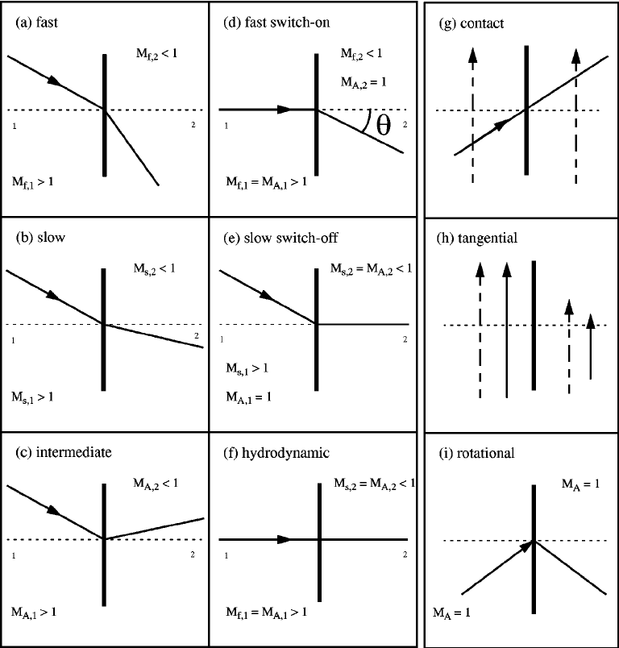{#fig-summary-mhd-shocks-discontinuities}

### 演化性

守恒定律的双曲性质只允许符合_因果性_的波传播。因果性是自然界的一般要求，在这里意味着跨激波的速度下降必须足够大，使下游流动的法向分量低于相应的下游模速度。对于快激波，这意味着激波两侧的法向流速和磁声速度满足以下顺序：
$$
\begin{aligned}
U_\text{1n} > c_\text{1ms}^+ \\
U_\text{2n} < c_\text{2ms}^+
\end{aligned}
$$
其中数字 1、2 分别表示快激波的上游和下游。

第一个条件是激波得以形成的先决条件；第二个条件则（部分）说明了_演化性_。否则，在下游激发并向上游朝激波运动的小幅快模扰动会比流动更快，它们会越过激波，使激波无限变陡。由于这种情况不可能发生而仍形成激波，下游法向速度必须小于下游快磁声速度。此外，对于快激波，激波两侧的流速都必须大于中间（阿尔芬）速度；对于慢激波，两侧流速都必须小于中间速度。这些条件成立的原因相同：否则相应的波会追上激波前沿，改变并破坏它，从而无法形成激波。

### 共面性

对于一个平稳的理想 MHD 激波，如果激波过渡区外不存在其他波动活动或动理学过程，使得耗散只发生在狭窄的激波过渡区内，并且相对于等离子体中所有其他物理尺度可以认为这个过渡区无穷薄，那么激波静止参考系中的电场严格垂直于磁场，$\mathbf{E} = -\mathbf{U}\times\mathbf{B}$。稳态 Faraday 定律
$$
\nabla\times\mathbf{E} = \dot{\mathbf{B}} = 0
$$
使两侧磁场切向分量的差异消失：
$$
(U_{n2} - U_{n1})(\mathbf{B}_{t2}\times\mathbf{B}_{t1}) = 0
$$

对于激波，$\lfloor U_n \rceil \neq 0$，因此
$$
\mathbf{B}_{t2}\times\mathbf{B}_{t1} = 0
$$
即两侧的两个切向分量严格平行。

更详细地，从 [RH 关系](https://en.wikipedia.org/wiki/Shocks_and_discontinuities_(magnetohydrodynamics)) 取 $\lfloor U_t \rceil$，得到
$$
\lfloor U_n \mathbf{B}_t \rceil = \frac{B_n^2}{\mu_0 ... }\lfloor \mathbf{B}_t \rceil
$$

因此，左侧与右侧的叉积必然为零：
$$
\begin{aligned}
\lfloor \mathbf{B}_t \rceil \times \lfloor U_n\mathbf{B}_t \rceil = 0 \\
(\mathbf{B}_{t2} - \mathbf{B}_{t1})\times(U_{n2}\mathbf{B}_{t2} - U_{n1}\mathbf{B}_{t1}) = 0 \\
(U_{n1} - U_{n2})(\mathbf{B}_{t1}\times\mathbf{B}_{t2}) = 0 \\
\mathbf{B}_{t1} \parallel \mathbf{B}_{t2}
\end{aligned}
$$ {#eq-shock_coplanarity}

由此得到的共面定理意味着跨激波的磁场具有简化的二维几何结构：上游和下游切向场相互平行，并与激波法向 $\hat{n}$ 共面。

然而，共面性并不严格成立。例如，当激波是非平稳的，即其宽度随时间或沿激波切向变化时，Faraday 定律中 $\partial\mathbf{B}/\partial t = \nabla\times\mathbf{E} \neq 0$，共面性便被破坏。

此外，任何沿上游磁场传播的上游低频电磁波都具有垂直于上游磁场的波动磁场。当它遇到激波时，这一切向分量会跨激波发生变换和放大。这自然引入了一个平面外磁场分量，从而破坏共面条件。在非 MHD 激波中，还有其他破坏共面性的效应。

### 临界性 {#sec-criticality}

激波是一种耗散结构，其中定向等离子体流的动能和磁能部分转化为等离子体热能。然而，对于空间中的激波，耗散并不是通过粒子碰撞发生的。无碰撞激波可以根据其马赫数小于某个临界马赫数 $M_c$（$M < M_c$）还是大于该值（$M > M_c$），分为_亚临界_和_超临界_激波。$M_c$ 是激波马赫数的一个阈值，超过该值后某些物理过程占据主导，导致激波的行为和结构出现明显变化。[^aerodynamic-critical]

根据具体物理过程，无碰撞激波可以有不同的临界马赫数：

1. 电子注入的 $M_c$：超过这一最小马赫数后，上游等离子体中的热电子可以被加速到高能并注入激波加速过程。这种注入对于产生观测到的宇宙线电子能谱至关重要。

2. 离子反射的 $M_c$：超过这一最小马赫数后，相当一部分上游离子从激波前沿反射。离子反射在激波耗散过程中发挥关键作用，并可能导致前激波区形成。

3. 哨声波前驱形成的 $M_c$：超过这一最小马赫数后，激波上游可以激发哨声波，形成能够改变激波性质的前驱波结构。

4. 非线性波陡化的 $M_c$：超过这一最小马赫数后，非线性波陡化效应变得重要，导致激波过渡区形成孤子和其他非线性波结构。

对于电阻性 MHD 激波，Marshall [1955] 通过数值方法确定临界马赫数为 $M_c\approx 2.76$（见 @fig-critical-mach-number-mhd-perp-shock）。在各种情形下，大多数天体物理和空间等离子体环境中的 $M_c$ 通常落在 2–10 的范围内。

[^aerodynamic-critical]: 在空气动力学中，飞行器的[临界马赫数](https://en.wikipedia.org/wiki/Critical_Mach_number) $M^\ast$ 是飞行器表面某点气流达到但不超过声速的_最低_马赫数。飞行器飞行时，其周围气流在不同位置的速度与飞行器空速有很大差别；这是因为气流绕过飞行器结构时必须加速和减速。当飞行器空速达到临界马赫数时，尽管飞行器本身的空速低于 1.0 马赫，机体附近某些区域的气流速度已达到声速。这会产生弱激波。当飞行器超过临界马赫数时，其阻力系数突然增加，导致阻力急剧增大，并可能使飞行器操纵性能恶化。

亚临界激波能够在流动从上游穿过激波到达下游的时间内产生足够的耗散，以实现减速、热化和熵的产生。相关过程基于受激波影响的等离子体与激波激发的湍流波场之间的波粒相互作用。

但超临界激波并非如此。超临界激波必须调用不同于简单波粒相互作用的机制，才能消除整体流动中任何经典反常耗散都无法耗散的多余能量。超过临界马赫数后，最简单有效的能量耗散方式是将相当一部分入射等离子体反射回上游，从而把流入的多余能量从激波处排出。耗散多余能量的非热过程包括：

* 将粒子加速到极高能量；
* 产生强而复杂的磁场；
* 显著加热等离子体。

为了说明激波临界马赫数如何从 Rankine-Hugoniot 关系中出现，我们考虑上游压力为零 $P_1 = 0$ 的严格垂直情形。此时跃变条件变得十分简单：
$$
\begin{aligned}
n_1 U_1 &= n_2 U_2 \\
v_1 B_1 &= v_2 B_2 \\
n_1 U_1^2 + \frac{B_1^2}{2\mu_0 m} &= n_2 U_2^2 + \frac{P_2}{m} + \frac{B_2^2}{2\mu_0 m} \\
\frac{U_1^2}{2} + \frac{B_1^2}{\mu_0 m n_1} &= \frac{U_2^2}{2} + \frac{\gamma}{\gamma - 1}\frac{P_2}{m n_2} + \frac{B_1^2}{\mu_0 m n_1}
\end{aligned}
$$
其中 $B$ 是此处唯一存在的磁场切向分量，$\gamma = 5/3$ 是绝热指数（适用于跨激波的快速绝热过渡）。这是所能设想的最简单的 MHD 激波情形，方程很容易求解。@fig-critical-mach-number-mhd-perp-shock 显示了归一化下游流速 $U_2/U_1$ 和下游声速 $c_{s2}/U_1 = \sqrt{\gamma P_2/n_2}/ v_1$ 随上游阿尔芬马赫数 $M_A = U_1 \sqrt{\mu_0 m n_1} / B_1$ 变化的关系。

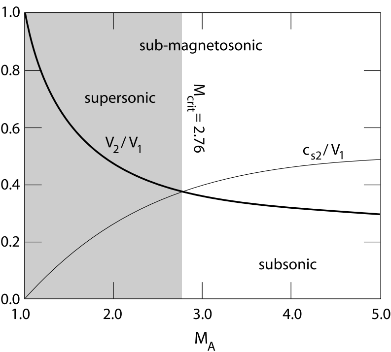{#fig-critical-mach-number-mhd-perp-shock}

图中两条曲线在临界马赫数处相交；在本例中，该值为 $M_c = 2.76$，在此处下游声速超过流速。低于临界马赫数时，下游流动仍为超声速（尽管显然是亚磁声速！）。只有超过临界马赫数，下游流速才降到下游声速以下。因此，超过该值后激波性质发生了 Rankine-Hugoniot 条件未包含的定性变化。

简要回顾：物质流入超临界激波的速度如此之快，以至于耗散发生的时间尺度太长，无法耗散多余能量并将流入速度降低到下游磁声速度以下。因此，临界条件是下游流速等于下游_声速_，由此得到临界马赫数 $M_c \simeq 2.76$。

临界马赫数的确定提出了一个有趣的问题：为什么下游会出现声速？有限的磁场压缩比给 MHD 激波中可能的电阻耗散速率设定了上限。等离子体具有多个耗散长度，具体取决于考虑哪种耗散过程。在等离子体中传播的任何非线性波都会持续变陡，直到其横向尺度接近这些耗散尺度中最长的一个。随后耗散开始并限制其振幅。

因此，当快磁声波波长接近电阻长度时，磁场通过电阻耗散与波解耦，波速在激波坡面下游变为声速。临界马赫数的条件于是由 $U_{n2} = c_{2s}$ 给出。类似地，对于慢模激波，由于其色散性质不同，电阻临界马赫数由条件 $U_{1n} = c_{1s}$ 定义[^slow_critical]。由于这些量依赖于波的角度，必须通过数值方法求解。先前研究表明，快模临界马赫数在 1 到 3 之间变化，取决于上游等离子体参数以及流动与磁场的夹角。它通常称为_第一_临界马赫数，因为模拟中的理论证据表明存在第二临界马赫数：当激波结构变得随时间变化、哨声波在激波前沿累积并周期性地使激波重新形成时，该临界马赫数开始发挥作用。此时主导的色散是哨声波色散。第二临界马赫数或哨声波临界马赫数的一个近似表达式为
$$
M_{2c} \propto \left( \frac{m_i}{m_e} \right)^{1/2}\cos\theta_{Bn}
$$ {#eq-2nd-critical-Mach-number}
其中比例常数取决于马赫数是相对于哨声波相速度还是群速度定义的。前者为 $1/2$，后者为 $\sqrt{27/64}$ [Oka+, 2006]。

[^slow_critical]: 所以它取决于上游声速？

显然，决定激波行为的是最小的临界马赫数。简单来说，在流动中存在障碍物，并以某种方式受到扰动而使快波能够增长、变陡并形成激波的条件下，$M > 1$ 决定激波的存在。此外，当流动超过给定 $\theta_{Bn}$ 下次低的马赫数时，该角度处的激波会转变为超临界激波，并在尚未最终阐明的附加条件下开始将粒子反射回上游。如果由于某种原因这没有发生，流动可能必须超过再高一级的临界马赫数，反射才有可能发生。在这种情况下，激波在马赫数变为超临界的区域会成为亚稳态，并不断变陡、宽度收缩，直到其他效应以及最终的粒子反射开始发挥作用。

### 平行激波 {#sec-parallel_shock}

第一种特殊情况是所谓的平行激波，其上游和下游等离子体流动都平行于磁场，同时垂直于激波前沿。换言之，
$$
\begin{aligned}
\mathbf{U}_1 = (U_1,\,0,\,0),\quad\mathbf{U}_2 = (U_2,\,0,\,0) \\
\mathbf{B}_1 = (B_1,\,0,\,0),\quad\mathbf{B}_2 = (B_2,\,0,\,0)
\end{aligned}
$$ {#eq-parallel_shock}

代入 @eq-RH_planar_sol 得到
$$
\begin{aligned}
\frac{B_2}{B_1} &= 1\\
\frac{\rho_2}{\rho_1} &= r \\
\frac{U_2}{U_1} &= r^{-1} \\
\frac{p_2}{p_1} &= R \\
\end{aligned}
$$ {#eq-parallel_shock_relation}
其中
$$
\begin{aligned}
r &= \frac{(\gamma + 1)M_1^2}{2+(\gamma-1)M_1^2} \\
R &= 1 + \gamma M_1^2 (1-r^{-1}) = \frac{(\gamma+1)r - (\gamma-1)}{(\gamma+1) - (\gamma-1)r}
\end{aligned}
$$ {#eq-eq-parallel_shock_coef}

这里 $M_1 = U_1/c_{s1}$，其中 $c_{s1} = \sqrt(\gamma p_1/\rho_1)$ 是上游声速。因此，当 $M_1>1$ 时上游流动为超声速，当 $M_1<1$ 时为亚声速。顺便指出，从上式可以清楚看出，平行激波不受磁场存在的影响。事实上，这种激波与中性流体中出现的激波相同，因此通常称为_流体动力学激波_。

从 @eq-parallel_shock 容易看出，当上游流动恰好为声速，即 $M_1=1$ 时，不存在激波（即激波前沿两侧的等离子体参数没有跃变）。换言之，当 $M_1=1$ 时，$r=R=1$。然而，如果 $M_1\neq 1$，上游和下游等离子体参数就会不同（即 $r\neq 1$、$R\neq 1$），真正的激波便会形成。事实上，容易证明
$$
\begin{aligned}
\frac{\gamma-1}{\gamma+1} &\leq r \leq \frac{\gamma+1}{\gamma-1} \\
0&\leq R \leq \infty \\
\frac{\gamma-1}{2\,\gamma}&\leq M_1^2\leq \infty
\end{aligned}
$$ {#eq-parallel_shock_coef_range}

注意，上述不等式中的上限和下限分别都是同时达到的。

前面的讨论似乎意味着平行激波既可以是压缩性的（即 $r>1$），也可以是膨胀性的（即 $r<1$）。跨激波是否有一个优选方向？换言之，能否区分上游和下游？可以，借助额外的物理原理——_热力学第二定律_。这一定律指出，封闭系统的_熵_可以自发增加，但绝不能自发减少。一般来说，流体动力学激波前沿两侧的每粒子熵不同。因此，热力学第二定律要求下游熵必须_大于_上游熵，以保证等离子体流经激波时系统总熵净增加，而不是净减少。

理想等离子体的每粒子熵（经适当归一化）为
$$
S = \ln\left(\frac{p}{\rho^\gamma}\right)
$$

因此，上游和下游的熵之差为
$$
\lfloor S\rceil =\ln R - \gamma\,\ln r
$$

现在，利用 @eq-eq-parallel_shock_coef，
$$
r\frac{\mathrm{d}\lfloor S \rceil}{dr} = \frac{r}{R}\frac{dR}{dr} - \gamma = \frac{\gamma(\gamma^2-1)(r-1)^2}{[(\gamma+1)r - (\gamma-1)][(\gamma+1)-(\gamma-1)r]}
$$

此外，从 @eq-parallel_shock_coef_range 容易看出，在所有有物理意义的情况下 $\mathrm{d}\lfloor S \rceil/dr\ge 0$。然而，当 $r=1$ 时，$\lfloor S \rceil = 0$，因为此时激波前沿两侧的等离子体参数没有间断。我们得出结论：$r<1$ 时 $\lfloor S \rceil<0$，$r>1$ 时 $\lfloor S \rceil>0$。因此，热力学第二定律要求流体动力学激波是_压缩性_的，即 $r\equiv\rho_2 / \rho_1>1$。换言之，沿等离子体相对流动方向穿过激波前沿时，等离子体密度必须始终_增加_。事实证明，这是一条适用于所有三类 MHD 激波的一般规律。在激波静止参考系中，激波伴随着从超声速到亚声速流动的不可逆转变（因为熵突然增加）。

上游马赫数 $M_1$ 是衡量激波强度的良好指标：$M_1=1$ 时没有激波，$M_1-1 \ll 1$ 时激波较弱，$M_1\gg 1$ 时激波较强。类似地，可以定义下游马赫数 $M_2=U_2/(\gamma\,p_2/\rho_2)^{1/2}$。由跃变条件容易证明，如果 $M_1>1$，则 $M_2 < 1$。换言之，在激波静止参考系中，激波伴随着从超声速到亚声速流动的不可逆转变（因为熵突然增加）。注意，在 $M_1\rightarrow \infty$ 极限下，$r\equiv \rho_2/\rho_1\rightarrow (\gamma+1)/(\gamma-1)$，而 $R\equiv p_2/p_1\rightarrow\infty$。换言之，随着激波强度增大，压缩比 $r$ 渐近趋于有限值，而压力比 $P$ 无限制增大。对于 $\gamma=5/3$ 的普通等离子体，压缩比的极限值为 4，即下游密度绝不会超过上游密度的四倍。我们得出结论，在强激波极限 $M_1\gg 1$ 下，激波前沿两侧等离子体压力的巨大跃变主要必然源于等离子体_温度_的巨大跃变，而不是_密度_的巨大跃变。事实上，$r$ 和 $R$ 的定义意味着
$$
\frac{T_2}{T_1}\equiv \frac{R}{r}\rightarrow \frac{2\gamma(\gamma-1)M_1^2}{(\gamma+1)^2}\gg 1
$$
当 $M_1\rightarrow\infty$ 时成立。因此，强平行激波或流体动力学激波伴随着强烈的等离子体加热。

如前所述，流体动力学激波存在的条件是 $M_1>1$，或 $U_1 > U_{S\,1}$。换言之，在激波参考系中，上游等离子体速度 $U_1$ 必须是超声速的。然而，根据伽利略不变性，$U_1$ 也可解释为激波在初始静止等离子体中的传播速度。由此可知，在静止等离子体中，平行激波或流体动力学激波以超声速沿磁场传播。

### 垂直激波 {#sec-perp_shock}

第二种特殊情况是所谓的_垂直激波_，其上游和下游等离子体流动均垂直于磁场，同时垂直于激波前沿。换言之，
$$
\begin{aligned}
\mathbf{U}_1 = (U_1,\,0,\,0),\quad\mathbf{U}_2 = (V_2,\,0,\,0) \\
\mathbf{B}_1 = (0,\,B_1,\,0),\quad\mathbf{B}_2 = (0,\,B_2,\,0)
\end{aligned}
$$ {#eq-perp_shock}

代入 @eq-RH_planar_sol 得到
$$
\begin{aligned}
\frac{B_2}{B_1} &= r\\
\frac{\rho_2}{\rho_1} &= r \\
\frac{U_2}{U_1} &= r^{-1} \\
\frac{p_2}{p_1} &= R \\
\end{aligned}
$$ {#eq-perp_shock_relation}
其中
$$
R = 1+ \gamma\,M_1^{\,2}\,(1-r^{-1}) + \beta_1^{-1}\,(1-r^2)
$$ {#eq-perp_shock_coef}
而 $r$ 是以下二次方程的一个正实根：
$$
F(r) = 2\,(2-\gamma)\,r^2+ \gamma\,[2\,(1+\beta_1)+ (\gamma-1)\beta_1 M_1^2]r - \gamma\,(\gamma+1)\,\beta_1\,M_1^2=0
$$ {#eq-perp_shock_coef_f}

这里 $\beta_1 = 2\mu_0 p_1/B_1^2$。

现在，如果 $r_1$ 和 $r_2$ 是 @eq-perp_shock_coef_f 的两个根，则
$$
r_1 r_2 = -\frac{\gamma(\gamma+1)\beta_1 M_1^2}{2(2-\gamma)}
$$

假设 $\gamma < 2$，我们得出一个根为负，因此 @eq-perp_shock_coef_f 只有一个物理解，即只有一种 MHD 激波与 @eq-perp_shock 一致。容易证明 $F(0)<0$ 且 $F(\gamma+1/\gamma-1)>0$。因此，物理解位于 $r=0$ 和 $r=(\gamma+1)/(\gamma-1)$ 之间。

采用与上一小节类似的分析，容易证明热力学第二定律要求垂直激波是压缩性的，即 $r>1$。由此可知，只有当 $F(1)<0$ 时才能得到物理解，该条件化为
$$
M_1^{\,2} > 1 + \frac{2}{\gamma\,\beta_1}
$$

这一条件也可写为
$$
\mathbf{U}_1^2 > \mathbf{V}_{s1}^2 + \mathbf{V}_{A1}^2 = V_{+\,1}^2
$$
其中 $V_{A1} = B_1/\sqrt(\mu_0 \rho_1)$ 是上游阿尔芬速度。$V_{+\,1} = (V_{S\,1}^{\,2} + V_{A\,1}^{\,2})^{1/2}$ 可以识别为垂直于磁场传播的快波速度（@sec-fast_slow）。因此，垂直激波存在的条件是上游等离子体相对速度必须_大于_上游快波速度。顺便指出，容易证明，如果满足这一条件，下游等离子体速度小于下游快波速度。我们还可以推断，在静止等离子体中，垂直激波以超过快波速度的速度横跨磁场传播。

在强激波极限 $M_1\gg 1$ 下，@eq-perp_shock_coef 和 @eq-perp_shock_coef_f 与 @eq-eq-parallel_shock_coef 相同。因此，强垂直激波与强流体动力学激波非常相似（只是前者垂直于磁场传播，而后者平行于磁场传播）。特别是，与流体动力学激波一样，垂直激波压缩密度的倍数不能超过 $(\gamma+1)/(\gamma-1)$。然而，根据 @eq-perp_shock_relation，垂直激波压缩磁场的倍数与压缩等离子体密度的倍数相同。由此可知，垂直激波压缩磁场的倍数也有上限。

### 倾斜激波

现在考虑一般情况：激波两侧的等离子体速度和磁场既不平行也不垂直于激波前沿。将其变换到所谓的 _de Hoffmann-Teller 参考系_比较方便，在该参考系中 $|\mathbf{U}_1\times \mathbf{B}_1|=0$，即
$$
U_{x1}B_{y1} - U_{y1}B_{x1} = 0
$$ {#eq-HT_frame_up}

换言之，变换到以等离子体局地 $\mathbf{E}\times\mathbf{B}$ 速度运动的参考系比较方便。关键思路是从 $\mathbf{v}_1$ 中提取垂直于 $\mathbf{B}_1$ 的速度分量。一个尝试性的想法是直接去掉垂直部分：
$$
\begin{aligned}
\mathbf{V}_{\mathrm{dHT}} = \mathbf{U}_1 - (\mathbf{U}_1 \cdot \mathbf{b}_1)\mathbf{b}_1 \\
\mathbf{U}_1^\prime = \mathbf{U}_1 - \mathbf{V}_\mathrm{dHT} = (\mathbf{U}_1 \cdot \mathbf{b}_1)\mathbf{b}_1
\end{aligned}
$$

注意，这种变换不是唯一的，因为总可以添加一个平行速度分量。虽然上述变换正确，却引入了两个问题：

1. 冲压压力 $\rho V_n^2$ 在两个坐标系之间发生变化。
2. 给定某些参数时，@eq-shock_adiabatic 可能没有有效解（例如 $\mathrm{MA}_1 = 5, \theta_1 = 65^\circ$ 会给出 $r<1$）。

为解决这一问题，可以使用另一种变换：
$$
\begin{aligned}
\mathbf{V}_{\mathrm{dHT}} = \mathbf{U}_1 - \frac{U_x}{B_x}\mathbf{B} \\
\mathbf{U}_1^\prime = \mathbf{U}_1 - \mathbf{V}_\mathrm{dHT} = \frac{U_x}{B_x}\mathbf{B}
\end{aligned}
$$ {#eq-dHT-transformation}

这一变换的一个优点是法向速度分量保持不变，冲压压力也不变。因此，可以在实验室参考系和 de Hoffmann-Teller 参考系中使用相同的量。

将 @eq-HT_frame_up 代入 @eq-RH_planar_sol 的第二个跃变条件，得到
$$
U_{x2}B_{y2} - U_{y2}B_{x2} = 0
$$ {#eq-HT_frame_down}
即 $|\mathbf{U}_2\times \mathbf{B}_2|=0$。因此，在 de Hoffmann-Teller 参考系中，上游等离子体流动平行于上游磁场，下游等离子体流动也平行于下游磁场。此外，跃变条件 @eq-RH_planar_sol（最后一个方程）中的磁场贡献恒为零，使问题大为简化。

将 @eq-HT_frame_up 和 @eq-HT_frame_down 与一般跃变条件 @eq-RH_planar_sol 结合可得[^tangential]
$$
\begin{aligned}
\frac{\rho_2}{\rho_1}&=r \\
\frac{B_{x\,2}}{B_{x\,1}} &= 1 \\
\frac{B_{y\,2}}{B_{y\,1}} &= r\frac{U_{1}^{2} - V_{A\,1}^{2}}{U_{1}^{2} - r\,V_{A\,1}^{2}} \\
\frac{U_{x\,2}}{U_{x\,1}} &= \frac{1}{r} \\
\frac{U_{y\,2}}{U_{y\,1}} &= \frac{U_{1}^{2} - V_{A\,1}^{2}}{U_{1}^{2}-r\,V_{A\,1}^{2}} \\
\frac{p_2}{p_1} &= 1+\frac{\gamma U_1^2 (r-1)}{V_{s1}^2 r}\left[\cos^2\theta_1 - \frac{r V_{A1}^2 \sin^2\theta_1[(r+1)U_1^2 - 2r V_{A1}^2]}{2(U_1^2 - r\,V_{A\,1}^2)^2} \right]
\end{aligned}
$$ {#eq-oblique_shock_relation}
其中 $U_{x,1}=U_1\cos\theta_1$ 是垂直于激波前沿的上游速度分量，$\theta_1$ 是上游等离子体流动与激波前沿法向之间的夹角。[^normal][^coordinate] 最后，给定压缩比 $r$ 后，法向上游速度的平方 $U_1^{\,2}$ 是一个称为_激波绝热线_的三次方程的实根：[^ratio]
$$
\begin{aligned}
0 = & (U_{1}^2 - r V_{A1}^2)^2\{ [(\gamma+1) - (\gamma-1)r]U_{1}^2\cos^2\theta_1 - 2r V_{s1}^2 \} \\
& -r\sin^2\theta_1 U_{1}^2 V_{A1}^2 \{ [\gamma+(2-\gamma)r]U_{1}^2 - [(\gamma+1) - (\gamma-1)r]r\, V_{A1}^2 \}
\end{aligned}
$$ {#eq-shock_adiabatic}

[^tangential]: 定义切向方向 $\hat{t}$ 的一种方法是以 $\mathbf{U}_{t1}$ 为参考：$\mathbf{U}_{t1} = \mathbf{U}_1 - (\mathbf{U}_1 \cdot \hat{n})\hat{n}$。于是 $\hat{t} = \mathbf{U}_{t1} / |\mathbf{U}_{t1}|$。注意，法向和切向分量都是带符号的数。

[^normal]: 激波法向从下游指向上游，等离子体流动从上游指向下游。通常取小于 $90^\circ$ 的夹角，因此定义为 $\theta_1 = \cos^{-1}(-\mathbf{U}_1 \cdot\hat{n}/|\mathbf{U}_1|)$。

[^coordinate]: 注意，速度是在 dHT 参考系中定义的，而不是在实验室参考系中！这里只是因为跃变条件更容易求解才使用 dHT。还要注意，在 dHT 参考系下求解的跃变条件与实验室参考系中的不同！

[^ratio]: 这个方程仅在 dHT 参考系中有效。在实验室参考系中，应有另一个方程从上游条件求解压缩比 r。然而，由于激波的唯一性，两者必须给出相同结果。

与前面一样，热力学第二定律要求 $r>1$。

__弱激波极限__

首先考虑弱激波极限 $r\rightarrow 1$。此时，容易看出激波绝热线的三个根分别化为沿激波前沿法向传播的慢波、中间波（或剪切阿尔芬波）和快波：
$$
\begin{aligned}
U_1^{\,2}&=V_{-\,1}^{\,2}\equiv \frac{V_{A\,1}^{\,2}+V_{S\,1}^{\,2}- [(V_{A\,1}+V_{S\,1})^2 -4\,\cos^2\theta_1\,V_{S\,1}^{\,2}\,V_{A\,1}^{\,2}]^{1/2}}{2} \\
U_1^{\,2}&=\cos^2\theta_1\,V_{A\,1}^{\,2} \\
U_1^{\,2}&=V_{+\,1}^{\,2}\equiv \frac{V_{A\,1}^{\,2}+V_{S\,1}^{\,2} + [(V_{A\,1}+V_{S\,1})^2 -4\,\cos^2\theta_1\,V_{S\,1}^{\,2}\,V_{A\,1}^{\,2}]^{1/2}}{2}
\end{aligned}
$$

我们得出结论，在激波振幅很小的极限下，慢、中间和快 MHD 激波退化为相应的 MHD 波。反过来，可以将各种 MHD 激波视为相应 MHD 波的_非线性_形式。容易证明
$$
V_{+1} > \cos\theta_1 V_{A1} > V_{-1}
$$

换言之，快波比中间波传播得快，而中间波比慢波传播得快。合理的假设是，相应的 MHD 激波也满足同样的关系，至少在激波强度相对较低时如此。由 @eq-oblique_shock_relation 可知，对于快激波 $B_{y2}>B_{y1}$，而对于慢激波 $B_{y\,2}<B_{y\,1}$。对于中间激波，经过少量代数运算可以证明，在 $r\rightarrow 1$ 极限下 $B_{y\,2}\rightarrow -B_{y\,1}$。我们可以得出结论：在 de Hoffmann-Teller 参考系中，快激波使磁场和等离子体流动（回想它们在所采用的参考系中平行）折射得_远离_激波前沿法向，而慢激波使这些量折射得_靠近_法向。此外，跨中间激波前沿时，切向磁场和等离子体流动通常会_反向_。这一点如 @fig-mhd-shock-rest-frame 所示。

::: {.content-visible unless-format="pdf"}

{#fig-mhd-shock-rest-frame}

:::

当 $r$ 略大于 1 时，容易证明慢激波、中间激波和快激波存在的条件分别为 $U_1> V_{-\,1}$、$U_1> \cos\theta_1\,V_{A\,1}$ 和 $U_1> V_{+\,1}$。

__强激波极限__

现在考虑强激波极限 $U_1^{\,2}\gg 1$。此时，激波绝热线给出 $r\rightarrow r_m=(\gamma+1)/(\gamma-1)$，以及
$$
U_1^{\,2} \simeq \frac{r_m}{\gamma-1}\,\frac{2V_{S1}\sin^2\theta_1\,[\gamma + (2-\gamma)\,r_m]\,V_{A1}^2}{r_m-r}
$$

不存在其他实根。上述根显然属于快激波。只有一个实根这一事实表明，存在一个临界激波强度，超过该强度后慢激波和中间激波解不再存在。（事实上，它们合并并相互湮灭。）换言之，慢激波或中间激波的强度存在上限；另一方面，快激波的强度没有上限。然而注意，任何类型的 MHD 激波对等离子体密度和切向磁场的压缩倍数都不能超过 $(\gamma+1)/(\gamma-1)$。

__$\theta_1=0$__

考虑特殊情况 $\theta_1=0$，其中等离子体流动和磁场都垂直于激波前沿。此时，激波绝热线的三个根为
$$
\begin{aligned}
U_1^2&=\frac{2r\,V_{S1}^2}{(\gamma+1)-(\gamma-1)\,r} \\
U_1^2&=r\,V_{A1}^2 \\
U_1^2&=r\,V_{A1}^2
\end{aligned}
$$

第一个根就是 @sec-parallel_shock 中讨论的流体动力学激波。当 $V_{S\,1}<V_{A\,1}$ 时，该激波被归类为慢激波；当 $V_{S\,1}> V_{A\,1}$ 时被归类为快激波。另外两个根相同，对应以速度 $U_1 =\sqrt{r}\, V_{A\,1}$ 传播并“开启”等离子体流动和磁场切向分量的激波：从 @eq-oblique_shock_relation 可看出，对于这类激波，$U_{y\,1}=B_{y\,1} =0$，而 $U_{y\,2}\neq 0$ 且 $B_{y\,2}\neq 0$。

于是有“开启”和“关闭”激波，分别指产生和消除等离子体流动与磁场的切向分量。顺便指出，也可能存在消除等离子体流动和磁场切向分量的“关闭”激波。根据 @eq-oblique_shock_relation，这种激波以速度 $U_1=\cos\theta_1\,V_{A\,1}$ 传播[^switch_on_alfven]。开启和关闭激波如 @fig-shock-switch-on-off 所示。

[^switch_on_alfven]: 这是阿尔芬波参与开启／关闭激波的一个非常有力的迹象！

::: {.content-visible unless-format="pdf"}

{#fig-shock-switch-on-off}

:::

__$\theta_1=\pi/2$__

考虑另一种特殊情况 $\theta_1=\pi/2$。容易证明，激波绝热线的三个根为
$$
\begin{aligned}
U_1^{\,2}&=r \left(\frac{2V_{S1}^2 + [\gamma+(2-\gamma)\,r]\,V_{A1}^2} {(\gamma+1)-(\gamma-1)\,r}\right)\\
U_1^{\,2}&=0 \\
U_1^{\,2}&=0
\end{aligned}
$$

第一个根显然是快激波，与 @sec-perp_shock 中讨论的垂直激波相同，只是在这种情况下没有等离子体流动穿过激波前沿。（这是因为 HT 参考系吗？）另外两个根为零表明，与相应的 MHD 波一样，慢 MHD 激波和中间 MHD 激波不垂直于磁场传播。

MHD 激波已在各种各样的情形中被观测到。例如，已知超新星爆炸、强恒星风、太阳耀斑以及行星磁层上游的太阳风都能形成激波。

### 开启和关闭激波 {#sec-switch-shocks}

理论上，MHD 中的平行激波应当与气体动力学激波的行为完全相同：既没有上游切向磁场分量，也不应有下游切向场。然而，这一结论并不严格成立，因为等离子体由带电粒子组成，它们对场的涨落敏感，并能通过电流在等离子体中激发各种波，这些波随后成为磁场的来源。平行和准平行激波中的动理学效应在其物理过程中起重要作用，完全有能力至少在短于离子尺度的尺度上产生切向场。

然而，正如上一小节所见，即使在 MHD 中，也会遇到一个有趣的事实：这类激波必然具有特殊性质。原因在于，它们不像气体动力学中那样是变陡的_声波_的结果；如果是那样，它们就只是纯静电激波。相反，沿磁场平行传播的是阿尔芬波和磁声波。阿尔芬波包含横向磁场分量。在平行激波中，这些横向波动场实际上与激波相切。因此，如果一个纯平行激波变陡，横向阿尔芬波也会变陡，激波从上游过渡到下游后会开启一个原本不存在的切向磁场分量。这类激波称为_开启_激波。类似地，可以设想激波后方的一个切向分量通过同样的过程被方向相反的开启场关闭，从而形成_关闭_激波。

这类激波在 MHD 中是否存在的问题，与阿尔芬波传播进入激波时是否发生非线性陡化的问题有关。对于普通阿尔芬波，这种陡化在一阶为零。然而，在二阶上，跟在前导阿尔芬波后面的波会感受到其微弱的横向磁场分量。因此，尾随波相对于主磁场略微倾斜地传播，从而产生二阶密度压缩；这除了产生类似激波的等离子体压缩外，还会局地改变阿尔芬速度。如果尾随波与前导波沿相同方向偏振，它还会增大压缩下游的横向磁场分量，从而在二阶上开启切向磁场分量。因此，整列具有相同偏振的尾随波会使密度和切向磁场都强烈变陡。

显然，这类激波是比较特殊的 MHD 激波，其重要性尚不明确，观测实例也非常罕见。

## 双绝热 MHD

@cgl1956 提出的经典方法使用 MHD 框架，假设平行和垂直于磁场方向的分布各向同性，从而得到激波两侧的标量压力。这现在称为 CGL 理论或双绝热理论。

当我们转向具有各向异性压力张量的 MHD 时，
$$
P_{ij} = p_\perp \delta_{ij} + (p_\parallel - p_\perp)B_i B_j / B^2
$$
其中 $p_\perp$ 和 $p_\parallel$ 分别是垂直和平行于磁场的压力。
在强磁场近似下，两个压力通过两个绝热方程与等离子体密度及磁场强度相联系：
$$
\begin{aligned}
\frac{\mathrm{d}}{\mathrm{d}t}\left( \frac{p_\parallel B^2}{\rho^3} \right) &= 0 \\
\frac{\mathrm{d}}{\mathrm{d}t}\left( \frac{p_\perp}{\rho B} \right) &= 0
\end{aligned}
$$ {#eq-mhd-double-adiabatic}

这就是双绝热理论名称的由来，也是许多人记忆中的 CGL 理论关键结论。然而，这些是在固定位置随时间保持的常数：将它们应用于跨激波过程是_不正确_的。还要注意*绝热*的含义：这意味着热通量为零。如果系统不是绝热的，与平行和垂直压力相关的这两个量便不再守恒，随机加热等额外项可能发挥作用。

@abraham1967shock 推导了 CGL 近似下无碰撞各向异性磁化等离子体中间断的一般跃变条件。

@hudson1970discontinuities 以 CGS 单位制给出的各向异性等离子体一般跃变条件为：
$$
\begin{aligned}
\lfloor \rho U_n \rceil &= 0 \\
\lfloor U_n\mathbf{B}_t - \mathbf{U}_t B_n \rceil &= 0 \\
\lfloor p_\perp + (p_\parallel - p_\perp)\frac{B_n^2}{B^2} + \frac{B_t^2}{8\pi} + \rho U_n^2 \rceil &= 0 \\
\lfloor \frac{B_n \mathbf{B}_t}{4\pi}\left( \frac{4\pi(p_\parallel - p_\perp)}{B^2} - 1 \right) +\rho U_n \mathbf{U}_t \rceil &= 0 \\
\lfloor \rho U_n\left( \frac{\epsilon}{\rho} + \frac{U^2}{2} + \frac{p_\perp}{\rho} + \frac{B_t^2}{4\pi \rho} \right) + \frac{B_n^2 U_n}{B^2}&(p_\parallel - p_\perp) \\
- \frac{\mathbf{B}_t\cdot\mathbf{U}_t B_n}{4\pi}\left( 1 - \frac{4\pi(p_\parallel - p_\perp)}{B^2} \right) \rceil &= 0 \\
\lfloor B_n \rceil &= 0
\end{aligned}
$$
其中 $\rho$ 是质量密度，$U$ 和 $B$ 是速度和磁场强度。下标 $t$ 和 $n$ 表示相对于间断的切向和法向分量。$p_\perp$ 和 $p_\parallel$ 是等离子体压力张量中垂直和平行于磁场的分量。$\epsilon$ 是内能，$\epsilon = p_\perp + p_\parallel/2$，且 $\lfloor Q \rceil = Q_2 - Q_1$，其中下标 1 和 2 分别表示间断上游和下游的量。这些方程对应物理量的守恒，即质量通量、电场切向分量、动量通量的法向和切向分量、能量通量，最后是磁场的法向分量。为了在激波上下游各向异性等离子体条件下求解跃变方程，必须使用一个附加方程，因为这一方程组是欠定的。一种常见选择是磁场／密度跃变比。

以下推导遵循 [@erkaev2000solution]。
引入两个无量纲参数 $A_s$ 和 $A_m$，由上游条件确定为
$$
\begin{aligned}
A_s &= \frac{p_{\perp 1}}{\rho_1 v_1^2} \\
A_m &= \frac{1}{M_A^2}
\end{aligned}
$$
其中 $M_A$ 是上游阿尔芬马赫数。在常见的太阳风条件下，这两个参数都相当小（$\sim 0.01$）。

对于激波，电场和磁场的切向分量是_共面_的（@eq-shock_coplanarity）。因此，激波上游磁场的分量为 $B_{n1} = B_1 \cos\theta_1$ 和 $B_{t1} = B_1 \sin\theta_1$，其中 $\theta_1$ 是磁场矢量与垂直于间断的向量 $\hat{n}$ 之间的夹角。类似地，激波上游整体速度的分量选为 $U_{n1} = U_1 \cos\alpha$ 和 $U_{t1} = B_1 \sin\alpha$，其中 $\alpha$ 是整体速度与速度法向分量之间的夹角。此外，参数 $\lambda$ 用来表示压力各向异性：
$$
\lambda = p_\perp / p_\parallel
$$
另一个参数 $r$ 用来表示密度比：
$$
r \equiv \frac{\rho_2}{\rho_1} = \frac{U_{n1}}{U_{n2}}
$$

### 垂直激波

对于垂直激波，$B_n = 0$，守恒关系化为
$$
\begin{aligned}
\lfloor \rho U_n \rceil &= 0 \\
\lfloor U_n\mathbf{B}_t \rceil &= 0 \\
\lfloor p_\perp + \frac{B_t^2}{8\pi} + \rho U_n^2 \rceil &= 0 \\
\lfloor \rho U_n \mathbf{U}_t \rceil &= 0 \\
\lfloor \rho U_n\left( \frac{\epsilon}{\rho} + \frac{U^2}{2} + \frac{p_\perp}{\rho} + \frac{B_t^2}{4\pi \rho} \right) \rceil &= 0
\end{aligned}
$$

间断下游的各量为
$$
\begin{aligned}
B_{t2} &= r B_{t1} \\
U_{t2} &= U_{t1} \\
p_{\perp 2} &= p_{\perp 1} + \frac{B_{t1}^2}{8\pi}(1-r^2) + \rho_1 U_{n1}^2\big( 1 - \frac{1}{r} \big)
\end{aligned}
$$

将这些式子代入能量方程得到
$$
\begin{aligned}
2 \lambda_1(3\lambda_2 +1)\xi^3 − \lambda_1(4\lambda_2 +1)(2A_S + A_M +2)\xi^2 \\
+ \lambda_2[2\lambda_1(4A_S + 1 + 2A_M) + 2A_S ]\xi + A_M \lambda_1 = 0
\end{aligned}
$$
其中 $\xi = 1/r$。

现在可以做一些简单估计。假设上游太阳风各向同性，在 GSM 坐标中 $n = 2\,\textrm{amu/cc}$、$\mathbf{v} = [600, 0, 0]\,\textrm{km/s}$、$\mathbf{B} = [0, 0, -5]\,\textrm{nT}$，且 $T = 5\times 10^5\,\textrm{K}$。我们希望在给定密度／切向磁场跃变比为 3 的情况下估计下游各向异性。

```jl
KeyNotes.shock_estimation()
```

还要注意，如果在上述计算中将跃变比设为 4（$\gamma = 5/3$ 时的最大值），下游各向异性将变为 0.6。这表明，在这一组上游条件下，如果各向异性 $T_\perp/T_\parallel > 1$，跃变比就绝不应接近 4！

## 亚临界激波

亚临界激波也称为层流激波，其马赫数介于 1 和 $M_c$ 之间，可以用无碰撞等离子体中色散波所具有的色散和耗散共同作用来描述。过去认为亚临界激波在空间中很罕见；它们主要仅与太阳风的大质量加载有关，例如在彗星和金星、火星等无磁化行星附近，尤其是在具有稠密大气的金星附近。然而，由于非线性色散波能够变陡并演化为激波的性质，它们可能普遍得多。

后一种情况下亚临界激波的演化现在已得到较好的理解，尽管临界马赫数以下反常电阻和反常耗散的产生仍有许多未解决的问题。已经明确，亚临界激波经历低频磁声波变陡的各个阶段而演化，这种波已被确定属于哨声模分支。这一陡化过程完全无碰撞。各模式逆上游流动传播，形成一列局域波模；边带产生的更高空间谐波造成陡化，这些谐波都以（近似）相同的相速度（群速度）传播，因此它们的振幅同相并叠加在母波上。当前导波包的梯度长度接近耗散尺度 $L_d$ 时，耗散开始。此时，尺度更小的高次谐波边带要么超过前导波包，最终成为激波前方静止、在空间上衰减的前驱波模；要么在波包后方形成空间衰减的尾迹。这取决于色散是凸还是凹（$\partial^2 \omega /\partial k^2$ 的符号）。这一色散效应限制了激波振幅。同时，激波内部产生的耗散使波包形成激波坡面。

耗散的产生最可能源于激波坡面电流的电子电流不稳定性，其尺度短于离子惯性尺度。目前尚未确定这种不稳定性，但我们已经给出有力论据，表明其特征指向修正双流不稳定性。反常碰撞率处于激波坡面的低混杂频率，在这种情况下相当高，足以提供熵产生、激波加热和压缩所需的耗散。此外，还可能发生其他小尺度效应，我们仅提及而未深入讨论。

只要激波是马赫数 $M < M_c$ 的亚临界激波，准垂直和准平行激波的区别就不特别重要，至少当激波法向角远离零时如此。然而，正如后续章节所示，当马赫数增大并最终超过临界马赫数 $M > M_c$ 时，这一区别变得非常重要。

## 超临界垂直激波

准垂直激波是第一类重要的无碰撞磁化激波，它们将粒子反射回上游以满足激波条件。通过讨论粒子动力学，并定义相对于上游磁场的激波法向角，可以明确区分它们与准平行激波。它们存在于激波法向角 $< 45^\circ$ 的情况。准垂直激波反射的粒子无法沿磁场逃逸到遥远上游。它们向上游运动半个回旋轨道后返回激波坡面，最终穿过坡面，成为下游等离子体粒子群的一员；它们还在激波坡面前方形成足部。我们讨论产生反射的激波电势和具体激波结构。大多数理论认识来自数值模拟，模拟证实了反射、足部形成和激波重形成。后者由足部扰动变陡引起，直到足部本身成为激波过渡区并将粒子反射到上游。重形成使激波暂时发生调制，但长期来看保证其平稳性。我们结合涉及的各种不稳定性以及粒子加速和激波加热，具体讨论离子和电子动力学。最后给出一个典型准垂直激波过渡区的示意模型。

为了帮助维持超临界情形下的激波，激波必须阻止越来越多的离子穿过其坡面，这是通过将部分粒子反射回上游实现的。这不是直接的耗散过程，而是激波的一种应急行为。它将一部分入射离子抛回上游，由此同时降低流入的动量密度和能量密度。显然，这一反射过程通过赋予激波本身负动量而使激波减速。激波向后滑移，因此在激波参考系中也减小了它与入射流之间的相对速度，即减小马赫数。此外，反射离子对入射流形成了一个意外的障碍，从而再次降低马赫数。

### 粒子动力学

让我们回到粒子与超临界激波相互作用并被激波反射时的轨道。在最简单的模型中，假设激波为平面，且反射是镜面反射：粒子瞬时速度 $\mathbf{v}$ 垂直于激波的分量 $v_n$ 转向 $180^\circ$，即简单反向。这里遵循 @schwartz1983ions 对这些理想条件的具体计算，该文以最一般的方式处理了这个问题。不过应当记住，理想镜面反射的假设是现实情况的极端极限，只是一种方便的假设。事实上，反射完全不一定是镜面的，因为

1. 激波坡面不是刚性墙壁；粒子至少会穿透其中一段相当于其回旋半径某个分数的距离。
2. 粒子与波相互作用，甚至在这种相互作用及接近激波的过程中激发波。

图 5.1 显示了平面（稳态）激波所用的坐标系，分别具有激波法向 $\hat{n}$、磁场方向 $\hat{b}$ 和速度方向 $\hat{v}$ 单位向量。图中显示了角度 $\theta_{Bn},\,\theta_{Vn},\,\theta_{BV}$。速度矢量 $\mathbf{V}_\text{HT}$ 是位于激波平面内的 de Hoffmann-Teller 速度，其定义使得在以速度 $\mathbf{V}_\text{HT}$ 沿激波平面运动的坐标系中，等离子体流动沿磁场方向，$\mathbf{U} − \mathbf{V}_\text{HT} = −v_\parallel \hat{b}$。由于后一个原因，在 de Hoffmann-Teller 参考系中考察粒子运动很方便。在该参考系中，粒子的导引中心都沿磁场运动。因此，使用 $\mathbf{U} = −U\hat{v}$、$\hat{n}\cdot\hat{v} = \cos\theta_{Vn}$、$\hat{n}\cdot(\hat{b},\,\hat{x},\,\hat{y})=(\cos\theta_{Bn},\sin\theta_{Bn},0)$，得到
$$
v_\parallel = U\frac{\cos\theta_{Vn}}{\cos\theta_{Bn}},\quad \mathbf{V}_\text{HT} = U\left( -\hat{v} + \frac{\cos\theta_{Vn}}{\cos\theta_{Bn}}\hat{b} \right) = \frac{\hat{n}\times\mathbf{U}\times\mathbf{B}}{\hat{n}\cdot\mathbf{B}},\quad V_\text{HT,n}\equiv 0
$$ {#eq-dHT-definition}

![激波坐标系，显示激波法向 $\hat{n}$、速度和磁场方向 $\hat{v}$、$\hat{b}$，以及分别位于 $\hat{b}$ 与 $\hat{n}$、速度 $\mathbf{U}$ 与 $\hat{n}$、速度 $\mathbf{U}$ 与 $\hat{b}$ 之间的三个角度 $\theta_{Bn},\,\theta_{Vn},\,\theta_{BV}$。激波平面内的速度 $\mathbf{V}_\text{HT}$ 是 de Hoffmann-Teller 速度 [据 @schwartz1983ions]。](../../images/shock_coordinate_system.png){#fig-shock-coordinate-system}

由于法向分量 $B_n$ 和切向电场 $\mathbf{E}_t$ 连续，de Hoffmann-Teller 速度在激波坡面两侧相同。因此，在 de Hoffmann-Teller 参考系中不存在感应电场 $\mathbf{E} = -\hat{n}\times\mathbf{U}\times\mathbf{B}$。剩下的问题是二维的（因为 $\hat{n}$、$\hat{b}$ 和 $-v_\parallel\hat{b}$ 显然共面，这正是在这些未受扰动的理想条件下成立的共面定理）。

在 de Hoffmann-Teller（带撇号）参考系中，粒子速度由沿磁场 $\hat{b}$ 的运动加上粒子在垂直于 $\hat{b}$ 的平面内的回旋运动描述：
$$
\mathbf{v}^\prime(t) = v_\parallel^\prime\hat{b} + v_\perp\left[ \hat{x}\cos(\omega_{ci}t +\phi_0) \mp\hat{y}\sin(\omega_{ci}t + \phi_0) \right]
$$ {#eq-dHT-v}

单位向量 $\hat{x}$、$\hat{y}$ 沿离子回旋平面内的正交坐标方向，相位 $\phi_0$ 表示离子的初始回旋相位，$\pm$ 表示上游磁场方向平行（+）或反平行（-）于 $\hat{b}$。

在（来自稳态激波的）镜面反射中，沿 $\hat{n}$ 的上游速度分量反向，因此（对于冷离子）速度变为（???）
$$
\mathbf{v}^\prime = -v_\parallel^\prime\hat{b} + 2v_\parallel \cos\theta_{Bn}\hat{n}
$$
取 $\phi_0 = 0$，得到速度分量
$$
\frac{v_\parallel^\prime}{U} = \frac{\cos\theta_{Vn}}{\cos\theta_{Bn}}\left( 2\cos^2\theta_{Bn} - 1 \right) \quad \frac{v_\perp^\prime}{U} = 2\sin\theta_{Bn}\cos\theta_{Vn}
$$

这些表达式可以利用 $\mathbf{V}_\text{HT}$ 变换回观测者参考系。然而，更值得关注的是反射粒子在什么条件下会在上游运动中转向激波。当反射离子的上游速度分量 $v_x = 0$ 消失时，就会发生这种情况。为此需要对 @eq-dHT-v 积分；当 $\phi_0 = 0$ 时得到
$$
\mathbf{x}^\prime(t) = v_\parallel^\prime t \hat{b} + \frac{v_\perp}{\omega_{ci}}\left[ \hat{x}\sin\omega_{ci}t \pm\hat{y}(\cos\omega_{ci}t -1) \right]
$$

与 $\hat{n}$ 作标量乘积，得到离子沿激波法向朝上游的位移。所得表达式
$$
\mathbf{x}_n^\prime(t^\ast) = v_\parallel^\prime t \cos\theta_{Bn} + \frac{v_\perp}{\omega_{ci}}\sin\theta_{Bn}\sin\omega_{ci}t^\ast = 0
$$ {#eq-dHT-shock-upstream-distance}
在离子再次遇到激波的时间 $t^\ast$ 处为零，此时法向速度为
$$
v_n(t^\ast) = v_\parallel^\prime \cos\theta_{Bn} + v_\perp\sin\theta_{Bn}\cos\omega_{ci}t^\ast
$$

令这个速度为零，即可得到沿法向远离激波的最大位移，并求出最大位移对应的时间 $t_m$（这里再次包含初始相位）：
$$
\omega_{ci}t_m + \phi_0 = \cos^{-1}\left( \frac{1 - 2\cos^2\theta_{Bn}}{2\sin^2\theta_{Bn}} \right)
$$ {#eq-dHT-shock-upstream-tmax}

将此表达式代入 $\mathbf{x}_n$，得到回旋半径为 $r_{ci} = V/\omega_{ci}$ 的反射离子在上游方向上能够达到的距离：
$$
\Delta x_n = r_{ci}\cos\theta_{Vn}\left[ (\omega_{ci}t_m + \phi_0)(2\cos^2\theta_{Bn} - 1) + 2\sin^2\theta_{Bn}\sin(\omega_{ci}t_m +\phi_0) \right]
$$ {#eq-dHT-shock-upstream-distance-max}

对于垂直激波，$\theta_{Bn} = 90^\circ$ 且 $\phi_0 = 0$ 时，这一距离为 $\Delta x_n \simeq 0.7 r_{ci} \cos\theta{Vn}$，小于一个离子回旋半径。该距离取决于激波法向角，对于非平面激波会减小。注意，当 $\theta_{Bn} \le 45^\circ$ 时，@eq-dHT-shock-upstream-tmax 中 $\cos^{-1}$ 的自变量改变符号。对于初始粒子相位 $\phi_0 = 0$，@eq-dHT-shock-upstream-distance 只有在激波法向角 $\theta_{Bn} > 45^\circ$ 时才具有正的上游转向距离解。[^finite-initial-phase]
只有当磁场与激波法向的夹角大于这一数值时，反射离子才能在一个回旋周期内返回激波。对于较小的激波法向角，反射离子沿磁场逃逸到激波上游，不会在一个回旋周期内返回。因此，激波法向角 $\theta_{Bn} < 45^\circ$ 与 $\theta_{Bn} > 45^\circ$ 之间的明显区别提供了我们所寻找的准垂直和准平行（平面）激波之间自然的（运动学镜面反射）区分。

[^finite-initial-phase]: 然而，有限初始相位 $\phi_0 = 0$ 可能改变这一结论，根据初始相位的符号，将准平行和准垂直激波之间的边界移向大于或小于 $45^\circ$ 的角度。

上述形式的激波粒子反射理论只适用于冷离子，这意味着完全忽略离子的任何速度弥散和自身回旋运动。认为所有离子都以同一个倾斜流速 $\mathbf{U}$ 运动。在温等离子体中，每个粒子具有不同速度，上述理论只能描述具有整体流速的那组离子。幸运的是，这些粒子受到反射激波电势的作用最强，也最容易发生镜面反射。纳入温度效应后，理论在多个方面会变得更加复杂：

1. 必须重新定义 de-Hoffmann-Teller 速度，以包含微观粒子运动。
2. 理想镜面反射的假设变得可疑，因为粒子本身参与产生激波电势。然而，空间观测表明，对于高流速和超临界马赫数，简单的运动学反射是一种有充分依据的机制。

温离子的形式化处理见 @balogh2013physics 第 153 页。结果表明，纳入热效应可能

1. 改变过渡角度；以及
2. 显著影响在准垂直激波处镜面反射的粒子能够穿入上游流动的距离，即影响准垂直激波足部的宽度，即使反射过程确实是镜面反射也是如此。

### 足部形成与加速

准垂直激波中被激波反射的离子无法逃逸到遥远上游（见 @fig-perp-shock-particle-acceleration）。它们穿入上游等离子体的距离受到 @eq-dHT-shock-upstream-distance-max 的严格限制。在这一距离内，离子沿回旋轨道运动，然后返回激波。

![上：准垂直激波足部中反射离子的真实空间轨道。离子以瞬时角度 $\theta_{Vn}$ 入射，被无限薄的激波反射，在上游磁场 $\mathbf{B}_1$ 中继续进行部分回旋，并受到上游对流电场 $\mathbf{E} = -\mathbf{U}_1 \times \mathbf{B}_1$ 的作用而被加速，这可以从其在激波足部的非圆形轨道段看出。它第二次撞击激波坡面时，能量已足以克服激波电势，因而穿过坡面并到达激波后方压缩的下游磁场，在那里以较小的回旋半径回旋。下：针对真实空间中所标出的区域——足部上游、坡面处和坡面下游——映射到速度空间 $v_x$、$v_y$ 的离子分布函数。在上游，分布由入射的稠密等离子体流（粒子群 1，$v_y = 0$ 处的深色圆）和具有较大负 $v_y$ 的反射分布 2 组成。在坡面处，除了入射流 1 和加速分布 $2^\prime$，还有新反射的分布 3。坡面后方的下游区域中，入射流被减速为 $1^\prime$，并略微偏转到非零 $v_y$；获得能量并穿过坡面的离子以不同瞬时相位回旋，其中两个粒子群（$2^{\prime\prime}$、4）指向下游，一个粒子群（$2^{\prime\prime\prime}$）指向上游。[根据 @sckopke1983evolution 重绘]。](../../images/perpendicular_shock_particle_acceleration.png){#fig-perp-shock-particle-acceleration}

由于反射离子相对于入射等离子体大致静止，它们对感应对流电场 $\mathbf{E} = -\mathbf{U}_1 \times \mathbf{B}_1$ 敏感，行为非常类似拾取离子，并沿电场方向被加速以获得更高能量 [@schwartz1983ions]。返回激波时，它们能够达到的最大（最小）能量为
$$
\epsilon_\text{max} = \frac{m_i}{2}\left[ (v_\parallel^\prime + V_\text{HT})^2 + (V_\text{HT} \pm v_\perp)^2 \right]
$$ {#eq-dHT-shock-upstream-energy-minmax}

这一能量大于它们最初遇到激波坡面时的能量；在有利条件下，它们此时可能克服激波坡面电势并逃逸到下游。否则，如果再次被反射，它们会在第二轮运动中获得能量，直到获得足够能量穿过激波坡面。

除了这种对最初未能穿过激波的反射离子的加速外，反射离子在对流电场中回旋并加速时，还在激波坡面正前方构成一个电流层，其电流密度为 $J_y\sim e n_\text{i,refl} v_\text{y, refl}$，产生大小为 $B_\text{z, foot}\sim \mu_0 j_y \Delta x_n$ 的足部磁场。显然，这个足部离子电流本质上是仅由新近获得能量的反射离子组分参与的漂移电流；由于它偏离了入射等离子体在自身参考系中的能量最低状态，因此构成自由能来源。作为自由能源，它可激发波，并通过这些波弥补耗散的不足。然而，准垂直激波中还有其他自由能源，并不限于足部区域。

@fig-perp-shock-geometry 示意了跨准垂直激波的一些不同自由能源和过程。除了激波足部电流和该处存在的快速横磁场离子束外，激波坡面具有有限厚度。它包含电荷分离电场 $E_x$，在超临界激波中，该场强到足以反射能量较低的离子。此外，它将电子向下游加速，从而使电子分布函数发生形变。

![理想垂直超临界激波的几何结构，显示场结构和自由能源。激波是压缩结构，因此激波剖面代表磁场强度 $|B|$、各等离子体组分的密度 N、温度 T 和压力 $P=N k_B T$ 的压缩剖面。速度为 $\mathbf{V}_1$ 的流入和速度为 $\mathbf{V}_2$ 的流出沿 x 方向，磁场沿 z 方向。激波坡面磁场中跨一个离子回旋半径 $r_{ci}$ 的电荷分离产生沿激波法向的电荷分离电场 $E_x$，将低能离子反射回上游。这些离子感受到沿激波前沿的入射流对流电场 $E_y$，并被加速。加速的回流离子所携带电流的磁场在激波坡面前方产生磁足部。激波电子沿与 $E_x$ 相反的方向、垂直于磁场被加速。激波电子还在交叉的 $E_x$ 和压缩的 $B_{z2}$ 场中沿 y 方向发生电场漂移，产生沿激波的电子电流 $J_y$。这些不同电流是自由能源，在垂直激波的不同区域驱动各种不稳定性。[@balogh2013physics]](../../images/perpendicular_shock_geometry.png){#fig-perp-shock-geometry}

这一电场具有相当大的垂直于磁场的分量，意味着回旋半径小于激波坡面宽度的磁化电子在坡面内沿激波发生电漂移 $V_{ye} = -E_x/ B_{z2}$。该漂移可能相当大，从而产生 y 方向的电子漂移电流 $J_{ye} = -en_\text{e,ramp}V_{ye} = en_\text{e,ramp}E_x/B_{z2}$。这一电流又对磁场有所贡献，其最大值大致为 $B_z \sim \mu_0 J_{ye}\Delta x_n$。这里使用了激波坡面的宽度。电子电流区域可能更窄，量级为电子趋肤深度 $d_e = c/\omega_{pe}$。然而，只要我们既不知道参与这一电流的磁化电子数量，也不知道电场区域的宽度（由于双极效应，它必须小于一个离子回旋半径），上述估计就已足够。

电子漂移电流的磁场使激波坡面下游侧的磁场出现过冲，并使上游侧的磁场减弱，从而增加坡面的陡峭程度。当这一电流变强时，它会促成电流驱动的横磁场不稳定性，例如修正双流不稳定性。

最后，存在于激波坡面及其后方的不同粒子群之间的相互作用提供了其他自由能源。因此预计激波内部会产生大量不稳定性和波。除了这些微观不稳定性，还有由该区域等离子体和场梯度引起的更长波长不稳定性。通常认为后者不太重要，因为穿过激波的时间短于它们的增长时间。然而，其中一些沿激波传播，因此有相当长的时间增长并改变激波剖面。下面我们将转向讨论其中一些过程的数值研究，回顾其现状并与观测比较。

### 激波电势降

重要的激波参数之一是跨激波坡面——如果存在，也包括跨激波足部——的电势降。这一电势降不一定是常数，而会随沿激波法向的位置变化。我们已经指出，它源于流入离子和电子在足部和坡面区域尺度上的不同动力学响应。理论上确定它很困难；然而，在转到 de Hoffmann-Teller 参考系后，粒子的整体运动只沿磁场方向，稳态电子运动方程中的 $\mathbf{V}_e \times \mathbf{B}$ 项消失，并且在一级近似下，跨激波电势由压力梯度给出（忽略波场的任何贡献时）。此时表达式简单地为
$$
\Delta \Phi(x) = \int_0^x \frac{1}{eN_e(n)}\left[ \nabla\cdot \overleftarrow{P}_e(n) \right]\mathrm{d}\mathbf{n} 
$$ {#eq-shock-potential-drop}

积分沿激波法向 $\hat{n}$ 对 $n$ 进行。对于回旋对称的电子压力（适用于长于电子回旋半径的长度尺度），$\overleftrightarrow{P}_e = P_{e\perp}\mathbf{I} + (P_{e\parallel} - P_{e\perp})\mathbf{B}\mathbf{B}/BB$，考虑到 $\mathbf{E}\cdot\mathbf{B}$ 不变，可得 [@goodrich1984adiabatic]
$$
\frac{\mathrm{d}}{\mathrm{d}n}\phi(n) = -\frac{E_\parallel}{\cos\theta_{Bn}} = \frac{1}{eN_e}\left[ \frac{\mathrm{d}}{\mathrm{d}n}P_{e\parallel} - (P_{e\parallel} - P_{e\perp})\frac{\mathrm{d}}{\mathrm{d}n}(\ln B) \right]
$$
将其用于上式，得到
$$
e\Delta \Phi(x) = \int_0^x \mathrm{d}n\left\{ \frac{\mathrm{d}T_{e\parallel}}{\mathrm{d}n} + T_{e\parallel}\frac{\mathrm{d}}{\mathrm{d}n}\ln\left[ \frac{N(n)}{N_1}\frac{B_1}{B(n)} \right] + T_{e\perp}\frac{\mathrm{d}}{\mathrm{d}n}\ln\left[ \frac{B(n)}{B_1} \right] \right\}
$$

这个表达式可以近似地用电子磁矩 $\mu_e = T_{e\perp}/B$ 的梯度写为：
$$
e\Delta\Phi(x) \simeq \Delta(T_{e\parallel} + T_{e\perp}) - \int_0^x \mathrm{d}n \frac{\mathrm{d}\mu_e(n)}{\mathrm{d}n}B(n)
$$
其中 $T_e$ 以能量为单位。当电子磁矩守恒时，最后一项消失，得到电势降的简单关系 $e\Delta\Phi(x) \simeq \Delta(T_{e\parallel} + T_{e\perp})$，即电子温度变化之和。垂直温度变化可以表示为 $\Delta T_{e\perp} = T_{e\perp,1}\Delta B/B_1$，即用磁场压缩表示。非绝热效应通过被舍弃的积分项作出贡献，并破坏绝热不变量。

平行温度变化更难表示。可以像 Kuncic 等 [2002] 那样用温度各向异性 $A_e = T_{e\parallel} /T_{e\perp}$ 表示，再改变 $A_e$。但这取决于具体模型。更重要的是注意，这种电势降的绝热估计没有考虑在激波中产生波和子结构的任何动力学过程。因此，它只能提示准垂直激波足部—坡面区域跨越电势降的量级。

### 激波结构

@fig-perp-shock-ISEE 显示了卫星首次明确穿越地球弓形激波处准垂直超临界激波（磁声马赫数 $M_\text{ms} \sim 4.2$）的若干次观测之一。

![ISEE 1 和 2 航天器于 1977 年 11 月 7 日在近地空间穿越一个真实准垂直激波时，跨激波等离子体和磁场参数的时间剖面 [@sckopke1983evolution]。$N_E$ 是电子密度，$N_i$ 是反射高能离子密度，二者单位均为 $\text{cm}^{-3}$；$T_P$、$T_E$ 是质子和电子温度，单位为 K。$V_P$ 是质子（等离子体）整体速度，单位为 $\text{km}\,\text{s}^{-1}$；$P_e$ 是电子压力，单位为 $10^{-9}\,\text{N}\,\text{m}^{-2}$；B 是磁场大小，单位为 nT；另给出了 $\theta_{Bn}$。竖线分别标记反射离子首次出现的位置、磁场剖面中足部的外缘以及磁场强度的坡面。横轴为与测量对应的世界时 UT。上半部分为 ISEE 1 的观测，下半部分为 ISEE 2 的观测。](../../images/Quasi_perp_bow_shock_crossing_ISEE.png){#fig-perp-shock-ISEE}

#### 观测证据

ISEE 1（图中上半部分）和 ISEE 2（图中下半部分）两艘航天器沿入向轨道从上游向下游先后穿越激波，间隔仅几分钟。尽管短时间尺度上存在一些差异，两次激波穿越几乎相同，表明主要激波过渡区是一种空间结构，而不是时间结构。不过，在不到一分钟的尺度上仍可看到时间变化。

在这一案例中，$\theta_{Bn}$ 在穿越激波之前接近 $90^\circ$（平均 $\theta_{Bn} \sim 85^\circ$），之后在 $90^\circ$ 附近波动，表明该激波是准垂直的。因此，激波在坡面前方形成足部；这可以从 ISEE 1 在 22:51 UT 之后略有增强的磁场以及 ISEE 2 中类似的增强看出，更有趣的是电子压力中也能看出。同时，整体流速已经开始下降，这是足部区域相互作用和减速的结果。电子密度中也可以看到足部：密度在整个足部区域增加，表明存在电子；压力的增加说明这些电子必定被加热或加速了。

然而，足部存在的最佳证据是高能离子的测量（从上往下第二个面板）。这些离子首先在距离激波一定距离处被观测到，但进入足部时其强度急剧增加。它们是被激波反射并在激波坡面前方的对流电场中加速的离子。认识到激波并非完全垂直，就可以理解它们为何在进入足部之前出现。激波实际上是准垂直的，因此一部分具有足够大平行上游速度的反射离子可以沿磁场逃逸，其距离大于足部向上游的平均延伸范围。对于近乎垂直的激波，这部分离子的比例很小。

@fig-perp-shock-ISEE 中的激波坡面分别表现为 B 和 $P_E$ 的陡峭壁状变化。电子温度 $T_E$ 跨激波只适度增加，而离子温度 $T_P$ 跃升超过一个数量级，在激波后方的下游超过 $T_E$。这种行为源于被加速后返回并穿过激波的足部离子。$P_E$、$B$ 和 $N_E$ 在激波坡面本身后方出现过冲。离激波更远处，它们逐渐进入密度、压力和磁场较低且高度波动的状态，可以将其描述为某种湍流。显然，这一区域受到激波的强烈影响，激波构成其一个边界；另一个边界是障碍物（地球），它是形成激波的主要原因。

上述测量提供的证据表明，准垂直激波是一个准平稳实体。然而，不应将这一点视为不证自明。平稳性既取决于空间尺度，也取决于时间尺度。激波是非常不均匀的对象，包含各种空间尺度；在一个尺度上平稳，并不意味着在另一个尺度上也平稳。像地球弓形激波这样的激波，如果在数日、数周或数年的时间范围内考察，当然是平稳对象。然而，在与流动穿越时间相当的较短时间尺度上，情况可能并非如此。亚临界激波在长短时间尺度上都可能是平稳的。然而，对于超临界激波，形成平稳状态的条件十分微妙。仅凭上述一次航天器穿越，不能断定观测到的激波在何种程度上，即在什么时间尺度、空间尺度及外部条件（马赫数、角度、激波电势、等离子体 β 等）下，可以被视为平稳的（有关不同尺度的讨论，例如见 Galeev 等，1988）。两艘 ISEE 航天器的比较已经表明，它们探测到的小尺度细节非常不同。这说明，在本例中，应预期激波结构在少于一分钟的时间尺度上发生变化。

一般而言，必须准备好将激波在局部（离子回旋尺度）和短时间内（离子回旋频率尺度）视为非平稳现象（Morse 等于 1972 年首先认识到这一点），它取决于许多相互竞争的过程。最重要的是，虽然与非平稳性只有次要联系，激波作为一个整体_并不处于热平衡_。它需要激波外部的某种能源驱动才能维持。因此，它对外部参数的微小变化非常敏感，并会不断试图摆脱非平衡状态、趋近平衡。由于其非平衡状态由流动条件维持，正是这些条件决定了激波演化、重新演化和改变状态的时间尺度。真实的超临界激波，无论是准垂直还是准平行，都处于持续演化状态，因而本质上是非平稳的。

#### 模拟研究

垂直或准垂直无碰撞激波相对容易用数值模拟处理。早期一维无碰撞激波数值实验就已经表明，这类激波具有非常特殊的结构。我们在 @fig-perp-shock-geometry 中简化描述了这一结构，从 @fig-perp-shock-ISEE 的观测中也可以在一定程度上推断出它；分辨率越精细、越能分辨较短尺度，这种结构就越明显。

如前所述，无碰撞激波处于热力学非平衡状态，因此只有存在自由能源且相关过程足够剧烈以建立并维持激波时，它们才能演化。通常，在自由演化的系统中，自由能会引起涨落，这些涨落使自由能耗散和重新分配，推动系统趋向热力学平衡和热平衡。热平衡的特征是不同组分温度相等，例如 $T_e = T_i$；从 @fig-perp-shock-ISEE 可见，激波附近显然不满足这一条件。热力学平衡的特征是等离子体所有组分都具有高斯分布。检验这一点需要粒子相空间分布的信息。激波中包含许多不同的粒子分布：受热分布、平顶分布、束流分布、长高能尾、截断分布以及回旋分布，我们将在后面遇到这些分布。因此，它们远离热力学平衡。

要使激波演化，需要耗散的自由能如此之多，以至于涨落无法完成这一任务。这发生在大马赫数下。激波本身接过提供耗散的任务：它提供各种足够短的尺度，使大量耗散过程能够开始。

**尺度**

对于在高 β 等离子体中传播和演化的准垂直激波，存在一系列这样的尺度。
动理学 $\beta_{\text{kin}\perp} = 2\mu_0 N m_i V_n^2/2B^2 \equiv M^2 > 1$ 意味着流动中的动能超过磁能。因此，流动支配磁场，并输运磁场。在 $\beta_{\text{kin}\perp} = M^2 < 1$ 的等离子体中，磁场支配动力学，垂直于磁场的激波无法演化。在 $\beta_{\text{kin}\perp}\gg 1$ 的情况下，平行激波基本上是静电的，并且在沿磁场的流动足够快时可以演化，正如日球层中磁化行星的极光磁层所观测到的。另一方面，在大马赫数和 $\beta \ge 1$ 条件下激波确实存在，太阳风就是一个例子。

可以根据激波的不同区域组织这些不同尺度。

1. 足部区域的宏观尺度决定足部宽度，是基于入射流速度的离子回旋半径 $r_\text{ci,1} = V_1/\omega_\text{ci,1}$。稍作修改，用（非均匀的）坡面磁场 $B_\text{r}(x)$ 代替上游磁场，它也近似成为坡面中宏观电势降的尺度，$\Delta_{\phi, r}\sim r_\text{ci, r}\sim V_1 / \omega_\text{ci,r}$。这是一个重要区别，可作为估计准垂直激波结构的_黄金法则_，尽管这些值当然是动力学量，在足部和坡面不同位置会发生变化。CLUSTER 卫星的观测证据见 [@bale2003density]。

2. 离子惯性长度 $d_i = c/\omega_\text{pi}$；由于密度 $N(x)$ 急剧增加，它在坡面内部也是空间的函数。它决定快磁声波的色散性质，后者在局部负责陡化和激波坡面形成。

3. 热离子回旋半径 $r_\text{ci} = v_\text{th,i}/\omega_\text{ci}$。它决定离子从未磁化到磁化、以及从非绝热加热到绝热加热的转变。

4. 密度梯度尺度 $L_P = (\nabla_x \ln P)^{-1}$。它决定沿激波传播的漂移波的重要性；这些波被激发时，会使激波在垂直于激波法向和磁场的第三个方向形成结构。

5. 电子惯性长度 $d_e = c/\omega_{pe}$。这是在激波前方激发的哨声波的尺度长度，人们普遍认为这些波在激波动力学中发挥关键作用。

6. 热电子回旋半径 $r_\text{ce} = v_\text{th,e}/\omega_\text{ce}$。它决定电子表现为磁化还是未磁化。在所关注的所有条件下，激波中的电子通常都是磁化的。然而，当非绝热加热对电子变得重要时，它发生在与 $r_\text{ce}$ 相当的尺度上。

7. 德拜长度 $\lambda_\text{D}$。它决定离子声波的色散性质，离子声波负责反常电阻率和激波中的较小尺度密度子结构，例如在几个德拜长度尺度上形成的相空间空穴。它还决定 Buneman 双流（BTS）和修正双流（MTS）不稳定性的尺度，这两种不稳定性是激波足部最重要的两种不稳定性。

@kennel1985quarter 假设等离子体中已产生某种主要为反常电阻的电阻，并讨论了其中一些尺度的重要性。此时，负责快激波形成的快磁声波速度写为
$$
c_\text{ms}^2 = c_\text{ia}^2 + \frac{V_A^2}{1+ k^2 R^2},\quad R =
\begin{cases}
   R_\eta=(\eta / \mu_0)(k/\omega) & \eta \neq 0 \\
   d_e=c/\omega_{pe} & \eta \to 0
\end{cases}
$$
这里明确考虑了导致波陡化的波色散。激波形成的宏观尺度通过 $R$ 的定义进入方程；在无碰撞情况下，$R$ 成为电子趋肤深度。从距激波无穷远处出发，在以下驻点方程中寻找线性磁扰动 $b_z \sim \exp \lambda_x$ 的增长解：
$$
R_e^2 b_z^{''} + R_\eta b_z^{'} = D b_z,\quad D \equiv \frac{1 - M^2}{1 - c_\text{ia}^2 / V^2}
$$
其中撇号 $' \equiv \partial/\partial x$ 表示对 x 求导。取 $x \to -\infty$ 时 $b_z \to 0$，得到空间增长率
$$
\lambda_> = -\frac{R_\eta}{2d_e^2} + \left[ \frac{D}{d_e^2} + \left( \frac{R_\eta}{2d_e^2} \right)^2 \right]^{1/2} \to \frac{D^{1/2}}{d_e}\quad\text{当}\quad R_\eta \ll d_e
$$
由此可知，近似的激波过渡尺度与电子趋肤深度成正比，$\Delta \simeq c / \omega_{pe}D^{1/2}$；这正是对自由运动的电子和离子直观预期会发生的情况。由于上游声速 $c_\text{ia} \ll V$ 与快速流动 $V$ 相比较小，有 $D ≈ 1 - M^{-2}$，激波坡面宽度略大于电子趋肤深度 $d_e = c/\omega_{pe}$，即
$$
\Delta \simeq M(M^2 -1)^{-1/2}d_e
$$

对于大马赫数，这一宽度趋于 $d_e$。然而，我们已经看到，在大马赫数下，色散与耗散之间的竞争不再以这种简单方式成立。

随着波数 k 增大，快磁声模并入具有凸色散曲线的哨声波分支。这意味着色散性哨声波会超过激波，成为激波的前驱。哨声波只在其共振锥外传播。哨声波超过激波时 k 与磁场 B 之间的极限角由 $\theta_\text{wh,lim} \le \cos^{-1}[M_A(m_e/m_i)^{1/2}]$ 给出，从而人为地限制阿尔芬马赫数 $M_A = V/V_A < 43$。
只要马赫数 $M < M_\text{wh}$ 小于临界哨声波马赫数，线性哨声波前驱就能驻留在准垂直激波前方：

$$
\begin{aligned}
M_\text{wh} &= \frac{1}{2}\left(\frac{m_i}{m_e} \right)^{1/2}|\cos\theta_{Bn}|\quad&\text{线性情况} \\
M_\text{wh,nl} &= M_\text{wh}\sqrt{2}\left[ 1 - \frac{27\beta}{128 M_\text{wh}}^{1/3} \right]\quad&\text{非线性情况}
\end{aligned}
$$
第二个表达式是在考虑陡化过程中哨声波振幅的非线性增长时得到的［有关推导，例如见 Kazantsev，1961；Krasnoselskikh 等，2002］。

在一维模拟中，所有量都只沿激波法向 $\hat{n}$ 变化，波的 $\mathbf{k}$ 矢量也沿 $\hat{n}$；为了得到不受这些哨声波污染的清晰效应，会选择大于上述极限的 $(\mathbf{k},\hat{n})$ 与 $\mathbf{B}$ 之间的夹角。然而，哨声波的最大相速度并不比阿尔芬速度大多少。因此，只要上游速度小于这一最大哨声波速度，激波前方就会附着一个驻立哨声波前驱。当上游速度超过这一速度时，相位驻立的哨声波就不可能存在。这发生在临界哨声波马赫数处。此时激波结构因形成尺度为 $d_e = c/\omega_{ce}$ 的激波子结构 [Galeev+, 1988] 而变得更复杂，激波也可能变得非平稳 [Krasnoselskikh+, 2002]。

**一维结构**

@fig-perp-shock-ISEE 所示的一维观测证实了对准垂直激波整体结构的理论预测。观测可能受到无法分辨激波较小尺度空间结构以及缺乏对激波演化的推断的限制。为了更清楚地了解结构和演化，观测必须得到数值模拟的支持。

**激波过渡尺度**

激波过渡区的宽度尤其重要，因为它与跨激波静电电势降的宽度有关。基本上有三种过渡尺度：磁场尺度 $\Delta B$、密度尺度 $\Delta N$ 和电势尺度 $\Delta E$。由于激波不处于压力平衡，前两个尺度不一定相互成正比。然而，电场和密度梯度可能有关，因此预期 $\Delta N\,\sim\,\Delta E$，尽管未必如此，特别是在出现产生极小尺度电场梯度的不稳定性时。原则上可以区分描述不同物理过程的三种情况 [Lembege et al, 1999]：

1. $\Delta E \gg \Delta B$。据报道，弓形激波穿越观测到过这种情况。此时磁坡面比电场结构陡峭得多，后者在足部和坡面区域上展宽。在这种情况下，电子将表现为绝热，而离子可能只部分磁化，甚至未磁化。

2. $\Delta E \sim \Delta B$。此时激波过渡区中的电子行为将显著偏离绝热。电子加热和运动不再是绝热的，电子分布将受到显著扰动。

3. $\Delta E \ll \Delta B$。这种情况也称为“等磁”过渡 [Eselevich, 1982; Kennel et al, 1985]，对应具有静电子结构的激波过渡，有时也称为_子激波_。

各种不稳定性产生这些准垂直激波结构，甚至可能使激波足部和坡面区域变成因波粒相互作用而产生大量反常碰撞、进而产生电阻的区域。在这种情况下，激波通过阻止大量反射离子穿过陡峭的激波坡面和较大的激波电势，重新变为电阻性激波；它利用反射粒子群的动能产生宽波谱，使粒子在足部和坡面区域内散射，也可能使它们在坡面后方过渡区内一定距离范围中散射。这种长时间约束反射粒子的过程将足以提供维持电阻性激波所需的加热和耗散；该激波于是由离子黏性和反常电阻率，即_反常碰撞_的共同作用形成。此外，被俘获的反射粒子群的散射必然导致等离子体加热，一些粒子也会在这些相互作用中被加速到高速度。于是，这些粒子可能为通过著名的激波费米一阶和激波费米二阶加速机制加速到高能的粒子提供种子粒子群。

### 激波重形成

在某些条件下，超临界激波会周期性或准周期性地重新形成自身。这是一种激波的非平稳性，它不会破坏激波，反而以随时间变化的方式使其保持完整。我们稍后将讨论真正的非平稳性问题。

![激波重形成的全粒子 PIC 模拟中的磁场 [Lembege & Savoini,2002]。左：激波中磁场的重形成周期。时间以电子等离子体频率的倒数 $\omega_\text{pe}^{-1}$ 为单位。图中箭头标出重形成时刻，并给出周期完成时的时间。右：重形成时从磁场中观察激波前沿的两个时间快照。有趣的发现是，在这一二维视图中，前沿并非平滑平面，而是在空间中具有相当明显的结构，并同时不断演化。](../../images/shock_reformation_pic_2d.png){#fig-perp-shock-reformation}

作为示例，@fig-perp-shock-reformation 左侧的磁场堆叠图显示了低质量比情况下激波重形成期间的时间演化；右侧沿激波坡面绘出了两个不同重形成时刻的坡面结构。该模拟具有明显的重形成周期，坡面／激波前沿在切向方向上也有明显结构，远非平滑；在讨论激波非平稳性时我们将回到这一点。激波不仅在时间上周期性重形成，其表面还会出现像波一样沿激波传播的波纹。

{#fig-perp-shock-large-mi2me}

全 PIC 模拟表明，重形成至少在离子 $\beta_i \sim 0.2$ 较小时会发生。在这些模拟中，从 -x 方向注入均匀等离子体，并让其从模拟盒右端的静止壁面反射，以产生激波。等离子体携带位于 (x,z) 平面内的均匀磁场，并沿 +x 方向持续注入。[^shock-setup] 由于右侧反射边界静止，由入射和反射离子束相互作用中的离子—离子束不稳定性产生的激波以由超临界激波马赫数 $M_A \sim 4.5$ 给出的速度向左移动。上游等离子体具有 $\beta_i = \beta_e = 0.05$，激波法向角为 $\theta_{Bn} = 87^\circ$。

[^shock-setup]: 这种激波设置在局部模拟中很常见，但与全球激波模拟相当不同。我们正在研究设置局部激波模拟的新方法。

@fig-perp-shock-large-mi2me 显示了这些模拟的两次运行，一次的质量比为 400，另一次为 1840。图左侧显示近乎垂直的磁场 $B_z$ 的时间剖面堆叠图，纵轴上的时间以等间隔单位向上增加。由于等离子体从左侧注入并在右边界反射，可以看到激波从右向左移动。两种质量比的磁场剖面惊人地相似。在两种情况下，由激波反射离子造成的相对平坦的足部都在更陡的激波坡面前方形成。该足部的磁场本身开始随时间增强，足部上游边缘附近的增长最强，直到足部磁场强到足以取代原先的激波坡面，自身成为位置发生偏移的新激波坡面。

这一点在图中上方的低质量比部分最为清楚。足部接替坡面，变陡并自身成为激波。还可以看到，甚至在更早的时候，强足部就已经开始自行反射离子并形成自己的平坦前足部区域。这个前足部很快演化为下一个足部，而旧坡面成为下游湍流的一部分。

@umeda2006full 在马赫数 $M_A = 10$ 和中等质量比 $m_i/m_e = 100$ 下进行的一维全粒子 PIC 模拟进一步阐明了重形成过程；需要记住，重形成对质量比的依赖并不像最初认为的那样强。@fig-perp-shock-MA10 汇集了他们的一些结果，这次在激波参考系中表示。

{#fig-perp-shock-MA10}

这些模拟在 PIC 程序中假设初始 Rankine-Hugoniot 平衡。初始化的非物理性体现在最初几个离子回旋周期的初始演化中。在此期间，模拟自行调整到正确的物理状态，非物理扰动衰减。激波参考系因此移到了一个新位置，该位置在激波参考系中位于更远的下游（这考虑了上游离子反射向激波传递的动量，它降低了激波速度）。

激波的后续演化显示了准周期性重形成，以及足部与坡面形成之间的相互作用。周期大致为 $\sim 6 \omega_{ci,\text{down}}^{-1} \sim T_{i,\text{down}}$。当足部接替并成为坡面时，坡面在这一时间的一小部分内向前跃迁。随后，足部形成使坡面运动减缓，坡面变得平缓并向下游位移，成为一个向下游运动的磁振荡谱，以波包形式注入下游区域。图左部分的各种等离子体参数还显示了等离子体和磁场的压缩，以及垂直离子加热的主导作用；后者当然源于穿入下游的加速足部离子。

### 离子动力学

#### 激波重形成中的离子动力学

反射粒子在垂直激波上形成足部，并可能促成激波重形成。

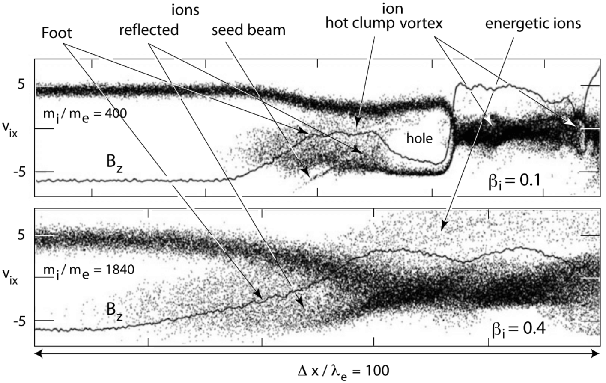{#fig-perp-shock-1d-phase}

@fig-perp-shock-1d-phase 分别显示质量比 $m_i/m_e = 400$（上）和 1840（下）时的离子相空间图。两图都只显示放大的激波足部过渡区，尺度均为 $100 d_e$。两次模拟中电子 $\beta_e = 0.2$ 保持恒定，而离子 $\beta_i$ 发生变化。对于这一近乎垂直的超临界激波，图中只显示离子速度的法向分量。两图中，磁场 $B_z$ 都以细实线绘出，显示其在空间距离 $\Delta x$ 上的磁激波剖面。

上方（低质量比）的低 $\beta_i$ 面板显示，速度为 $v_{ix} \sim 5$（以上游阿尔芬速度为单位）的冷稠密离子入射流在刚进入足部时就被减速到近乎马赫数 1。这种减速是由于它与强烈但较冷（速度空间中较窄）的反射离子束相互作用；图中从激波坡面出发的窄负 $v_{xi}$ 速度束即为反射离子束。反射离子束需要经过一定距离才能与上游等离子体入射流相互作用，这一距离是束流相互激发的波增长所需的长度。一旦相互作用足够强，反射离子除了因回旋而转向外，还会被波散射成一个热离子团。这两种效应都使反射离子的速度 vx 降低；这些离子在对流电场中加速，转而沿 y 方向流动，并在足部的这一区域产生逐渐形成的磁场隆起。有趣的是，在 $(v_x, x)$ 平面中，反射离子与上游流动在坡面正前方闭合形成热离子环分布（涡旋），其中使入射流减速的热离子团是其上游边界。在坡面后方，即离子分布的分叉点，也就是发生反射的位置，出现宽广的热离子分布；在某些位置，它显示出先前重形成周期留下的离子涡旋的雏形残迹。它们的磁场特征是磁场中可见的凹陷。可以预期，下一个重形成周期将使足部的离子涡旋完全闭合，并将坡面从当前位置移至足部位置。这一过程的第一个迹象已经出现在足部离子分布中：在高负速度处出现了一束微弱的新反射离子束。这束粒子不参与形成环，而是作为新反射粒子群的种子。

只要 $\beta_i$ 较小，大质量比模拟中也会出现相同行为。从 @fig-perp-shock-large-mi2me 中显示的大质量比磁场可以清楚看到这一点。只要 $\beta_i$ 保持较小，即使质量比取真实值，激波也会发生重形成。换言之，只要等离子体相对较冷，自然界中的真实激波就应形成足部，并在之后准周期性地变为激波坡面。

当 $\beta_i$ 增大时，情况完全改变，@fig-perp-shock-1d-phase 的下面板表明了这一点。该模拟假设真实质量比，但 $\beta_i = 0.4$，至少在可以实现的模拟时间内没有观测到重形成。相反，激波形成很长的足部区域，其向上游延伸的距离是低 $\beta_i$ 情况的两倍。显然，高离子温度使反射离子群弥散到上游束流和反射束流区域之间的整个间隙区域，因此无法形成涡旋。这意味着足部保持平滑，不会演化成坡面。

然而，考察 @fig-perp-shock-1d-phase 的面板立刻可以看出，对重形成的抑制是一个相对过程。只有离子热速度 $v_\text{th,i}$ 足够大，能够跨越反射和入射离子束之间的间隙，即足以填满空穴时，重形成才会被抑制。考虑到入射离子的法向速度只是通过镜面反射变为负值，可以半经验地建立激波重形成条件 $v_i < \alpha V_{n1}$。由于这一情况从来不会完全成立，系数大致位于 $1.5 < \alpha < 2$ 的区间。发生重形成的条件可写为
$$
M_A > \frac{\beta_i^{1/2}}{\alpha}
$$ {#eq-shock-reformation-estimate}
其中阿尔芬马赫数根据 $V_{1n}$ 定义。马赫数越大，对重形成的抑制作用就越小；在高马赫数下，预计重形成要么成为常规过程，要么出现其他含时过程，导致非平稳状态，使激波重形成成为混沌且不可预测的过程。如前所述，这很正常，因为激波在热力学和热状态上都处于非平衡状态：在这一区域，电子和离子的温度差异极大；它不处于压力平衡；上游和下游温度不同；并且包含许多集中在真实空间小体积内的非 Maxwell 相空间分布。

#### 足部和坡面区域中的离子不稳定性和离子波

从准垂直超临界激波模拟所展示的场和粒子性质可以明显看出，在激波过渡区的不同区域中，粒子分布携带自由能。这对足部区域、激波过渡区和过冲区以及下游区域都成立，对电子和离子这两类粒子也都成立。这些自由能是一系列不稳定性的来源，它们在激波过渡区的不同区域激发各种可测量的波。

这些不稳定性主要不是由温度各向异性驱动，而是由不同粒子种类的整体流动性质差异驱动。因此，我们忽略温度各向异性的差异，尽管这类不稳定性也可能出现，特别是温度各向异性可以激发离子哨声波时。在一定程度上，两束沿激波法向 x 方向反向流动的离子束的出现本身就在离子组分上模拟出一种整体温度，从而在双束流情形与温度各向异性之间建立某种联系。类似地，横向加热的反射离子叠加在垂直温度较低的入射离子背景上，会模拟出垂直温度各向异性。然而，对我们的目的而言，整体流动差异更有意思，而且事实上从一开始就得到了更深入的研究。

首先考虑足部区域。这里的自由能源是入射电子与反射离子之间以及入射电子与入射离子之间的相对漂移。反射离子的存在导致足部区域的离子整体速度下降。这意味着入射电子也被减速，使激波法向的电流为零，即流动在法向无电流。然而，其结果是电子与反射离子之间或电子与入射离子之间出现相对整体速度。这些差异会促成不稳定性的激发。本节只讨论离子不稳定性，将实际上更有趣的离子—电子不稳定性留到下一节。@tbl-instability-foot 列出了足部区域最重要的一些不稳定性。有趣的是，尽管理论上它们应当存在，实际观测和模拟中曾被识别出的却只有少数。原因可能有很多，例如增长率太小、存在热离子时 朗道阻尼太强、对流损失、由于加热效应而很快饱和、与其他波竞争或波—波相互作用等。

激波足部产生的最相关不稳定性已被确定为近乎垂直的超临界但低马赫数激波中的哨声波不稳定性。它会导致足部形成，但对足部并非决定性的，因为事实表明，在这一马赫数和激波法向角范围内，足部是由回旋离子在足部上游边缘积累而产生的。

| 不稳定性 | 激发粒子 | 自由能源 | 传播方向 |
|-------------|---------------|-----------------------|--------------------------|
| 离子—离子流动不稳定性 | 反射和透射离子 | 离子组分之间的相对流动 | $\theta_{kB} = 90^\circ$ |
| 动理学横磁场流动不稳定性 | 反射离子 | 反射离子与太阳风电子之间的相对流动 | $\theta_{kB} \in (0^\circ, 90^\circ)$ |
| 动理学横磁场流动不稳定性 | 透射离子 | 透射离子与电子之间的相对流动 | $\theta_{kB} \le 90^\circ$ |
| 低混杂漂移不稳定性 | 反射离子 | 反射离子与电子之间的相对横磁场漂移；密度梯度 | $\theta_{kB} < 90^\circ$ |
| 低混杂漂移不稳定性 | 漂移电子 | 反射离子与电子之间的相对横磁场漂移；密度梯度 | $\theta_{kB} < 90^\circ$ |
| 离子声不稳定性 | 透射离子 | 离子组分与电子之间的相对流动 | $\theta_{kB} < 90^\circ$ |
| 电子回旋漂移不稳定性 | 漂移电子 | 电子相对于太阳风离子的漂移 | $\theta_{kB} \simeq 90^\circ$ |
| 哨声波不稳定性 | 电子 | 电子热各向异性 $T_{e\perp}> T_{e\parallel}$ | $\theta_{kB} \simeq 0^\circ$ |

: 足部区域中的不稳定性 [@wu1984microinstabilities] {#tbl-instability-foot}

坡面区域的情况类似，同样并非所有这些不稳定性和波都已得到观测或模拟的证实。

#### 下游区域

在磁层等钝障碍物前方演化的脱体激波尤其具有广阔的下游区域，将障碍物与未受扰动的上游区域分开。这些区域是磁声波族中压缩波的活动范围，其指向上游的相速度和群速度大于下游流速，因此可以在流动从激波到障碍物的下游距离所需的特征时间内向上游到达激波；激波形成这些波的空间包络，从而将它们限制在激波过渡区下游。

这是激波下游区域演化的流体图景。对于弯曲的无碰撞超临界激波，很难分别区分由准垂直部分和准平行部分触发的过程。只有进一步讨论准平行激波后，我们才能全面描述下游区域。

然而，无碰撞激波不能仅用流体图景描述。因此，下游区域的行为与流体动力学描述所推断的很不相同。这对于准平行激波尤其如此，对准垂直激波也同样成立。准垂直超临界激波下游的条件也与流体图景规定的条件非常不同；流体图景对等离子体性质的基本预测包括：由于磁场和等离子体在流体磁矩（比值 $T_\perp/B$）守恒下受到压缩，流体压力各向异性增大；流动绕障碍物偏转；磁场披覆；以及靠近障碍物处出现磁场堆积区，在那里压力平衡要求等离子体变稀。

下游区域偏离这种平均层流行为的主要原因是，在超临界情况下，流体图景不包含离子（和电子）反射过程，以及它们对激波足部形成、坡面物理和激波过冲形成的影响。由于不可能依靠碰撞耗散，反射机制取代了所需的耗散。例如，对于地球的准垂直弓形激波，可以容易地估计为了适应上游与下游流动性质的差异必须耗散多少能量。对于 1 AU 处标称密度为 $n = 5\times 10^6\,\text{m}^{-3}$、速度为 $V_1 = 500\,\text{km/s}$、马赫数 $M_A = 5$、激波强度（压缩比）中等且 $B_2 / B_1 = 3$ 的上游太阳风，激波后方流动（$M_A = 1$）中的能量密度仅为太阳风能量密度的一半。因此，50% 的入射流能量必须由激波耗散。由于最多只有 10% 的离子被反射（只对应入射能量的 10%），其余 40% 通过其他方式吸收和耗散。

影响激波坡面后方区域的第一个简单效应是：反射离子在激波足部受到运动电场作用，沿激波表面、垂直于上游磁场的方向加速，达到远高于入射离子动能的能量，从而吸收入射流能量的很大一部分。将 10% 的反射离子加速 2 倍就已经产生 40% 的能量耗散。因此，这是主要耗散机制。
这些离子携带漂移电流，并在上游磁场中以高速度和大离子回旋半径回旋时，这种加速会影响准垂直激波近乎周期性的重形成。然而，经过几次这样的回旋后，它们获得足够能量突破产生反射的激波电势并克服激波势垒，进入下游流动区域。在准垂直激波下游，它们表现为一种垂直能量远大于平行能量的高能回旋离子组分。

事实上，已经观测到这些回旋高能离子 [@sckopke1983evolution]。它们是自由能源，能够激发多种不稳定性，例如电磁离子回旋波；这些波在激波下游可以增长到大振幅，并促成下游观测到的磁场涨落。甚至已有激波正后方镜像模的报道 [Czaykowska et al, 1998]。激波下游这些波的均方根振幅 $b_\text{rms} = \sqrt{|\mathbf{b}|^2} \sim B_2$ 与平均下游场 $B_2$ 相当。因此，这些波对能量平衡有贡献。此外，由于它们被对流带向下游并逐渐阻尼，它们也有助于下游等离子体加热和激波能量耗散。

较大振幅的波不会阻尼，而是衰变为其他较短振幅的波，或者通过有质动力相互作用稳定下来，形成大振幅局域磁结构、密度脉冲或狭窄电流片。这些结构的物理机制仍知之甚少。有时人们称之为下游湍流，但这一说法既未经充分限定也缺乏依据，因为湍流几乎无法在下游区域发展：它没有足够时间达到充分混合状态。这需要一个非常广阔的区域以及相对平静的边界条件，并以近乎恒定的能量水平持续流入。它还要求激波平稳，而这显然不成立，正如后面讨论平稳性问题时将看到的。激波重形成已经是一种相当非平稳的过程，使下游湍流的发展颇为可疑。

### 电子动力学

太复杂了，需要时间消化！

事实表明，Buneman 模和修正双流模比哨声波更重要：前者在垂直角度的激波中占主导，后者增长缓慢，但在更倾斜的角度和模拟后期占主导，能够完全重构激波足部和坡面。这两种不稳定性都产生相空间空穴，它们在重形成期间存活并被加入下游等离子体，同时也是磁场值较低的原因。

### 平稳性

![高度超临界激波在重形成前的含波剖面示意图，并显示波开始破裂的迹象 [@balogh2013physics]。图中显示坡面内的离子结构，包括超越离子、回流离子和离子涡旋的特征，这些都是开始破裂的迹象。](../../images/schematic_profile_perpendicular_shock.png){#fig-perp-shock-1d-schematic}

#### 波纹的形成

一维理论和一维模拟隐含地将激波视为无限延伸的平面。此外，它们只允许不稳定性沿激波法向、在相当接近 90◦ 的角度上演化，因此完全排除了沿激波表面的任何波；平行于磁场的波具有很小的波数 $k = k_x \cos\theta_{Bn} \ll k_x$，对应很长的平行波长。为了更加真实，研究者进行了二维 PIC 模拟，考察第二个空间维度带来的额外自由度的影响；这个维度允许不稳定性沿激波法向以外的方向演化。

Shinohara & Fujimoto [2010] 使用真实质量比对准垂直激波进行的三维 PIC 模拟发现，加入第三维后，激波足部区域出现非常强的波动活动。这些波产生比先前所知更强的上游电子加速，并产生非热电子。

然而，得到的结论相当简单：激波沿其表面具有结构，这可能归因于沿激波前沿传播并在时间和空间上调制它的波。至少存在三类波纹：（1）由横磁场电流不稳定性支持的短尺度（小于离子惯性长度）低混杂波（通常近乎垂直于磁场）[Lembège and Savoini, 1992]；（2）较长尺度（约一个或几个离子惯性长度）的倾斜哨声波 [@hellinger2007emission; @lembege20092d]；以及（3）更长的“阿尔芬波”波纹（几个离子惯性长度）[@winske1988magnetic; Saito and Umeda, 2011]。

## 超临界平行激波

根据 MHD 或双绝热理论，平行激波更为特殊，因为磁场强度保持不变，所以方程实际上描述的是纯气体动力学解。@kuznetsov2018parallel 给出了一个一维平行激波情形的简化解，其中包含平行和垂直热能热通量 $S_\parallel$ 和 $S_\perp$。再次注意，原始 CGL 理论假设热通量为 0。

然而，正如 @sec-switch-shocks 所指出的，这并未涵盖平行激波所涉及的真实物理过程，必须依据动理学理论处理这些过程。这类激波具有广阔的前激波区，其中电子和离子两类粒子都有极为有趣的动力学过程，从前激波区边界一直延伸到其深处。主要根据动理学模拟可知，前激波区是流动能量在流动到达激波之前很久就开始耗散的区域。这种耗散由流动与从激波逃逸到上游的反射粒子相互作用所激发的各种不稳定性引起。这些波与前激波区中反射并积累的粒子组分之间的相互作用导致波增长和陡化、激波小波及脉动形成，并导致准平行激波持续重形成；这与准垂直激波的重形成完全不同。它是维持准平行激波的主要过程；这种激波由于其本质而主要表现为局部非平稳，并且在小尺度上对电子来说接近于准垂直激波。这一过程可定义为湍流重形成，伴随热流异常、前激波气泡等瞬态现象以及电磁辐射的产生。

湍流性质意味着准平行激波过渡区没有准垂直激波过渡区那么陡峭，因此定义也不那么明确；它具有广阔的湍流前激波区，而不是激波足部。该前激波区由电子前激波区和离子前激波区组成，主要粒子群是弥散离子组分。前激波区的湍流由被反射和加速的前激波粒子群产生。准平行激波物理中的一个重要问题是激波的*重形成*，其机制与准垂直激波完全不同；这里的重形成由弥散离子组分激发的上游低频电磁波提供。这些波向激波传播时变陡，大振幅波在激波过渡区叠加，使激波前沿重新形成。旧的激波前沿被排向下游，在那里引起下游湍流。重形成过程中，激波对于离子而言在局部变为准垂直，从而支持粒子反射。

### 基本性质

在准平行激波中，上游磁场和通常弯曲的激波表面的组合几何结构使被激波反射的粒子无法立即返回激波。原因是粒子受到激波坡面反射后，其回旋轨道完全位于上游、激波坡面之外，因此反射后不会再次碰到激波坡面。此外，它们的上游速度具有较大的平行于上游磁场的分量；激波法向越趋于平行上游磁场，该分量越大。因此，反射粒子能够沿磁场从激波逃逸到上游，摆脱向后的对流并形成快速上游粒子束。

因此，准平行超临界无碰撞激波使上游空间充满反射粒子组分。这个粒子群沿磁场移动到远离激波的位置。对于准垂直激波，上游流动直到距激波仅一个激波足部宽度时才完全不知道激波的存在；而对于准平行激波，当首批速度最快的反射粒子沿连接流动与激波的磁力线到达时，流动已经在相当远的上游距离收到激波存在的第一个信号。事实上，只有这些粒子能够告知流动超临界激波的存在，因为对于超临界马赫数 $M > M_c$，任何低频等离子体波都无法传播到遥远上游，而激波处产生的任何电磁辐射的频率都为 $\omega_\text{rad} > \omega_\text{pe}$。上游流动在自己的参考系中将反射粒子识别为高速场向束流。由此形成双束流构型，并导致一系列束流驱动的不稳定性。这些不稳定性激发各种等离子体波，填充激波前方的空间并改变其性质。

@fig-parallel-shock-geometry 显示超临界准平行激波磁场剖面的示意图，可与 @fig-perp-shock-geometry 给出的准垂直激波剖面比较。准平行磁激波剖面比准垂直激波的剖面扭曲得多，以至于难以从剖面上确定真正激波坡面的位置。

{#fig-parallel-shock-geometry}

准垂直和准平行激波之间的主要结构区别是：准垂直激波具有一个与激波表面相切、宽约 $\sim 1 r_\text{ci}$ 的狭窄足部区域，而准平行激波具有广阔的前激波区。有趣的是，在例如空间有限的障碍物前方产生的弯曲激波中，超临界激波的这两种状态可以同时存在，并在空间上彼此相邻。@fig-foreshock 的弯曲地球弓形激波示意图给出了一个例子。处理准平行激波在很大程度上意味着处理前激波区中发生的过程。因此，自然应从讨论前激波区的性质开始。

然而，在继续之前需要指出，尽管准垂直和准平行激波有严格区别，二者之间也有密切联系。它们都属于超临界激波，只有通过反射离子才能存在；而且在激波过渡区前方都具有被反射离子占据的上游区域。准垂直激波中这一区域狭窄是由于离子受磁场约束，而这一点在准平行激波中也成立。在准垂直激波处，反射离子会很快返回激波。在准平行激波处，它们最终也会返回激波，但只有在远离激波的前激波区中经历处理、与流动耦合、经过这一过程的若干阶段并成为主流动的高能组分之后才会返回。作为主流动的一部分，它们最终随流动一起到达激波。在此期间，它们的主要任务是耗散首次到达激波时所具有的、无法在狭窄激波坡面过渡区中耗散的多余能量。这只能在广阔延伸的前激波区中实现；从这一角度看，前激波区已经是激波的一部分。因此，准垂直和准平行激波之间的主要物理区别是耗散过程。

### 前激波区

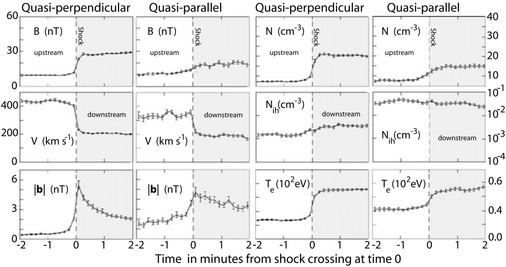{#fig-shock-parameter-comparison}

@fig-shock-parameter-comparison 一目了然地显示了 AMPTE IRM 航天器多次穿越弓形激波时测得的准垂直和准平行激波（平均）整体等离子体参数的主要差异。该图所用数据经过堆叠、平均，并相对于以穿越激波坡面时刻归一化的时间绘制。为进行这种归一化，需要使用上游速度的激波法向分量重新计算时间。对于准平行激波，这一过程不太确定，因为正如后面所见，准平行激波的坡面定义并不明确。不过，对于简单比较主要差异来说，这种不确定性不那么严重。

图中的阴影区域对应下游区域。图中成对显示准垂直／准平行情况下的磁场 B、整体速度 V、超低频波的平均涨落振幅 $|\mathbf{b}|$、等离子体密度 N、能量 >15 keV 的高能离子密度 $N_{ih}$ 和电子温度 $T_e$。从图中得到的一般结论是，准垂直情况下所有量的过渡都比准平行情况陡峭得多。此外，准垂直情况的平均值比准平行情况更加平静。总体而言，准平行情况的水平也高于准垂直情况。几乎在所有情况下，准平行激波的激波前水平都高于准垂直激波。高能离子密度最显著地体现了这一点：在准平行激波中，它在这一距离／时间尺度上几乎恒定，且远高于准垂直激波中的值；这既表明高能粒子在准平行激波动力学中的重要性，也表明准平行激波能够将粒子加速到相当高的能量。

不考虑前激波区就无法理解准平行激波的物理。前激波区是上游激波区域中被反射粒子占据的部分。对于地球弓形激波这样的弯曲激波，前激波区从激波表面上游磁场与激波法向夹角 $\theta_{Bn} \le 45^\circ$ 的位置开始。从该点起，电子和离子沿磁场向上游逃逸。由于电子的平行速度通常大于离子，它们较不容易受到自身所依附的上游磁力线对流运动的影响，因此通常在更靠近前激波区边界磁力线的地方存在一个只发现上游电子的区域。该区域大致位于标记电子前激波区边界的线和倾斜程度更大的离子前激波区边界线之间。地球弓形激波的这一几何构型示例见 @fig-foreshock。

因此，在讨论前激波区的性质时，必须区分所讨论的是哪一种前激波区。然而，电子前激波区的性质对准平行激波形成的决定性不及离子前激波区的性质。大多数时候，我们用前激波区指代离子前激波区。

离子前激波区不是均匀一致的区域。反射离子组分从离子前激波区边界向其中心演化，再从那里朝激波方向演化。只有在离子前激波区边界紧邻区域，才有意义谈论可以明确识别为反射的离子组分，即向上游流动的离子。这里的反射离子表现为快速离子束，其来源可以追溯到激波。在前激波区更深处，束流组分便无法再被识别。

#### 离子前激波区边界区域

Gosling 等 [1978] 和 Paschmann 等 [1981] 首次报告在与地球弓形激波相连的磁通管中识别出空间反射束流质子；他们根据分辨率较低的分布函数，将这些束流与前激波区更深处较为弥散的质子区分开来。有趣的是，对行星际传播激波的前激波区观测没有显示这类束流的任何迹象，只显示出弥散离子组分。
@fig-reflect-beam-shock-ISEE 给出了这样一束反射离子的观测例子，它非常靠近前激波区边界向上游传播，远离激波。整体流动是图左侧沿负 $v_x$ 方向偏移的狭窄冷束流。反射束流密度较低（计数率较低），但能量高得多。它沿 $+v_x$ 方向偏移，即流离激波，并且还有一个 $-v_y$ 分量，也就是说，它构成一团远离激波运动的回旋离子。图右侧可见，该束流沿连接到激波的磁力线远离激波运动，而等离子体的主体沿正方向流动。

{#fig-reflect-beam-shock-ISEE}

沿前激波区边界的这些束流在前激波区动力学中发挥一定作用，因为它们似乎代表整个离子前激波区的源粒子群。这是否确实如此以及为何如此尚未完全理解，因为处于准平行状态的激波几乎在每个位置都应反射离子。然而，似乎只有沿前激波区边界从激波逃逸的那一组离子才能形成这种束流。这指向弯曲激波面上准垂直激波与准平行激波之间另一种有趣联系：二者平滑过渡，如 @fig-foreshock 所示，并存在于空间中，例如行星弓形激波。看来这些束流沿近乎切向的磁力线从激波的准垂直区域逃逸。这也与以下观测一致 [Gosling et al, 1984]：广阔的行星际激波前激波区没有显示任何反射离子束的迹象。这些激波弯曲程度很小，近乎平面，其表面没有可识别的准垂直区域。

@kucharek2004origin 分析了沿连接到地球弓形激波准垂直区域的磁力线的离子分布。通过研究这些束流的起源，他们发现前激波区边界观测到的离子束确实来自准垂直激波处的反射；如果不存在准垂直区域，大概就不会有明显的前激波区边界，也不会有逃逸进入前激波区的离子束。如果情况确实如此，准平行离子前激波区中的粒子群实际上来自两个不同的离子源：准垂直激波区域的束流和真正的前激波区离子群。后者不具有束流特征，而是弥散离子组分［另见 Meziane 等，2004］。行星际激波只有后者。

大约 2% 的入射离子沿磁场以束流形式离开激波坡面进入上游。[^ratio-reflect-ion] @kucharek2004origin 认为，沿磁场逃逸的离子从坡面／过冲区反射，在那里它们与低频等离子体波共振；作者假设这些波是大振幅阿尔芬—哨声波。这些离子经历俯仰角散射和向小俯仰角的俯仰角扩散，随后可以沿磁场向上游逃逸。由于逃逸条件首先取决于俯仰角散射过程，束流应当随时间和位置高度变化。在模拟证明其真实性之前，这一机制仍可能听起来有些推测性，但任何能够在准垂直激波中使离子沿磁场发生俯仰角散射的机制，都会自然导致离子束从坡面向上游和下游两个方向逃逸。这类模拟需要三维处理，目前尚无法实现。[^chance]

[^ratio-reflect-ion]: 根据我们的一维模拟，反射比例约为 1%。我认为研究其原因会很有意思，能量角度是一个好的起点。

[^chance]: 我们的机会可能已经到来了！

@fig-reflect-beam-shock-dist 显示了一个离子前激波区边界场向离子束分布的实测例子 [@kis2004multi]；观测位置在地球弓形激波上游，上游流速为 $V_1 \simeq 660\,\text{km}\,\text{s}^{-1}$，马赫数为 $M_A = 8$，平均激波法向角为 $\theta_{Bn} \simeq 15^\circ$。这一分布是所谓的约化分布；它是对俯仰角 $\phi$ 和垂直速度 $v_\perp$ 积分并经过适当分箱和平滑的磁场方向相空间分布函数 $f(v_\parallel) \sim 2\pi \int v_\perp^2 \mathrm{d}v_\perp f(v_\perp, v_\parallel)$。该图所传达的信息是，约化离子束分布（实线）在速度上很窄，其峰值速度（绝对值为 $|V_{b\parallel}| \simeq 800\,\text{km/s}$）仅略大于平行流速（考虑激波法向角后，$V_{1\parallel} \simeq 640\,\text{km/s}$），即 $|V_{b\parallel}| \simeq 1.25V_{1\parallel}$。其方向与流动相反。作为比较，同图还显示了取自前激波区更深处的约化平行弥散离子分布。
该分布大致关于磁场方向对称，表明弥散离子组分的相空间分布大致呈圆形，并表现为主离子分布上的高能尾（注意，虚线弥散离子分布曲线左侧的小间隙值得怀疑，因为它低于 1 次计数水平）。

@meziane2004bow 报告了 CLUSTER 同时观测前激波区边界离子束和弥散离子的结果。他们发现标称离子束速度 $V_b \simeq 1.7V_1$ 与镜面反射等任何已知的激波反射机制都无关；这一结论支持俯仰角散射作为束流注入过程，因为该过程不依赖入射流速度。[^doubts]

[^doubts]: 我对此有很大疑问。根据我的理解，作者在这个案例研究中支持镜面反射！

{#fig-reflect-beam-shock-dist}

@kis2004multi 仔细分析了上游航天器位置处观测到的离子分布与计算得到的激波法向角 $\theta_{Bn}$ 之间的关系；该角度由局地上游磁场方向和预测的弓形激波形状确定。@fig-reflect-beam-shock-location 给出了 2003 年 2 月 18 日 CLUSTER 航天器位于弓形激波外部时三个连续时刻的结果。在 1130 UT 和 1355 UT，激波法向角 $\theta_{Bn} \sim 15^\circ$ 和激波—航天器距离分别约为 $\sim 7.5$ 和 $\sim 6.7\,\text{R}_\text{E}$，二者相近。尽管如此，观测到的离子相空间分布却完全不同。在 1130 UT 没有观测到低能回旋离子，而在稍后的 1355 UT 它们存在。因此，在 1130 UT 航天器必定更靠近离子前激波区边界，即前激波区边界比稍后时刻更加倾斜，使得从前激波区边界散射的束流粒子尚未到达航天器位置。由于速度过滤效应，它们在航天器所在距离处被分离出来。利用这一时段测得的上游条件和激波形状重建的离子前激波区边界位置如 @fig-reflect-beam-shock-location 所示。确实，在 1220 UT 航天器靠近前激波区边界，并如预期探测到离子束（见 @fig-reflect-beam-shock-dist）。

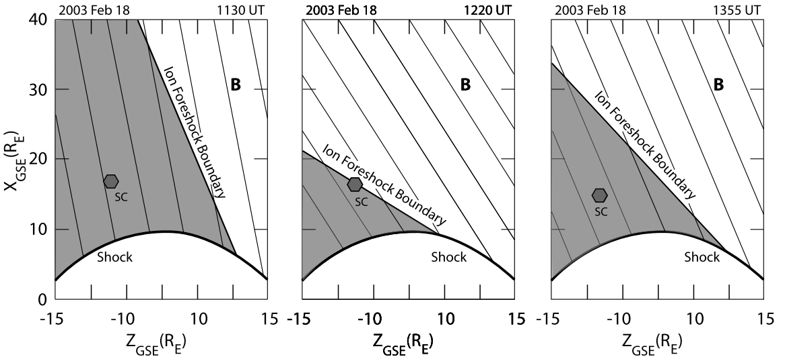{#fig-reflect-beam-shock-location}

这一观测支持上述观点：离子前激波区束流产生于从准垂直到准平行激波的过渡区。仍需回答的问题是：

* 哪种俯仰角散射机制负责产生这种束流？

* 前激波区边界束流离子沿边界传播期间的命运是什么？

* 它们是否对前激波区离子群有贡献？如果有，以何种方式？

目前我们还无法明确回答这些问题中的任何一个。尤其是，俯仰角散射机制未知，至少也是不确定的。在讨论波的产生时，我们将涉及束流命运的问题。下面给出束流离子被散射并并入上游前激波区弥散离子群的证据。

#### 弥散离子

沿上游磁场方向的反射离子束只在前激波区边界被观测到。前激波区中遇到的第二种、也是主要的离子组分是弥散离子群，在那里它表现为入射等离子体的高能延伸部分。由于没有其他可用的高能粒子源，人们普遍假设这一组分也起源于激波。然而，对地球弓形激波前激波区弥散离子组分的仔细研究表明，这些离子并非通过激波处的镜面反射过程产生，而是具有扩散性质的来源。

到目前为止，虽然已经提出一些模型，但仍无法确定这些离子的来源；下面我们将结合前激波波动的出现简要讨论这些模型。这些粒子也与激波粒子加速有关。这里我们只讨论它们的一些性质，并提供证据表明它们确实来自激波，从而证明激波是高能离子源。

前激波区边界离子束也会在边界处受到自身产生的波谱散射，随后被整体流动对流带向下游，从而并入前激波区粒子分布。Paschmann 等 [1981] 通过追踪 @fig-reflect-beam-shock-ISEE 所示前激波区边界束流分布在对流期间的演化，描绘了这一合并过程。在该图中，束流是在前激波区边界附近探测到的。@fig-parallel-shock-diffuse-ion1 显示了它在前激波区更深处的形态：其角度已显著展宽，演化成半个环形分布。在前激波区更深处，反射离子分布呈现环绕整体分布的完整环形，如 @fig-parallel-shock-diffuse-ion2 所示。

::: {layout-nrow=2}

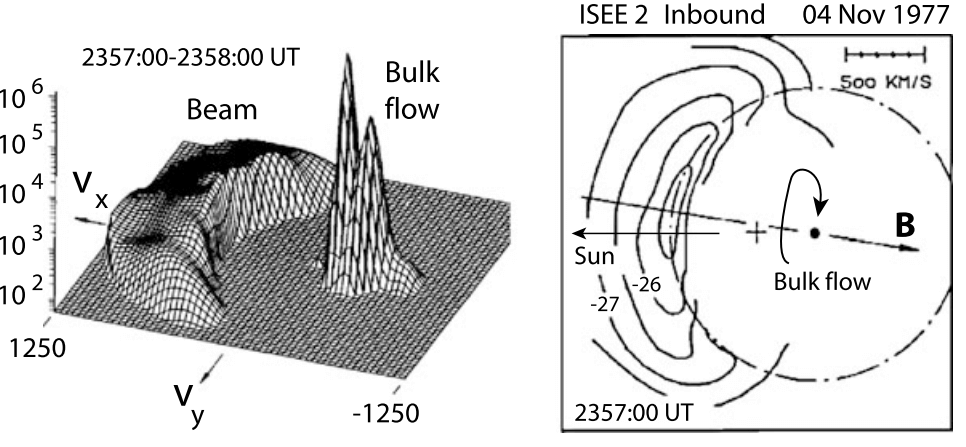{#fig-parallel-shock-diffuse-ion1}

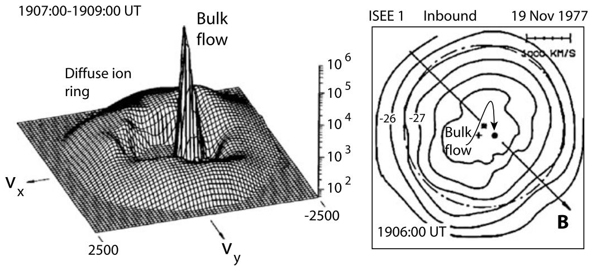{#fig-parallel-shock-diffuse-ion2}

ISEE 2 和 1 于 1977 年 11 月 4 日观测到的离子前激波区边界离子束在被对流带向下游进入前激波区、并远离离子前激波区边界传播到前激波区深处时的演化。速度单位为 $\text{km}\,\text{s}^{-1}$。右侧标尺是计数率，通过只选取高于 $50\,\text{s}^{-1}$ 的值抑制背景计数率。图中还显示磁场方向，并标出了 $10^{-26}$ 和 $10^{-27}\,\text{s}^3\,\text{cm}^{-6}$ 水平的通量等值线。［数据来自 Paschmann 等，1981］
:::

图 6.4、6.8 和 6.9 中描绘的三次观测来自不同时刻；不过已经确认，它们对应的距离逐渐远离前激波区边界，因此尽管未经直接证明，关于束流在对流过程中演化的假设仍有充分依据（或至少是合理的）。[^foreshock-vlasiator-sim] 有趣的是，原始离子相空间束流分布与整体流动分布之间仍有间隙，这是演化中的分布属于离子前激波区束流演化过程的另一个迹象。对于不是从束流演化而来的分布，预计其行为较不规则，而且通常在速度空间中整体流动与束流之间不会有如此明显的间隙。事实上，前激波区中的主要高能离子组分是不规则的，也没有明显的间隙。

[^foreshock-vlasiator-sim]: Yann 使用混合 Vlasov 模型 Vlasiator 证明了这一点。

平滑、无间隙的前激波区分布 [Sentman et al, 1981a] 与有间隙的观测 [Paschmann et al 1981] 之间的差异实际上很早就被注意到 [Sanderson et al, 1981; Scholer, 1985]；当时没有给出解释，但提出平行激波处存在连续离子源。下面我们将为两个来源——前激波区边界束流和连续延伸的激波面源——的假说提供进一步论据。尽管如此，这一结论必须谨慎看待，因为 @fig-parallel-shock-diffuse-ion2 显示间隙逐渐闭合。在足够远的位置，即比图中更远离离子前激波区边界时，将无法再区分由束流演化而来的分布和真正的扩散离子分布。最终，两种分布将合并得无法区分。两类粒子群是否合并、在哪里合并，即距离子前激波区边界多远处发生合并，目前仍无一致意见。[^distribution-evolution]

[^distribution-evolution]: 这是我们可以用新模拟检验的问题！

Trattner 等 [1994] 利用 AMPTE IRM 对准平行弓形激波上游弥散离子密度的测量发现，弥散离子密度随距激波的距离_指数下降_。@kis2004multi 利用四艘 CLUSTER 航天器尝试推断上游弥散高能离子的来源，大幅改进了这一研究。作者确定了 10–32 keV 能量范围内弥散离子平行密度梯度随距弓形激波距离的变化，如 @fig-diffuse-ion-gradient 所示。从该图可知，在前激波区深处，即远离离子前激波区边界的位置，弥散离子组分在靠近激波处密度最高，沿磁场向上游远离激波时密度随距离增加呈指数衰减。弥散离子部分密度的这一空间衰减 $N_i(\mathcal{E}, z) \sim \exp[-z / L(\mathcal{E})]$ 对不同能量 $\mathcal{E}$ 的粒子有所不同。e 倍衰减距离 $L(\mathcal{E}) \sim \mathcal{E}$ 随能量线性增大，即低能粒子被限制在激波附近。离子能量越高，它们就能越深入地穿入上游等离子体。在地球弓形激波的特殊条件下，从这些数据确定的比例常数为 $\sim 0.14 \text{R}_\text{E}/\text{keV}$。高能前激波离子的这一行为为弥散离子组分起源于广阔的平行激波面提供了无可争辩的证据。弥散离子的源位于准平行激波处。为了出现在激波上游一定距离处，离子会沿磁场经历扩散过程。因此，这些离子与离子前激波区边界发现的束流离子完全不同。

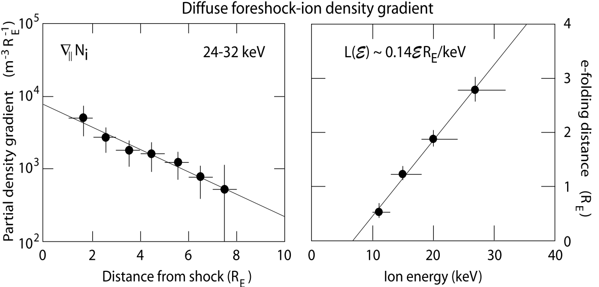{#fig-diffuse-ion-gradient}

弥散离子的 e 倍衰减距离为 $L(\mathcal{E}) = \kappa_\parallel(\mathcal{E})/V_1$，空间扩散系数为 $\kappa(\mathcal{E}) = \frac{1}{3}v l_\parallel(\mathcal{E})$，其中 $l_\parallel$ 是扩散长度（平行离子平均自由程），$v$ 是粒子速度[^diffusion-unit]。根据对流入射与向上游扩散之间的平衡，可以写出 $l_\parallel(\mathcal{E}) = 3L(\mathcal{E})\sqrt{\mathcal{E}_1/\mathcal{E}} \sim \sqrt{\mathcal{E}/\mathcal{E}_1}$，其中 $\mathcal{E}$ 是粒子能量，$\mathcal{E}_1$ 是上游流动能量。太阳风中的流动能量为几个 keV，20 keV 弥散离子的典型平行扩散长度（或平均自由程）为 $l_\parallel \sim (1−2)\text{R}_\text{E}$。这一距离相当短，比离子的碰撞平均自由程短好几个数量级。因此，扩散估计表明，强波粒相互作用可能负责弥散粒子组分的散射和加速，使其能够从激波向上游扩散和逃逸并充满前激波区。扩散过程依赖能量，能量最高的离子扩散最快。

[^diffusion-unit]: 扩散系数具有正确的量纲 $\text{m}^2\text{s}^{-1}$。

这些相互作用应发生在准平行激波过渡区，因为正如上文所示，弥散上游离子密度在最靠近激波处达到最大值。估计相应的上游离子碰撞频率 $\nu_\text{c,ui}\simeq \nu/l_\parallel$ 很有意思。对于 20 keV 上游离子，得到 $\nu_\text{c,ui} \sim 0.2\text{Hz}$。这个值与观测期间 $B\simeq 8\,\text{nT}$ 坡面磁场中的离子回旋频率 $\omega_\text{ci}/2\pi = (0.1−0.3)\,\text{Hz}$ 相当 [@kis2004multi]。

看来，与离子回旋频率有关的电磁波和／或静电波参与了上游离子扩散过程。由于这种扩散依赖能量，它不是像产生沿前激波区边界传播的离子束时那样的简单俯仰角扩散。弥散离子组分在此过程中必定经历了显著加速，这种加速位于激波过渡区或其附近，与离子束加速形成对比：后者是散射过程，之后伴随拾取加速，即向上游传播的束流离子受到主整体流动对流电场作用，在垂直于磁场的方向上被加速到约为整体流动能量四倍的能量，从而演化为表征其相空间分布的环形分布。

### 上游低频波

在上游整体流动参考系中，充满离子前激波区的两种离子组分携带大量需要耗散的自由能。由于这种耗散是无碰撞的，它只能通过准平行超临界激波上游的不稳定性激发波和波动湍流来进行。另一方面，显然，如果不完全了解前激波区中的波及其与粒子的相互作用，就无法理解这两种组分中任何一种的存在。

自 Olson 等 [1969]、Russell 等 [1971]、Fairfield [1974] 以及 Fairfield & Feldman [1975] 首次探测到激波上游波以来，对它们的观测一直是长期研究课题。Tidman & Northrop [1968] 预言了它们的存在，随后出现了有关无碰撞准平行超临界激波上游电磁波激发和传播的 MHD 理论 [Barnes, 1970] 和动理学理论 [Hasegawa, 1972]。Wu [1972] 提出，这些波可能发展成分立波包，正如 Russell 等 [1971] 从观测中推断的那样。ISEE 1–3 航天器使更深入地研究上游波的性质成为可能。近年来，CLUSTER 测量被用于研究上游波和波动湍流的时空结构。波的产生与粒子能量损失和粒子散射相耦合，二者都在粒子加速中发挥重要作用。我们首先回顾离子束和弥散离子区域中上游波的观测性质，并讨论它们的产生机制。

[Burgess 1997] 按频率整理并综述了观测到的波。他区分了低频波（5 mHz 至几百 Hz）和高频波（>1 kHz）；后者包括从离子声波到电子等离子体波的静电波以及辐射。辐射的产生将在后面详细讨论。这里仅指出，离子声频带中的波几乎持续存在；自 Rodriguez & Gurnett [1975] 以来，人们已知这些波遍布整个前激波区。这些频谱可能由多种不同模式组成，包括离子声模、电子声模、Buneman 模、电子回旋谐波等。其产生机制尚不清楚。它们可能通过多种不同不稳定性，由同样进入离子前激波区的热前激波区电子组分产生，或者由来自准平行激波、尚未分辨出的狭窄电子小束流激发。它们也可能由等离子体非均匀性、电子分布的空间非均匀性激发，或者是预期发生在前激波区中的非线性波—波相互作用的结果。自 Burgess 的评论以来，我们对这些高频波仍知之甚少。[^high-frequency-simulation]

[^high-frequency-simulation]: 从模拟角度看，捕捉这些高频波也很困难。目前能达到的最好水平约为 10 Hz。

然而，人们在理解低频波及其在准平行激波动力学中的作用方面取得了显著进展。对激波形成最重要的波在 <0.1 Hz 的超低频范围传播。它们通常具有较大的（磁）波振幅，约为 $|\mathbf{b}|/B \sim 0.2−1.0$，表明它们高度非线性。Russell 等 [1971] 已观测到这些大振幅波具有从单色波到孤波的各种波形，常具有类似激波小波的陡峭边缘，说明这些波在演化和传播期间经历了非线性陡化。它们有时显示出与这些边缘相连的典型涨落特征，并显然以哨声模传播。因此，这些形态确实是类似小激波的结构。

在同一频率窗口中，人们识别出大振幅脉动，它们是准平行激波的典型特征。Schwartz & Burgess [1991] 和 Schwartz 等 [1992] 在 AMPTE 磁场测量中识别出这些脉动，并将其命名为 SLAMS，即_短尺度大振幅磁结构_。它们也称为上游脉动，持续时间为 10–20 s；其振幅确实很大，$|\mathbf{b}|/B \sim 5$，但表现为嵌入超低频波动湍流中的较相干结构。与超低频波一样，它们在等离子体静止参考系中向上游传播，同时被对流流动扫向激波。它们具有混合偏振，可能略以左旋偏振（在等离子体静止参考系中）为主，暗示其起源于超低频（ULF）波。有时上游脉动两侧的偏振不同，表明它们由某种产生两种偏振的过程演化而来，这与孤波类似。

SLAMS 的传播速度表现出有趣的振幅依赖性。指向上游的脉动速度随振幅增大，这也是类似孤波的性质。此外，它们在接近激波并进入弥散离子密度梯度增大的区域时会增长，并在激波重形成中发挥重要作用。Schwartz 等 [1992] 推测，这些脉动是准平行激波的基本组成单元。

另一个有趣的性质是，SLAMS 包含具有上游流动性质的热等离子体，同时被高温前激波区等离子体包围。因此可以认为其源区位于离子前激波区边界。它们在边界处通过离子—离子束流等离子体相互作用产生后，可能非线性增长，直到形成捕获了上游等离子体、近乎平衡的孤立结构，随后被对流带向激波，进入离子前激波区的核心。

#### 离子束波

两种不同的上游离子粒子群各自负责激发相应的不稳定性。本节只讨论由前激波区边界离子束激发的波。@fig-reflect-beam-shock-dist 表明，这是一种离子—离子束流相互作用（暂时忽略回旋相位聚集的弥散离子组分）。在上游流动参考系中，反射的前激波区边界离子束沿磁场向上游传播，平行速度为 $v_{b\parallel}\simeq -(2−3)V_{1\parallel}$，其中 $V_{1\parallel}\simeq 600\,\text{km}\,\text{s}^{-1}$。上游离子温度（以能量为单位）为 $T_i \simeq (1−2)\,\text{keV}$，由此得到离子热速度 $V_\text{i,th}\simeq 200\,\text{km}\,\text{s}^{-1}$。该束流可视为温束流，热速度满足 $v_\text{b,th} \le v_{b\parallel}$。因此，$v_{b\parallel}> V_\text{i,th}$，且背景离子和束流离子都已磁化。另一方面，电子是热的，$T_e \simeq 100\,\text{eV}$。[^hot-e]

[^hot-e]: 当 $T_e$ 远小于离子温度时，为什么说电子是热的？这种比较是基于速度吗？

**预期的波模** 理论上，当 $p_\parallel > p_\perp$ 时，我们预期束流可以通过消防水管不稳定性激发长波长负螺度阿尔芬波。此外，由于离子束具有一定温度，它可以激发共振左旋离子—离子束流不稳定性；当 $v_{b\parallel} > V_A\sim 100\,\text{km}\,\text{s}^{-1}$ 时，这种不稳定性可能发生。当束流热速度可以认为较小时，它可能激发右旋共振离子—离子束流模。两种模式都在上游流动背景上与束流一起沿磁场向上游传播。然而，它们没有束流那么快，因此会随流动向下游、朝激波方向对流。相反，消防水管模逆束流运动，因此一旦被激发，它本身便向下游、朝激波位置运动。与等离子体色散关系的联系在 @sec-mhd-CPDR 中讨论。

在上述三种情况下，前激波区边界束流都会激发低频阿尔芬波和离子回旋波；这些波的源位于前激波区边界磁力线上，但在激波参考系中向激波靠近。在这一朝向激波的对流和／或传播过程中，它们使前激波区充满低频电磁涨落，这些涨落可能进一步与弥散前激波离子组分相互作用。另一方面，由于这些波的相速度和群速度 $\omega/k_\parallel$ $\sim$ $(\partial\omega/\partial k_\parallel)$ $\sim$ $V_A\ll v_{b\parallel}$ 的量级为阿尔芬速度，因而远小于束流和流动速度，向下游的对流会迅速将它们带离前激波区边界源区。因此，它们在前激波区的进一步演化取决于非线性波陡化与同弥散前激波离子组分相互作用之间的竞争；如下文所示，后者最为重要。

将电子纳入考虑（目前仍忽略电子前激波区组分）后，得到一种对离子声波不稳定的相空间构型。在上游离子等离子体参考系中，相对稠密的前激波区边界离子束在冷离子—热电子等离子体中向上游传播。为了使等离子体保持无电流状态，电子组分略微减速，从而创造了能够激发离子声波的条件。另一方面，该构型既不能激发 Buneman 双流不稳定性，也不能激发修正双流不稳定性，因为束流仅平行于磁场传播。这如 @fig-parallel-shock-unstable-dist 所示。离子前激波区边界离子束 $F_\text{ib}(v_\parallel)$ 与略向左偏移的热（$T_e \sim 100\,\text{eV}$）电子分布之间的速度差激发了不稳定性，因为离子束与电子组分之间的速度差 $\Delta V$ 满足 $v_\text{e,th} > \Delta V$ $\sim$ $10^3\,\text{km}\,\text{s}^{-1}> c_\text{ia}$ $\sim 100\,\text{km}\text{s}^{-1}$，即它超过离子声速，同时小于电子热速度 $v_\text{e,th}$。这些离子声波占据相对宽的频谱，具有 $<v_\text{ib}$ 的向下游平行相速度，并被扫向激波。由于它们很快离开前激波区边界，而且束流不是热的，源区中的离子 朗道阻尼不起作用。然而，当这些波进入弥散离子前激波区时，会遇到热弥散离子组分并与之相互作用，从而经历（正和负）朗道阻尼。

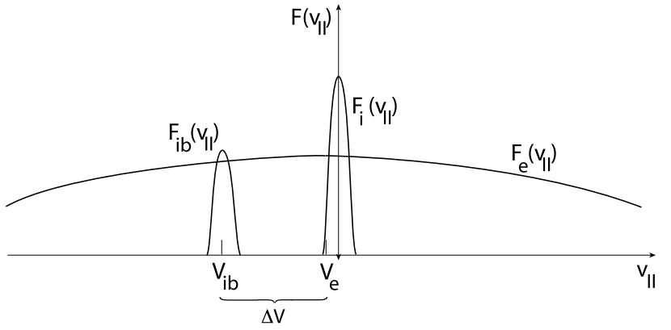{#fig-parallel-shock-unstable-dist}

**观测** 在观测中，很难区分前激波区边界波和弥散离子产生的波。已有报告指出弓形激波附近存在两类可能与上游束流有关的波。Fairfield [1974] 和 Fairfield & Feldman [1975] 发现频率范围为 $\omega/2\pi ∼ 0.4\,\text{Hz}$ 的单色大振幅分立波包；Hoppe & Russell [1980] 表明，它们是在等离子体静止参考系中传播、频率为 $\omega \simeq 10\omega_\text{ci}$ 的右旋偏振哨声波，无法逃逸到遥远上游。另一类波的振幅较小，$|b|/B \sim 0.1$，频率量级为 $\omega/2\pi \sim 1\,\text{Hz}$。这些波形成直接与上游前激波区边界离子束相关的波列 [Hoppe et al, 1982]。事实上，正如 Hoppe 等 [1982] 所证明的，它们只在观测到 2−5 keV 反射前激波区边界离子束 [Eastman et al, 1981] 时出现；@kis2007scattering 表明，该束流会演化成回旋粒子组分，在前激波区深处叠加于弥散离子组分之上，然后与之合并。然而，正如 Feldman 等 [1983] 通过测量电子分布函数所表明的，激发这些哨声波的并不是离子束。它们由前激波区中特定电子分布驱动的可能性更高。

观测到的波相对于磁场倾斜传播（$<60^\circ$），平均角度为 $\sim 45^\circ$。观测频谱和根据测量确定的色散关系显示在图 6.12 的高频部分。该图合并了 Hoppe 等 [1982] 的高频观测和 Le & Russell [1992] 的低频观测，二者均来自 ISEE 航天器测量。通过测量波前到达 ISEE 1 和 ISEE 2 两艘航天器的时间差，初步确定高频波的波数，得到（令人惊讶地）短于 100 km 的波长。知道波数后，通过逆多普勒频移 $\omega=\omega_\text{ISEE} - \mathbf{k}\cdot\mathbf{V}_1$ 将频率转换到等离子体参考系，得到异常高的频率 $\omega \sim (20−100)\omega_\text{ci}$。这一过程确定了色散关系（自然具有误差棒所示的大误差），发现它在等离子体静止参考系中波的狭窄高频范围内近似线性。在航天器参考系中左旋偏振的波，在等离子体静止参考系中变为右旋偏振。

![左：ISEE 航天器测得的由离子前激波区边界离子束激发的磁涨落功率谱密度组合图，中心频率约为 1 Hz［下部，数据来自 Hoppe 等，1982］和 <0.1 Hz［左上部，数据来自 Le & Russell，1992］。该频谱在 ISEE 航天器参考系中得到。低频谱显示三个不同时刻，对应从前激波区内部向边界的距离逐渐增大（由下至上）。它比高频波强约五个数量级。值得注意的是，Hoppe 等 [1982] 的高频谱向低频延伸，在与 Le & Russell [1992] 频谱重叠处没有显示低频峰的任何迹象。如细直线所示，它会平滑延伸到 0.01 Hz 处的 1930 UT 分支。低频峰的缺失很可能是偶然的，由测量时的特殊条件造成。右：根据相关波数的初步估计确定并转换到等离子体静止参考系中的约 1 Hz 高频哨声模波色散关系。可以看出，在观测范围内，这些波具有近似线性色散和频率 $\omega \sim (20−100)\omega_\text{ci}$，远高于离子回旋频率 $\omega_\text{ci}$［数据来自 Hoppe 等，1982］。](../../images/foreshock_wave_PSD_ISEE.png){#fig-parallel-shock-wave-ISEE}

根据这些性质，最初得出的结论是，这些波在哨声波分支上传播，并由冷离子—离子束流不稳定性激发，这与我们最初的讨论一致。然而，这一结论值得怀疑。利用实际观测到的束流性质进行的模型计算 [Sentman et al, 1981a; Gary, 1993] 与静止参考系中的高频率不符。对于离子—离子束流模和消防水管模，这些计算都给出量级为 $\omega \sim 0.1\omega_\text{ci}$ 的波频率。事实上，@eastwood2005quasi 报告了 CLUSTER 对类似波的观测，但频率低得多，$\omega/\omega_\text{ci} \sim 0.1$，波长量级为 $\sim1\,\text{R}_\text{E} \sim 6000\,\text{km}$，与理论预测非常一致。按照 @gary1993theory 和 Krauss-Varban 等 [1994] 的术语，这些波是由冷离子束激发的快动理学（磁声）哨声波。约 1 Hz 的高频哨声波则很可能由前激波区的特定电子分布驱动 [Feldman et al, 1983]，而不是由冷离子束不稳定性驱动。另一个支持这一说法的事实是：在离子前激波区更深处，电子分布变得更各向同性，这些波不会脱离较小磁场结构（SLAMS 或激波小波）而单独出现。

Le & Russell [1992] 分析的 ISEE 前激波波与 CLUSTER 测量相当一致：他们发现频率 $\omega \sim 10^{-2}\,\text{Hz}$ 处的谱峰，且频谱随距离子前激波区边界距离增加而展宽。这显示在 @fig-parallel-shock-wave-ISEE 频谱的左上部分，图中合并了 Hoppe 等 [1982] 和 Le & Russell [1992] 的测量。尽管两次观测时的条件并不相同，可以发现 Hoppe 等 [1982] 识别出的高频哨声波出现在 Le & Russell [1992] 最靠近离子前激波区边界的 1930–2030 UT 频谱的大致高频延伸处。然而注意，Hoppe 等 [1982] 频谱的低频部分（这里没有直接显示，只在图中用细直线表示）较平坦，在与 Le & Russell [1992] 频谱的相对较短重叠区域中没有显示磁声前激波区边界波的迹象，这必然是由于该观测时段的特殊条件。因此，Hoppe 等 [1982] 的波是一种不同于这些更常见的低频／长波长快磁声波的高频波。后者的谱密度也高得多（约 5 个数量级），如 @fig-parallel-shock-wave-ISEE 所示，后来的 CLUSTER 测量也证实了这一点。此外，这些磁声波在等离子体参考系中为左旋偏振，@fig-foreshock-n-B-cluster 所示密度与磁场涨落的同相变化证明了它们具有压缩性快磁声波的性质。

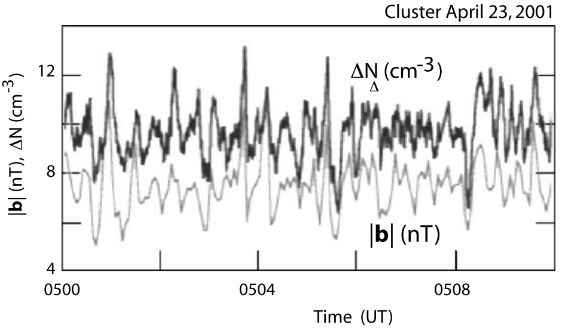{#fig-foreshock-n-B-cluster}

这些由低频离子束产生的波的存在意味着离子束与涨落电磁场相互作用。在此过程中，离子束在相空间中受到散射和扩散，这就是离子束在相空间中展宽并最终并入弥散背景分布的原因。@kis2007scattering 追踪了上述束流演化，它也导致 @fig-parallel-shock-wave-ISEE 左上部频谱逐渐展宽。@kis2007scattering 的论文中可找到类似的频谱。Archer 等 [2005] 根据 CLUSTER 观测推断了这些超低频（ULF）波的性质，并表明其沿波矢方向 k 的相关长度量级为 1−3$\text{R}_\text{E}$，而垂直于 $\mathbf{k}$ 的方向上可大三倍，使这些波虽然近乎平面却呈扁平形。

在热束流出现期间，Eastwood 等 [2003] 观测到向上游传播的左旋低频波，它们在动理学色散关系的阿尔芬—离子回旋分支上被激发。这些波是动理学阿尔芬波，由类似 @fig-reflect-beam-shock-dist 右侧所示的向上游传播的热束流激发。在航天器参考系中，由于这些波被流动扫向下游，它们表现为右旋波。Eastwood 等 [2003] 报告说，随着波出现，束流变得更加弥散。这既可解释为波对束流的反作用，也可解释为航天器进入了这样的区域：最初的冷束流进入前激波区、在速度上展宽，并在变得足够热后产生观测到的波。

截至 2024 年，关于反射离子束演化和上游波产生的现有模拟研究仍然很值得关注！

#### 弥散离子波

周期约为 30 s 的长周期波在前激波区很常见。它们与位于前激波区更深处的弥散前激波离子组分同时出现［例如参见 Sanderson 等，1983；Mellott，1986］。因此，由弥散离子组分激发的任何波都局限于前激波区内部。人们甚至为这些波定义了一个模糊边界，称为 ULF 波边界 [Russell & Hoppe, 1983; Greenstadt & Baum, 1986]，它相对于上游磁场比离子前激波区边界更加倾斜，在其外侧 ULF 波活动应当很弱。原因是，如果 ULF 波向上游传播，其最大传播速度为快磁声速度；对于超临界激波，这一速度小于流速，也小于反射离子束速度。流动平流会将它们向下游吹向激波，并将它们限制在相对靠近激波的区域，其上游边界即 ULF 边界。

{#fig-foreshock-wave-dispersion-obs}

@fig-foreshock-wave-dispersion-obs 给出了根据 CLUSTER 三维观测得到的前激波区低频波色散关系。图左侧显示等离子体静止参考系中的色散关系以及波相对于局地平均上游磁场的传播角。散布相当大。尽管如此，令人惊讶的是，虽然色散关系由几种具有不同偏振的不同模式共同构成，仍能在其中找到一个明显的近线性部分。图采用线性表示，在 k 轴上突出显示短波长（较大的 k 值）。根据线性理论，预期长波长（小 k）应当更加明显。不幸的是，使用当时可用的 CLUSTER 航天器间距无法充分分辨这一区域。这些低频波在等离子体参考系中似乎近乎垂直于磁场传播，因此可能处于快磁声模。此外，直线形束流色散关系似乎对垂直传播的波有所贡献。低频（磁声）波似乎具有负频率（即沿相反方向传播）。根据观测期间参数得到的线性色散理论给出图右侧曲线，显示在波数 $kV_A/\omega_\text{ci} < 0.3$ 时，可能的束流模与四种等离子体模之间的耦合。实验确定的色散关系类似于小 k 和极低频率 ω 处这种耦合的聚集。然而，应用线性理论即使不是值得怀疑，也十分危险，因为前激波区等离子体受到强烈扰动，低频波振幅相当大，几乎不能视为线性波。此外，等离子体高度不均匀，密度和磁场具有陡峭梯度。对于阿尔芬速度 $V_A \simeq 30\,\text{km}\,\text{s}^{-1}$ 和离子回旋频率 $\omega/2\pi \simeq 1\,\text{Hz}$，线性波耦合附近的波长量级为 $k/2\pi \simeq 100\,\text{km}$，因此应受到等离子体非均匀性的影响（注意，降低参考回旋频率会使波长进一步减小）。尽管如此，在极低频和极长波长处，这些波可能属于快磁声波频带。

更神秘的是频率更高、波长更短的波。与线性色散关系比较，它们似乎符合右旋哨声波分支（高频磁声哨声波 $R^+$）。然而，考察色散关系发现，各种偏振都散布在色散曲线上。曲线本身很不规则，尽管波的传播角似乎在略微倾斜的角度附近大致恒定。这种波的组合表明，我们处理的并非单一波模，而更可能是湍流频谱的短波长部分；从长波长到短波长的正向级联产生了各种短波长涨落，其偏振不同且近乎随机分布。Narita 等 [2006] 更详细地研究了这一想法，发现较短波长的频谱确实大致没有明显特征并呈幂律，接近平稳湍流的 $-5/3$ Kolmogorov 谱，且大部分功率位于垂直（不可压缩）磁分量中，为阿尔芬性和磁声湍流提供了又一个论据。这显示在 @fig-foreshock-b-spectra-distribution 左侧。图中还标出了相应的回旋和惯性波数 $k_\text{ci} = v_i/\omega_\text{ci}$ 和 $k_\text{in} = c/\omega_\text{pi}$。有迹象表明，由于反常离子黏性和离子惯性开始发挥作用，频谱在这些数值附近改变斜率。垂直功率曲线在 $k \sim 10^{-3}\,\text{km}^{-1}$ 附近的大峰值对应此前报道的波长 $\lambda \sim 6000\,\text{km}$［例如 Eastwood 等，2003］，位置恰好适合低频不稳定性注入能量。

{#fig-foreshock-b-spectra-distribution}

然而，认为前激波区深处存在充分发展的快磁声／阿尔芬性湍流，这一结论绝非完全有依据。考察 @fig-foreshock-b-spectra-distribution 右侧给出的场涨落概率分布，便可明显看出这一点。如果涨落服从正态分布，其分布函数应具有虚线曲线的形状。相反，实际分布偏斜并具有尾部。对于平行分量，分布缺乏对称性。这种尾部可能表明湍流是非平稳、间歇或不均匀的。这三种情况都可能在前激波区成立，特别是因为前激波区是一个空间范围相当有限、两侧有边界并受到等离子体注入和损失影响的区域。尽管如此，所确定的频谱包含强非线性和湍流相互作用的迹象，而且这些波，特别是低频波，具有大振幅，并与等离子体离子组分以及其他波相互作用。这些波通过散射、加热和加速影响上游回流离子组分。另一方面，上游离子组分是波存在的原因，因为它是波的最终能量来源。为了完成这一循环，这些波无法从前激波区逃逸到很远的上游，因为在超临界激波中，流动马赫数高于任何基于波速的马赫数，足以使流动将波谱平流带向激波。只要这些波在对流期间没有完全耗散其能量，电磁波能量就会积累在它们到达激波的位置。

这种积累的结果是，波影响激波、引起激波表面不稳定并重新组织激波前沿。这使准平行激波本质上是非平稳的（有时也称为湍流的），并经历某种不规则重形成。因此可以预期，超临界准平行激波在大面积上并不表现为一个完整的激波面。它由或疏或密的区域“拼块”组成，这些区域共同形成激波，但也以不规则方式出现和消失、来来去去，并在一定体积内组织激波；在该体积中熵增加，但也发生大量极难处理的过程，只能通过实验或借助适当设计的数值模拟研究。

离子前激波区动力学研究中尚未涉及的一个重要问题是前激波区电子组分的作用。在广阔的离子前激波区内，它由两个粒子群组成：属于准中性上游流动的约 100 eV 上游电子群，以及由激波反射电子形成的温度约为数 keV 的热电子群，我们将在下一节讨论后者。该组分各向同性但不规则，可能促成离子前激波区不稳定性，从而影响前激波区湍流和激波形成。

### 电子前激波区

尽管离子前激波区占据前激波区的大部分，更重要的是在准平行超临界激波动力学中发挥决定性作用，但如果不提及除主流动外仅由反射的较高能电子组分占据的部分，即电子前激波区，就未免有所忽略。@fig-foreshock 示意了它的范围及其与离子前激波区的关系。Scarf 等 [1971] 已在 OGO 5 卫星观测中识别出电子前激波区。他们注意到弓形激波附近出现增强的电子通量，并与 30 kHz 高频电场尖峰的观测相关。他们认为，这些尖峰来自电子束激发的 Langmuir 波；电子束沿与激波相连的磁力线从弓形激波到达。[^early] 后来证实，这些电子通量沿磁场方向，且能量高于主流动中的整体电子。这被解释为从激波向上游发射的电子束，尽管当时尚无已知机制能够提供所需的激波电子加速／反射；事实上，Sonnerup [1969] 已提出 de Hoffman-Teller 参考系中的激波反射机制，Wu [1984] 很久之后又针对电子重新提出并详细发展了这一机制。

[^early]: Klimas [1985] 对早期观测进行了详细综述。

#### 电子束

类似于离子前激波区边界，电子前激波区边界（前激波区最远的上游边界）上存在短促的窄电子束爆发。这些电子束沿磁场从激波向上游逃逸，并被对流流动略微向下游偏移。

@fig-foreshock-e-dist 左侧显示了 IMP-8 卫星测得的这类束流窄能谱的一个例子。航天器只在电子前激波区边界停留了相对较短的时间。由于接近远地点，航天器几乎静止。因此，与束流的短接触时间很可能表明电子前激波区边界相当狭窄，或电子束聚集成电子爆发。电子束也只占据速度空间中的很小体积，对应分布上的一个窄凸起 [Anderson et al, 1981]。在电子前激波区内仅深入一个高能电子回旋半径，电子束就会减弱，仅在流动的电子分布函数上形成热晕电子的高能尾。

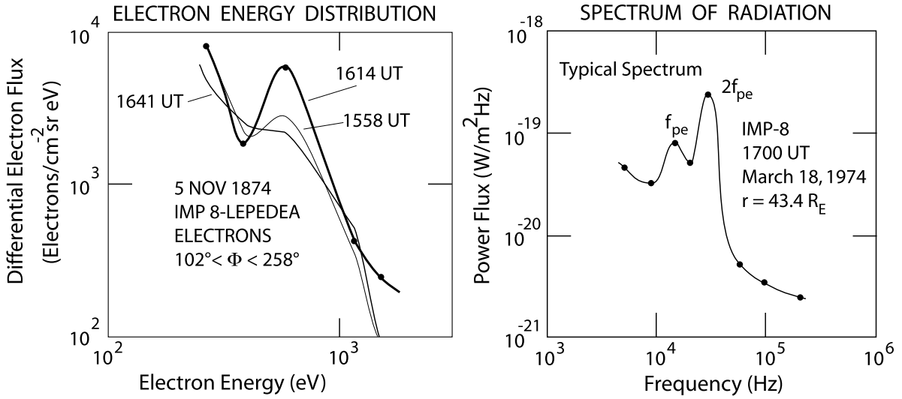{#fig-foreshock-e-dist}

@fig-foreshock-e-dist-ISEE 显示了 ISEE 1 和 2 上的电子仪器穿越电子前激波区边界时的电子相空间观测。图左侧［取自 Fitzenreiter 等，1984］的时间和速度（或能量）分辨率远高于前图。可以清楚地看到，电子分布在接触前激波区边界前是沿磁场方向的近 Maxwell 分布，接触时变为类似场向束流的分布，随后演化为沿磁场具有高能尾的分布，电子束已完全被抹平。这一转变发生在 15 s 内，刚好允许获得三次测量。右侧电子分布函数的伪三维图是在另一天航天器穿越电子前激波区边界时得到的，当时记录了一系列从上游、穿越边界直至进入电子前激波区的分布。这里仅显示狭窄电子束已经形成并沿磁场向上游、背离激波方向流动时的边界分布。注意束流的角度范围狭窄、强度较弱以及速度相对较大，因此可以在约 100 eV 热背景电子主体的外侧识别出它；背景电子比束流热得多（束流在 $v_\parallel$ 方向上的宽度很小说明了这一点）。

{#fig-foreshock-e-dist-ISEE}

从这些观测中可以得出以下结论，后来 AMPTE IRM 和 AMPTE UKS 等其他航天器的测量也证实了这一结论：类似于离子前激波区，电子前激波区由沿近乎与激波相切的上游磁力线（或磁通管）的一个很窄区域组成，该区域中有冷、弱且快速的电子束；与此磁通管相邻的下游还有一个广阔的电子区域，其电子分布具有尾部，此外还包含一个高温、相当各向同性的电子组分。电子束（与离子前激波区边界的离子束一样）起源于连接到激波准垂直部分、近乎与激波相切的磁力线附近。其产生机制尚未明确阐明。推测它由 Sonnerup [1969] 的 de Hoffman-Teller 参考系机制、激波表面弯曲，以及激波过渡区、坡面和过冲区中形成的电场中的某种随机加速共同组成。近期确有报告指出，在小于电子趋肤深度 $d_e = c/\omega_\text{pe}$ 的尺度上，这类电场非常大，平行和垂直于磁场方向的量级为 $\le 100\,\text{mV}\,\text{m}^{-1}$ [Bale & Mozer, 2007]。另一方面，前激波区中热电子组分的存在并非由于这一反射机制，而需要另一种机制在准平行激波表面的大片区域加热和加速电子。

**Langmuir 波**

所谓“温和电子束”正是在电子前激波区边界观测到的束流：快速但不过快（$V_b$ 为 $V_1$ 的几倍）、平行（$V_b \equiv V_b, V_{b\perp} = 0$）、弱（$N_b \ll N_e$）且冷（$v_{eb} < v_e \ll V_b$）。已知它们通过共振动理学温和电子束不稳定性驱动色散关系为
$$
\omega^2(\mathbf{k}) = \omega_\text{pe}^2 + 3 v_e^2 k^2,\quad v_\text{res} > \sqrt{3}v_e
$$
的 Langmuir 波。Langmuir 共振条件为 $ω − \mathbf{k}\cdot\mathbf{v}_\text{res} = 0$，其中 $\mathbf{v}_\text{res} \sim \mathbf{v}_b$ 是共振电子速度。将其与色散关系结合，容易看出，为使波数 k 为实数，共振速度必须满足上式右侧的条件。

**电子前激波区边界波**

@fig-foreshock-wave-e-obs 取自 Décréau 等 [2001]，根据四艘 CLUSTER 航天器上的 WHISPER 等离子体波仪器记录的 CLUSTER 等离子体波谱，展示了 CLUSTER 四星于 2000 年 12 月 22 日两次穿越地球弓形激波的精彩观测。@fig-foreshock-boundary-wave-e-obs 给出了这些高分辨率测量的一个例子。

{#fig-foreshock-wave-e-obs}

CLUSTER 从磁层出发，进入激波下游区域，穿过激波到达上游，再次进入激波，然后再次逃逸到下游。四艘航天器都可看到每个区域的相关特征。最上方浅蓝色轨迹是电子等离子体频率 $f_\text{pe} = \omega_\text{pe}/2\pi$，反映局地等离子体密度。激波表现为强烈的宽带发射，其最大强度位于低频波中。在密度上，它表现为 $f_\text{pe}$ 急剧下降至低的上游密度值。激波附近可以识别出多个 $f_\text{pe}$ 增强区域。它们发生在接触电子前激波区边界、强 Langmuir 模等离子体波被激发时。有趣的是，这些增强以斑点形式出现，且不一定是窄带的。它们可能超过 $f_\text{pe}$，也可能降到其下方：等离子体频率可能长出“头发”或“胡须”。此外，有时在等离子体频率和前激波区低频发射之间的中间位置探测到强烈的较低频发射。其中最强的发射属于更靠近激波、密度梯度尚未稳定到上游值的区域；但相同类型的较弱发射也出现在更远处的上游低密度区域。

{#fig-foreshock-boundary-wave-e-obs}

观测到的等离子体频率处强斑点，其“头发”部分超过局地 fpe、“胡须”部分向下垂落，强烈暗示它们与从激波发出、沿电子前激波区边界磁场向上游传播的场向电子束有关，因为它们具有与 ISEE 和 AMPTE 航天器观测相同的特征，只是这里的频率分辨率和灵敏度高得多。考虑到远离激波的上游等离子体频率相当恒定，这意味着激波法向角 $\theta_{Bn}$ 在不规则且快速的时间尺度上变化，即即使上游介质看起来平静，上游磁场方向也高度可变。由此得出的结论_不_应是上游磁场发生剧烈变化，因为在电子前激波区没有理由认为磁场受到强烈影响。相反，这种可变性指向切向磁力线附近激波区域的时间变化。那里的激波法向即使发生微小变化，也会使距激波一定上游距离处切向磁通管的位置发生很大变化。主要原因是超临界激波既不处于热平衡，也不处于热力学平衡，因此其所有物理参数本质上都会变化。

#### 辐射

激波经常被称为辐射源。著名例子包括超新星激波，它们几乎在所有波长上都可见，从无线电波、可见光直到 X 射线［例如 Dickel & Wang，2004］；以及其主要辐射特征出现在无线电波段的太阳 II 型激波。

超新星激波是相对论性激波，这里不予讨论。它们的马赫数范围从弱相对论性到高度相对论性，但其中每个粒子的能量仍低于电子静止能 $m_e c^2 = 0.511\,\text{MeV}$，因此可以经典地处理。对于驱动流动的超新星中心引擎，这一点不再成立；在某些情况下它会产生超相对论性喷流。那里的激波变为非经典激波，描述时不仅必须考虑辐射损失，还必须考虑粒子产生。

激波发射辐射的理论基于等离子体过程；在激波和前激波区等离子体中占主导的无碰撞条件下，波—波耦合是主要产生机制。粒子直接发射并不重要，因为粒子在激波处被减速或反射时经历的能量损失不会转化为辐射。在所有非相对论性情况下，与所有其他能量损失相比，辐射损失完全可以忽略。尽管如此，观测到的辐射仍然值得关注，因为在许多无法进行原位测量的情况下，从远处观察时，辐射是激波留下的唯一直接且可能可识别的特征。另一个特征是高能粒子的产生，我们将在后面讨论；但高能粒子是更为弥散的激波指标，因为其传播容易受到其他粒子、障碍物，首先是磁场的散射影响。

### 准平行激波重形成

在准平行超临界激波中，激波上游区域与激波本身之间的区别不像准垂直激波那样严格。由于前激波区中存在反射和弥散粒子组分，前激波区与激波本身不能分开考虑。这些粒子是大量波的来源。

这些波与激波的相互作用是准平行激波物理的主要问题之一。本节讨论从数值模拟推断出的准平行激波形成、行为和结构时，这一点将变得清楚；这些认识更多来自模拟，而不是观测。原因是实际空间观测无法将粒子和波与激波分离。它们同时出现、相互关联，而且永远无法在初始状态下被观测到。尽管如此，我们偶尔仍会提到一些观测，它们给人的印象是大振幅嘈杂涨落。

#### 低马赫数准平行激波

通常假设低马赫数激波是稳定的，即没有显著的时间变化或重形成。但为什么一般应当如此，并不完全清楚。

1. Kennel 等 [1985] 已表明，当激波法向角很小、$\theta_{Bn}\to 0$ 时，临界马赫数会变小；在这种情况下，即使低马赫数准平行激波也应变为超临界并反射离子。
2. 在激波中被加热、平行速度满足 $v_\parallel > V_1$ 的任何快速离子原则上都可以沿磁场从准平行激波逃逸到上游，并应出现在前激波区，在那里促成波的产生。

因此，即使马赫数较低，从稳定性和波产生的角度研究准平行激波的状态也是有意义的。此外，在激波坡面或过渡区产生、$\mathbf{k}$ 指向上游且平行相速度或群速度足够快的任何波，也可能从激波向上游逃逸。特别是，这可能恰恰在低马赫数准平行激波中发生。

为了检验这种可能性，Omidi 等 [1990] 进行了一维混合模拟，发现最初准平行激波由相位驻立的色散性（磁声）哨声波构成，最后一个哨声波周期构成激波坡面。正如预期，这些锁相磁声哨声波的波矢沿激波法向排列。在较晚时刻，沿上游磁场回流的离子在激波上游激发长波长哨声波包。在一维模拟中，波矢被限制在激波法向，而理论已知沿磁场方向的增长率最大。因此，这些倾斜哨声波应出现在二维模拟中，并且在上游相速度足够大时可能在更远距离处可见。

Scholer & Fujimoto [1993] 对马赫数 MA = 2.2、角度 $\theta_{Bn} = 20^\circ, 30^\circ, 45^\circ$，以及 Dubouloz & Scholer [1995] 对角度 $\theta_{Bn} = 30^\circ$、高马赫数 MA = 5 的情形，进行了采用无惯性电子流体的此类二维混合模拟（@fig-foreshock-2d-hybrid）。较低马赫数模拟显示存在大量回流离子，它们在上游区域引起离子—离子不稳定性。然而，波的激发和性质强烈依赖于激波法向角。最初，如 Omidi 等 [1990] 的情况一样，出现锁相短波长哨声波；在较晚时刻，它们被上游长波长哨声波取代，这些波的相速度指向激波坡面、振幅朝坡面增长，但群速度指向上游，即激波向上游辐射能量。正如直观预期，超临界激波必须排出多余的流入能量，它既可以通过反射粒子，也可以通过向上游发射波来实现。这些波由回流离子组分通过强非线性相互作用过程激发，因为形成的陡峭离子密度梯度与哨声波波长处于同一尺度。$\mathbf{k}$ 矢量转离磁场，其平行于 $\mathbf{B}$ 和平行于激波法向 $\hat{n}$ 的分量大小相当。对于小 $\theta_{Bn}$，初始锁相哨声波的残余仍然存在，但在 $\theta_{Bn} = 30^\circ$ 时消失。靠近激波、回流离子密度高的地方，波长较短，且 $\mathbf{k}$ 几乎平行于 $\hat{n}$。在高马赫数模拟中没有产生激波，而是人为注入与入射流具有相同马赫数但温度高得多（$v_i = 14.1V_A$）的反射离子，形成空间均匀的离子束。目的是研究热反射离子的影响。这显示在上图右侧。结果与通过墙面反射产生激波的前一种情况相似，但由于马赫数较高，注入束流情形中的效应更强。因此，负责波动力学和激波动力学的是热反射离子组分。[^hybrid-setup]

[^hybrid-setup]: 我认为这些反射墙设置不够真实！

![上游波演化的二维混合模拟。左列：低马赫数 MA = 2.2 准平行激波中的上游波［据 Scholer & Fujimoto，1993］。标称激波位于 (y,z) 平面。逃向上游的离子产生倾斜的上游磁声波。图示两个以上游磁场归一化的磁涨落分量等值线取自相对早期的 $t\omega_{ci} = 68$。图中显示相对于激波沿 x 方向倾斜的近乎平面磁波前，其沿 z 的波长约为 $\sim 10c/\omega_{pi}$，而沿 x 的波长短得多。在激波附近，波前转向更平行于激波，并产生与 $|b_z|$ 同量级的非共面磁分量 $|b_y|$。此外，尽管激波马赫数较低，它并非完全稳定，而是在 z 方向显示出由反射上游粒子和上游波产生的结构。在某些位置不可能识别单一激波坡面。右列：准平行超临界激波前方巨大磁脉动（SLAMS）演化的二维混合模拟［据 Dubouloz & Scholer］。上：模拟平面，显示时间 $t\omega_{ci} = 45$、激波法向角 $\theta_{Bn} = 30^\circ$ 时（归一化）磁涨落场 $|b|$ 的结构。增长的波前在激波过渡区积累、振幅增大并转向平行于激波，可以从以白色显示的两个波前及其 $\mathbf{k}$ 矢量的旋转清楚看到。远离激波过渡区时，$\mathbf{k}$ 与激波法向 $\hat{n}$ 的夹角很大；靠近激波时，两个矢量近乎平行。磁场位于波前内，因此此处 $\theta_{Bn}$ 接近 $90^\circ$。下：脉动振幅和离子相空间。涨落接近激波并构成激波时演化为大振幅脉动。在激波法向速度分量中可以看到上游流动被脉动强烈减速。在混合模拟中，这种减速伴随一定的离子加热。](../../images/2d_hybrid_foreshock_waves.png){#fig-foreshock-2d-hybrid}

这些情况都可以从模拟中前激波区这些波的二维强度等值线看出；图 6.26 绘制的是激波演化中相对早期的时刻。该图右侧给出几何构型，磁涨落矢量 $\mathbf{b}$ 位于 (y,z) 平面。左侧下面板显示 (x,z) 平面中 $b_z$ 涨落的等值线。此时标称激波坡面位于 $x \approx 145 d_i$。上面板以相同方式显示非共面分量 $b_y$ 的等值线。激波后方的涨落不规则且无序。然而，激波前方可见清晰的波结构，其波前高度倾斜，沿 z 方向即平行于标称激波表面的波长约为 $\sim 10 d_i$。沿 x 的波长约短三倍。

这些波在 $b_z$、$b_y$ 两个分量中都可见：远离激波时振幅较低，接近激波时两个分量同时达到很大振幅，同时波前弯曲并在 z 方向形成结构，不同于远处规则的细长形态。这种波前变形可能由激波附近残余哨声波引起，但它意味着激波在 x 和 z 两个方向的表面上都有结构，不再像最初假设的那样平坦。激波在激波切向波长尺度上局部弯曲。这些波使激波变形，此外，由于其振幅本身与激波坡面相同，它们越来越难与激波本身区分。_可以说，激波是下游方向上最后一个大振幅磁波脉动，而激波磁场不再共面_，因为这些波贡献了一个指向共面平面之外的显著分量。

我们强调这句话，是因为它表达了低频上游磁波在准平行激波物理中的重要性。在准垂直激波中，反射回旋离子与反射离子激发的修正双流不稳定性共同负责激波动力学及各种类型和阶段的激波重形成；与此相反，准平行激波重形成及其大部分物理主要归因于大振幅、空间分立的上游波的存在。这些波产生激波，并且由于它们的存在，激波改变了性质。激波随时间和沿激波表面的位置高度变化，并且在靠近激波过渡区的较小尺度上“较不准平行”（或更加垂直，即在上游波尺度上激波法向角 $\theta_{Bn}$ 增大）。后者是由于上游波具有共面平面外分量。这个结论在全粒子模拟中基本仍然有效。Greenstadt 等 [1993] 根据 ISEE 1 和 2 对上游超低频波组分演化的观测，早已提出这一点。

![二维混合模拟中激波法向角 $\theta_{Bn}$ 随距激波距离的演化，分别对应两个初始准平行激波法向角 $\theta_{Bn0} = 2^\circ$ 和 $\theta_{Bn0} = 20^\circ$ [Scholer & Fujimoto, 1993]。$45^\circ$ 处的水平线是准垂直和准平行激波法向角的分界。在两种情况下，$\theta_{bn}$ 都从准平行方向演化为准垂直方向。阴影区域标示准垂直区域。](../../images/evolution_shock_normal_angle_quasi_parallel.png){#fig-shock-normal-angle-evolution}

Scholer & Fujimoto [1993] 和 Dubouloz & Scholer [1995] 在其他混合模拟中研究了激波法向角随距激波距离的演化，展示了 ΘBn 的逐渐变化。@fig-shock-normal-angle-evolution 显示了我们在此提前介绍的二维混合模拟，初始激波法向角分别为 $\theta_{Bn0} = 2^\circ$ 和 $\theta_{Bn0} = 20^\circ$。在两种情况下，ΘBn 都从准平行角度演化为准垂直角度，定性上差别很小。在激波坡面处，$\theta_{Bn}$ 深入准垂直激波区域。唯一的区别是，对于近乎平行的情况，角度在接近激波坡面之前突然跃变到准垂直，而对于初始 $\theta_{Bn}$ 较大的情况，演化更加平缓。然而，两种情况下演化都不平滑，这是由于存在大振幅前激波波。最初近乎平行的情况在标称激波坡面处转变为准垂直，而最初准平行的情况则在距激波约 $100 d_i$ 的上游位置发生转变。这个距离足够远，上游流动离子能够感受到激波法向的变化。

注意，这种转变发生在离子尺度上，意味着在靠近激波的区域，离子有时会将激波感受为准垂直（由于 $\theta_{Bn}$ 的大幅涨落），而最终到达激波时也会如此。因此，这里的电子是否也会看到准垂直激波并不清楚（不过无法从这些混合模拟中得出结论）。Feldman 等 [1983] 在激波处对电子分布函数的 ISEE 测量没有显示准垂直和准平行激波之间的差异。这一事实进一步表明，在靠近激波过渡区时，准平行激波在电子尺度上也像准垂直激波一样表现，正如我们所主张的。

最后指出，激波法向角的行为可以相当明确地识别准平行情况下激波过渡区的位置，如 @fig-shock-normal-angle-evolution 中阴影所示。可以注意到三个区别：

1. 初始激波法向角较大时，向准垂直角度的转变发生得更早，即比近乎平行激波发生在更远的上游。这是因为此时大振幅上游波的作用更强；

2. 初始激波法向角较大时，准垂直激波过渡区比近乎平行激波宽得多，即在下游区域主要的准平行磁场方向重新占据主导之前，它向下游延伸得更远；

3. 初始激波法向角为 $20^\circ$ 时，这一区域宽约 $\sim 150d_i$，意味着准平行激波后方的磁场方向在从激波坡面算起相当长的下游距离内仍保持准垂直。对于近乎平行的激波，这一体积的宽度只有约 $\sim 50d_i$。

这一观测必然对准平行激波下游的物理具有有趣的含义。例如，应用于地球弓形激波，其中 $d_i \sim 10^3\,\text{km}$，两个距离都对应宽度大于 $> 5\text{R}_\text{E}$ 量级的区域，超过了磁鞘的标称宽度！因此，在弓形激波后方，相当一部分磁鞘等离子体的行为应当如同弓形激波完全是准垂直激波一样。

#### 湍流重形成

谈到湍流重形成，我们想到的是：准平行超临界激波基本上是由相当宽的波谱介导的、从较低熵等离子体状态到另一较高熵等离子体状态的过渡。@schwartz1991parallel 根据前激波区大振幅磁脉动（SLAMS）的探测提出了这种过渡。

@fig-parallel-shock-reformation 左侧显示了这一模型：假设在上游前激波区的某处激发了磁脉动，它们被对流流动带向下游的激波，振幅和数量不断增大，在激波过渡区积累，从而形成在空间和时间上高度可变的、从激波上游到下游的过渡。这一论证的重要线索是观测到脉动首先在接近激波时振幅增大，其次速度减慢。这种减速实际上是随着振幅增大，它们在等离子体参考系中指向上游的速度增加，以至于其速度几乎抵消流动向下游的对流。

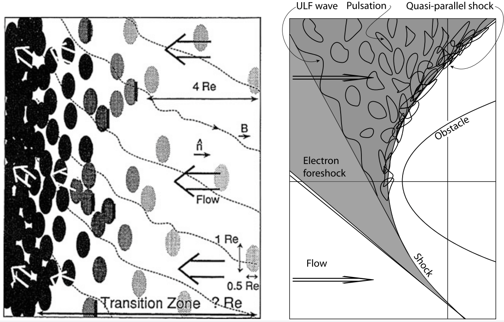{#fig-parallel-shock-reformation}

图右侧受 @kis2007scattering 的观测启发，显示更大范围。这里的脉动是增长中的 ULF 波的结果，这些波产生于前激波区内部但相对靠近离子前激波区边界的体积中。它们增长到大振幅，直至演化成被流动带向激波的脉动。随后，增长、减速和积累导致脉动在激波位置堆积，形成湍流激波结构。右图只绘出了与激波相切的上游磁力线。左图示意了几条磁力线，显示由背景 ULF 涨落施加的波动。此外，图中还包含磁力线在接近激波过渡区时的一定弯曲：越接近激波，磁力线越趋向垂直。这种弯曲就是我们所说的平行激波在非常靠近激波的尺度上转为准垂直。然而，在这个示意图中，磁场并没有理由如此转向。更仔细的观测和模拟表明，磁场转向是大振幅磁脉动存在的结果。下文将使这一点更加清楚。

**观测**

当然，@fig-parallel-shock-reformation 所示只是一个示意模型，但它在解释观测方面有一定价值。准平行激波的磁场特征确实与准垂直激波相当不同。准平行激波的磁场特征相当宽带：激波前沿没有明确位置，而是包含一个广阔区域，其中磁场大小和方向都具有极大振幅的压缩振荡；后来人们将其识别为一次准平行激波穿越。

@fig-parallel-shock-B-obs 显示了 CLUSTER 航天器测得的一个例子。该图显示 CLUSTER 在准平行激波紧邻区域的八小时观测。很难说激波过渡区位于图中的哪里，因为磁场大小和方向的大幅涨落掩盖了数据中包含的多次往返穿越激波。显然，在开始时约 1400 UT，航天器位于下游区域。涨落表明，几乎在整个序列中磁场都表现出压缩涨落，它们属于激波过渡区。同时还观测到磁场方向的大幅涨落。磁场压缩中也埋藏着上游脉动（SLAMS），而许多方向变化属于激波处及附近存在的 ULF 波。方向变化表明，激波的行为不像静止的平面；相反，它具有结构，局地激波法向方向高度波动。

![CLUSTER 在准平行超临界弓形激波（阿尔芬马赫数 $M_A \sim 12−13$，离子惯性长度 $d_i \sim 140\,\text{km}$）附近并穿越该激波的长时间过程中取得的八小时磁场数据。时间分辨率为 $4\,\text{s}$。上方面板显示磁场大小的变化。下面两个面板分别是 GSE 坐标系中的仰角和方位角 θ、φ [@lucek2002cluster]。可以看到，与这次准平行激波穿越相关的磁压缩和方向变化很大。在这一高度时间压缩的尺度上，许多磁脉动（SLAMS）埋藏于这些大幅变化之中。上方面板中的大振幅压缩涨落是准平行激波过渡区的典型特征。](../../images/B_obs_parallel_shock_Cluster.png){#fig-parallel-shock-B-obs}

@lucek2002cluster 通过确定局地激波法向角 $\theta_{Bn}$，并将其与位于更远上游流动中的 ACE 航天器磁场测量所估计的预测值比较，检验了这一预期。有趣的结果是，在所检查的准平行激波穿越时间段内，预测的激波法向角约为 $20-30^\circ$，符合对准平行激波的预期。然而，该值只是实际测得激波法向角的下限。测得的 $\theta_{Bn}$ 在大得多的数值附近强烈波动，并且有接近 $90^\circ$ 的趋势。这强化了以下主张：准平行激波在局部小尺度上非常接近垂直激波，这一性质来自围绕它们的大磁波。事实上，我们甚至可以说，在局部小尺度（$\sim\mathcal{O}(d_i)$）上，准平行激波是准垂直的。

数据表明，准平行激波确实由不断重新组织和重形成激波的上游波堆积而成。@fig-parallel-shock-SLAMS-obs 显示了三种有代表性的上游波例子，它们远非连续波列。上方面板取自激波过渡区的大密度涨落区域。事实表明，这一区域由许多嵌入其中、振幅极大的磁脉动（SLAMS）组成。在本例中振幅达到 $|\mathbf{b}| \sim 25\,\text{nT}$。这些脉动具有陡峭侧翼和相当不规则的形状，在其足部或肩部上还出现可能以哨声模传播的较高频振荡。最有趣的是，间距小于 1000 km 的不同 CLUSTER 航天器并未观测到某一脉动的一致图像。这意味着激波中脉动的尺度短于航天器间距：不同航天器分别观测到不同结构，即不同脉动。此外，不同航天器测得的磁场方向（图中未显示）非常不同，因此不同脉动之间也不同；即使同一个脉动，其前缘和后缘观测到的磁场方向也不同。跨脉动的磁法向方向在很短的空间尺度上变化。
因此，准平行激波前沿具有相当不规则的形状，会局部弯曲，其法向方向不断变化。

第二个面板显示距激波过渡区更远的一个孤立脉动。四艘不同 CLUSTER 航天器观测到的这一脉动一致性高得多。它似乎仍在演化，因为三艘航天器看到近乎一致的结构，而更远的第四艘看到的是不同状态。从这一事件推断，孤立脉动似乎具有更大的尺寸和更低的振幅，这与假设的脉动孤立波性质一致。第三个面板显示一个激波小波，即可能与脉动共同点很少的结构。它嵌入长波长 ULF 波列，演化出陡峭前沿，并驱动附着在该前沿、横跨流动传播的哨声波。这些波早已由 Russell 等 [1971] 观测到。它们的性质确实类似于逆流传播的亚临界小激波，但速度较慢，因此实际上被缓慢对流带向激波。AMPTE IRM 对等离子体波谱的观测显示在图 6.31 中，大振幅 SLAMS 脉动表现为类似狭窄激波结构的宽带波特征。

![CLUSTER 于 2001 年 2 月 2 日在准平行激波附近和远处对磁脉动（SLAMS）的磁场测量 [@lucek2002cluster]。图中只显示四艘 CLUSTER 航天器的磁场大小，以颜色区分。航天器间距从几百千米到 1000 km。上：激波过渡区中成簇的脉动，显示三个大振幅事件。这些结构非常不规则，具有陡峭前沿。注意，尽管航天器间距很小，不同航天器测得的结构形状差异很大。此外，对脉动前沿及其法向的确定（未显示）表明，在航天器间距尺度上变化很大。因此，这些结构尺度相对较小、振幅较大。中：压缩区域外、距离激波较远处的孤立脉动。航天器几乎同时看到这些结构，因此其尺寸必定更大。与嵌入的脉动相比，它们振幅较低、结构更规则。下：ULF 波区域中脉动区外观测到的一个激波小波。陡峭的类激波前沿及其携带的附着哨声波十分明显。注意其振幅远低于脉动。](../../images/SLAMS_obs_Cluster.png){#fig-parallel-shock-SLAMS-obs}

Behlke 等 [2003] 给出了激波过渡区中磁脉动的另一个有趣性质；这些脉动在此重叠形成准平行激波。跨 SLAMS 电势的测量发现，当从上游向下游穿过脉动时，存在数百伏的显著单极电势降，对应一个电势坡面。这种电势降表明跨脉动存在一个单方向电场。取脉动平均尺寸约为 1000 km，平均电场为 $\left<E\right> \simeq 400\text{mV}\,\text{m}^{-1}$。然而，该场主要在脉动前缘下降。这种场可能对应脉动中陡峭的压力梯度。[^unipolar-E]

[^unipolar-E]: 它也可能由反常碰撞频率产生（但可能性不大）。这仍有待进一步观测和数据分析检验。

Behlke 等 [2003] 的测量先于 Bale & Mozer [2007] 后来关于激波中强电场的报告。除了这一观测，人们还发现 [Behlke et al, 2004]，单个脉动中存在相当多的高频／德拜尺度电场结构，可在 WHISPER 记录（下面板）中看到；它们属于在脉动梯度区域形成的电子空穴或孤子，如图 6.32 所示。该图显示了跨一个实际上非常对称的孤子的双极电场和单极电势。这些观测表明，脉动确实是准平行激波的主要组成部分，准平行激波微观尺度上的动力学主要发生在构成激波过渡区的单个脉动中。

![准平行激波过渡区中大磁脉动（SLAMS）内电场结构的观测 [Behlke et al, 2003, 2004]。显示了三个不同时间尺度上的结构，也对应三个不同空间尺度。上：CLUSTER 穿越激波过渡区中的一个中等偏大振幅磁脉动。（平滑后的）磁场结构是一个略微变陡的磁隆起。跨这一结构的稳态平行电势场显示一个电势坡面，在脉动前缘具有陡峭梯度。约 400 V 的电势降对应电场 $\sim 0.47\,\text{V}\,\text{m}^{-1}$。注意该面板的时间尺度为 90 s。左下：CLUSTER 穿越激波过渡区的六秒数据。黑点显示航天器电势变化，反映局地密度变化；其上叠加了 WHISPER 测得的等离子体频率高频轨迹。在磁脉动区域（白色），等离子体频率向两侧出现巨大偏移，类似于波观测中的偏移。这些偏移反映 BGK（非对称）模和（对称）孤子。右下：2 ms 时间尺度上一个孤子的例子。可以清楚看到，孤波结构中平行电势槽及相应的双极平行电场形状非常对称。](../../images/SLAMS_E_obs_Cluster.png){#fig-parallel-shock-SLAMS-E-obs}

准平行激波过渡区中出现这些强非线性静电电子等离子体波令人感兴趣。它迫使人们从这些观测中得出另一个非常重要的主要结论：准平行激波是将电子加速成电子束的源，这些电子束能够沿磁场向上游运动一定距离，并激发强度足以进入非线性区的电子等离子体波，形成孤子和电子空穴（BGK 模）。只有准平行激波在电子尺度上也呈准垂直时，这才有可能。

事实上，电子反射形成能够产生 Langmuir 波的束流，大概只有在超临界准平行激波过渡区中磁场在电子尺度 $\sim d_e$ 上从准平行变为准垂直时才可能发生。上文已多次指出离子尺度 $d_i$ 上这种变化的迹象，但在与准平行激波过渡相关的电子等离子体波中探测到孤立结构，为这种变化在远小于离子尺度上也成立提供了非常有力的论据。只有如此，才有充分理由认为电子能从准平行激波过渡区被反射并加速成束流。因此，正如前面所指出的，我们可以预期准平行超临界激波在电子尺度上不再是准平行的，而会局部变为准垂直；在较大的离子尺度上它们仍保持准平行。出于这一原因，高马赫数准平行激波将嵌入一个发射辐射的弥散高能电子组分中。

如果这一结论最终得到证实，它将对无碰撞激波物理产生重要影响。超临界、无碰撞、非相对论性激波在电子尺度上事实上将始终表现为准垂直，也可以推测这一猜想同样适用于相对论性激波，尽管可能出于其他原因（例如 Weibel 不稳定性产生横向磁场，该不稳定性在相对论性激波中占主导［例如见 Jaroschek 等，2004，2005］）。这也意味着，如果像混合模拟那样忽略电子效应，就无法恰当地阐明真正的准平行激波物理。

**一维混合模拟**

我们已经从观测中知道，准平行激波在小 $\theta_{Bn}$ 下存在，其前激波区充满弥散离子组分，后者激发上游波并调节由束流产生的上游离子前激波区边界波。由于这一弥散组分不可能完全来自激波准垂直部分的激波反射，立刻证明准平行激波（甚至近乎平行的激波）必须能够将粒子反射到上游。因此，要么准平行激波能够产生很大的跨激波电势，要么它能够在激波过渡区中随机或近乎随机地散射离子的俯仰角和能量，使入射离子分布的一部分能够逃逸到上游；或者在影响离子运动的尺度上，靠近激波过渡区的准平行激波变得足够准垂直，使离子像遇到准垂直激波一样被反射。

观测表明后一种情况成立，同时也表明大振幅磁脉动（SLAMS）在激波坡面积累处出现很大的电势降 [Behlke et al, 2004]。因此，离子的反射将由电势降和磁偏转两种效应共同造成。事实上，对于穿过多个磁脉动的离子，这可能是一个相当复杂的过程：它在每个脉动中减速，同时偏转一个小角度，直到其法向速度分量充分减小，使俯仰角进一步偏转就足以让它返回上游区域。

早期一维混合模拟已经证实了准平行激波的一些特征。扩展模拟盒中的首次一维混合模拟 [Burgess, 1989] 表明，准平行激波重形成大致是周期性的，由大振幅上游波的冲击引起。Scholer & Terasawa [1990] 在一维混合模拟（具有较小数值电阻率）中使用 $\theta_{Bn} = 20^\circ$、MA = 3.5 和上游离子热速度 $v_{th,i} = V_A$（对应 $\beta_i = 1$），表明反射离子不来自入射上游离子分布的核心，而来自该分布的外壳，初始速度为 $v \simeq 1.7v_{th,i}$。这些离子从激波逃逸到相当远的上游，并在最远 $> 300 d_i$ 的距离处激发指向上游、速度约为 $\sim 1.3 V_A$ 的 ULF 波，这些波被对流带向下游并到达激波。在这一一维混合模拟中，它们能够传播的唯一模式是压缩性快磁声模。

这些波实际上就是观测中已被识别为脉动（SLAMS）的波，但这里尚未如此识别。在向下游对流期间，波在与前激波区离子组分相互作用时增长并减速。接近激波时，它们产生大量新的反射离子。这些离子使入射离子群减速并使波峰变陡，波峰成为新的激波前沿。在压缩波到达之间，激波大致平稳，并形成锁相上游哨声波；下一个到达的波峰会将其破坏。然而，这些模拟无法确定是哪种过程产生反射离子，因为一维模拟除了有其他缺陷外，还只选择一个特定波数方向，因此不够一般，无法得出最终结论。

大振幅上游波的性质、产生和影响后来在一维［Krauss-Varban & Omidi，1991；Scholer & Burgess，1992；Scholer，1993 等］以及二维混合模拟中［Krauss-Varban & Omidi，1993；Scholer，1993；Dubouloz & Scholer，1995］得到了更详细的研究。由于激波是三维的，显然，在相同分辨率下二维数值模拟更接近实际。然而，二维模拟受到模拟盒大小和模拟时间的限制。由于现实并不会向我们提供初始状态，需要大模拟盒和长时间。

为了识别特定波模，必须研究波的色散。这一色散关系依赖于所采用的参考系，因为波的能量／频率在坐标变换下不保持不变；在以速度 $\mathbf{V}$ 运动的介质中，它按照 $\omega^\prime = \omega(\mathbf{k}) - \mathbf{k}\cdot\mathbf{V}$ 发生多普勒频移，其中 $\omega(\mathbf{k})$ 是流动静止参考系中的色散关系。高频下的多普勒频移可以忽略，但在大马赫数下它会完全改变超低频波的色散。@fig-fast-mode-dispersion-shock 左侧显示了大马赫数 M > 1 时，在等离子体参考系中向上游传播的波在激波参考系中的快模色散关系变形。这种变形产生波的负频率，意味着相速度指向下游，也就是直观上波被流动向下游对流带走。然而，色散关系的极小值意味着某一频率和波数的波具有零群速度。在激波参考系中，这些波的能量静止。较小波数的能量向下游运动，较大波数的能量向上游运动并远离激波。图右侧显示 Krauss-Varban & Omidi [1991] 对 $\theta_{Bn} = 30^\circ$ 和马赫数 $M_\text{A} = 2.8$ 的一维混合模拟所得上游波。模拟波的整个色散关系为负。由于波的马赫数小于流动马赫数，所有波都被对流带向激波。靠近激波时，大部分波能量向下游运动并将穿过激波。仍有一些较短波长的波（大 k）在激波参考系中将能量向上游输运。远离激波时，所遇到的大部分波能量向上游运动。

{#fig-fast-mode-dispersion-shock}

Scholer [1993] 在一维混合模拟中进一步研究这些波，进行若干数值实验：移除激波，改为从下游注入弥散离子组分。主要发现是，大振幅上游磁脉动（SLAMS）在与弥散离子组分相互作用时从 ULF 波谱中演化出来。与观测一致，脉动在等离子体参考系中向上游运动。因此，它们的上游前缘变陡，并按照哨声波的要求呈右旋圆偏振。然而，色散并不重要：大脉动演化的主要原因是波与弥散离子分布相互作用时的非线性。该分布沿激波方向的密度梯度比脉动波长更陡。此外，流动在脉动前缘减速（如 @fig-foreshock-2d-hybrid 所示），流动与弥散离子组分之间的速度差在此急剧减小，使共振波的 k 矢量移向更大的值，脉动被对流带向激波期间波长减小。[^note1] 前缘的驻立哨声波仅由流经前缘的电流产生。因此可以得出结论，是热弥散离子组分在与波长同量级的长度上的梯度产生了脉动。最终，如前所述，这些脉动引起激波的准周期性重形成，这一点因此已由一维混合模拟证明。当模拟一开始就没有激波而注入热束流时，也得到相同结果（这并不奇怪，因为前一种模拟中为了保留波场而移除激波之前，激波的产生源于等离子体流与反射离子束的相互作用）。

[^note1]: 注意，由于束流是热而弥散的，不存在共振离子束—哨声波相互作用。

**二维混合模拟**

Scholer & Fujimoto [1993] 和 Dubouloz & Scholer [1995] 后来研究了脉动（SLAMS）的二维演化（见 @fig-foreshock-2d-hybrid）。它基本证实了一维模拟的结论，但有以下三个重要修正：

1. 脉动（SLAMS）的波前旋转到更平行于激波的方向，从而使局地激波法向角增大并变为准垂直。
2. 脉动在激波法向具有短波长，但在激波切向具有明显更长但有限的长度，使激波在切向形成结构。
3. 激波重形成是脉动陡化和积累的结果，是准周期性过程；但激波在下游一定距离内的结构由旧激波前沿向下游对流造成，即由曾积累在原激波过渡区位置的大部分脉动造成。

有趣的是，从一个重形成周期到下一个周期，上游到下游的过渡中存在相当大的磁场和密度涨落，能够俘获粒子。二维模拟也证实弥散上游离子组分负责脉动（SLAMS）增长的结论。特别是，Dubouloz & Scholer [1995] 的二维模拟遵循与一维模拟相同的方案，向上游注入热弥散离子，以控制弥散离子组分与大振幅脉动（SLAMS）之间的相互作用。

**全粒子 PIC 模拟**

在混合模拟中，离子是宏粒子，而电子代表电荷中和背景。显然，如果涉及哨声波，这样的模拟并不真实。

### 平行激波的粒子反射

有两种可能的机制：

- 准平行激波能够产生较大的跨激波电势，或者能够在激波过渡区中随机或近乎随机地散射离子的俯仰角和能量，使入射离子分布的一部分可以逃逸到上游。
- 在影响离子运动的尺度上，靠近激波过渡区的准平行激波变得足够准垂直，使离子像遇到准垂直激波一样被反射。

## 不稳定性和波

在无碰撞激波中，所关注的不稳定性可以分为两类。第一类包含能够自行增长并成为激波的波。显然，这些波应当具有低频和相对较大的尺度，否则它们无法演化为大型宏观激波。主要候选是磁声模、阿尔芬模和哨声模。初始种子激波坡面形成后，一些波可以次级形成，并以某种方式从这些波模之一中增长：它们是离子模，现已确定负责构建、塑造和重形成激波。事实上，真实的倾斜激波——行星际空间中以及可能在所有空间和天体物理对象中主要的一类激波——没有这些离子波就无法维持，因此可以认为这些波模在激波和波之间的相互给予与获取过程中真正产生激波。

第二类包括伴随激波并提供反常输运系数的波，例如反常碰撞频率、摩擦系数、热导率和黏度。这些波对激波也很重要，因为它们有助于产生熵和耗散。然而，它们不是主要的激波形成波。

其中还有另一组波，只从激波带走能量和信息。这些是高频波，大多具有静电性质，由电子产生；如果是电磁波，则属于自由空间辐射模。后一种情况下，它们以无线电波或 X 射线等各种辐射形式将远处对象的信息带到地球，告知激波的存在。在行星际空间，只有无线电波属于这一组，因为日球层激波的辐射量度太小，无法通过 X 射线成像。

这里主要限于温等离子体中的低频电磁波 $\omega\le \omega_{ci}$，只在最后提及高频电磁波。这类波以某种方式由等离子体流或动理学各向异性激发。@tbl-shock-waves 给出了简单总结。

| 模式 | 波类型 | 旋向 | 其他性质 |
|:------------:|:---------:|:----------:|:----------------:|
| 消防水管 | 阿尔芬 | 左旋 | 优先平行各向异性 |
| 离子—离子束流 | 快波 | 右旋 | 冷束流 |
| 离子回旋 | 阿尔芬 | 左旋 | 温束流 |
| KAW | 阿尔芬 | 右旋 | 电子、平行电场 |
| 哨声波 | 阿尔芬 | 右旋 | Hall 项、电子 |

: 与激波有关的不稳定性和波的类型 {#tbl-shock-waves}

### 离子不稳定性 $\omega \leq \omega_{ci}$ {#sec-shock-ion-instabilities}

#### 消防水管模

已知能够通过激发沿磁场传播的阿尔芬波使磁场变形的最简单不稳定性是消防水管模。然而，被激发的波是普通阿尔芬波，不适合形成激波。

当离子束快速而冷时，其速度太高而不能进入共振。此时所有离子都参与非共振不稳定性；它实际上是一种热消防水管模，其中离子束有足够能量摇动磁力线。该模式反平行于离子束传播，相速度小且具有负螺度。当 $n_b / n_e$ 和 $v_b / v_A$ 较大时，这一模式的增长率很大，原因很简单：此时束流离子多、离心力大，而束流速度处于任何共振波速之外。当离子束由较重离子组成时，这种不稳定性更强，因为较大质量增强了离心力效应。

#### 动理学阿尔芬波

KAW（@sec-kaw）具有有限的 $E_\parallel$，可以加速电子；反过来，沿磁场向相反方向运动的电子被减速，并将其能量注入 KAW。

通常，这可能只是次要效应，因为从孤立脉冲反射并在脉冲前方向上游回流的离子相互作用会引起更强的不稳定性。反射离子形成一束与初始等离子体入射流相向运动的束流；入射流本身是另一束由共动电子中和的离子束。正如 @gary1993theory 所述，两束反向流动束流中的自由能导致各种不稳定性。

#### 动理学增长率

在低频下，为理解激波物理，我们只需处理由两种离子和一种中和电子组分组成的三组分等离子体，并假设电子服从 Maxwell 速度分布。此外，我们也假设漂移离子组分服从 Maxwell 分布。与上述有关共振不稳定性的讨论一致，假设主导离子组分密度很大，$n_i\gg n_b$，第二组分代表密度为 $n_b$ 的弱快速束流，它以速度 $v_b \gg v_i \approx = 0$ 在离子—电子背景中传播。按照 @gary1993theory，方便起见区分三种情况：

1. 冷束流（$0<v<v_b$）
2. 温束流（$v\sim v_b$）
3. 热束流（$v\gg v_b$）

@fig-shock-instability-driver 分别显示这三种情况下的束流构型，以及波共振的位置或不稳定频率的位置。

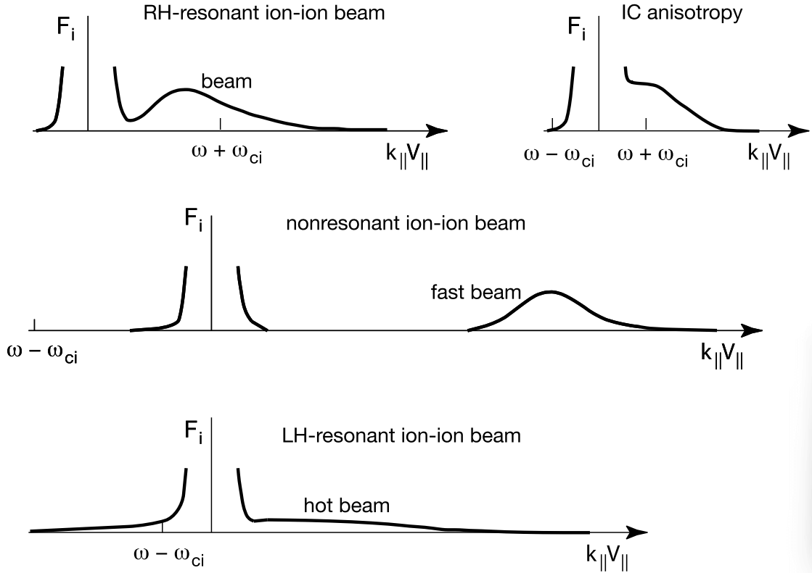{#fig-shock-instability-driver}

#### 冷离子束：右旋不稳定性

假设离子束热各向同性且较冷，即其相对于整体等离子体的速度快于其热速度。此时发生右旋共振不稳定性。没有束流 $v_b=0$ 时，平行模是在最低频哨声波色散分支上传播的右旋圆偏振磁声波，满足 $\omega\approx k_\parallel v_A$。存在漂移时，这一波变得不稳定，增长最快的频率为 $\omega \simeq k_\parallel v_b - \omega_{ci}.$ 由于 $\omega>0$、$k_\parallel > 0$ 且 $v_b > 0$，该模式平行于束流传播。对于密度 $0.01 \le n_b/n_i \le 0.1$，在增长率最快的波数 $k_\parallel$ 处对这一不稳定性的数值求解表明，增长率与波频率同量级，$\gamma\sim\omega$，最大增长率 $\gamma_m$ 为
$$
\gamma_m \simeq \omega_{ci}\left( \frac{n_b}{n_e} \right)^{1/3}
$$
其中，根据准中性，$n_e = n_i + n_b$ 是总密度。这种不稳定性驱动的波在假设静止的等离子体背景中与束流一起沿离子束方向传播。例如，将其应用于激波反射离子时，对于 2% 的反射离子，最大增长率为 $\gamma_m\sim 0.2\omega_{ci}$，且 $v_b\sim 1.2 \omega_{ci}/k_\parallel$、$k_\parallel\sim 0.2 \omega_{ci}/v_A$，由此得到 $v_b \sim 6 v_A$。太阳风中的阿尔芬速度约为 $v_A ≈ 30\,\mathrm{km/s}$。因此，沿磁场方向激波反射离子与太阳风之间的速度差应大致为 $\sim 180\,\mathrm{km/s}$。[^va_estimation] 离子束的热速度必须显著小于这一值，对应热束流能量小于 $T_b \ll 100\,\mathrm{eV}$；例如，太阳风中靠近切向磁力线的位置满足这一条件。太阳风以 300–1200 km/s 运动。完全反射应产生两倍于这些数值的束流速度。[^foreshock_q]

与产生的快磁声模相关的回旋共振条件为
$$
\omega = v_b k_\parallel - \omega_{ci}
$$ {#eq-cyclotron_resonance}
其中 $v_b$ 是束流速度，$\omega_{ci}$ 是离子回旋频率。它可近似为 $\omega=v_A k_\parallel$。

[^va_estimation]: 如果使用典型 Vlasiator 模拟值，$B=5\,\mathrm{nT}$、$n=10^6/\mathrm{cc}$、$v_A = 109\,\mathrm{km/s}$，则 $\Delta v \sim 650\,\mathrm{km/s}$。

[^foreshock_q]: [@balogh2013physics] 中的说法难以理解。也许他们试图说明，正是激波的垂直部分产生这些反射离子并导致不稳定性。书中后面论证了准平行激波在小尺度上会变为垂直。

#### 温离子束：左旋不稳定性

当离子束温度升高而背景离子仍然较冷时，束流离子出现在整体离子分布的负速度一侧，并在那里与左旋偏振离子阿尔芬波共振。最大增长率是右旋低频哨声模增长率的一部分。[^low_whister] 尽管如此，它仍能激发同样平行于束流传播的阿尔芬—离子回旋波。对于这一不稳定性，束流速度必须超过阿尔芬速度 $v_b > v_A$。

[^low_whister]: 所以确实是阿尔芬性分支？

倾斜传播时，右旋和左旋不稳定性的增长率都较小。但有趣的是，@goldstein1985 表明，增长最快的模式此时出现在倾斜的 $\mathbf{k}$ 和离子回旋频率的谐波 $\omega\sim n\omega_{ci}, n=1,2,...$ 处。[^vlasiator_comparison]

[^vlasiator_comparison]: 在 2014 年早期 Vlasiator 论文中，模拟的 RH 增长率低于理论值，尽管使用了近乎平行的一维三速度构型。

### 电子不稳定性和辐射 $\omega \sim \omega_{pe}$

与离子束激发的不稳定性不同，电子束不稳定性不直接参与激波形成（除非电子束具有高度相对论性，而整个日球层内并非如此）。原因是电子不稳定性的频率很高。然而，正是由于这一原因，它们在反常输运中至关重要，负责产生反常碰撞频率和高频场涨落。因为高频波导致电子能量损失并使其减速，而对较重的离子而言，它们代表使离子散射的涨落背景。
通过这种方式，高频波可能有助于激波中的基本耗散，尽管对于超临界激波，这种耗散不足以维持无碰撞激波，甚至不足以在无碰撞条件下形成激波。这也容易从直觉上理解：波需要时间产生并达到显著振幅；在快速流中，这个时间比流动穿越激波所需的时间更长。因此，波不会在那里积累；相反，在它们达到足以对散射产生重要影响的显著振幅之前，快速流早已将它们对流带到下游。

讨论电子可以激发的电磁波时，还必须记住，只有所考虑的等离子体中存在电磁色散分支时，这类波才能传播。这些位于 $(\omega,\mathbf{k})$ 空间中的电磁分支处于电子回旋频率 $\omega_{ce}$ 以下，相应的分支是哨声模分支。在激波条件下，电子一般不能激发频率高于 $\omega_{ce}$ 的电磁模。前面我们看到，离子束能够激发频率较低但高于离子回旋频率的哨声波；这只有在存在高频电子哨声波分支作为波传播通道时才可能。电子激发的电磁波在哨声波分支或其低频阿尔芬性延伸上传播，二者均为右旋。它们也激发多种静电发射。

### 哨声波

@gary1993theory 研究了电子束激发哨声波的情形。他对包含平行运动电子束的完整色散关系进行数值求解，发现随着束流速度 $v_b$ 增大，不稳定哨声波的实频率下降，即不稳定激发的哨声波在哨声波分支上移向较低频率，同时仍处于哨声波范围 $\omega_{ci} < \omega < \omega_{ce}$。背景电子和束流电子都以共振方式作出贡献。最重要的发现是，对于足够大的 $\beta_i \sim 1$（意味着磁场较弱）、$n_b/n_e$ 和 $T_b/T_e$，与静电电子束不稳定性相比，哨声模具有最低束流速度阈值，如 @fig-shock-whistler-instability 所示。这表明，在相对高 β 的等离子体中，中等密度电子束会首先激发哨声波。因此，在激波环境中，只要电子束沿相对较弱的磁场穿过等离子体传播，激发哨声波的条件就应当有利。共振电子满足 $v_\parallel = (\omega - \omega_{ce})/k_\parallel$，由于 $\omega \ll \omega_{ce}$，共振电子沿与束流相反的方向运动。提高束流温度会增加共振电子数量，从而增强不稳定性。

另一方面，提高束流速度会使粒子偏离共振并减弱不稳定性。因此，对于给定束流温度，哨声波不稳定性具有一个为离子回旋频率几倍的最大增长率。

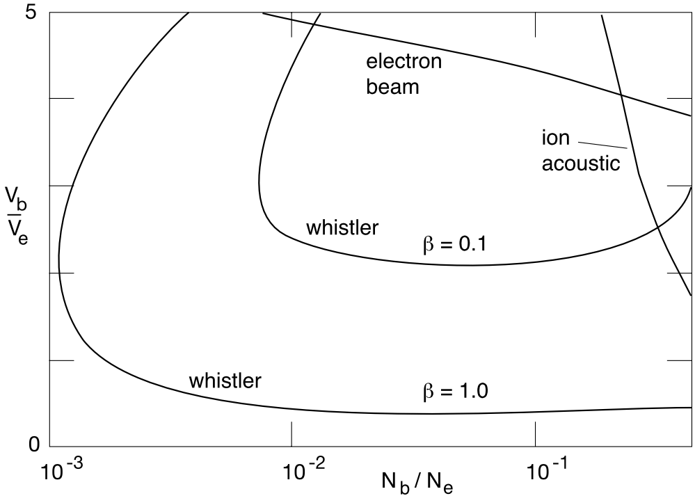{#fig-shock-whistler-instability}

## 激波粒子反射

粒子被激波反射是整个无碰撞激波物理中最重要的过程之一。然而，粒子反射机制尚未完全阐明。

粒子反射由静电力和磁力共同引起，其性质近似镜面反射。超临界激波需要这种反射，因为它是唯一能够补偿激波坡面内部耗散过程无法消化快速流入激波的动量和能量的过程。激波粒子反射本身并不耗散，尽管在处理分布函数矩的流体图景中，它可被解释为一种离子黏性，即它产生一个反常黏性系数，作为离子运动方程中离子速度二阶导数前的因子。作为这种黏性，它也出现在离子热输运方程中。将平均自由程替换为离子回旋半径时，运动学离子黏性可通过离子压力 $P_i$ 和离子回旋频率 $\omega_{ci}$ 表示为
$$
\mu_\mathrm{vis} = m_i n \nu_i \lambda_\mathrm{mfp} \simeq P_i / 2\omega_{ci}
$$
从这一意义上讲，激波粒子反射本身构成一种非常高效的非耗散性耗散机制。然而，它的直接耗散作用是在尽可能远的激波上游产生真实耗散，以尽量耗散形成激波坡面、坡面内部耗散以及离子反射回上游后仍然多余的运动能量。激波通过阻止相当一部分入射离子从上游穿过激波进入下游来实现这一点。它将这些离子送回上游区域，在那里它们形成剧烈不稳定的上游离子束—等离子体构型，激发大振幅湍流波谱，散射尚未获知激波存在的等离子体入射流，使其加热并减速到激波可以处理的马赫数范围。通过这种方式，无碰撞激波产生一个远向上游延伸的激波过渡区，而激波坡面退化为在马赫数最终从上游值降至下游值的位置发挥子激波作用。

激波反射对激波还有另一个重要影响：反射粒子组分向激波传递动量，使激波在反射区域减速，从而降低激波的有效马赫数。

### 镜面反射

离子从激波前沿镜面反射，即速度法向分量在激波处反向，是所能设想的最简单情形。它要求离子将激波坡面感受为不可穿透的墙。当激波本身包含在接近的离子前方建立的正反射电势时，就可能出现这种情况。这一电势的产生尚未阐明。在非常简单的处理方式中，假设流动磁化等离子体中的电势墙源于电子和离子穿透激波坡面时发生的电荷分离。它发生在尺度通常相当于离子与电子回旋半径之空间差异的范围内，因为在理想情况下，电子进入激波坡面时会在这一距离内被陡峭磁场梯度暂时阻挡，而离子只在长于其回旋半径的尺度上感受到磁梯度，因此能更深入地穿入激波过渡区。

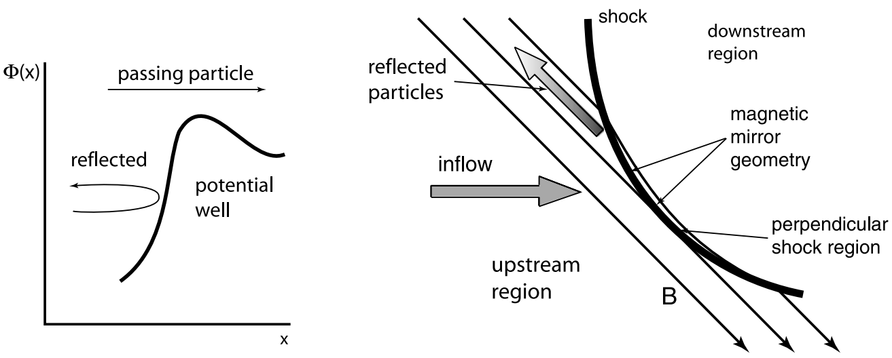{#fig-shock-specular-reflection}

* 从激波电势反射

根据这一简化图景，激波坡面应包含电势 $\Delta\Phi$ 的陡峭增加，它会反射任何动能较低的离子，即满足 $m_i V_N^2/2 < e\Delta\Phi$ 的离子（@fig-shock-specular-reflection）。

* 磁镜反射

磁化等离子体中粒子从激波坡面反射的另一种简单可能性是磁镜反射。接近激波的离子具有分量 $v_{i\parallel}$。假设存在地球弓形激波这样的弯曲激波。在其垂直部分附近，上游磁场与激波相切，随流动接近激波并以平行速度沿磁场运动的粒子会遇到磁镜场构型，它由垂直点附近汇聚的磁力线形成（@fig-shock-specular-reflection）。磁矩 $\mu = T_{i\perp}/B$ 守恒意味着粒子在增强的磁场中被绝热加热；它们还受到反射性磁镜力 $-\mu \nabla_\parallel B$，该力试图阻止离子沿磁场进入激波。当粒子在垂直激波点处的俯仰角变为 90◦ 时，它们将在该点发生镜面反射并返回上游。（??? Leroy & Mangeney, 1984; Wu, 1984）

激波镜面反射是激波粒子反射的极端情况。然而，湍流反射等其他机制尚未得到充分发展，无论如何都必须借助数值模拟研究。

### 激波反射的后果

反射离子返回上游多远取决于磁场相对于激波的方向，即激波法向角 $\theta_{Bn}$。对于垂直激波，反射离子只返回上游约一个回旋半径。它们感受到对流电场 $\mathbf{E} = -\mathbf{v}_\mathrm{flow}\times\mathbf{B}$ 后沿激波加速，形成电流；电流速度无论如何都超过入射流速度（其在垂直方向上为零），对于足够冷的离子还超过离子声速 $c_{ia}$，此时离子束等离子体不稳定性会在离子电流流经的激波足部区域被激发。这可能在激波足部产生反常碰撞。此外，由于激发的波沿磁场加速电子，还可能出现其他次级不稳定性。

在准垂直和倾斜激波中，离子可以沿磁场逃逸。此时上游束流与等离子体入射流之间出现离子双流情形，导致激发多种电磁和静电不稳定性。此外，上游离子与入射电子之间还会形成离子—电子双流情形；由于上游电子温度较高，它可能主要激发离子声模，但也可能导致 Buneman 双流模激发。这些模式促成上游前激波区的湍流，使前激波区形成弱耗散状态，在那里等离子体入射流获知激波的存在。
另一方面，这一区域激发的电磁低频不稳定性会增长到大振幅，形成局域结构，在被主流动对流带向激波坡面后与激波相互作用并改变激波剖面，甚至促成激波形成和再生。

## 激波粒子加速

在星际空间观测到的宇宙线背景下，中等能量粒子指约几个 GeV 的离子和约几个 MeV 的电子。超过这些范围就必须考虑相对论性激波。地球弓形激波附近太阳风氢的动能约为 1 keV；约 10 keV 是高能离子的低能阈值。这里我们首先将讨论限制在非相对论情形。

@fig-shock-acceleration 示意了粒子加速过程。根据 @fermi1949origin 的早期估计，粒子必须多次往返穿越激波并反射，才能达到高能宇宙线水平。散射是一个假设能量守恒的随机过程；特别是粒子不应参与会消耗其部分运动能量的不稳定性激发。在这一过程中唯一允许的实际耗散是整体运动能的耗散，少数被加速粒子从中获取能量增益。这种耗散也归因于通过对流输运或由于加速区域大小有限造成的直接粒子损失。因此，这一机制一直工作到被加速粒子的回旋半径大到超过系统尺寸为止。

随机过程意味着控制这一过程的基本方程是 Fokker-Planck 方程形式的相空间扩散方程：
$$
\frac{\partial F(\mathbf{p}, \mathbf{x}, t)}{\partial t} + \mathbf{v}\cdot\nabla F(\mathbf{p},\mathbf{x},t) = \frac{\partial}{\partial \mathbf{p}}\cdot\mathbf{D}_{pp}\cdot\frac{\partial F(\mathbf{p}, \mathbf{x}, t)}{\partial \mathbf{p}},\quad \mathbf{D}_{pp}=\frac{1}{2}\left< \frac{\Delta \mathbf{p}\Delta \mathbf{p}}{\Delta t} \right>
$$
其中 $\Delta \mathbf{p}$ 是时间间隔 $\Delta t$ 内发生的散射过程中粒子动量的变化，尖括号表示系综平均。$\mathbf{D}_{pp}$ 是动量空间扩散张量。通常定义 $\mu = \cos\alpha$ 为粒子俯仰角 $\alpha$ 的余弦，并将 $F(p,\mu)$ 理解为经过回旋相位平均的分布函数，它只依赖于 $p = |\mathbf{p}|$ 和 $\mu$。

{#fig-shock-acceleration}

对回旋半径的依赖给加速机制施加了严格限制，即_注入问题_。为了经历第一次散射，也就是为了进入加速过程，粒子一开始就必须具有远大于整个激波过渡区宽度的回旋半径。只有满足这一条件，激波才会表现为分隔两个速度截然不同区域的无限薄间断，使粒子在跨激波往返时能够感受到整体速度差并从中获得能量。这一限制排除了上游入射分布核心中的所有粒子参与加速过程：要进入费米激波加速机制，粒子必须预先加速或预热，直到其回旋半径足够大。这一条件提出了尚未解决的_注入问题_，即进一步加速需要一个来源未明的高能粒子种子群。

前激波瞬态现象（@sec-foreshock-transient），特别是 HFA 和 FB，可以加速粒子并促成主激波加速。它们可以形成次级激波，从而产生几种可能的加速机制；也可以引起局地磁重联，从而加速粒子。与前激波瞬态现象的相互作用为费米_注入问题_提供了一种可能的解决方案，并提高主激波的加速效率。

1. 当前激波瞬态结构随上游流动对流时，限制在其边界与主激波之间的粒子可以经历费米加速。
2. 观测还表明，次级激波自身可以通过[激波漂移加速（SDA）](https://svs.gsfc.nasa.gov/4513/)[^SDA] 加速上游粒子，甚至形成次级前激波区。
3. 次级激波也可以俘获主激波加速过的电子，并通过电子感应加速进一步增加它们的能量。
4. 前激波瞬态结构内部的磁重联有助于电子和离子的加速／加热。

[^SDA]: SDA 的本质是电场在激波中间增强！链接中的动画显示一个垂直激波情形，如果激波中的电场不增强，就不存在 SDA。然而问题仍然是：为什么电场会增强？

另一个引人关注的问题是，激波如何受到高能粒子存在的调制。

从粒子加速角度看，激波表现为两个具有不同整体流动参数、各自独立且充满粒子散射中心的区域之间的边界，如 @fig-DSA-heating 所示。理论上（[@balogh2013physics]），任何从下游返回上游的粒子都会在上游流动中被加速，即使没有任何上游湍流和散射也是如此。如果上游介质已磁化且范围足够大，能够容纳上游回旋轨道，就可以在整个上游半回旋轨道上通过对流电场 $\mathbf{E}=-\mathbf{V}\times\mathbf{B}$ 发生拾取离子加能。另一种可能是，上游湍流也可使离子获得能量。

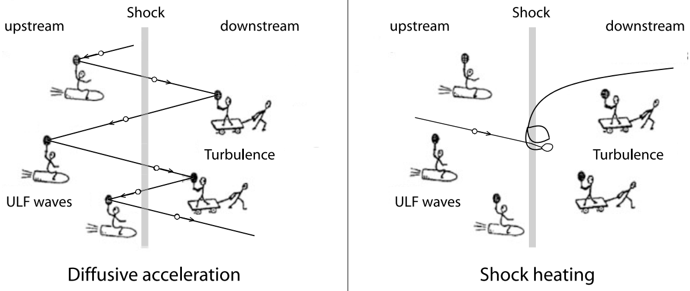{#fig-DSA-heating}

总而言之，*扩散激波加速（DSA）*（一阶费米加速）是目前对准平行激波粒子加速最广泛接受的理论。
然而，类似理论在准垂直激波的低能情况下效率不高，因为反射离子在上游磁场中回旋，几乎立即返回激波。因此，*激波漂移加速（SDA）*和*激波冲浪加速（SSA）*被认为在准垂直激波的离子加速或预加速中发挥重要作用。

### 激波处的电子加速和加热

对于准垂直几何构型的强激波，虽然离子加热通常被认为是电场力和磁力反射粒子的结果，电子加热问题仍有争议。电子加热的关键争议在于不可逆耗散如何以及何时发生。对地球弓形激波电子加热的一种广泛接受的图景认为：准静态跨激波电势加速入射电子、减速逃逸电子，使电子相空间膨胀，同时保持第一绝热不变量，并在低于电子跨激波电势能的能量处形成一个不可进入的区域 [Schwartz 2012]。人们假设波粒散射填充这一区域，从而导致热化。这一图景基于过去观测到的受热“平顶”分布和穿过激波坡面时近似各向同性的温度增加。

近期研究关注绝热条件的破坏（例如 Li-jen Chen 2018 PRL）。MMS 观测显示，在准垂直激波前沿，太阳风电子发生整体加速，随后通过非线性弛豫而加热。加速由嵌入低频哨声模波中的电场实现，并产生很高的平行电流密度。有人假设，一组局域强电场（$E_n$ 尖峰，其中 n 是激波前沿的法向）可能构成“跨激波电势”的一部分。

## 前激波瞬态现象 {#sec-foreshock-transient}

本节列出并简要描述基于观测的前激波瞬态现象，包括热流异常（HFA）、自发热流异常（SHFA）、前激波气泡（FB）、前激波空腔、前激波空洞、前激波压缩边界、密度空洞和短尺度大振幅磁结构（SLAMS）。@tbl-foreshock-transient 根据 [@zhang2022dayside] 比较了它们的特征。

::: {#tbl-foreshock-transient layout-nrow=2}

| | n 和 B 降低 | n 和 B 压缩 | 存在超热离子 | 流动偏转 | 等离子体加热 | 与 IMF 间断相关 | 持续时间 | 尺度大小 |
|:---:|:---:|:---:|:---:|:---:|:---:|:---:|:---:|:---:|:---:|
| HFA | 是 | 在边缘 | 是 | 强 | 强 | 是 | $10 - 10^2$ s | $\mathcal{O}(R_E)$ |
| SHFA | 是 | 在边缘 | 是 | 强 | 强 | 否 | $10 - 10^2$ s | $\mathcal{O}(R_E)$ |
| FB | 是 | 仅在上游边缘 | 是 | 强 | 强 | 是 | $10 - 10^2$ s | $\mathcal{O}(R_E)$ |
| 空腔 | 是 | 在边缘 | 是 | 弱 | 中等 | 有时 | $10 - 10^2$ s | $\mathcal{O}(R_E)$ |
| 空洞 | 是 | 在边缘 | 是 | 弱 | 弱 | 否 | $10 - 60$ s | $\mathcal{O}(R_E)$ |
| FCB | 湍流侧是 | 在边缘 | 可能 | 弱 | 弱 | 否 | $10 - 10^2$ s | $\mathcal{O}(R_E)$ |
| 密度空洞 | 是 | 在边缘 | 是 | 有时 | 有时 | 是 | $1 - 60$ s | $\mathcal{O}(R_E)$ |
| SLAMS | 否 | 是 | 可能 | 有时 | 有时 | 否 | $1 - 60$ s | $<0.5\, R_E$ |

: 前激波瞬态现象的基本性质

| | 产生机制 |
|--------------|----------------------|
| HFA | IMF 间断与弓形激波的相互作用 |
| SHFA | 前激波空洞与弓形激波的相互作用 |
| FB | 超热回流离子与含 IMF 间断的入射太阳风等离子体之间的动理学相互作用；这些间断穿过离子前激波区并改变它 |
| 空腔 | 向远日方向运动的磁力线板层连接到弓形激波，并夹在始终不与弓形激波相连的更宽磁力线区域之间 |
| 空洞 | ULF 波的非线性相互作用 |
| FCB | 回流离子使前激波区内部压力增大，导致其向原始太阳风膨胀并产生 FCB |
| 密度空洞 | 可能由回流粒子与原始太阳风相互作用引起 |
| SLAMS | 非线性波陡化 |

: 前激波瞬态现象的产生机制 {tbl-colwidths="[15,85]"}

弓形激波处前激波瞬态现象的比较
:::

### 热流异常

HFA 的特征是低场强、低密度核心，其中等离子体受到加热且流动显著偏转，尺度为几个 $\mathrm{R}_\mathrm{E}$。HFA 通常由与弓形激波相交的太阳风切向间断（TD）驱动，并且太阳风对流电场至少在 TD 一侧向内指向间断。这种 TD 在沿弓形激波表面传播时，可以局部俘获前激波离子，从而形成 HFA。HFA 可以通过费米加速有效加速粒子，即粒子在相向靠拢的 HFA 边界和弓形激波之间往返反弹。观测到的高能离子也可能从外磁层逃逸而来。

HFA 最显著的性质之一是太阳风整体流动的强偏转，其程度可能大到使 HFA 内部流动实际出现向日分量。太阳风中的瞬态低密度区域与快激波相互作用，可导致快激波破坏，并产生一个实际向上游传播的新激波；该新激波后方等离子体的动量密度和速度远小于原始太阳风。

### 自发热流异常

SHFA 与 HFA 具有相同特征，只是它们与任何太阳风间断都无关。它们在准平行区域内自发形成，可能源于前激波空洞与弓形激波的相互作用。

为了在模拟中区分 SHFA 与前激波空洞，人们使用了一项额外经验判据：至少 60% 的瞬态区域内 SHFA 具有 $\beta > 10$。之所以选择这一判据，是为了不对瞬态结构内部加热和流动偏转的程度作假设。数值 10 表示瞬态结构由等离子体而非磁场主导，并且显著高于周围前激波区的典型 β（$β \sim 1-4$）。

### 前激波气泡

当前激波区回流离子与不一定同弓形激波相交的太阳风旋转间断（RD）相互作用时，FB 在 RD 上游形成，并与其一起向远日方向对流。后续观测和模拟发现 TD 也可以驱动 FB。FB 同样具有受到加热的稀薄核心及显著流动偏转。与 HFA 和 SHFA 不同，FB 以超快磁声速膨胀，且主要沿向日方向。由于向日超快磁声速膨胀，核心上游形成激波，FB 沿膨胀方向的尺寸可达 5-10 $\mathrm{R}_\mathrm{E}$，大于典型 HFA 和 SHFA。除了显著的动压扰动外，由于存在激波，FB 还是有效的粒子加速器（例如激波漂移加速，以及激波向弓形激波靠拢时的费米加速）。

### 前激波空腔

前激波空腔的特征是低密度、低场强核心区域，其两侧是高密度、高场强压缩边界。但与 HFA 不同，前激波空腔内部流动偏转相当弱，等离子体加热也不显著。当连接到弓形激波的磁力线板层被始终不与弓形激波相连的更宽磁力线区域夹在中间时，只有这些板层充满从弓形激波反射并获得能量的粒子。前激波粒子的存在增强热压，使其向两侧膨胀。这种膨胀降低板层内部的等离子体密度和磁场强度，并增加两个边界处的密度和场强，即形成前激波空腔。

注意，这与另一种称为磁空腔的空腔有所不同；后者常被解释为磁镜结构，其中中心磁场减小对应中心粒子增加 [J. Liu+ 2020]。

### 前激波空洞

前激波空洞的特征也是低密度、低场强核心区域，两侧由高密度、高场强边界围住，没有明显加热和流动偏转。其尺度约为一个 $\mathrm{R}_\mathrm{E}$。它们由两类波的非线性演化形成：平行传播的右旋或左旋偏振波，以及倾斜传播的线偏振快磁声波。因此，前激波空洞嵌入前激波 ULF 波中，而由于形成机制不同，前激波空腔则是孤立的。

### 前激波压缩边界

FCB 具有增强的密度和场强，出现在前激波区与原始太阳风之间的边界。由于前激波离子的存在造成高热压，前激波区向周围原始太阳风膨胀，导致 FCB 形成。FCB 的前激波区一侧有时伴随局地密度和场强降低。FCB 在稳定或非稳定 IMF 条件下都可以形成。

### SLAMS 和激波小波

短尺度大振幅磁结构（SLAMS）是振幅至少为环境磁场强度两倍的磁脉动。SLAMS 的典型空间尺度可达许多离子回旋半径（太阳风中热离子回旋半径通常为 160 km），并以秒级时间尺度快速增长。激波小波也是磁结构（非线性陡化的磁声波），但在振幅、空间尺度、增长率和传播角方面与 SLAMS 不同。

### 密度空洞

密度空洞的特征是具有相似形状的磁空洞，其一侧或两侧边缘的密度和场强增强。密度空洞的定义与 HFA、SHFA、FB、前激波空腔和前激波空洞有所重叠，但范围更广。@lu2022statistical 的统计表明，411 个密度空洞中约 66% 无法归入任何上述前激波瞬态类型。因此，有必要将密度空洞单独列为一类。需要更好的密度空洞定义才能明确区分它们与其他前激波瞬态类型，这需要进一步研究。其形成可能源于回流粒子与原始太阳风的相互作用 [@parks2006larmor]。

## 激波的位置

在关于准垂直激波的观测比较论文 [@slavin1981solar] 中，作者得出结论：激波离体距离和形状的变化由声速马赫数 $M_s$ 而非其他涉及磁场的马赫数所决定。换言之，他们认为弓形激波是气体动力学结构。

然而，即使在中性流体理论中，激波位置及形状的确定仍是正在研究的问题。设想最简单的情形：空气中有一个质量无限大、静止的球。假设空气完全均匀，且上游密度、速度和压力已知，你能用纸笔告诉我激波离体距离的确切位置吗？

除此之外，引入电磁场使问题更加复杂。特别是在平行激波的情况下，上游和下游的等离子体都会受到“激波”影响，激波的离体距离在理论上可能不是单一位置。从某种意义上说，垂直于边界的磁场使激波前沿“增厚”。

## 地球弓形激波

利用 AMPTE/IRM 航天器数据，[@hill1995plasma] 表明双绝热方程在磁鞘中不成立。此外，[@phan1996subsolar] 利用 WIND 航天器数据研究了磁鞘的热行为。他们报告说，磁鞘的大部分区域处于镜像不稳定的边缘：电子观测表明磁鞘中 $T_{e\perp} / T_{e\parallel} \sim 1.3$。
