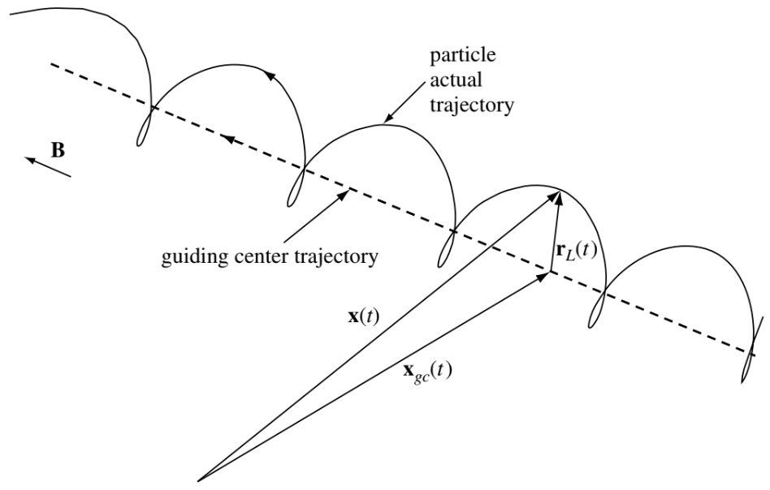
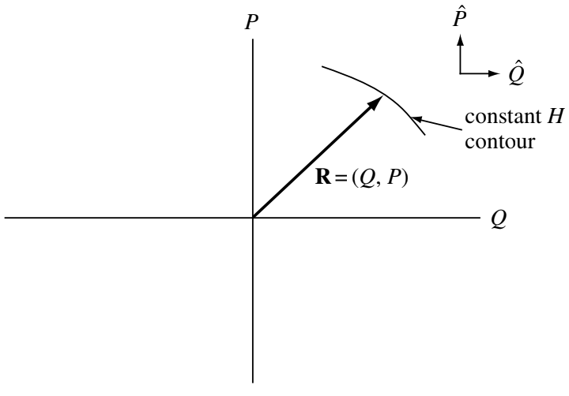
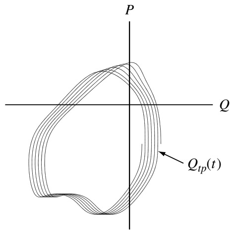

# 单粒子运动 {#sec-single}

等离子体特别难以分析，原因在于其密度处于中间范围。水等流体的密度很高，不必考虑单个分子的运动。碰撞占主导地位，普通流体动力学的简单方程便已足够。另一个极端是密度极低的装置，只需考虑单粒子轨迹，集体效应往往并不重要。等离子体有时表现得像流体，有时又像单个粒子的集合。学习如何应对这种双重特性的第一步，是理解单个粒子在电场和磁场中的行为。

中性气体中的单粒子运动很简单——粒子沿直线运动，直到撞上其他粒子或器壁。由于这种简单性，没有必要追踪中性气体中单粒子运动的细节，对这种运动进行统计平均就已足够；这种平均表明，中性气体具有麦克斯韦速度分布，并处于局部热力学平衡。相比之下，等离子体粒子近乎无碰撞，其轨迹通常很复杂，并受到电场和磁场的强烈影响。

正如 @sec-collision-entropy 将要说明的，当发生足够多的碰撞使熵达到最大值时，等离子体的速度分布将变为麦克斯韦分布。然而，由于高温等离子体中的碰撞很少发生，许多重要现象的时间尺度短于等离子体速度分布变为麦克斯韦分布所需的时间。因此，需要用无碰撞模型来描述这些快速现象。在这些情况下，随机化不会发生，熵守恒，分布函数不一定是麦克斯韦分布，等离子体也不处于热力学平衡。因此，热力学概念不再适用，转而使用经典力学概念来描述等离子体，例如单个粒子的动量或能量守恒。在这些无碰撞情况下，单粒子动力学的复杂细节不会被碰撞抹平，而是持续存在并影响宏观尺度。例如，在无碰撞等离子体中，单个粒子的回旋共振可能在宏观尺度上十分重要。本章研究单粒子运动的各个方面，并说明这些方面如何影响等离子体的宏观性质。

此外，单粒子动力学的研究与弗拉索夫理论有着非常直接的联系，因为如 @sec-vlasov 所示，任何由单粒子运动常量构造的函数都是无碰撞弗拉索夫方程的有效解。因此，了解单粒子动力学可以提供一组可供选用的运动常量，从而构造适用于各种情况的弗拉索夫方程解。

最后，研究单粒子运动能够培养对波–粒相互作用的宝贵直觉，并揭示某些超出流体模型描述能力的特殊情况，例如随机或非绝热粒子运动。

这里假定电磁场是预先给定的，不受带电粒子的影响。相应的方法通常称为_测试粒子_方法。换言之，只要电场和磁场_在空间和时间上都缓慢变化_，就可以推导出直观且相当准确的解析解，描述带电粒子在任意复杂电场和磁场中的漂移（这一要求本质上就是 @sec-adiabatic-invariant 中介绍的绝热不变量所要求的缓慢变化条件）。利用所假定的快、慢运动之间的尺度分离，通过迭代求解洛伦兹方程
$$
m\frac{\mathrm{d}\mathbf{v}}{\mathrm{d}t} = q\left( \mathbf{E}+\mathbf{v}\times\mathbf{B} \right)
$$ {#eq-lorentz}
可得到漂移解。

考虑相对论时，洛伦兹方程变为
$$
\frac{\mathrm{d}\mathbf{p}}{\mathrm{d}t} = q\left( \mathbf{E}+\mathbf{v}\times\mathbf{B} \right)
$$ {#eq-lorentz-relativistic}
其中 $\mathbf{p}=\gamma m\mathbf{v}$ 是相对论动量，$\gamma = \left( 1 - v^2/c^2 \right)^{-1/2}$ 是_洛伦兹因子_。电子的静质量为 $me = 511\,\mathrm{keV}/c^2$，质子的静质量为 $m_p = 938\,\mathrm{MeV}/c^2$。

## 均匀电场和磁场

这里约定速度 $\mathbf{v}$ 表示单粒子速度，本章大部分内容都采用这一约定。

### E=0

在这种情况下，带电粒子作简单的回旋运动。运动方程为
$$
m\frac{\mathrm{d}\mathbf{v}}{\mathrm{d}t} = q\mathbf{v}\times\mathbf{B}
$$

取 $\widehat{z}$ 为 $\mathbf{B}$ 的方向（$\mathbf{B} = B\widehat{z}$），得到
$$
\begin{aligned}
m\dot{v}_x = qB v_y,\quad m\dot{v}_y = -qB v_x,\quad m\dot{v}_z = 0, \\
\ddot{v}_x = \frac{qB}{m}\dot{v}_y = -\Big( \frac{qB}{m}\Big)^2 v_x \\
\ddot{v}_y = \frac{qB}{m}\dot{v}_x = -\Big( \frac{qB}{m}\Big)^2 v_y
\end{aligned}
$$

这描述了一个以*回旋频率*振荡的简谐振子，回旋频率定义为
$$
\omega_c \equiv \frac{| q | B}{m}
$$

按照所选的约定，$\omega_c$ 始终非负。因此速度的解为
$$
v_{x,y} = v_\perp \exp(\pm i \omega_c t + i\delta_{x,y})
$$

$\pm$ 表示 q 的符号。我们可以选择相位 $\delta$，使得
$$
v_x = v_\perp e^{i\omega_c t} = \dot{x}
$$
其中 $v_\perp$ 是正的常数，表示垂直于 $\mathbf{B}$ 的平面内的速率。于是
$$
v_y  = \frac{m}{qB} \dot{v}_x = \pm \frac{1}{\omega_c}\dot{v}_x = \pm i v_\perp e^{i\omega_c t} = \dot{y}
$$

再次积分，得到
$$
\begin{aligned}
x - x_0 &= -i\frac{v_\perp}{\omega_c}e^{i\omega_c t} \\
y - y_0 &= \pm i\frac{v_\perp}{\omega_c}e^{i\omega_c t}
\end{aligned}
$$

我们将*拉莫尔半径*定义为
$$
r_L \equiv \frac{v_\perp}{\omega_c} = \frac{mv_\perp}{|q| B}
$$ {#eq-larmor_radius}

注意 @eq-larmor_radius 中没有出现 $2\pi$！

对位置取实部，得到
$$
\begin{aligned}
x - x_0 &= r_L\sin\omega_c t \\
y - y_0 &= \pm r_L \cos\omega_c t
\end{aligned}
$$

这描述了围绕固定*导引中心*（$x_0, y_0$）的圆形轨道。回旋方向总是使带电粒子产生的磁场与外加磁场相反。因此，等离子体粒子倾向于*减弱*磁场，等离子体具有*抗磁性*。除了这种运动，还有沿 $\mathbf{B}$ 方向的任意速度 $v_z$，它不受 $\mathbf{B}$ 的影响。带电粒子在空间中的轨迹一般是一条螺旋线。沿磁场方向（逆磁场方向）观察时，顺时针（逆时针）旋转的粒子带负电。在等离子体物理中，这就是_右手性_的约定。

在国际单位制中，$\omega_c$ 的单位是 rad/s。要将其换算为赫兹，需要除以 $2\pi$。电子和质子对应的_振荡频率_ $f_{c\alpha} = \omega_{c\alpha}/(2\pi)$ 为
$$
\begin{aligned}
f_{ce}[\mathrm{Hz}] &= 28 B [\mathrm{nT}] \\
f_{cp}[\mathrm{Hz}] &= 0.015 B [\mathrm{nT}]
\end{aligned}
$$

### 非零电场

如果现在允许存在电场，可以发现运动是两种运动之和：通常的圆形拉莫尔回旋，加上导引中心的漂移。所假定的场在空间中均匀且不随时间变化，是假定场在空间和时间上缓慢变化的极限情况。我们可以选取 $\mathbf{E}$ 位于 x-z 平面，使得 $E_y = 0$。与前面一样，速度的 z 分量与横向分量无关，可以单独处理。现在运动方程为
$$
m\dot{\mathbf{v}} = q( \mathbf{E} + \mathbf{v}\times\mathbf{B} )
$$
其 z 分量为
$$
\dot{v_z} = \frac{q}{m}E_z
$$
或者
$$
v_z = \frac{qE_z}{m}t + v_{z0}
$$

这就是沿 $\mathbf{B}$ 方向的直接加速。横向分量为
$$
\begin{aligned}
\dot{v_x} &= \frac{q}{m}E_x \pm \omega_c v_y \\
\dot{v_y} &= 0 \mp \omega_c v_x
\end{aligned}
$$

求导得到（对于恒定的 $\mathbf{E}$）
$$
\begin{aligned}
\ddot{v}_x &= -\omega_c^2 v_x \\
\ddot{v}_y &= \mp \omega_c \Big( \frac{q}{m}E_x \pm \omega_c v_y \Big) = -\omega_c^2 \Big( v_y + \frac{E_x}{B} \Big)
\end{aligned}
$$

可以将其写为
$$
\frac{\mathrm{d}^2}{\mathrm{d}t^2}\Big( v_y + \frac{E_x}{B} \Big) = -\omega_c^2\Big( v_y + \frac{E_x}{B} \Big)
$$
因此，如果将 $v_y$ 替换为 $v_y + (E_x/B)$，便可化为先前的情况。速度解相应变为
$$
\begin{aligned}
v_x &= v_\perp e^{i\omega_c t} \\
v_y &= \pm v_\perp e^{i\omega_c t} - \frac{E_x}{B}
\end{aligned}
$$

拉莫尔运动与之前相同，但叠加了导引中心在 $-y$ 方向上的漂移 $\mathbf{v}_{gc}$（对于 $E_x > 0$）。

为了得到 $\mathbf{v}_{gc}$ 的一般公式，可以求解矢量形式的动量方程。我们可以省略 $m \mathrm{d}\mathbf{v}/\mathrm{d}t$ 项，因为这一项只给出频率为 $\omega_c$ 的圆周运动，而我们已经了解这种运动。于是动量方程变为
$$
\mathbf{E} + \mathbf{v}\times\mathbf{B} = 0
$$

与 $\mathbf{B}$ 取叉积，得到
$$
\mathbf{E}\times\mathbf{B} = \mathbf{B}\times(\mathbf{v}\times\mathbf{B}) = \mathbf{v}B^2 - \mathbf{B}(\mathbf{v}\cdot\mathbf{B})
$$

这一方程相对于 $\mathbf{B}$ 的横向分量为
$$
\mathbf{v}_{gc} = \mathbf{E}\times\mathbf{B}/B^2 \equiv \mathbf{v}_E
$$

我们将其定义为 $\mathbf{v}_E$，即导引中心的电场漂移。该漂移的大小为
$$
v_E = \frac{E(\text{V/m})}{B(\text{tesla})}\frac{\text{m}}{\text{sec}}
$$

需要注意，$\mathbf{v}_E$ 与 q、m 和 $v_\perp$ 无关。从下面的物理图像可以清楚地看出原因。在离子轨道的前半个周期内，离子从电场获得能量，$v_\perp$ 随之增大，因此 $r_L$ 也增大。在后半个周期内，离子失去能量，$r_L$ 减小。轨道左右两侧的 $r_L$ 差异造成了漂移 $v_E$。带负电的电子沿相反方向回旋，但也沿相反方向获得能量；它最终与离子沿相同方向漂移。对于速度相同但质量不同的粒子，质量较小者的 $r_L$ 较小，因此每周期漂移得较少。但是，它的回旋频率也更大，这两种效应恰好抵消。两个质量相同但能量不同的粒子具有相同的 $\omega_c$。较慢粒子的 $r_L$ 较小，因此在半个周期内从 $\mathbf{E}$ 获得的能量较少。然而，对于能量较低的粒子，给定能量变化引起的 $r_L$ 相对变化较大，这两种效应也相互抵消。解释这一行为的另一种方法是回顾：根据狭义相对论，以速度 $\mathbf{u}$ 运动的参考系中观测到的电场 $\mathbf{E}^\prime$ 为 $\mathbf{E}^\prime = \mathbf{E}+\mathbf{u}\times\mathbf{B}$，因此 $\mathbf{v}_E$ 只是表明粒子以这样的方式漂移，使其自身参考系中看到的电场为零。

因此，具有非零初始速度的带电粒子在空间中的三维轨道是一条螺距不断变化的倾斜螺旋线。俯仰角定义为
$$
\alpha = \arctan{\frac{v_\perp}{v_\parallel}} = \arcsin{\frac{v_\perp}{v}} = \arccos{\frac{v_\parallel}{v}}
$$ {#eq-pitch-angle}

### 重力场 {#sec-gravity_field}

将运动方程中的 $q\mathbf{E}$ 替换为一般的力 $\mathbf{F}$，即可把前面的结果应用于其他力。由 $\mathbf{F}$ 引起的导引中心漂移为
$$
\mathbf{v}_f = \frac{1}{q}\frac{\mathbf{F}\times\mathbf{B}}{B^2}
$$

特别地，如果 $\mathbf{F}$ 是重力 $m\mathbf{g}$，就存在漂移
$$
\mathbf{v}_g = \frac{m}{q}\frac{\mathbf{g}\times\mathbf{B}}{B^2}
$$ {#eq-gravity_drift}

这与漂移 $\mathbf{v}_E$ 相似，都是垂直于力和 $\mathbf{B}$ 的方向，但在一个重要方面有所不同：漂移 $\mathbf{v}_g$ 随粒子电荷的符号而改变方向。在重力作用下，离子和电子向相反方向漂移，因此等离子体中存在净电流密度
$$
\mathbf{j} = n(m_i+m_e)\frac{\mathbf{g}\times\mathbf{B}}{B^2}
$$

这种漂移的物理原因仍然是粒子在重力场中获得和失去能量时拉莫尔半径的变化。此时电子的回旋方向与离子相反，但它们受到的力方向相同，因此漂移方向相反。$\mathbf{v}_g$ 的大小通常可以忽略，但当力线（即磁力线）弯曲时，离心力会产生一个有效重力。这个不可忽略的力与质量无关；这就是我们在此没有强调漂移对 m 的依赖关系的原因。离心力是一种称为“重力”不稳定性的等离子体不稳定性的基础，这种不稳定性与真正的重力无关。

现在应当清楚，只需在洛伦兹方程中作替换 $\mathbf{E}\rightarrow\mathbf{F}/q$，就可以轻易地将 $\mathbf{E}\times\mathbf{B}$ 漂移分析推广到描述任何垂直于 $\mathbf{B}$ 的力对带电粒子的作用。因此，任何在空间上均匀、在时间上恒定且垂直于 $\mathbf{B}$ 的力都会引起漂移
$$
\mathbf{v}_F = \frac{\mathbf{F}\times\mathbf{B}}{qB^2}
$$
由此得到两个违反直觉而又重要的结论：

1. 垂直于磁场的稳态电场不会在等离子体中驱动电流，而是使整个等离子体以速度 $\mathbf{v}_E$ 横跨磁场作整体运动。

2. 垂直于磁场的稳态力（例如重力、离心力等）使电子和离子沿相反方向运动，从而驱动横跨磁场的电流
$$
\mathbf{j}_F = \sum_\sigma n_\sigma \frac{\mathbf{F}\times\mathbf{B}}{B^2}
$$

## 非均匀磁场

现在导引中心漂移的概念已经确立，可以讨论粒子在非均匀场中的运动，即 $\mathbf{E}$ 和 $\mathbf{B}$ 随空间或时间变化的情况。对于均匀场，我们能够得到导引中心漂移的精确表达式。一旦引入非均匀性，问题就变得过于复杂，无法精确求解。为了得到近似答案，通常按小量 $r_L/L$ 展开，其中 L 是非均匀性的尺度长度。这类称为*轨道理论*的理论可能极其复杂。我们只研究最简单的情况，即每次只出现一种非均匀性。

### ∇B ⊥ B：磁场梯度漂移

这里磁力线是直的，但其密度沿某个方向增加，例如沿 y 方向。我们可以利用简单的物理图像预见结果。$|B|$ 的梯度使轨道下方的拉莫尔半径大于上方，这应该导致垂直于 B 和 $\nabla B$ 的漂移，且离子与电子的漂移方向相反。漂移速度显然应当与 $r_L/L$ 和 $v_\perp$ 成正比。

考虑对一个回旋周期取平均的洛伦兹力 $\mathbf{F} = q\mathbf{v}\times\mathbf{B}$。显然 $\bar{F}_x = 0$，因为粒子向上和向下运动的时间相同。我们希望利用粒子的*未受扰动轨道*求平均，从而近似计算 $\bar{F}_y$。未受扰动轨道由第一节中均匀 $\mathbf{B}$ 场的解给出。取 $v_x$ 和 $y$ 的解的实部，得到
$$
F_y = -q v_x B_z(y) = -q v_\perp(\cos \omega_c t) \Big[ B_0 \pm r_L(\cos\omega_c t )\frac{\partial B}{\partial y} \Big]
$$
其中我们在 $x_0=0, y_0=0$ 点附近对 $\mathbf{B}$ 场作了泰勒展开：
$$
\begin{aligned}
\mathbf{B} &= \mathbf{B}_0 + (\mathbf{r}\cdot\nabla)\mathbf{B} + ... \\
Bz &= B_0 + y(\partial B_z/\partial y) + ...
\end{aligned}
$$

这一展开当然要求 $r_L / L \ll 1$，其中 L 是 $\partial Bz/\partial y$ 的长度尺度。上式第一项在一个回旋周期内的平均值为零，而 $\cos^2 \omega_c t$ 的平均值为 $1/2$，因此
$$
\bar{F}_y = \mp q v_\perp r_L \frac{1}{2}\frac{\partial B}{\partial y}
$$

于是导引中心漂移速度为
$$
\mathbf{v}_{gc} = \frac{1}{q}\frac{\mathbf{F}\times\mathbf{B}}{B^2} = \frac{1}{q}\frac{\bar{F}_y}{|B|}\widehat{x} = \mp \frac{v_\perp r_L}{B}\frac{1}{2} \frac{\partial B}{\partial y} \widehat{x}
$$
其中使用了前面给出的公式。由于 y 轴的选择是任意的，可以将其推广为
$$
\mathbf{v}_{\nabla B} = \pm \frac{1}{2}v_\perp r_L \frac{\mathbf{B}\times \nabla B}{B^2}
$$

这一结果具有我们从物理图像预期的所有依赖关系；只有因子 $\frac{1}{2}$（来自平均）未被预见。注意，$\pm$ 表示电荷的符号，非粗体的 $B$ 表示 $|B|$。量 $\mathbf{v}_{\nabla B}$ 称为*磁场梯度漂移*；离子和电子的漂移方向相反，并产生垂直于 $\mathbf{B}$ 的电流。精确计算 $\mathbf{v}_{\nabla B}$ 需要在求平均时使用包含漂移在内的精确轨道。

### 弯曲磁场：曲率漂移

这里假设磁力线弯曲，曲率半径 $R_c$ 恒定，并取 $|B|$ 为常数。这样的场在真空中不满足麦克斯韦方程组，因此实际情况下，磁场梯度漂移总会叠加在这里推导的效应上。粒子在热运动中沿磁力线运动时受到离心力，从而产生导引中心漂移。如果 $v_\parallel^2$ 表示沿 $\mathbf{B}$ 方向的随机速度分量的平方平均值，$\mathbf{R}_c$ 表示从曲率中心指向曲线的曲率半径矢量，则平均离心力为
$$
\mathbf{F}_{cf} = \frac{mv_\parallel^2}{R_c}\widehat{r} = mv_\parallel^2\frac{\mathbf{R}_c}{R_c^2}
$$

根据导引中心漂移公式，这产生漂移
$$
\mathbf{v}_{R} = \frac{1}{q}\frac{\mathbf{F}_{cf}\times\mathbf{B}}{B^2} = \frac{mv_\parallel^2}{qB^2}\frac{\mathbf{R}_c \times\mathbf{B}}{R_c^2}
$$

漂移 $\mathbf{v}_c$ 称为*曲率漂移*。

现在必须考虑 $|B|$ 随半径减小，并计算伴随曲率漂移的磁场梯度漂移。在真空中，$\nabla\times\mathbf{B} = 0$（无电流）。在柱坐标中，$\nabla\times\mathbf{B}$ 只有 $z$ 分量，因为 $\mathbf{B}$ 只有 $\theta$ 分量，而 $\nabla B$ 只有 $r$ 分量。于是
$$
(\nabla\times\mathbf{B})_z = \frac{1}{r}\frac{\partial}{\partial r}(rB_\theta) = 0,\, B\propto \frac{1}{r}
$$

因此
$$
|B| \propto \frac{1}{R_c},\, \frac{\nabla B}{B} = - \frac{\mathbf{R}_c}{R_c^2}
$$ {#eq-curvature-radius}

利用磁场梯度漂移的表达式，得到
$$
\mathbf{v}_{\nabla B} = \mp \frac{1}{2}\frac{v_\perp r_L}{B^2}\mathbf{B}\times\frac{\mathbf{R}_c}{R_c^2} = \pm \frac{1}{2}\frac{v_\perp^2}{\omega_c}\frac{\mathbf{R}_c\times\mathbf{B}}{R_c^2 B} = \frac{1}{2}\frac{m}{q}v_\perp^2\frac{\mathbf{R}_c\times\mathbf{B}}{R_c^2 B^2}
$$

将其与 $\mathbf{v}_c$ 相加，得到弯曲真空场中的总漂移
$$
\mathbf{v}_c + \mathbf{v}_{\nabla B} = \frac{m}{q}\frac{\mathbf{R}_c\times\mathbf{B}}{R_c^2 B^2}\left( v_\parallel^2 + \frac{1}{2}v_\perp^2 \right)
$$

或者只用磁场表示为
$$
\mathbf{v}_c + \mathbf{v}_{\nabla B} = \frac{m}{q}\frac{\mathbf{B}\times\nabla B}{B^3}\left( v_\parallel^2 + \frac{1}{2}v_\perp^2 \right)
$$ {#eq-gc-drift-curvature-current-free}

或者用动能 $W$ 和俯仰角 $\theta$ 表示为
$$
\mathbf{v}_c + \mathbf{v}_{\nabla B} = \frac{\mathbf{B}\times\nabla B}{qB^3}\Big( 2W\cos^2\theta + W\sin^2\theta \Big) = \frac{\mathbf{B}\times\nabla B}{qB^3}\left( 1 + W\cos^2\theta \right)
$$ {#eq-gc-drift-b-pitchangle}

遗憾的是，这些漂移会相加。这意味着，如果为了约束热核等离子体而把磁场弯成环面，那么无论如何调整温度和磁场，粒子都会漂出环面。

对于麦克斯韦分布，$\bar{v_\parallel^2}$ 和 $\frac{1}{2}\bar{v_\perp^2}$ 都等于 $k_B T/m$，因为 $v_\perp$ 涉及两个自由度。于是平均弯曲场漂移可写为
$$
\bar{\mathbf{v}}_{c+\nabla B} = \pm \frac{v_{th}^2}{R_c\omega_c}\widehat{y} = \pm\frac{\bar{r}_L}{R_c}v_{th}\widehat{y}
$$
其中 $\widehat{y}$ 是 $\widehat{R}_c\times\mathbf{B}$ 的方向。这表明 $\bar{\mathbf{v}}_{c+\nabla B}$ 依赖于粒子种类的电荷，但不依赖其质量。

如果存在电流，不能假定 $\nabla\times\mathbf{B}=0$，则采用曲率半径的原始定义
$$
\frac{\hat{r}}{R_c} = \frac{\mathbf{R}_c}{R_c^2} = -\hat{b}\cdot\nabla\hat{b}
$$ {#eq-curvature-radius}

于是曲率漂移可写为
$$
\mathbf{v}_{R} = \frac{mv_\parallel^2}{qB^2}\frac{\mathbf{R}_c \times\mathbf{B}}{R_c^2} = \frac{mv_\parallel^2}{qB^4}\mathbf{B}\times\left[ \mathbf{B}\cdot\nabla\mathbf{B} \right]
$$ {#eq-gc-drift-curvature-general}

利用以下等式[^proof]可以验证 @eq-gc-drift-curvature-current-free 和 @eq-gc-drift-curvature-general 的等价性：
$$
\begin{aligned}
\mathbf{B}\times(\cancel{\nabla\times\mathbf{B}}) &= (\nabla\mathbf{B})\cdot\mathbf{B} - (\mathbf{B}\cdot\nabla)\mathbf{B} \\
(\mathbf{B}\cdot\nabla)\mathbf{B} &= (\nabla\mathbf{B})\cdot\mathbf{B} = B\nabla B
\end{aligned}
$$

[^proof]: 将 $\mathbf{B}$ 的每个分量写出即可检验最后一个等式。

### ∇B ∥ B：磁镜

现在考虑一个主要沿 z 方向、其大小也沿 z 方向变化的磁场。设该场轴对称，即 $B_\theta = 0$ 且 $\partial/\partial\theta = 0$。由于磁力线会聚和发散，必然存在分量 $B_r$。我们要说明，这会产生一种能够将粒子俘获在磁场中的力。

由 $\nabla\cdot\mathbf{B} = 0$ 可得到 $B_r$：
$$
\frac{1}{r}\frac{\partial}{\partial r}(rB_r) + \frac{\partial B_z}{\partial z} = 0
$$

如果给定 $r=0$ 处的 $\partial \mathbf{B}_z/\partial z$，且它随 r 的变化不大，则近似有
$$
\begin{aligned}
rB_r &= -\int_0^r r\frac{\partial B_z}{\partial z}dr \simeq -\frac{1}{2}r^2 \Big[ \frac{\partial \mathbf{B}_z}{\partial z} \Big]_{r=0} \\
B_r &= -\frac{1}{2}r \Big[ \frac{\partial \mathbf{B}_z}{\partial z} \Big]_{r=0}
\end{aligned}
$$

$|B|$ 随 r 的变化使导引中心绕对称轴发生磁场梯度漂移，但由于 $\partial B/\partial \theta = 0$，不存在径向磁场梯度漂移。洛伦兹力的各分量为
$$
\begin{aligned}
F_r &= q(\underbrace{v_\theta B_z}_{\small{1}} - v_z \cancel{B_\theta}) \\
F_\theta &= q(\underbrace{-v_r B_z}_{\small{2}} + \underbrace{v_z B_r}_{\small{3}}) \\
F_z &= q(v_r \cancel{B}_\theta - \underbrace{v_\theta B_r}_{\small{4}})
\end{aligned}
$$

当 $B_\theta = 0$ 时有两项为零，第 1 项和第 2 项产生通常的拉莫尔回旋。第 3 项在轴线上为零；当它不为零时，这个方位角方向的力会引起径向漂移。这种漂移仅使导引中心沿磁力线运动。我们感兴趣的是第 4 项。利用 $B_r$ 的表达式，得到
$$
F_z = \frac{1}{2}q v_\theta r_L \frac{\partial B_z}{\partial z}
$$

现在必须对一个回旋周期取平均。为简单起见，考虑导引中心位于轴线上的粒子。此时 $v_\theta$ 在一个回旋周期内为常数；根据 q 的符号，$v_\theta$ 为 $\mp v_\perp$。由于 $r = r_L$，平均力为
$$
\bar{F}_z = \mp \frac{1}{2}q v_\perp r_L \frac{\partial B_z}{\partial z} = \mp \frac{1}{2}q\frac{v_\perp^2}{\omega_c} \frac{\partial B_z}{\partial z} = -\frac{1}{2}\frac{mv_\perp^2}{B} \frac{\partial B_z}{\partial z}
$$

我们将回旋粒子的*磁矩*定义为
$$
\mu \equiv \frac{1}{2}mv_\perp^2 / B
$$
因此
$$
\bar{F}_z = -\mu \frac{\partial B_z}{\partial z}
$$

这是抗磁粒子所受力的一个具体例子，一般可以写为
$$
\mathbf{F}_\parallel = -\mu\frac{\partial B}{\partial \mathbf{s}} = -\mu\nabla_\parallel B
$$
其中 $\mathrm{d}\mathbf{s}$ 是沿 $\mathbf{B}$ 的线元。注意，这里磁矩的定义与面积为 A、电流为 I 的电流环磁矩的通常定义相同：$\mu = IA$。对于单电荷离子，I 由电荷 e 每秒绕行 $\omega_c / 2\pi$ 次产生：$I = e\omega_c/2\pi$。面积 A 为 $\pi r_L^2 = \pi r_L^2/\omega_c^2$。因此
$$
\mu = \frac{e\omega_c}{2\pi}\frac{\pi r_L^2}{\omega_c^2} = \frac{1}{2}\frac{v_\perp^2 e}{\omega_c} = \frac{1}{2}\frac{mv_\perp^2}{B}
$$

当粒子进入 B 更强或更弱的区域时，它的拉莫尔半径会改变，但 *μ 保持不变*。为证明这一点，考虑运动方程沿 $\mathbf{B}$ 的分量：
$$
m\frac{\mathrm{d}v_\parallel}{\mathrm{d}t} = -\mu \frac{\partial B}{\partial s}
$$

左侧乘以 $v_\parallel$，右侧乘以与其等价的 $ds/\mathrm{d}t$，得到
$$
mv_\parallel \frac{\mathrm{d}v_\parallel}{\mathrm{d}t} = \frac{\mathrm{d}}{\mathrm{d}t}\Big( \frac{1}{2}mv_\parallel^2 \Big) = -\mu\frac{\partial B}{\partial s}\frac{ds}{\mathrm{d}t} = -\mu\frac{\mathrm{d}B}{\mathrm{d}t}
$$

这里 $\mathrm{d}B/\mathrm{d}t$ 是粒子看到的 $B$ 的变化；$B$ 本身不随时间变化。粒子的能量必须守恒，因此
$$
\frac{\mathrm{d}}{\mathrm{d}t}\Big( \frac{1}{2}mv_\parallel^2 + \frac{1}{2}mv_\perp^2 \Big) = \frac{\mathrm{d}}{\mathrm{d}t}\Big( \frac{1}{2}mv_\parallel^2 + \mu B \Big) = 0
$$

结合前一个方程得到
$$
-\mu\frac{\mathrm{d}B}{\mathrm{d}t} + \frac{\mathrm{d}}{\mathrm{d}t}(\mu B) = 0
$$
因此
$$
\frac{\mathrm{d}\mu}{\mathrm{d}t} = 0
$$

$\mu$ 的不变性是等离子体约束的主要方案之一——*磁镜*——的基础。粒子在热运动过程中从弱场区域进入强场区域时，看到的 B 增大，因此为了保持 μ 不变，其 $v_\perp$ 必须增大。由于总能量必须保持不变，$v_\parallel$ 必然减小。如果磁镜“喉部”的 B 足够大，$v_\parallel$ 最终变为零，粒子被“反射”回弱场区域。当然，引起反射的是力 $\mathbf{F}_\parallel$。一对简单线圈产生的非均匀场形成两个磁镜，等离子体可以被俘获在它们之间。这一效应对离子和电子都适用。

然而，这种俘获并不完美。例如，$v_\perp = 0$ 的粒子没有磁矩，也不会受到沿 $\mathbf{B}$ 的力。若最大场强 $B_m$ 不够大，那么在中平面（$B = B_0$）处 $v_\perp / v_\parallel$ 较小的粒子也会逃逸。给定 $B_0$ 和 $B_m$ 时，哪些粒子会逃逸？一个在中平面处具有 $v_\perp = v_{\perp 0}$ 和 $v_\parallel = v_{\parallel 0}$ 的粒子，在其转折点处具有 $v_\perp = v_\perp^\prime$ 和 $v_\parallel = 0$。设该处磁场为 $B^\prime$。由 $\mu$ 的不变性得到
$$
\frac{1}{2}\frac{mv_{\perp 0}^2}{B_0} = \frac{1}{2}\frac{m{v_{\perp 0}^{\prime}}^2}{B^\prime}
$$

能量守恒要求
$$
{v_{\perp 0}^{\prime}}^2 = v_{\perp 0}^2 + v_{\parallel 0}^2 \equiv v_0^2
$$

结合以上两个方程，得到
$$
\frac{B_0}{B^\prime} = \frac{v_{\perp 0}^2}{{v_{\perp}^{\prime}}^2} \equiv \sin^2 \theta
$$
其中 $\theta$ 是弱场区域中轨道的俯仰角。θ 较小的粒子会在 B 较大的区域被镜面反射。如果 θ 太小，$B^\prime$ 就超过 $B_m$，粒子根本不会被镜面反射。将 $B^\prime$ 替换为 $B_m$，可见被约束粒子的最小 $\theta$ 由下式给出：
$$
\sin^2 \theta_m = \frac{B_0}{B_m} \equiv \frac{1}{R_m}
$$
其中 $R_m$ 是*镜比*。它定义了速度空间中一个锥形区域的边界，该区域称为*损失锥*。位于损失锥内的粒子不会被约束。因此，磁镜约束的等离子体绝不会是各向同性的。注意，损失锥与 q 或 m 无关。没有碰撞时，离子和电子受到同样良好的约束。发生碰撞时，粒子会在碰撞中改变俯仰角，被散射进入损失锥而损失。通常电子更容易损失，因为它们的碰撞频率更高。

磁镜最初由恩里科·费米提出，作为宇宙线加速的一种机制。质子在高速相互接近的磁镜之间来回反弹，每次反弹都可能获得能量。这种磁镜如何产生则是另一个问题。磁镜效应的另一个例子是粒子在范艾伦辐射带中的约束。地球磁场在两极强、赤道弱，形成一个 $R_m$ 相当大的天然磁镜。

## 非均匀电场 {#sec-nonuniform_E}

现在设磁场均匀、电场非均匀。为简单起见，假定 $\mathbf{E}$ 沿 x 方向，并沿 x 方向按正弦规律变化：
$$
\mathbf{E} \equiv E_0 (\cos kx)\widehat{x}
$$

这种场分布的波长为 $\lambda = 2\pi / k$，它是电荷按正弦规律分布的结果，我们不必具体说明该电荷分布。实际上，等离子体在波动过程中可以产生这样的电荷分布。运动方程为
$$
m\frac{\mathrm{d}\mathbf{v}}{\mathrm{d}t} = q[\mathbf{E}(x) + \mathbf{v}\times\mathbf{B}]
$$
其横向分量为
$$
\begin{aligned}
\dot{v}_x &= \frac{qB}{m}v_y + \frac{q}{m}E_x(x) \\
\dot{v}_y &= -\frac{qB}{m}v_x
\end{aligned}
$$

$$
\begin{aligned}
\ddot{v}_x &= -\omega_c^2 v_x \pm \omega_c \frac{\dot{E}_x}{B} \\
\ddot{v}_y &= -\omega_c^2 v_y -\omega_c^2\frac{E_x(x)}{B}
\end{aligned}
$$

这里 $E_x(x)$ 是粒子所在位置的电场。为了计算它，需要知道粒子的轨道，而这正是我们首先要解决的问题。如果电场很弱，可以近似使用*未受扰动轨道*来计算 $E_x(x)$。前面已给出不存在电场时的轨道：
$$
x = x_0 + r_L\sin \omega_c t
$$
因此
$$
\ddot{v}_y = -\omega_c^2 v_y -\omega_c^2\frac{E_0}{B}\cos k (x_0 + r_L \sin\omega_c t)
$$

预见到结果，我们寻找一个由频率为 $\omega_c$ 的回旋和稳定漂移 $\mathbf{v}_E$ 相加组成的解。由于我们有兴趣求出 $v_E$ 的表达式，因此对一个周期取平均以消去回旋运动。
于是 $v_x$ 分量给出 $\bar{v}_x = 0$。[^lost] 在 $v_y$ 分量中，振荡项 $\ddot{v}_y$ 的平均值显然为零，因此

[^lost]: 我在这里有些迷惑。这里的逻辑可能是先假设解中有一个额外的稳定漂移，因此令 $\ddot{v}_y = 0$？查阅 Y.Y 的笔记。

$$
\bar{\ddot{v}_y} = 0 = -\omega_c^2 \bar{v}_y -\omega_c^2\frac{E_0}{B}\bar{\cos k (x_0 + r_L \sin\omega_c t)}
$$

展开余弦，得到
$$
\cos k (x_0 + r_L \sin\omega_c t) = \cos(kx_0) \cos(kr_L \sin\omega_c t) - \sin(kx_0) \sin(kr_L \sin\omega_c t)
$$

只需处理小拉莫尔半径的情况 $kr_L \ll 1$。利用泰勒展开可写为
$$
\cos k (x_0 + r_L \sin\omega_c t) \approx \cos(kx_0)\big( 1 - \frac{1}{2}k^2r_L^2 \sin^2\omega_c t \big) - \sin(kx_0)k r_L \sin\omega_c t
$$

最后一项对时间取平均后为零，于是得到
$$
\bar{v}_y = -\frac{E_0}{B}\cos(kx_0)\big( 1 - \frac{1}{4}k^2r_L^2 \big) = -\frac{E_x(x_0)}{B}\big( 1 - \frac{1}{4}k^2r_L^2 \big)
$$

因此，通常的 $\mathbf{E}\times\mathbf{B}$ 漂移受到非均匀性的修正，变为
$$
\mathbf{v}_E = \frac{\mathbf{E}\times\mathbf{B}}{B^2}\big( 1 - \frac{1}{4}k^2r_L^2 \big)
$$

这背后的物理原因很容易理解。导引中心位于 $\mathbf{E}$ 最大值处的离子，实际上有相当多的时间处于 $\mathbf{E}$ 较弱的区域。因此，其平均漂移小于在导引中心处计算得到的 E/B。在随位置线性变化的 $\mathbf{E}$ 场中，离子在轨道一侧处于较强的场中，而在另一侧处于弱相同量的场中；此时对 $\mathbf{v}_E$ 的修正相互抵消。由此可见，修正项依赖于 $\mathbf{E}$ 的*二阶导数*。对于我们假定的正弦分布，二阶导数相对于 $\mathbf{E}$ 始终为负。对于 $\mathbf{E}$ 的任意变化，只需将 $ik$ 替换为 $\nabla$，便可将漂移写为
$$
\mathbf{v}_E = \Big( 1 + \frac{1}{4}r_L^2\nabla^2 \Big) \frac{\mathbf{E}\times\mathbf{B}}{B^2}
$$ {#eq-vE}

第二项称为*有限拉莫尔半径效应*。这一修正有什么意义？由于离子的 $r_L$ 比电子大得多，$\mathbf{v}_E$ 不再与粒子种类无关。如果等离子体中出现密度团块，电场可能使离子与电子分离，从而产生另一个电场。如果存在某种反馈机制，使第二个电场增强第一个电场，$\mathbf{E}$ 就会无限增长，等离子体便不稳定。这种称为*漂移不稳定性*的不稳定性是等离子体不稳定性的一种。当然，磁场梯度漂移也是一种有限拉莫尔半径效应，同样会造成电荷分离。然而，$\mathbf{v}_{\nabla B} \propto kr_L$，而上面的修正项与 $k^2 r_L^2$ 成正比。因此，非均匀电场效应在 k 相对较大、即非均匀性尺度长度较小时比较重要。由于这一原因，漂移不稳定性属于更一般的一类不稳定性，称为*微观不稳定性*。

## 随时间变化的电场 {#sec-time-varying_E}

现在设 $\mathbf{E}$ 和 $\mathbf{B}$ 在空间上均匀，但随时间变化。首先考虑只有 $\mathbf{E}$ 随时间按正弦规律变化的情况，并设它沿 x 轴方向：
$$
\mathbf{E} = E_0 e^{i\omega t}\widehat{x}
$$

由于 $\dot{E}_x = i\omega E_x$，可以将速度 x 分量的方程写为
$$
\ddot{v}_x = -\omega_c^2 \Big( v_x \mp \frac{i\omega}{\omega_c}\frac{\tilde{E}_x}{B} \Big)
$$

定义
$$
\begin{aligned}
\tilde{v}_p &\equiv \pm \frac{i\omega}{\omega_c}\frac{\tilde{E}_x}{B} \\
\tilde{v}_E &\equiv \frac{\tilde{E}_x}{B}
\end{aligned}
$$
其中加上波浪号只是为了强调漂移在振荡。与往常一样，正号（负号）表示 $q$ 为正（负）。现在 x 和 y 方向的速度分量方程可写为
$$
\begin{aligned}
\ddot{v}_x &= -\omega_c^2(v_x - \tilde{v}_p) \\
\ddot{v}_y &= -\omega_c^2(v_y - \tilde{v}_E)
\end{aligned}
$$

类比均匀电磁场情况下的推导，我们尝试一个由漂移和回旋运动相加组成的解：
$$
\begin{aligned}
v_x &= v_\perp e^{i\omega_c t} + \tilde{v}_p \\
v_y &= \pm i v_\perp e^{i\omega_c t} + \tilde{v}_E
\end{aligned}
$$

现在对时间求两次导数，得到
$$
\begin{aligned}
\ddot{v}_x &= -\omega_c^2 v_x + (\omega_c^2 - \omega^2)\tilde{v}_p \\
\ddot{v}_y &= -\omega_c^2 v_y + (\omega_c^2 - \omega^2)\tilde{v}_E
\end{aligned}
$$

除非 $\omega^2 \ll \omega_c^2$，否则这与上面刚给出的表达式**不**相同。如果现在假设 $\mathbf{E}$ 缓慢变化，使得 $\omega^2 \ll \omega_c^2$，便得到了近似解。

x 和 y 方向的速度解表明，导引中心运动有两个分量。垂直于 $\mathbf{B}$ 和 $\mathbf{E}$ 的 y 分量是通常的 $\mathbf{E}\times\mathbf{B}$ 漂移，只是 $v_E$ 现在以频率 $\omega$ 缓慢振荡。x 分量是一种*沿 $\mathbf{E}$ 方向*的新漂移，称为*极化漂移*。将 $i\omega$ 替换为 $\partial/\partial t$，可以推广 $v_p$ 的表达式，并将极化漂移定义为
$$
\mathbf{v}_p = \pm \frac{1}{\omega_c B}\frac{\mathrm{d}\mathbf{E}}{\mathrm{d}t}
$$

由于离子和电子的 $\mathbf{v}_p$ 方向相反，因此存在*极化电流*；当 Z = 1 时，它为
$$
\mathbf{j}_p = ne(v_{ip} - v_{ep}) = \frac{ne}{eB^2}(M+m)\frac{\mathrm{d}\mathbf{E}}{\mathrm{d}t} = \frac{\rho}{B^2}\frac{\mathrm{d}\mathbf{E}}{\mathrm{d}t}
$$ {#eq-polarization_current}
其中 $\rho$ 是质量密度。

极化电流的物理原因很简单。考虑磁场中静止的一个离子。如果突然施加电场 $\mathbf{E}$，离子首先沿 $\mathbf{E}$ 方向运动。只有获得速度 $\mathbf{v}$ 之后，离子才会受到洛伦兹力 $e\mathbf{v}\times\mathbf{B}$，并开始沿垂直于两个场的方向运动。如果此后保持 $\mathbf{E}$ 恒定，就不再有 $\mathbf{v}_p$ 漂移，而只有 $\mathbf{v}_E$ 漂移。但是，如果 $\mathbf{E}$ 反向，又会出现瞬时漂移，这次向左。因此，$\mathbf{v}_p$ 是由惯性引起的初始漂移，只发生在 $\mathbf{E}$ 变化期间每次回旋的前半个周期内。因此，当 $\omega/\omega_c \ll 1$ 时，$\mathbf{v}_p$ 趋于零。

等离子体中的极化效应与固体电介质中的极化效应相似，后者满足 $\mathbf{D} = \epsilon_0\mathbf{E} + \mathbf{P}$。等离子体中的偶极子是相隔距离 $r_L$ 的离子和电子。但由于离子和电子可以移动以维持准中性，施加稳态 $\mathbf{E}$ 场不会产生极化场 $\mathbf{P}$。然而，如果 $\mathbf{E}$ 振荡，离子惯性造成的滞后会产生振荡电流 $\mathbf{j}_p$。

显然，在这种情况下，$\mathbf{E}\times\mathbf{B}$ 漂移速度依赖于时间，导引中心坐标系是非惯性系。极化漂移由虚拟的惯性力 $-m \mathrm{d}\mathbf{v}_E/\mathrm{d}t$ 引起。这意味着导引中心的位置不会因极化漂移而改变！

让我们用一个具体配置说明这一点。假定 $\mathbf{B}=B\hat{z}$、$\mathbf{E}=Et\hat{y}$。设 $\theta$ 是垂直平面内的角度：
$$
\mathbf{v}_\perp = v_\perp\hat{e}_\perp = v_\perp(\cos\theta\hat{x}+\sin\theta\hat{y})
$$

导引中心定义为
$$
\mathbf{X} = \mathbf{x} - \mathbf{r}_L = \mathbf{x} - \mathbf{v}_\perp / \omega_c = \mathbf{x} - \frac{v_\perp}{\omega_c}\hat{\theta}
$$
其中 $\hat{\theta} = \mathbf{b}\times\hat{e}_\perp$。运动方程为
$$
\begin{aligned}
m\frac{\mathrm{d}\mathbf{v}}{\mathrm{d}t} &= q(\mathbf{E} +\mathbf{v}\times\mathbf{B}) \\
\frac{\mathrm{d}\mathbf{x}}{\mathrm{d}t} &= \mathbf{v}
\end{aligned}
$$
在导引中心坐标中，选取的两个标量方程可写为
$$
\begin{aligned}
m\frac{\mathrm{d}v_x}{\mathrm{d}t} &= qE_x + qv_yB \\
\frac{dX_y}{\mathrm{d}t} &= v_y - \frac{1}{\omega_c}\frac{\mathrm{d}v_x}{\mathrm{d}t}
\end{aligned}
$$
从而
$$
\frac{dX_y}{\mathrm{d}t} = 0
$$

## 随时间变化的磁场

最后，允许磁场随时间变化。由于洛伦兹力始终垂直于 $\mathbf{v}$，磁场本身不能向带电粒子传递能量。然而，随时间变化的 $\mathbf{B}$ 伴随着由下式给出的电场：
$$
\nabla\times\mathbf{E} = -\dot{\mathbf{B}}
$$
而这个电场可以加速粒子。我们不能再假设场完全均匀。设 $\mathbf{v}_\perp = \mathrm{d}\mathbf{l}/\mathrm{d}t$ 为横向速度，其中 $\mathbf{l}$ 是沿粒子轨迹的路径元（忽略 $v_\parallel$）。将运动方程与 $\mathbf{v}_\perp$ 作标量积，得到
$$
\frac{\mathrm{d}}{\mathrm{d}t}\Big( \frac{1}{2}mv_\perp^2 \Big) = q\mathbf{E}\cdot\mathbf{v}_\perp = q\mathbf{E}\cdot\frac{\mathrm{d}\mathbf{l}}{\mathrm{d}t}
$$

对一个周期积分，得到一次回旋中的变化：
$$
\delta \Big( \frac{1}{2}mv_\perp^2  \Big) = \int_0^{2\pi/\omega_c}q\mathbf{E}\cdot\frac{\mathrm{d}\mathbf{l}}{\mathrm{d}t}\mathrm{d}t
$$

如果场变化缓慢，可以将时间积分替换为沿未受扰动轨道的线积分：
$$
\delta \Big( \frac{1}{2}mv_\perp^2  \Big) = \oint q\mathbf{E}\cdot \mathrm{d}\mathbf{l} = q\int_s (\nabla\times\mathbf{E})\cdot \mathrm{d}\mathbf{S} = -q \int_s\dot{\mathbf{B}}\cdot \mathrm{d}\mathbf{S}
$$

这里 $\mathbf{S}$ 是拉莫尔轨道围成的曲面，其方向由右手定则给出：手指指向 $\mathbf{v}$ 的方向。由于等离子体具有抗磁性，对离子有 $\mathbf{B}\cdot \mathrm{d}\mathbf{S}<0$，对电子有 $\mathbf{B}\cdot \mathrm{d}\mathbf{S}>0$。于是
$$
\delta \Big( \frac{1}{2}mv_\perp^2  \Big) = \pm q \dot{B}\pi r_L^2 = \pm q \pi\dot{B}\frac{v_\perp^2}{\omega_c}\frac{m}{\pm qB} = \frac{\frac{1}{2}mv_\perp^2}{B}\cdot \frac{2\pi \dot{B}}{\omega_c}
$$

量 $\frac{2\pi\dot{B}}{\omega_c} = \frac{\dot{B}}{\omega_c}$ 恰好是一个回旋周期内的变化 $\delta B$。因此
$$
\delta \Big( \frac{1}{2}mv_\perp^2  \Big) = \mu \delta B
$$

由于左侧为 $\delta(\mu B)$，得到所需的结果
$$
\delta \mu = 0
$$

*磁矩在缓慢变化的磁场中保持不变。*

随着磁场强度变化，拉莫尔轨道膨胀和收缩，粒子失去或获得横向能量。粒子与场之间的这种能量交换可以用磁矩不变量非常简单地描述。利用 $\mu$ 的不变性，可以容易地证明以下著名定理：
_穿过拉莫尔轨道的磁通量保持不变。_

磁通量 $\Phi$ 由 $BS$ 给出，其中 $S = \pi r_L^2$。因此
$$
\Phi = B\pi\frac{v_\perp^2}{\omega_c^2} = B\pi\frac{v_\perp^2 m^2}{q^2 B^2} = \frac{2\pi m}{q^2}\frac{\frac{1}{2}mv_\perp^2}{B} = \frac{2\pi m}{q^2}\mu
$$

因此，只要 $\mu$ 保持不变，$\Phi$ 就保持不变。

这一性质用于一种称为*绝热压缩*的等离子体加热方法。将等离子体注入一系列磁镜，并持续增大后续磁镜中的磁场，就可以提高等离子体速度。

## 缓慢变化的任意场中的漂移

前面考虑的大多数漂移运动可以在同一个框架下描述。考虑任意复杂但缓慢变化、且满足以下限制的场：

1. 时间变化足够缓慢，使得在运动的每个回旋周期内可以认为场近似恒定。
2. 场在空间中变化得足够_平缓_，使其在任意一次完整回旋漂移的空间范围内近乎均匀。
3. 电场和磁场满足法拉第定律 $\nabla\times\mathbf{E}=-\dot{\mathbf{B}}$。
4. $E/B\ll c$，因此相对论效应不重要（否则会出现 $v_E$ 超过 $c$ 的问题）。

这些条件称为_导引中心近似_。回旋运动的中心是_导引中心_（GC），我们将 $v_\parallel = 0$ 的参考系称为_导引中心系_（GCS）。
在这种更一般的情况下，带电粒子将绕 $\mathbf{B}$ 回旋、平行于 $\mathbf{B}$ 流动、横跨 $\mathbf{B}$ 发生 $\mathbf{E}\times\mathbf{B}$ 漂移，也可能发生由力引起的漂移。分析基于这些不同运动彼此充分分离的假设；这一假设与场缓慢变化的要求以及绝热不变量的概念密切相关。

所假定的尺度分离通过将粒子运动分解为快速振荡分量——回旋运动——以及对回旋运动取平均后得到的缓慢分量来表达。如 @fig-drift-decomposition 所示，粒子的位置和速度各分解为两项：
$$
\mathbf{x}(t) = \mathbf{x}_\mathrm{gc}(t) + \mathbf{r}_L(t),\quad \mathbf{v}(t) = \frac{\mathrm{d}\mathbf{x}}{\mathrm{d}t} = \mathbf{v}_\mathrm{gc}(t) + \mathbf{v}_L(t)
$$
其中 $\mathbf{r}_L(t), \mathbf{v}_L(t)$ 给出粒子在回旋轨道上的_快速_回旋，而 $\mathbf{x}_\mathrm{gc}(t), \mathbf{v}_\mathrm{gc}(t)$ 是对回旋运动取平均后得到的_导引中心_的_缓慢_变化运动。暂时忽略场对时间的任何依赖，粒子所见的磁场可写为
$$
\begin{aligned}
\mathbf{B}(\mathbf{x}(t)) &= \mathbf{B}(\mathbf{x}_\mathrm{gc}(t)+\mathbf{r}_L(t)) \\
&= \mathbf{B}(\mathbf{x}_\mathrm{gc}(t)) + (\mathbf{r}_L(t)\cdot\nabla)\mathbf{B}
\end{aligned}
$$

由于假定 $\mathbf{B}$ 在回旋轨道范围内近乎均匀，只保留磁场泰勒展开的第一项就足够了。电场可以用类似方式展开。

{#fig-drift-decomposition}

将非均匀电场和磁场的这些泰勒展开代入后，洛伦兹方程变为
$$
\begin{aligned}
m\frac{\mathrm{d}\left[ \mathbf{v}_\mathrm{gc}(t) + \mathbf{v}_\mathrm{L}(t) \right]}{\mathrm{d}t} =& q\left[ \mathbf{E}(\mathbf{x}_\mathrm{gc}(t)) + (\mathbf{r}_L(t)\cdot\nabla)\mathbf{E} \right] \\
& + q[ \mathbf{v}_\mathrm{gc}(t) + \mathbf{v}_\mathrm{L}(t) ] \times \left[ \mathbf{B}(\mathbf{x}_\mathrm{gc}(t)) + (\mathbf{r}_L(t)\cdot\nabla)\mathbf{B} \right]
\end{aligned}
$$

回旋运动（即快速回旋运动）定义为下列方程的解：
$$
m\frac{\mathrm{d}\mathbf{v}_\mathrm{L}(t)}{\mathrm{d}t} = q\mathbf{v}_\mathrm{L}(t)\times\mathbf{B}(\mathbf{x}_\mathrm{gc}(t))
$$

从前一个方程中减去这一快速运动方程，得到
$$
\begin{aligned}
m\frac{\mathrm{d}\mathbf{v}_\mathrm{gc}(t)}{\mathrm{d}t} =& q\left[ \mathbf{E}(\mathbf{x}_\mathrm{gc}(t)) + (\mathbf{r}_L(t)\cdot\nabla)\mathbf{E} \right] \\
& + q \left\{ \mathbf{v}_\mathrm{gc}(t)\times\left[ \mathbf{B}(\mathbf{x}_\mathrm{gc}(t)) + (\mathbf{r}_L(t)\cdot\nabla)\mathbf{B} \right] + \mathbf{v}_\mathrm{L}(t)\times(\mathbf{r}_\mathrm{L}(t)\cdot\nabla)\mathbf{B} \right\}
\end{aligned}
$$ {#eq-lorentz-avg}

现在对 @eq-lorentz-avg 在一个回旋周期内取平均，其中关于回旋运动_线性_的项平均后为零。剩下的是描述缓变量的方程，即
$$
m\frac{\mathrm{d}\mathbf{v}_\mathrm{gc}(t)}{\mathrm{d}t} = q\left\{ \mathbf{E}(\mathbf{x}_\mathrm{gc}(t)) + \mathbf{v}_\mathrm{gc}(t)\times\mathbf{B}(\mathbf{x}_\mathrm{gc}(t)) + \left< \mathbf{v}_\mathrm{L}(t)\times(\mathbf{r}_\mathrm{L}\cdot\nabla)\mathbf{B} \right> \right\}
$$ {#eq-lorentz-avg2}
其中 $<>$ 表示在一个回旋周期上取平均。现在可以将导引中心速度分解为垂直和平行于 $\mathbf{B}$ 的分量：
$$
\mathbf{v}_\mathrm{gc}(t) = \mathbf{v}_{\perp gc}(t) + v_{\parallel gc}(t)\hat{b}
$$
因此
$$
\frac{\mathrm{d}\mathbf{v}_\mathrm{gc}(t)}{\mathrm{d}t} = \frac{\mathrm{d}\mathbf{v}_{\perp\mathrm{gc}}(t)}{\mathrm{d}t} + \frac{\mathrm{d}\left(\mathbf{v}_{\parallel\mathrm{gc}}(t)\hat{b}\right)}{\mathrm{d}t} = \frac{\mathrm{d}\mathbf{v}_{\perp\mathrm{gc}}(t)}{\mathrm{d}t} + \frac{\mathrm{d}\mathbf{v}_{\parallel\mathrm{gc}}(t)}{\mathrm{d}t}\hat{b} + \mathbf{v}_{\parallel\mathrm{gc}}(t)\frac{\mathrm{d}\hat{b}}{\mathrm{d}t}
$$

用 $s$ 表示沿磁场的距离，磁场单位矢量的导数在最低阶可写为（？？？）
$$
\frac{\mathrm{d}\hat{b}}{\mathrm{d}t} = \frac{\partial\hat{b}}{\partial s}\frac{\mathrm{d}s}{\mathrm{d}t} = v_{\parallel gc}\hat{b}\cdot\nabla\hat{b}
$$
因此 @eq-lorentz-avg2 变为
$$
\begin{aligned}
m\left[ \frac{\mathrm{d}\mathbf{v}_{\perp\mathrm{gc}}(t)}{\mathrm{d}t} + \frac{\mathrm{d}\mathbf{v}_{\parallel\mathrm{gc}}(t)}{\mathrm{d}t}\hat{b} + \mathbf{v}_{\parallel\mathrm{gc}}^2(t)\hat{b}\cdot\nabla\hat{b} \right] =& q\mathbf{E}(\mathbf{x}_\mathrm{gc}(t)) \\
& + q\mathbf{v}_\mathrm{gc}(t)\times\mathbf{B}(\mathbf{x}_\mathrm{gc}(t)) \\
& + q\left< \mathbf{v}_\mathrm{L}(t)\times(\mathbf{r}_\mathrm{L}\cdot\nabla)\mathbf{B} \right>
\end{aligned}
$$

这一方程沿 $\mathbf{B}$ 的分量为
$$
m \frac{\mathrm{d}\mathbf{v}_{\parallel\mathrm{gc}}(t)}{\mathrm{d}t} = q\left[ E_\parallel(\mathbf{x}_\mathrm{gc}(t)) + \left< \mathbf{v}_\mathrm{L}(t)\times(\mathbf{r}_\mathrm{L}\cdot\nabla)\mathbf{B} \right>_\parallel \right]
$$
而垂直于 $\mathbf{B}$ 的分量为
$$
\begin{aligned}
m\left[ \frac{\mathrm{d}\mathbf{v}_{\perp\mathrm{gc}}(t)}{\mathrm{d}t} + \mathbf{v}_{\parallel\mathrm{gc}}^2(t)\hat{b}\cdot\nabla\hat{b} \right] =& q\mathbf{E}_\perp(\mathbf{x}_\mathrm{gc}(t)) \\
& + q\mathbf{v}_\mathrm{gc}(t)\times\mathbf{B}(\mathbf{x}_\mathrm{gc}(t)) \\
& + q\left< \mathbf{v}_\mathrm{L}(t)\times(\mathbf{r}_\mathrm{L}\cdot\nabla)\mathbf{B} \right>_\perp
\end{aligned}
$$ {#eq-lorentz-perp}

@eq-lorentz-perp 的一般形式为
$$
m\frac{\mathrm{d}\mathbf{v}_{\perp gc}}{\mathrm{d}t} = \mathbf{F}_\perp + q\mathbf{v}_\mathrm{gc}\times\mathbf{B}
$$ {#eq-lorentz-perp2}
其中
$$
\mathbf{F}_\perp = q\left[ \mathbf{E}_\perp(\mathbf{x}_\mathrm{gc}(t)) + \left< \mathbf{v}_\mathrm{L}(t)\times(\mathbf{r}_\mathrm{L}\cdot\nabla)\mathbf{B} \right>_\perp \right] - m\mathbf{v}_{\parallel\mathrm{gc}}^2(t)\hat{b}\cdot\nabla\hat{b}
$$ {#eq-lorentz-perp3}

基于 $\mathbf{v}_\mathrm{gc}$ 随时间缓慢变化的假设，迭代求解 @eq-lorentz-perp2。在第一次迭代中，完全忽略时间依赖性，将 @eq-lorentz-perp2 的左侧设为零，得到垂直漂移的“第一次猜测”：
$$
\mathbf{v}_{\perp gc}\simeq \mathbf{v}_\mathrm{F} \equiv \frac{\mathbf{F}_\perp\times\mathbf{B}}{qB^2}
$$

接下来，将 $\mathbf{v}_p$ 定义为对第一次猜测的修正，假定 $\mathbf{v}_p$ 很小，并包含 $\mathbf{v}_{\perp gc}$ 任何时间依赖性的效应。为了确定 $\mathbf{v}_p$，写成 $\mathbf{v}_{\perp gc} = \mathbf{v}_F +\mathbf{v}_p$，于是到二阶时 @eq-lorentz-perp2 变为
$$
m\frac{\mathrm{d}(\mathbf{v}_\mathrm{F}+\mathbf{v}_p)}{\mathrm{d}t} = \mathbf{F}_\perp + q(\mathbf{v}_\mathrm{F} + \mathbf{v}_\mathrm{p})\times\mathbf{B}
$$ {#eq-lorentz-perp3}

按照缓慢变化条件，假定 $|\mathrm{d}\mathbf{v}_p/\mathrm{d}t| \ll |\mathrm{d}\mathbf{v}_\mathrm{F}/\mathrm{d}t|$，于是 @eq-lorentz-perp3 变为
$$
0 = -m\frac{\mathrm{d}\mathbf{v}_F}{\mathrm{d}t} + q\mathbf{v}_p \times\mathbf{B}
$$

将此方程与 $\mathbf{B}$ 取叉积，得到一般的_极化漂移_
$$
\mathbf{v}_p = -\frac{m}{qB^2}\frac{\mathrm{d}\mathbf{v}_F}{\mathrm{d}t}\times\mathbf{B}
$$

极化漂移最重要的例子是 $\mathbf{v}_F$ 为均匀恒定磁场中的 $\mathbf{E}\times\mathbf{B}$ 漂移，此时（$\mathbf{E}\perp\mathbf{B}$？）
$$
\begin{aligned}
\mathbf{v}_p &= -\frac{m}{qB^2}\frac{\mathrm{d}}{\mathrm{d}t}\left( \frac{\mathbf{E}\times\mathbf{B}}{B^2} \right)\times\mathbf{B} \\
&= \frac{m}{qB^2}\frac{\mathrm{d}\mathbf{E}}{\mathrm{d}t}
\end{aligned}
$$

为了计算 @eq-lorentz-perp3 右侧的中间项，需要对回旋轨道取平均。这一中间项定义为“磁场梯度”力：
$$
\mathbf{F}_{\nabla B} = q\left< \mathbf{v}_L(t)\times(\mathbf{r}_L(t)\cdot\nabla)\mathbf{B} \right>
$$ {#eq-grad-B-force}

为了简化求平均时的代数运算，采用局部笛卡尔坐标系，其 $x$ 轴沿 $t=0$ 时的回旋速度方向，$z$ 轴沿_回旋中心_处磁场的方向。因此，拉莫尔轨道速度的形式为
$$
\mathbf{v}_L(t) = v_{L0}\left[ \hat{x}\cos\omega_c t -\hat{y}\sin\omega_c t \right]
$$
其中
$$
\omega_c = \frac{qB}{m}
$$
是前面所知的回旋频率，而拉莫尔轨道位置的形式为
$$
\mathbf{r}_L(t) = \frac{v_{L0}}{\omega_c}\left[ \hat{x}\sin\omega_c t +\hat{y}\cos\omega_c t \right]
$$

将上述两个表达式代入 @eq-grad-B-force，得到
$$
\mathbf{F}_{\nabla B} = q\frac{v_{L0}^2}{\omega_c} \left<\left[ \hat{x}\cos\omega_c t -\hat{y}\sin\omega_c t \right]\times(\left[ \hat{x}\sin\omega_c t +\hat{y}\cos\omega_c t \right]\cdot\nabla)\mathbf{B} \right>
$$

注意到 $\left< \sin^2\omega_c t \right> = \left< \cos^2\omega_c t \right> = 1/2$，而 $\left< \sin\omega_c\cos\omega_c \right> = 0$，上式化为
$$
\begin{aligned}
\mathbf{F}_{\nabla B} &= \frac{qv_{L0}^2}{2\omega_c}\left[ \hat{x}\times\frac{\partial\mathbf{B}}{\partial y} - \hat{y}\times\frac{\partial\mathbf{B}}{\partial x} \right] \\
&= \frac{mv_{L0}^2}{2B}\left[ \hat{x}\times\frac{\partial(B_y\hat{y}+B_z\hat{z})}{\partial y} - \hat{y}\times\frac{\partial(B_x\hat{x}+B_z\hat{z})}{\partial x} \right] \\
&= \frac{mv_{L0}^2}{2B}\left[ \hat{z}\left( \frac{\partial B_y}{\partial y} + \frac{\partial B_x}{\partial x} \right) -\hat{y}\frac{\partial B_z}{\partial y} - \hat{x}\frac{\partial B_z}{\partial x} \right]
\end{aligned}
$$

但由 $\nabla\cdot\mathbf{B}=0$ 可知 $\frac{\partial B_y}{\partial y} + \frac{\partial B_x}{\partial x} = -\frac{\partial B_z}{\partial z}$，因此“磁场梯度”力为
$$
\mathbf{F}_{\nabla B} = -\frac{mv_{L0}^2}{2B}\nabla B
$$
其中使用了近似 $B_z\simeq B$，因为磁场方向主要沿 $\hat{z}$ 方向。

通过应用导引中心近似，我们将独立变量的数量从 6 个 $(x,y,z,v_x,v_y,v_z)$ 减少到 5 个 $(x,y,z,v_\perp, v_\parallel)$。

## 导引中心漂移汇总

一般的力：
$$
\mathbf{v}_f = \frac{1}{q}\frac{\mathbf{F}\times\mathbf{B}}{B^2}
$$ {#eq-gc-drift-f}

电场：
$$
\mathbf{v}_E = \frac{\mathbf{E}\times\mathbf{B}}{B^2}
$$ {#eq-gc-drift-e}

重力场：
$$
\mathbf{v}_g = \frac{m}{q}\frac{\mathbf{g}\times\mathbf{B}}{B^2}
$$ {#eq-gc-drift-g}

非均匀电场：
$$
\mathbf{v}_E = \Big( 1+\frac{1}{4}r_L^2 \nabla^2 \Big)\frac{\mathbf{E}\times\mathbf{B}}{B^2}
$$ {#eq-gc-drift-e-nonuniform}

非均匀磁场：

磁场梯度漂移：
$$
\begin{aligned}
\mathbf{v}_{\nabla B} &= \pm \frac{1}{2}v_\perp r_L\frac{\mathbf{B}\times\nabla B}{B^2} \\
&=\frac{mv_\perp^2}{2qB^3}\mathbf{B}\times\nabla B
\end{aligned}
$$ {#eq-gc-drift-gradB}

曲率漂移：
$$
\begin{aligned}
\mathbf{v}_c &= \frac{mv_\parallel^2}{q}\frac{\mathbf{R}_c \times\mathbf{B}}{R_c^2 B^2} \\
&= \frac{mv_\parallel^2}{qB^4}\mathbf{B}\times\left[ \mathbf{B}\cdot\nabla\mathbf{B} \right] \\
&= \frac{m v_\parallel^2}{qB^3}\mathbf{B}\times\nabla B\,\text{（无电流）}
\end{aligned}
$$ {#eq-gc-drift-curvature}

弯曲真空场：
$$
\begin{aligned}
\mathbf{v}_c + \mathbf{v}_{\nabla B} &= \frac{m}{q}\Big( v_\parallel^2 + \frac{1}{2}v_\perp^2 \Big) \frac{\mathbf{R}_c \times\mathbf{B}}{R_c^2 B^2} \\
&= \frac{m}{q}\frac{\mathbf{B}\times\nabla B}{B^3}\Big( v_\parallel^2 + \frac{1}{2}v_\perp^2 \Big)
\end{aligned}
$$ {#eq-gc-drift-b}

极化漂移：
$$
\mathbf{v}_p = \pm \frac{1}{\omega_c B}\frac{\mathrm{d}\mathbf{E}}{\mathrm{d}t}
$$ {#eq-gc-drift-polarization}

## 绝热不变量 {#sec-adiabatic-invariant}

经典力学中众所周知，只要系统具有周期运动，在一个周期上计算的作用量积分 $\oint p dq$ 就是运动常量。这里 $p$ 和 $q$ 是在运动中重复变化的广义动量和广义坐标。如果系统发生缓慢变化，使运动不再严格周期性，这个运动常量仍不改变，此时称为*绝热不变量*。[^adiabatic] 这里的“缓慢”是指相对于运动周期而言缓慢，因此即使严格来说 $\oint p dq$ 不再是沿闭合路径的积分，它仍然有明确的定义。绝热不变量在等离子体物理中起着重要作用：在许多涉及复杂运动的情况下，它们使我们能够得到简单的答案。绝热不变量有三个，每个对应一种不同的周期运动。

[^adiabatic]: 这个不变量之所以带有“绝热”之名，是因为历史上保罗·埃伦费斯特首先在热力学的可逆绝热过程中对其进行了系统研究。后来“可逆”一词被省略，它便被称为“绝热不变量”，尽管这一结论适用于缓慢变化的一般系统，而这些系统可能与热力学毫无关系。这与量子力学也有深刻联系。在中文中，更加合理的翻译是“浸渐不变量”，而非“绝热不变量”。

关于带电粒子绝热运动的综述见 @northrop1963adiabatic。

### 摆的绝热不变量

现实中永远无法达到完美的对称性。这引出了一个实际问题：当空间和／或时间对称性“良好”但并不完美时，运动常量会如何表现？当出现最轻微的不对称瑕疵时，运动常量的用处是否会突然消失、逐渐减弱，还是会发生完全不同的情况？为回答这些问题，首先考虑一个小振幅摆，其共振频率 $\omega(t)$ 随时间变化，但变化缓慢。由于 $\omega^2=g/l$，频率的时间依赖性可能来自重力加速度 $g$ 的缓慢变化，也可能来自摆长 $l$ 的缓慢变化。在这两种情况下，摆的运动方程都是
$$
\frac{\mathrm{d}^2 x}{\mathrm{d}t^2} + \omega^2(t)x = 0
$$ {#eq-pendulum}

对于任意 $\omega(t)$，这个方程无法精确求解，但如果对 $\omega(t)$ 施加适当限制，就可以用 WKB 方法（Wentzel 1926，Kramers 1926，Brillouin 1926）_近似_求解。该方法基于以下假设：时间依赖频率的解很可能是恒定频率解
$$
x = \mathrm{Re}\left[ A\exp(i\omega t) \right]
$$
的推广，并假设这种推广具有形式
$$
x = \mathrm{Re}\left[ A(t) e^{i\int^t \omega(t^\prime)\mathrm{d}t^\prime} \right]
$$ {#eq-pendulum-WKBJ-guess}
这里 $A(t)$ 是按以下方法确定的振幅函数：计算一阶导数，得到
$$
\frac{\mathrm{d}x}{\mathrm{d}t} = \mathrm{Re}\left[ i\omega A e^{i\int^t \omega(t^\prime)\mathrm{d}t^\prime} + \frac{\mathrm{d}A}{\mathrm{d}t} e^{i\int^t \omega(t^\prime)\mathrm{d}t^\prime} \right]
$$
然后计算二阶导数
$$
\frac{\mathrm{d}^2x}{\mathrm{d}t^2} = \mathrm{Re}\left[ \left( i\frac{\mathrm{d}\omega}{\mathrm{d}t}A + 2i\omega\frac{\mathrm{d}A}{\mathrm{d}t} -\omega^2 A + \frac{\mathrm{d}^2A}{\mathrm{d}t^2} \right) e^{i\int^t \omega(t^\prime)\mathrm{d}t^\prime} \right]
$$
将最后的结果代入 @eq-pendulum，化简为
$$
i\frac{\mathrm{d}\omega}{\mathrm{d}t}A + 2i\omega\frac{\mathrm{d}A}{\mathrm{d}t} + \frac{\mathrm{d}^2A}{\mathrm{d}t^2} = 0
$$ {#eq-pendulum-WKBJ}
因为含 $\omega^2$ 的项恰好抵消。为了继续推导，我们作一个假设——其有效性将在后面检验——即 $\mathrm{d}A/\mathrm{d}t$ 对时间的依赖_足够_缓慢，以至于 @eq-pendulum-WKBJ 中的最后一项相对于中间项可以忽略。于是 @eq-pendulum-WKBJ 中剩下的两项可以整理为
$$
\frac{1}{\omega}\frac{\mathrm{d}\omega}{\mathrm{d}t} = -\frac{2}{A}\frac{\mathrm{d}A}{\mathrm{d}t}
$$
其精确解为
$$
A(t) \sim \frac{1}{\sqrt{\omega(t)}}
$$ {#eq-WKBJ-A}

因此，缓慢变化的假设至少是自洽的，因为如果 $t$ 确实缓慢变化，@eq-WKBJ-A 表明 At 也将缓慢变化，忽略 @eq-pendulum-WKBJ 中的最后一项便是合理的。可以通过假定频率具有指数形式来量化缓慢变化的要求：
$$
\omega(t) = \omega_0 e^{\alpha t}
$$

因此，
$$
\alpha = \frac{1}{\omega}\frac{\mathrm{d}\omega}{\mathrm{d}t}
$$
衡量频率相对于其自身变化得有多快。所以，当下式成立时，忽略 @eq-pendulum-WKBJ 中的最后一项是合理的：
$$
\alpha = \frac{1}{\omega}\frac{\mathrm{d}\omega}{\mathrm{d}t} \ll 4\omega_0
$$ {#eq-pendulum-wkbj-criterion}

换言之，如果满足 @eq-pendulum-wkbj-criterion，那么每个周期中摆周期的相对变化很小。

@eq-WKBJ-A 表明，当 $\omega$ 依赖时间时，摆的振幅并不恒定，因此摆的能量_不_守恒。事实表明，守恒的是_作用量积分_
$$
S = \oint v\mathrm{d}x
$$ {#eq-pendulum-action-integral}
其中积分在一个振荡周期上进行。该积分也可以用时间写为
$$
S = \int_{t_0}^{t_0+\tau} v\frac{\mathrm{d}x}{\mathrm{d}t}\mathrm{d}t
$$
其中 $t_0$ 是 $x$ 处于瞬时最大值的时刻，$\tau$ 是一个完整周期的时长，定义为连续两次满足 $\mathrm{d}x/\mathrm{d}t = 0$ 且 $\mathrm{d}^2/\mathrm{d}t^2$ 具有相同符号的时刻之间的时间间隔（例如，对于摆，$t_0$ 可以是摆向右摆到最远处、因而速度正在反向的时刻，而 $\tau$ 是等待这一情况再次发生所需的时间）。为说明作用量守恒，可对 @eq-pendulum-action-integral 分部积分：
$$
\begin{aligned}
S &= \int_{t_0}^{t_0+\tau} \left[ \frac{\mathrm{d}}{\mathrm{d}t}\left( x\frac{\mathrm{d}x}{\mathrm{d}t} \right) - x\frac{\mathrm{d}^2 x}{\mathrm{d}t^2} \right]\mathrm{d}t \\
&= \left[ x\frac{\mathrm{d}x}{\mathrm{d}t} \right]_{t_0}^{t_0+\tau} - \int_{t_0}^{t_0+\tau}x\frac{\mathrm{d}^2 x}{\mathrm{d}t^2}\mathrm{d}t \\
&= \int_{t_0}^{t_0+\tau} \omega^2 x^2 \mathrm{d}t
\end{aligned}
$$ {#eq-pendulum-action-integral2}
根据 $t_0$ 和 $\tau$ 的定义，积分产生的边界项为零，并使用 @eq-pendulum 替换了 $\mathrm{d}^2 x/\mathrm{d}t^2$。结合 @eq-pendulum-WKBJ-guess 和 @eq-WKBJ-A 得到
$$
x(t) = x(t_0)\sqrt{\frac{\omega(t_0)}{\omega(t)}}\cos\left( \int_{t_0}^{t}\omega(t^\prime)\mathrm{d}t^\prime \right)
$$
于是 @eq-pendulum-action-integral2 变为
$$
\begin{aligned}
S &= \int_{t_0}^{t_0+\tau}\omega(t^\prime)^2 \left[ x(t_0)\sqrt{\frac{\omega(t_0)}{\omega(t^\prime)}}\cos\left( \int_{t_0}^{t^\prime}\omega(t^{\prime\prime})\mathrm{d}t^{\prime\prime} \right) \right]\mathrm{d}t^\prime \\
&= [x(t_0)]^2 \omega(t_0)\int_{t_0}^{t_0+\tau}\omega(t^\prime)\cos^2\left( \int_{t_0}^{t^\prime}\omega(t^{\prime\prime}\mathrm{d}t^\prime) \right)\mathrm{d}t^\prime \\
&= [x(t_0)]^2 \omega(t_0)\int_{0}^{2\pi}\mathrm{d}\xi\cos^2\xi = \pi [x(t_0)]^2 \omega(t_0) = \mathrm{const.}
\end{aligned}
$$ {#eq-pendulum-action-integral3}
其中 $\xi=\int_{t_0}^{t^\prime}\omega(t^{\prime\prime})\mathrm{d}t^{\prime\prime}$，$\mathrm{d}\xi=\omega(t^\prime)\mathrm{d}t^\prime$。@eq-pendulum-action-integral 表明 $S$ 是轨迹 $[x(t),v(t)]$ 在相空间中围成的面积，而 @eq-pendulum-action-integral3 表明，当摆的频率缓慢变化时，_这个面积是一个运动常量_。由于摆的平均能量按 $\sim[\omega(t)x(t)]^2$ 的尺度变化，由 @eq-WKBJ-A 可知比值
$$
\frac{\text{能量}}{\text{频率}}\sim \omega(t)x^2(t)\sim S\sim\mathrm{const}.
$$ {#eq-pendulum-action-integral-const}

@eq-pendulum-action-integral-const 中的比值在经典理论中相当于简谐振子的量子数 $N$，因为在量子力学中，简谐振子的能量 $E$ 与频率的关系为 $E/\hbar \omega = N+1/2$。

这一分析显然适用于任何运动方程具有 @eq-pendulum 形式的动力系统。因此，如果等离子体粒子的动力学恰好具有这种形式，就可以把 $S$ 加入可供使用的运动常量之列。

### 将 WKB 方法推广到一般绝热不变量

作用量的量纲是（正则动量）×（正则坐标），因此可以预料，对一般哈密顿系统而言，@eq-pendulum-action-integral 给出的作用量积分并非不变量，因为一般来说 $v$ 不与 $P$ 成正比。我们假设作用量积分的一般形式为
$$
S = \oint P\mathrm{d}Q
$$ {#eq-action-integral}
其中积分在周期运动的一个周期上进行，$P, Q$ 是相关的正则动量–坐标共轭对。用于 @eq-pendulum-action-integral 的绝热不变性证明不能直接用于 @eq-action-integral；下面给出一个稍复杂的证明，说明 @eq-action-integral 确实是绝热不变量的更一般形式。

{#fig-q-p-plane}

定义 $Q-P$ 平面中的径矢为 $\mathbf{R}=(Q,P)$，并用 $\hat{Q}$ 和 $\hat{P}$ 定义 $Q$ 和 $P$ 方向的单位矢量；这些定义见 @fig-q-p-plane。此外，定义 $z$ 方向垂直于 $Q-P$ 平面，因此单位矢量 $\hat{z}=\hat{Q}\times\hat{P}$。哈密顿方程（$\dot{P} = -\partial H/\partial Q,\dot{Q}=\partial H/\partial P$）可以写成矢量形式：
$$
\frac{\mathrm{d}\mathbf{R}}{\mathrm{d}t} = -\hat{z}\times\nabla H
$$ {#eq-hamilton-vector-form}
其中
$$
\nabla = \hat{Q}\frac{\partial}{\partial Q} + \hat{P}\frac{\partial}{\partial P}
$$
是 $Q-P$ 平面中的梯度算符。@eq-hamilton-vector-form 表明相空间“速度” $\mathrm{d}\mathbf{R}/\mathrm{d}t$ 与 $\nabla H$ _正交_。因此，$\mathbf{R}$ _保持在 $H$ 的等值线上_。如果 $H$ 是常数，那么为了使运动具有周期性，沿这条等值线的路径必须绕一圈并与自身相接，如同围绕山顶（或火山口）边缘的一条等高道路。如果 $H$ 不是常数，而是随时间缓慢变化，那么等值线将绕一圈并几乎与自身相接。

将 @eq-hamilton-vector-form 与 $\hat{z}$ 取叉积，可将其反转为
$$
\nabla H = \hat{z}\times\frac{\mathrm{d}\mathbf{R}}{\mathrm{d}t}
$$ {#eq-hamilton-vector-form2}

对于周期和近周期运动，$\mathrm{d}\mathbf{R}/\mathrm{d}t$ 始终沿同一个旋转方向（始终顺时针或始终逆时针）。因此，@eq-hamilton-vector-form2 表明，沿路径前进的观察者总会看到 $H$ 在路径左侧增大、右侧减小（或相反）。为清晰起见，将 $Q-P$ 平面的原点重新定义在 $H$ 的局部极大值或极小值处。因此，在极值附近，$H$ 必须具有泰勒展开
$$
H(P,Q) = H_\mathrm{extremum} + \frac{P^2}{2}\left[ \frac{\partial^2 H}{\partial P^2} \right]_{P=0,Q=0} + \frac{Q^2}{2}\left[ \frac{\partial^2 H}{\partial Q^2} \right]_{P=0,Q=0}
$$
其中二阶导数要么都为正（谷底），要么都为负（山顶）。由于假定 $H$ 缓慢依赖于时间，这些二阶导数将依赖时间，因此 $H$ 具有形式
$$
H = \alpha(t)\frac{P^2}{2} + \beta(t)\frac{Q^2}{2}
$$ {#eq-hamilton-extremum}
其中 $\alpha(t)$ 和 $\beta(t)$ 具有相同符号。$H_\mathrm{extremum}$ 项被省略，因为它只是加在能量上的常数，不影响哈密顿方程。由 @eq-hamilton-vector-form 可知，如果 $H$ 的极值是山顶，$\mathbf{R}$ 的旋转方向为逆时针；如果是谷底，则为顺时针。

对 @eq-hamilton-extremum 应用哈密顿方程，得到
$$
\frac{\mathrm{d}P}{\mathrm{d}t} = -\beta Q,\quad \frac{\mathrm{d}Q}{\mathrm{d}t} = \alpha P
$$ {#eq-hamilton-extremum2}

由于 $\alpha,\beta$ 依赖时间，这些方程不能直接导出简谐振子方程。不过，如果定义辅助变量
$$
\tau = \int^t \beta(t^\prime)\mathrm{d}t^\prime
$$
则
$$
\frac{\mathrm{d}}{\mathrm{d}t} = \frac{\mathrm{d}\tau}{\mathrm{d}t}\frac{\mathrm{d}}{\mathrm{d}\tau} = \beta\frac{\mathrm{d}}{\mathrm{d}\tau}
$$
于是 @eq-hamilton-extremum2 变为
$$
\frac{\mathrm{d}P}{\mathrm{d}\tau} = -Q,\quad \frac{\mathrm{d}Q}{\mathrm{d}\tau} = \frac{\alpha}{\beta}P
$$ {#eq-hamilton-extremum3}

利用左侧方程将右侧方程中的 $Q$ 代入，得到
$$
\frac{\mathrm{d}^2P}{\mathrm{d}\tau^2} + \frac{\alpha}{\beta}P = 0
$$
这对应于一个 $\omega^2(\tau) = \alpha(\tau)/\beta(\tau)$ 的简谐振子。作用量积分可以改写为
$$
S = \oint P\frac{\mathrm{d}Q}{\mathrm{d}\tau}\mathrm{d}\tau
$$
其中积分在运动的一个周期上进行。使用 @eq-hamilton-extremum3，并遵循求得 @eq-pendulum-action-integral3 时的相同步骤，得到
$$
S = \oint P^2\frac{\alpha}{\beta}\mathrm{d}\tau = \lambda^2\int \left[ \left( \frac{\alpha(\tau^\prime)}{\beta(\tau^\prime)} \right)^{1/2}\cos^2\left( \int^{\tau^\prime} (\alpha/\beta)^{1/2}\mathrm{d}\tau^{\prime\prime} \right) \right]\mathrm{d}\tau^\prime
$$
其中 $\lambda$ 是由初始条件决定的常数。引入轨道相位 $\phi=\int^\tau (\alpha/\beta)^{1/2}\mathrm{d}\tau$，上式变为
$$
S = \lambda^2 \int_0^{2\pi}\mathrm{d}\phi\cos^2\phi = \mathrm{const}.
$$

因此，一般作用量积分确实是绝热不变量。当然，这一证明只在 $H$ 的极值附近有效，即只在 $H$ 能够由 @eq-hamilton-extremum 充分表示的地方有效。

### 一般绝热不变量的证明

现在推导一般绝热不变量的证明。与前面的讨论不同，这一证明不限于小振荡（即接近 $H$ 的极值）的情况。设哈密顿量通过缓慢变化的参数 $\lambda(t)$ 依赖时间，即 $H=H(P,Q,\lambda(t))$。由 @eq-hamiltonian-charged-particle，能量为
$$
E(t) = H(P,Q,\lambda(t))
$$ {#eq-hamilton-energy}
原则上，这一关系可以反解为 $P=P(E(t),Q,\lambda(t))$。假设粒子在 $Q-P$ 平面中作近周期运动。我们将转折点 $Q_{tp}$ 定义为 $\mathrm{d}Q/\mathrm{d}t=0$ 的位置。由于 $Q$ 在振荡，因此会有一个对应于 $Q$ 最大值的转折点和一个对应于 $Q$ 最小值的转折点。从现在起，我们只考虑 $Q$ 取最大值的转折点，也就是只考虑 @fig-q-p-nearly-periodic-traj 所示 $Q-P$ 平面中近周期轨迹右侧的转折点。

{#fig-q-p-nearly-periodic-traj}

如果运动是周期性的，那么第 $N+1^{\mathrm{th}}$ 个周期的转折点与第 $N^{\mathrm{th}}$ 个周期的转折点相同；但如果运动只是近似周期性的，两者就会略有差异，如 @fig-q-p-nearly-periodic-traj 所示。可以将转折点表示为时间的函数 $Q_{tp}=Q_{tp}(t)$ 来描述这一差异。该函数仅在 $\mathrm{d}Q/\mathrm{d}t = 0$ 的时刻有定义。当运动不严格周期时，转折点满足 $Q_{tp}(t+\tau)\neq Q_{tp}(t)$，其中 $\tau$ 是粒子从第一个转折点到下一个转折点所需的时间间隔。
作用量积分从一个右侧转折点开始，到下一个右侧转折点为止，覆盖整个振荡周期，因此可写为
$$
S = \oint P\mathrm{d}Q = \int_{Q_{tp}(t)}^{Q_{tp}(t+\tau)}P\mathrm{d}Q
$$

由 @eq-hamiltonian-charged-particle 可知，一般来说 $P/m$ 并不是速度，因此速度 $\mathrm{d}Q/\mathrm{d}t$ 一般不与 $P$ 成正比（？？？）。所以转折点不一定在 $P$ 为零的位置；实际上，$P$ 在一个周期内不一定改变符号。不过，$S$ 仍对应于相空间轨迹一个周期所围成的相空间面积。

现在可以计算
$$
\begin{aligned}
\frac{\mathrm{d}S}{\mathrm{d}t} &= \frac{\mathrm{d}}{\mathrm{d}t}\int_{Q_{tp}(t)}^{Q_{tp}(t+\tau)}P(E(t),Q,\lambda(t))\mathrm{d}Q \\
&= \left[ P\frac{\mathrm{d}Q}{\mathrm{d}t} \right]_{Q_{tp}(t)}^{Q_{tp}(t+\tau)} + \int_{Q_{tp}(t)}^{Q_{tp}(t+\tau)} \left( \frac{\partial P}{\partial t}_Q \right)\mathrm{d}Q \\
&= \int_{Q_{tp}(t)}^{Q_{tp}(t+\tau)} \left[ \left( \frac{\partial P}{\partial E} \right)_{Q,\lambda}\frac{\mathrm{d}E}{\mathrm{d}t} + \left(\frac{\partial P}{\partial \lambda} \right)_{Q,E}\frac{\mathrm{d}\lambda}{\mathrm{d}t} \right]\mathrm{d}Q
\end{aligned}
$$ {#eq-action-integral-time-derivative}

由于转折点处 $\mathrm{d}Q/\mathrm{d}t = 0$，边界项为零，因此转折点的运动没有贡献。由 @eq-hamilton-energy 得到
$$
1 = \frac{\partial H}{\partial P}\left( \frac{\partial P}{\partial E} \right)_{Q,\lambda}
$$
以及
$$
0 = \frac{\partial H}{\partial P}\left( \frac{\partial P}{\partial \lambda} \right)_{Q,E} + \frac{\partial H}{\partial\lambda}
$$
因此 @eq-action-integral-time-derivative 变为
$$
\frac{\mathrm{d}S}{\mathrm{d}t} = \oint \left( \frac{\partial H}{\partial P} \right)^{-1} \left[ \frac{\mathrm{d}E}{\mathrm{d}t} - \frac{\partial H}{\partial\lambda}\frac{\mathrm{d}\lambda}{\mathrm{d}t} \right]\mathrm{d}Q
$$ {#eq-action-integral-time-derivative2}

由 @eq-hamilton-energy 得到
$$
\frac{\mathrm{d}E}{\mathrm{d}t} = \frac{\partial H}{\partial P}\frac{\mathrm{d}P}{\mathrm{d}t} + \frac{\partial H}{\partial Q}\frac{\mathrm{d}Q}{\mathrm{d}t} + \frac{\partial H}{\partial \lambda}\frac{\mathrm{d}\lambda}{\mathrm{d}t} = \frac{\partial H}{\partial\lambda}\frac{\mathrm{d}\lambda}{\mathrm{d}t}
$$ {#eq-hamilton-time-derivative}
因为前两项根据哈密顿方程相互抵消。将 @eq-hamilton-time-derivative 代入 @eq-action-integral-time-derivative2，得到 $\mathrm{d}S/\mathrm{d}t=0$，从而完成绝热不变性的证明。这里没有假设 $P,Q$ 接近与 $H$ 的极值相关的值。

这个证明似乎过于简洁，因为它只通过谨慎使用链式法则和计算偏导数就建立了绝热不变性。然而，这一观察揭示了绝热性的根本要义：从一个周期到下一个周期，$H, P$ 对 $\lambda$ 的可微性与系统的哈密顿性质共同提供了绝热不变量存在的条件。如果运动在一个周期后发生了剧烈变化，以至于对 $H$ 或 $P$ 求导没有意义，那么绝热不变量就不会存在。

### 第一绝热不变量

我们已经遇到过量
$$
\mu = mv_\perp^2 / 2B
$$
并已证明它在空间和时间变化的 $\mathbf{B}$ 场中保持不变。这里涉及的周期运动当然是拉莫尔回旋。如果将 $p$ 取为角动量 $mv_\perp r$，将 $dq$ 取为坐标微分 $\mathrm{d}\theta$，作用量积分变为
$$
\oint p dq = \oint mv_\perp r \mathrm{d}\theta = 2\pi r_L m v_\perp = 2\pi \frac{mv_\perp^2}{\omega_c} = 4\pi \frac{m}{|q|}\mu
$$

因此，只要 $q/m$ 不改变，$\mu$ 就是运动常量。我们证明 $\mu$ 的不变性时仅隐含假设了 $\omega/\omega_c \ll 1$，其中 $\omega$ 是表征粒子所见 $\mathbf{B}$ 变化速率的频率。不过，有一种证明表明，即使 $\omega/\omega_c \le q$，$\mu$ 仍保持不变。用理论家的语言来说，$\mu$ 在“按 $\omega/\omega_c$ 展开的所有阶上”都是不变的。这在实际中意味着，在一个回旋周期内，$\mu$ 比 $\mathbf{B}$ 更接近于保持恒定。

第一不变量由快速回旋运动的作用量积分导出。将磁矢势 $\mathbf{A}$ 在导引中心附近展开，并在一个回旋周期内对垂直于磁场的正则动量积分，得到第一绝热不变量：
$$
I_1 = \oint \mathbf{P}_\perp \cdot d\boldsymbol{\rho} \approx \frac{c}{e} \frac{p_\perp^2}{2B} = \frac{cm}{e} \mu
$$

这给出磁矩 $\mu$，它在导引中心极限下守恒：
$$
\mu = \frac{p_\perp^2}{2mB}
$$

在相对论情况下，磁矩与绝热不变量的关系为 $M = \mu/\gamma$。

知道绝热不变量何时*不*存在，与知道它何时存在同样重要。当 ω 相对于 $\omega_c$ 不再很小时，μ 的绝热不变性会被破坏。下面给出三个例子。

* *磁泵浦*。如果磁镜约束系统中 $\mathbf{B}$ 的强度按正弦规律变化，粒子的 $v_\perp$ 会振荡，但从长期来看不会获得能量。然而，如果粒子发生碰撞，μ 的不变性就会被破坏，等离子体可以被加热。特别是，在压缩阶段发生碰撞的粒子可以将其部分回旋能量转移到 $v_\parallel$ 对应的能量中，而这部分能量不会在膨胀阶段再次被取走。

* *回旋加热*。现在设想 $\mathbf{B}$ 场以频率 $\omega_c$ 振荡。感应电场将与某些粒子同相旋转，并持续加速它们的拉莫尔运动。条件 $\omega\ll \omega_c$ 被破坏，μ 不再守恒，等离子体便可以被加热。

* *磁尖点*。如果简单磁镜系统中一个线圈的电流反向，就会形成磁尖点。除了通常的磁镜之外，这种构型还具有一个沿方位角延伸 $360^\circ$ 的纺锤尖点磁镜。尖点装置中约束的等离子体应当具有比普通磁镜中更好的稳定性。不幸的是，由于增加了损失区域，损失锥损失更大；而且粒子运动是非绝热的。由于 $\mathbf{B}$ 场在对称中心为零，$\omega_c$ 在那里为零，μ 不再保持不变。中心附近的局部拉莫尔半径大于装置尺寸。因此，绝热不变量 μ 不能保证损失锥外的粒子在穿过非绝热区域后仍处于损失锥外。幸运的是，在这种情况下还有另一个不变量：正则角动量 $p_\theta = mrv_\theta - erA_\theta$。这保证有一群粒子会一直被俘获，直到发生碰撞。

### 第二绝热不变量

对快速回旋运动取平均之后，剩下的运动包括弹跳和漂移。

第二不变量（$I_2$ 或 $J$）：通过沿磁力线在弹跳点 $s_m$ 与 $s'_m$ 之间对平行动量积分得到：
$$
J = \oint p_\parallel ds = 2p \int_{s_m}^{s'_m} \sqrt{1 - \frac{B(s)}{B_m}} ds
$$
$J$ 的守恒意味着，当粒子横跨磁力线漂移时，它会调整弹跳路径，使该积分保持不变。

考虑一个被俘获在两个磁镜之间的粒子：它在两者之间来回弹跳，因此具有以“弹跳频率”进行的周期运动。这个运动的一个常量由 $\oint mv_\parallel ds$ 给出，其中 $ds$ 是沿磁力线的路径长度元（导引中心的路径长度元）。然而，由于导引中心横跨磁力线漂移，运动并非严格周期性的，运动常量因而变成绝热不变量。这称为*纵向不变量* $J$，对两个转折点之间的半个周期定义为
$$
J = \int_a^b v_\parallel ds
$$

我们将证明 $J$ 在静态非均匀 B 场中保持不变；这个结果对随时间缓慢变化的 B 场也成立。

在开始这个略长的证明之前，先考虑一个例子，说明 $J$ 不变定理在哪类问题中有用。如前所见，地球磁场通过磁镜效应俘获带电粒子，这些粒子缓慢地绕地球沿经度方向漂移。如果磁场完全对称，粒子最终会漂回同一条磁力线。然而，实际磁场会受到太阳风等效应的扭曲。在这种情况下，粒子还能回到同一条磁力线吗？由于粒子的能量守恒，且在转折点处等于 $\frac{1}{2} mv_\perp^2$，μ 的不变性表明转折点处的 $|B|$ 保持不变。然而，粒子漂回同一经度时，可能发现自己位于不同高度的另一条磁力线上。如果 $J$ 守恒，这种情况就不会发生。$J$ 决定了转折点之间磁力线的长度，而任意两条磁力线在 $|B|$ 相同的点之间没有相同的长度。因此，即使磁场略不对称，粒子也会返回同一条磁力线。

为了证明 $J$ 的不变性，首先考虑 $v_\parallel \delta s$ 的不变性，其中 $\delta s$ 是沿 $\mathbf{B}$ 的一段路径。由于导引中心漂移，位于 $s$ 上的粒子经过时间 $\Delta t$ 后会处于另一条磁力线 $\delta s^\prime$ 上。$\delta s^\prime$ 的长度由穿过 $\delta s$ 两个端点且垂直于 $\mathbf{B}$ 的平面来确定。$\delta s$ 的长度显然与曲率半径成正比：
$$
\frac{\delta s}{R_c} = \frac{\delta s^\prime}{R_c^\prime}
$$
因此
$$
\frac{\delta s^\prime - \delta s}{\Delta t \delta s} = \frac{R_c^\prime - R_c}{\Delta t R_c}
$$

$\mathbf{v}_{gc}$ 的“径向”分量恰好是
$$
\mathbf{v}_{gc}\cdot \frac{\mathbf{R}_c}{R_c} = \frac{R_c^\prime - R_c}{\Delta t}
$$

弯曲真空场中的导引中心漂移为
$$
\mathbf{v}_{gc} = \mathbf{v}_c + \mathbf{v}_{\nabla B} = \pm \frac{1}{2}v_\perp r_L\frac{\mathbf{B}\times\nabla B}{B^2} + \frac{mv_\parallel^2}{q}\frac{\mathbf{R}_c \times\mathbf{B}}{R_c^2 B^2}
$$

曲率漂移在 $\mathbf{R}_c$ 方向上没有分量。利用上述三个方程，得到

$$
\frac{1}{\delta s}\frac{\mathrm{d}}{\mathrm{d}t}\delta s = \mathbf{v}_{gs} \cdot \frac{\mathbf{R}_c}{R_c^2} = \frac{1}{2}\frac{m}{q}\frac{v_\perp^2}{B^3}(\mathbf{B}\times\nabla B)\cdot\frac{\mathbf{R}_c}{R_c^2}
$$

这是粒子所见的 $\delta s$ 变化率。现在必须求出粒子所见的 $v_\parallel$ 变化率。平行和垂直能量定义为

$$
W \equiv \frac{1}{2}mv_\parallel^2 + \frac{1}{2}mv_\parallel^2 = \frac{1}{2}mv_\parallel^2 + \mu B \equiv W_\parallel + W_\perp
$$

因此 $v_\parallel$ 可写为
$$
v_\parallel = \left[ \frac{2}{m}(W - \mu B) \right]^{1/2}
$$

这里 W 和 μ 是常数，只有 B 变化。因此，
$$
\frac{\dot{v}_\parallel}{v_\parallel} = -\frac{1}{2}\frac{\mu\dot{B}}{W - \mu B} = -\frac{1}{2}\frac{\mu \dot{B}}{W_\parallel} = -\frac{\mu\dot{B}}{mv_\parallel^2}
$$

由于假定 B 是静态的，$\dot{B}$ 不为零仅仅是因为导引中心的运动：
$$
\dot{B} = \frac{\mathrm{d}B}{\mathrm{d}\mathbf{r}}\cdot\frac{\mathrm{d}\mathbf{r}}{\mathrm{d}t} = \mathbf{v}_{gc}\cdot\nabla B = \frac{mv_\parallel^2}{q}\frac{\mathbf{R}_c \times\mathbf{B}}{R_c^2 B^2} \cdot\nabla B
$$

现在得到
$$
\frac{\dot{v}_\parallel}{v_\parallel} = -\frac{\mu}{q}\frac{(\mathbf{R}_c\times\mathbf{B})\cdot\nabla B}{R_c^2 B^2} = -\frac{1}{2}\frac{m}{q}\frac{v_\perp^2}{B} \frac{(\mathbf{R}_c\times\mathbf{B})\cdot\nabla B}{R_c^2 B^2}
$$

$v_\parallel \delta s$ 的相对变化率为
$$
\frac{1}{v_\parallel \delta s}\frac{\mathrm{d}}{\mathrm{d}t}(v_\parallel \delta s) = \frac{1}{\delta s}\frac{\mathrm{d}\delta s}{\mathrm{d}t} + \frac{1}{v_\parallel}\frac{\mathrm{d}v_\parallel}{\mathrm{d}t}
$$

由前面的推导可知，这两项相互抵消，因此
$$
v_\parallel \delta s = \text{常数}
$$

但这并不完全等同于说 $J$ 是常数。在转折点之间对 $v_\parallel \delta s$ 积分时，$\delta s^\prime$ 上的转折点可能与垂直平面的交点不重合。然而，由这种差异引起的 $J$ 误差可以忽略，因为在转折点附近 $v_\parallel$ 接近零。因此，我们证明了
$$
J = \int_a^b v_\parallel ds = \text{常数}
$$

一种称为*渡越时间磁泵浦*的等离子体加热方案提供了 $J$ 不变性被破坏的例子。假设对磁镜系统的线圈施加振荡电流，使磁镜以接近弹跳频率的频率交替靠近和远离。具有适当弹跳频率的粒子总会看到一个正在靠近的磁镜，因而获得 $v_\parallel$。在这种情况下 $J$ 不守恒，因为 $\mathbf{B}$ 变化的时间尺度相对于弹跳时间并不长。

### 第三绝热不变量

再次考虑地球偶极场的情况，可以看到导引中心绕地球的缓慢漂移构成第三种周期运动。与之相关的绝热不变量是漂移面所包围的总磁通量 $\Phi$：
$$
\Phi = \int\mathbf{B}\cdot \mathrm{d}\mathbf{S}
$$ {#eq-magnetic_flux}

几乎可以显然看出，随着 $\mathbf{B}$ 变化，粒子将保持在某个曲面上，使其所包围的磁力线总数保持不变。不变量 $\Phi$ 的应用很少，因为 $\mathbf{B}$ 的大多数涨落发生的时间尺度比漂移周期短。作为 $\Phi$ 不变性被破坏的例子，可以举出近期关于电离层中超低频磁流体力学波激发的一些研究。这些波的周期很长，与粒子绕地球漂移的时间相当。因此，粒子每绕行一周都可能在相同相位遇到波。如果相位合适，粒子的漂移能量可以转化为波能量，从而激发波。

对于地球辐射带中 L 壳层 4 上一个 1 MeV 电子／离子，以下是一些值得记住的时间尺度，来自 Solène Lejosne 的[计算器](https://solenelejosne.com/bounce/)：

|     类型       | 回旋周期 | 弹跳周期 | 漂移周期[^drift-e] |
|:--------------:|:----------:|:-------------:|:------------:|
| 1 MeV 电子 | 0.22 ms    | 0.22 s        | 16 mins      |
| 1 MeV 离子      | 135 ms     | 5.5  s        | 11 mins      |

[^drift-e]: 注意，对于同一 L 壳层上具有相同能量的粒子，电子的漂移比离子慢！

在辐射带研究中，通常考虑一个与磁通量成反比的量：
$$
L^\ast = \frac{2\pi M}{|\phi|R_E} = \frac{2\pi B_{eq}R_E^2}{|\phi|}
$$ {#eq-Lstar}
其中 $M$ 是地球偶极场的磁矩，$R_E$ 是地球半径，$B_{eq}$ 是地球赤道表面的磁场强度。第三不变量的这种表示称为 $L^\ast$，或 Roederer 的 $L$ 参数：如果将地磁场中的所有非偶极扰动绝热地关闭，只留下偶极场，那么粒子所在的赤道点的径向距离就是该参数（Roederer, 1970）。应当注意，在非偶极场中，$L^\ast$ _不_代表空间坐标，而是稳定俘获粒子的一个性质（Roederer and Lejosne, 2018）。也就是说，在没有加速或损失过程时，$L^\ast$ 定义了一个相空间密度恒定的曲面。如果粒子在漂移过程中遇到辐射带系统的边界（即磁层顶或大气层），导致它从系统中损失，那么该粒子没有 $L^\ast$ 值。此时称粒子处于漂移损失锥中。

因此，$L$ 和 $L^\ast$ 参数在偶极场中相同，但在非偶极场中不同。通常 $L$ 与粒子通量一起使用，而 $L^\ast$ 更适合相空间密度。
非偶极场中一个有趣的现象是_漂移壳分裂_，它被提出作为导致磁层中压力各向异性的机制之一（@sec-magnetosphere）。

## 环电流 {#sec-ring-current}

单粒子运动的一个典型应用是研究环电流。除了磁层中带电粒子的最低阶运动（即回旋与平行漂移的组合）之外，让我们考察更高阶的修正。对于不随时间变化的场和弱电场，这些修正由 $\mathbf{E}\times\mathbf{B}$ 漂移、磁场梯度漂移和曲率漂移组合而成：
$$
\mathbf{v}_{1\perp} = \frac{\mathbf{E}\times\mathbf{B}}{B^2} + \frac{\mu}{m\Omega}\hat{b}\times\nabla B + \frac{v_\parallel^2}{\Omega}\hat{b}\times(\hat{b}\cdot\nabla)\hat{b}
$$

忽略 $\mathbf{E}\times\mathbf{B}$ 漂移，因为这种运动只引起磁层内等离子体的对流，不产生电流。相比之下，磁场梯度漂移和曲率漂移伴有净电流。在该电流不会显著改变背景磁场的极限下（即 $\nabla\times\mathbf{B} \simeq \mathbf{0}$），地球磁层当然属于这种情况，我们可以写出
$$
(\mathbf{B}\cdot\nabla)\,\mathbf{B} =-\mathbf{B}\times(\nabla\times \mathbf{B})\simeq \frac{\nabla_\perp B}{B}
$$

由此可以将高阶漂移合并为
$$
\mathbf{v}_{1\perp} = \frac{(v_\perp^{~2}/2+v_\parallel^{~2})}{{\Omega}\,B}\, \mathbf{B}\times\nabla B
$$

对于偶极场 @eq-dipole_spherical，上式给出
$$
\mathbf{v}_{1\perp} \simeq -\mathrm{sgn}({\Omega})\,\frac{6\,\mathcal{E} L^2}{eB_E R_E}(1-B/2B_m)\frac{\cos^5\vartheta(1+\sin^2\vartheta)}{(1+3\sin^2\vartheta)^2}\,\hat{\varphi}
$$ {#eq-high_order_drifts}
其中 $\mathcal{E}$ 是粒子的能量，$B_E$ 是地球表面的赤道磁场强度，$B_m$ 是镜点处的磁场强度。
注意漂移沿方位角方向。正漂移速度对应向东运动，负速度对应向西运动。显然，除了回旋运动和沿磁力线的周期弹跳运动之外，磁层中被俘获的带电粒子还会缓慢绕地球进动。离子向西漂移，电子向东漂移，从而形成绕地球流动的向西净电流。这种电流称为_环电流_。

尽管环电流引起的地球磁场扰动很小，仍然可以被探测到。事实上，环电流会使赤道区域的地球磁场略有减弱。这种减弱的幅度可以很好地衡量范艾伦辐射带中所含带电粒子的数量（@sec-radiation_belt）。在所谓地磁暴的发展过程中，带电粒子从外磁层注入范艾伦辐射带，使环电流急剧增强，并使地球赤道磁场相应减弱。这些粒子最终从磁层沉降到高纬度地区的高层大气中，引发强烈的极光活动、严重的电磁通信干扰，在极端情况下还会破坏电网。环电流引起的地球磁场减弱由所谓的 _Dst_ 指数衡量，该指数基于四个低纬度观测站记录的地磁场向北水平分量的逐小时平均值；这四个观测站位于檀香山（夏威夷）、圣胡安（波多黎各）、赫马努斯（南非）和柿冈（日本）。Dst 指数降低 600 nT 对应于地球赤道磁场减弱 $2\%$。

根据 @eq-high_order_drifts，磁层中带电粒子的进动漂移速度随纬度增加而迅速减小（即大部分环电流集中在赤道平面内）。由于粒子绕地球完整旋转一周通常会完成许多次弹跳，适合对 @eq-high_order_drifts 在一个弹跳周期上取平均，以得到_平均_漂移速度。这种平均只能通过数值方法完成。最终结果可用下式很好地近似：
$$
\langle v_d\rangle \simeq \frac{6\,\mathcal{E}\,L^2}{e\,B_E\,R_E} \,(0.35 + 0.15\,\sin\alpha_\mathrm{eq})
$$ {#eq-drift_ring_current}

平均漂移周期（即绕地球完整旋转一周所需的时间）为
$$
\langle \tau_d\rangle = \frac{2\pi\,L\,R_E}{\langle v_d\rangle}\simeq\frac{\pi e B_E R_E^2}{3\,\mathcal{E}\,L}\,(0.35 + 0.15\,\sin\alpha_\mathrm{eq})^{-1}
$$

因此，质子和电子的漂移周期为
$$
\langle \tau_d\rangle_p=\langle \tau_d\rangle_e \simeq \frac{1.05}{\mathcal{E}(\text{MeV})L}\,(1+0.43\,\sin\alpha_\mathrm{eq})^{-1}\,\,\,\text{小时}
$$

注意，MeV 能量的电子和离子绕地球进动的速度大致相同，只是方向相反，因为 @eq-drift_ring_current 中没有显式的质量依赖。绕行一周通常需要 $\sim 20$ 分钟。与弹跳周期一样，漂移周期对赤道俯仰角 $\alpha_\mathrm{eq}$ 的依赖很弱。略显矛盾的是，在更远的 $L$ 壳层上漂移周期更短。当然，只有当内磁层在约一小时的时间尺度上保持平静时，粒子才有机会绕地球完整旋转一周，而这种情况远非总会发生。

注意，由于电子的静质量为 $0.511\,\mathrm{MeV}/c^2$，上述大多数公式应用于 MeV 能量电子时需要相对论修正。不过，质子没有这个问题，其静质量能量为 $0.938\,\mathrm{GeV}/c^2$。

现有理论认为，相对于区域 I 电流处于较低纬度的区域 II 电流与环电流密切相关，更准确地说，与夜侧的部分环电流（亚暴电流楔？）密切相关。环电流由超热电子和离子产生，而非由热粒子部分产生，因此需要特别注意高能尾部分布；仅能分辨热部分的模型可能不包含这一分布。

## 粒子加速

所有粒子加速本质上都来自电场做功。
经典理论考虑绝热机制；与湍流或波–粒相互作用等非绝热机制在后面加入。检验绝热假设是否有效的一个判据为
$$
\kappa = \sqrt{R_C / R_L} > \kappa_\mathrm{set}
$$
其中 $R_C$ 是曲率半径，$R_L$ 是粒子的回旋半径。如果 $\kappa$ 很大，意味着变化的磁场结构的特征长度相对于回旋运动尺度很大。实际中通常取 $\kappa_\mathrm{set} \simeq 3$。

绝热加速有三种基本机制：

* _感应加速_是指磁场强度随时间缓慢增大的情况（相对于一个回旋周期而言缓慢，即绝热假设），因此 $\mu$ 保持不变，但由于存在电场（与随时间变化的磁场相关），粒子动能并不恒定。于是，由于 $\mu$ 不变，垂直能量增大。检验感应加速的一个简单模型是根据磁场变化确定能量变化。

* _费米加速_是带电粒子沿正在弛豫的弯曲磁力线流动和漂移时经历的加速。它发生在粒子被反复反射时，通常由磁镜引起。[^mirror] 费米加速是第二绝热不变量守恒的结果，当磁通管长度减小时会加速粒子。磁尾中另一种费米加速以“反射”的形式出现，类似于经典系统中一个球在两面相向运动的墙之间反弹并获得能量。费米加速有两种类型：_一阶费米加速_（在激波中）和_二阶费米加速_（在运动的磁化气体云环境中）[@axford1977acceleration]。一阶费米加速涉及粒子与激波等运动磁结构迎面碰撞并获得能量，每次碰撞的能量增益与激波速度成正比。二阶费米加速涉及粒子被运动的磁化云随机散射并获得能量，每次碰撞的能量增益与云速度的平方成正比，因此效率低于一阶加速。在两种情况下，为使机制有效，环境都必须是无碰撞的，并且预先存在中等能量的粒子。这是因为费米加速只适用于能量高于热能的粒子，而与周围粒子频繁碰撞会造成严重的能量损失（加热），从而无法发生加速。详见 [wiki](https://en.wikipedia.org/wiki/Fermi_acceleration) 和 [@fermi1949origin]。

* _局域电场_ $E_\parallel$（平行于磁场）直接加速粒子。研究发现，偶极化锋面等结构中平行电场的直接加速小于观测误差。

[^mirror]: 磁镜结构俘获电子，为费米加速过程提供更多时间和空间。有观测证据表明，强烈的电子加速可能与磁镜模的有利出现有关。磁通绳合并也可能有利于费米加速，以及扩散区附近由重联电场引起的直接加速。

需要指出加速和加热之间的区别。当考虑单个粒子的运动时，不存在温度这样的概念，因此也不存在加热。
然而，一群粒子的加速可以使速度分布扩展，从而提高温度。
实际中，人们对高能尾部使用“加速”一词，对热粒子群使用“加热”一词。

在激波情况下，有以下几种加速类型：

* _扩散激波加速_（DSA）。DSA 实际上被认为是费米加速的一个子类，具体来说是一阶费米加速。DSA 中的“扩散”指粒子被磁湍流散射，从而能够反复穿越激波锋面。

* _激波漂移加速_（SDA）。激波过渡区内的梯度可能引起激波漂移加速：离子沿激波锋面运动，多次回旋穿过跃升区，之后进入下游或逃逸到上游区域。这种漂移既垂直于磁场，也垂直于激波法线。粒子沿激波锋面漂移时从电场获得能量；该电场可以由等离子体的突然压缩产生。

* _激波冲浪加速_（SSA）。当带电粒子被“俘获”在激波锋面的电势中时，会发生 SSA。粒子被磁场反复反射穿过激波锋面，实际上是在激波上“冲浪”。粒子在每次反射过程中从电场获得能量。

* _随机激波漂移加速_（SSDA）。SSDA 在一般 SDA 理论中引入随机过程：被加速的电子受到激波过渡层中哨声波的俯仰角散射，使电子能够更长时间地经历 SDA 过程，因而获得更多能量。

SDA 和 SSA 都是粒子预加速的重要机制，即它们可以将粒子注入 DSA 等进一步加速过程。DSA 是产生高能宇宙线的主要机制。
俯仰角分布（PAD）是区分感应加速和费米加速的重要工具。
由于感应加速作用于垂直运动的粒子，它产生在 $90^\circ$ 附近达到峰值的俯仰角分布，有时称为“饼状分布”。
另一方面，费米加速作用于平行运动的粒子，因此产生沿磁场和反磁场方向的分布，称为“雪茄状分布”。

在绝热假设和导引中心近似下，粒子能量 $\mathcal{E}$ 的演化可写为（@northrop1963adiabatic, @dahlin2014mechanisms）
$$
\frac{\mathrm{d}\mathcal{E}}{dt} = \frac{\mu}{\gamma} \frac{\partial B}{\partial t} + q (\mathbf{v}_\parallel + \mathbf{v}_c + \mathbf{v}_g)\cdot \mathbf{E}
$$ {#eq-particle_energization_nonrelativistic1}
其中 $\mu=m \gamma^2 v_\perp^2/(2B)$ 是磁矩，$\gamma$ 是相对论洛伦兹因子，$\mathbf{v}_c$ 和 $\mathbf{v}_g$ 分别是曲率和梯度漂移速度：
$$
\mathbf{v}_c = \frac{v_\parallel^2 \mathbf{b}}{\Omega_{c}} \times \pmb{\kappa}
$$
$$
\mathbf{v}_g = \frac{v_\perp^2 \mathbf{b}}{2\Omega_{c}} \times \frac{\nabla B}{B}
$$

$\Omega_{c} = eB/(\gamma m c)$ 是回旋频率，$\pmb{\kappa} = \mathbf{b}\cdot\nabla\mathbf{b}$ 是曲率。@eq-particle_energization_nonrelativistic1 可等价地写为
$$
\frac{\mathrm{d}\mathcal{E}}{dt} = qE_\parallel v_\parallel + \frac{\mu}{\gamma}\left( \frac{\partial B}{\partial t} + \mathbf{u}_E \cdot\nabla B \right) + \gamma m v_\parallel^2 (\mathbf{u}_E \cdot \pmb{\kappa})
$$ {#eq-particle_energization_nonrelativistic2}

@eq-particle_energization_nonrelativistic2 用 ExB 漂移描述加速过程：粒子向更强的 B 场或 B 曲率方向漂移时得到加速。
第一项是平行电场引起的加速。第二项对应于 $\mu$ 守恒导致的垂直加热或冷却。
第三项驱动平行加速，来自一阶费米机制。
例如，重联 X 线下游新近重联的磁力线因张力（$\sim B^2\pmb{\kappa}$）而加速并“拉直”。
从这条运动磁力线反射的粒子会受到一次费米“踢动”，从而获得能量。
被俘获在细长磁岛中的粒子，其两端由于这些张力而收缩，粒子从磁岛两端反射时会反复获得能量。
更一般地，任何从这条运动的弯曲磁力线反射的粒子都会获得能量。

如果对 @eq-particle_energization_nonrelativistic2 中相空间里的所有粒子积分，粒子总能量的变化可写为（非相对论情况）
$$
\frac{\mathrm{d}\mathcal{E_\mathrm{tot}}}{dt} = E_\parallel J_\parallel + \frac{p_\perp}{B}\left( \frac{\partial B}{\partial t} + \mathbf{u}_E \cdot\nabla B \right) + \left(p_\parallel + m n u_\parallel^2 \right)\mathbf{u}_E \cdot \pmb{\kappa}
$$ {#eq-particle_energization_total}
右侧各项分别是平行电场加速、感应加速和费米加速。根据 @eq-particle_energization_nonrelativistic1 右侧的漂移项，还可以加入其他项，例如下面所示的极化漂移。

粒子加速是磁重联和激波的重要结果。
在磁重联过程中，能量从磁场迅速转化给粒子，表现为流动、整体“热”加热和高能“非热”尾部。
[@ji2022magnetic] 描述了目前对非相对论和相对论情况下磁重联期间电子加速的认识。
第一性原理数值模拟表明，在低 $\beta$、具有中等强度导引磁场（垂直于重联平面）的系统中，幂律非热粒子群更为常见，并且与简化的二维计算相比，三维情况下的加速效率更高。
人们已研究了多种加速机制。
在没有导引场的 X 线附近的局域扩散区中，粒子可能变得非磁化，在沿所谓的 _Speiser_ 轨道或_游荡轨道_运动时容易被重联电场直接加速。
近期实验室中已有证据表明，在使用激光驱动电容线圈的低 $\beta$ 磁驱动重联过程中，这种机制正在加速电子。
数值证据还表明，在三维情况下，当粒子变得非磁化并从等离子体团逃逸时，被这种机制加速的粒子携带了相当一部分耗散的磁能。

在更大尺度上，当粒子保持磁化时，三种基本粒子加速过程在无碰撞重联中占主导地位。
非相对论极限下的能量增长率近似由下式给出：
$$
\frac{\mathrm{d}\mathcal{E}}{dt} = qE_\parallel v_\parallel + \mu\frac{\mathrm{d}B}{\mathrm{d}t} + q\mathbf{E}\cdot\mathbf{u}_c + \frac{1}{2}m\frac{\mathrm{d}}{\mathrm{d}t}|\mathbf{u}_E|^2
$$ {#eq-particle_energization_nonrelativistic3}
其中 $\mathcal{E}$ 是粒子能量，$\mathbf{u}_E$ 是 $\mathbf{E}\times\mathbf{B}$ 漂移速度，$\frac{\mathrm{d}}{\mathrm{d}t}=\frac{\partial}{\partial t} + \mathbf{u}_E\cdot\nabla$，$E_\parallel$ 是平行电场，$v_\parallel$ 是经漂移修正的导引中心平行速度。
对于缓慢变化的场，$\mathbf{u}_c$ 是粒子的曲率漂移，可化为 $\mathbf{u}_c \sim(mv_\parallel^2/qB)(\hat{b}\times\pmb{\kappa})$，其中 $\pmb{\kappa}=\hat{b}\cdot\nabla\hat{b}$ 是磁场曲率，$\hat{b}$ 是沿 $\mathbf{B}$ 方向的单位矢量。
右侧各项分别表示由平行电场、感应加热、费米加速和极化漂移引起的能量增益。
前三种机制示意于 @fig-particle-acceleration-reconnection。极化漂移对较低能量的离子尤其重要，这一项描述大尺度重联流出射流中的动能增益。
虽然 @eq-particle_energization_nonrelativistic3 在非相对论极限下有效，但在与天体物理系统有关的更极端相对论情况下，粒子增能也是由相同的基本加速机制造成的。

::: {.content-visible unless-format="pdf"}

![粒子加速机制示意图。重联电场沿 $y$ 方向。
重联电场加速发生在 X 线附近，与 Speiser 轨道有关；平行电场加速发生在分界面附近，分界面是上游（重联前）和下游（重联后）区域之间的边界。当 X 线附近的粒子与平行电场相互作用时，离子（电子）沿电场方向（反方向）加速，直接加速项 $qE_\parallel v_\parallel$（@eq-particle_energization_nonrelativistic3 右侧第一项）为正。当粒子流入流出区中磁场更强的区域时，会发生感应加速。在这个轨迹示例中，粒子因 $\mathbf{E}\times\mathbf{B}$ 运动沿 z 正方向移动，$\nabla B$ 也沿 z 正方向。因此，@eq-particle_energization_nonrelativistic3 的第二项为正。费米加速发生在磁力线曲率大的区域。在本例中，等离子体团沿 $z$ 方向伸长，因此磁力线在 $x = 0$ 处曲率最大。在等离子体团内部，由于较大的曲率漂移，粒子沿 $y$ 方向获得较大的速度踢动，并从重联电场获得显著能量（$q\mathbf{E}\cdot\mathbf{u}_c > 0$）。在流出区，俘获粒子每次经过 $x = 0$ 处的高曲率区域时都会获得能量。di 是离子惯性长度。图 5 出自 [@ji2022magnetic]](https://media.springernature.com/lw685/springer-static/image/art%3A10.1038%2Fs42254-021-00419-x/MediaObjects/42254_2021_419_Fig5_HTML.png){#fig-particle-acceleration-reconnection}

:::

当粒子由磁力线曲率引起的漂移与重联电场同向时，粒子获得能量；这是费米加热的一种形式。费米加速可能解决加热模型面临的两个主要难题。首先，当存在许多磁岛或等离子体团时，它可以在很大的体积内发挥作用；在存在三维遍历磁力线时，电子可以到达这些结构。已有若干磁岛或等离子体团附近高能电子的空间观测。其次，费米过程自然产生幂律，因为经历费米加速的粒子获得能量的速率与其能量成正比，$\delta\mathcal{E}\propto \mathcal{E}$。在非相对论极限下，费米加速造成的绝热粒子增能与磁化粒子的其他加热机制一起，导出磁通管内粒子分布 $f(v_\parallel, v_\perp)$ 的类 Parker 输运方程，其中包括随时间变化的等离子体密度 $n$ 和磁场 $\mathbf{B}$：
$$
\frac{\partial f}{\partial t} + \frac{\dot{B}}{B}v_\perp^2\frac{\partial f}{\partial v_\perp^2} + \left( \frac{\dot{n}}{n} - \frac{\dot{B}}{B} \right)v_\parallel\frac{\partial f}{\partial v_\parallel} = \frac{D\{ f \}}{\tau_\text{diff}} - \frac{f}{\tau_\text{esc}} + \frac{f_\text{inj}}{\tau_\text{inj}}
$$ {#eq-parker_transport}
其中 $\frac{D\{ f \}}{\tau_\text{diff}}$ 包含俯仰角散射或能量散射等扩散过程，$\tau_\text{esc}$ 是粒子逃离重联区域的典型时间，$f_\text{inj}/\tau_\text{inj}$ 是新注入粒子的源项。在某些假设下，这个输运方程会产生幂律解，不过在存在显著导引磁场分量时，费米过程产生幂律非热尾部的效率会大幅降低。在某些假设下，可以使用 MHD 模拟得到的速度场和磁场求解 Parker 方程，以预测粒子加速，但这种方法不包括自洽反馈。

## 测试粒子模型

测试粒子方法不是自洽的，因为我们只描述场对粒子的作用，而不描述粒子对场的反作用。这将偏微分方程简化为更容易求解的常微分方程。尽管如此，我们仍利用测试粒子的轨迹推断系统的近似动力学性质。你会看到许多利用测试粒子运动导出的漂移来理解更复杂情况的例子，特别是在稳定性分析方面。

测试粒子建模有四种方法：

1. 轨迹采样。它求解单个粒子的轨迹，但选择样本可能并不简单。

2. 正向蒙特卡洛。在已知 $f$ 的源区注入粒子，并追踪它们直到到达感兴趣的区域。这与 PIC 类似，只是场不是自洽的。

3. _正向刘维尔方法_。

4. _反向刘维尔方法_。它也利用关于 $f$ 的刘维尔定理，但既不在 $\mathbf{x}$ 空间也不在 $\mathbf{v}$ 空间采样，因而没有统计误差。该过程从选取空间中给定的一点 $\mathbf{x}$ 开始……
