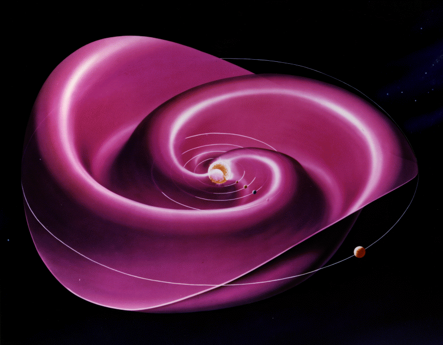

# 太阳风 {#sec-solarwind}

_太阳风_是从太阳持续吹向行星际空间的高速粒子流。它延伸到远远超出地球轨道的地方，并终止于一个称为日球层顶的激波前沿，在那里与弱电离的星际介质相接。预计日球层顶距太阳中心 110 至 160 AU（1 天文单位为 $1.5\times 10^{11}$m）。1977 年发射的旅行者 1 号和 2 号已穿过日球层顶，而且仍在运行！

在地球附近（即距离太阳约 1 AU 处），太阳风速度通常在 300 至 1400 $\mathrm{km}\,\mathrm{s}^{-1}$ 之间。平均值约为 $500\,\mathrm{km}\,\mathrm{s}^{-1}$，相当于从太阳飞行约 4 天。注意，太阳风既是_超声速_的，也是_超阿尔芬速_的。

太阳风主要由质子和电子组成。一般而言，氦（$\mathrm{He}^{++}$）约占 4%，氧（$\mathrm{O}^+$）不足 1%。

令人惊叹的是，Eugine Parker 在 1958 年从理论上预言了太阳风，比利用卫星数据证实其存在早了好几年。Parker 对太阳气体超声速外流的预言既是一个引人入胜的科学探案故事，也是等离子体物理的一次精彩应用。

太阳风起源于日冕。日冕是环绕太阳的高温稀薄等离子体，其特征温度和粒子密度分别约为 $10^6$K 和 $10^{14}\,\mathrm{m}^{-3}$。注意，日冕比太阳大气，即光球层，_热得多_。事实上，光球层温度只有约 6000 K。人们认为，来自光球层的阿尔芬波与湍流级联过程共同加热了日冕。日全食期间最容易观测日冕，此时它表现为紧邻太阳周围的白色丝状区域。

让我们遵循 Chapman 的思路，首先尝试构建一个静态日冕模型。日冕的静水平衡方程为
$$
\frac{\mathrm{d}p}{\mathrm{d}r} = - \rho\,\frac{G\,M_\odot}{r^2}
$$ {#eq-corona_static}
其中 $G= 6.67\times 10^{-11}\,\mathrm{m}^{3}\,\mathrm{s}^{-2}\,\mathrm{kg}^{-1}$ 是引力常数，$M_\odot=2\times 10^{30}\,\mathrm{kg}$ 是太阳质量。等离子体密度写为
$$
\rho\simeq n\,m_p
$$ {#eq-corona_mass_density}
其中 $n$ 是质子数密度。如果假设质子和电子具有共同的温度 $T(r)$，则日冕压力为
$$
p = 2nk_B T
$$ {#eq-corona_pressure_constT}

日冕的热导率由电子热导率主导，形式为（???）
$$
\kappa = \kappa_0\,T^{5/2}
$$
其中 $\kappa_0$ 对密度和温度的依赖相对较弱。在典型日冕条件下，这一热导率极高，约为室温下铜的热导率的二十倍。日冕热流密度写为
$$
\mathbf{q} = -\kappa\nabla T
$$

对于没有能量源或汇的静态日冕，要求
$$
\nabla\cdot\mathbf{q} = 0
$$

假设球对称，上式化为
$$
\frac{1}{r^2}\frac{\mathrm{d}}{\mathrm{d}r}\left(r^2\kappa_0\, k_B T^{5/2}\,\frac{dT}{\mathrm{d}r}\right) =0
$$

采用合理的边界条件，即日冕温度在远离太阳处必须趋于零，得到
$$
T(r) = T(a)\left(\frac{a}{r}\right)^{2/7}
$$ {#eq-corona_T_static}

参考位置 $r=a$ 方便地取为日冕底部，那里 $a\sim 7\times 10^5\,\mathrm{km}$、$n\sim 2\times 10^{14}\,\mathrm{m}^{-3}$，且 $T\sim 2\times 10^{6}$K。

将 @eq-corona_static、@eq-corona_mass_density、@eq-corona_pressure_constT 和 @eq-corona_T_static 联立并积分，得到
$$
p(r) = p(a) \exp\left\{\frac{7}{5}\,\frac{G\,M_\odot\,m_p}{2k_B T(a)\,a} \left[\left(\frac{a}{r}\right)^{5/7}-1\right]\right\}
$$

注意，当 $r\rightarrow\infty$ 时，日冕压力趋于一个有限常数：
$$
p(\infty) = p(a)\,\exp\left\{-\frac{7}{5}\,\frac{G\,M_\odot\,m_p}{2k_B T(a)\,a} \right\}
$$

当然，在远离太阳的地方没有任何东西能够承受这样的压力（星际介质的压力小得可以忽略）。因此，我们与 Parker 一样得出结论：静态日冕模型不符合物理实际。

既然刚才已经证明太阳日冕的静态模型并不令人满意，现在就尝试构建一个物质从太阳向外流动的动态模型。

## Parker 太阳风模型

根据对称性，我们预期日冕外流完全沿径向。日冕的径向动量守恒方程为
$$
\rho\,u\,\frac{du}{\mathrm{d}r} = -\frac{\mathrm{d}p}{\mathrm{d}r} - \rho\,\frac{G\,M_\odot}{r^2}
$$ {#eq-corona_dynamic_mass_cons}
其中 $u$ 是径向膨胀速度。连续性方程化为
$$
\frac{1}{r^2}\frac{\mathrm{d}(r^2\,\rho\,u)}{\mathrm{d}r} = 0
$$ {#eq-corona_dynamic_continuity_reduced}

为了得到封闭方程组，现在需要为日冕采用一个联系压力 $p$ 与密度 $\rho$ 的状态方程。为简单起见，我们采用所能设想的最简单状态方程，它对应于_等温_日冕。因此有
$$
p = \frac{2k_B\rho T}{m_p}
$$ {#eq-corona_dynamic_isothermal}
其中 $T$ 为常数。注意，更符合实际的状态方程会使分析复杂化，但不会显著改变任何物理结果。

对 @eq-corona_dynamic_continuity_reduced 积分可得
$$
r^2\,\rho\,u = I
$$ {#eq-corona_dynamic_continuity_integrated}
其中 $I$ 为常数。上式只是说明每单位立体角的质量通量为 $I$，与半径 $r$ 无关。将 @eq-corona_dynamic_mass_cons、@eq-corona_dynamic_isothermal 和 @eq-corona_dynamic_continuity_integrated 联立可得
$$
\frac{1}{u} \,\frac{du}{\mathrm{d}r}\left(u^2 - \frac{2k_B T}{m_p}\right) = \frac{4k_B T}{m_p\,r} - \frac{G\,M_\odot}{r^2}
$$ {#eq-corona_dynamic_governing}

我们只考虑满足下式的日冕温度：
$$
T < T_c \equiv \frac{G\,M_\odot\,m_p}{4k_B\,a}
$$
其中 $a$ 是日冕底部的半径。$T_c$ 定义为使 @eq-corona_dynamic_governing 右侧在 $r=a$ 处为零的温度。对于典型的日冕参数（见上一节），$T_c\simeq 5.8\times 10^6$K，显然高于 $r=a$ 处的日冕温度。当 $T<T_c$ 时，@eq-corona_dynamic_governing 的右侧在 $a<r<r_c$ 范围内为负，其中（???）
$$
\frac{r_c}{a} = \frac{T_c}{T}
$$ {#eq-corona_T_r}
而在 $r_c<r<\infty$ 范围内为正。@eq-corona_dynamic_governing 的右侧在 $r=r_c$ 处为零，这意味着左侧在此半径处也为零；该半径通常称为“临界半径”。@eq-corona_dynamic_governing 的左侧在临界半径处为零有两种情况：要么
$$
u^2(r_c) = u_c^2 \equiv \frac{2k_B T}{m_p}
$$ {#eq-corona_dynamic_critical1}
要么
$$
\frac{du(r_c)}{\mathrm{d}r} = 0
$$ {#eq-corona_dynamic_critical2}

注意，$u_c$ 是日冕声速。

容易证明，如果满足 @eq-corona_dynamic_critical1，则 $du/\mathrm{d}r$ 对所有 $r$ 同号，$u(r)$ 是 $r$ 的单调递增或单调递减函数。另一方面，如果满足 @eq-corona_dynamic_critical2，则 $u^2-u_c^2$ 对所有 $r$ 同号，且 $u(r)$ 在 $r=r_c$ 附近有一个极值。流动对于所有 $r$ 都是超声速，或对于所有 $r$ 都是亚声速。这些可能性使 @eq-corona_dynamic_governing 存在四类解，具有以下性质：

1. $u(r)$ 在整个区域 $a<r<\infty$ 内均为亚声速。$u(r)$ 随 $r$ 增大，在 $r=r_c$ 附近达到最大值，随后随 $r$ 减小。
2. 唯一解，$u(r)$ 随 $r$ 单调增大，且 $u(r_c) = u_c$。
3. 唯一解，$u(r)$ 随 $r$ 单调减小，且 $u(r_c) = u_c$。
4. $u(r)$ 在整个区域 $a<r<\infty$ 内均为超声速。$u(r)$ 随 $r$ 减小，在 $r=r_c$ 附近达到最小值，随后随 $r$ 增大。

这四类解如 @fig-parker-sol 所示。

::: {.content-visible unless-format="pdf"}

{#fig-parker-sol}

:::

上述每类解都对应 $r=a$ 和 $r\rightarrow\infty$ 处不同的一组边界条件。这些解在物理上是否可以接受取决于这些边界条件。例如，第 3 类和第 4 类解都可以排除为合理的日冕模型，因为它们预言日冕底部存在超声速流动，而这种流动既未被观测到，也与静态太阳光球层不一致。根据 $r=a$ 附近的性质，第 1 类和第 2 类解仍可作为日冕模型，因为它们都预言该区域的流动为亚声速。然而，当 $r\rightarrow\infty$ 时，第 1 类和第 2 类解的行为截然不同，这两类解在物理上是否可以接受取决于这一差异。

重新整理 @eq-corona_dynamic_governing 可得
$$
\frac{du^2}{\mathrm{d}r}\left(1-\frac{u_c^{~2}}{u^2}\right) = \frac{4\,u_c^{~2}}{r} \left(1-\frac{r_c}{r}\right)
$$
其中使用了 @eq-corona_T_r 和 $T_c$ 的定义。对上式积分得到
$$
\left(\frac{u}{u_c}\right)^2 -\ln\!\left(\frac{u}{u_c}\right)^2 = 4\,\ln\frac{r}{r_c} + 4\,\frac{r_c}{r} + C
$$ {#eq-corona_dynamic_sol}
其中 $C$ 为积分常数。

让我们考察 $r\rightarrow\infty$ 极限下第 1 类解的行为。从 @fig-parker-sol 可清楚看出，对于第 1 类解，当 $r\rightarrow\infty$ 时，$u/u_c$ 小于 1 且单调减小。在大 $r$ 极限下，@eq-corona_dynamic_sol 化为
$$
\ln\frac{u}{u_c} \simeq -2\,\ln\frac{r}{r_c}
$$
因此
$$
u\propto \frac{1}{r^2}
$$

由 @eq-corona_dynamic_continuity_integrated 可知，当 $r\rightarrow\infty$ 时，日冕密度 $\rho$ 趋于有限常数 $\rho_\infty$。因此，第 1 类解在大 $r$ 处给出有限压力
$$
p_\infty= \frac{2k_B\,\rho_\infty\,T}{m_p}
$$
它无法与小得多的星际介质压力相匹配。显然，第 1 类解不符合物理实际。

让我们考察 $r\rightarrow\infty$ 极限下第 2 类解的行为。从 @fig-parker-sol 可清楚看出，对于第 2 类解，当 $r\rightarrow\infty$ 时，$u/u_c$ 大于 1 且单调增大。在大 $r$ 极限下，@eq-corona_dynamic_sol 化为
$$
\left(\frac{u}{u_c}\right)^2 \simeq 4\,\ln\frac{r}{r_c}
$$
因此
$$
u \simeq 2\,u_c\,\left(\ln\frac{r}{r_c}\right)^{1/2}
$$

由 @eq-corona_dynamic_continuity_integrated 可知，$\rho\rightarrow 0$ 且 $r\rightarrow\infty$。因此，第 2 类解在大 $r$ 处给出 $p\rightarrow 0$，所以可以与低压星际介质相匹配。

我们得出结论，@eq-corona_dynamic_governing 中唯一符合 $r=a$ 和 $r\rightarrow\infty$ 处物理边界条件的是第 2 类解。该解预言日冕在靠近太阳时以相对较低的亚声速径向向外膨胀，并在远离太阳时逐渐加速至超声速。Parker 将日冕这种持续的超声速膨胀称为_太阳风_。

注意，虽然速度预言与卫星观测相当吻合，Parker 模型预言的地球处太阳风密度却明显高于卫星观测值。因此，这一模型有了许多进一步发展。特别是，人们放宽了太阳风等离子体等温这一不现实的假设，并在分析中纳入了双流体效应。

## Parker 螺旋

_行星际磁场_（IMF）也称为 _Parker 螺旋_，是被太阳风流从日冕拖出、充满太阳系的太阳磁场分量。根据光球层足点的极性，日球层磁场向内或向外螺旋；磁场在日球层南北两部分遵循形状相同的螺旋，但磁场方向相反。这两个磁场区域由电流片（局限在曲面内的电流）隔开。这个日球层电流片的形状类似旋转的芭蕾舞裙（@fig-helio-current-sheet），并随着太阳磁场大约每 11 年反转一次，在太阳活动周期中改变形状。

```jl
KeyNotes.plot_IMF_ecliptic()
```

```jl
KeyNotes.plot_IMF_3D()
```

{#fig-helio-current-sheet}

## 太阳风中的各向异性

观测方面，先驱者 6 号表明 1AU 处太阳风离子温度各向异性通常满足 $T_\parallel > T_\perp$，同时还带来了另外两项有趣发现：

1. 太阳黄道平面外的流速涨落很强；
2. 离子热分布具有各向异性（$T_\parallel / T_\perp \sim [2,5]$）；
3. 根据角分布和能量分布的荷质比分析，存在第三种粒子——氦。

这可能可以用第一绝热不变量的守恒来解释 [@scarf1967plasma]（这篇论文展示了我们领域的先驱如何开展真正优雅的物理研究！）。

无碰撞太阳风从太阳向外流动时，磁矩 $\mu = m v_\perp^2/2B$ 守恒。在太阳赤道附近，平均场强随距离减小，满足
$$
B_r(r) \simeq B_r(r_0)\Big( \frac{r_0}{r} \Big)^2
$$
以及
$$
B_\phi(r) \simeq \frac{\Omega_r}{u(r)}B_r(r)
$$

以上来自 Parker 螺旋太阳风模型，其中 $\Omega_r = 2.94\times 10^{-6}$ rad/s 是太阳自转角频率。

垂直方向的绝热方程表明，垂直热能 $\langle m v_\perp^2/2\rangle = k_B T_\perp$ 随 B 减小。假设在静止参考系中，分布函数为如下形式的双 Maxwell 分布：
$$
f(v) = \Big( \frac{m}{2\pi}  \Big)^{3/2}\frac{1}{k_B T_\perp (k_B T_\parallel)^{1/2}} \exp\Big( -\frac{mv_\perp^2}{2k_B T_\perp} -\frac{mv_\parallel^2}{2k_B T_\parallel} \Big)
$$

总热能
$$
W = \int \mathrm{d}^3v \frac{mv^2}{2}f(v)
$$
的守恒给出
$$
W = k_B T_\perp + k_B T_\parallel/2 = \text{const}.
$$

这些关系使我们能够计算从太阳表面各向同性分布出发的 $T_\perp$ 和 $T_\parallel$ 的变化。从 $T_\perp(0.3 AU) = T_\parallel(0.3 AU)\simeq 1.3\times 10^{5}\textrm{K}$ 出发，预言的地球处各向异性 $T_\parallel / T_\perp$ 可以超过 20！因此，实际上合理的问题是：为什么真实太阳风的各向异性因子如此之小？在模拟中，我们总是在上游太阳风条件中采用各向同性分布，这主要是因为我们通常使用流体模型（即 MHD）研究磁层与太阳风的整体相互作用。对于动理学模型，_我们需要更符合实际的分布设置_。

现在我们知道，压力各向异性发展时可以触发两种等离子体不稳定性：$T_\perp < T_\parallel$ 时为消防水管不稳定性，$T_\perp > T_\parallel$ 时为镜像不稳定性。进一步研究需要用动理学理论描述它们的行为。

另一方面，相反的情况 $T_\perp > T_\parallel$ 也被观测到，并被认为与宏观尺度压缩（例如高速流与低速流的相互作用）或等离子体不稳定性引起的局地离子加热有关 [@bame1975evidence]。

镜像不稳定性判据可作为确定激波下游压力各向异性的附加关系，摘自 Hasegawa 1975 年的著作 Plasma instabilities and nonlinear effects：
$$
1 + \sum_{\textrm{species}} \beta_\perp \big( 1 - \frac{\beta_\perp}{\beta_\parallel} \big) < 0
$$

## 磁场折返

当 Parker Solar Probe（PSP，帕克太阳探测器）从其奔向太阳的旅程中传回首批观测数据时，科学家发现了汹涌的电流和波动海洋的迹象，与距离我们星球近得多的近地空间大不相同。这片海洋中遍布后来被称为_磁场折返_（switchbacks）的现象：太阳磁场快速翻转，像蜿蜒曲折的山路一样反向。

::: {.content-visible unless-format="pdf"}

{#fig-switchbacks}

:::

目前的理解是，磁场折返可能由磁重联、湍流或等离子体速度剪切产生。每种机制都有相应模型，但都需要利用未来的 PSP 数据进一步检验。

::: {.content-visible unless-format="pdf"}

{#fig-switchbacks-mechanisms}

:::

更多内容参见 [磁场折返的科学：解释 Parker 太阳探测器的磁场之谜](https://www.nasa.gov/feature/goddard/2021/switchbacks-science-explaining-parker-solar-probe-s-magnetic-puzzle)。

## MHD 描述

由于太阳风携带强磁场，太阳风中的低频涨落通常用 MHD 描述。然而，由于某些特殊性质，太阳风湍流具有一些难以归入一般理论框架的特征。(Tu and Marsch 1995) 根据黄道面内的观测，对太阳风中的湍流现象进行了全面综述。20 世纪 90 年代，随着尤利西斯航天器的发射，研究扩展到了日球层的高纬度区域。

Ruelle 和 Takens（1971）表明，系统相空间中的奇异吸引子是湍流产生的最佳模型。这极大推动了从动力系统角度研究湍流现象学。太阳风被用作一个巨大的风洞，用于研究湍流涨落的标度律、多重分形模型等。因此，太阳风可以看作一个非常巨大的实验室，既可以研究充分发展的湍流本身，也可以研究其基本理论方面。

## 太阳风中的波模

太阳风观测表明，惯性区间太阳风湍流的可压缩分量以慢模为主。太阳风的低碰撞性使非热特征得以保留，这表明需要采用等离子体动理学描述。

动理学慢波（KSW）的作用在很大程度上被忽视，因为在太阳风的典型等离子体参数下，它受到强烈阻尼（Barnes, 1966; Narita & Marsch, 2015）。近年来，KSW（或压力平衡结构）常被用来解释流体尺度上的可压缩涨落及磁场强度 $B$ 与密度 $n$ 的反相关 [@howes2012slow; @verscharen2017kinetic]，也再次被用于解释亚离子尺度上观测到的可压缩性增强 [@lacombe2017anisotropies]。
