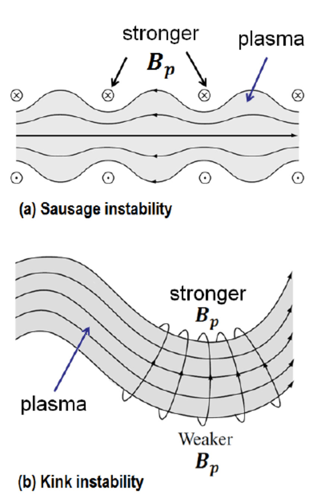
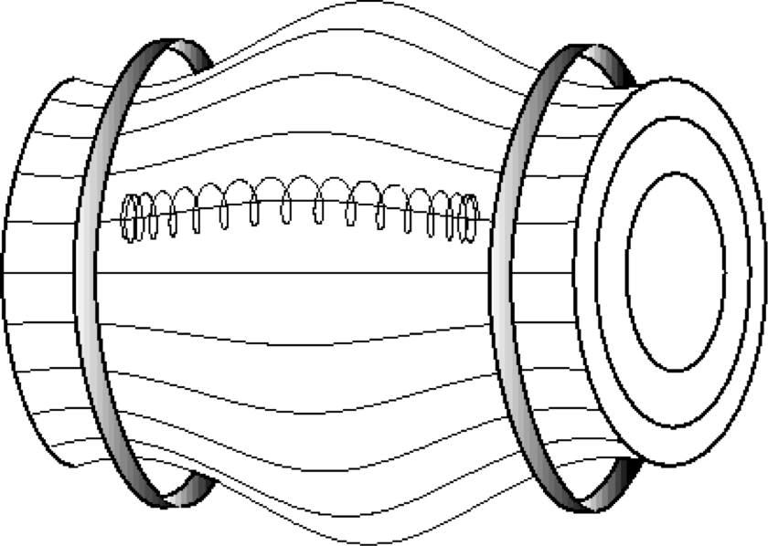
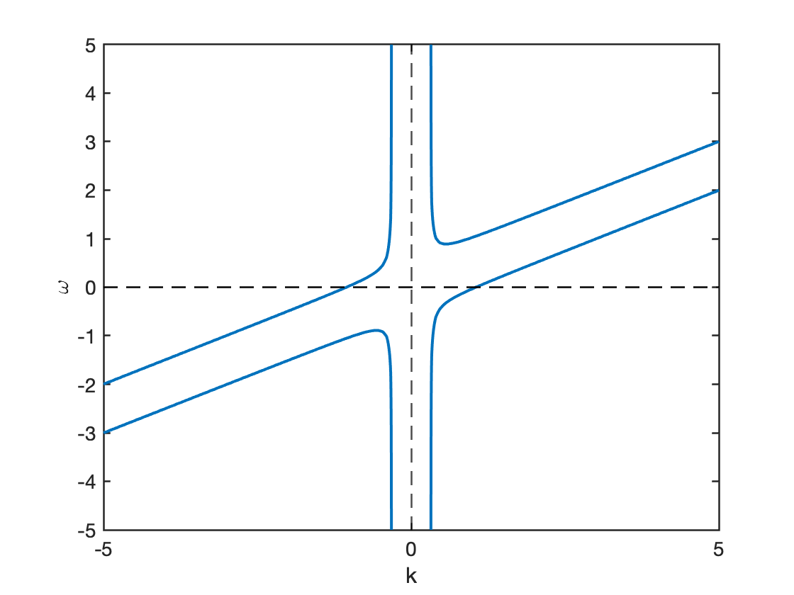
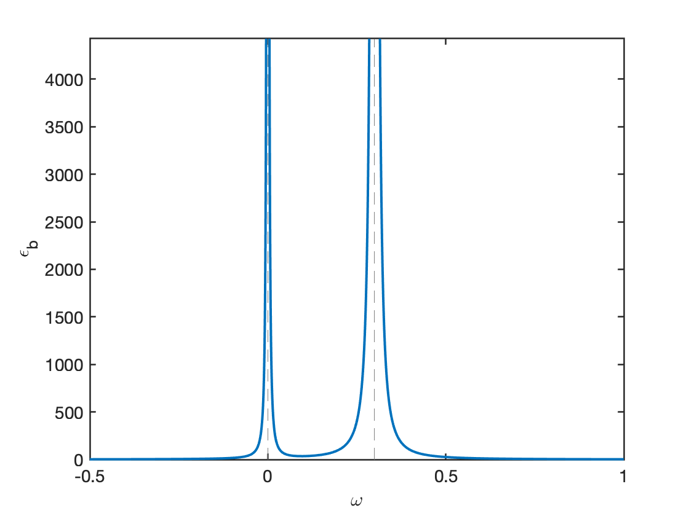
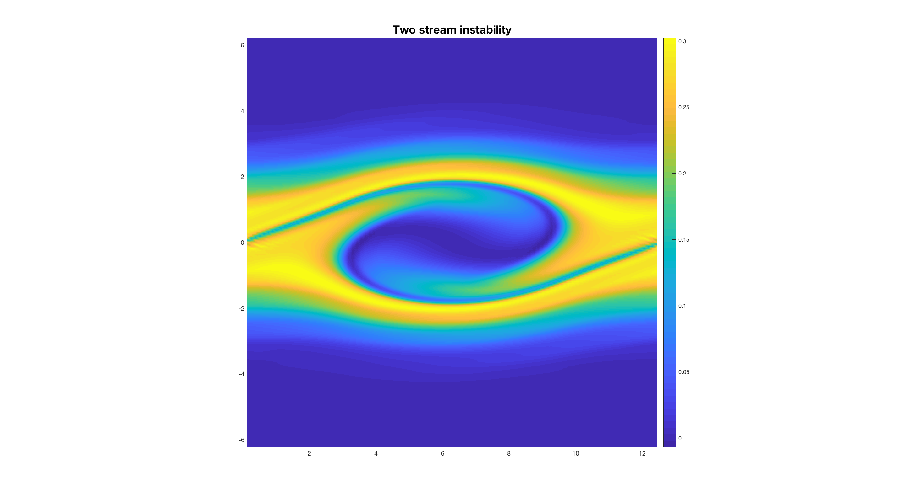
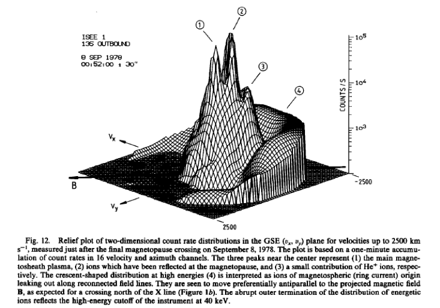
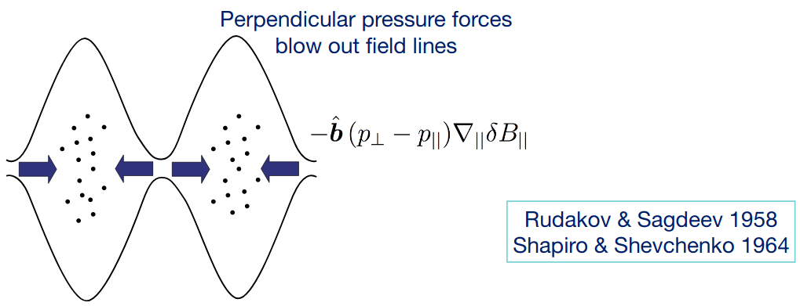

# 稳定性 {#sec-stability}

本章讨论等离子体平衡与稳定性，或者更确切地说，不稳定性。我们关注等离子体不稳定性在何时、何处以及如何产生。

磁场在宇宙中的天体里普遍存在。关于磁场为何呈现其特定形式，存在一些一般性问题：

* 为什么这种特定形式能够维持？
* 它是如何形成这种形式的？

任何重新组织磁场的过程都是一种输运现象，因此不稳定性受到广泛关注。从流体力学不稳定性到等离子体不稳定性，我们需要认识磁场和动力学物理在不稳定性过程中的作用：

* 现有的流体不稳定性可能受到磁场的影响。
* 不稳定性可能由磁场驱动。
* 流体力学中不存在的不稳定性可能出现在动力学描述中。

由于空间等离子体中有多种自由能来源，可能发展出数量众多的不稳定性。不稳定性增长并最终饱和，从而降低自由能。一般可将它们分为两组：

1. 宏观不稳定性：涉及的空间尺度与宏观尺寸（等离子体的整体尺度）相当，可以用流体理论处理；
2. 微观不稳定性：涉及的空间尺度与微观尺寸（回旋半径、惯性长度）相当，应当用动力学理论处理。

等离子体不稳定性种类繁多。

| 类型 | 说明 |
|--------------|-------------------|
| 束声波不稳定性 |  |
| 尾部隆起不稳定性 |  |
| Buneman 不稳定性 |  |
| 切伦科夫不稳定性 |  |
| Chute 不稳定性 |  |
| 合并不稳定性 |  |
| 坍缩不稳定性 |  |
| 对向流不稳定性 |  |
| 回旋不稳定性 | 阿尔芬、电子、静电、离子、磁声 |
| 破坏性不稳定性 |  |
| 双发射不稳定性 |  |
| 漂移不稳定性 | |
| 电热不稳定性 |  |
| 扇形不稳定性 |  |
| 丝化不稳定性 |  |
| 消防水管不稳定性 | @sec-firehose |
| 自由电子脉泽不稳定性 |  |
| 回旋管不稳定性 |  |
| 螺旋不稳定性 | 螺旋 |
| 交换不稳定性 | 瑞利–泰勒、笛形、气球、扭结、香肠 |
| 离子束不稳定性 |  |
| 低杂波漂移不稳定性 | @sec-LHDI |
| 磁漂移不稳定性 |  |
| 调制不稳定性 |  |
| 非阿贝尔不稳定性 | 色 Weibel |
| 成对不稳定性 |  |
| Parker 不稳定性 | 磁浮力 |
| Peratt 不稳定性 |  |
| 箍缩不稳定性 |  |
| 撕裂模不稳定性 | @sec-tearing |
| 双流不稳定性 | Kelvin-Helmholtz、@sec-KH |
| 弱束不稳定性 |  |
| Weibel 不稳定性 |  |
| Z 箍缩不稳定性 | Bennett 箍缩 |

研究不稳定性的基本方法：

* 写出方程。
* 在某个平衡解附近进行线性化。
* 加入扰动并观察其后果。
  * 寻找_简正模_解 $e^{i(\mathbf{k}\cdot\mathbf{x}-\omega t)}$，并求出增长率 $\Im(\omega)$ 与扰动波数 $\mathbf{k}$ 及问题参数之间的关系（即色散关系）。
  * 使用 _MHD 能量原理_：计算与扰动相关的势能变化 $\delta W$，并寻找满足 $\delta W<0$ 的扰动（只要存在任何一种这样的扰动，系统就不稳定；要稳定则所有类型的扰动都须满足 $\delta W>0 \forall$）。

## 能量原理的类比

首先，从能量原理出发进行直观考察。在经典力学中，我们学到运动会使系统的能量降低。对于两种不同密度流体之间最简单的瑞利–泰勒不稳定性，我们可以通过检查总势能的变化轻易判断是否存在不稳定性。在载流等离子体中，可以出现类似的运动。能量可表示为
$$
W=\frac{1}{2}LI^2
$$
其中 $L$ 是电感，$I$ 是电流。磁通量可写为
$$
\Phi = LI
$$
因此能量也可写为
$$
W=\frac{\Phi^2}{2L}
$$

磁通量与电流的关系类似于电荷与电压的关系 $Q=CV$，其中 $C$ 是电容。在磁通量 $\Phi$ 守恒的系统中（例如理想 MHD），等离子体通过增大电感 $L$ 来降低势能。参见 [@bellan2008fundamentals] 第 315 页。

1. 电流环、箍力、面积增大；
2. 香肠模；
3. 电流导线变为螺旋形。

## 单粒子运动对不稳定性的启示 {#sec-particle_motion_instability}

本节对等离子体中的不稳定性提供一些定性认识。从单粒子运动的角度思考不稳定性，可以使我们从非常基本的层面直观理解不稳定性的起因和发展。

### 从漂移看等离子体的平衡稳定性

核聚变的一个关键问题是约束等离子体。首先，需要在环面管周围设置电流环（添加图片！），以提供沿环面方向的环向磁场 $\mathbf{B}_t$。让我们观察环面的一个截面。（添加图片！）$\nabla B_0$ 指向内侧。$\mathbf{B}_0$ 指向纸面之外，因此梯度–曲率漂移会使电子向上、离子向下，进而产生一个向上的电场 E。随后 $\mathbf{E}\times\mathbf{B}$ 漂移会使电子和离子都向外边界运动，最终等离子体将会流失。一种解决办法是加入环向的内部等离子体电流 $\mathbf{J}_t$，产生极向磁场 $\mathbf{B}_p$，使边界处的磁场比中心处更强。这样，总磁场便成为螺旋形。

考虑 $\mathbf{J}_t$ 产生的极向磁场。进一步的问题是：理想圆柱构型受到无穷小扰动时，等离子体管是否稳定？答案是否定的。设想 @fig-kink-sausage b 所示的小扰动。$\nabla B$ 从弱 B 区域指向强 B 区域。在凸出的一侧，梯度–曲率漂移使离子向左、电子向右，进而产生从左指向右的电场。随后 $\mathbf{E}\times\mathbf{B}$ 漂移进一步将等离子体拉向凸出区域，整个系统再也无法回到平衡。这种载流等离子体不稳定性称为_扭结不稳定性_。这里描述的情况有时称为_线性扭结不稳定性_。扭结模可以承载电流。另一种类似的模式是 @fig-kink-sausage 所示的_香肠不稳定性_。还应注意，足够强的 $B_z$（不是极向／环向分量）可以使这些不稳定性稳定下来。

{#fig-kink-sausage}

另一种著名的不稳定性是瑞利–泰勒不稳定性。在流体动力学中，瑞利–泰勒不稳定性由重力引起。在等离子体物理中，重力的作用由电磁力取代。设想等离子体位于 $z>0$ 区域，其下方是真空空间。B 场指向纸面之外，$\nabla B$ 则向上（$B_{\text{up}}>B_{\text{down}}$）。由于边界处的梯度漂移，离子向左运动，电子向右运动，从而产生从左指向右的电场 E。因此，$\mathbf{E}\times\mathbf{B}$ 漂移会使等离子体从上方区域移向下方区域，最终破坏界面。（实际上我对这幅图有一些疑问：在我看来似乎无法判断界面的哪一部分首先发生变化？）

### 从单粒子运动看磁镜的稳定性 {#sec-single_particle_instability}

通过假定边界上存在初始小扰动，可以推断磁镜的稳定性。在中心截面上，首先存在一个向外的离心力，它会使电子向一个方向漂移、离子向相反方向漂移。电荷分离将产生电场。如果存在波纹，$\mathbf{E}\times\mathbf{B}$ 漂移将进一步把等离子体向外拉，从而导致不稳定性。有好几个名称描述的是同一现象：笛形不稳定性、R-T 不稳定性、交换不稳定性、重力不稳定性等。这种不稳定性以阿尔芬速度传播。

{#fig-magnetic-mirror}

一般而言，我们可以将构型分为两类：不稳定情况，其中 $\mathbf{B}$ 具有不利的“坏”曲率；以及稳定情况，其中 $\mathbf{B}$ 具有有利的“好”曲率。这取决于真空中的磁压是否强于等离子体内部。在基本磁镜中，中心边界处的等离子体不稳定，而线圈弯曲处附近的等离子体稳定。

著名的俄罗斯科学家 Ioffe 在磁镜周围引入导体棒，以产生_绝对最小 B 几何构型_：离开中心的任何位置，B 场都更强。这确实抑制了 R-T 不稳定性，但遗憾的是，由于损失锥分布引起的微观不稳定性，整个系统仍然不稳定。粒子数反转（高速粒子比低速粒子多）会导致不稳定性。后来科学家提出加入冷气体以改变分布，但注入冷气体的过程最终破坏了磁镜构型。

### 托卡马克中的稳定性

在经典托卡马克几何构型中，极向和环向磁场共同形成围绕环面的螺旋：
$$
\begin{aligned}
\mathbf{B}=\mathbf{B}_T+\mathbf{B}_P \\
B=\sqrt{{B_T}^2+{B_P}^2}\approx B_T
\end{aligned}
$$

场强随 $R$ 增大而减小，这意味着内侧半管处于好曲率区域，外侧半管处于坏曲率区域。将沿 B 力线的机械势能 $\mu B$ 作为 $\theta$ 的函数绘图，可以看到波峰和波谷。$v_\parallel$ 小的粒子被俘获，而 $v_\parallel$ 大的粒子是通过粒子。托卡马克是_平均最小 B 几何构型_，因为粒子在波峰（稳定区域）停留的时间更长，在波谷（不稳定区域）停留的时间更短。这种构型不如 Ioffe 棒磁镜稳健，因为一些 $v_\parallel$ 小的粒子始终被俘获在坏曲率区域。

更多内容参见 [@chen2016introduction] 第三版的“等离子体的应用”一章。

## 双流不稳定性

求得静电波色散关系的一般步骤是：

1. 从控制方程得到线性方程。
2. 求出线性化速度与扰动电场之间的关系。
3. 求出线性化密度与扰动电场之间的关系。
4. 求出电流对扰动电场的响应。
5. 从麦克斯韦方程得到介电张量。令 $|\pmb{\epsilon}|=0$，最终得到色散关系。对于各向同性情况，介电张量退化为标量，因此只需令 $\epsilon=0$。

假设一维简单平衡态（静止的“冷”离子和“冷”电子）：$m_i=\infty,E_0=B_0=0, p_i=p_e=0, n_i = n_0, T_e=T_i=0$。称等离子体为“冷”时，并不是说等离子体处于绝对零度，而只是说我们考虑的情况下动理学压力在色散关系中不起作用。由于 $\mathbf{B_0} = 0$，这也是_无磁化等离子体_。包含扰动的变量为
$$
\begin{aligned}
n_e &= n_0+n_1 \quad n_0\gg n_1\\
v_e &= v_0+v_1 \quad v_0\gg v_1 \\
E &= \cancel{E}_0 +E_1 \\
n_1(x,t)&=\tilde{n}_1e^{-i\omega t+ikx}
\end{aligned}
$$

电子连续性方程和动量方程为
$$
\begin{aligned}
&\frac{\partial}{\partial t}(n_0+n_1)+\frac{\partial}{\partial x}\big[(n_0+n_1)(v_0+v_1)\big]=0 \\
&\frac{\partial}{\partial t}(v_0+v_1)+(v_0+v_1)\frac{\partial(v_0+v_1)}{\partial x}=-\frac{e}{m_e}\big[ (E_0+E_1)+(\mathbf{v}_0+\mathbf{v}_1)\times(\mathbf{B}_0+\mathbf{B}_1)_x \big]
\end{aligned}
$$

同样，对于静电波，$\mathbf{B}_1=0$。忽略高阶项，得到线性化方程
$$
\begin{aligned}
\frac{\partial n_1}{\partial t}+\frac{\partial}{\partial x}(n_0 v_1)+\frac{\partial }{\partial x}(n_1v_0)&=0 \\
\frac{\partial v_1}{\partial t}+v_0\frac{\partial v_1}{\partial x}&=-\frac{e}{m_e}E_1
\end{aligned}
$$

与弗拉索夫理论一样，假设波动形式的扰动 $e^{ikx-i\omega t}$，由线性化动量方程得到
$$
\begin{aligned}
(-i\omega+ikv_0)v_1&=-\frac{e}{m_e}E_1 \\
\Rightarrow v_1&=\frac{\frac{e}{m_e}E_1}{i(\omega-kv_0)}.
\end{aligned}
$$

将其代入线性连续性方程，得到
$$
\begin{aligned}
-i\omega n_1+ikn_0v_1+ikn_1v_0=0 \\
\Rightarrow n_1=\frac{kn_0v_1}{\omega-kv_0}=\frac{kn_0}{\omega-kv_0}\frac{\frac{e}{m_e}E_1}{i(\omega-kv_0)}.
\end{aligned}
$$

这就是双流体理论中密度对电场扰动 $E_1$ 的响应。

接着可以利用泊松方程得到介电函数：
$$
\begin{aligned}
\nabla\cdot(\epsilon_0\mathbf{E}_1)+en_1\equiv\nabla\cdot(\epsilon \mathbf{E}_1)=0 \\
ik\epsilon_0 \tilde{E}_1+e\tilde{n}_1=ik\epsilon \tilde{E}_1 \\
\Rightarrow \epsilon=\epsilon_0 \Big[ 1-\frac{{\omega_{pe}}^2}{(\omega-kv_0)^2} \Big]
\end{aligned}
$$
这与弗拉索夫理论给出的结果相同（Y.Y. 习题集 \#6.2）。使用双流体方法的优点是不必考虑速度空间，从而简化推导。

如果有两股电子流，由 $g(v)$ 描述为
$$
\begin{aligned}
g(v)=\frac{1}{2}\big[ \delta(v-v_1)+\delta(v-v_2) \big]
\end{aligned}
$$
其振荡频率分别为 $\omega_{p1},\omega_{p2}$，数密度分别为 $n_{p1,1},n_{p2,1}$。考虑线性叠加性质，可以预期介电函数为
$$
\frac{\epsilon}{\epsilon_0}=1-\frac{{\omega_{p1}}^2}{(\omega-kv_1)^2}-\frac{{\omega_{p2}}^2}{(\omega-kv_2)^2}
$$

一般情况下，如果 $g(v)$ 是连续分布，$g(v)=\sum_j g_j(v)$，则
$$
\begin{aligned}
\frac{\epsilon}{\epsilon_0}&=1-\int_{-\infty}^{\infty}\sum_j \frac{{\omega_{p,j}}^2 g_j(v)\mathrm{d}v}{(\omega-kv)^2} \\ &=1-\frac{{\omega_{pe}}^2}{k^2}\int_{-\infty}^{\infty}\frac{g(v)\mathrm{d}v}{(v-\omega/k)^2}.
\end{aligned}
$$

注意 $\delta^\prime(x) = x^{-1}\delta(x)$。这里我们从双流体理论重新构造了弗拉索夫理论的结果。两种方法的等价性将在后面的“动力学模式的流体描述”一节中更深入地讨论（添加链接！）。

那么，如果包括离子运动会怎样？平衡态中的离子仍然是静止的“冷”离子，但现在有离子密度扰动。泊松方程应包含离子密度扰动：
$$
\begin{aligned}
\nabla\cdot(\epsilon_0 \mathbf{E}_1)&=\sum_{j=i,e} q_j n_{1j} \\
\Rightarrow \frac{\epsilon}{\epsilon_0}&=1-\frac{{\omega_{pe}}^2}{k^2}\int_{-\infty}^{\infty}\mathrm{d}v \frac{\partial g_e(v)/\partial v}{v-\omega/k}-\frac{{\omega_{pi}}^2}{k^2}\int_{-\infty}^{\infty}\mathrm{d}v \frac{\partial g_i(v)/\partial v}{v-\omega/k}
\end{aligned}
$$

在最简单的平衡情况下，$g_e(v)=\delta(v-v_0),\ g_i(v)=\delta(v)$：
$$
\frac{\epsilon}{\epsilon_0}=1-\frac{{\omega_{pe}}^2}{(\omega-kv_0)^2}-\frac{{\omega_{pi}}^2}{\omega^2}
$$

令 $\epsilon=0$，得到色散关系 $\omega=\omega(k)$。色散关系及介电函数性质的例子分别见 @fig-2stream-dispersion 和 @fig-2stream-dielectric。注意，对于实波数 $k$，会得到一对共轭的 $\omega$，其中位于 $0$ 与 $kv_0$ 之间的一个是不稳定模。这将表现出双流不稳定性，如 @fig-2stream-velocity 中的速度空间分布所示。

{#fig-2stream-dispersion}

{#fig-2stream-dielectric}

{#fig-2stream-velocity}

$$
\begin{aligned}
\epsilon(\omega,k)/\epsilon_0=1-\frac{{\omega_{pe}}^2}{(\omega-kv_0)^2}-\frac{{\omega_{pi}}^2}{\omega^2}=0 \notag \\
1=\frac{{\omega_{pe}}^2}{(\omega-kv_0)^2}+\frac{{\omega_{pi}}^2}{\omega^2}
\end{aligned}
$$

令 $\omega/\omega_{pe}=z,\ \frac{kv_0}{\omega_{pe}}=\lambda$，使 $z$ 和 $\lambda$ 为无量纲数。令右侧为 $f(z)$，则
$$
f(z)=\frac{1}{(z-\lambda)^2}+\frac{{\omega_{pi}}^2/{\omega_{pe}}^2}{z^2}=\frac{z^2+(z-\lambda)^2 \omega_{pi}^2/{\omega_{pe}}^2}{(z-\lambda)^2z^2}
$$

可以绘制 $f$，以找出发生不稳定性时 $k$ 的阈值。详见 Y.Y. 的习题集 6.3。

## 瑞利–泰勒不稳定性 {#sec-RT}

瑞利–泰勒不稳定性可能是最重要的 MHD 不稳定性。它也称为_重力不稳定性_、_笛形不稳定性_，或者更一般地称为_交换不稳定性_。在普通流体动力学中，当试图用轻流体支撑上方的重流体时，会出现瑞利–泰勒不稳定性：界面出现“波纹”，使重流体能够穿过轻流体下落。在等离子体中，当密集等离子体受到磁场压力支撑以抵抗重力时，也可能出现瑞利–泰勒不稳定性。

这种情况本身不会特别有趣或具有相关性，因为真实重力在等离子体中很少十分重要。然而，在弯曲磁场中，粒子沿弯曲磁力线运动而对等离子体产生的离心力相当于一种“重力”（@sec-gravity_field）。因此，分析瑞利–泰勒不稳定性有助于理解弯曲磁场中等离子体的稳定性质。
由实际磁场曲率驱动的类瑞利–泰勒不稳定性是非均匀等离子体中最猛烈的一类 MHD 不稳定性。

这里使用双流体模型和所谓的“弥散边界”模型 [@chen2016introduction] 对其进行数学描述。回忆磁镜的结构：弯曲的磁力线和中心处的高密度等离子体。由 @sec-single_particle_instability 的讨论可知，磁镜中心部分由于离心力而对瑞利–泰勒不稳定性不稳定。让我们简化情况，在笛卡尔坐标中研究这个问题。离心力与粒子电荷无关，与粒子质量成正比，因此离子和电子因此具有相同的加速度。我们用重力 $\mathbf{g}$ 代替离心力。在 @fig-RT-instability 中，上方是高密度等离子体，下方是低密度等离子体，其分布满足 $\partial n_o/\partial x<0$。

![瑞利–泰勒不稳定性的模拟 [@rahman2019]。](../../images/Rayleigh_Taylor_Instability.png){#fig-RT-instability}

### 双流体弥散边界模型

本节类似于 [@chen2016introduction] 的第 6.7 节。

连续性方程和动量方程为：
$$
\begin{aligned}
\frac{\partial n_j}{\partial t}+\nabla\cdot(n_j \mathbf{v_j})&=0 \\
\frac{\partial \mathbf{v_j}}{\partial t}+\mathbf{v_j}\cdot\nabla\mathbf{v_j}&=\frac{q_j}{m_j}\big( \mathbf{E}+\mathbf{v_j}\times\mathbf{B} \big)-\frac{\nabla P_j}{n_j m_j} + \mathbf{g}
\end{aligned}
$$
其中 $j=e^-, i^+$ 分别表示电子和离子。

假设一维情况：
$$
\begin{aligned}
T_e = T_i = 0 \Rightarrow P_e=n_ek_BT_e = 0,\ P_i = n_ik_BT_i = 0 \\
n_0 = n_0(x), \frac{\partial n_0}{\partial x}<0\ (\text{非均匀等离子体}) \\
\mathbf{g}=g\hat{x}, g=\textrm{const.}>0 \\
\mathbf{B}_0=B_0\hat{z},\ B_0=\textrm{const.},\ \mathbf{E}_0=0\ (\text{无梯度／曲率漂移})
\end{aligned}
$$

注意，如果 $P_e=P_i=0$，则没有抗磁电流（没有电场，因而没有沿 $\mathbf{B}_0$ 的电流？）：
$$
\begin{aligned}
&\mathbf{J}_{de}\times\mathbf{B}_0=-\nabla P_e=0 \\
&\mathbf{J}_{di}\times\mathbf{B}_0=-\nabla P_i=0 \\
\Rightarrow & \mathbf{J}_{de}=\mathbf{J}_{di}=0
\end{aligned}
$$

当平衡态被破坏时，就会出现不稳定性。什么力平衡了重力？答案是洛伦兹力中的 $\mathbf{v}\times\mathbf{B}$ 项：电子和离子分离产生电流，电流进而产生力。

添加图片！

在平衡状态下，$\frac{\partial}{\partial t}=0$，$\frac{\partial}{\partial y}\big[ n_{0j}(x)v_{0j} \big]=0,$ $v_{0j}=\text{const.}$，
$$
\begin{aligned}
&\frac{\partial{n_{oj}}}{{\partial t}}+\nabla\cdot(n_{oj}\mathbf{v}_{oj})=0 \\
&\frac{q_j}{m_j}\mathbf{v}_j\times\mathbf{B}_0+\mathbf{g}=0 \\
\Rightarrow &
\begin{cases}
\mathbf{v}_i=\frac{gm_i}{q_iB_0}(-\hat{y})=-\frac{g}{\Omega_i}\hat{y}=-\hat{y}v_{0i} \\
\mathbf{v}_e=\frac{gm_e}{q_eB_0}(\hat{y})=\frac{g}{\Omega_e}\hat{y}=\hat{y}v_{0e}\approx 0 (v_{0e}\ll v_{0i})
\end{cases}
\end{aligned}
$$
其中 $\Omega_i,\ \Omega_e$ 分别是离子和电子的回旋频率。

现在，在这个平衡态上引入静电扰动（$\mathbf{B}_1(\mathbf{x},t)=0$，$\nabla\times\mathbf{E}_1=-\frac{\partial \mathbf{B}_1}{\partial t}=i\omega\mathbf{B}_1=0$，$\mathbf{E}_1$ 可以写为标量势的梯度）：
$$
\mathbf{E}_1(\mathbf{x},t)=-\nabla\Phi_1 = -\nabla\big[ \phi_1(x)e^{ik_y y-i\omega t} \big]
$$

此外，采用所谓的“局部近似”，即假设 $\partial \phi_1/\partial x=0$，$\frac{\partial}{\partial x}\big[ E_1,\mathbf{v}_1,n_1 \big]=0$。这是一个非常激进的假设，它极大地简化了问题，但无法得到论证。许多教科书显式或隐式地使用这一假设（例如 [@bellan2008fundamentals] 用它来处理普遍不稳定性。回想求解弗拉索夫方程时，我们沿未受扰动轨道积分，这也要求这一假设）。

在这种情况下，
$$
\mathbf{E}_1=0\hat{x}+E_{1y}\hat{y}=\hat{y}\widetilde{E}_{1y}e^{ik_y y-i\omega t}
$$
其中 $\widetilde{E}_{1y}=-i k_y \phi_1$ 为常数。

线性化：
$$
\begin{aligned}
\frac{\partial}{\partial t}(n_0+n_1) +\nabla\cdot\big[ (n_0+n_1)(\mathbf{v}_0+\mathbf{v}_1) \big]&=0 \\
\frac{\partial}{\partial t}(\mathbf{v}_0+\mathbf{v}_1)+(\mathbf{v}_0+\mathbf{v}_1)\cdot\nabla(\mathbf{v}_0+\mathbf{v}_1)&=\frac{q}{m}\big[ \mathbf{E}_0+\mathbf{E}_1+(\mathbf{v}_0+\mathbf{v}_1)\times(\mathbf{B}_0+\mathbf{B}_1)\big]+\mathbf{g}
\end{aligned}
$$

去掉平衡项和高阶项，得到（注意 $\mathbf{g}$ 甚至没有出现在这里！在 MHD 中，它会以非常明确的方式出现。）
$$
\begin{aligned}
i(k_yv_{0y}-\omega)n_1=-n_0 ik_y v_{1y} - v_{1x}\frac{\partial n_0}{\partial x} \\
\frac{\mathrm{d}}{\mathrm{d}t}\mathbf{v}_1=i(k_yv_{0y}-\omega)\mathbf{v}_1=\frac{q}{m}\big( \mathbf{E}_1+\mathbf{v}_1\times\mathbf{B}_0 \big)
\end{aligned}
$$

现在，由线性化动量方程可以得到扰动速度的 x 和 y 分量；凭直觉也可以猜出表达式：
$$
\begin{aligned}
&v_{1,ix}=\frac{E_{1y}}{B_0},\ v_{1,ex}=\frac{E_{1y}}{B_0}\\
&v_{1,iy}=\frac{1}{\Omega_i}\frac{\mathrm{d}}{\mathrm{d}t}\Big(\frac{E_{1y}}{B_0} \Big)=\frac{i(k_yv_{0i}-\omega)}{\Omega_i}\Big( \frac{E_{1y}}{B_0}\Big),\ v_{1,ey}=\frac{1}{\Omega_e}\frac{\mathrm{d}}{\mathrm{d}t}\Big(\frac{E_{1y}}{B_0} \Big)\approx0
\end{aligned}
$$
其中 x 方向的是 $\mathbf{E}\times\mathbf{B}$ 漂移，y 方向的是极化漂移。

由线性化连续性方程，
$$
\begin{aligned}
i(k_y v_{0,yi}-\omega)n_{1i} &= -n_0 ik_y v_{1,yi} - v_{1,xi}\frac{\partial n_0}{\partial x} \\
-i\omega n_{1e} &= - v_{1,xe}\frac{\partial n_0}{\partial x}
\end{aligned}
$$

于是可以得到 $n_{1e}=n_{1e}(E_{1y}),\ n_{1i}=n_{1i}(E_{1y})$。令 $n_{1e}=n_{1i}$，得到色散关系
$$
\omega(\omega-k_y v_{0i})=g\frac{1}{n_0}\frac{\partial n_0}{\partial x}
$$

当 $k_y\rightarrow0$ 时，
$$
\omega^2=g\frac{1}{n_0}\frac{\partial n_0}{\partial x}<0 \Rightarrow\ \text{不稳定！}
$$

让我们再思考一下这种双流体方法。显然，我们不能用完全相同的方程处理尖锐边界，即 $\frac{\partial n_0}{\partial x}=\delta(x)$。然而，令人惊讶的是，MHD 方法可以轻松做到这一点，正如我们将在下一节看到的。

### 单流体 MHD 方法

在平衡状态下，$\mathbf{g}=\hat{x}g,\ \mathbf{B}_0=\hat{z}B_0(x),\ \mathbf{U}_0=0,\ \mathbf{E}_0=0,\ \rho_0(x),\ p_0(x)$。
$$
\begin{aligned}
\frac{\partial \rho_0}{\partial t}+\nabla\cdot(\rho_0 \mathbf{U}_0)=0 \\
0=\frac{1}{\mu_0}\Big[ -\frac{1}{2}\frac{\partial}{\partial x}({B_0}^2)\Big] -\frac{\partial}{\partial x}p_0(x)+\rho_0(x)g
\end{aligned}
$$

注意，不同压力占主导地位的情况有所不同。例如，在 z 箍缩中磁压占主导地位，而在激光脉冲中通常是热压占主导地位。

假设扰动具有形式
$$
\begin{aligned}
p_1(\mathbf{x},t) &= p_1(x) e^{ik_y y-i\omega t} \\
\rho_1(\mathbf{x},t) &= \rho_1(x) e^{i k_y y-i\omega t} \\
\mathbf{U}_1 &=\frac{\partial \pmb{\xi}_1}{\partial t}=-i\omega\pmb{\xi}_1
\end{aligned}
$$
其中 $\pmb{\xi}_1$ 是位移。

可以计算各个线性项：
$$
\begin{aligned}
\big[(\mathbf{B}_0+\mathbf{B}_1)\cdot\nabla \big](\mathbf{B}_0+\mathbf{B}_1) \approx (\mathbf{B}_0\cdot\nabla)\mathbf{B}_1 + (\mathbf{B}_1\cdot\nabla)\mathbf{B}_0 = \big( B_0(x)\frac{\partial}{\partial z}\big)\mathbf{B}_1 \\
B^2 = (\mathbf{B}_0+\mathbf{B}_1)\cdot(\mathbf{B}_1+\mathbf{B}_1)\approx 2\mathbf{B}_0\cdot\mathbf{B}_1 \\
\mathbf{U} = \mathbf{U}_0+\mathbf{U}_1 = \mathbf{U}_1
\end{aligned}
$$

张力项没有 x 或 y 分量，因此可以直接忽略。于是线性化动量方程可写为
$$
\rho_0\frac{\partial \mathbf{u}_1}{\partial t}=\rho_0\frac{\partial^2\pmb{\xi}_1}{\partial t^2}=-\nabla\Big( \frac{\mathbf{B}_0\cdot\mathbf{B}_1}{\mu_0}\Big) - \nabla p_1 +\rho_1\mathbf{g}
$$
它可以分解为两个标量方程：
$$
\begin{aligned}
-\rho_0 \omega^2 \xi_{1x} &= -\frac{\partial}{\partial x}\Big( \frac{\mathbf{B}_1\cdot\mathbf{B}_1}{\mu_0}+p_1 \Big) +\rho_1 g \\
-\rho_0 \omega^2 \xi_{1y} &= -ik_y\Big( \frac{\mathbf{B}_1\cdot\mathbf{B}_1}{\mu_0}+p_1\Big)
\end{aligned}
$$

假设不可压缩：
$$
\nabla\cdot\mathbf{u}=0\Rightarrow \nabla\cdot\mathbf{u}_1=0,\ \nabla\cdot\pmb{\xi}_1=\frac{\partial \xi_{1x}}{\partial x}+ik_y \xi_{1y}=0
$$

线性化连续性方程（@sec-es_wave_magnetized）给出
$$
\rho_1=-\nabla\cdot(\rho_0\pmb{\xi}_1)=\xi_{1x}\frac{\partial}{\partial x}\rho_0
$$

结合最后四个方程，得到
$$
-\rho_0\omega^2 \xi_{1x} = -\frac{\partial}{\partial x}\Big[ \rho_0\omega^2 \frac{1}{{k_y}^2}\frac{\partial \xi_{1x}}{\partial x}\Big] - g\xi_{1x}\frac{\partial \rho_0}{\partial x}
$$ {#eq-RT_MHD_linear}

这是瑞利–泰勒不稳定性的控制方程，与 [@bellan2008fundamentals] 中的式 (10.15) 相同。注意，这里没有对 x 依赖性作任何假设；如果直接像前面那样使用局部近似，就会立即得到相同的结果。

为处理尖锐边界问题，假设
$$
\begin{aligned}
\rho_0= \left\{
\begin{array}{rl}
\textrm{const.} & \text{若 } x<0 \\
0 & \text{若 } x>0
\end{array} \right.
\end{aligned}
$$

则对于 $x<0$，
$$
\begin{aligned}
\frac{\partial^2 \xi_{1x}}{\partial x^2} -{k_y}^2 \xi_{1x} = 0 \\
\Rightarrow\ \xi_{1x}=Ae^{k_y x} + Be^{-k_y x}
\end{aligned}
$$

而对于 $x>0$，
$$
\begin{aligned}
\frac{\partial^2 \xi_{1x}}{\partial x^2} -{k_y}^2 \xi_{1x} = 0 \\
\Rightarrow\ \xi_{1x}=Ce^{k_y x} + De^{-k_y x}
\end{aligned}
$$

由于无穷远处对场的要求，系数 $B$ 和 $C$ 必须为零。根据 $x=0$ 处的连续性，令
$$
A = D = \xi_0
$$

密度分布满足
$$
\frac{\partial \rho_0}{\partial x}=-\rho_0\delta(x)
$$

将控制方程 @eq-RT_MHD_linear 从 $x=0^-$ 到 $x=0^+$ 积分，得到
$$
\begin{aligned}
&-\frac{\rho_0 \omega^2}{{k_y}^2}\frac{\xi_{1x}}{\partial x}\bigg|_{x=0^-}^{x=0^+} - g\xi_{1x}(-\rho_0)=0 \\
\Rightarrow &\omega^2=k_y g
\end{aligned}
$$

因此增长率为 $\gamma=\Im(\omega)=\sqrt{k_y g}$。可以注意到这里 $\mathbf{k}\cdot\mathbf{B}_0=0$，因此色散关系中的这一磁场稳定项为零。

### 双流体尖锐边界模型

现在回过头来看看能否用双流体模型处理尖锐边界问题。这实际上并不容易：S. Chandraserkhar 首先从粒子轨道理论的角度解决了它。我认为有一种更“现代”的方法可以完成完全相同的工作，但这里仅列出原始推导。

考虑均匀重力场中位于水平面上方、温度均匀的等离子体，重力方向竖直向下。存在沿 x 方向的水平磁场，它在边界两侧各自的半空间内均匀，边界平面 $z=0$ 处均匀的水平电流片使场强发生跃变。重力由等离子体中的压力梯度和 $z=0$ 处磁压的跃变共同平衡。

现在假设 $z=0$ 处的等离子体边界受到正弦扰动而出现波纹，如 fig-RT_perturb 所示。界面位移可写为（添加图片！）
$$
\Delta z = a \sin ky
$$ {#eq-RT_displacement_z}
其中扰动振幅 $a$ 被认为很小，$k(=2\pi/\lambda)$ 是扰动在 y 方向上的波数。重力产生的漂移为
$$
\mathbf{V}_g = \frac{m}{q}\frac{\mathbf{g}\times\mathbf{B}}{B^2}
$$

由于磁场沿 x 方向，电子将向右漂移，正离子将向左漂移。因此，重力漂移使等离子体中的电荷分离，形成 @fig-RT-displacement 所示的边界。由离子和电子分离（$\delta\Delta z$）造成的面电荷 $\delta\sigma$ 为
$$
\begin{aligned}
\delta\sigma&=Ne\delta\Delta z \\
&=Ne\frac{\partial \Delta z}{\partial y}\delta y \\
&=e\frac{\partial \Delta z}{\partial y}V_g \delta t
\end{aligned}
$$

因此，面电荷密度的时间变化率为
$$
\begin{aligned}
\frac{\partial \sigma}{\partial t}&=NeV_g\frac{\partial}{\partial y}\Delta z \\
&=-Ne\frac{Mg}{eB}ak\cos ky \\
&=-\frac{NMeg}{B}ak\cos ky
\end{aligned}
$$ {#eq-RT_time_rate_surface_charge}
写出这些表达式时，我们忽略了电子漂移，因为它与离子漂移相比小 $m/M$ 倍。由面电荷产生的电场可以直接计算。在远离边界的区域，必须满足
$$
\nabla\cdot(\epsilon\mathbf{E})=0
$$ {#eq-RT_dielectric}
其中 $\epsilon=\epsilon_0\big( 1+\frac{{\omega_{pi}}^2}{{\Omega_i}^2}\big)=...$ 是等离子体的介电常数。界面处的电场由下式确定：
$$
\nabla\cdot(\epsilon\mathbf{E})=\frac{1}{\mu_0}\frac{\sigma}{dz}
$$
其中 $\sigma$ 是面电荷密度，$\mathrm{d}z$ 是该层的无穷小厚度。现在对体积元 $\mathrm{d}S\mathrm{d}z$ 积分。右侧给出柱形体积元内的电荷（$\sigma\mathrm{d}S$）。利用高斯定理变换左侧，得到
$$
\epsilon E_z dS = \frac{1}{\mu_0}\sigma dS = \frac{1}{\mu_0}\sigma_0 \cos ky dS
$$

因此，界面处的电场为
$$
\epsilon E_z = \frac{\sigma_0}{\mu_0}\cos ky
$$ {#eq-RT_surface_bc}

在等离子体内部满足 @eq-RT_dielectric、且在 $z=0$ 处满足边界条件 @eq-RT_surface_bc 的电场具有以下分量：
$$
\begin{aligned}
E_y &= \frac{\sigma_0}{\mu_0\epsilon}\sin ky\, e^{-kz} \\
E_z &= \frac{\sigma_0}{\mu_0\epsilon}\cos ky\, e^{-kz}
\end{aligned}
$$
其中 $E_x=0$。这些电场产生的漂移可以由下式计算：
$$
\mathbf{V}=\frac{\mathbf{E}\times\mathbf{B}}{B^2}
$$

注意到 $\mathbf{B}$ 沿 x 方向，得到
$$
V_y = \frac{E_z}{B},\quad V_z = -\frac{E_y}{B}
$$

由前述方程得到
$$
\begin{aligned}
V_y &= \frac{\sigma_0}{\mu_0 B}\cos ky\, e^{-kz} \\
V_z &=-\frac{\sigma_0}{\mu_0 B}\sin ky\, e^{-kz}
\end{aligned}
$$

从解中可以清楚地看到，速度场的散度为零，因此除边界处之外不会引起等离子体密度变化。有
$$
\frac{\partial}{\partial t}\Delta z(z=0)=V_z(z=0) = -\frac{\sigma}{\mu_0 B}\sin ky
$$ {#eq-RT_vel_boundary}

由 @eq-RT_displacement_z 和 @eq-RT_vel_boundary，得到振幅 $a$ 的运动方程：
$$
\frac{\mathrm{d}a}{\mathrm{d}t}=-\frac{\sigma_0}{\mu_0 B}
$$

由 @eq-RT_time_rate_surface_charge 和 @eq-RT_surface_bc 得到
$$
\frac{\mathrm{d}\sigma_0}{\mathrm{d}t}=-\frac{NMg}{\mu_0B}ak
$$

由上述两个方程得到
$$
\begin{aligned}
\frac{\mathrm{d}^2 a}{\mathrm{d}t^2} &= \frac{1}{\mu_0\epsilon B}\frac{NMg}{B}ka \\
&\approx gka, \quad(\text{当 } \epsilon \gg 1)
\end{aligned}
$$
（由平衡条件得到 $g=...$）。该方程的解为
$$
a(t) = a_0e^{\pm\sqrt{gk} t}
$$

有趣的是，这种不稳定性的增长率与无重量流体支撑另一种流体抵抗重力时的瑞利–泰勒不稳定性增长率完全相同。电荷分离恰好能够克服磁场的约束作用。这种完全抵消只在 $\epsilon\gg1$ 的极限下发生。

使用玻尔兹曼输运方程的严格形式也可以得到相同结果。然而，在更复杂的情况下，一阶轨道理论的结果只有在某些特殊情况下才与玻尔兹曼方程的结果一致。

产生这种不稳定性的基本机制是重力漂移导致的电荷分离——这种漂移由不依赖电荷符号的力引起。如果考虑环面中的等离子体构型，粒子会受到离心力 $m{v_\parallel}^2/R$ 和 B 梯度力 $m{v_\perp}^2/R$，两者都与电荷符号无关。因此，我们应当预期被约束在环面中的等离子体会出现不稳定性。

## Kelvin–Helmholtz 不稳定性 {#sec-KH}

Kelvin–Helmholtz（KH）不稳定性由速度剪切引起，在剪切层产生表面波，最终卷曲成非线性涡旋。典型例子包括：

* 飞机坠毁
* 旗帜飘动
* 电子片中的二回旋不稳定性
* 水波的非线性阶段
* 激光烧蚀金属
* 行星际磁场朝北期间磁层顶的低纬度侧翼
* 吸积盘
* 脉冲星风
* 射流

它是通过黏性相互作用、湍流、模态转换和磁重联等过程，在具有速度剪切的边界层中调节质量、动量和能量输运的重要机制。

为了理解剪切流为何能导致不稳定性，首先介绍流体力学中的伯努利定理。在 MHD 动量方程中取 $\partial/\partial t=0,\ \mathbf{J}=0,\ \mathbf{g}=0$，得到
$$
\begin{aligned}
\rho\mathbf{v}\cdot\nabla\mathbf{v}=-\nabla p
\end{aligned}
$$

使用自然坐标，设 $\hat{t}$ 为流线上的单位切向量，$\hat{n}$ 为从凹侧指向凸侧的单位法向量，$ds$ 为沿流线的无穷小距离，得到
$$
\begin{aligned}
\rho\mathbf{v}\cdot\nabla\mathbf{v} &= (\rho v\frac{\partial }{\partial s})\mathbf{v} =\rho v_s \frac{\partial }{\partial s}(\hat{t} v) =\rho v \Big( \frac{\partial v}{\partial s}\hat{t} + \frac{\partial \hat{t}}{\partial s}v\Big) \\
&=-\frac{\partial p}{\partial s}\hat{t}-\nabla_\perp p\\
\Rightarrow \hat{t}:\ pv\frac{\partial v}{\partial s}+\frac{\partial p}{\partial s}&=\frac{\partial}{\partial s}\Big( \frac{1}{2}\rho v^2 + p \Big) = 0
\end{aligned}
$$

因此，对于不可压缩流，$\frac{1}{2}\rho v^2 + p = \text{const.}$ 沿流线成立。这是经典的伯努利方程。

现在考虑 fig-two-layer 中在平面界面处具有速度剪切的两层流体（添加图片！）。设想层间界面在 $Q$ 处有一个向上的波纹。分别考察下层在 $P$ 和 $Q$ 处的截面，得到
$$
\begin{aligned}
\text{P 处通量} = \rho v A|_P = \text{Q 处通量} = \rho v A|_Q
\end{aligned}
$$

由于沿力线的密度不变（不可压缩）且面积 $A_P<A_Q$，有 $v_P>v_Q$。由伯努利方程，$p_P<p_Q$。类似地，对上层可得到 $P$ 处压力大于 $Q$ 处。因此，总压力指向远离界面的方向，使波纹增长。

::: {.content-visible unless-format="pdf"}

{#fig-two-layer-flow}

:::

现在可以进行更仔细的推导。控制方程为
$$
\begin{aligned}
\nabla\cdot\mathbf{v}&=0 \\
\rho\Big( \frac{\partial\mathbf{v}}{\partial t}+\mathbf{v}\cdot\nabla\mathbf{v}\Big) &= -\nabla p \\
\end{aligned}
$$

在平衡状态下，假设 x 方向存在速度剪切，界面沿 y 方向，
$$
\begin{aligned}
\rho_0 &= \text{const.} \\
p_0 &= \text{const.} \\
\mathbf{v}_0 &= \hat{y}v_{0y}(x)
\end{aligned}
$$

假设线性扰动具有形式
$$
\begin{aligned}
v_{1x}(\mathbf{x},t) &= v_{1x}(x)e^{i k_y y-i\omega t} \\
p_1(\mathbf{x},t) &= p_1(x)e^{i k_y y-i\omega t}
\end{aligned}
$$
则线性化动量方程为
$$
\rho_0\big( \frac{\partial \mathbf{v}_1}{\partial t}+\mathbf{v}_0\cdot\nabla\mathbf{v}_1 +\mathbf{v}_1\cdot\nabla\mathbf{v}_0 \big) = -\nabla p_1
$$
其中
$$
\begin{aligned}
\mathbf{v}_0\cdot\nabla\mathbf{v}_1 &= i k_y v_{0y} \mathbf{v}_1 \\
\mathbf{v}_1\cdot\nabla\mathbf{v}_0 &= v_{1x}\frac{\partial}{\partial x}v_{0y}(x)\hat{y}
\end{aligned}
$$

于是线性化动量方程的 x 和 y 分量给出
$$
\begin{aligned}
-i\omega \rho_0 v_{1x} +\rho_0 i k_y v_{0y}v_{1x} &= -\frac{\partial p_1}{\partial x} \\
-i\omega \rho_0 v_{1y} + \rho_0 i k_y v_{0y}v_{1y} + \rho_0 v_{1x}\frac{\partial}{\partial x}v_{0y}(x) &= -ik_y p_1
\end{aligned}
$$

结合线性化不可压缩条件
$$
\frac{\partial v_{1x}}{\partial x} + ik_y v_{1y}  = 0
$$
消去 $p_1$ 和 $v_{1y}$，得到
$$
\frac{\partial^2 v_{1x}}{\partial x^2} - \Big[ {k_y}^2 - \frac{k_y {v_{0y}}^{\prime\prime}(x)}{\omega-k_y v_{0y}(x)} \Big]v_{1x} = 0
$$ {#eq-KH_governing}

现在离得到色散关系已完成一半。为简单起见，假设三个层区：区域 I 在左侧（$x<0$），区域 II 在中间（$x\in(0,\tau)$），区域 III 在右侧（$x>\tau$）。设剪切层 II 的厚度为 $\tau$。令两侧速度为 $v_1 = 0,\ v_2 = v_1+\Delta v \equiv v$，并令 $k_y=k$。则
$$
v_{0y}^{\prime\prime}(x) = \Big(\frac{v}{\tau}\Big)\big[ \delta(x) - \delta(x-\tau)\big]
$$
除 $x=0$ 和 $x=\tau$ 处外，@eq-KH_governing 可以简化为
$$
\frac{\mathrm{d}^2 v_{1x}}{\mathrm{d}x^2}-k^2 v_{1x} = 0
$$

在区域 I（$x<0$），
$$
\begin{aligned}
v_{1x} &= \xi_0 e^{kx},\quad x<0 \\
\frac{\partial v_{1x}}{\partial x}\big|_{x=0_-} &= k\xi_0
\end{aligned}
$$

在区域 III（$x>\tau$），
$$
\begin{aligned}
v_{1x} &= \xi_\tau e^{-k(x-\tau)},\quad x>\tau \\
\frac{\partial v_{1x}}{\partial x}\big|_{x=\tau^+} &= -k\xi_\tau
\end{aligned}
$$

在区域 II（$x\in(0,\tau)$），我们寻找两侧解的叠加，且在边界连续：
$$
\begin{aligned}
v_{1x} &=\xi_\tau \frac{\sinh{kx}}{\sinh{k\tau}} + \xi_0\frac{\sinh{k(x-\tau)}}{\sinh{-k\tau}},\quad 0<x<\tau \\
\frac{\partial v_{1x}}{\partial x}\big|_{x=\tau^-} &= k\xi_\tau \frac{\cosh{k\tau}}{\sinh{k\tau}} - k\xi_0\frac{1}{\sinh{k\tau}} \\
 \frac{\partial v_{1x}}{\partial x}\big|_{x=0^+} &= k\xi_\tau \frac{1}{\sinh{k\tau}} - k\xi_0\frac{\cosh{k\tau}}{\sinh{k\tau}}
\end{aligned}
$$

$x = 0$ 处的连续性要求 $V_{0y}=0, V_{1x}=\xi_0$。将控制方程 @eq-KH_governing 从 $x=0^-$ 到 $x=0^+$ 积分，得到
$$
-\xi_0 k\frac{\cosh{k\tau}}{\sinh{k\tau}} + \xi_\tau k\frac{1}{\sinh{k\tau}} - k\xi_0 + \frac{kv}{\omega\tau}\xi_0 = 0
$$

将控制方程 @eq-KH_governing 从 $x=\tau^-$ 到 $x=\tau^+$ 积分，得到
$$
-\xi_\tau k +\xi_0 k\frac{1}{\sinh{k\tau}} - \xi_\tau k\frac{\cosh{k\tau}}{\sinh{k\tau}} - \frac{kv}{\omega\tau}\xi_\tau = 0
$$

结合最后两个方程，得到
$$
1 = \Big[ \sinh{k\tau} + \cosh{k\tau} + \frac{kv}{\omega-kv}\frac{\sinh{k\tau}}{k\tau}\Big] \Big[ \cosh{k\tau}+\sinh{k\tau} - \frac{kv}{\omega}\frac{\sinh{k\tau}}{k\tau}\Big]
$$
这就是 KH 不稳定性的色散关系。

利用恒等式 $\sinh{k\tau} + \cosh{k\tau} = e^{k\tau}$，色散关系可简化为
$$
\begin{aligned}
1 &= \Big[ e^{k\tau} + \frac{kv}{\omega-kv}\frac{\sinh{k\tau}}{k\tau}\Big] \Big[ e^{k\tau} - \frac{kv}{\omega}\frac{\sinh{k\tau}}{k\tau}\Big] \\
1 &= e^{2k\tau} +e^{k\tau}\frac{(k\tau)^2}{\omega(\omega-kv)}\frac{\sinh{k\tau}}{k\tau} - \frac{(k\tau)^2}{\omega(\omega-k\tau)}\Big(\frac{\sinh{k\tau}}{k\tau}\Big)^2 \\
1 &= e^{2k\tau} + \frac{(k\tau)^2}{\omega(\omega-kv)} \frac{\sinh{k\tau}}{k\tau} \Big[ e^{k\tau} - \frac{\sinh{k\tau}}{k\tau}\Big]
\end{aligned}
$$

两侧乘以 $\omega(\omega-kv)$，得到
$$
\omega(\omega-k\tau)(1-e^{2k\tau}) = (kv)^2  \frac{\sinh{k\tau}}{k\tau} \Big[ e^{k\tau} - \frac{\sinh{k\tau}}{k\tau}\Big]
$$

假设 $k\tau\ll 1$（长波长近似），$e^{k\tau}\approx 1+k\tau$，得到
$$
\omega(\omega-kv) + \frac{(kv)^2}{2} \approx 0
$$
其解为
$$
\omega=\frac{1}{2}kv(1\pm i),\quad k\tau \ll 1
$$

一般而言，KH 的增长率为
$$
\omega_i = \frac{1}{2}|k_y \Delta v|,\quad k_y\tau\ll 1
$$

### 电子片上的二回旋不稳定性

尚未核查！

二回旋不稳定性是一种由两个电荷片相互滑过而产生的等离子体不稳定性。能量以两个沿相反方向传播、其中一个从另一个上方流过的表面波的形式耗散。这种不稳定性是流体力学中 Kelvin–Helmholtz 不稳定性的等离子体对应物。

最简单的情况是一个均匀电子片，以及片平面内与之平行的恒定磁场，如 fig-electron-sheet 所示。由于电子片的空间电荷，上下区域存在指向电子片的电场。考虑电子片上的一个小扰动（正弦形波纹）。库仑力将电子向外排斥，因此根据右手定则，电子会向左漂移。电子的缺失相当于某种正电荷分布，从而产生电场。$\mathbf{E}\times\mathbf{B}$ 漂移向外，因此扰动会增长。注意，尽管这个问题看似简单，实际上并不容易。人们甚至等离子体物理学的巨擘都曾在推导中犯许多错误！

如果电子片内部也有磁场，$\mathbf{E}\times\mathbf{B}$ 漂移将在片内形成速度梯度，并导致 K-H 不稳定性。用 $\sigma_0$ 表示面电荷密度，$\rho_0$ 表示电荷密度，有
$$
\sigma_0 = \rho_0 \tau = en_0\tau,
$$
以及跨越电子片的速度剪切
$$
\Delta v = \frac{E_2}{B_0} + \frac{E_1}{B_0} = -\frac{1}{B_0}\frac{\sigma_0}{\epsilon_0}=-\frac{en_0\tau}{B_0 \epsilon_0}.
$$
于是由 K-H 模的色散关系，得到增长率
$$
\omega_i = \frac{1}{2}k_y|\Delta v|=\frac{1}{2}k_y\Big|\frac{en_0\tau}{B_0 \epsilon_0}\Big|=\frac{1}{2}k_y \tau\frac{{\omega_{pe}}^2}{|\Omega_e|},
$$
只要 $k_y\tau\ll1$，即长波长极限，该结果便有效。

::: {.content-visible unless-format="pdf"}

{#fig-electron-sheet}

:::

[@bellan2008fundamentals] 第 537 页。

需要来自 H.W.3.4 的图片
考虑在金属漂移管内传播的类似 MELBA 的环形电子束上的二回旋不稳定性。设 $V = $ 束电压，$I =$ 束电流，$a =$ 束半径，$\tau=$ 环形束厚度（$\tau\ll 1$）m，$L=$ 漂移管长度，$T = $ 束脉冲长度，$B=$ 轴向磁场。注意，束流的自电场和自磁场共同产生沿 $\theta-$ 方向的缓慢旋转 $\mathbf{E}\times\mathbf{B}$ 漂移。这个方位角方向的漂移速度 $v_{0\theta}$ 远小于束流的轴向速度，但它具有剪切。

在平衡状态下，
$$
\begin{aligned}
0&=q(\mathbf{v}\times\mathbf{B}+\mathbf{E}) \\
\mathbf{v}&=v_{0\theta}\hat{\theta} + v_{0z}\hat{z} \\
\mathbf{B}&=B_{0\theta}\hat{\theta} + B_{0z}\hat{z} \\
\Rightarrow & v_\theta - v_z B_\theta + E_r = 0
\end{aligned}
$$

由安培定律，
$$
\begin{aligned}
B_{0\theta}\cdot 2\pi (a+\tau) \approx B_\theta \cdot 2\pi a = \mu_0 2\pi a \tau J_z \\
\Rightarrow J_z = \frac{1}{\mu_0\tau} B_{0\theta} = -en_0 V_{0z}
\end{aligned}
$$

由高斯定律，
$$
\begin{aligned}
\nabla\cdot\mathbf{E} = \frac{\rho}{\epsilon_0} = \frac{-en_0}{\epsilon_0} \\
E_r\cdot 2\pi a \Delta = \frac{-en_0}{\epsilon_0}\cdot 2\pi a\tau \Delta \\
\Rightarrow E_r = \frac{1}{\epsilon_0}\tau(-e)n_0
\end{aligned}
$$

将 $E_r$ 和 $J_z$ 代入径向力平衡方程，得到
$$
\begin{aligned}
V_{\theta}\big|_{r=a+\tau} &= \frac{1}{B_{z}}[V_{0z}B_\theta - E_r]\big|_{r=a+\tau}\\
&=\frac{1}{\gamma^2}\frac{E_r}{B_z}
\end{aligned}
$$
其中 $\gamma=(1-\beta)^{-1/2}=1+V/(511\text{ keV})$，$\beta= V_{0z}/c$。

令 $\nu=\frac{I}{\beta I_A}$ 为 Budker 参数，$I_A=4\pi\epsilon_0 mc^2/e=17\,\text{kA}$ 为 Alfvén–Lawson 电流，$\Omega=\frac{eB_{0z}}{m_e}$ 为轴向 B 场对应的非相对论回旋频率，则
$$
V_\theta\big|_{r=a+\tau} = \frac{2c^2\nu}{\Omega a\gamma^2}
$$

在 $r=a$ 处，由于没有电场，$V_\theta=0$。因此 $\hat{\theta}$ 方向的速度剪切为
$$
\Delta V_{\theta} = V_\theta\big|_{r=a+\tau} - V_\theta\big|_{r=a} =\frac{2c^2\nu}{\Omega a \gamma^2}
$$

于是由 K-H 不稳定性分析，时间增长率 $\omega_i$ 为
$$
\begin{aligned}
\omega_i &= \frac{1}{2}|k_\theta \Delta V_{0\theta}| \\
&=\frac{1}{2}\frac{m}{a}\frac{2c^2\nu}{\Omega a \gamma^2}
\end{aligned}
$$

在长波长极限下，取 $m=1$。

对于具有以下参数的类 MELBA 束流：$V=700\text{keV},\ I=1\text{kA},\ a = 5\text{cm},\ \tau=0.5\text{cm},\ T=500\text{ns},\ L=1\text{m},\ B=2\text{kG}$，
$$
\omega_i =1.18\times 10^7 \text{s}^{-1}
$$

在脉冲时间 T 内，不稳定性增长的总 e 折叠次数为
$$
\omega_i T \approx 5.9
$$

尽管这个值很大，K-H 不稳定性不会停留在初始位置并随时间增长，而会被输运。通过计算某一频率的信号沿装置长度 L 传播时经历的总 e 折叠次数来估算空间增长更有意义：
$$
k_i L =\frac{\omega_i}{V_{0z}}L = \omega_i \frac{L}{\beta c}\approx 0.04
$$

因此，我们不必过于担心这种不稳定性。

## MHD 稳定性

$$
\mathbf{J}\times\mathbf{B} = \nabla p
$$

$$
\mathbf{J}_\perp = \frac{\mathbf{B}\times\nabla p}{B^2}
$$

这种电流通常称为_抗磁电流_，由等离子体压力梯度产生。

利用安培定律，可以将磁力写为

$$
\mathbf{J}\times\mathbf{B} = -\nabla\Big( \frac{B^2}{2\mu_0}\Big) + \frac{1}{\mu_0}(\mathbf{B}\cdot\nabla)\mathbf{B}
$$ {#eq-mhd_force}

它分为磁压项和磁张力项。

如果采用各向异性的热压描述，@eq-mhd_force 可以写为

$$
\mathbf{J}\times\mathbf{B} = -\nabla_\perp\left( p_\perp + \frac{B^2}{2\mu_0}\right) + \left( 1+\frac{p_\perp - p_\parallel}{B^2/\mu_0}\right)\mathbf{B}\cdot\nabla\mathbf{B}
$$ {#eq-mhd_force_anisotropic}

### Harris 电流片 {#sec-harris_cs}

MHD 平衡构型的一个例子是 Harris 电流片，其中跨电流片的磁场与等离子体压力变化相互平衡。Harris 电流片可以作为能在较长时间内保持稳定的地球磁尾的一级近似。在一维 Harris 电流片中，磁场（这里假设沿 $z$ 方向）由下式给出：
$$
\mathbf{B} = B_0 \tanh\left( \frac{z}{\lambda} \right) \hat{y}
$$

压力为
$$
p = p_0 \cosh^{-2}\frac{z}{\lambda}
$$
其中 $p_0 = B_0^2/(2\mu_0)$。于是电流密度为
$$
J_y(z) = \frac{B_0}{\mu_0 \lambda}\,\text{sech}^2\left(\frac{z}{\lambda}\right)
$$
电荷密度为
$$
\rho(z) = \rho_0\,\text{sech}^2\left(\frac{z}{\lambda}\right)
$$

Harris 电流片也是弗拉索夫–麦克斯韦方程组的平衡解：
$$
\begin{aligned}
\cancel{\frac{\partial f}{\partial t}} + \mathbf{v}\cdot\nabla_r f + \frac{q}{m}\left(\mathbf{E} + \mathbf{v}\times\mathbf{B} \right)\cdot \nabla_v f = 0 \\
f_s(\mathbf{r_2},\,\mathbf{v}_2,\,t_2) = f_s(\mathbf{r_1},\,\mathbf{v}_1,\,t_1) = f_s(\mathbf{r_2},\,\mathbf{v}_2,\,t_1)
\end{aligned}
$$

这称为刘维尔定理：粒子的相空间密度沿粒子轨迹守恒。为了满足弗拉索夫方程，将粒子分布函数写成粒子运动不变量的函数：

* 粒子能量 $W = mv^2 / 2 + q\varphi$
* y 方向的正则动量 $P_y = m v_y + qA$

最初，[Harris 1962] 将这两个运动不变量线性组合，并假设粒子分布函数具有指数形式，从而构造出平衡电流片：
$$
\begin{aligned}
f_\alpha &\propto \exp \left[ -(W_\alpha - V_{D\alpha}P_{y\alpha})/T_\alpha \right],\quad \alpha=e,i \\
&\propto \exp \left[ -q(\varphi + V_{D\alpha}A) / T_\alpha \right]\cdot \exp \left[ -m(v - V_{D\alpha}^2)/2T_\alpha \right]
\end{aligned}
$$

第一项代表等离子体密度对 $A$ 和 $\varphi$，即对位置的依赖；第二项则代表一个平移的麦克斯韦分布，其 $V_y$ 偏移和温度与位置无关。
对粒子分布在速度空间中积分，得到电荷密度和电流密度：
$$
\begin{aligned}
\rho(A,\varphi) &= \sum_\alpha q_\alpha \int f_\alpha \mathrm{d}^3 v_\alpha \\
J(A,\varphi) &= \sum_\alpha q_\alpha \int f_\alpha v_\alpha \mathrm{d}^3 v_\alpha
\end{aligned}
$$

最后，由麦克斯韦方程可以得到电磁场：
$$
\begin{aligned}
(\nabla\cdot\mathbf{E})/4\pi &= \rho \\
c(\nabla\times\mathbf{B})/4\pi &= J
\end{aligned}
$$

即使电流片中的粒子轨迹很复杂（例如回旋轨道、游荡轨道），它们的分布也可以非常简单，即漂移麦克斯韦分布。

Harris 模型的局限性：

* Harris 模型是一维模型，电流片法向上没有磁场。
  * 人们经常在一维 Harris 电流片上叠加一个法向均匀磁场。然而，叠加后的模型不是动力学平衡态！
* Harris 模型中的静电场为零。
  * 可以修正漂移麦克斯韦分布以产生电场。
* Harris 电流片中的粒子分布始终是漂移麦克斯韦分布，这往往与观测不一致。
  * 分布的修正形式：
$$
\begin{aligned}
f_\alpha &\propto \exp \left[ -(W_\alpha - V_{D\alpha}P_{y\alpha})/T_\alpha \right] \\
f_\alpha &\propto \exp \left[ -W_\alpha/T_\alpha \right] \cdot g\left( P_{y\alpha} \right) \\
f_\alpha &\propto \exp \left[ -(W_\alpha - V_{D\alpha}P_{y\alpha})/T_\alpha + I_\alpha\omega_\alpha \right]
\end{aligned}
$$
其中 $I_\alpha$ 是与周期运动相关的一个新的绝热不变量：
$$
I = \oint p\,\mathrm{d}q
$$
这里 $p$ 是广义动量，$q$ 是共轭位置坐标。例如，令 $p=mv_z$、$q = z$，得到所谓的电流片不变量：
$$
I_z = \oint mv_z\,\mathrm{d}z
$$

在应用方面，平衡态很重要，因为我们可能只需在几个点进行测量就能重构整个结构。受这一简单 Harris 模型启发，我们也可以为磁腔建立类似的平衡态。请观看周旭之教授的精彩报告：

<iframe src="//player.bilibili.com/player.html?isOutside=true&aid=461555913&bvid=BV1LL411W7BG&cid=366074720&p=1" scrolling="no" border="0" frameborder="no" framespacing="0" allowfullscreen="true"></iframe>

### θ 箍缩与 Z 箍缩

θ 箍缩和 Z 箍缩都是用柱坐标表示的一维平衡构型。在 θ 箍缩中，圆柱形线圈驱动电流，磁场沿轴向；而在 Z 箍缩中，电流沿轴向，磁场沿环向。

### 无力场

如果 MHD 平衡中 $\beta\ll 1$，压力梯度可以忽略，因此
$$
\mathbf{J}\times\mathbf{B} = 0
$$ {#eq-mhd_force_free}

这类构型称为_无力场_，因为作用在等离子体上的磁力为零。根据 @eq-mhd_force，在无力场中，磁压梯度 $\nabla(B^2/2\mu_0)$ 与磁张力 $\mu_0^{-1}(\mathbf{B}\cdot\nabla)\mathbf{B}$ 相平衡。实际上，无力平衡往往是动量方程的一个很好的近似。由 @eq-mhd_force_free 也可以明显看出，在无力场中电流沿磁场流动。这种电流通常称为_场向电流_（FAC）。

利用安培定律，可将 @eq-mhd_force_free 写为
$$
(\nabla\times\mathbf{B})\times\mathbf{B} = 0
$$

由此可见，看似简单的方程 $\mathbf{J}\times\mathbf{B}=0$ 实际上是非线性的，因此难以求解。

电流沿磁场的性质可表示为
$$
\nabla\times\mathbf{B} = \mu_0\mathbf{J} = \alpha(\mathbf{r})\mathbf{B}
$$
其中 $\alpha$ 是位置的函数。对其取散度，得到
$$
\mathbf{B}\cdot\nabla\alpha = 0
$$
即 $\alpha$ 沿磁场保持不变。

如果 $\alpha$ _在所有方向上都是常数_，方程
$$
\nabla\times\mathbf{B} = \alpha\mathbf{B}
$$ {#eq-b_alpha_constant}
是线性的。对 @eq-b_alpha_constant 取旋度，得到_亥姆霍兹方程_：
$$
\nabla^2\mathbf{B} + \alpha^2\mathbf{B} = 0
$$

1950 年，Lundquist 用贝塞尔函数 $J_0$ 和 $J_1$ 给出了柱对称情况下螺旋形式的亥姆霍兹方程解：
$$
\begin{aligned}
B_R &= 0 \\
B_A &= B_0 J_0\Big( \frac{\alpha_0 r}{r_0} \Big) \\
B_T &= \pm B_0 J_1\Big( \frac{\alpha_0 r}{r_0} \Big)
\end{aligned}
$$
其中 $B_r, B_A$ 和 $B_T$ 分别是径向、轴向和切向磁场分量。该解是一个磁_通量绳_，其中磁力线形成螺旋，其俯仰角从轴线向外增大（@fig-flux-rope）。$r$ 是到磁通绳轴线的径向距离，$r_0$ 是磁通绳半径，$B_0$ 是磁通绳中心 $r=0$ 处的最大磁场强度。

::: {.content-visible unless-format="pdf"}

{#fig-flux-rope}

:::

无力磁场的一个特殊情况是无电流构型 $\nabla\times\mathbf{B}=0$。此时磁场可表示为标量势的梯度 $\mathbf{B}=\nabla\Psi$，而由于 $\nabla\cdot\mathbf{B}=0$，可以通过_拉普拉斯方程_
$$
\nabla^2\Psi = 0
$$
结合适当的边界条件并使用势论方法求得它。

例如，太阳磁场结构常用所谓的势场源面（[PFSS](https://gong.nso.edu/science/gongpfss/gongpfss.html)）模型（@fig-PFSS）建模。利用球坐标中的拉普拉斯方程计算从光球层到“源面”的磁场，源面通常选在 2.5 个太阳半径处。假定太阳磁场在源面上纯粹沿径向。内边界条件由太阳磁图得到。因此，PFSS 假定日冕中没有电流。

::: {.content-visible unless-format="pdf"}

{#fig-PFSS}

:::

无力场模型也用于描述磁通绳，磁通绳通常表现为双极结构。近期，周旭之教授的团队扩展了对磁腔的描述，并引入轴向的新正则动量，以描述穿过平衡磁通绳时磁场的反转。

## MHD 模式

一个简单但具有代表性的色散关系为

$$
\omega^2=(\mathbf{k}\cdot\mathbf{V}_A)^2-\mathbf{k}\cdot\mathbf{g},\quad \text{其中 }\mathbf{V}_A=\frac{\mathbf{B}_0}{B_0}\cdot V_A
$$

如果将等离子体视为单一的磁化流体，

$$
\rho\Big( \frac{\partial\mathbf{u}}{\partial t}+\underbrace{\mathbf{u}\cdot\nabla \mathbf{u}}_{\text{K-H 不稳定性}} \Big)=\underbrace{-\nabla p}_{\text{气球不稳定性}} + \underbrace{\mathbf{j}\times\mathbf{B}}_{\text{扭结、香肠不稳定性}}+\underbrace{\rho\mathbf{g}}_{\text{R-T 不稳定性}}
$$

我们可以定性地识别等离子体中各类不稳定性的来源。下面将分别讨论它们以及它们的若干组合。

### 扭结模

扭结不稳定性是一种_电流驱动的_等离子体不稳定性，其特征是等离子体柱的横截面相对于其质心发生横向位移，而等离子体的性质没有任何变化。它通常发生在承载超过 [Kruskal–Shafranov 极限](https://en.wikipedia.org/wiki/Safety_factor_(plasma_physics))的强轴向电流的细等离子体柱中，有时称为 Kruskal–Shafranov（扭结）不稳定性。

20 世纪 50 年代，扭结不稳定性首先在采用 Z 箍缩构型的聚变能装置中得到广泛研究。它是箍缩等离子体中可能出现的常见磁流体力学不稳定模式之一，有时称为 $m=1$ 模。

如果等离子体柱开始出现“扭结”，扭结内侧的磁力会大于外侧，从而使扰动增长。由于扭结在等离子体中的固定区域发展，它属于“绝对等离子体不稳定性”，与对流过程相对。

```jl
KeyNotes.plot_kink()
```

扭结不稳定性是托卡马克中最危险的不稳定性。我们已在 @sec-particle_motion_instability 从单粒子运动的角度讨论了这种微观不稳定性；这里将进一步探讨。

__弦模型__

首先，设想一根载流等离子体柱，如 fig-kink-column 在 x-z 平面中所示。金属线承载电流并受到张力 $T$，$\mu=$质量／长度是单位长度的质量。根据基础力学，$C_s=\sqrt{T/\mu}$ 是系统中的声速。设背景场 $\mathbf{B}_0=\hat{z}B_0$，位移 $\pmb{\xi}=\pmb{\xi}(\mathbf{x},t)$。可以证明，如果电流 $\mathbf{I}$ 足够强，就会出现扭结不稳定性。

添加等离子体柱扭结图！

假设 x-y 平面中的位移具有形式

$$
\pmb{\xi} = (\xi_x,\xi_y)e^{ik_z z-i\omega t}
$$

力定律给出（即力学教科书中的基本弦模型）

$$
\mu\frac{\partial^2\pmb{\xi}}{\partial t^2}=T\frac{\partial^2\pmb{\xi}}{\partial z^2}+ \text{单位长度的力}
$$

这里，_单位长度_的外力是洛伦兹力（这就是我们说 R-T 不稳定性由电流驱动的原因），

$$
\begin{aligned}
\mathbf{I}\times\mathbf{B}&=\Big( \hat{x}I\frac{\partial \xi_x}{\partial z}+\hat{y}I\frac{\partial\xi_y}{\partial z}+\hat{z}0 \Big)\times B_0\hat{z} \\
&=IB_0 \Big( \hat{x}\frac{\partial\xi_y}{\partial z}-\hat{y}\frac{\partial \xi_x}{\partial z}\Big)
\end{aligned}
$$

以标量形式表示，力定律给出

$$
\begin{aligned}
\hat{x}:\ -\mu\omega^2 \xi_x &= T(-{k_z}^2)\xi_x + IB_0 \frac{\partial \xi_y}{\partial z}\\
\hat{y}:\ -\mu\omega^2\xi_y &= T(-{k_z}^2)\xi_y - IB_0 \frac{\partial \xi_x}{\partial z}
\end{aligned}
$$

结合这两个方程，可以容易地得到色散关系

$$
\omega^2 = {k_z}^2{C_s}^2 \pm \frac{IB_0}{\mu_0 \mu}k_z
$$

色散关系是力定律的一种表示。右侧第一项是张力造成的稳定项；带负号的第二项是洛伦兹力造成的不稳定项。注意，这个表达式与 R-T 不稳定性非常相似。（哪一个？）

可以立即估算托卡马克中的情况。取柱截面的半径为 $a$，波数 $k_z\sim 1/R$（即波长的量级为托卡马克半径），${C_s}^2={V_A}^2={B_{0z}}^2/(\mu_0\rho_0)$（即等离子体中的张力产生阿尔芬波），则电流为

$$
I=J_z(\pi a^2)=\frac{B_\theta 2\pi a}{\mu_0} \sim \frac{B_\theta a}{\mu_0}
$$

单位长度质量为

$$
\mu =\rho_0(\pi a^2) \sim \rho_0 a^2
$$

稳定性判据于是变为

$$
\begin{aligned}
&{k_z}^2{C_s}^2 >\frac{IB_0}{\mu_0}k_z\Rightarrow \frac{1}{R}\frac{{B_0z}^2}{\mu_0\rho_0}>\frac{B_\theta a}{\mu_0}\frac{B_{0z}}{\rho_0 a^2} \\
\Rightarrow &\frac{a}{R}\frac{B_{0z}}{B_{0\theta}}>1
\end{aligned}
$$

这称为 _Kruskal–Shafranov 稳定性判据_。通常定义

$$
q\equiv\frac{a}{R}\frac{B_{0z}}{B_{0\theta}}=\frac{a}{R}\frac{B_t}{B_p}
$$

为安全因子。实际的 $q$ 值约为 2 到 3。

__理想 MHD 方法__

现在用更标准的方法处理扭结模。（[@bellan2008fundamentals] 第 10.9 节）假设有一个半径为 $a$ 的等离子体柱。在柱内部，假设电导率无限大，$\sigma=\infty$；在柱外部，假设为真空，因此电流只能在表面 $r=a$ 上流动。于是，除了 z 方向的全局背景磁场，还存在由表面电流产生的方位角磁场。（稍后会看到，$\theta$ 方向的衰减实际上驱动了扭结不稳定性。）

在平衡状态下，

$$
\begin{aligned}
r<a:\ &\mathbf{B}_0 = \hat{z}B_0 = \text{const.} \\
& p_0 = \text{const.},\ \mathbf{v}_0 = \text{const.},\ \mathbf{J}_0 = 0,\ \rho_0=\text{const.} \\
r>a:\ & \mathbf{B}_0 = B_0\hat{z} + B_{0\theta}\frac{a}{r}\hat{\theta} \\
& p_0=0,\ \rho_0 = 0
\end{aligned}
$$

平衡状态下的力方程

$$
\nabla p_0 = \mathbf{J}\times\mathbf{B}_0
$$

在 $r>a$ 和 $r<a$ 两种情况下都自动满足。

引入一个小扰动

$$
\pmb{\xi}_{1r}(\mathbf{x},t) = \widetilde{\xi}_{1r}(r)e^{ikz + im\theta-i\omega t}
$$

使得在 $r=a$ 处，

$$
\pmb{\xi}_{1r}(\mathbf{x},t)\big|_{r=a} = \widetilde{\xi}_{1a}(r)e^{ikz + im\theta-i\omega t}
$$

在进入线性化方程之前，先看看不同的波模。也就是说，在固定时刻 $t$，不同 $m$ 值下的扰动是什么样子？为简单起见，假设 $t=0$。（总可以进行时间平移。）实际位移是 $\pmb{\xi}$ 的实部：

$$
\xi_{1r} = \xi_{1a}\cos(k_z z+m\theta)
$$

对于 $m=0$，

$$
\xi_{1r} = \xi_{1a}\cos(k_z z)
$$

这是香肠模。

对于 $m=1$，

$$
\xi_{1r} = \xi_{1a}\cos(k_z z+\theta)
$$

如果画出 $k_z z=0,\frac{\pi}{2},\pi,\frac{3}{2}\pi$ 时的位移，可以看到在一个 $2\pi$ 周期内旋转一圈，表明其形状为螺旋。这通常称为扭结模。

对于更高的 $m$，

$$
\xi_{1r} = \xi_{1a}\cos(k_z z+m\theta)
$$

其形状看起来像一个轴向波长内相互交织的 $m$ 条螺旋。

现在回到扰动方程。这里假设不可压缩作为状态方程：

$$
\nabla\cdot\mathbf{v}=0
$$

求得色散关系的步骤如下：

1. 将表面内外的扰动磁场表示为位移的函数。
2. 通过总力平衡联系两个区域。

（I）$r<a$

$$
\mathbf{v}_1=\frac{\partial \pmb{\xi}_1}{\partial t} \Rightarrow \nabla\cdot\pmb{\xi_1}=0
$$

线性化连续性方程给出

$$
\rho_1 = -\nabla\cdot(\rho_0\pmb{\xi}_1)=-\pmb{\xi}_1 \cdot\nabla\rho_0 - \rho_0\nabla\cdot\pmb{\xi}_1 =0
$$

线性化力定律给出

$$
\rho_0\frac{\partial^2\pmb{\xi}_1}{\partial t^2} = -\nabla p_1 +\frac{(\nabla\times\mathbf{B}_1)\times\mathbf{B}_0}{\mu_0} +\cancel{\mathbf{J}_0}\times\mathbf{B}_1
$$

欧姆定律给出

$$
\begin{aligned}
-\frac{\partial \mathbf{B}_1}{\partial t} &= \nabla\times\mathbf{E}_1 = \nabla\times(-\mathbf{v}_1\times\mathbf{B}_0) \\
\mathbf{B}_1 &= \nabla\times(\pmb{\xi}_1\times\mathbf{B}_0)=B_0 \nabla\times(\pmb{\xi}_1\times\hat{z})=ik_z B_0\pmb{\xi}_1
\end{aligned}
$$

最后一个等式由将第二项展开为四项并消去为零的项得到。

在柱坐标中，

$$
(\nabla\times\mathbf{B}_1)\times\mathbf{B}_0 = ik{B_0}^2 (\nabla\times\pmb{\xi}_1)\times\hat{z}
$$

以及

$$
\nabla\times\pmb{\xi}_1=\frac{1}{r}
\begin{bmatrix}
\hat{r} & r\hat{\theta} &\hat{z} \\
\partial_r & \partial_\theta & \partial z \\
\xi_{1\theta} & r\xi_{1\theta} & \xi_{1z}
\end{bmatrix}
$$

因此线性化力定律给出

$$
\begin{aligned}
-\omega^2 \xi_{1r} &= -\frac{1}{\rho_0}\frac{\partial p_1}{\partial r} +ik{v_A}^2 \big[ ik\xi_{1r} - \frac{\partial \xi_{1z}}{\partial r}\big] \\
-\omega^2 \xi_{1\theta} &= -\frac{im}{\rho_0 r}p_1 + k{v_A}^2 \big[ -\frac{im}{r}\xi_{1z} + ik\xi_{1\theta} \big] \\
-\omega^2 \xi_{1z}&= -ik_z p_0/\rho_0
\end{aligned}
$$

将 $\xi_{1z}$ 的表达式代入其他两个方程，可以得到

$$
\pmb{\xi}_1 = \frac{1}{\omega^2}\nabla\big( \frac{p_1}{\rho_0} \big)
$$

由不可压缩条件，得到

$$
\nabla\cdot\pmb{\xi}_1=0\Rightarrow \nabla^2 p_1 =0
$$

或者在柱坐标中，

$$
\frac{1}{r}\frac{\partial}{\partial r}\big( r\frac{\partial p_1}{\partial r} \big) - \frac{m^2 p_1}{r^2} - k^2 p_1 = 0
$$

假设长波长极限和 $m=1$（扭结模），

$$
kr<ka\ll 1
$$

得到

$$
\frac{1}{r}\frac{\partial}{\partial r}\big( r\frac{\partial p_1}{\partial r} \big) - \frac{p_1}{r^2} = 0
$$

由勒让德多项式得到的解（我需要核查）为

$$
p_1 = Ar + \frac{B}{r} = Ar
$$

因为 $p_1$ 在 $r=0$ 处有限。

所以

$$
\begin{aligned}
\pmb{\xi}_1 &= \frac{1}{\omega^2}\nabla\big( \frac{p_1}{\rho_0} \big)=\hat{r}\frac{A}{\rho_0\omega}e^{-i\omega t +i\theta+ikz} \\
\Rightarrow\ \xi_{1ra} &= \frac{A}{\rho_0\omega^2}
\end{aligned}
$$

于是表面上的扰动动力学压力为

$$
p_1(r=a^-) = Aa = \rho_0 \omega^2 \xi_{1ra} a,
$$

扰动磁场为

$$
\mathbf{B}_1=ikB_0\pmb{\xi}_1 \Rightarrow B_{1z}(r=a^-)=ikB_0 \xi_{1z}=-k^2 B_0\xi_{1ra}
$$

（II）$r>a$

$$
\nabla\cdot\mathbf{B}_1=0,\ \nabla\times\mathbf{B}_1=0\Rightarrow \mathbf{B}_1 = \nabla\Psi_1,\ \nabla^2\Psi_1 = 0
$$

柱坐标中拉普拉斯方程的解为

$$
\Psi = \big( \frac{C}{r}+\cancel{D}r\big)e^{-i\omega t+i\theta+ikz}
$$

其中 $D=0$，因为当 $r\rightarrow\infty$ 时 $\Psi <\infty$。

于是扰动磁场为

$$
\mathbf{B}_1=\mathbf{B}_{1e}\nabla\Psi = C\big[ -\frac{\hat{r}}{r^2}+i\frac{\hat{\theta}}{r^2}+ik\frac{\hat{z}}{r} \big]e^{-i\omega t+i\theta+ikz}
$$

在 $r=a$ 处，

$$
\mathbf{B}_{1e}(r=a)=B_{1ra}[\hat{r}-i\hat{\theta}-ika\hat{z}]e^{i\theta+ikz}.
$$

现在希望利用“冻结”定律联系 $\xi_{1ra}$ 和 $B_{1ra}$。在一阶近似下，令 $\hat{n}$ 为垂直于受扰边界的方向，得到

$$
(\hat{n}\cdot\mathbf{B})_1=0
$$

受扰边界的方程（[@bellan2008fundamentals] 的式 (10.146)）给出

$$
r-\xi_r-a =0
$$

因此

$$
\begin{aligned}
\hat{n}&=\frac{\nabla(r-\xi_r-a)}{|\nabla(r-\xi_r-a)|} \\
&=\frac{\hat{r}-\frac{i}{r}\xi_{1ra}\hat{\theta}-ik\xi_{1ra}\hat{z}}{|\hat{r}-\frac{i}{r}\xi_{1ra}\hat{\theta}-ik\xi_{1ra}\hat{z}|} \\
&=\hat{r}-\frac{i}{r}\xi_{1ra}\hat{\theta}-ik\xi_{1ra}\hat{z}
\end{aligned}
$$

最后一个等式成立是因为 $\xi_{1ra}/r$ 和 $k\xi_{1ra}$ 的量级都是二阶的。

因此得到

$$
\begin{aligned}
(\hat{n}\cdot\mathbf{B})_1 = ( \hat{r}-\frac{i}{r}\xi_{1ra}\hat{\theta}-ik\xi_{1ra}\hat{z} )\cdot (B_{1r}\hat{r}+B_{0\theta}\hat{\theta}+B_{0z}\hat{z})=0 \\
B_{1r} = B_{0\theta}\frac{i\xi_{1ra}}{a}+ik_z\xi_{1ra}B_{0z}=  B_{1ra} = \frac{i\xi_{1ra}}{a}[B_{0\theta}+k_z a B_{0z}] = i\xi_{1ra}(\mathbf{k}\cdot\mathbf{B})
\end{aligned}
$$

其中 $\mathbf{k}=k_\theta \hat{\theta}+k_z\hat{z}=\frac{m}{r}\hat{\theta}+k_z\hat{z}=\frac{m}{a}\hat{\theta}+k_z\hat{z}$。

最后，$p+B^2/2\mu_0$ 在受扰边界两侧连续：

$$
\begin{aligned}
\Big( p+\frac{B^2}{2\mu_0}\Big)_{1,interior} &= p_{1i} + \frac{2\mathbf{B}_{oi}\cdot\mathbf{B}_{1i}}{2\mu_0}=\rho_0\omega^2 a\xi_{1ra} - \frac{1}{\mu_0}k^2{B_0}^2a\xi_{1ra}=a\rho_0\xi_{1ra}(\omega^2-k^2{v_A}^2) \\
\Big( p+\frac{B^2}{2\mu_0}\Big)_{1,exterior}&=0+\frac{1}{2\mu_0}[{B_{0e}}^2+2\mathbf{B}_{oe}\cdot\mathbf{B}_1e]_{1,r=a+\xi_r} \\
&=\frac{1}{2\mu_0}\Big[ \cancel{{B_{0ze}}^2}+{B_{0\theta a}}^2\big( \frac{a}{a+\xi_{1r}}\big)^2+2(B_{0\theta}B_{1e\theta}+B_{0z}B_{1ez})\Big]_1 \\
&=\frac{1}{2\mu_0}\Big[ -\frac{2\xi_{1ra}{B_{0\theta a}}^2}{a}+2\big[ B_{0\theta}(-iB_{1ra})+B_{0z}(-ikaB_{1ra})\big]\Big]\\
&=\frac{1}{2\mu_0}\Big[ -\frac{2\xi_{1ra}{B_{0\theta a}}^2}{a}+\frac{2\xi_{1ra}}{a}\big[ B_{0\theta}+kaB_{0z}\big]^2\Big]
\end{aligned}
$$

其中一个等式中取 $\frac{\xi_{1ra}}{a}\rightarrow0$，

$$
\Big( \frac{1}{1+\frac{\xi_{1r}}{a}}\Big)^2 \approx -2\frac{\xi_{1ra}}{a}
$$

$$
\begin{aligned}
\Big( p+\frac{B^2}{2\mu_0}\Big)_{1,interior} &= \Big( p+\frac{B^2}{2\mu_0}\Big)_{1,exterior} \\
\omega^2&=k^2{v_A}^2 + \frac{1}{a\mu_0 a^2 \rho_0}\big[ k^2 a^2{B_{0z}}^2+2kaB_{0\theta}B_{0z} \big]\\
\omega^2&= \frac{1}{a\mu_0 a^2 \rho_0}\big[2 k^2 a^2{B_{0z}}^2+2kaB_{0\theta}B_{0z} \big]
=\frac{2k^2{B_{0z}}^2}{\mu_0\rho_0}\Big[ 1+\frac{B_{0\theta}}{kaB_{0z}}\Big]
\end{aligned}
$$

稳定性要求 $1>\big| \frac{B_{0\theta}}{ka B_{0z}}\big|\Rightarrow |ka|>\frac{B_{0\theta}}{B_{0z}}$。取 $|k|=R^{-1}$，其中 $R$ 是大半径，稳定条件变为

$$
q\equiv \frac{a}{R}\frac{B_{0z}}{B_{0\theta}}>1
$$

其中 $q$ 称为安全因子。这再次给出 $m=1$ 扭结模的 Kruskal–Shafranov 极限。对于 $m=0$ 香肠模，使用与上述相同的方法可得到稳定条件

$$
B_{0\theta}< \sqrt{2} B_{0z}
$$

注意：

1. 这个双区域模型可以推广为三区域模型，后者与实验相比更为实际。在内衬惯性聚变实验中，存在 R-T、香肠、扭结以及许多高阶模式的混合。
2. 一般而言，色散关系可写为

$$
\omega^2 = (\mathbf{k}\cdot\mathbf{v_A})^2 - \text{致不稳定项}
$$

其中致不稳定项可以是重力 $\mathbf{k}\cdot\mathbf{g}$、电流 $I/I_{crit}$、由电阻率引起的撕裂模等。

3. 如果在笛卡尔坐标 $(x,y,z)$ 中进行相同分析，就不会出现香肠模或扭结模！参见习题 HW3。

__三区域问题__

在 572 课程的 HW3.1 中，我们已经证明，笛卡尔内衬对于扭结模和香肠模始终稳定，而圆柱内衬则不然。然而，如果还考虑重力（或等效的离心力等），就可能出现磁瑞利–泰勒（MRT）不稳定性。

这里推导笛卡尔内衬三区域问题的色散关系。这种方法可见 Chandrasekhar 关于不稳定性的书第 429 页。考虑 Lau 教授论文“磁瑞利–泰勒不稳定性中的各向异性与贯穿传递”中的图 1。各区域的界面为 $x=\alpha,\ x=\beta$。包含重力的控制方程为

$$
\frac{\mathrm{d}}{\mathrm{d}x}\Big\{ \rho_0\big[ \omega^2-(\mathbf{k}\cdot\mathbf{v}_A)^2\big] \frac{\partial \xi_{1x}}{\partial x} \Big\}
- k^2 \big[ \rho_0\big( \omega^2 - (\mathbf{k}\cdot\mathbf{v}_A)^2\big)+g\frac{\partial \rho_0}{\partial x}\big] \xi_{1x} = 0
$$

如果 $\rho_0=\text{const.}\Rightarrow g\frac{\partial \rho_0}{\partial x}=0$，则在区域 I、II 和 III 内，控制方程可简化为

$$
\frac{\mathrm{d}^2 \xi_{1x}}{\mathrm{d}x^2} - k^2\xi_{1x} = 0
$$

其通解为

$$
\xi_{1x} = Ae^{-kx} + Be^{kx} = C\sinh{k(x-\alpha)} + D\sinh{k(x-\beta)}
$$

其中 $A,B,C,D$ 是系数。消去各区域中的非物理解，得到

$$
\begin{aligned}
\text{I: }& \xi_{1x} = \xi_\beta e^{k(x-\beta)} \\
\text{II: }& \xi_{1x} = \xi_\alpha \frac{\sinh{k(x-\beta)}}{\sinh{k(\alpha-\beta)}} + \xi_\beta \frac{\sinh{k(x-\alpha)}}{\sinh{k(\beta-\alpha)}} \\
\text{III: }& \xi_{1x} = \xi_\alpha e^{-k(x-\alpha)}
\end{aligned}
$$

注意，$\rho_0(x)$ 在 $x=\alpha,\beta$ 处发生跃变。现在可以跨越边界对控制方程积分：

$$
\begin{aligned}
\int_{x=\alpha^-}^{x=\alpha^+} \mathrm{d}x \Big[ \frac{\mathrm{d}}{\mathrm{d}x}\Big\{ \rho_0\big[ \omega^2-(\mathbf{k}\cdot\mathbf{v}_A)^2\big] \frac{\partial \xi_{1x}}{\partial x} \Big\}
- k^2 \big[ \rho_0\big( \omega^2 - (\mathbf{k}\cdot\mathbf{v}_A)^2\big)+g\frac{\partial \rho_0}{\partial x}\big] \xi_{1x}  \Big]= 0 \\
\Rightarrow F_1(\xi_\alpha,\xi_\beta) = 0 \\
\int_{x=\beta^-}^{x=\beta^+} \mathrm{d}x \Big[ \frac{\mathrm{d}}{\mathrm{d}x}\Big\{ \rho_0\big[ \omega^2-(\mathbf{k}\cdot\mathbf{v}_A)^2\big] \frac{\partial \xi_{1x}}{\partial x} \Big\}
- k^2 \big[ \rho_0\big( \omega^2 - (\mathbf{k}\cdot\mathbf{v}_A)^2\big)+g\frac{\partial \rho_0}{\partial x}\big] \xi_{1x}  \Big]= 0 \\
\Rightarrow F_2(\xi_\alpha,\xi_\beta) = 0
\end{aligned}
$$

最后，由 $F_1$ 和 $F_2$ 可以得到色散关系

$$
\omega^4 - R\omega^2  + S = 0
$$

其中 $R$ 和 $S$ 是 $B_{01},B_{02},B_{03},\rho_{01},\rho_{02},\rho_{03},g,\Delta,k_y$ 和 $k_z$ 的函数。

接下来，可以考察界面处正弦波纹的时间演化，形式为

$$
\xi_{\alpha,\beta}(t) = A_1 e^{i\omega_1 t}+A_2 e^{-i\omega_3 t}+A_3e^{i\omega_3 t}  + A_4 e^{-i\omega_3 t}
$$

其中 $\omega_1$ 和 $\omega_3$ 是色散关系给出的两个本征模。详情见论文。色散关系的细节见 M.Weis 等，Phys. Plasmas 21, 122708 (2014)；圆柱内衬中 MRT、香肠模和扭结模的耦合见 M.Weis 等，Phys. Plasma 22, 032706 (2015)。

注意：对于 RT/MRT，

$$
\xi_{RT}(t) \sim\xi_0 e^{\gamma t} < \xi_0 e^{\sqrt{gk}t}
$$

增长率为

$$
\gamma_{\max} = \sqrt{gk}
$$

如果使用 $s=\frac{1}{2}gt^2\Rightarrow \sqrt{2s}=\sqrt{|g|}t$，

$$
\xi_{RT}(t)<\xi_0 e^{\sqrt{2ks}}
$$

它只依赖于波数和距离。

### 香肠模

$m=0$ 模称为香肠不稳定性。由于没有 $B_z$，磁场纯粹沿环向。初始平衡由径向向内的洛伦兹力和向外的压力梯度建立。但由于曲率，这种构型对交换不稳定性不稳定。当扰动使圆环收缩时，等离子体中的磁场增强，因此 $\mathbf{J}\times\mathbf{B}$ 洛伦兹力增大。没有任何作用抵消这一径向向内的力的增大，从而导致不稳定性。

色散关系为

$$
\omega^2 = -2\frac{p_0}{\rho_0}\frac{k}{R_c^2}
$$

在内部等离子体中加入 $B_z$ 可以稳定香肠不稳定性：$B_z$ 产生的磁压向外推，以抵抗挤压。界面处的压力平衡给出

$$
p_0 + \frac{B_{0z}^2}{2\mu_0} = \frac{B_\phi^2}{2\mu_0}
$$

利用修正后的色散关系

$$
\omega^2 = -2\frac{p_0}{\rho_0 a^2} + \frac{B_{0z}^2}{\mu_0\rho_0 a^2}
$$

得到稳定条件

$$
B_{0z}^2 > \frac{1}{2}B_\phi^2
$$

这可能与前一节重复。

### 扭结模

然而，即使香肠模受到抑制，该构型对扭结模仍然不稳定。这个 $m=1$ 模保持管子的圆形截面，扰动使管子扭曲成螺旋。没有 $B_z$ 时，系统对所有 $k$ 都不稳定；有 $B_z$ 时，若波长足够长，使扰动螺距与螺旋的螺距一致，即扰动的波峰／波谷沿管子的磁力线分布，系统就不稳定：

$$
B_\phi/R + k B_Z \ge 0
$$

用扭转量 $\Phi = 2LB_\phi/RB_z$ 表示，这个判据等价于

$$
k\ge-\frac{\Phi}{2L}
$$

扰动洛伦兹力 $\mathbf{j}_1\times\mathbf{B}_0$ 为零。（？？？）

### 气球模 {#sec-ballooning}

气球不稳定性是一种由内部压力驱动的等离子体不稳定性，通常见于托卡马克聚变反应堆或空间等离子体中 [@hameiri1991ballooning]。它在聚变研究中很重要，因为它决定了可达到的最大等离子体 beta 的一组判据。这个名称源自不稳定性的形状和作用，它类似于长气球被挤压时形成的伸长部分。文献中这些伸长结构通常称为“指状结构”。

这种不稳定性产生的狭窄等离子体指状结构能够加速并推开周围的磁场，从而导致能量突然爆发性释放。因此，这种不稳定性也称为爆炸性不稳定性。

交换不稳定性可以从气球不稳定性的方程导出，是气球模不扰动平衡磁场的特殊情况。[@hameiri1991ballooning] 这个特殊极限称为 Mercier 判据。

```jl
KeyNotes.plot_balloon()
```

### 撕裂模 {#sec-tearing}

```jl
KeyNotes.plot_tearing()
```

撕裂模与磁重联密切相关（@sec-reconnection）。重联过程十分重要，因为它是能量爆发性转化的主要方式之一。无碰撞系统中的电流片对撕裂不稳定性不稳定，电流在这一过程中倾向于塌缩成细丝。撕裂不稳定性产生的磁岛随后相互作用并合并，进入非线性不稳定阶段，使重联过程增强。更多内容参见 [@bellan2008fundamentals] 第 413 页。

__线性撕裂模__

考虑两个含有不同方向磁场的等离子体之间的界面。可以想象的最简单场构型如 @fig-tearing-config-simple 所示。这里，磁场只沿 $x$ 方向变化，且只指向 $y$ 方向。对于 $x<0$，场沿 $-y$ 方向；对于 $x>0$，场沿 $+y-$ 方向。界面位于 $x=0$。跨界面时场方向突然反转，在 $x=0$ 处产生沿 $z$ 方向的电流片。

::: {.content-visible unless-format="pdf"}

{#fig-tearing-config-simple}

:::

忽略等离子体电阻率时，假定界面两侧存在通常的压力平衡，@fig-tearing-config-simple 所示的场构型代表稳定平衡态。但考虑电阻率时，场构型是否仍然稳定？如果不稳定，我们预期会出现一种不稳定性，使该构型弛豫到磁能更低的构型。正如后面将看到的，这种弛豫过程不可避免地涉及磁力线的断裂和重新连接，因此称为_磁重联_。重联过程中释放的磁能最终表现为等离子体热能。因此，磁重联也涉及等离子体加热。

下面概述确定 @fig-tearing-config-simple 所示磁场构型线性稳定性的标准方法，同时考虑等离子体电阻率的影响。我们特别关注在没有电阻率时稳定、只有电阻率非零时才增长的等离子体不稳定性。这类不稳定性通常称为_撕裂模_。由于磁重联实际上是非线性过程，接下来还将研究撕裂模的非线性发展。

平衡磁场写为
$$
\mathbf{B}_0=B_{0y}(x)\hat{y}
$$
其中 $B_{0y}(-x)=-B_{0y}(x)$。假设存在非平衡等离子体流。假设流动不可压缩，电阻 MHD 的线性化方程为
$$
\frac{\partial \mathbf{B}}{\partial t}=\nabla\times(\mathbf{v}\times\mathbf{B}_0)+\frac{\eta}{\mu_0}\nabla^2\mathbf{B}
$$ {#eq-linear_induction_B}

$$
\rho_0\frac{\partial\mathbf{v}}{\partial t}=-\nabla p +\frac{(\nabla\times\mathbf{B})\times\mathbf{B}_0}{\mu_0}+\frac{(\nabla\times\mathbf{B}_0)\times\mathbf{B}}{\mu_0}
$$ {#eq-linear_moment}

$$
\nabla\cdot\mathbf{B}=0
$$ {#eq-linear_divB}

$$
\nabla\cdot\mathbf{v}=0
$$ {#eq-linear_divV}

这里，$\rho_0$ 是平衡等离子体密度，$\mathbf{B}$ 是扰动磁场，$\mathbf{v}$ 是扰动等离子体速度，$p$ 是扰动等离子体压力。只要与不稳定性相关的等离子体速度远小于阿尔芬速度和声速，不可压缩等离子体流的假设就是有效的。

假设所有扰动量都按如下形式变化：
$$
A(x,y,z,t)=A(x)e^{iky+\gamma t}
$$ {#eq-linear_tearing_pert}

其中 $\gamma$ 是不稳定性的增长率。@eq-linear_induction_B 的 $x$ 分量和 @eq-linear_moment 的旋度的 $z$ 分量分别化为？？？
$$
\gamma B_x = ikB_{0y}v_x + \frac{\eta}{\mu_0}\Big( \frac{\mathrm{d}^2}{\mathrm{d}x^2}-k^2\Big)B_x
$$ {#eq-pert_induction_B}
$$
\gamma \rho_0 \Big( \frac{\mathrm{d}^2}{\mathrm{d}x^2}-k^2 \Big)v_x=\frac{ikB_{0y}}{\mu_0}\Big( \frac{\mathrm{d}^2}{\mathrm{d}x^2}-k^2-\frac{B_{0y}^{\prime\prime}}{B_{0y}}\Big)B_x
$$ {#eq-pert_momentum}
其中已使用 @eq-linear_divB 和 @eq-linear_divV。这里 $\prime$ 表示 $\mathrm{d}/\mathrm{d}x$。

用典型磁场强度 $B_0$ 和典型尺度长度 $a$ 对 @eq-pert_induction_B 和 @eq-pert_momentum 归一化很方便。定义_阿尔芬时间尺度_
$$
\tau_A=\frac{a}{V_A}
$$
其中 $V_A=B_0/\sqrt{\mu_0 \rho_0}$ 是阿尔芬速度，电阻扩散时间尺度为
$$
\tau_R=\frac{\mu_0 a^2}{\eta}
$$

这两个时间尺度之比是 _Lundquist 数_：
$$
S=\frac{\tau_R}{\tau_A}
$$

令 $\psi= B_x/B_0$、$\phi = i\,k\,V_y/\gamma$、$\bar{x}=x/a$、$F=B_{0y}/B_0$、$F'\equiv dF/\mathrm{d}\bar{x}$、$\bar{\gamma} = \gamma\,\tau_A$ 和 $\bar{k} = k\,a$，由此得到
$$
\bar{\gamma}\,(\psi-F\,\phi) = S^{-1}\left(\frac{\mathrm{d}^2}{\mathrm{d}\bar{x}^2}-\bar{k}^2\right) \psi
$$ {#eq-tearing_normalized_induction_B}
$$
\bar{\gamma}^2\left(\frac{\mathrm{d}^2}{\mathrm{d}\bar{x}^2} -\bar{k}^2\right)\phi = -\bar{k}^2\, F \left( \frac{\mathrm{d}^2}{\mathrm{d}\bar{x}^2} -\bar{k}^2 - \frac{F''}{F}\right) \psi
$$ {#eq-tearing_normalized_momentum}

@eq-tearing_normalized_induction_B 右侧的项代表等离子体电阻率，而 @eq-tearing_normalized_momentum 左侧的项代表等离子体惯性。

假设_撕裂不稳定性在一个远小于 $\tau_R$ 但远大于 $\tau_A$ 的混合时间尺度上增长_。因此
$$
\begin{aligned}
\tau_A \ll \gamma^{-1} \ll \tau_R \\
\gamma\tau_A \ll 1 \ll \gamma\tau_R \\
\bar{\gamma} \ll 1 \ll S\,\bar{\gamma}
\end{aligned}
$$

因此，在等离子体的大部分区域可以忽略 @eq-tearing_normalized_induction_B 的右侧和 @eq-tearing_normalized_momentum 的左侧，这相当于忽略等离子体的电阻率和惯性。此时两个方程化为
$$
\phi = \frac{\psi}{F}
$$ {#eq-tearing_normalized_induction_ideal}
$$
\frac{\mathrm{d}^2\psi}{\mathrm{d}\bar{x}^2} - \bar{k}^2\psi - \frac{F''}{F}\psi = 0
$$ {#eq-tearing_normalized_momentum_ideal}

@eq-tearing_normalized_induction_ideal 正是磁通冻结约束，要求等离子体随磁场运动。@eq-tearing_normalized_momentum_ideal 是线性化静态力平衡判据 $\nabla\times(\mathbf{j}\times\mathbf{B})=0$。这两个方程统称理想 MHD 方程，在几乎整个等离子体中都有效。然而，这些方程在界面紧邻区域_失效_，因为那里 $F=0$（即磁场方向反转处）。例如，根据 @eq-tearing_normalized_induction_ideal，当 $F\rightarrow 0$ 时，归一化“径向”速度 $\phi$ 变为无穷大。

理想 MHD 方程在界面附近失效，因为当 $F\rightarrow 0$ 时，忽略等离子体电阻率和惯性的做法不再成立。因此，在界面 $\bar{x}=0$ 紧邻处有一个薄层，其中等离子体行为由完整的 MHD 方程 @eq-tearing_normalized_induction_B 和 @eq-tearing_normalized_momentum 支配。利用薄层中 $\bar{x}\ll 1$ 且 $\mathrm{d}/\mathrm{d}\bar{x} \gg 1$，可以简化这些方程，得到以下层内方程：
$$
\bar{\gamma}\,(\psi - \bar{x}\,\phi) = S^{-1}\frac{\mathrm{d}^2\psi}{\mathrm{d}\bar{x}^2}
$$ {#eq-tearing_layer_induction}
$$
\bar{\gamma}^2\,\frac{\mathrm{d}^2\phi}{\mathrm{d}\bar{x}^2} = - \bar{x}\,\frac{\mathrm{d}^2\psi}{\mathrm{d}\bar{x}^2}
$$ {#eq-tearing_layer_momentum}

注意，我们重新定义了变量 $\phi$、$\bar{\gamma}$ 和 $S$，使 $\phi\rightarrow F'(0)\,\phi$、$\bar{\gamma}\rightarrow \gamma\,\tau_H$、$S\rightarrow \tau_R/\tau_H$。这里
$$
\tau_H = \frac{\tau_A}{k\,a\,F'(0)}
$$
是_流体磁学时间尺度_。

撕裂模稳定性问题归结为：在界面 $\bar{x}=0$ 紧邻区域求解非理想 MHD 层内方程 @eq-tearing_layer_induction 和 @eq-tearing_layer_momentum，在等离子体其他各处求解理想 MHD 方程 @@eq-tearing_normalized_induction_ideal 和 @eq-tearing_normalized_momentum_ideal，在层边缘匹配两个解，并在 $\vert\bar{x}\vert\rightarrow\infty$ 时施加物理边界条件。这种求解方法首先在经典论文 [@furth1963finite] 中提出。步骤列于 [farside 笔记](https://farside.ph.utexas.edu/teaching/plasma/Plasmahtml/node76.html)。该过程与 K-H 不稳定性的三层解类似。经过一些数学运算，撕裂模色散关系为
$$
\gamma = \left[\frac{{\Gamma}(1/4)}{2\pi\,{\Gamma}(3/4)}\right]^{4/5}\, \frac{({\Delta}')^{4/5}}{\tau_H^{2/5}\,\tau_R^{3/5}}
$$
其中
$$
\begin{aligned}
{\Delta} &= 2\pi\,\frac{{\Gamma}(3/4)}{{\Gamma}(1/4)}\,S^{1/3}\, Q^{5/4} \\
Q &= \gamma\,\tau_H^{2/3}\,\tau_R^{1/3}
\end{aligned}
$$

只要 ${\Delta}'>0$，撕裂模就不稳定，并在混合时间尺度 $\tau_H^{2/5}\,\tau_R^{3/5}$ 上增长。

## 磁重联 {#sec-reconnection}

磁重联是已知将磁场能量转化为粒子运动的最复杂过程之一。磁重联的关键组成之一，是嵌入等离子体中、磁力线方向相反的两个磁场区域相互碰撞。在两者最接近、作用最强的位置，磁场与等离子体共同形成 X 形构型。可以从磁场视角或[粒子视角](https://svs.gsfc.nasa.gov/4987/)可视化重联。

深入理解重联物理需要掌握几个关键要素 [@ji2022magnetic]。首先，在电子–离子等离子体中，由于电子质量小，冻结性质与电子流体相关。这可以用随电子流对流的任意面积 $\mathbf{S}$（由回路 $l$ 围成）上的磁通量（@eq-magnetic_flux）时间变化率表示为 $\mathrm{d}\Phi/\mathrm{d}t = \oint(\mathbf{E}+\mathbf{u}_e\times\mathbf{B})\cdot\mathrm{d}l = 0$。因此，冻结条件由电子动量方程（即广义欧姆定律）调节：
$$
\underbrace{\mathbf{E} + \mathbf{V}_e\times\mathbf{B}}_{\text{理想}} = \underbrace{\mathbf{R}_\text{col}}_{\text{碰撞}} - \underbrace{\frac{\nabla\cdot\mathbf{P}_e}{en} - \frac{m_e}{e}\frac{\mathrm{d}\mathbf{u}_e}{\mathrm{d}t}}_{\text{动力学}}
$$ {#eq-ohms_law_reconnection}
其中 $\mathbf{R}_\text{col}$ 是单位电子电荷所受的碰撞力。在完全电离的碰撞等离子体中，$\mathbf{R}_\text{col}\approx \eta\mathbf{j}$，其中 $\eta$ 是库仑碰撞产生的电阻率。如果 @eq-ohms_law_reconnection 右侧的项可以忽略，则 $\mathrm{d}\Phi/\mathrm{d}t \approx 0$，磁通量“冻结”在电子流中。对于 @fig-reconnection-configurations 中间面板所示的一般重联层，偏离理想演化的情况发生在“扩散区”（蓝色）内，其中有限电阻率或动力学效应（电子惯性与压力张量）十分重要。在扩散区内，从电流层两侧汇聚的磁力线可以改变连接关系。

::: {.content-visible unless-format="pdf"}

![电流片内的磁重联（图中央）具有以下特征：密度为 $\rho$、重联磁场为 $B_0$ 的等离子体流入（$V_\text{in}$）；流出速度（$V_\text{out}$）量级为阿尔芬速度 $V_A$；磁力线在扩散区（长度为 $2L$、厚度为 $2\Delta$）内改变连接关系。磁分界线（红色）是标记上游磁通与下游流出射流之间拓扑边界的磁力线。上方面板展示实验室实验中已证实的重联阶段：单 X 线碰撞重联、单 X 线无碰撞重联和多 X 线无碰撞重联。这里 R 和 Z 分别是采集这些数据的磁重联实验（MRX）中的径向和轴向坐标。$B_Y$ 和 $J_Y$ 分别是垂直于平面的磁场和电流密度。下方面板示意由等离子体团介导的重联和三维湍流重联，两者预计都表现出一定程度的自相似性。图 2 出自 [@ji2022magnetic]。](https://media.springernature.com/lw685/springer-static/image/art%3A10.1038%2Fs42254-021-00419-x/MediaObjects/42254_2021_419_Fig2_HTML.png){#fig-reconnection-configurations}

:::

理解磁重联物理的下一个关键要素，是把握局域区域内磁力线连接关系改变所产生的显著全局后果。尤其是，新近重联的磁力线具有较大的曲率 $\mathbf{B}\cdot\nabla\mathbf{B}$，会产生张力，类似于拉伸的橡皮筋。考虑压力可能具有各向异性，垂直于磁场的 MHD 动量方程为
$$
\rho\frac{\mathrm{d}\mathbf{u}_\perp}{\mathrm{d}t} = -\nabla_\perp\left( p_\perp + \frac{B^2}{2\mu_0}\right) + \left( 1+\frac{p_\perp - p_\parallel}{B^2/\mu_0}\right)\mathbf{B}\cdot\nabla\mathbf{B} - \mathbf{F}_{\text{col}\perp}
$$ {#eq-mhd_force_perp_anisotropic}
其中 $\mathbf{F}_\text{col}$ 来自离子间碰撞（黏滞力）及离子与中性粒子之间的碰撞（摩擦力）。对于新近重联的磁力线，@eq-mhd_force_perp_anisotropic 中的磁张力驱动速度接近阿尔芬速度的流出射流，$V_\text{out} \approx V_A \equiv B_0/\sqrt{\mu_0 \rho}$（$B_0$ 是发生重联的磁场分量）。由此产生的磁压亏损将新的磁力线推入扩散区，最大流入速度为 $V_\text{in}\sim (0.01 \rightarrow 0.1) V_A$。随着这一过程持续，较大范围内受应力的区域得到弛豫，使全局磁场在快速阿尔芬时间尺度 $\sim L/V_A$ 上重新配置。假设扩散区相对于全局尺度仍然很小，大多数等离子体如 @fig-reconnection-configurations 所示穿过磁分界线进入流出射流。这种流入是扩散区内磁力线连接关系改变的结果，它使重联磁力线的整个延伸部分都加入流出。在这个极限下，释放的大部分能量与流出射流中磁力线张力在长距离上的弛豫有关。由于这些射流的空间范围只受宏观构型限制，它们是原位和遥感观测中最显著的重联特征之一。我们主要关注可用于驱动重联的磁能与初始等离子体热能相当或更大的情况，对应于 $\beta\equiv p/(B_0^2/2\mu_0)\lesssim 1$。在这些条件下，磁力线张力的全局弛豫是重联的最终“引擎”，本质上是“理想”的，因此在大多数应用中以类似方式发挥作用，但有少数重要例外。沿磁场方向占优的等离子体加热（$p_\parallel\gg p_\perp$）可以减弱 @eq-mhd_force_perp_anisotropic 中的磁张力，而在部分电离情况下，由于与中性粒子相互作用，射流形成更为复杂。此外，非理想动力学物理可能沿磁分界线（见 @fig-reconnection-configurations 中的红线）延伸到更远处；在非常大的系统中，这些边界上可能形成激波并参与能量转化。

与驱动射流的理想物理不同，扩散区内的非理想项密切依赖于等离子体条件和空间尺度，因此可能存在多种不同情形，如 @fig-reconnection-configurations 的各面板所示。在准稳态下，流出速度在能量上总是受限于 $V_A$，质量守恒意味着扩散区几何形状决定无量纲重联率 $R \equiv u_\mathrm{in}/V_A \approx \Delta/L$，其中 $\Delta$ 是扩散区厚度。对扩散区物理的现有认识经过 60 多年的三个主要阶段发展而来，但对于大型空间和天体物理问题，完整理解仍然难以实现。

### 重联率

重联率量化穿过 X 线的磁通输运量。重联率有两种 [@nakamura2018measurement]：

1. _有量纲_重联率，定义为稳态重联时 X 线处垂直于平面的电场（二维 X-Z 平面构型中通常记为 $E_r$ 或 $E_y$，单位为 [V/m]）：
$$
E_r \equiv E_y \sim U_\mathrm{in}B_\mathrm{in}\sim U_\mathrm{out}B_\mathrm{out}
$$ {#eq-reconnection-rate-dimensional}

稳态是平衡流入和流出磁通并保持 $E_r$ 均匀的必要条件。$E_r$ 定义了磁通从流入区进入扩散区、改变磁力线连接关系的速率。因此，重联电场也称为有量纲重联率。

2. _无量纲_重联率，定义为流入速度与基于背景重联场强 $B_b$ 和上游密度计算的离子阿尔芬速度之比：
$$
R \equiv \frac{U_\mathrm{in}}{V_{Aib}}
$$ {#eq-reconnection-rate-dimensionless}

由于[理想 MHD 中的磁通守恒](https://en.wikipedia.org/wiki/Alfv%C3%A9n%27s_theorem)，$B_\mathrm{in}U_\mathrm{in}=B_\mathrm{out}U_\mathrm{out}$。假设 $B_\mathrm{in}\sim B_b$ 且 $U_\mathrm{out}\sim V_{Aib}$，可以利用非归一化重联率 $E_r\sim U_\mathrm{in}B_\mathrm{in}$ 近似写出归一化重联率：
$$
R = \frac{U_\mathrm{in}}{V_{Aib}} \sim \frac{E_r}{V_{Aib}B_b} \sim \frac{E_r}{V_\mathrm{out}B_b}
$$

流入速度应取自重联位置附近。观测表明，这一比值的量级为 $\mathcal{O}(0.1)$。近年来有一些基于几何的理论论证试图解释这一普适比值。还应注意，靠近 X 线中心、通常称为离子扩散区和电子扩散区的区域中磁通不守恒。

对于全球磁层研究，一个有用的概念是_重联效率_ $\epsilon$，定义为施加的电势降与横跨磁层宽度的全部可能电势降之比。电势降由沿 X 线积分 $E_r$ 得到。例如，观测发现木卫三的重联效率异常高，约为 60% [@zhou2020reconnection]；相比之下，地球上跨极冠电势（CPCP）与全部可能电势降之比约为 10%。较高的 $\epsilon$ 意味着更多等离子体进入磁层内部，而不是绕过磁层顶。[^efficiency]

[^efficiency]: 我在这里有一个问题。如果 $\epsilon=1$，是否意味着所有撞击磁层顶的等离子体都会通过重联进入内部？应当如何证明这一点，例如使用测试粒子模型？

需要注意，高重联效率并不表示无量纲重联率高。例如，在二维稳态磁层重联中，全局重联效率必须为 1，否则系统不能处于稳态。但局域无量纲重联率仍可以是 0.1，既可由速度比测量，也可由紧邻磁层顶内侧的 LMN 坐标系中 $B_N$ 与总磁场强度之比测量 [@sonnerup1974magnetopause]。

### 霍尔场

令 X 为流入方向，Z 为流出方向，Y 为垂直于平面的方向。磁重联期间：

* 当离子和电子在小于离子惯性长度的尺度上解耦时，磁分界线附近流动的场向电流 $j_\parallel$ 会形成四极型面外磁场，即_霍尔_磁场 $B_y$ [@sonnerup1979space]。四极霍尔磁场曾作为电流层的撕裂模本征模进行分析（Terasawa 1983）。霍尔效应使撕裂模扰动（二维构型内的 $\mathbf{B}$ 分量）与剪切阿尔芬模扰动（面外的 $\mathbf{B}$ 分量）发生耦合。
* 在无碰撞等离子体中，离子–电子碰撞不存在，因此离子和电子在微观尺度上的行为不同。在离子尺度上，离子开始变得非磁化，而电子仍与磁场耦合。离子和电子运动的差异产生_电荷分离_、_霍尔电场_和_相关电流_。（在更小的电子尺度上，电子也变得非磁化，对应于磁力线的“断裂”。）霍尔电场的空间变化主要沿 X 方向，即垂直于并指向电流层。在离子惯性尺度上，霍尔效应对重联很重要，为非理想重联电场提供来源。（在观测中，霍尔场和电流层的垂直尺度是否也可以小到电子尺度？）霍尔场的平行尺度大得多。等价地，霍尔场对应波矢 $\mathbf{k}$，使得 $k_x\gg k_z$，而 $1/k_x$ 处于离子尺度。

霍尔场是持续产生的准稳态结构，其时间尺度远长于离子回旋周期。与之相关的动能和磁能由阿尔芬波携带，向远离重联层的方向传播。数值模拟表明，重联区附近主要激发动力学阿尔芬波（KAW，@sec-kaw）（Rogers+, 2001；Shay+, 2011），而流出区更下游主要是剪切阿尔芬波 [@gurram2021shear]。

在观测中，霍尔磁场的特征被用作地球和行星磁层中无碰撞磁重联的操作性定义。双极／四极霍尔磁场 $B_y$ 可以与导引场（即恒定的 $B_y$）共存（火星上的例子见 [@wang2023situ]）。

[@dai2023kinetic] 强调，霍尔效应背后的物理与 KAW 相似：

* 两者都可以用双流体方程描述。
* 霍尔场的时间和空间尺度与 KAW 完全相同。
* 霍尔电场（X 方向）和霍尔磁场（Y 方向）的极性也与 KAW 一致。
* 霍尔场的比值 $E_x / B_y$ 量级为 $V_A$，与 KAW 类似。
* 霍尔场的电流系统位于 XZ 平面内。

当阿尔芬波的垂直波长变得与离子回旋半径相当时，离子无法跟随 $\mathbf{E}\times\mathbf{B}$ 漂移。这是因为此时波电场在离子回旋轨迹上不均匀。因此，离子的横向运动受到有限拉莫尔半径（FLR）效应修正。考虑动力学修正时，离子的横向运动实际上满足 $\mathbf{E} = \mathbf{V}_i\times\mathbf{B} + \frac{1}{n_i q_i}\nabla\cdot\mathbf{P}_i$。FLR 效应体现在离子压力梯度项中：在流体层面，FLR 效应相当于离子具有有限温度。在离子尺度波长下，电子不能在横向运动中跟随离子。离子和电子横向运动的差异产生电荷分离并与静电模式耦合，从而在横向形成准静电电场。为了保持准中性，电子迅速沿平行于磁场的方向运动。在 KAW 情况下，沿平行方向运动的这些电子在小的平行电场与电子压力梯度之间满足力平衡。电子的平行运动产生场向电流（FAC），这是阿尔芬模的一个鲜明特征。FAC 感应出垂直于直流（背景）磁场的波磁场。$r_{iL}$ 是基于电子温度定义的离子回旋半径，是快速重联中电流层和流出层的一个新物理尺度长度。穿过 X 线附近扩散区时观测到强烈的 KAW 湍流，表明磁重联是 KAW 的_源_。因此，KAW 被认为是快速重联的组成因素。

在平行于磁场（$\hat{z}$）的方向上，$B_y$ 反转而 $E_x$ 保持其符号。这一特征与两个从重联区向外、沿相反方向传播的 KAW 模波的_叠加_有关。在垂直方向上，霍尔场似乎沿 $\hat{x}$ 只存在一个波长。这与电流层中 KAW 的本征模（驻波模）结构有关。

文献中通常认为霍尔电场来自广义欧姆定律 @eq-genearlized_ohm_law 中的 $\mathbf{j}\times\mathbf{B}/n_e q$ 项。霍尔项在离子惯性尺度上开始变得重要，并对霍尔电场作出贡献。有趣的是，$\mathbf{j}\times\mathbf{B}$ 也是单流体 MHD 动量方程中的主要力项。$\mathbf{j}\times\mathbf{B}$ 力在较大的 MHD 尺度上也可能很重要，因此关于霍尔电场来源的论证变得含糊；由 MHD 动量方程，$\mathbf{j}\times\mathbf{B}$ 项等价于离子惯性效应、离子压力效应和电子压力效应：
$$
\rho\frac{{d\mathbf{u}}}{dt}+\nabla\cdot(\overleftrightarrow{P}_i+\overleftrightarrow{P}_e)=\mathbf{J}\times\mathbf{B}
$$ {#eq-mhd_momentum_JxB}

这一方程由分别乘以各粒子种类质量的双流体动量方程求和得到。单流体 MHD 动量方程 @eq-mhd_momentum_JxB 与广义欧姆定律一起，几乎等价于两种粒子的双流体动量方程（有一定程度的简化？）。两组方程都能等价地描述霍尔电场。

由离子动量方程
$$
\mathbf{E} + \mathbf{u}_i\times\mathbf{B} = \frac{1}{n_i q_i}\nabla\cdot\overleftrightarrow{P}_i + \frac{m_i}{q_i}\frac{\mathrm{d}\mathbf{v}_i}{\mathrm{d}t}
$$ {#eq-ion_momentum_E}

在离子动力学尺度上，非理想电场 $\mathbf{E} + \mathbf{u}_i\times\mathbf{B}$ 的垂直分量就是霍尔电场；从右侧可见，霍尔电场的两个来源是离子惯性项和离子压力梯度。从 KAW 的角度看，霍尔电场由离子压力梯度支撑。在 KAW 的时间和空间尺度范围内，离子惯性项很小，量级为 $\mathcal{O}(\omega^2/\Omega_i^2)$。

如果忽略离子惯性项，@eq-ion_momentum_E 变为
$$
\mathbf{E} + \mathbf{u}_i\times\mathbf{B} = \frac{1}{n_i q_i}\nabla\cdot\overleftrightarrow{P}_i
$$

保留 $\mathbf{u}_i\times\mathbf{B}$ 项，因为 X 线附近的离子流可能不能忽略。

### 扩散区的动力学特征

（以下部分来自《不对称（磁层顶）重联中 X 线周围区域的动力学特征》[Kinetic signatures of the region surrounding the X-line in asymmetric (magnetopause) reconnection] 和《晨侧磁尾磁层顶重联的流体与动力学特征：Wind 观测》[Fluid and kinetics signatures of reconnection at the dawn tail magnetopause-Wind observations]。）

_电子扩散区_（EDR）定义为围绕 X 线、磁连接最终断裂的电子尺度区域。注意，这一定义在本质上是非局域的。

1. 增强的耗散 [例如 Zenitani+, 2012]
2. 非回旋对称粒子行为 [例如 Scudder+, 2008；Aunai+, 2013；Swisdak 2016]
3. 电子分布函数 [例如 Chen+, 2008，Ng+, 2011]
4. 在两个流入区中，预期总压力、磁场 $B_L$ 和等离子体密度 $n_i$ 相对于周围上游条件有所降低。

扩散区下游和分界线沿线也存在一些特征。实际中，人们采用互补的方法来识别。

具体来说，EDR 应表现出若干性质：

1. 电子冻结条件被破坏
2. 非回旋对称电子分布 [例如 Scudder+, 2008；Aunai+, 2013；Swisdak 2016]
3. 增强的耗散 [Zenitani+, 2011]

EDR 的一个简单实用指标是中平面存在指向太阳的 $E_N$（称为“肩部”），因为这一特征与耗散增强区域、中平面的非回旋对称电子，以及电子绕 X 线游荡轨道产生的对向电子束相重合。由于该 $E_N$ 特征是磁层顶电场的最大分量，在实验中易于测量。

新月形分布的局域性不如 $E_N$ 肩部，尤其对离子而言。

{#fig-ion-crescent}

在日侧磁层顶，磁鞘与地磁场磁力线之间的重联预计产生：

1. 垂直于磁层顶的非零磁场分量 $B_N$；
2. 与磁层顶旋转间断相关的阿尔芬型等离子体流加速；
3. 重联磁力线上的离子分布由磁鞘和磁层粒子群混合组成，其中透射的磁鞘粒子群具有“D 形”分布，其低能截断位于 deHoffmann–Teller 速度 [Cowley, 1982]；
4. 磁层顶相邻层中的反射离子；
5. 沿重联磁力线向外流出的磁层电子与向内流入的磁鞘电子的相反流动，从而产生较大的平行电子热通量；
6. 低纬边界层（LLBL）内边界的离子边缘与电子边缘之间的偏移，这是飞行时间效应的结果：进入的磁鞘电子与离子的横向运动相同，但电子的平行速度高得多。

### D 形分布

重联的动力学描述也可以得到定量验证。一个重要的动力学特征是“D 形”离子分布。磁鞘粒子可能在磁层顶处反射，也可能穿过磁层顶。在电场为零的 deHoffmann–Teller 参考系中，只有朝磁层顶运动的离子才会穿过磁层顶。因此，在航天器参考系中，只能在磁层顶的地球侧看到平行速度大于 deHoffmann–Teller 速度的磁鞘离子，从而形成“D 形”分布。[Cowley, 1982]

磁层顶（MP）存在非零的 BN 要求其两侧的磁力线一起运动。在这种情况下，必定存在一个沿磁层顶以磁力线速度滑动的参考系（HT 系）。在该参考系中，对流电场为零（$\mathbf{E}_c= -\mathbf{v}\times\mathbf{B}= 0$），即磁层顶两侧的流动均沿磁场方向。

实际中，对一组跨磁层顶的等离子体和场测量，HT 系可以通过寻找使对流电场均方值 $D=\left<|(\mathbf{v}-\mathbf{V}_{HT})\times\mathbf{B}|^2\right>$ 尽可能小的参考系得到。尖括号 $<...>$ 表示对一组测量中括号内的量取平均。使 $D(\mathbf{v})$ 最小的速度 $\mathbf{v}$ 是 deHoffmann–Teller 速度 $\mathbf{V}_{HT}$。比值 $D/D_0$（其中 $D_0=\left<|(\mathbf{v}\times\mathbf{B}^|2\right>$）用于衡量 HT 系的质量。对于好的 HT 系，$D/D_0$ 应很小（$\ll 1$）。

在另一篇论文《侧翼磁层顶的特征：Cluster 观测》[Characteristics of the flank magnetopause: Cluster observations] 中，$\mathbf{V}_{HT}$ 通过最小化 $\mathbf{E}^\prime = \mathbf{E} + \mathbf{V}_{HT}\times\mathbf{B}$ 来定义，而 $\mathbf{E}_c=-\mathbf{v}\times\mathbf{B}$ 和 $\mathbf{E}_{HT}=-\mathbf{V}_{HT}\times\mathbf{B}$ 之间的相关性描述该参考系确定得有多好。

### 间断类型的分类

在流体描述中，磁层顶可以描述为切向间断（TD）或旋转间断（RD）。TD 意味着两个等离子体区域完全分离（此处一侧为磁鞘，另一侧为磁层）。整个边界可以运动，但没有等离子体跨过间断面输运，且边界法向没有磁场。另一方面，类似 RD 的磁层顶意味着存在跨边界输运和法向磁场，并表明存在重联。在 X 线附近，等离子体流是阿尔芬型的，即满足 Walén 关系：
$$
\mathbf{v} - \mathbf{V}_{HT} = \pm\mathbf{V}_A
$$
其中 $\mathbf{v}$ 是等离子体速度，$\mathbf{V}_{HT}$ 是 deHoffmann–Teller 参考系速度，$\mathbf{V}_A$ 是局部阿尔芬速度。

另一些文献给出更完整的形式：
$$
\mathbf{v} - \mathbf{V}_{HT} = \pm(1-\alpha)^{1/2}\mathbf{V}_A
$$

它考虑了压力各向异性因子 $\alpha=(p_\parallel - p_\perp)\mu_0 / B^2$。

这通常用于对磁层顶的间断类型分类。对于 RD，跨边界流与法向磁场成正比，即 $v_n \propto B_n$。回归斜率为正（负）意味着法向磁场和流动具有相同（相反）的符号。
在磁层顶，可以假定流动向内，即从磁鞘流入磁层。

### 重联效率

这很令人困惑。摘自 [Kivelson+ 1997]：

> 极冠上空的流速与磁层顶鼻部的重联效率之间有一个有趣的联系。这是因为横跨磁层的电压降是上游共转流中相同距离上电压降的一部分。因此，磁层内的对流电场是共转电场的一部分，其比例由重联效率决定。如果已知重联效率，该模型允许我们估算极冠上空的等离子体对流速度；反过来，如果已知极冠上空的流速，也可以估算重联效率。

我这样理解：上游的对流电场 $\mathbf{E}=-\mathbf{v}\times\mathbf{B}$ 描述了在给定点有多少磁力线正在进入重联位置。沿 X 线对电场积分描述了有多少磁力线正在重联进入磁层。这与电势降不同，在最简单的情况下，电势降要求静态电磁场。由于难以找到分界线，我们采用一种间接方法，假设磁力线等电势，计算沿远离重联位置的磁层边界曲线的电场。

这里要注意“跨极冠电势”一词。这可能是一个容易误导的术语，因为在电磁场中如何定义电势？

### 耗散机制

与重联相关的最重要问题或许是理解磁场耗散能量并随后产生粒子加热和加速的机制 [Huba 1979]。由于许多磁场反转等离子体本质上是无碰撞的，不稳定性很可能在耗散过程中起重要作用。

撕裂模等宏观不稳定性（MHD 型）即使在无碰撞等离子体中，也可以通过电子惯性、电子或离子朗道阻尼耗散磁能。然而，无碰撞撕裂模在很小的振幅下就会饱和。微观不稳定性也可以通过产生反常电阻率耗散磁能；该电阻率既可直接耗散磁能，也可增强撕裂模的增长。

无论如何，与无碰撞快速重联相对应的动力学物理是一个长期存在的问题。_非回旋对称粒子分布_及相关的_压力张量非对角项_被认为在电子尺度和离子尺度上提供重联电场。

_低杂波漂移不稳定性_（LHDI，@sec-LHDI）常被认为是扩散区附近耗散的重要微观不稳定性。

### Sweet–Parker 解

摘自 Yi-Hsin Liu 关于空间天气的报告。

质量守恒：
$$
\nabla\cdot(n\mathbf{V})=0 \Rightarrow\ V_{in}L \simeq V_{out}\delta
$$

动量守恒：
$$
\frac{\mathbf{B}\cdot\nabla\mathbf{B}}{4\pi} = nm_i \mathbf{V}\cdot\nabla\mathbf{V} \Rightarrow V_{out}\simeq \frac{B}{\sqrt{4\pi nm_i}} = V_A
$$

归一化重联率：
$$
R\equiv\frac{V_{in}}{V_A}\sim\frac{\delta}{L}
$$

然而，该模型的 $\delta/L$ 很小，重联率太低，无法解释太阳耀斑的时间尺度。要解释耀斑，需要 $R\sim 0.1$。

### Petschek 解

这个模型中的重联快得多，因为 $R\sim \delta/L$ 增大了。然而，这不是一个自洽解。

在 PIC 模拟中，扩散区像 Petschek 解一样局域化。使用 PIC 而不是 MHD 的原因是 PIC 捕捉到了自然界中破坏冻结条件的关键物理。在 GEM 挑战研究中，PIC、混合模型、霍尔 MHD 以及具有局域人工电阻率的 MHD，在不同系统中都给出相似的 $R\sim 0.1$ 快速重联率。从矩方程的压力描述来看，研究发现六矩模型不能触发快速重联，而十矩模型可以，这实际上表明压力张量的非对角项对于得到正确物理至关重要。

对这一 $0.1$ 重联率的一种可能解释来自几何考虑。在 $\delta/L$ 很小的极限下，$R\sim\delta/L\sim0$。在 $\delta/L$ 很大的极限下，$\delta/L\rightarrow 1$，$R\rightarrow0$。因此，两者之间应当存在一个最优的 $R_{\text{max}}$。在 $\delta/L$ 很大的极限下，
$$
\frac{\mathbf{B}\cdot\nabla\mathbf{B}}{4\pi}\simeq \frac{\nabla(B^2)}{8\pi} + nm_i\mathbf{V}\cdot\nabla\mathbf{V}
$$

在流入区，大角度减弱重联磁场；在流出区，它降低流出速度。两者都会使 $R$ 减小。流入区和流出区施加的约束限制了重联率！[Liu+, PRL 2017] 给出 $R$ 的解析表达式：
$$
R\equiv\frac{V_{in}}{V_A}\simeq \frac{\delta}{L}\cdot \underbrace{\Big[ \frac{1-(\delta/L)^2}{1+(\delta/L)^2} \Big]}_{\text{重联磁场的减弱}}\cdot \underbrace{\sqrt{1-\Big( \frac{\delta}{L} \Big)^2}}_{\text{流出速度 }V_{out}\text{ 的降低}}
$$

重联倾向于在最有效状态附近进行，此时 $R\sim\mathcal{O}(0.1)$。值得注意的是，在这一状态附近重联率对 $\delta/L$ 不敏感（因为斜率很小？？？）。

Amitava Bhattacharjee 认为标度关系是一个有争议的问题：

1. 它如何随离子／电子惯性长度、电阻率、等离子体 beta 和系统尺寸变化？
2. 重联率是否对电子层（电流片层）的细节不敏感，而由离子控制？
* 哨声波产生垂直于平面的四极磁场。
* 水平电子流出与水平磁扰动之比，对于色散性哨声波（或动力学阿尔芬波）按 $k$ 标度。（究竟是哪种波？我一直对哨声波和 KAW 的关系感到困惑。两者在大 $k$、特别是频率位于 $\Omega_i$ 和 $\Omega_e$ 之间时都有相速度超过阿尔芬速度的区域；哨声波涉及电子，而 KAW 只能依靠离子。）

从 GEM 挑战的角度看：

* 重联对打破磁力线连接的机制（电子惯性或电阻率）不敏感。重联层长度 $\Delta_i\sim 10 d_i$。重联率是“普适常数”，$V_in\approx 0.1 V_A$。
* 存在霍尔电流时，哨声波介导重联。特征流出速度是哨声波相速度（基于上游磁场）。
* 流入速度 $v_\text{in}=\Omega_e\delta_e^2/\Delta_i$，其中 $\Delta_i\sim k^{-1}\ll L$（系统尺寸）。该重联率与 $m_e$ 无关。

GEM 观点并未得到普遍接受。另一种观点提供了以下证据：

* 重联率不是普适常数，而依赖系统参数（例如离子／电子惯性长度、等离子体 beta 和边界条件）。
* 重联率并非与系统尺寸无关；实际上，它往往随系统尺寸增大而降低。

他给出了三个例子：

1. 没有导引场的受迫重联
2. 有导引场的无驱动重联
3. 具有开放边界的无驱动重联

### 重联的三维性质

额外维度带来的自由度会产生什么影响？

独特的三维特征包括：

* 磁通绳
* 扭结不稳定性
* 湍流

三维扩散区可能有根本差异。例如，在三维重联模拟中可能发现电子扩散区分叉。线索是：分叉层位于这些相互交织的磁通绳之间，而撕裂模产生这些磁通绳！二维情况下只允许平行撕裂模，即没有分叉。与二维不同，三维允许一系列倾斜撕裂模。

三维重联对我来说一直是个谜。人们长期使用二维重联概念（[有导引场](https://svs.gsfc.nasa.gov/4569)与[无导引场](https://svs.gsfc.nasa.gov/4568/)），这使我们难以理解重联的三维性质。一个合理的问题是：导引场与重联磁场有什么区别？

## 低杂波漂移不稳定性 {#sec-LHDI}

_低杂波漂移不稳定性_（LHDI）是一种微观不稳定性，被认为是实验室和空间等离子体中的一种反常输运机制。对这种不稳定性的局域线性理论已有很好的理解。该模式由压力非均匀性产生的抗磁电流驱动，在最大增长时的特征为
$$
\begin{aligned}
\omega\sim kV_d \lesssim \omega_{lh} \\
\gamma\lesssim \omega \\
k \sim \omega_{lh}/v_i \\
\mathbf{k}\cdot\mathbf{B}=0
\end{aligned}
$$

其中 $V_d$ 是抗磁漂移速度，$\omega_{lh}$ 是低杂波频率，$v_i$ 是离子热速度。

$$
\omega_{lh} = [(\Omega_i \Omega_e)^{-1} + \omega_{pi}^{-2}]^{-1/2}
$$
其中 $\Omega_i$ 是离子回旋频率，$\Omega_e$ 是电子回旋频率，$\omega_{pi}$ 是离子等离子体频率。它之所以称为“杂波”，是因为它是两种频率的混合。其不同寻常之处在于离子和电子质量起着同等重要的作用。

漂移速度为
$$
V_d = \frac{\nabla p\times \mathbf{B}}{neB^2}
$$

从物理上看，在强漂移速度范围（$V_d > v_i$）内，不稳定性是反应性的（类似流体）；在弱漂移速度范围（$V_d < v_i$）内，它是耗散性的（动力学的）。压力非均匀性可以由温度非均匀性、密度非均匀性或两者共同引起。

对应的低杂波（LH）是低杂波共振频率附近的静电辐射。它们沿垂直方向传播，波长较短，与热粒子的拉莫尔半径相当，能够加热离子和电子。在冷等离子体条件下（@sec-CPDR），低杂波（频率高于低杂波共振频率）和哨声模波属于同一个波模分支。

## 动力学模式

## 压力各向异性不稳定性

当我们转向具有各向异性压力张量的 MHD 时，
$$
P_{ij} = p_\perp \delta_{ij} + (p_\parallel - p_\perp)B_i B_j / B^2
$$
其中 $p_\perp$ 和 $p_\parallel$ 分别是垂直和平行于磁场的压力。在强磁场近似下，这两个压力通过两个绝热方程与等离子体密度和磁场强度相关联：
$$
\begin{aligned}
\frac{\mathrm{d}}{\mathrm{d}t}\left( \frac{p_\parallel B^2}{\rho^3} \right) &= 0 \\
\frac{\mathrm{d}}{\mathrm{d}t}\left( \frac{p_\perp}{\rho B} \right) &= 0
\end{aligned}
$$

这也称为_双绝热理论_，也是许多人记得的 CGL 理论的关键结论（[@cgl1956]、@eq-CGL-par 和 @eq-CGL-perp）。这里再次强调_绝热_的含义：这假设热通量为零。如果系统不是绝热的，这两个与平行和垂直压力相关的量就不再守恒，还可能出现随机加热等附加项。

现在设想磁场 $B$ 增强。初始服从麦克斯韦分布、在相空间中像一个圆的等离子体，会沿垂直方向被拉伸并变成椭圆；反之，如果磁场减弱，它会沿平行方向被拉伸。

### 消防水管不稳定性

消防水管模由等离子体中的压力（或温度）各向异性产生，此时平行压力 $P_\parallel$ 超过垂直压力 $P_\perp$ 和磁压 $B^2/2\mu_0$。Sagdeev [1966] 基于以下认识给出了这种不稳定性的简单直观解释：绝热磁化离子沿磁场的平行热运动对磁力线施加离心力。当这个力超过磁压和垂直等离子体压力产生的恢复力时，离心力占上风，磁场的小偏移开始增长，并像弦上的波一样沿磁通管传播。不稳定条件为
$$
P_\parallel - P_\perp > B^2 / \mu_0
$$

由于左侧的压力各向异性意味着等离子体中有过剩的平行能量，等离子体拥有自由能，不稳定性将其用于激发频率为 $\omega_A \ll \omega_{ci}$ 的阿尔芬波；这些波以阿尔芬速度向外输运，最终以某种方式耗散。被激发的波是普通阿尔芬波。

如果波的增长与少量共振粒子群有关，相应的不稳定性称为共振模。消防水管模是非共振的，因为所有粒子都对其有贡献。一般而言，大多数非共振不稳定性只能通过数值求解完整色散关系来发现。

更多内容见 @sec-firehose。

### 镜像不稳定性 {#sec-mirror-instability}

[Southwood & Kivelson](https://www-thphys.physics.ox.ac.uk/people/AlexanderSchekochihin/notes/LESHOUCHES15/SouthwoodKivelson93_Mirror.pdf) 的一篇论文对镜像不稳定性的物理给出了很好的解释。更详尽的数学描述另见 @sec-mirror。

镜像不稳定性广泛存在于行星和彗星磁鞘及其他高 $\beta$ 环境中。它被认为是均匀等离子体存在极端速度空间（俯仰角）各向异性时出现的两种磁流体力学不稳定性之一，另一种是消防水管不稳定性。自从在磁鞘和太阳风的航天器数据中识别出镜像模后，它受到越来越多的关注。
虽然这种不稳定性最初由磁流体理论推导出来，但后来的工作表明，流体理论与更严格的动力学方法之间存在显著差异，正如 @sec-mirror 将要说明的。

当等离子体压力与磁压之比 $\beta$ 满足以下判据时，会发生这种不稳定性：
$$
\beta_\perp \left( \frac{P_\perp}{P_\parallel} - 1 \right) < 1
$$
不稳定性所需的各向异性 $(p_\perp - p_\parallel)/p_\parallel$ 满足 $\propto \beta^{-1}$。在行星磁鞘中，各向异性的来源很可能是行星弓激波；在彗星环境中，离子拾取过程是各向异性的自然来源。这两类环境通常都具有相对较大的 $\beta$ 值。

镜像不稳定性的任何非线性饱和机制都可能使等离子体在空间上形成结构，许多观测也强烈暗示了这一点。实际上，在几乎任何等离子体不稳定性的实验探测中，波场和等离子体粒子群都已演化到某种准稳态，代表不稳定性的非线性饱和态。在与镜像不稳定性线性及非线性阶段相关的空间结构磁场中，当波沿非均匀场传播时，离子分布的不同部分将与离子回旋波共振。这种效应可能抑制离子回旋模的增长，后者在理论上也存在于相同频段。

镜像不稳定性被称为“流体”不稳定性，意指热等离子体主体分布的相空间（俯仰角）各向异性是能量来源。平行于磁场的速度很小的一群粒子与其余粒子之间发生微妙耦合，使不稳定性增长。
镜像不稳定性在等离子体参考系中的平行相速度为零。
类比该术语的其他用法，我们可以将平行速度接近零的粒子称为_共振_粒子。

{#fig-instability-mirror}

(Song+ 1994) 提出一组识别判据，用来区分各种高 $\beta$ MHD 波；其中镜像模具有以下性质：

* 压缩性涨落：
$$
(\delta\mathbf{B}^2 - \delta \mathbf{B}_\parallel^2) / \delta \mathbf{B}_\parallel^2 < 1
$$

* $\delta Pi$ 和 $\delta P_B$ 反相关：
$$
\delta P_i / \delta P_B < 0
$$

* 线性磁场偏振

* 在等离子体静止系中静止（即相速度为零）：
$$
\Big(\delta \mathbf{v}^2 / \mathbf{v}_0^2 \Big) / \Big( \delta \mathbf{B}^2 / \mathbf{B}_0^2 \Big) \approx 0
$$

最后一个判据称为多普勒比，用于区分慢模波（值 $\ge 1$）和镜像模（值接近零）。

注意，镜像模实际上不是 MHD 模，但在地球磁鞘的观测中，我们经常在大型 MHD 尺度上看到镜像模。然而，在太阳风中，镜像模结构似乎比磁鞘中观测到的结构小得多。根据 @eq-kmhd_mirror_dispersion，在电子尺度上可能涉及电子物理。

MMS 观测中仍有一个未解之谜：行星际激波下游观测到的镜像模很少。这令人惊讶，因为激波通常是压力各向异性的来源。另一个已解释的事实是，快速太阳风期间通常观测不到镜像模（截至 2022 年）。

### Weibel 不稳定性

Weibel 不稳定性存在于速度空间具有各向异性的均匀或近均匀电磁等离子体中。这种各向异性最普遍地理解为不同方向上的两个温度，并可推广到许多对向流束的叠加。从这个意义上说，它类似于双流不稳定性，只是扰动是电磁性的并导致丝化，而静电扰动会导致电荷聚团。在线性极限下，不稳定性使等离子体中的电磁场指数增长，从而有助于恢复动量空间的各向同性。

简单构型下的 Weibel 不稳定性示意图见 [Wiki](https://en.wikipedia.org/wiki/Weibel_instability)。@chen2016introduction 也有一节讨论此问题。

Weibel 不稳定性常见于天体物理等离子体，例如超新星遗迹和 $\gamma$ 射线暴中的无碰撞激波形成。

## 回旋不稳定性

我仍然没有看到这些类型不稳定性的色散关系……

### 离子回旋不稳定性

除了镜像不稳定性之外，在存在离子俯仰角各向异性时，离子回旋频率以下还会出现另一种不稳定性，即_电磁离子回旋不稳定性_（EMIC）。这是一种共振不稳定性，其能量来自与不稳定波发生回旋共振的一部分粒子群。

地球磁鞘观测显示，尽管线性色散关系预测镜像模的增长率小于 EMIC 波，镜像模仍占主导地位。Gary 在 20 世纪 90 年代认为，这是因为少量较重粒子种类（例如氦）改变了增长率。局域混合模拟（例如 ISSS14 中的 hybrid VPIC 例子）支持这一观点。然而，对于离子回旋不稳定性是否抑制镜像不稳定性，或反之，研究人员尚未达成共识。
