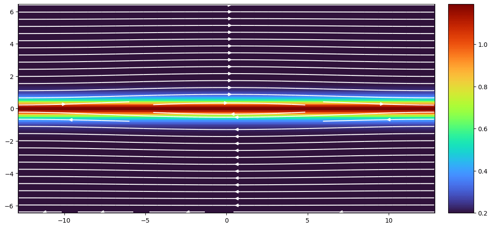

# 测试 {#sec-test}

验证模型的有效性对于开展严谨一致的研究至关重要。本章介绍在等离子体物理中可以进行的数值测试，内容深受 [Athena MHD 代码中的测试](https://www.astro.princeton.edu/~jstone/Athena/tests/)影响。详情见 [@stone2008athena]。

大多数测试参数以无量纲单位给出。如果需要使用国际单位制，就需要进行单位换算。详情见 @sec-unit-value。

## 误差

1. 扩散误差：波的振幅下降的速率。
2. 色散误差：波在数值解中与在解析解中传播速度的差异。

误差范数通常同时包含这两种误差的贡献。不过，也可以将误差绘制为位置或相位的函数，分别追踪它们。

## 波测试

### 线性波

将 @eq-ideal-mhd 线性化得到方程组 $\mathbf{W}_t = \mathbf{A}(\mathbf{W})\mathbf{W}_x$，其中 $\mathbf{W}$ 由一维情况下的原始变量或守恒变量组成，下标 $t$ 和 $x$ 表示相应的偏导数。理想 MHD 的特征值和特征向量可用于设置特征波扰动。详情见 [@stone2008athena] 的附录 A 和 B。

初始时密度、速度、磁场和总能量均设为常数。这些值可以选取得使各波速充分分离，并使（在 MHD 中）波矢与 $\mathbf{B}$ 成任意角度。此处所述测试选用的具体数值在下方相应的结果部分给出。

波以 $\delta \mathbf{U} = A \mathbf{R} \sin(2\pi x)$ 的形式作为扰动叠加到这些常数值上。这里 $\mathbf{U}$ 是守恒变量向量，$A$ 是振幅，$\mathbf{R}$ 是与所需波族对应的右特征向量。每项测试的 $\mathbf{R}$ 分量列于下方相应的结果部分。对于这里展示的所有测试，$A = 10^{-6}$。

计算区域的长度设为一个波长，使用周期性边界条件。波传播一个波长后，我们将每个变量在所有网格点上的绝对误差求和，再计算所得向量的范数，以此衡量数值解的误差：

$$
\begin{aligned}
\epsilon &= || \Delta U || = \sqrt{\sum_k (\Delta U_k)^2} \\
&= \sqrt{\sum_k (\sum_{i=1}^{N_x} |U_{k,i}^n - U_{k,i}^0| / N_x)^2}
\end{aligned}
$$

这里，$U_{k,i}$ 是时间层 $n$ 上网格点 $i$ 处守恒量向量第 k 个分量的数值解，$U_{k,i}^0$ 是初始数值解，$N_x$ 是网格点数。注意，初始解 $U_{k,i}^0$ 就是离散到网格上的解析解。由于初始条件的离散化也会引入误差，为衡量积分算法的误差，重要的是相对于初始条件 $U_{k,i}^0$ 而非解析解计算误差。在二维（三维）情况下，还需要对 $j(k)$ 求和。

要与这里给出的结果进行比较，重要的是：

1. 对波使用相同的振幅
2. 以完全相同的方式计算误差
3. 在完全相同的时刻计算误差

这是定量检验数值算法精度和收敛阶的极佳测试。唯一的缺点是它只涉及线性振幅振荡。因此，这项测试并不能代表代码最初编写出来所要解决的那类问题（毕竟线性波的动力学可以解析处理）。在这项测试中表现良好的代码，捕捉激波的能力仍可能很差。不过，知道算法在线性区域能收敛到正确答案仍然有益。此外，由于几乎所有格式在激波等间断处都只有一阶精度，像这样光滑的问题是测量高阶格式实际收敛阶的唯一方法。

事实证明，这项测试在发现编码错误方面非常有用：

* 同一波族向左和向右传播的波，其误差应当相同。
* 如果误差不收敛，说明某处出了问题。
* 必须使用双精度和非常小的波振幅，以消除舍入误差和非线性效应。

#### 一维绝热流体动力学

给定 @eq-ideal-mhd（其中 $\mathbf{B}=0$），
$$
\begin{aligned}
\rho &= 1 \\
\mathbf{u} &= \mathbf{0} \\
p &= 1/\gamma
\end{aligned}
$$

其中 $\gamma = 5/3$。守恒变量为
$$
\mathbf{U}=[\rho, \rho u_x, \rho u_y, \rho u_z, E]
$$

向左传播的波的右特征向量为
$$
\mathbf{R}=[1.0, -1.0, 0.0, 0.0, 1.5]
$$

从 $\mathcal{E}$ 转换到 $p$ 时，由背景值和 $\mathbf{R}$ 可知

$$
\delta p = (\gamma-1)\left( \delta\mathcal{E} + \rho\, u\delta u + \frac{1}{2}u^2\delta\rho \right) = 1.0
$$

参数汇总于 @tbl-linear-wave-1d-hd。

| 变量        | 背景值     | 扰动 $\mathbf{R}$ |
|-------------|------------|-------|
|$\rho$       | 1          | 1.0   |
|$\rho u_x$   | 0          | -1.0  |
|$\rho u_y$   | 0          | 0.0   |
|$\rho u_z$   | 0          | 0.0   |
|$p$          | $\frac{1}{\gamma}$ | 1.0 |
|$\mathcal{E}$| $\frac{1}{\gamma(\gamma-1)}$ | 1.5 |

: 一维绝热流体动力学线性波参数 {#tbl-linear-wave-1d-hd}

声波向左传播一个波长的绝对误差与网格点数 $N_x$ 的关系

#### 一维绝热 MHD

给定 @eq-ideal-mhd，

$$
\begin{aligned}
\rho &= 1 \\
\mathbf{u} &= \mathbf{0} \\
p &= 1/\gamma \\
\mathbf{B} &= [1, \sqrt{2}, 0.5]
\end{aligned}
$$

其中 $\gamma = 5/3$。因此，沿 x 方向的特征速度为

$$
\begin{aligned}
v_s &= \sqrt{\frac{\gamma p}{\rho}} = 1.0 \\
v_A &= \sqrt{\frac{b_x^2+b_y^2+b_z^2}{\rho}} = \frac{\sqrt{13}}{2} \approx 1.8 \\
v_{xA} &= \sqrt{\frac{b_x^2}{\rho}} = 1.0 \\
v_{x,\mathrm{fast}} &= \sqrt{\frac{1}{2}\left[v_s^2 + v_A^2 + \sqrt{(v_s^2 + v_A^2)^2 - 4v_s^2 v_{xA}^2}\right]} = 2.0 \\
v_{x,\mathrm{slow}} &= \sqrt{\frac{1}{2}\left[v_s^2 + v_A^2 - \sqrt{(v_s^2 + v_A^2)^2 - 4v_s^2 v_{xA}^2}\right]} = 0.5
\end{aligned}
$$
若守恒变量按以下顺序排列
$$
\mathbf{U} = [\rho, \rho u_x, \rho u_y, \rho u_z, E, B_y, B_z]
$$
则向左传播的波的右特征向量如下：

* 对于快磁声波：
```{julia}
U = [
4.472135954999580e-01
-8.944271909999160e-01
4.216370213557840e-01
1.490711984999860e-01
2.012457825664615e+00
8.432740427115680e-01
2.981423969999720e-01 ]
```

* 对于阿尔芬波：
```{julia}
U = [
0.0
0.0
-3.333333333333333e-01
9.428090415820634e-01
0.0
-3.333333333333333e-01
9.428090415820634e-01 ]
```

* 对于慢磁声波：
```{julia}
U = [
8.944271909999159e-01
-4.472135954999579e-01
-8.432740427115680e-01
-2.981423969999720e-01
6.708136850795449e-01
-4.216370213557841e-01
-1.490711984999860e-01 ]
```

参数汇总于 @tbl-linear-wave-1d-mhd。

::: {#tbl-linear-wave-1d-mhd layout-nrow=3}
| 变量        | 背景值     | 扰动 $\mathbf{R}$ |
|-------------|------------|---------------------------|
|$\rho$       | 1.0        | 4.472135954999580e-1      |
|$\rho u_x$   | 0          | -8.944271909999160e-1     |
|$\rho u_y$   | 0          | 4.216370213557840e-1      |
|$\rho u_z$   | 0          | 1.490711984999860e-1      |
|$\mathcal{E}$| $\frac{1}{\gamma(\gamma-1)}+\frac{13}{8}$ | 2.012457825664615 |
|$B_x$        | 1.0        | 0.0                       |
|$B_y$        | $\sqrt{2}$ | 8.432740427115680e-1      |
|$B_z$        | 0.5        | 2.981423969999720e-1      |

: 快磁声波 {tbl-colwidths="[30,35,35]"}

| 变量        | 背景值     | 扰动 $\mathbf{R}$ |
|-------------|------------|---------------------------|
|$\rho$       | 1.0        | 0.0                       |
|$\rho u_x$   | 0          | 0.0                       |
|$\rho u_y$   | 0          | -3.333333333333333e-1     |
|$\rho u_z$   | 0          | 9.428090415820634e-1      |
|$\mathcal{E}$| $\frac{1}{\gamma(\gamma-1)}$ | 0.0     |
|$B_x$        | 1.0        | 0.0                       |
|$B_y$        | $\sqrt{2}$ | -3.333333333333333e-1     |
|$B_z$        | 0.5        | 9.428090415820634e-1      |

: 阿尔芬波 {tbl-colwidths="[30,35,35]"}

| 变量        | 背景值     | 扰动 $\mathbf{R}$ |
|-------------|------------|---------------------------|
|$\rho$       | 1.0        | 8.944271909999159e-1      |
|$\rho u_x$   | 0          | -4.472135954999579e-1     |
|$\rho u_y$   | 0          | -8.432740427115680e-1     |
|$\rho u_z$   | 0          | -2.981423969999720e-1     |
|$\mathcal{E}$| $\frac{1}{\gamma(\gamma-1)}$ | 6.708136850795449e-1 |
|$B_x$        | 1.0        | 0.0                       |
|$B_y$        | $\sqrt{2}$ | -4.216370213557841e-1     |
|$B_z$        | 0.5        | -1.490711984999860e-1     |

: 慢磁声波 {tbl-colwidths="[30,35,35]"}

一维绝热 MHD 线性波参数
:::

在某些情况下，需要将守恒变量转换为另一组变量，例如 $(n,\mathbf{u},p,\mathbf{B})$。数密度扰动为
$$
\delta n = \frac{\delta \rho}{m} = \frac{\rho_0}{m}A\sin 2\pi x
$$ {#eq-number-mass-density-conversion}
假设背景值 $u_0=0$，
$$
\delta u = \frac{1}{\rho}\left[ \delta(\rho u) - (\delta \rho) u \right] = \frac{1}{\rho_0+\delta\rho}\delta(\rho u)
$$ {#eq-velocity-momentumflux-conversion}

给定能量密度扰动
$$
\begin{aligned}
\mathcal{E} &= \frac{p}{\gamma-1} + \frac{\rho u^2}{2} + \frac{B^2}{2\mu_0} \\
p &= (\gamma-1)\left[ \mathcal{E} - \frac{\rho u^2}{2} - \frac{B^2}{2\mu_0} \right]
\end{aligned}
$$

则压力扰动为
$$
\delta p = (\gamma-1)\left[ \delta\mathcal{E} - \frac{1}{2}(\rho_0 + \delta\rho)\delta u^2 - \frac{1}{2}\left( 2B_0\delta B + \delta B^2 \right) \right]
$$ {#eq-pressure-energyflux-conversion}

如果输入的是 $T$ 而不是 $p$，则有
$$
\delta T = \frac{p_0 + \delta p}{\rho_0+\delta \rho} - \frac{p_0}{\rho_0}
$$ {#eq-temperature-pressure-conversion}

注意，虽然在线性扰动理论中可以忽略高阶（>2）项，但在这里进行数值计算时不必如此。

#### 二维绝热 MHD

这里采用与一维绝热 MHD 测试相同的数值，但使用范围为 $0 \le x \le 2$、$0 \le y \le 1$ 的二维网格。在每种分辨率下，x 方向的网格点数都是 y 方向的两倍（例如最高分辨率为 $512 \times 256$），因此整个网格为矩形，但每个网格单元为正方形。波沿整个网格的对角线传播，与 x 轴成 $\theta = \tan^{-1}(0.5) \approx 26.6$ 度角。由于波并不沿网格单元的对角线传播，我们保证了 x 和 y 方向的通量不同；也就是说，这是一个真正的多维问题。

### 三维绝热 MHD

现在使用范围为 $0 \le x \le 3$、$0 \le y \le 1.5$、$0 \le z \le 1.5$ 的三维网格。网格大小为 $2N\times N \times N$。波沿整个网格的对角线传播，同样保证这是一个真正的多维测试。背景状态与一维测试的值相同。

### 各向异性 MHD

此测试取自 [@daldorff2014two]。即使未受扰动的等离子体压力各向同性，在无碰撞等离子体中，平行和垂直压力的变化也不相同。各向同性 MHD 解不适用于各向异性 MHD、混合模型或 PIC 等模型。

以下方程是各向异性 MHD 方程的精确解（即 @eq-ideal-mhd，但将能量方程替换为 @eq-6-moment-fluids 中的两个压力方程）
$$
\begin{aligned}
\rho &= \rho_0\left[ 1 + \delta\sin(kx-\omega t) \right] \\
u_x &= V_f \delta\sin(kx-\omega t) \\
u_y &= 0 \\
u_z &= 0 \\
p &= p_0\left[ 1 + \gamma\delta\sin(kx-\omega t) \right] \\
p_\parallel &= p_0\left[ 1 + \delta\sin(kx-\omega t) \right] \\
B_x &= 0 \\
B_y &= B_0 \left(1+\delta\sin(kx-\omega t)\right) \\
B_z &= 0
\end{aligned}
$$
其中 $p = \frac{p_\parallel + 2p_\perp}{3}$，而
$$
V_f = \frac{\omega}{k} = \sqrt{\frac{B_0^2 + 2 p_0}{\rho_0}}
$$
是沿垂直于磁场方向传播的快波的传播速度。这对应于 @sec-fast_slow 中 $\theta = 90^\circ$ 的情况。注意 $p$ 和 $p_\parallel$ 的波振幅不同，即此解不同于各向同性（有碰撞）快波。还要注意相速度中的 $2p_0$（实际上是 $2p_\perp$）项取代了通常的 $\gamma p$ 项。

初始时设 $\rho_0 = 1, p_0 = 4.5\times 10^{-4}$ 和 $B_0 = 0.04$，得到 $V_f=0.05$。波长设为 $\lambda=32$，因此 $k=2\pi/\lambda$。如果离子和电子的回旋半径相对于波长 $\lambda$ 很小，且传播速度 $V_\mathrm{ph}$ 远小于光速 $c$，上述解也满足动理学求解器所求解的 Vlasov-Maxwell 方程。

### 圆偏振阿尔芬波

以下关系描述了右旋偏振阿尔芬波
$$
\begin{aligned}
\rho &= 1.0 \\
p &= 0.1 \\
v_\parallel &= 0.0 \\
v_\perp &= 0.1\sin(2\pi x_\parallel) \\
v_z &= 0.1\cos(2\pi x_\parallel) \\
B_\parallel &= 1.0 \\
B_\perp &= 0.1\sin(2\pi x_\parallel) \\
B_z &= 0.1\cos(2\pi x_\parallel)
\end{aligned}
$$
其中 $\gamma = 5/3$，$x_\parallel = (x \cos\alpha + y\sin\alpha)$，$\alpha$ 是波传播方向相对于网格的夹角。这里 $v_\perp$ 和 $B_\perp$ 是速度和磁场在 x-y 平面内垂直于波矢的分量。它们与存储在网格上的分量 $B_x$ 和 $B_y$ 的关系为
$$
\begin{aligned}
B_\perp &= - B_x\sin\alpha + B_y\cos\alpha \\
B_\parallel &= B_x\cos\alpha + B_y\sin\alpha
\end{aligned}
$$

将方程组反解可得
$$
\begin{aligned}
B_x &= B_\parallel\cos\alpha - B_\perp\sin\alpha \\
B_y &= B_\parallel\sin\alpha + B_\perp\cos\alpha
\end{aligned}
$$

一般来说，速度和磁场扰动的振幅满足
$$
\frac{v_1}{B_1} = \frac{V_A}{B_0}
$$

二维计算区域的大小满足 $L_x = 2L_y$，且 $N_x = 2N_y$。因此网格为矩形，但每个单元为正方形。波沿整个网格的对角线传播，与 x 轴成 $\alpha = \tan^{-1}(0.5) \approx 26.6$ 度角。由于波不沿网格单元的对角线传播，x 和 y 方向的通量必然不同；因此这是一个真正的多维问题。

该波是 MHD 方程的一个精确非线性解，可以用于测试算法在非线性区域的表现。[^circular_alfven] 虽然非线性振幅的阿尔芬波会受到参量不稳定性（@sec-parametric）的影响而衰变为磁声波，但圆偏振阿尔芬波不应出现这种不稳定性。由于问题是光滑的，它可用于收敛性测试。使用较小压力（较高 β）和／或较大振幅进行测试，是检验算法稳健性的好方法。

更多内容见[参考资料](https://www.astro.princeton.edu/~jstone/Athena/tests/cp-alfven-wave/cp-alfven.html)和 [@toth2000b]。

[^circular_alfven]: 与之相反，线偏振阿尔芬波不是非线性 MHD 方程的精确解！偏振会影响衰变。关于这一点可向 Chaitanya 了解更多。

### 哨声波

此测试涉及哨声波的传播，取自 [@daldorff2014two]。它是加入霍尔项后对圆偏振阿尔芬波的扩展。哨声波的磁场和速度横向分量会发生变化，而纵向分量、密度和压力不受扰动。以下霍尔 MHD 方程的解描述了沿 $+x$ 方向传播的右旋偏振哨声波：
$$
\begin{aligned}
u_y &= -\delta u\cos(kx-\omega t) \\
u_z &= +\delta u\sin(kx-\omega t) \\
B_y &= +\delta B\cos(kx-\omega t) \\
B_z &= -\delta B\sin(kx-\omega t)
\end{aligned}
$$ {#eq-R-whistler-x}
其中波速为（@eq-R-wave-phase-speed）
$$
v_\mathrm{ph} = \frac{\omega}{k} = \frac{W}{2} + \sqrt{\frac{B_x^2}{\rho} + \frac{W^2}{4}},\quad W=\frac{m}{e}\frac{kB_x}{\rho}
$$

注意波速取决于波数 $k$。磁场和速度扰动满足以下关系（这与通常的阿尔芬性 @eq-Alfvenity 不同吗？？？但当 $v_\mathrm{ph}=v_A=B_x/\sqrt{\rho}$ 时，它退化为阿尔芬性条件。）
$$
\frac{\delta u}{\delta B} = \frac{B_x}{v_\mathrm{ph}\rho}
$$ {#eq-R-whistler-B-v}

设 $\rho=1, u_x=0, B_x = 0.2$ 和 $p=5.12\times 10^{-4}$，波长为 $\lambda = 32$。由此得到 $v_\mathrm{ph}=0.22059$，比阿尔芬速度 $V_A=0.2$ 快约 10%，因此在这个波长下霍尔项虽小但不可忽略。横向磁场扰动振幅设为 $\delta B = 0.01$，即背景场的 5%。

选择这些参数以满足

* $c \gg v_\mathrm{ph}$
* $m_e\ll m_i$
* $\beta\ll 1$
* $\omega\ll \Omega_e$

从而使动理学色散关系退化为右旋偏振哨声波的霍尔 MHD 色散关系。

[@tenerani2023dispersive] 展示了阿尔芬型波的色散和阻尼与 $\lambda/d_i$ 的关系。当尺度接近离子惯性长度，但不一定小于它时（对于 $\beta\sim 1$，$d_i$ 和 $r_{iL}$ 的量级相同），霍尔 MHD 和混合模拟均显示这些效应已经发生。

使用混合 Vlasov 代码 Vlasiator 进行这个低 $\beta$ 测试时，我观察到：没有霍尔项时，波形会从所有量的波峰和波谷后缘开始迅速畸变；有霍尔项时，波形可以维持更长时间，而且相速度当然是 $v_W$，比理想 MHD 情况下的 $v_A$ 更快。在 @sec-mhd-ohm 中，我们了解到欧姆定律中的霍尔项在两种情况下可以忽略；如上面对 $V_A$ 和 $v_W$ 的比较所示，这两种情况在此测试中都不适用。这意味着一个重要事实：在某些参数空间内，经典阿尔芬波根本不存在；我们可能观察到阿尔芬型涨落（即 $\delta\mathbf{u}$ 和 $\delta\mathbf{B}$ 之间的相关性），但它们可能属于哨声波（R 波）、EMIC 波（L 波）或 KAW。

### 光波

### 消防水管不稳定性

### 镜模不稳定性

### 朗缪尔波

朗缪尔波是等离子体中由库仑力驱动的快速静电振荡。这里假设等离子体为冷等离子体，离子不动。从流体角度看，控制方程见 @eq-langmuir-linear：
$$
\begin{aligned}
\frac{\partial n_1}{\partial t} &= -n_0\frac{\partial u_1}{\partial x} \\
\frac{\partial u_1}{\partial t} &= -\frac{e}{m}E_1 \\
\frac{\partial E_1}{\partial x} &= -\frac{e}{\epsilon_0}n_1
\end{aligned}
$$

第三个方程也可以用电势 $\phi$ 写出，电势定义为 $\mathbf{E} = -\nabla \phi = -\partial \phi/\partial x$，
$$
\frac{\partial^2 \phi}{\partial x^2} = \frac{e}{\epsilon_0}n_1
$$

于是完整方程为
$$
\begin{aligned}
\frac{\partial n_1}{\partial t} &= -n_0\frac{\partial u_1}{\partial x} \\
\frac{\partial u_1}{\partial t} &= -\frac{e}{m}\frac{\partial \phi}{\partial x} \\
\frac{\partial^2 \phi}{\partial x^2} &= \frac{e}{\epsilon_0}n_1
\end{aligned}
$$

如果电子存在密度扰动，即局部电荷不平衡，就可以自洽地驱动朗缪尔振荡。一个经典测试是将一维周期空间区域设为 $[0,2\pi]$，使用 512 个点，时间步长为 $\Delta t = 0.01$。初始密度扰动为 $n_1 = 0.02n_0\cos(x)$，其中 $n_0$ 是均匀的背景电子密度。温度设为 0，总模拟时间为 100。[^langmuir]

[^langmuir]: 使用简单的有限差分求解器时，我发现求解 E 不稳定，因为泊松方程左侧的有限差分矩阵是奇异的。用拉普拉斯方程求解电势则没有问题。

电子的运动方程为
$$
\begin{aligned}
m\frac{\mathrm{d}v}{\mathrm{d}t} &= -e E \\
\frac{\mathrm{d}x}{\mathrm{d}t} &= v
\end{aligned}
$$

## 激波测试

### Brio-Wu 激波管

此测试是一个 MHD 激波管，左右状态初始化为不同的值。左右初始值分别为
$$
\begin{aligned}
\rho &= 1.0,\, 0.125 \\
u_x &= 0.0,\, 0.0 \\
u_y &= 0.0,\, 0.0 \\
u_z &= 1.0,\, -1.0 \\
B_x &= 0.75,\, 0.75 \\
B_y &= 0.0,\, 0.0 \\
B_z &= 0.0,\, 0.0 \\
p &= 1.0,\, 0.1
\end{aligned}
$$
且 $\gamma = 2$。初始条件中的流体动力学部分与 Sod 激波管问题相同。

这是 MHD 代码的标准测试，用于检查代码能否准确表示 MHD 激波、稀疏波、接触间断和复合结构。

### Ryu 和 Jones 的 2A 测试

此测试是一个 MHD 激波管，左右状态初始化为不同的值。它涉及三维场和速度结构，以及磁场所在平面的旋转。左右初始值分别为
$$
\begin{aligned}
\rho &= 1.08,\, 1.0 \\
u_x &= 1.2,\, 0.0 \\
u_y &= 0.01,\, 0.0 \\
u_z &= 0.5,\, 0.0 \\
B_x &= 3.6,\, 2.0 \\
B_y &= 2.0,\, 4.0 \\
B_z &= 2.0,\, 2.0 \\
p &= 0.95,\, 1.0
\end{aligned}
$$

此测试包含向接触间断两侧传播的快激波、慢激波和旋转间断。仅凭这一测试就可以检查数值格式捕捉 MHD 中全部 7 种波的能力。

### 球形爆炸波

我们使用矩形区域 $-0.5 \le x \le 0.5; -0.75 \le y \le 0.75$。所有边界均采用周期性边界条件。这个非正方形区域和周期性边界条件在后期会产生复杂的激波与激波、激波与接触间断（CD）之间的相互作用。

初始条件为
$$
\begin{aligned}
\rho &= 1.0 \\
\mathbf{u} &= [0.0, 0.0, 0.0] \\
p &= 0.1
\end{aligned}
$$
其中 $\gamma = 5/3$。初始速度处处为零。在 $r < 0.1$ 区域内，$p = 10.0$（即环境压力的 100 倍）。对于 MHD 问题，初始磁场处处均匀，$B_x = B_y = 1/\sqrt{2}$。

虽然这个测试不太具有定量性，但可以制作很精彩的动画！

在早期，向外传播的爆炸波应当是球形的，并且不表现出与网格方向对齐的效应，这一点很重要。
在后期，爆炸波与中心低密度气泡边缘的接触间断相互作用，通过 Richtmyer-Meshkov 不稳定性产生高密度气体的丝状结构。这些指状结构应当清晰而不被扩散抹去，这一点很重要。此外，对于流体动力学问题，指状结构的图案应严格上下对称、左右对称。对于 MHD 问题，Richtmyer-Meshkov 不稳定性受到抑制，不会明显出现指状结构。

## 不稳定性测试

### Kelvin-Helmholtz 不稳定性

使用正方形区域 $-0.5 \le x \le 0.5; -0.5 \le y \le 0.5$，所有边界均为周期性边界条件。当 $|y| > 0.25$ 时，设 $\rho = 1$、$u_x = -0.5$；当 $|y| \le 0.25$ 时，设 $\rho = 2$、$u_x = 0.5$。压力处处为 2.5，且 $\gamma = 1$.4，因此 $\rho=2$ 的气体中马赫数约为 0.377，$\rho = 1$ 的气体中约为 0.267。两股反向流之间的界面是一个间断，即「滑移面」。两种流体使用不同密度，以便观察界面。

对于 MHD 问题，初始磁场处处均匀，$B_x = 0.5$。

为触发不稳定性，我们在速度的 x 和 y 分量中都加入峰峰振幅为 0.01 的随机数。

在早期，可以检查速度横向分量的增长率是否与线性理论的预测一致。这需要初始化单模扰动，而不是像这里一样使用一系列扰动。

在后期，一旦不稳定性进入完全非线性阶段，就难以进行定量比较。不过，两股流之间边界的清晰程度可以反映格式的数值扩散。例如，如果使用 HLLE 黎曼求解器，界面处的扩散会大到足以抑制不稳定性。

### Rayleigh-Taylor 不稳定性

单模测试使用矩形区域 $-0.25 \le x \le 0.25; -0.75 \le y \le 0.75$。在 $|x| = 0.25$ 处采用周期性边界条件，在 $|y| = 0.75$ 处采用反射壁。当 $y>0$ 时密度为 2.0，当 $y \le 0$ 时密度为 1.0。必须在运动方程中加入恒定重力加速度 $g = 0.1$。压力由静水平衡条件给出，即 $p = p_0 - 0.1\rho y$，其中 $p_0=2.5$，$\gamma=1.4$。由此得到界面处低密度介质中的声速为 3.5。

非线性阶段出现的结构对用于触发不稳定性的扰动性质非常敏感。为避免扰动界面时产生的网格误差，我们改为扰动速度。对于单模扰动，设 $u_y = 0.01[1 + \cos(4\pi x)][1 + \cos(3\pi y)]/4$。

对于多模扰动，使用范围为 $-0.25 \le x \le 0.25; -0.375 \le y \le 0.375$ 的区域，并设 $u_y = A[1 + \cos(8\pi y/3)]/2$，其中 $A$ 是每个网格单元中的随机数，峰峰振幅为 0.01。

算法中加入源项的方式可能对测试结果产生很大影响。例如，对于 Godunov 格式，如果使用算子分裂加入源项，由于缺少精确的数值平衡而产生的网格噪声可能扰动界面并触发结构。若将源项直接纳入重构和积分步骤，则可以自动保持静水平衡。

在早期，可以检查速度垂直分量的增长率是否与线性理论的预测一致。

在后期，一旦不稳定性进入完全非线性阶段，就难以进行定量比较。不过，两种流体之间边界的清晰程度可以反映格式的数值扩散。此外，由次级 KH 不稳定性产生的精细结构的多少，对界面受扰动的方式以及算法保持接触间断清晰的程度都很敏感。然而，更清晰并不一定更好。例如，PPM 算法中的「接触间断陡化器」可能在多维接触间断中引入「阶梯」结构，进而使网格噪声触发 KH 涡卷。

## 湍流测试

### Orszag-Tang 涡旋

使用正方形区域 $0 \le x \le 1; 0 \le y \le 1$，所有边界均为周期性边界条件。密度 $\rho$ 处处为 $25/(36\pi)$，压力处处为 $5/(12\pi)$，且 $\gamma = 5/3$。注意这样的选择使 $u_s^2 = \gamma p/\rho = 1$。初始速度是周期性的，$u_x = -\sin(2\pi y)$、$u_y = \sin(2\pi x)$。磁场通过定义在网格单元角点上的周期性矢势初始化：$A_z = B_0 (\cos(4\pi x)/(4\pi) + \cos(2\pi y)/(2\pi))$，其中 $B_0 = 1.0$。使用 $\mathbf{B} = \nabla\times \mathbf{A}$ 计算面中心磁场，以保证初始时 $\nabla\cdot\mathbf{B}=0$。由此得到 $B_x = -B_0 \sin(2\pi y)$ 和 $B_y = B_0 \sin(4\pi x)$。

Orszag-Tang 涡旋是用于测试向超声速二维 MHD 湍流过渡的著名模型问题。因此，该问题可以检验代码处理 MHD 激波形成和激波之间相互作用的稳健性。该问题还可以定量估计磁单极子对数值解的影响程度，检验 $\nabla\cdot\mathbf{B}=0$ 条件。最后，这一问题是二维数值 MHD 代码的常见测试，已用于许多以往研究，因此为一致地比较不同代码提供了基础。

## 磁重联测试

### GEM 挑战问题

这个二维设置基于 [@birn2001gem]。计算在矩形区域 $-L_x/2 \le x\le L_x/2$、$-L_z/2\le z \le L_z/2$ 中进行。系统在 x 方向为周期性的，在 $z=\pm L_z/2$ 处采用理想导体边界。因此，z 边界上磁场的边界条件为 $B_z=\partial B_x/\partial z = \partial B_y/\partial z = 0$，电场以及粒子或流体量具有相应的条件。所有量都使用开放边界条件。

重联挑战问题选用的平衡态是 Harris 平衡态，电流层外的密度具有一个下限。磁场为
$$
B_x(z) = B_0 \tanh(z/\lambda)
$$
其中 $\lambda$ 是电流片的特征尺度，密度为
$$
n(z) = n_0 \text{sech}^2(z/\lambda) + n_\infty
$$

初始状态下电子温度 $T_e$ 和离子温度 $T_i$ 均取为均匀值。假设初始等离子体 $\beta = (p_i+p_e)/p_B=1$。

系统空间和时间尺度的归一化量分别选为离子惯性长度 $d_i=c/\omega_{pi}$ 和离子回旋频率 $\Omega_i^{-1}$。其中 $\omega_{pi}^2 = n_0e^2/\epsilon_0 m_i$ 使用密度 $n_0$ 计算，离子回旋频率 $\Omega_i = eB_0/m_i$ 使用峰值磁场计算。速度则以阿尔芬速度 $v_A$ 归一化。在归一化单位中，$B_0 = 1$、$n_0 = 1$。模拟的具体参数为 $L_x = 25.6, L_z = 12.8, \lambda=0.5, n_\infty/n_0 = 0.2$ 和 $T_e/T_i = 0.2$。必要时假设 $m_i/m_e = 25$。

初始磁岛通过磁通扰动指定：
$$
\psi(x,z) = \psi_0 \cos(2\pi x/L_x)\cos(\pi z/L_z)
$$
其中磁场扰动由 $\mathbf{B} = \hat{y}\times\nabla\psi$ 给出，更具体地说，
$$
\begin{aligned}
B_{1x} &= -\psi_0\Big(\frac{\pi}{L_z}\Big)\cos(2\pi x/L_x)\sin(\pi z/L_z) \\
B_{1z} &= \psi_0\Big(\frac{2\pi}{L_x}\Big)\sin(2\pi x/L_x)\cos(\pi z/L_z)
\end{aligned}
$$

在归一化单位中，$\psi_0 = 0.1$，由此产生的初始磁岛宽度与电流层的初始宽度相当。采用如此大的初始扰动，是为了使系统从模拟开始就处于磁重联的非线性阶段。

初始设置见 @fig-GEM-currentsheet。

{#fig-GEM-currentsheet}

#### 为什么需要分辨离子惯性长度

在物理上，电子和离子在离子惯性长度尺度上分离。在数值计算中，只有网格单元足够小、能够分辨离子惯性长度时，霍尔项才重要。原因如下。欧姆定律为

$$
\mathbf{E} = -(\mathbf{U}+\mathbf{U}_H)\times\mathbf{H}
$$

假设典型流速为阿尔芬速度：$\mathbf{U} = \mathbf{V}_A$。霍尔速度估计为：

$$
\mathbf{U}_H = -\frac{\mathbf{J}}{ne} = -\frac{\nabla\times\mathbf{B}}{\mu_0ne} \sim -\frac{|dB|}{\mu_0ne\Delta x} \sim -\frac{|B|}{\mu_0ne\Delta x}
$$

近似 $dB\approx B$ 对较粗的网格有效；对于较细的离散网格单元，这一近似不成立，因此磁场不能在下面的估算中约去。现在假设可以作出这一近似，则霍尔速度与阿尔芬速度之比为：

$$
\frac{|\mathbf{U}_H|}{|\mathbf{V}_A|} = \frac{c/\omega_{pi}}{\mu_0 \Delta x}
$$

离子惯性长度对 PIC 也很重要：如果假设粒子速度为阿尔芬速度，那么离子惯性长度与离子回旋半径相同。

### 电流片

网格是正方形，范围为 $-0.5 \le x \le 0.5$、$-0.5 \le y \le 0.5$。密度和压力处处均匀，$\rho = 1$、$p = \beta/2$，其中 $\beta$ 是输入参数。当 $|x| > 0.25$ 时设 $B_y / \sqrt{4π} = 1$，否则设 $B_y / \sqrt{4π} = -1$。速度为 $u_x = A \sin(2\pi y)$（其中 $A$ 是振幅）和 $u_y = 0$。「标准」测试使用 $\beta = 0.1$ 和 $A = 0.1$，但此测试的目的之一是观察 $\beta (A)$ 需要小（大）到何种程度才会使代码崩溃。

虽然我们不知道这个问题的解析解，它仍可能是检验算法稳健性的极佳测试。对于理想 MHD，初始解应当是沿 y 方向的磁场传播的非线性（？？？）偏振阿尔芬波（由于磁压不是恒定的，这些波会迅速产生磁声波）。然而，由于问题中存在两个电流片（位于 $x = \pm0.25$），重联不可避免。由于 $\beta < 1$，重联会驱动强烈的过压区域，从而发射横穿磁场的磁声波。此外，随着重联改变磁力线的拓扑，磁岛会形成、增长并合并。测试的目的是确保算法能够尽可能长时间地跟踪这一演化而不崩溃。在磁场拓扑发生复杂变化时保持 $\nabla\cdot\mathbf{B}=0$ 可能很重要。

## 无散场测试

### 磁场环


