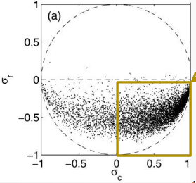
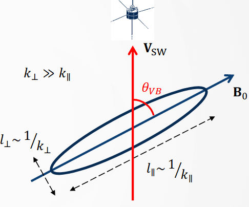
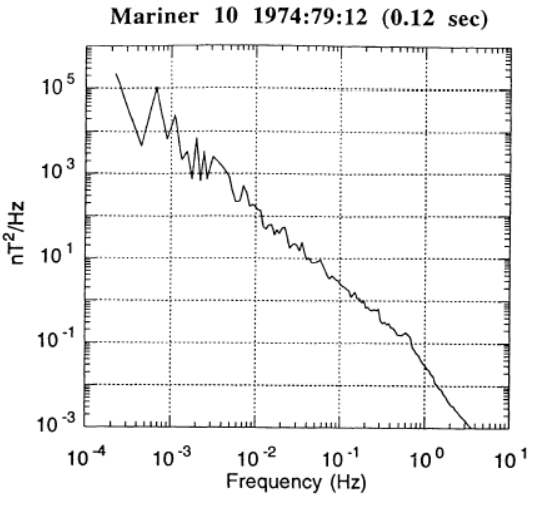
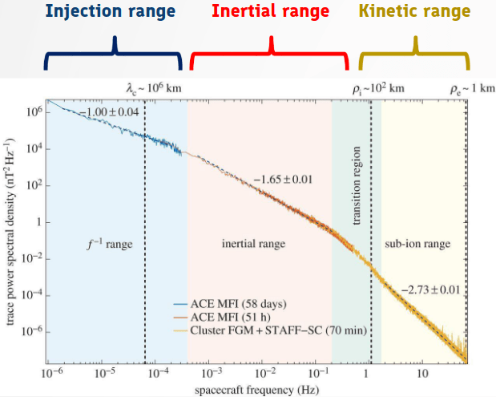
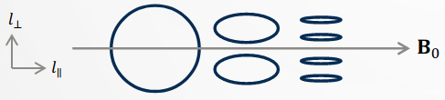

# 湍流 {#sec-turbulence}

湍流或许是经典物理中最美丽的未解问题。行星际空间湍流的历史或许更加有趣，因为人们对它的认识与人类征服空间的进程共同发展。违背经典动力学确定性规则的流动行为称为_湍流_。实际上，只要流速足够高，湍流几乎无处不在。乍看之下，湍流在空间和时间上都显得极不规则且混沌：似乎不可能预测运动的任何未来状态。然而，有趣的是，当我们在某一时刻拍下一幅湍流图像时，可以看到许多_各种尺度的不同湍流结构_在运动中活跃存在。我们认识到，流动的整体特征可以重现，但细节不可预测。我们必须用_统计方法_研究湍流，正如描述随机过程时那样，尽管这一问题产生于确定性系统的奇特动力学。

等离子体中的微小涨落会导致湍流，而湍流涡旋可以非常有效地将质量、动量和热量从高温核心穿过约束磁力线输运到较冷的等离子体边缘。预测这种湍流输运现象对于太阳风研究以及聚变反应堆的理解和发展至关重要。

湍流自 Osborne Reynolds 起成为一门实验科学。19 世纪末，他通过实验观测并研究了从层流到湍流的转变。他注意到，每当一个由质量密度 $\rho$、黏性系数 $\eta$、特征速度 $U$ 和长度 $L$ 组合而成的单一参数增大时，管道内的流动就会变为湍流。这个参数 $\text{Re} = UL\rho/\eta$ 现在称为_雷诺数_。当 $\text{Re}$ 增大并超过约为 $\text{Re}\simeq 4000$ 的某个阈值时，流动变成湍流。

湍流中的可预测性可以在统计层面重新表述。换言之，当我们观察两个不同的湍流样本时，即使它们采集自同一介质，也会发现细节看起来非常不同。真正共同的是一般性的随机行为。这意味着从一个样本转到另一个样本时，全局统计行为不变。_充分发展的湍流对微小扰动极为敏感，但其统计性质对扰动不敏感_。某个随机变量 $\psi$ 的涨落定义为其与平均值之差 $\delta\psi = \psi - \left< \psi \right>$，其中尖括号表示某种平均过程。至少有三种不同的平均方法可用于获得湍流的统计平均性质：

1. 空间平均：对在大于涨落尺度的尺度上统计均匀的流动进行平均。
2. 系综平均：对在几乎相同的外部条件下产生的一组湍流进行平均。系综中的每个成员称为一个_实现_。
3. 时间平均：只有当湍流在远长于涨落时间尺度的时间内统计平稳时才有用。实际上，由于将探测器放在空间固定点并对时间积分较为方便，实验结果通常以时间平均得到。遍历定理（Halmos, 1956）保证在某些标准条件下，时间平均与系综平均一致。

湍流的另一个性质是_所有动力学上有意义的尺度都被激发_，也就是说，_能量分布在所有尺度上_，并且可以观察到某种自相似性。

由于充分发展的湍流包含一系列不同尺度，因此涉及大量相互作用的自由度。于是，湍流应当存在一个不依赖流动细节的渐近统计态。我们希望这一渐近态可能以某种关键方式只依赖于能谱等简单统计性质，就像统计力学平衡态中的统计状态由能谱决定一样（Huang, 1987）。当然，我们不能期望统计态决定各个实现的细节，因为在具有相同低阶统计性质的不同系综中，各个实现未必具有相同权重。

应当强调，目前没有确定的数学论证能证明渐近统计态的存在。观测得到了可重现的统计结果，也就是说，实验和物理合理性暗示了它的存在。除了物理合理性之外，充分发展湍流如此重要的特征——统计稳定性的存在——仍未解决，令人困扰。然而，这正是湍流的复杂本质。

Amitava Bhattacharjee 给出了一个很好的[空间等离子体中的 MHD 湍流](https://youtu.be/SURETlz5PX0?si=TbZqVzn6Z_XNxKfg)教程。

## 弱湍流和强湍流

弱湍流

* 非线性：波或涡旋之间的相互作用很弱，即这些相互作用中的能量远小于系统总能量。
* 微扰方法：弱湍流理论常通过微扰展开处理，将非线性项视为波线性行为的小修正，从而可以解析处理波—波相互作用。
* 三波相互作用：基本相互作用涉及满足频率和波数共振条件的三个波（例如两个波结合形成第三个波）。
* 可预测性：由于相互作用较弱，系统的时间演化相对可预测，湍流态的统计性质也可以更直接地计算。
* 能量级联：能量仍然从大尺度向小尺度传递，形成特征能谱。

强湍流

* 强烈非线性：波或涡旋之间相互作用的强度变得与系统总能量相当。线性波描述在很大程度上失效。
* 复杂的相互作用网络：简单的三波相互作用不再能完整描述其行为，更复杂的多波相互作用和湍流结构占主导。
* 解析处理更困难：由于线性近似不再适用，强湍流难以、通常甚至无法完全解析求解。数值模拟和现象学建模成为必不可少的工具。
* 混沌行为：系统可能对初始条件极为敏感，使长期预测详细演化非常困难。
* 能量级联和耗散：能量跨尺度传递更快，可能不再遵循弱湍流中简单的幂律能谱。小尺度耗散变得显著。

以水波为例，相对平静的池塘上的小涟漪是弱湍流的例子，暴风雨中海洋上的破碎波浪则是强湍流的例子。直观上，我们可以看出弱湍流比强湍流更容易用数学描述。

## MHD

Nunov 强烈推荐一篇综述 [@schekochihin_2022]。另一篇关于太阳风湍流的好参考文献是 [@bruno2013solar]，本笔记中引用了其中许多材料。

磁流体力学湍流研究高雷诺数下磁流体流动的混沌状态。磁流体力学（MHD）处理的是电导率很高的准中性流体。流体近似意味着关注的宏观长度和时间尺度分别远大于碰撞长度和碰撞时间。

湍流中的导引磁场通常被视为稳态背景场。它既可以由外部源施加，也可以由大尺度涡旋产生。

### 与流体动力学比较

* 流体动力学（HD）湍流：涡旋的相互作用。
* MHD 湍流：以阿尔芬速度运动的波包之间的相互作用。

### 不可压缩 MHD 方程

在湍流研究中，最常用的数学工具是不可压缩 MHD 方程。不可压缩意味着 $\nabla\cdot\mathbf{u}=0$，但密度不一定恒定。它在物理上意味着声速无限大 $V_s \sim \sqrt{\delta p / \delta \rho}\to \infty$，即无论压力变化多大，密度都不会改变。在许多情况下，假设密度恒定已经足够好，并能进一步简化数学处理。[^incompressibility-const]

[^incompressibility-const]: 密度恒定意味着不可压缩，反之则不然。

质量密度恒定、$\rho=1$ 时的不可压缩 MHD 方程为
$$
\begin{aligned}
\frac{\partial\mathbf{u}}{\partial t} + \mathbf{u}\cdot\nabla\mathbf{u} &= -\nabla P + \mathbf{B}\cdot\nabla\mathbf{B} + \nu\nabla^2\mathbf{u} \\
\frac{\partial\mathbf{B}}{\partial t} + \mathbf{u}\cdot\nabla\mathbf{B} &= \mathbf{B}\cdot\nabla\mathbf{u} + \eta\nabla^2\mathbf{B} \\
\nabla\cdot\mathbf{u} &= 0 \\
\nabla\cdot\mathbf{B} &= 0
\end{aligned}
$$ {#eq-constrho-ideal-mhd}
其中 $P$ 是总压力（热压加磁压），$\nu$ 是运动黏度，$\eta$ 是磁扩散率。上式中的磁场采用阿尔芬单位（与速度单位相同）。

总磁场可以分为平均场 $\mathbf{B}_0$ 和涨落场 $\mathbf{b}$：
$$
\mathbf{B} = \mathbf{B}_0 + \delta\mathbf{b}
$$

然后可以得到仅包含扰动项的磁场方程：
$$
\frac{\partial\mathbf{b}}{\partial t} = \mathbf{v}_A\cdot\nabla\mathbf{u} + \mathbf{b}\cdot\nabla\mathbf{u}
$$

如果考虑 Hall 效应，磁场方程中就会出现额外项：
$$
\frac{\partial\mathbf{b}}{\partial t} = \mathbf{v}_A\cdot\nabla\mathbf{u} + \mathbf{b}\cdot\nabla\mathbf{u} + d_i\nabla\times\left[ \mathbf{v}_A\times(\nabla\times\mathbf{b}) \right] + d_i\nabla\times\left[ \mathbf{b}\times(\nabla\times\mathbf{b}) \right] + \eta \nabla^2\mathbf{b}
$$ {#eq-constrho-hall-mhd}

$\mathbf{u}$ 和 $\mathbf{B}$ 的对称形式提示我们或许可以将它们结合起来；这正是 Walter Elsässer 在 1950 年所做的。

### 带电流体与磁场之间的耦合

Elsässer 变量用于从 MHD 中提取阿尔芬性分量。Elsässer 形式的扰动写为
$$
\begin{aligned}
\mathbf{z}^+ &= \delta\mathbf{v} + \delta\mathbf{b} \\
\mathbf{z}^- &= \delta\mathbf{v} - \delta\mathbf{b}
\end{aligned}
$$ {#eq-Elsässer-vars}
其中 $\mathbf{b} = \mathbf{B}/\sqrt{\mu_0\rho}$，在 CGS 单位制中则为 $\mathbf{b} = \mathbf{B}/\sqrt{4\pi\rho}$。

$\mathbf{z}^\pm$ 对应反平行／平行传播的模式：

* 平行传播的波：$\delta\mathbf{v}=-\delta\mathbf{b}\Rightarrow \mathbf{z}^+=0, \mathbf{z}^-=2\delta\mathbf{v}$
* 反平行传播的波：$\delta\mathbf{v}=\delta\mathbf{b}\Rightarrow \mathbf{z}^+=2\delta\mathbf{v}, \mathbf{z}^-=0$

注意，每个场可以包含多个涨落模式：$\mathbf{z}^- = \sum_{k} \mathbf{z}_k^-$，$\delta\mathbf{B} = \sum_{k} \delta\mathbf{B}_k$。$\mathbf{z}^\pm$ 是场量。

阿尔芬性条件
$$
\delta\mathbf{v}=\pm\delta\mathbf{b}=\pm\delta\mathbf{B}/\sqrt{\mu_0\rho_0}
$$ {#eq-Alfvenity}
经常出现在阿尔芬波的讨论中。

以涨落 Elsässer 变量表示的不可压缩 MHD 波动方程为：
$$
\frac{\partial\mathbf{z}^\pm}{\partial t} \mp \mathbf{v}_A\cdot\nabla_\parallel\mathbf{z}^\pm + \mathbf{z}^\mp\cdot\nabla\mathbf{z}^\pm = -\nabla p + \nu_+ \nabla^2 \mathbf{z}^{\pm} + \nu_- \nabla^2 \mathbf{z}^{\mp}
$$ {#eq-mhd_elsassar}
其中 $\nu _{\pm}=\frac{1}{2}(\nu \pm \eta)$。不可压缩条件和 B 无散条件写为
$$
\nabla\cdot\mathbf{z}^\pm = 0
$$ {#eq-elsassar_divergence}

散度为零意味着没有外力或耗散项。由于我们在 @eq-constrho-ideal-mhd 中已经假设密度均匀，$v_A = B_0 / \rho = B_0$，可以将 @eq-mhd_elsassar 写成另一种形式：
$$
\frac{\partial\mathbf{z}^\pm}{\partial t} \mp \mathbf{B}_0\cdot\nabla_\parallel\mathbf{z}^\pm + \mathbf{z}^\mp\cdot\nabla\mathbf{z}^\pm = -\nabla p + \nu_+ \nabla^2 \mathbf{z}^{\pm} + \nu_- \nabla^2 \mathbf{z}^{\mp}
$$ {#eq-mhd_elsassar2}

@eq-mhd_elsassar 揭示了阿尔芬性湍流研究中有趣的现象。左侧第二项是线性项，表示波沿平均场平行传播。第三项表示反向传播波的非线性相互作用，在此过程中能量被传递到更小尺度。这正是湍流。在 MHD 中，湍流表现为阿尔芬波的碰撞。

根据线性微扰理论，$\mp \mathbf{v}_A\cdot\nabla_\parallel\mathbf{z}^\pm$ 的标度为 $(k_\parallel v_A)z^\pm$，而 $\mathbf{z}^\mp\cdot\nabla\mathbf{z}^\pm$ 的标度为 $(k_\perp z^\mp)z^\pm$。当 $k_\parallel v_A \gg k_\perp z^\mp$ 时，湍流是_弱_的；当 $k_\parallel v_A \simeq k_\perp z^\mp$ 时，湍流是_强_的。假设在小 k 处供给能量，则首先在弱 MHD 湍流中能量满足 $E(k_\perp)\propto k_\perp^{-2}$，随后在强 MHD 湍流中满足 $E(k_\perp)\propto k_\perp^{-3/2}$。在更大的 k 处，最终会遇到耗散尺度，由于相互作用波的能量级联平衡／不平衡，斜率在该处急剧变化。

在耗散尺度可能发生几种机制 [Huang, Howes, McCubbin, 2024]：

* 渡越时间阻尼（TTD）：类似于磁场的朗道阻尼，也称 Barnes 阻尼。粒子可以从磁镜场获得能量：首先在垂直方向被感应电场加速（与能量在平行方向传递的朗道阻尼相反），随后能量被转移到平行方向。（这一机制也出现在 @sec-mirror 中，因为它与镜像模密切相关。）当电磁波穿过磁场强度变化的等离子体时，其电场和磁场发生振荡。如果这些振荡的频率与粒子被磁镜力反射的自然频率相匹配（第二绝热运动？），就会发生共振。在共振期间，粒子实际上在波上“冲浪”，从波中获得能量。粒子获得能量以波的能量为代价，导致波受到阻尼。粒子获得的能量主要位于垂直于磁场的方向。TTD 是一种无碰撞阻尼机制，在速度空间中具有独特特征。它形成以共振速度为中心的双极性能量传递图样，其中一些粒子获得能量，另一些粒子失去能量。TTD 的强度与磁场强度梯度直接相关：梯度越强，阻尼越有效。

当非线性项可以忽略时，我们得到正常模波。对于只有 $\mathbf{z}^+$ 的系统，
$$
\begin{aligned}
\frac{\partial \mathbf{z}^+}{\partial t} - \mathbf{V}_A \cdot\nabla \mathbf{z}^+ = 0 \\
\rightarrow \mathbf{z}^+ \sim f(\mathbf{x} + \mathbf{V}_A t)
\end{aligned}
$$ {#eq-elsassar-linear-positive}

对于只有 $\mathbf{z}^-$ 的系统，
$$
\begin{aligned}
\frac{\partial \mathbf{z}^+}{\partial t} + \mathbf{V}_A \cdot\nabla \mathbf{z}^+ = 0 \\
\rightarrow \mathbf{z}^+ \sim f(\mathbf{x} - \mathbf{V}_A t)
\end{aligned}
$$ {#eq-elsassar-linear-negative}
其中 $\mathbf{x}$ 是平行于 $\mathbf{B}$ 的坐标。@eq-elsassar-linear-positive 和 @eq-elsassar-linear-negative 都给出阿尔芬正常模：
$$
\omega = |k_\parallel| V_A
$$ {#eq-alfven-normal-mode}

一个有趣的问题是：MHD 阿尔芬波的磁场涨落能量更大，还是速度涨落能量更大？

答案：两类涨落的能量相同，因为 MHD 阿尔芬波要么只有 $z^+$，要么只有 $z^-$。

阿尔芬性准模：由非线性驱动的非正常模，不一定满足阿尔芬波色散关系，但仍保留一些阿尔芬性性质，例如不可压缩性以及 $\delta\mathbf{b}$ 和 $$ 之间的高度相关性。

考虑模式 $z_1^-$ 和 $z_2^+$ 非线性相互作用产生的模式 $z_3^-$，$z_3^- = z_1^- z_2^+$。由于非线性项很重要，
$$
\frac{\partial \mathbf{z}_3^-}{\partial t} + \mathbf{V}_A\cdot\nabla \mathbf{z}_3^- \neq 0 \rightarrow \omega_3 - k_{3\parallel}V_A \neq 0
$$

问题：考虑不可压缩 MHD 中的一个涨落，它是包含许多相互作用模式的更大系统的一部分。如果该涨落只存在于 $z^+$ 而没有 $z^-$ 分量，这说明什么？

答案：没有 $z^-$ 分量意味着 $z^- = \delta\mathbf{v} - \frac{\delta\mathbf{B}}{\sqrt{4\pi\rho}} = 0$，这导致磁场和速度涨落同相。然而，这并不意味着它一定是沿一个方向传播的阿尔芬波？（问问 Seth！）

### 阿尔芬波的重要性

* 阿尔芬波可以散射托卡马克等离子体中的快速离子。
* 阿尔芬波可能有助于日冕加热。
* 阿尔芬波是更复杂结构和动力学的基本组成，尤其是湍流的基本组成。

### 波相互作用现象学

根据 @eq-mhd_elsassar，我们可以研究波模的非线性相互作用。考虑模式 $z_1^-$ 和 $z_2^+$ 非线性相互作用产生的模式 $z_3^-$：$z_3^- = z_1^- z_2^+$。
剪切阿尔芬波最简单的三波相互作用为
$$
\begin{aligned}
\omega(k) &= \omega(k_1) + \omega(k_2) \\
\mathbf{k} &= \mathbf{k}_1 + \mathbf{k}_2
\end{aligned}
$$ {#eq-three-wave-alfven-interaction}
其中
$$
\omega(k) = |k_z|v_A
$$

以简单形式可以写为
$$
\begin{aligned}
\omega_3 = \omega_1 \pm \omega_2 \\
k_{3\parallel} = k_{1\parallel} \pm k_{2\parallel}
\end{aligned}
$$

总波数 k 由两部分组成：$k_z$ 是沿导引场方向的波数，$k_\perp$ 是垂直于导引场的波数。由于只有反向传播的波发生相互作用，$k_{1z}$ 和 $k_{2z}$ 应符号相反。为了满足相互作用条件，可以有 $k_{1z} = 0$ 或 $k_{2z} = 0$。这意味着波相互作用改变 $k_\perp$，但不改变 $k_z$。这一点已在两个反向传播模式的实验室实验中得到验证；在实验中可以分离单次相互作用进行详细研究（例如 Howes+ 2012）。一个有趣之处是，尽管不可压缩理想 MHD 预言沿同一方向传播的两个模式不能发生非线性相互作用，一项实验室实验表明事实并非如此。这归因于 Hall 效应，它使方程更加复杂。

### 无量纲参数

MHD 的重要无量纲参数包括

* 雷诺数：$\text{Re}=UL/\nu$

* 磁雷诺数：$\text{Re}_{M}=UL/\eta$

* 磁普朗特数：$P_{M}=\nu/\eta$

磁普朗特数是流体的重要性质。液态金属的磁普朗特数较小，例如液态钠的 $P_{M}$ 约为 $10^{-5}$。但等离子体具有较大的 $P_{M}$。

雷诺数是 Navier–Stokes 方程中非线性项 $\mathbf{u} \cdot \nabla \mathbf{u}$ 与黏性项之比。磁雷诺数则是感应方程中非线性项与扩散项之比。

在许多实际情形中，流动的雷诺数 Re 相当大。对于这类流动，速度场和磁场通常是随机的，这样的流动被称为呈现 MHD 湍流。注意，MHD 湍流中的 $\text{Re}_{M}$ 不一定很大。$\text{Re}_{M}$ 在发电机（磁场产生）问题中发挥重要作用。

平均磁场在 MHD 湍流中发挥重要作用，例如它可以使湍流具有各向异性，也可以通过减弱能量级联等方式抑制湍流。早期 MHD 湍流模型假设湍流各向同性，而后来的模型研究了各向异性方面。

### 临界平衡

偏振的阿尔芬模相互作用。由于 @eq-mhd_elsassar 中非线性项含有点积，只有模式中*垂直*偏振的分量发生相互作用。相互作用强度可量化为
$$
\chi \sim \frac{k_\perp z^\mp}{k_\parallel V_A}
$$

如果将阿尔芬（线性）时间尺度 $\tau_A \sim l_\parallel/v_A$（与阿尔芬波沿磁力线传播的速度有关）和非线性时间尺度 $\tau_{nl}\sim l_\perp/\delta z$（与湍流涡旋相互作用并相互扭曲的速度有关）相匹配，
$$
\tau_A = \tau_{nl}
$$
就有了一种预测不同尺度上能量分布的标度关系，以及湍流中垂直和平行结构之间关系的方法。这称为_临界平衡_（Goldreich and Sridhar 1995），其中 $\chi\sim 1$，太阳风湍流中就采用了这一假设。

假设能量级联率恒定，为 $\epsilon\sim \delta z^2/\tau_{nl}$，尺度 L 处的能量注入率为 $\epsilon_L\sim v_A^2/\tau_{nl}=v_A^3/L$。当我们使这两个速率相匹配并且……（我对 Nunov 在 Nordita 的讲座还有一些印象），得到
$$
k_\parallel\propto k_\perp^{2/3}
$$ {#eq-critical-balance}
这意味着各向异性随着尺度减小而增强。它表明从“弱”湍流向“强”湍流的转变，或者更准确地说，是从“准线性”过程向“模式耦合”过程的转变。[^picture] 功率谱为
$$
\begin{aligned}
E(k_\perp) &\propto k_\perp^{-5/3} \\
E(k_\parallel) &\propto k_\parallel^{-2}
\end{aligned}
$$ {#eq-critical-balance-spectra}

[^picture]: 两个相向运动的阿尔芬波包首先处于准线性阶段，当它们相遇并发生非线性相互作用时，进入模式耦合阶段。

这是与 MHD 湍流有关的最具影响力的发现之一。它将磁场考虑在内，使 MHD 湍流区别于气体动力学中的 Kolmogorov 湍流。通过分离 $k_\parallel$ 和 $k_\perp$ 动力学，临界平衡理论预言了垂直能谱 @eq-critical-balance-spectra，这与惯性区间内的太阳风湍流一致 [Chen 2016]。采用这一概念的理论现在称为各向异性 MHD 湍流理论。

然而，自然界为何会出现这种情况仍有争议。

### 剩余能量

剩余能量是磁场涨落与速度涨落之间的能量差。归一化剩余能量为
$$
\sigma_r = \frac{|\delta\mathbf{v}|^2 - |\delta\mathbf{b}|^2}{|\delta\mathbf{v}|^2 + |\delta\mathbf{b}|^2}
$$ {#eq-residual_energy_normalized}

对于阿尔芬波，$\sigma_r$ 为零，但太阳风观测中它在 MHD 尺度上通常为负（$|\delta\mathbf{b}|^2 > |\delta\mathbf{v}|^2$），这意味着它们很可能是湍流而非波。

弱 MHD 湍流在小 $k_\parallel$ 处自发产生剩余能量 $E_r = E_b - E_k$ 的凝聚体。凝聚体随 $k_\perp$ 展宽。

对于强 MHD 湍流，剩余能量在所有 k 处都非零。

### 归一化交叉螺度 {#sec-turbulence_cross_helicity}

交叉螺度是 $\mathbf{z}^+$ 和 $\mathbf{z}^-$ 涨落之间的能量差（@sec-cross_helicity）。归一化交叉螺度为
$$
\sigma_c = \frac{|\mathbf{z}^+|^2 - |\mathbf{z}^-|^2}{|\mathbf{z}^+|^2 - |\mathbf{z}^-|^2} = \frac{2\delta\mathbf{v}\cdot\delta\mathbf{b}}{|\delta\mathbf{v}|^2 + |\delta\mathbf{b}|^2}
$$ {#eq-cross_helicity_normalized}

* $|\sigma_c|=1$：单向阿尔芬波（无湍流）
* $|\sigma_c|\lesssim 1$：不平衡湍流
* $|\sigma_c|=0$：平衡湍流（或非阿尔芬性涨落）

太阳风通常在远离太阳方向上不平衡。从 @eq-residual_energy_normalized 和 @eq-cross_helicity_normalized 可以容易地看出
$$
\sqrt{\sigma_r^2 + \sigma_c^2} \le 1
$$

观测到的分布如 @fig-turbulence-residual-energy-cross-helicity 所示。不过注意，$\sigma_r$ 取决于如何计算 $\delta{b}$。在 MHD 情况下使用 $\mathbf{b} = \mathbf{B}/\sqrt{\mu_0\rho}$，但在动理学情况下会有一个额外系数。结果看起来相当不同！

{#fig-turbulence-residual-energy-cross-helicity}

1 AU 处的观测（WIND）表明，非阿尔芬性太阳风通常具有较小的 alpha 粒子与质子的相对漂移，两种离子组分的温度几乎相等。从出现频率看，对于 300 km/s 的典型太阳风速度，没有显著差异；但对于高速太阳风，较大 $|\sigma_c|$ 的情况更有可能具有阿尔芬性。

* 非阿尔芬性太阳风
  * 速度较慢，丰度较低，$n_\alpha/n_p < 4%$
  * $v_p - v_\alpha \sim 0$
  * $T_p \sim T_\alpha$
  * 可能由太阳附近的交换重联形成
* 阿尔芬性太阳风
  * $n_{\mathrm{He}}/n_{\mathrm{p}}\sim 4%$，且不依赖于质子速度
  * alpha 粒子的温度约为质子的 4 倍。
  * 起源于日冕洞

## 太阳风湍流

### Taylor 假设

太阳风是一种超声速流动（$v_A/v_{\text{SW}}\ll 1$），其平流时间尺度远短于等离子体中任何动力学时间尺度。这意味着对于航天器观测，时间序列代表穿过太阳风等离子体的瞬时空间截面。因此，我们可以通过下式简单地将航天器频率 $f_{\text{sc}}$ 与等离子体参考系中的波数 $k$ 联系起来：
$$
k = \frac{2\pi f_\text{sc}}{v_\text{SW}}
$$

这一假设在磁鞘中往往不适用，而在太阳附近需要修正的 Taylor 假设。

{#fig-turbulence-v-b}

根据 Taylor 假设确定的波数 $k$ 实际上是 $\mathbf{k}$ 沿流动方向的分量。对于给定角度 $\theta_{vb}$，无法区分 $k_\perp$ 和 $k_\parallel$；在不同时刻，角度较小（对于 $k_\parallel$ 约为 $\sim 0^\circ$）和较大（对于 $k_\perp$ 约为 $\sim 90^\circ$）时可能分别测量它们。在太阳风中，$P(k_\perp) \gg P(k_\parallel)$，其中 $P$ 是扰动功率。对于 1 AU 处类似 Parker 螺旋的磁场，$\mathbf{B}_0$ 与 $\mathbf{v}_\text{sw}$ 之间的夹角很少很小（$\sim 45^\circ$），因此功率谱通常以 $k_\perp$ 涨落的贡献为主（@fig-turbulence-v-b）。

### 太阳风功率谱

{#fig-solarwind-B-spectrum-mariner10}

{#fig-solarwind-power-spectrum}

当我们将太阳风功率谱（$\delta|\mathbf{B}|$）绘制为时间的函数时，它通常代表 $k_\perp$[^time-vs-space]。航天器太阳风观测所得频谱中有三个不同的幂律区间（@fig-solarwind-power-spectrum）：

[^time-vs-space]: 当然，这里假设空间尺度和时间尺度成正比，因为我们无法直接测量作为空间函数的频谱。

* 注入区间：
  * 起源于太阳的大振幅、低频阿尔芬波。
  * $f^{-1}$ 谱称为“粉红噪声”。
  * 不相互作用
  * 向更高频率的 MHD 级联注入能量
* 惯性区间：
  * 主要是不可压缩阿尔芬性湍流。
  * $\sim f^{-5/3}$ 谱（Kolmogorov 型）
  * 能量向更小尺度级联
* 动理学区间：
  * 粒子被加热的尺度
  * 通常为 $f^{-2.8}$ 谱
  * 可能是 KAW（@sec-kaw）或哨声模（@sec-CPDR）湍流

当转向更小尺度时，各向异性增强。@fig-turbulence-scale 展示了这是 $k_\perp \gg k_\parallel$ 的结果，这也是回旋动理学成为湍流理论的原因。由于这一重大缺陷，各向同性 MHD 不足以用于湍流研究。

{#fig-turbulence-scale}

惯性区间中的涨落模式由 90% 的不可压缩（阿尔芬）模和 10% 的可压缩慢模／镜像模组成。人们认为阿尔芬性湍流对压缩模是被动的：压缩模被阿尔芬模散射，但不会显著影响后者（即二者相互解耦）。预计压缩模的阻尼为 $\sim k_\parallel v_A$。由于 $k_\perp \gg k_\parallel$，压缩模的阻尼不显著，因此它们往往比阿尔芬性湍流更具各向异性。

## 湍流与重联

湍流和磁重联可以相互驱动，但湍流磁重联中能量耗散、内禀湍流波和磁场拓扑的内在本质仍未得到充分理解。

为了同时研究湍流和重联，需要事先确认几件事：

1. 通过识别磁零点、等离子体流入和流出以及扩散区，确认重联的存在。

2. 通过考察磁场功率谱并确认级联，确认湍流的存在。对于卫星数据，可以选取一个时间区间、进行 FFT，并检查离子回旋频率 $f_{ci}$、低混杂频率 $f_{ln}$ 等特征频率尺度。

如果功率谱图（PSD）中存在谱折点，特别是在特征频率附近，这可能表明存在与波粒相互作用相关的局地回旋共振。一些研究者根据 MMS 对磁尾电流片的观测发现，在重联外流区，能量以低频 $f_{ci}$ 离子回旋尺度上的动理学阿尔芬波以及高频低混杂尺度上的快波／慢波的形式沉积。
