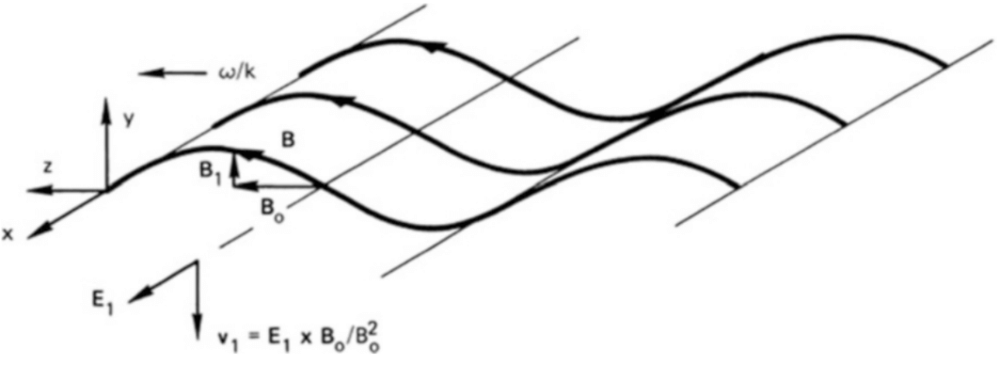
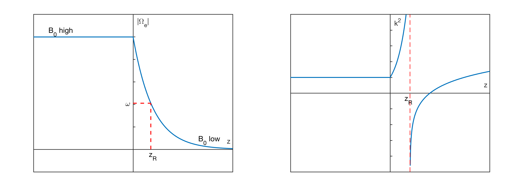
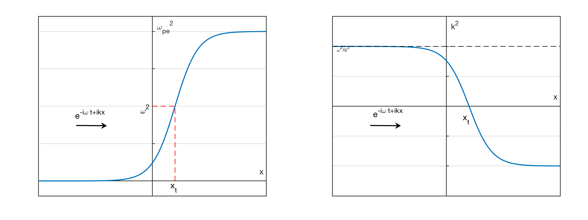
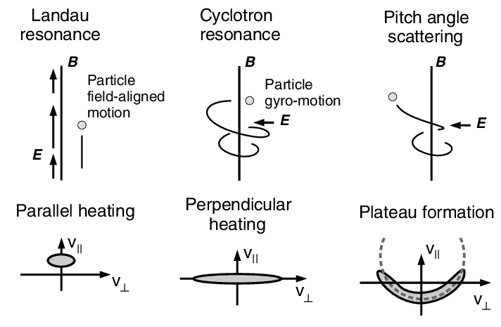

# 波动 {#sec-waves}

波由不稳定性（@sec-stability）产生。本章主要关注波的传播。

## 基本性质

## 偏振

* [电磁波与偏振](https://svs.gsfc.nasa.gov/4580/)

在等离子体物理中，波的偏振是相对于背景磁场 $\mathbf{B}_0$ 而不是波传播方向 $\mathbf{k}$ 定义的。[^polarization-def]

[^polarization-def]: 这与光学中的定义不同，有助于分析波与粒子的相互作用，因为粒子绕磁场回旋的旋向也是按同样方式定义的。

[波的偏振](https://farside.ph.utexas.edu/teaching/plasma/lectures/node70.html)

* 可压缩性：有些波可以改变等离子体密度，有些则不能。

### 色散关系

波是大多数介质中非常普遍的现象。然而，波要在介质中传播，必须满足一系列条件。首先，介质必须允许一定范围的频率 $\omega$ 和波矢 $\mathbf{k}$ 存在，即允许本征模存在。这些范围由色散关系 $D(\omega,\mathbf{k},...)=0$ 确定，它给出了介质动力学方程具有小振幅解的条件。色散关系通常在线性、无穷小振幅近似下推导。不过，有时也可以建立非线性色散关系，此时 $D(\omega,\mathbf{k},|\mathbf{a}|)$ 还依赖于涨落振幅 $|\mathbf{a}|$。

色散关系描述色散对介质中波性质的影响，它将波的波长或波数与频率联系起来。给定色散关系，就可以计算介质中波的相速度和群速度随频率的变化。因此，求得色散关系是描述波传播的关键。

通常说某个波模具有*色散性*，意味着不同频率 $\omega$（或波长 $\lambda$）的波以不同的相速度 $v_\text{ph}$ 传播。常见的色散波包括海洋中的水波、棱镜中的光波以及杆和板中的声波；非色散波包括空气中的声波和真空中的光波。

### 阻尼率／增长率

色散关系的解在大多数情况下为复数。对于实波矢 $\mathbf{k}$，可写为 $\omega(\mathbf{k}) = \omega_r(\mathbf{k}) + i\gamma(\omega_r,\mathbf{k})$，其中下标 $r$ 表示实部，$\gamma$ 是频率的虚部，它本身是实频率和波数的函数。这是因为给定频率的各个波模随时间的行为可能不同，而通常情况下波具有色散性，即其频率并非波数的线性函数。大多数情况下，给定波的振幅随时间缓慢变化，这意味着频率的虚部相对于实频率很小。若满足此条件，就可以直接从色散关系 $D(\omega,\mathbf{k}) = D_r(\omega,\mathbf{k}) + iD_i(\omega,\mathbf{k})$ 通过简单步骤确定 $\gamma$。色散关系可以写成实部 $D_r$ 和虚部 $D_i$ 之和，因为频率中的小虚部 $\gamma$ 只会使色散关系发生微小变化，因此可以相对于这一虚部展开。保留到 $\gamma/\omega$ 的一阶，得到[^dispersion_derive]
$$
\begin{aligned}
D_r(\omega_r,\mathbf{k}) &= 0 \\
\gamma(\omega_r, \mathbf{k}) &= -\frac{D_i(\omega,\mathbf{k})}{\partial D_r(\omega_r,\mathbf{k})/\partial \omega |_{\gamma=0}}
\end{aligned}
$$ {#eq-dispersion-sol}

第一个表达式确定实频率作为波数的函数 $\omega_r(\mathbf{k})$，可直接由色散关系的实部计算。第二个方程给出确定频率虚部，即波的阻尼率或增长率的方法。

[^dispersion_derive]: 如何推导？

### 介电函数

通常，当材料的介电率是空间位置或频率的函数时，称其为介电函数。介电常数 $\epsilon$ 是静电学中描述材料如何屏蔽外加恒定电场的量。当从电动力学角度研究材料如何屏蔽外加随时间变化的电场 $\mathbf{E}\propto e^{-i\omega t}$ 时，人们发现 $\epsilon$ 依赖于频率，于是得到 $\epsilon(\omega)$。将本质上依赖于频率的量仍称为“介电常数”并不合适，因此称其为“介电函数”。进一步研究表明，$\epsilon$ 不仅依赖于频率，也依赖于场的波矢：$\mathbf{E}\propto e^{-i\omega t +ikx}$，于是得到介电函数 $\epsilon=\epsilon(k,\omega)$。

## 等离子体振荡 {#sec-oscillations}

如果等离子体中的电子相对于均匀离子背景发生位移，就会产生电场，其方向使电子被拉回原来位置，从而恢复等离子体的电中性。由于惯性，电子会越过平衡位置，并以称为 _等离子体频率_ 的特征频率在平衡位置附近振荡。这种振荡也称为 Langmuir 振荡，速度很快，以至于质量较大的离子来不及响应振荡电场，可以视为固定不动。在图 4.2 中（添加该图！），空心矩形代表离子流体的典型单元，深色矩形代表交替发生位移的电子流体单元。由此产生的电荷聚集形成空间周期性的 $\mathbf{E}$ 场，使电子趋于返回电中性位置。

::: {.content-visible unless-format="pdf"}

[等离子体振荡演示](https://henry2004y.github.io/space-physics-threejs/langmuir.html)

:::

我们将在最简单的情况下推导等离子体频率 $\omega_p$ 的表达式，作出以下假设：

1. 没有磁场；
2. 没有热运动（$k_B T=0$）；
3. 离子以均匀分布固定在空间中；
4. 等离子体在空间中无限延伸；并且
5. 电子运动只发生在 x 方向。由最后一个假设得到

$$
\nabla = \hat{x}\partial x,\, \mathbf{E} = E\hat{x},\, \nabla\times\mathbf{E} =0,\, \mathbf{E}=-\nabla\phi
$$

因此没有涨落磁场；这是静电振荡。

电子连续性方程和运动方程为
$$
\begin{aligned}
\frac{\partial n_e}{\partial t} + \nabla\cdot(n_e\mathbf{u}_e) = 0 \\
m_e n_e\Big[ \frac{\partial \mathbf{u}_e}{\partial t} + (\mathbf{u}_e\cdot\nabla)\mathbf{u}_e \Big] = -en_e\mathbf{E}
\end{aligned}
$$

我们唯一需要的 Maxwell 方程是不涉及 $\mathbf{B}$ 的方程，即 Poisson 方程。这个情况是 @sec-plasma_approximation 中不能用 Poisson 方程求 $\mathbf{E}$ 这一一般规则的例外。这是高频振荡；电子惯性很重要，而偏离电中性是该特定情况下的主要效应。因此写为
$$
\epsilon_0\nabla\cdot\mathbf{E} = \epsilon_0 \partial \mathbf{E}/\partial x = e(n_i - n_e)
$$

利用 _线性化_ 方法可以容易地联立求解上面三个方程。这里是指振荡振幅很小，可以忽略含有振幅因子高次幂的项。首先将因变量分成两部分：以下标 0 表示的“平衡”部分和以下标 1 表示的“扰动”部分：
$$
n_e = n_0 + n_1\quad \mathbf{u}_e = \mathbf{u}_0 + \mathbf{u}_1\quad \mathbf{E}_e = \mathbf{E}_0 + \mathbf{E}_1
$$

平衡量表示没有振荡时的等离子体状态。由于假设电子位移之前等离子体是静止、均匀且电中性的，得到
$$
\begin{aligned}
\nabla n_0 = \mathbf{u}_0 = \mathbf{E}_0 = 0 \\
\frac{\partial n_0}{\partial t} = \frac{\partial\mathbf{u}_0}{\partial t} =  \frac{\partial\mathbf{E}_0}{\partial t} = 0
\end{aligned}
$$

动量方程现在变为
$$
m_e\frac{\partial \mathbf{u}_1}{\partial t} = -e\mathbf{E}
$$

可以看出，$(\mathbf{u}_1\cdot\nabla)\mathbf{u}_1$ 项是振幅量的二次项，我们将忽略它以进行线性化。只要 $|u_1|$ 足够小，使这类二次项确实可以忽略，_线性理论_ 就有效。类似地，连续性方程变为
$$
\frac{\partial n_1}{\partial t} + n_0 \nabla\cdot\mathbf{u}_1 = 0
$$

在 Poisson 方程中，注意到平衡时 $n_{i0}=n_{e0}$，而根据离子固定的假设有 $n_{i1}=0$，因此得到
$$
\epsilon_0 \partial \mathbf{E}/\partial x = -en_1
$$

假设振荡量按正弦规律变化：
$$
\begin{aligned}
\mathbf{n}_1 &= n_1 e^{i(kx-\omega t)} \\
\mathbf{u}_1 &= \mathbf{u}_1 e^{i(kx-\omega t)}\hat{x} \\
\mathbf{E}_1 &= \mathbf{E}_1 e^{i(kx-\omega t)}\hat{x}
\end{aligned}
$$

因此时间导数 $\partial/\partial t$ 可以替换为 $-i\omega$，梯度 $\nabla$ 可以替换为 $ik\hat{x}$。现在，线性化方程
$$
\begin{aligned}
\frac{\partial n_1}{\partial t} &= -n_0\frac{\partial u_1}{\partial x} \\
\frac{\partial u_1}{\partial t} &= -\frac{e}{m_e}E_1 \\
\frac{\partial E_1}{\partial x} &= -\frac{e}{\epsilon_0}n_1
\end{aligned}
$$ {#eq-langmuir-linear}
变为
$$
\begin{aligned}
-i\omega n_1 &= -n_0 ik u_1 \\
-im\omega u_1 &= -eE_1 \\
ik\epsilon_0 E_1 &= -en_1
\end{aligned}
$$ {#eq-langmuir-linear-fourier}

消去 $u_1$ 和 $E_1$，得到
$$
n_1 = \frac{n_0 e^2}{\epsilon_0 m_e\omega^2}n_1
$$

如果 $n_1$ 不为零，则必须有
$$
\omega^2 = \frac{n_0 e^2}{\epsilon_0 m_e}
$$

因此，_等离子体频率_ 为
$$
\omega_p = \sqrt{\frac{n_0 e^2}{\epsilon_0 m_e}} \quad \text{rad/s}
$$ {#eq-plasma_frequency}

数值计算时可以使用近似公式
$$
\omega_p / 2\pi = f_p \approx 9\sqrt{n}\quad \text{m}^{-3}
$$

这个频率仅取决于等离子体密度，是等离子体的基本参数之一。由于 $m$ 很小，等离子体频率通常很高。例如，在密度为 $n=10^{18}\,\text{m}^{-3}$ 的等离子体中，有
$$
f_p\approx 9(10^{18})^{1/2} = 9\times 10^9\,\text{s}^{-1} = 9\,\text{GHz}
$$

频率为 $f_p$ 的辐射通常位于微波范围。可以将它与另一个电子频率 $\omega_c$ 比较。一个有用的数值公式为
$$
f_{ce}\simeq 28\,\text{GHz/T}
$$

因此，如果 $B=0.32$ T 且 $n=10^{18}\,\text{m}^{-3}$，电子的回旋频率近似等于等离子体频率。

@eq-plasma_frequency 告诉我们，只要发生等离子体振荡，其频率就只依赖于 $n$。特别是，$\omega$ 不依赖于 $k$，因此群速度 $\mathrm{d}\omega/dk$ 为零。扰动不会传播。可以通过一个力学类比说明这种情况如何发生（图 4.3 fig-independent-springs）。设想若干重球由等间距排列的弹簧悬挂成一排。如果所有弹簧相同，每个球都以相同频率上下振荡。如果让球以适当的相对相位开始运动，就可以使它们形成向任一方向传播的波。频率由弹簧固定，但波长可以任意选择。两端未受扰动的球不受影响，初始扰动也不会传播。与拉紧的绳子一样，可以形成行波或驻波。然而，绳子上的波必须传播，因为每一段都与相邻段相连。

图：由一组独立振子合成波。

这个类比并不完全准确，因为等离子体振荡中的运动沿 $\mathbf{k}$ 方向，而不是横向于 $\mathbf{k}$。然而，只要电子不与离子或彼此碰撞，仍可将它们想象为水平运动的独立振子（在 fig-independent-springs 中）。但电场又如何呢？它不会延伸到初始扰动区域之外，使相邻等离子体层振荡吗？在这个简单例子中不会，因为等量正、负无限平面电荷层产生的电场为零。然而，在任何有限系统中，等离子体振荡都会传播。在图 4.4 中，添加该图！，平面等离子体振荡的正、负区域（阴影部分）被限制在圆柱管中。边缘电场使扰动与相邻层耦合，振荡不再局限于局部。

## 均匀等离子体中电磁波的分类

$$
\begin{aligned}
&\left\{
\begin{array}{ll}
\mathbf{k}\parallel \mathbf{B}_0 & \text{平行传播}, \\
\mathbf{k}\perp\mathbf{B}_0 & \text{垂直传播}
\end{array} \right. \\
&\left\{
\begin{array}{ll}
\mathbf{k}\parallel \mathbf{E}_1 & \text{纵波}, \\
\mathbf{k}\perp\mathbf{E}_1 & \text{横波}
\end{array} \right. \\
&\left\{
\begin{array}{ll}
\mathbf{B}_1 = 0 & \text{静电波}, \\
\mathbf{B}_1 \neq 0 & \text{电磁波}
\end{array} \right.
\end{aligned}
$$

注意：

1. 波是纵波 $\Longleftrightarrow$ 波是静电波
2. 波是横波 $\implies$ 波是电磁波
3. 波是电磁波 $\centernot\implies$ 波是横波。总可以添加一个平行于 $\mathbf{k}$ 的 $\mathbf{E}_1$ 分量而不改变 $\mathbf{B}_1$。

## 静电波与电磁波

区分静电波（ES）和电磁波（EM）的实用方法是检查 $\nabla\times\mathbf{E}$ 和 $\nabla\cdot\mathbf{E}$，其中 $\mathbf{E}$ 是波的电场：
* 如果旋度相对较小、散度相对较大，则很可能是静电波。
* 否则很可能是电磁波。

正如我们将在 @sec-CPDR 中看到的，介电函数定义于 @eq-d_e_relation。从其他角度看，介电函数也出现在 Ampère 定律和 Poisson 方程中：
$$
\begin{aligned}
\nabla\times\mathbf{B}=\mu_0\mathbf{j}+\mu_0\epsilon_0\frac{\partial\mathbf{E}}{\partial t}&\equiv\mu_0\pmb{\epsilon}\cdot\frac{\partial \mathbf{E}}{\partial t} \\
\nabla\cdot(\mathbf{\epsilon_0 \mathbf{E}_1}) + q_j n_j \equiv\nabla\cdot(\pmb{\epsilon}\cdot\mathbf{E}_1) &= 0
\end{aligned}
$$

考虑 _各向同性_ 等离子体中的波。对于各向同性等离子体，介电张量 $\pmb{\epsilon}$ 简化为标量 $\epsilon$。对于冷等离子体（静止离子背景），介电函数为
$$
\frac{\epsilon}{\epsilon_0}=1-\frac{{\omega_{pe}}^2}{\omega^2}
$$

对于静电波（ES），令 $\epsilon=0$，得到
$$
\omega=\pm\omega_{pe}
$$

对于电磁波（EM），由 Maxwell 方程得到
$$
\begin{aligned}
\nabla\times\mathbf{E}&=-\frac{\partial \mathbf{B}}{\partial t}, \\
\nabla\times\mathbf{B}&=\mu_0\mathbf{j}+\mu_0\epsilon_0\frac{\partial\mathbf{E}}{\partial t}\equiv\mu_0\epsilon\frac{\partial \mathbf{E}}{\partial t}.
\end{aligned}
$$

令 $\nabla\rightarrow i\mathbf{k},\ \partial/\partial t\rightarrow -i\omega$，可得色散关系
$$
\begin{aligned}
i\mathbf{k}\times\mathbf{E}&=i\omega \mathbf{B} \\
i\mathbf{k}\times\mathbf{B}&=-i\mu_0\epsilon\omega\mathbf{E} \\
\Rightarrow k^2\mathbf{E}-\cancel{(\mathbf{k}\cdot\mathbf{E})\mathbf{k}}&=\omega^2 \mu_0\epsilon \mathbf{E}.
\end{aligned}
$$

如果 $\mathbf{k}\perp\mathbf{E}$，代入介电函数得到
$$
\begin{aligned}
k^2=\omega^2 \epsilon\mu_0=\omega^2\epsilon_0\mu_0\Big[ 1-\frac{{\omega_{pe}}^2}{\omega^2}\Big] \nonumber \\
\Rightarrow \omega^2=k^2c^2+{\omega_{pe}}^2.
\end{aligned}
$$

对这两种波，$\nabla\cdot(\epsilon\mathbf{E}_1)=0\Rightarrow i\epsilon(\mathbf{k}\cdot\mathbf{E}_1)=0$ 始终成立。然而，对于静电波，$\mathbf{E}_1=-\nabla\phi_1=-i\mathbf{k}\phi_1\Rightarrow \mathbf{k}\parallel \mathbf{E}_1\Rightarrow \epsilon=0$；而对于电磁波，通常有 $\mathbf{k}\perp\mathbf{E}_1$（$\mathbf{k}\perp\mathbf{E}_1 \Rightarrow$ 电磁波，但电磁波不一定是横波。总可以添加平行于 $\mathbf{k}$ 的 $\mathbf{E}_1$ 分量而不改变 $\mathbf{B}_1$），$\epsilon$ 不必为零。因此，_通过令 $\epsilon$ 为零得到色散关系只对各向同性静电波有效_。对于电磁波，可以从介电函数出发系统地求出所有色散关系，@sec-CPDR 中对此有详细说明。这里仅简要总结步骤。

从扰动场的 Maxwell 方程出发，
$$
\begin{aligned}
\nabla\times\mathbf{E}_1 &= -\mu_0\frac{\partial \mathbf{H}_1}{\partial t} \\
\nabla\times\mathbf{H}_1 &= \mathbf{J}_1 +\epsilon_0\frac{\partial \mathbf{E}_1}{\partial t}
\end{aligned}
$$
其中假设
$$
\begin{Bmatrix}
\mathbf{E}_1(\mathbf{x},t) \\ \mathbf{H}_1(\mathbf{x},t)
\end{Bmatrix}  = \Re
\begin{Bmatrix}
\tilde{\mathbf{E}_1}e^{i\mathbf{k}\cdot\mathbf{x}-i\omega t} \\
\tilde{\mathbf{H}_1}e^{i\mathbf{k}\cdot\mathbf{x}-i\omega t}
\end{Bmatrix}
$$

很快可得
$$
\begin{aligned}
\mathbf{k}\times\mathbf{E}_1 &= \mu_0 \omega \mathbf{H}_1 \\
i\mathbf{k}\times\mathbf{H}_1 &= i\mathbf{k}\times\Big( \frac{\mathbf{k}\times\mathbf{E}_1}{\mu_0 \omega}\Big) = \mathbf{J}_1 - \epsilon_0 i\omega\mathbf{E}_1
\end{aligned}
$$

于是得到波动方程
$$
\mathbf{k}\times(\mathbf{k}\times\mathbf{E}_1) = \mathbf{k}(\mathbf{k}\cdot\mathbf{E}_1) - k^2\mathbf{E}_1 =  -i\omega \mu_0 \mathbf{J}_1 -\frac{\omega^2}{c^2}\mathbf{E}_1 \equiv -\frac{\omega^2}{c^2}\frac{\epsilon}{\epsilon_0}\mathbf{E}_1
$$

如果结合介质性质，利用 MHD、双流体或 Vlasov 模型将总电流密度表示为扰动电场的函数 $\mathbf{J}_1 = \mathbf{J}_1(\mathbf{E}_1)$，就可以得到介电函数 $\epsilon$ 的表达式。经过一定推导，得到
$$
\mathbf{A}
\begin{pmatrix}
E_{1x} \\ E_{1y} \\ E_{1z}
\end{pmatrix} = 0
$$
由此，非平凡解的条件给出
$$
\det{A} = 0 \Rightarrow
\begin{cases}
\text{本征值：} \omega = \omega(\mathbf{k}) \\
\text{本征向量} \Rightarrow \text{电场的偏振}
\end{cases}
$$

## 冷均匀等离子体 {#sec-CPDR}

只要 $T_e = T_i = 0$，线性等离子体波的讨论就可以很容易地推广到任意数量的带电粒子组分，以及相对于磁场的任意传播角 $\theta$。依赖于有限 $T$ 的波，例如离子声波，不包含在这一处理之中。这些推导可追溯到 20 世纪 20 年代末，当时 Appleton 和 Wilhelm Altar 首次计算了冷等离子体色散关系（CPDR）。

首先按如下方式定义等离子体的介电张量。第四个 Maxwell 方程为
$$
\nabla\times\mathbf{B} = \mu_0(\mathbf{j} + \epsilon_0\dot{\mathbf{E}})
$$

其中 $\mathbf{j}$ 是各种带电粒子组分 $s$ 的运动产生的等离子体电流，各组分的密度、电荷和速度分别为 $n_s$、$q_s$ 和 $\mathbf{v}_s$：
$$
\mathbf{j} = \sum_s n_s q_s\mathbf{v}_s
$$ {#eq-ampere}

将等离子体视为具有内部电流 $\mathbf{j}$ 的介质，可以把 @eq-ampere 写为
$$
\nabla\times\mathbf{B} = \mu_0\dot{\mathbf{D}}
$$
其中
$$
\mathbf{D} = \epsilon_0 \mathbf{E} + \frac{i}{\omega}\mathbf{j}
$$ {#eq-electric_displacement_field}
是 __电位移场__ 或 __电感应强度__。它考虑了 _材料内部束缚电荷_（即等离子体）的效应。
这里我们假设所有等离子体运动都具有 $\exp(-i\omega t)$ 依赖性。令电流 $\mathbf{j}$ 与 $\mathbf{E}$ 成正比，但方向不一定相同（由于磁场 $B_0\hat{\mathbf{z}}$ 的存在）；于是可以通过以下关系定义电导率张量 $\pmb{\sigma}$：
$$
\mathbf{j} = \pmb{\sigma}\cdot\mathbf{E}
$$

@eq-electric_displacement_field 变为
$$
\mathbf{D} = \epsilon\Big( \mathbf{I} + \frac{i}{\epsilon_0\omega}\pmb{\sigma} \Big)\cdot\mathbf{E} = \pmb{\epsilon}\cdot\mathbf{E}
$$ {#eq-d_e_relation}

因此等离子体的有效介电常数是张量
$$
\pmb{\epsilon} = \epsilon_0 (\mathbf{I} + i\pmb{\sigma}/\epsilon_0\omega)
$$

其中 $\mathbf{I}$ 是单位张量。在电磁学中，__电介质__ 是可以被外加电场极化的电绝缘体。当电介质材料被置于电场中时，电荷不会像在导体中那样流过材料，因为其中没有可以在材料内漂移的弱束缚电子或自由电子；相反，电荷只从其平均平衡位置发生微小偏移，从而产生介电极化。

为了计算 $\pmb{\sigma}$，使用组分 $s$ 的线性化流体运动方程，并忽略碰撞和压强项：
$$
m_s\frac{\partial \mathbf{v}_s}{\partial t} = q_s(\mathbf{E}+\mathbf{v}_s\times\mathbf{B}_0)
$$ {#eq-motion_linear}

将每个组分的回旋频率和等离子体频率定义为
$$
\omega_{cs}\equiv\bigg\lvert\frac{q_s B_0}{m_s}\bigg\rvert, \quad \omega_{ps}^2\equiv\bigg\lvert\frac{n_0 q_s^2}{\epsilon_0m_s}\bigg\rvert
$$

将 @eq-motion_linear 分解为 x、y 和 z 分量并求解 $\mathbf{v}_s$，得到
$$
\begin{aligned}
v_{xs} &= \frac{iq_s}{m_s\omega} \frac{E_x\pm i(\omega_{cs}/\omega)E_y}{1-(\omega_{cs}/\omega)^2} \\
v_{ys} &= \frac{iq_s}{m_s\omega} \frac{E_y\mp i(\omega_{cs}/\omega)E_x}{1-(\omega_{cs}/\omega)^2} \\
v_{zs} &= \frac{iq_s}{m_s\omega} E_z
\end{aligned}
$$ {#eq-v}
其中 $\pm$ 表示 $q_s$ 的符号。等离子体电流为
$$
\mathbf{j} = \sum_s n_{0s}q_s\mathbf{v}_s
$$
于是
$$
\begin{aligned}
\frac{i}{\epsilon_0\omega}j_x &= \sum_s \frac{in_{0s}}{\epsilon_0 \omega}\frac{iq_s^2}{m_s\omega}\frac{E_x\pm i(\omega_{cs}/\omega)E_y}{1-(\omega_{cs}/\omega)} \\
&=\sum_s -\frac{\omega_{ps}^2}{\omega^2}\frac{E_x\pm i(\omega_{cs}/\omega)E_y}{1-(\omega_{cs}/\omega)}
\end{aligned}
$$ {#eq-current_jx}

利用恒等式
$$
\begin{aligned}
\frac{1}{1-(\omega_{cs}/\omega)^2} &= \frac{1}{2}\Big[ \frac{\omega}{\omega\mp\omega_{cs}} + \frac{\omega}{\omega\pm\omega_{cs}} \Big] \\
\pm\frac{\omega_{cs}/\omega}{1-(\omega_{cs}/\omega)^2} &= \frac{1}{2}\Big[ \frac{\omega}{\omega\mp\omega_{cs}} - \frac{\omega}{\omega\pm\omega_{cs}} \Big],
\end{aligned}
$$

可以将 @eq-current_jx 写为：
$$
\begin{aligned}
\frac{1}{\epsilon_0\omega}j_x &= -\frac{1}{2}\sum_s \frac{\omega_{ps}^2}{\omega^2}\Big[ \Big( \frac{\omega}{\omega\pm\omega_{cs}} + \frac{\omega}{\omega\mp\omega_{cs}} \Big)E_x \\
&+ \Big( \frac{\omega}{\omega\mp\omega_{cs}} + \frac{\omega}{\omega\pm\omega_{cs}} \Big)iE_y \Big]
\end{aligned}
$$ {#eq-jx}

类似地，$y$ 和 $z$ 分量为
$$
\begin{aligned}
\frac{1}{\epsilon_0\omega}j_y &= -\frac{1}{2}\sum_s \frac{\omega_{ps}^2}{\omega^2}\Big[ \Big( \frac{\omega}{\omega\pm\omega_{cs}} + \frac{\omega}{\omega\mp\omega_{cs}} \Big)iE_x \\
&+ \Big( \frac{\omega}{\omega\mp\omega_{cs}} + \frac{\omega}{\omega\pm\omega_{cs}} \Big)E_y \Big]
\end{aligned}
$$ {#eq-jy}

$$
\frac{i}{\epsilon_0\omega}j_z = -\sum_s\frac{\omega_{ps}^2}{\omega^2}E_z
$$ {#eq-jz}

将 @eq-jx 用于 @eq-electric_displacement_field，得到
$$
\begin{aligned}
\frac{1}{\epsilon_0}D_x &= E_x -\frac{1}{2}\sum_s \frac{\omega_{ps}^2}{\omega^2}\Big[ \Big( \frac{\omega}{\omega\pm\omega_{cs}} + \frac{\omega}{\omega\mp\omega_{cs}} )E_x \\
&+ \Big( \frac{\omega}{\omega\mp\omega_{cs}} + \frac{\omega}{\omega\pm\omega_{cs}} )iE_y \Big] \\
\end{aligned}
$$ {#eq-dx}

为方便起见定义缩写
$$
\begin{aligned}
R &\equiv 1 - \sum_s\frac{\omega_{ps}^2}{\omega^2}\Big( \frac{\omega}{\omega\pm\omega_{cs}} \Big)\\
L &\equiv 1 - \sum_s\frac{\omega_{ps}^2}{\omega^2}\Big( \frac{\omega}{\omega\mp\omega_{cs}} \Big)\\
S &\equiv \frac{1}{2}(R+L)\quad D\equiv \frac{1}{2}(R-L)^\ast \\
P &\equiv 1-\sum_s\frac{\omega_{ps}^2}{\omega^2}
\end{aligned}
$$ {#eq-stix_notation}

其中“R”表示右，“L”表示左，“S”表示和，“D”表示差，“P”表示等离子体。不要将 D 与电位移场 $\mathbf{D}$ 混淆。将这些记号用于 @eq-dx，并对 $y$ 和 $z$ 分量作类似处理，得到
$$
\begin{aligned}
\epsilon_0^{-1}D_x &= SE_x -iDE_y \\
\epsilon_0^{-1}D_y &= iDE_x + SE_y \\
\epsilon_0^{-1}D_z &= PE_z
\end{aligned}
$$

与 @eq-d_e_relation 比较，可见
$$
\pmb{\epsilon} = \epsilon_0\begin{pmatrix}
S & -iD & 0 \\
iD & S & 0 \\
0 & 0 & P
\end{pmatrix} \equiv \epsilon_0\pmb{\epsilon}_R
$$ {#eq-dielectric_matrix}

接下来，对方程 $\nabla\times\mathbf{E} = -\dot{\mathbf{B}}$ 取旋度，再代入 $\nabla\times\mathbf{B}=\mu_0\pmb{\epsilon}\cdot\dot{\mathbf{E}}$，推导波动方程，得到
$$
\nabla\times\nabla\times\mathbf{E} = -\mu_0\epsilon_0( \pmb{\epsilon}_R \cdot\ddot{\mathbf{E}} ) = -\frac{1}{c^2}\pmb{\epsilon}_R\cdot\ddot{\mathbf{E}}
$$ {#eq-wave1}

假设 $\mathbf{E}$ 的空间依赖性为 $\exp(i\mathbf{k}\cdot\mathbf{r})$，并定义矢量折射率
$$
\mathbf{n}=\frac{c}{\omega}\mathbf{k}
$$

可以将 @eq-wave1 写为
$$
\mathbf{n}\times(\mathbf{n}\times\mathbf{E})+\pmb{\epsilon}_R\cdot\mathbf{E} = 0
$$ {#eq-wave2}

均匀等离子体在 $x-y$ 平面内各向同性，因此可以选择 $y$ 轴使 $k_y = 0$，而不失一般性。如果 $\theta$ 是 $\mathbf{k}$ 与 $\mathbf{B}_0$ 之间的夹角，那么
$$
n_x = n\sin\theta\quad n_z=n\cos\theta\quad n_y = 0
$$

下一步将 @eq-wave2 分解为各分量，使用 @eq-dielectric_matrix 给出的 $\pmb{\epsilon}_R$ 元素。由此直接得到
$$
\mathbf{R}\cdot\mathbf{E}\equiv\begin{pmatrix}
S - n^2\cos\theta & -iD & n^2\sin\theta\cos\theta \\
iD & S-n^2 & 0 \\
n^2\sin\theta\cos\theta & 0 & P-n^2\sin^2\theta
\end{pmatrix}
\begin{pmatrix}
E_x \\ E_y \\ E_z
\end{pmatrix} = 0
$$ {#eq-dielectric}

由此可清楚看出，只有偏离主方向角 $\theta = 0, 90^\circ$ 时，$E_x$、$E_y$ 分量才与 $E_z$ 耦合。

@eq-dielectric 是一组三个联立齐次方程；解存在的条件是 $\mathbf{R}$ 的行列式为零：$||\mathbf{R}||=0$。于是得到
$$
\begin{aligned}
(iD)^2&(P-n^2\sin^2\theta) + (S - n^2)  \\
&\times [(S-n^2\cos^2\theta)(P-n^2\sin^2\theta)-n^4\sin^2\theta\cos^2\theta] = 0
\end{aligned}
$$ {#eq-dispersion_2ndcol}

将 $\cos^2\theta$ 替换为 $1-\sin^2\theta$，可以求出 $\sin^2\theta$：
$$
\sin^2\theta = \frac{-P(n^4-2Sn^2+RL)}{n^4(S-P)+n^2(PS-RL)}
$$

这里使用了恒等式 $S^2 -  D^2 = RL$。类似地，
$$
\cos^2\theta = \frac{Sn^4 - (PS + RL)n^2 + PRL}{n^4(S-P)+n^2(PS-RL)}
$$

将最后两个方程相除，得到
$$
\tan^2\theta = \frac{-P(n^4-2Sn^2+RL)}{Sn^4-(PS+RL)n^2+PRL}
$$

由于 $2S = R + L$，可以对分子和分母因式分解，得到冷等离子体色散关系
$$
\tan^2\theta = \frac{-P(n^2-R)(n^2-L)}{(Sn^2-RL)(n^2-P)}
$$ {#eq-cold_plasma_dispersion}

### 波模

令 $\theta = 0^0$ 和 $90^\circ$，可以得到冷等离子体波的主要模式。当 $\theta = 0^\circ$ 时，
$$
P(n^2-R)(n^2-L) = 0
$$

有三个根：

* $P=0$（Langmuir 波）
* $n^2=R$（R 波）
* $n^2=L$（L 波）

当 $\theta = 90^\circ$ 时，
$$
(Sn^2-RL)(n^2-P) = 0
$$

有两个根：

* $n^2=RL/S$（非寻常波）
* $n^2=P$（寻常波）

代入 @eq-stix_notation 的定义，可以验证这些结果与分别推导得到的色散关系相同，只是增加了离子运动造成的修正。

### 共振

令 $n$ 趋于 $\infty$，可以找到共振条件。于是有
$$
\tan^2\theta_{res} = -P/S
$$

这表明共振频率依赖于角度 $\theta$。

* 如果 $\theta=0^\circ$，可能的解为 $P = 0$ 和 $S = \infty$。前者是等离子体共振 $\omega=\omega_p$；后者发生在 $R = \infty$（即 $\omega=\omega_{ce}$，电子回旋共振）或 $L =\infty$（即 $\omega=\omega_{ci}$，离子回旋共振）时。
* 如果 $θ = 90^\circ$，可能的解为 $P =\infty$ 或 $S = 0$。对有限的 $\omega_p$ 和 $\omega$，前者不可能发生；后者给出上、下混杂频率，以及存在不止一种离子组分时的双离子混杂频率。

### 截止

在 @eq-cold_plasma_dispersion 中令 $n = 0$，可以找到截止条件。再次利用 $S^2-D^2 = RL$，可发现截止条件与 $\theta$ 无关：
$$
PRL = 0
$$

* 条件 $R = 0$ 和 $L = 0$ 给出截止频率 $\omega_R$ 和 $\omega_L$，其中包含离子修正。

对于 R 波，由于 $\omega_{pi}^2\ll\omega_{pe}^2,\omega_{ci}\ll\omega_{ce}$，截止频率可以近似为
$$
\begin{aligned}
1-\frac{\omega_{pe}^2}{\omega(\omega-\omega_{ce})} - \frac{\omega_{pi}^2}{\omega(\omega+\omega_{ci})} = 0 \\
1 = \frac{\omega_{pe}^2\Big[ \omega\Big(1+\cancel{\frac{\omega_{pi}^2}{\omega_{pe}^2}}\Big)+\omega_{ci}-\cancel{\frac{\omega_{pi}^2}{\omega_{pe}^2}}\omega_{ce}\Big]}{\omega_{ce}\omega(\omega-\omega_{ce})\Big( \frac{\omega}{\omega_{ce}}+\cancel{\frac{\omega_{ci}}{\omega_{ce}}}\Big)} \\
1 = \frac{\omega_{pe}^2(\omega+\omega_{ci})}{\omega^2(\omega-\omega_{ce})} \\
\omega^3 - \omega_{ce}\omega^2 - \omega_{pe}^2\omega - \omega_{pe}^2\omega_{ci} = 0
\end{aligned}
$$

这里不知为何可以忽略 $\omega_{pe}^2\omega_{ci}$（我不知道为什么???），得到正解
$$
\omega_{R=0} \approx \frac{\omega_{ce}}{2}\Big[ 1 + \sqrt{1+4\omega_{pe}^2/\omega_{ce}^2}\Big]
$$ {#eq-cutoff_R_freq}

在低密度极限 $\omega_p\ll\omega_c$ 下，当 $x\rightarrow 0$ 时 $(1+x)^{1/2}\approx 1+x/2$，
$$
\omega_{R=0} \approx \omega_{ce}(1+\omega_{pe}^2/\omega_{ce}^2)
$$

在高密度极限 $\omega_p\gg\omega_c$ 下，
$$
\omega_{R=0} \approx \omega_{pe} + \omega_{ce}/2
$$

类似地，对于 L 波，截止频率可近似为
$$
\omega_{L=0} \approx \frac{\omega_{ce}}{2}\Big[ -1 + \sqrt{1+4\omega_{pe}^2/\omega_{ce}^2}\Big]
$$ {#eq-cutoff_L_freq}

在低密度极限 $\omega_p\ll\omega_c$ 下，
$$
\omega_{L=0} \approx \omega_{pe}^2/\omega_{ce}
$$

在高密度极限 $\omega_p\gg\omega_c$ 下，
$$
\omega_{L=0} \approx \omega_{pe} - \omega_{ce}/2
$$

* 可以看出条件 $P = 0$ 既对应截止也对应共振。这种简并是由于我们忽略了热运动。实际上，$P = 0$（或 $\omega = \omega_p$）对于纵波是共振，对于横波是截止。

### 偏振

@eq-cold_plasma_dispersion 所包含的信息总结在 Clemmow–Mullaly–Allis（CMA）图中。[^kinetic-CMA] 通过这一形式还可以容易地得到图中没有给出的另一个结果。@eq-dielectric 的中间一行写为
$$
iDE_x + (S-n^2)E_y = 0
$$

因此垂直于 $\mathbf{B}_0$ 的平面中的偏振由下式给出：
$$
\frac{iE_x}{E_y} = \frac{n^2 - S}{D}
$$

由此容易看出，波在共振处（$n^2=\infty$）为线偏振，在截止处（$n^2 = 0$，$R = 0$ 或 $L = 0$，因此 $S = \pm D$）为圆偏振。

[^kinetic-CMA]: 还给出了一个[动理学 CMA 图](https://arxiv.org/abs/2504.04904)。

### 低频极限

求出低频区域中圆偏振波的色散关系非常有用。

R 波对应电子。当 $\omega\ll\omega_{ce}$ 时，
$$
\begin{aligned}
n^2 = R = 1 - \frac{\omega_{pi}^2}{\omega(\omega+\omega_{ci})} - \frac{\omega_{pe}^2}{\omega(\omega-\omega_{ce})} \\
\frac{k_\parallel^2 c^2}{\omega^2} \simeq 1+\frac{\omega_{pe}^2}{\omega\omega_{ce}}-\frac{\omega_{pi}^2}{\omega\omega_{ci}}\frac{\omega_{ci}}{\omega_{ci}+\omega} \\
\frac{k_\parallel^2 c^2}{\omega^2} = 1+\frac{\omega_{pi}^2}{\omega\omega_{ci}}-\frac{\omega_{pi}^2}{\omega\omega_{ci}}\frac{1}{1+\omega/\omega_{ci}} \\
\frac{k_\parallel^2 c^2}{\omega^2} = 1+\frac{\omega_{pi}^2}{\omega\omega_{ci}}\left( 1 - \frac{1}{1+\omega/\omega_{ci}}\right) \\
\frac{k_\parallel^2 c^2}{\omega^2} = 1+\frac{\omega_{pi}^2}{\omega_{ci}^2}\frac{1}{1+\omega/\omega_{ci}} \\
\frac{k_\parallel^2 c^2}{\omega^2} = 1+\frac{c^2}{V_A^2}\frac{1}{1+\omega/\omega_{ci}} \\
\frac{k_\parallel^2 c^2}{\omega^2} \simeq \frac{c^2}{V_A^2}\frac{1}{1+\omega/\omega_{ci}} \\
\frac{k_\parallel^2}{\omega^2} = \frac{1}{V_A^2}\frac{1}{1+\omega/\omega_{ci}}
\end{aligned}
$$ {#eq-R-wave-dispersion-1}

@eq-R-wave-dispersion-1 可以整理成关于 $v_\mathrm{ph}=\omega/k_\parallel$ 的准二次方程
$$
\frac{\omega^2}{k_\parallel^2} = v_A^2 + v_A^2\frac{\omega}{\omega_{ci}} = v_A^2 + W\frac{\omega}{k_\parallel}
$$
其中记 $W=\frac{v_A^2 k_\parallel}{\omega_{ci}}$。于是解为
$$
v_w = \frac{W}{2} \pm\sqrt{\frac{W^2}{4}+v_A^2}
$$ {#eq-R-wave-phase-speed}

当 $v_A\ll W$，即 $\frac{\omega_{ci}}{k_\parallel}\ll v_A$ 时，有 $v_w = W$。

根据 @gary1993theory，在假设 $\omega \ll \omega_{ci}$ 下，$n^2=R$ 给出
$$
\omega^2 = k^2 v_A^2 \left( 1 + \frac{kc}{\omega_{pi}} \right)
$$
推导见论文 [水星上游波的离子束不稳定性模型](https://angeo.copernicus.org/articles/43/417/2025/#section6) 的附录。Gary 的书中省略了这一推导。

对于 $\omega_{ci}\ll\omega\ll\omega_{ce}$，可以进一步简化：
$$
k^2c^2 = \omega^2\Big(1+\frac{\omega_{pe}^2}{\omega\omega_{ce}} \Big)
$$

这就是 _哨声波_，其群速度为 $v_g=\partial\omega/\partial k\propto\sqrt{\omega}$。这意味着高频波输运能量的速度比低频波快。换言之，人们会先听到高频分量，再听到低频分量，形成“哨声效应”。这一现象在第一次世界大战期间被发现，其理论解释发表于 20 世纪 50 年代。还要注意，由于哨声波沿磁力线传播，在近地空间中有这一频率范围内从南半球传到北半球的信号。[这里](https://en.wikipedia.org/wiki/Whistler_(radio))给出了南极 Palmer 站的一个观测例子。当 $\omega\ll\omega_{ci}$ 时，恢复阿尔芬波。

更多内容见 @sec-whistler。

L 波对应离子。当 $\omega<\omega_{ci}, c\gg V_A$ 时，
$$
\begin{aligned}
\frac{k^2c^2}{\omega^2} = \omega^2\left( 1+\frac{c^2}{v_A^2}\frac{\omega_{ci}}{\omega_{ci}-\omega} \right) \\
\frac{\omega^2}{k^2} = V_A^2\left( 1-\frac{\omega}{\omega_{ci}} \right)
\end{aligned}
$$

当 $\omega\lesssim\omega_{ci}$ 时，得到离子回旋波；当 $\omega\ll\omega_{ci}$ 时，恢复阿尔芬波。

@fig-dispersion-parallel 粗略显示了 L/R 波的色散关系（实际上比例尺画得太差了……）。在截止频率（$\omega_{R=0}$ 和 $\omega_{L=0}$）以上，波色散方程的解称为 _自由空间模_。低于电子和离子回旋频率的波称为 _回旋模_。在低频下（$\omega\rightarrow 0$），L 模和 R 模合并，色散关系变为剪切阿尔芬波的关系 $n^2\rightarrow c^2/v_A^2$。

```jl
KeyNotes.plot_dispersion_parallel()
```

平行于平衡磁场传播的 R 波的色散曲线示于 @fig-dispersion-R-wave。阿尔芬波在离子回旋频率以上的延续称为 _电子回旋波_，有时也称为 _哨声波_。后一名称在电离层和空间等离子体物理中较为常用。除电子回旋频率附近外，其相速度大多超过阿尔芬速度。在截止频率 $\omega_1$ 以上传播的波是一种标准右旋圆偏振电磁波，只因等离子体的存在而略有修正。注意色散曲线的低频分支与高频分支有根本不同：前者对应只能在存在平衡磁场时穿过等离子体传播的波，后者对应没有平衡磁场时也能传播的波。

::: {.content-visible unless-format="pdf"}

{#fig-dispersion-R-wave}

:::

对于 L 波，类似上述讨论得到 @fig-dispersion-L-wave 所示形式的色散曲线。在这种情况下，$n^2$ 在离子回旋频率 $\Omega_i$ 处趋于无穷大，对应所谓的 _离子回旋共振_（$L\rightarrow\infty$）。在此共振处，与左旋波相关的旋转电场和离子的回旋运动发生共振，使波能转换为离子的垂直动能。在离子回旋频率以上存在一个左旋波不能传播的频带。在很高的频率下存在传播模，它基本上是标准的左旋圆偏振电磁波，只因等离子体的存在而略有修正。

如前所述，@fig-dispersion-L-wave 的低频分支描述只能在存在平衡磁场时传播的波，高频分支则描述没有平衡磁场时也能传播的波。阿尔芬波延续到略低于离子回旋频率的部分通常称为 _离子回旋波_。注意其相速度始终低于阿尔芬速度。

::: {.content-visible unless-format="pdf"}

{#fig-dispersion-L-wave}

:::

### Faraday 旋转

线偏振平面波可以表示为左旋和右旋圆偏振波之和（R 模和 L 模具有相等振幅 $E_0$）。如果假设在 $z=0$ 处波沿 $x$ 轴线偏振，且波矢 $\mathbf{k}$ 和背景磁场 $\mathbf{B}_0$ 沿 $z$ 轴，可以写为
$$
\mathbf{E} = E_0 [(e^{ik_Rz}+e^{ik_Lz})\hat{x} + (e^{ik_Rz}-e^{ik_Lz})\hat{y}] e^{-i\omega t}
$$

$E_x$ 和 $E_y$ 分量之比为
$$
\frac{E_x}{E_y} = \cot\Big( \frac{k_L-k_R}{2}z\Big)
$$

因此，由于 R 模和 L 模的相速度不同，沿磁场传播的线偏振波的偏振面会旋转。这称为 _Faraday 旋转_。旋转大小取决于等离子体密度和磁场。考虑等离子体频率以上的频率，可以证明旋转角 $\phi$ 随传播距离（这里假设为 $z$ 方向）的变化率为
$$
\frac{\mathrm{d}\phi}{\mathrm{d}z} = \frac{-e^3}{2m_e^2\epsilon_0 c\omega^2}n_e B_0
$$
从源到观测者的总旋转为
$$
\phi=\frac{-e^3}{2m_e^2\epsilon_0 c\omega^2}\int_0^d n_e\mathbf{B}\cdot \mathrm{d}\mathbf{s}
$$
其中 $\mathrm{d}\mathbf{s}$ 沿波的传播路径。因此总旋转同时依赖于介质的密度和磁场。

Faraday 旋转是实验室和天文学中的重要诊断工具，可用于获取宇宙等离子体的磁场信息。注意，密度必须通过其他方法得知。反过来，如果磁场已知，Faraday 旋转可以给出密度信息。

### 垂直波传播

现在考虑任意频率的波垂直于平衡磁场传播，即 $\theta=90^\circ$。

根据 $n^2=LR/S$，$n^2$ 趋于零处的截止频率是 $R=0$ 和 $L=0$ 的根。实际上，我们在前面各节已求解这些方程（回顾一下，截止频率不依赖于 $\theta$）。两个截止频率 $\omega_{R=0}$ 和 $\omega_{L=0}$ 分别由 @eq-cutoff_R_freq 和 @eq-cutoff_L_freq 给出。

接下来寻找 $n^2$ 趋于无穷大处的共振频率。根据前面的讨论，共振频率是以下方程的解：
$$
S = 1 - \frac{\omega_{pe}^2}{\omega^2 - \Omega_e^2} - \frac{\omega_{pi}^2}{\omega^2 - \Omega_i^2} = 0
$$ {#eq-resonance_perp_wave}

可以按如下方式求出该方程的根。首先注意，如果令前两项之和为零，得到 $\omega=\omega_\mathrm{UH}$，其中
$$
\omega_\mathrm{UH} \equiv \sqrt{\omega_{pe}^2 + \Omega_e^2}
$$ {#eq-upper_hybrid_freq}

如果将该频率代入第三项，结果远小于 1。因此 $\omega_\mathrm{UH}$ 是 @eq-resonance_perp_wave 的一个根的良好近似。为了求出第二个根，利用各根平方的乘积为
$$
\Omega_e^2\,\Omega_i^2 + \omega_{pe}^2\,\Omega_i^2 + \omega_{pi}^2\Omega_e^2 \simeq \Omega_e^2 \Omega_i^2 + \omega_{pi}^2\,\Omega_e^2
$$

于是得到 $\omega= \omega_\mathrm{LH}$，其中
$$
\omega_\mathrm{LH} \equiv \sqrt{\frac{\Omega_e^2\Omega_i^2 + \omega_{pi}^2\Omega_e^2}{\omega_{pe}^2 + \Omega_e^2}}
$$ {#eq-lower-hybrid-freq}

第一个共振频率 $\omega_\mathrm{UH}$ 大于电子回旋频率或等离子体频率，称为 _上混杂频率_。第二个共振频率 $\omega_\mathrm{LH}$ 位于电子和离子回旋频率之间，称为 _下混杂频率_。[@chen2016introduction] 通过考察垂直于 $\mathbf{B}$ 的静电电子／离子波，对这些频率的物理起源作了很好的解释。在低频下，所讨论的模式恢复为前面讨论过的压缩阿尔芬波。注意剪切阿尔芬波不沿垂直于磁场的方向传播。

利用以上信息，以及容易证明的事实
$$
\omega_\mathrm{LH} < \omega_{L=0} < \omega_\mathrm{UH} < \omega_{R=0}
$$

可以推断所讨论模式的色散曲线具有 @fig-dispersion-perp-wave 所示的形式。最低频分支对应压缩阿尔芬波。另外两个分支构成 _非寻常波_，即 $X$ 波。上分支基本上是一个沿 $y$ 方向线偏振的电磁波，只因等离子体的存在而略有修正。该分支对应没有平衡磁场时也能传播的波。最低分支对应没有平衡磁场时不能传播的波。最后，中间分支对应在没有平衡磁场时转换为静电等离子体波的波。

::: {.content-visible unless-format="pdf"}

{#fig-dispersion-perp-wave}

:::

波沿倾斜角传播通常比平行或垂直于平衡磁场传播更复杂，但不涉及任何新的物理效应。

## MHD 波

### 冷 MHD

忽略压强、引力、黏性和旋转，得到
$$
\begin{aligned}
\rho \frac{\partial \mathbf{u}}{\partial t} = \mathbf{j}\times\mathbf{B}_0 \\
\mathbf{E} = -\mathbf{u}\times\mathbf{B}_0 \\
\nabla\times\mathbf{E} = -\frac{\partial \mathbf{B}_1}{\partial t} \\
\nabla\cdot\mathbf{B}_1 = 0 \\
\nabla\times\mathbf{B}_1 = \mu_0\mathbf{j}
\end{aligned}
$$ {#eq-mhd_cold}

与波动分析中通常的做法一样，将 $\mathbf{u},\mathbf{j},\mathbf{E}$ 视为扰动。于是可以得到电场的 MHD 波动方程：
$$
\begin{aligned}
\dot{\mathbf{E}} &= -\dot{\mathbf{u}}\times\mathbf{B}_0 = -\frac{1}{\rho}(\mathbf{j}\times\mathbf{B})\times\mathbf{B}_0 = -\frac{1}{\mu_0\rho}[(\nabla\times\mathbf{B}_1)\times\mathbf{B}_0]\times\mathbf{B}_0 \\
\ddot{\mathbf{E}} &= [(\nabla\times(\nabla\times\mathbf{E}))\times\mathbf{V}_A]\times\mathbf{V}_A
\end{aligned}
$$
其中 $\mathbf{V}_A = \mathbf{B}_0 /\sqrt{\mu_0 \rho}$ 是阿尔芬速度；或者交换三重叉积项的顺序，得到
$$
\ddot{\mathbf{E}} = \mathbf{V}_A \times [\mathbf{V}_A\times\nabla\times(\nabla\times\mathbf{E})]
$$ {#eq-mhd_cold_e_wave}

也可以得到磁场的 MHD 波动方程：
$$
\begin{aligned}
\left\{ \begin{aligned}
\dot{\mathbf{B}_1} = \nabla\times(\mathbf{u}\times\mathbf{B}_0) \\
(\nabla\times\mathbf{B}_1)\times\mathbf{B}_0 = \mu_0\mathbf{j}\times\mathbf{B}_0 = \mu_0\rho\dot{\mathbf{u}}
\end{aligned} \right. \\
\Rightarrow \ddot{\mathbf{B}_1} = \nabla\times \Big[ \big( \frac{1}{\mu_0\rho}(\nabla\times\mathbf{B}_1)\times\mathbf{B}_0 \big)\times\mathbf{B}_0 \Big]
\end{aligned}
$$
或
$$
\ddot{\mathbf{B}_1} = \nabla\times \Big[ \big( (\nabla\times\mathbf{B}_1)\times\mathbf{V}_A \big)\times\mathbf{V}_A \Big]
$$ {#eq-mhd_cold_b_wave}

我们很快会看到，在冷 MHD 中慢模不再存在，而快模以阿尔芬速度运动，因此沿磁力线只有一种波模。

### 热 MHD

$$
\begin{aligned}
\frac{\partial\rho}{\partial t}+\nabla\cdot(\rho\mathbf{v})=0 \\
\rho\frac{\mathrm{d}\mathbf{v}}{\mathrm{d}t}=-\nabla p+\mathbf{j}\times\mathbf{B} \\
\mathbf{j}=\frac{1}{\mu_0}\nabla\times\mathbf{B} \\
\frac{\mathrm{d}}{\mathrm{d}t}\Big( p\rho^{-\gamma} \Big)=0 \\
\frac{\partial\mathbf{B}}{\partial t}=-\nabla\times\mathbf{E} \\
\mathbf{E}=-\mathbf{v}\times\mathbf{B}
\end{aligned}
$$

由于只考虑低频波，忽略 $\dot{\mathbf{E}}$。假设没有背景流动，$\mathbf{u}_0=0$，因此电流完全由扰动速度 $\mathbf{u}_1$ 引起。进行线性化和平面波分解：
$$
\begin{aligned}
-i\omega\rho_1+i\rho_0\mathbf{k}\cdot\mathbf{v}=0 \\
-i\omega\rho_0\mathbf{v}=-i\mathbf{k}p_1+\mathbf{j}\times\mathbf{B}_0 \\
\mathbf{j}=\frac{1}{\mu_0}i\mathbf{k}\times\mathbf{B}_1 \\
p_1/p_0 -\gamma\rho_1/\rho_0 = 0 \\
-i\omega\mathbf{B}_1=i\mathbf{k}\times(\mathbf{v}\times\mathbf{B}_0)
\end{aligned}
$$

令 $\mathbf{B}_0 = B_0\hat{z}$。线性化方程可以进一步简化：
$$
\begin{aligned}
-i\omega\rho_0\mathbf{v}=-i\mathbf{k}\big( \gamma p_0\frac{\mathbf{k}\cdot\mathbf{v}}{\omega} \big) +\Big[ \frac{1}{\mu_0}i\mathbf{k}\times\big( -\frac{\mathbf{k}\times(\mathbf{v}\times\mathbf{B}_0)}{\omega} \big) \Big]\times\mathbf{B}_0 \\
\omega^2 \mathbf{v}-{v_s}^2 \mathbf{k}(\mathbf{k}\cdot\mathbf{v})-{v_A}^2\big[ \mathbf{k}\times\big( \mathbf{k}\times(\mathbf{v}\times\hat{z})\big) \big]\times\hat{z}=0
\end{aligned}
$$
其中 $v_s=\sqrt{\frac{\gamma p_0}{\rho_0}}$ 是声速，$v_A=\sqrt{\frac{{B_0}^2}{\mu_0\rho_0}}$ 是阿尔芬速度。如果写成 $\mathbf{V}_A = \mathbf{B}_0 / \sqrt{\mu_0 \rho_0}$，上式也可以写为
$$
\omega^2 \mathbf{v} - {v_s}^2 \mathbf{k}(\mathbf{k}\cdot\mathbf{v}) - \mathbf{k}\times \mathbf{k}\times (\mathbf{v}\times\mathbf{V}_A) \times\mathbf{V}_A = 0
$$

由于垂直 x-y 平面内的对称性，为简单起见，假设波矢 $\mathbf{k}$ 位于 x-z 平面内，与 $z$ 轴夹角为 $\theta$：
$$
\mathbf{k} = k_x\hat{x} + k_z\hat{z} = k_x\hat{x} + k_\parallel\hat{z} = k\sin\theta\hat{x} + k\cos\theta\hat{z}
$$

现在可以写为
$$
\begin{pmatrix}
-\omega^2/k^2 + v_A^2 + v_s^2\sin^2\theta & 0 & v_s^2\sin\theta\cos\theta \\
0 & -\omega^2/k^2+v_A^2\cos^2\theta & 0 \\
v_s^2\sin\theta\cos\theta & 0 & -\omega^2/k^2+v_s^2\cos^2\theta
\end{pmatrix}
\begin{pmatrix}
v_x \\ v_y \\ v_z
\end{pmatrix} = 0
$$ {#eq-mhd_v_perturbation}

### 阿尔芬波

对于任意非零 $v_y$，@eq-mhd_v_perturbation 的 $y$ 分量给出
$$
\omega^2 = k^2v_A^2\cos^2\theta = k_\parallel^2 v_A^2
$$
这称为均匀背景磁场中均匀等离子体里的 _阿尔芬波_，其相速度为
$$
v_p = v_A\cos\theta
$$

无论 $\mathbf{k}$ 的方向如何，群速度以及能量传播方向始终平行于 $\mathbf{B}$，因此这一模式也称为 _导引模_。这一性质当然与阿尔芬波共振吸收的特征直接相关。

给定速度扰动 $\mathbf{v}_1 = (0, v_y, 0)$、$-i\omega\rho_1 + \rho_0 \mathbf{k}\cdot\mathbf{v} = 0$ 和 $\omega\mathbf{B}_1 + \mathbf{k}\times(\mathbf{v}\times\mathbf{B}_0) = 0$，其他扰动为
$$
\begin{aligned}
\rho_1 &= 0 \\
p_1 &= 0 \\
\mathbf{E} &= -B_0 v_y\hat{x} \\
\mathbf{B}_1 &= \frac{\mathbf{k}}{\omega}\times\mathbf{E} = -\frac{k_zB_0v_y}{\omega}\hat{y} = -\frac{\mathbf{v}}{\omega/k_\parallel}B_0 \\
\mathbf{j} &= \frac{1}{\mu_0}\nabla\times\mathbf{B}_1 = \frac{i\mathbf{k}\times\mathbf{B}_1}{\mu_0}
\end{aligned}
$$ {#eq-mhd_Alfven_perturbations}

剪切阿尔芬波（SAW）的波矢 $\mathbf{k}$ 位于 XZ 平面内，$\mathbf{E}$ 应沿 X 方向振荡，$\mathbf{B}$ 应沿 Y 方向振荡。波电流 $\mathbf{j}$ 位于 XZ 平面内。波场变化的时间尺度远大于离子回旋周期 $\Omega_i^{-1}$。在垂直和平行方向上，波的空间尺度 $1/k$ 都远大于离子运动尺度 $r_{iL}$。波携带的 Poynting 通量 $\mathbf{S} = \mathbf{E}\times\mathbf{B}_1$ 严格平行于 $\mathbf{B}_0$。波电场与波磁场之比 $|\mathbf{E}|/|\mathbf{B}_1|$ 恰好等于一个阿尔芬速度 $V_A$。

@eq-mhd_Alfven_perturbations 中的 $\mathbf{E}$（或 $\mathbf{B}_1$）表明，如果 $\mathbf{v}_1 = (0, v_y, 0)$，均匀等离子体中的阿尔芬波是线偏振波。如果改为令 $\mathbf{k}=(0,0,k)$（$\theta=0^\circ$）和 $\mathbf{v}_1 = (v_x, v_y, 0)$，则 $\mathbf{k}\cdot\mathbf{v}=0\Rightarrow \rho_1=0$，但 $\mathbf{E}=-\mathbf{v}\times\mathbf{B}_0 = kv_y\hat{x} - kv_x\hat{y}$ 可以是圆偏振波或其他偏振的波。$\mathbf{B}_1$ 与 $\mathbf{v}$ 正相关对应反平行于 $\mathbf{B}_0$ 传播的波（$\mathbf{k}\cdot\mathbf{B}_0<0$），$\mathbf{B}_1$ 与 $\mathbf{v}$ 负相关对应平行于 $\mathbf{B}_0$ 传播的波（$\mathbf{k}\cdot\mathbf{B}_0>0$）。（这与阿尔芬性条件 @eq-Alfvenity 所表达的相同。）合成磁场因而表现出剪切，所以阿尔芬波称为 _剪切阿尔芬波_（SAW）。@fig-alfven-wave 展示了 SAW 的动画。

::: {.content-visible unless-format="pdf"}

[阿尔芬波。](https://henry2004y.github.io/space-physics-threejs/mhd-waves.html)

:::

为了理解阿尔芬波中发生的物理过程，回顾一下：这是一种具有涨落磁场 $\mathbf{B}_1$ 的电磁波，满足
$$
\nabla\times\mathbf{E}_1 = -\dot{\mathbf{B}}_1\quad E_x=(\omega/k)B_y
$$ {#eq-alfven-perturb-e-b}

小分量 $B_y$ 加到 $\mathbf{B}_0$ 上后，使磁力线产生正弦波纹，@fig-alfven-wave-oscillations 对此作了夸张显示。在图示位置，$B_y$ 沿 $y$ 正方向，因此根据 @eq-alfven-perturb-e-b，如果 $\omega/k$ 沿 $z$ 方向，则 $E_x$ 沿 $x$ 正方向。电场 $E_x$ 使等离子体产生沿 $y$ 负方向的 $\mathbf{E}_1\times\mathbf{B}_0$ 漂移。由于采用了极限 $\omega^2\ll\Omega_{c}$，离子和电子将具有相同的漂移 $v_y$，它由 @sec-CPDR 中 $T_i=0$ 时的 $v_y$ 分量得到：
$$
\begin{aligned}
v_{ix} &= \frac{iq}{m \omega}\left( 1-\frac{\Omega_c^2}{\omega^2} \right)^{-1} E_1 \\
v_{iy} &= \frac{q}{m\omega}\frac{\Omega_c}{\omega} \left( 1-\frac{\Omega_c^2}{\omega^2} \right)^{-1} E_1
\end{aligned}
$$ {#eq-vxy-CPDR}

因此流体沿 y 方向上下运动，其速度大小为 $|E_x/B_0|$。由于磁场中的波纹以相速度 $\omega/k$ 移动，在 @fig-alfven-wave-oscillations 所示位置，磁场也向下运动。磁力线向下的速度为 $(\omega/k)|B_y/B_0|$，根据 @eq-alfven-perturb-e-b，它恰好等于流体速度 $|E_x/B_0|$。因此流体与磁力线一起振荡，就像粒子黏附在磁力线上一样。磁力线表现得像承载质量、处于张力下的弦，阿尔芬波可以看作拨动弦时产生的传播扰动。等离子体冻结在磁力线上并随之运动这一概念有助于理解许多低频等离子体现象。可以证明，只要沿 $\mathbf{B}$ 没有电场，这一概念就是准确的。

{#fig-alfven-wave-oscillations}

还需要弄清楚是什么维持了我们预先假定存在的电场 $E_x$。当 $\mathbf{E}_1$ 涨落时，离子惯性使离子落后于电子，从而产生沿 $\mathbf{E}_1$ 方向的极化漂移 $\mathbf{v}_p$。这个漂移 $v_{ix}$ 由 @eq-vxy-CPDR 给出，并导致电流 $\mathbf{j}_1$ 沿 $x$ 方向流动。由此作用于流体的 $\mathbf{j}_1\times\mathbf{B}_0$ 力沿 $y$ 方向，与速度 $\mathbf{v}_1$ 相差 $90^\circ$。这个力维持振荡，其方式与任何力和速度异相的振子相同。当然，始终是离子惯性造成越过平衡位置和持续振荡，但在等离子体中，动量通过电磁力以复杂方式传递。

在更符合实验实际的几何构型中，$\mathbf{E}_1$ 沿径向，$\mathbf{v}_1$ 沿方位方向。此时等离子体运动不可压缩，这就是运动方程中的 $\nabla p$ 项可以忽略的原因。

在非均匀等离子体中，SAW 具有连续谱这一有趣性质。为了说明这一特征，考虑一个简化的冷等离子体平板模型，其密度非均匀，$\rho=\rho(x)$，磁场均匀，$\mathbf{B}_0 = B_0\hat{z}$。假设在 $t=0$ 时存在局域初始扰动 $\mathbf{B}_{1y}(x,t=0) = \exp(-x^2/\Delta x^2)$，$|k_y\Delta_x|\ll1$，且 $\partial\mathbf{B}_{1y}/\partial t=0$，那么扰动按以下波动方程演化（@eq-mhd_cold_b_wave，$B_{1z}=0$，因此快模与阿尔芬模之间没有耦合）：
$$
[\partial_t^2 + \omega_A^2(x)]B_{1y}(x,t) = 0
$$

这里 $\omega_A^2(x) = k_z^2v_A^2(x)$，解为
$$
B_{1y}(x,t) = \hat{B}_{1y}(x,0)\cos[\omega_A(x)t]
$$ {#eq-mhd_alfven_slab_by}

@eq-mhd_alfven_slab_by 表明，$x$ 方向的每一点都以不同频率 $\omega_A(x)$ 振荡。当 $\omega_A(x)$ 连续变化时，波频率便构成连续谱。尽管上述结果基于 x 方向一维非均匀模型，SAW 连续谱的这一一般特征在具有二维或三维非均匀性的磁化等离子体中也成立。一个很好的例子是 Engebretson 在地球磁层中观测到的地磁脉动，见 [@chen2021physics] 的图 1。

@eq-mhd_alfven_slab_by 还表明 SAW 连续谱具有一个独特而重要的性质：空间结构随时间演化。具体而言，非均匀方向的波数在时间渐近极限下为：
$$
|k_x| = \bigg\lvert\frac{\partial \ln B_{1y}}{\partial x}\bigg\rvert \simeq \bigg\lvert\frac{\mathrm{d} \omega_A(x)}{\mathrm{d} x}\bigg\rvert t
$$ {#eq-mhd_alfven_wavenumber_nonuniform}

$|k_x|$ 随 $t$ 增大很重要，因为它意味着任何初始长尺度扰动都会演化到短尺度。这一点在图 ??? 中展示（我可以做这个模拟吗？）；图中显示了 $t=0$ 时平滑的 $B_{1y}$ 如何在稍后时间 $t$ 演化为空间快速变化的 $B_{1y}$。

$|k_x|$ 随 $t$ 增大的另一个后果是 $B_{1x}$ 随时间衰减。由 $\nabla\cdot\mathbf{B}_1 \simeq \nabla_\perp\cdot\mathbf{B}_{1\perp}=0$，可以直接推导出，对于 $|\omega_A^\prime t|\gg |k_y|$：
$$
B_{1x}(x, t)\simeq \frac{k_y}{\omega_A^\prime(x)t}\hat{B}_{1y}(x,0)e^{-i\omega_A(x)t}\Big[ 1+\mathcal{O}\Big( \frac{k_y}{|\omega_A^\prime t|+ ...} \Big) \Big]
$$

也就是说，由于相邻扰动的变化越来越快而发生相位混合，$B_{1x}$ 随时间衰减。

注意当 $t\rightarrow\infty$ 时 $|k_x|\rightarrow\infty$，这表明扰动在趋于稳态时会发展出奇异结构。正如我们将在磁力线共振 @sec-flr 中看到的，在阿尔芬共振点 $x_r$ 处达到奇点，其中 $\omega^2=\omega_A^2(x_r)$，同时具有有限的共振波能吸收率。注意在 SAW 连续谱的孤立极值处，$|\omega_A^\prime|=0$，相位混合消失；因此扰动保持正则，不会通过共振吸收受到阻尼。这一特征对实验室等离子体中的阿尔芬不稳定性有重要影响。

空间等离子体支持多种波，但在加热等离子体和加速电子与离子方面，阿尔芬波是主要来源。太阳附近的阿尔芬波受到激发并向外传播，它们与粒子交换能量，以太阳风的形式加速粒子并加热电子。当动理学阿尔芬波（KAW，@sec-kaw）的垂直波长与离子回旋半径相当（$k_\perp r_{Li}\sim 1$），或者惯性阿尔芬波（IAW，@eq-iaw）的垂直波长与惯性长度相当（$k_\perp d_i \sim 1$）时，在这两个极限下波都具有 _非零平行电场_ 分量，它负责通过朗道机制加速粒子。这也与广义欧姆定律 @eq-genearlized_ohm_law 一致：只有超出 Hall MHD，$\mathbf{E}_\parallel$ 才可以非零。（$\eta\mathbf{j}$ 怎么办？）KAW 与 $\frac{\nabla P_e}{ne}$ 项有关，而 IAW 与 $\frac{\partial \mathbf{j}}{\partial t}$ 项有关。关键关注点是 $E_\parallel$。KAW 和 IAW 不仅在空间等离子体中重要，在聚变反应堆等实验室等离子体中也很重要。

阿尔芬波具有很高的饱和水平，意味着波需要很长时间才能进入非线性阶段。（???）

__平板中的 SAW__

现在更深入地研究非均匀磁化等离子体平板中的阿尔芬波性质；该平板携带沿外加磁场 $B_{0z}\hat{z}$ 流动的电流，其中假设 $B_{0z}$ 为常数。首先在理想 MHD 条件下建立平板几何的控制方程，然后说明阿尔芬波始终处于中性稳定状态，并在最后指出其重要含义。

平衡电流密度 $\mathbf{J}_0 = \widehat{z}J_0(x)$ 的存在产生如下形式的局部磁场：
$$
\mathbf{B}_0 = \hat{z}B_{0z} + \hat{y}B_{0y}(x)
$$

Ampère 定律给出
$$
\nabla\times\mathbf{B}_0 = \mu_0 \mathbf{J}_0 \Rightarrow \frac{\partial B_{0y}}{\partial x}-\frac{\partial B_{0x}}{\partial y} = \frac{\partial B_{0y}}{\partial x} = \mu_0 J_0(x)
$$ {#eq-ampere_slab}

由力平衡方程，
$$
\mathbf{J}_0\times\mathbf{B}_0 = \nabla P_0
$$ {#eq-force_balance_slab}

将 @eq-ampere_slab 代入 @eq-force_balance_slab，得到
$$
\frac{{B_{0y}(x)}^2}{2\mu_0} + P_0(x) = \text{const.}
$$

用下标 1 表示所有扰动量，并假设所有扰动具有 $e^{-i\omega t+ik_y y+ i k_z z}$ 依赖性（$x$ 方向非均匀，因此不假设正弦波形式）。由理想 MHD 中线性化的法拉第定律和欧姆定律，

$$
\begin{aligned}
-\nabla\times\mathbf{E}_1 = \nabla\times(\mathbf{v}_1\times\mathbf{B}_0) = \frac{\partial\mathbf{B}_1}{\partial t} \\
-i\omega\mathbf{B}_1 = \mathbf{v}_1\cancel{(\nabla\cdot\mathbf{B}_0)}-\mathbf{B}_0\cancel{(\nabla\cdot\mathbf{v}_1)}+(\mathbf{B}_0\cdot\nabla)
\mathbf{v}_1 - (\mathbf{v}_1\cdot\nabla)\mathbf{B}_0
\end{aligned}
$$
其中假设等离子体不可压缩。将 $\nabla$ 替换为 $i\mathbf{k}$，令 $\mathbf{v}_1=i\omega \pmb{\xi}_1$ 并取 $x$ 分量，得到
$$
B_{1x} = i(\mathbf{k}\cdot\mathbf{B}_0)\xi_{1x}
$$ {#eq-mhd_slab_b1x}
其中 $\mathbf{k}=\hat{y}k_y+\hat{z}k_z$。

MHD 力方程可以线性化为
$$
\rho_0 \frac{\partial \mathbf{v}_1}{\partial t} = -\nabla\Big( p_1 + \frac{\mathbf{B}_0\cdot\mathbf{B}_1}{\mu_0}\Big) + \frac{1}{\mu_0}\big[ (\mathbf{B}_0\cdot\nabla)\mathbf{B}_1 + (\mathbf{B}_1\cdot\nabla)\mathbf{B}_0\big]
$$ {#eq-mhd_momentum_linearized_slab}

由于等离子体不可压缩，$\nabla\cdot\pmb{v}_1=0,\ \dot{\pmb{\xi}}=\mathbf{v}_1\Rightarrow \nabla\cdot\pmb{\xi}=0$。此外，$\nabla\cdot\mathbf{B}_1=0$。于是有
$$
\begin{aligned}
\mathbf{k}\cdot\pmb{\xi}_{1yz}&=i\frac{\partial \xi_{1x}}{\partial x} \\
\mathbf{k}\cdot\pmb{B}_{1yz}&=i\frac{\partial B_{1x}}{\partial x}
\end{aligned}
$$
其中 $\pmb{\xi}_{1yz} = (0,\xi_{1y},\xi_{1z})$，$\mathbf{B}_{1yz}=(0,B_{1y},B_{1z})$。@eq-mhd_momentum_linearized_slab 的 $x$ 分量给出
$$
-\rho_0\omega^2 \xi_{1x} = -\frac{\partial}{\partial x}\Big( p_1 + \frac{\mathbf{B}_0\cdot\mathbf{B}_1}{\mu_0}\Big) +\frac{1}{\mu_0} \big[ (\mathbf{B}_0\cdot\nabla)B_{1x} \big]
$$ {#eq-mhd_momentum_linearized_slab_x}

将 @eq-mhd_momentum_linearized_slab 与 $\mathbf{k}$ 点乘，得到
$$
\begin{aligned}
-\rho_0 \omega^2 \mathbf{k}\cdot\pmb{\xi}_{1yz} &= ik^2 \Big( p_1 + \frac{\mathbf{B}_0\cdot\mathbf{B}_1}{\mu_0}\Big) + \frac{1}{\mu_0}\big[ i(\mathbf{k}\cdot\mathbf{B}_0)(\mathbf{k}\cdot\mathbf{B}_{1yz}) + B_{1x}\frac{\partial }{\partial x}(\mathbf{k}\cdot\mathbf{B}_0)\big]\\
-\rho_0 \omega^2 i\frac{\partial \xi_{1x}}{\partial x} &= ik^2 \Big( p_1 + \frac{\mathbf{B}_0\cdot\mathbf{B}_1}{\mu_0}\Big) + \frac{1}{\mu_0}\big[ i(\mathbf{k}\cdot\mathbf{B}_0)(i\frac{\partial B_{1x}}{\partial x}) + B_{1x}\frac{\partial }{\partial x}(\mathbf{k}\cdot\mathbf{B}_0)\big]
\end{aligned}
$$ {#eq-mhd_momentum_linearized_slab_k}

最后，从 @eq-mhd_momentum_linearized_slab_x 和 @eq-mhd_momentum_linearized_slab_k 中消去 $p_1 + \frac{\mathbf{B}_0\cdot\mathbf{B}_1}{\mu_0}$，并代入 @eq-mhd_slab_b1x 中的 $B_{1x}$，得到控制方程
$$
\frac{\partial}{\partial x}\Big\{ \rho_0 \big[ \omega^2 - (\mathbf{k}\cdot\mathbf{v}_A)^2\big]\frac{\partial \xi_{1x}}{\partial x}\Big\} -k^2\rho_0 \big[ \omega^2 - (\mathbf{k}\cdot\mathbf{v}_A)^2\big]\xi_{1x}=0
$$ {#eq-mhd_slab_governing}
其中 $k^2={k_y}^2+ {k_z}^2$，$\mathbf{v}_A = v_A \mathbf{B}_0/B_0$，$v_A=B_0/\sqrt{\mu_0 \rho_0}$ 是局部阿尔芬速度。这是 Hasegawa 和 Liu Chen 在 20 世纪 70 年代推导的平板几何中剪切阿尔芬波的控制方程，可以直接与 [@bellan2008fundamentals] 的式 (10.33) 比较。

容易证明，该控制方程总是给出 SAW 的 _中性稳定_ 解，即 $\omega_i=\Im(\omega)=0$。将其乘以 $\xi_{1x}^\ast$，并对所得方程积分，得到
$$
\int_{-\infty}^{\infty}\mathrm{d}x \rho_0 \big[ \omega^2-(\mathbf{k}\cdot\mathbf{v}_A)^2\big] \Big[ \bigg\lvert \frac{\mathrm{d}\xi_{1x}}{\mathrm{d}x}\bigg\rvert^2 + k^2\lvert\xi_{1x}\rvert^2 \Big] = 0
$$
其中假设 $\xi_{1x}$ 在边界上为零。这给出
$$
\omega^2 = \frac{\int_{-\infty}^{\infty}\mathrm{d}x \rho_0 (\mathbf{k}\cdot\mathbf{v}_A)^2\Big[ \bigg\lvert \frac{\mathrm{d}\xi_{1x}}{\mathrm{d}x}\bigg\rvert^2 + k^2\lvert \xi_{1x}\rvert^2 \Big]}{\int_{-\infty}^{\infty}\rho_0[ \lvert \frac{\mathrm{d}\xi_{1x}}{\mathrm{d}x}\rvert^2 + k^2\lvert \xi_{1x}\rvert^2]\mathrm{d}x} \ge 0
$$

SAW 是载流等离子体中占主导的低频波。上面研究的中性稳定模可能因不利曲率而变得不稳定，这样的模称为 _气球模_（@sec-ballooning）。它们也可能因有限电阻率而变得不稳定，此时称为 _撕裂模_（@sec-tearing）。它们与聚变产生的 alpha 粒子的相互作用是所有磁约束聚变方案中的主要问题。最后，由于控制方程在 $\omega=\mathbf{k}\cdot\mathbf{v}_A$ 时出现奇点，该奇点代表共振吸收，构成 _阿尔芬波加热_ 的基础（即磁力线共振，@sec-flr）。这个奇点也产生了上文提到的所谓“阿尔芬连续谱”。

注意，即使 $B_{0z}$ 是 $x$ 的任意函数，该控制方程仍然有效。如果此外还存在沿 x 方向的外加引力 $\mathbf{g}=\hat{x}g$，只需在第二个方括号中加入 $-(g/\rho_0)\mathrm{d}\rho_0/\mathrm{d}x$ 项，即可修正控制方程，此时方程与 Bellan 的式 (10.33) 相同。这是用不可压缩理想 MHD 模型描述笛卡尔几何中 _磁 Rayleigh-Taylor 不稳定性_（MRT）的最一般方程。

### 快波与慢波 {#sec-fast_slow}

@eq-mhd_v_perturbation 的 $x$-$z$ 分量给出
$$
\begin{aligned}
(\omega^2-k^2{v_A}^2-{k_x}^2{v_s}^2)v_x -k_x k_z{v_x}^2v_z = 0 \\
(\omega^2-{k_z}^2{v_s}^2)v_z -k_x k_z{v_s}^2v_x=0
\end{aligned}
$$

令行列式为零，得到色散关系
$$
\begin{aligned}
\omega^4-k^2({v_A}^2+{v_s}^2)\omega^2+{k_z}^2{v_s}^2k^2{v_A}^2=0 \\
\frac{\omega^2}{k^2}=\frac{1}{2}({v_A}^2+{v_s}^2)\pm\frac{1}{2}\sqrt{({v_A}^2+{v_s}^2)^2-4{v_s}^2{v_A}^2\cos^2\theta}
\end{aligned}
$$ {#eq-mhd_fast_slow}

“+”对应快模或磁声模，“-”对应慢模。
Friedrich 图 @fig-mhd-phase-speed-low-beta 对解释 @eq-mhd_fast_slow 很有用。这里只展示 $v_A>v_s$ 的情况；如果 $v_A<v_S$，则沿背景磁场方向 $\hat{z}$，快波的相速度为 $v_\mathrm{ph} = v_s$，慢波的相速度为 $v_\mathrm{ph} = v_A$，与阿尔芬波重合。因此，在高-$\beta$ 情况下，慢波在适当角度可以具有比阿尔芬波更快的相速度！

另一个需要注意的问题是，当观测到波沿磁力线以阿尔芬速度传播时，需要更多信息来确定该波的特征：

* 检查 $\beta$ 所处范围和可压缩性，以确定它是否具有快波／慢波分量。
* 检查偏振，以确定它是否为回旋波。
* 检查平行电场，以确定它是否具有动理学特征。

::: {.content-visible unless-format="pdf"}

{#fig-mhd-phase-speed-low-beta}

:::

给定速度扰动 $\mathbf{v}_1 = (v_x, 0, v_z)$，其他扰动为
$$
\begin{aligned}
\rho_1 &= \frac{\rho_0}{\omega}\mathbf{k}\cdot\mathbf{v} \\
p_1 &= \gamma p_0\frac{\rho_1}{\rho_0} = \frac{\gamma p_0}{\omega}\mathbf{k}\cdot\mathbf{v} \\
\mathbf{E} &= B_0 v_x\hat{y} \\
\mathbf{B}_1 &= \frac{\mathbf{k}}{\omega}\times\mathbf{E} = \frac{(\mathbf{k}\cdot\mathbf{v})\mathbf{B}_0 - (\mathbf{k}\cdot\mathbf{B}_0)\mathbf{v}}{\omega} = -\frac{B_0 v_x k_z}{\omega}\hat{x} + \frac{B_0v_xk_x}{\omega}\hat{z} \\
\mathbf{j} &= \frac{1}{\mu_0}\nabla\times\mathbf{B}_1 = \frac{i\mathbf{k}\times\mathbf{B}_1}{\mu_0}
\end{aligned}
$$ {#eq-mhd_fast_perturbations}

$\mathbf{E}$ 表明，均匀等离子体中的快模／慢模也是线偏振的。当 $\theta=90^\circ$（@fig-fast-wave）时，磁扰动可简化为
$$
\mathbf{B}_1 = \frac{v}{\omega/k_\perp}\mathbf{B}_0
$$
这意味着扰动磁场始终与背景磁场平行。

还可以通过比较波引起的等离子体压强与磁压强涨落，即分别为 $p$ 和 $\mathbf{B}_0\cdot\mathbf{B}/\mu_0$ 的符号，进一步理解快波与慢波的区别。由 @eq-mhd_fast_perturbations 得到
$$
\frac{\mathbf{B}_0\cdot\mathbf{B}}{\mu_0} = \frac{\mathbf{k}\cdot\mathbf{v}B_0^2 - (\mathbf{k}\cdot\mathbf{B}_0)(\mathbf{B}_0\cdot\mathbf{v})}{\mu_0\,\omega}
$$

扰动动量方程的 $z$ 分量给出
$$
\omega\rho_0 v_z = k \cos\theta p
$$

结合上述结果，得到
$$
\frac{\mathbf{B}_0\cdot\mathbf{B}}{\mu_0} = \frac{v_A^2}{v_s^2}\left( 1 - \frac{k^2 v_s^2\cos^2\theta}{\omega^2} \right) p
$$ {#eq-mhd-B-P-perturb-relation}

因此，当 $V_\mathrm{ph}=\omega/k>v_s \,\cos\theta$ 时，$p$ 和 $\mathbf{B}_0\cdot\mathbf{B}/\mu_0$ 同号；当 $V_\mathrm{ph}<v_s\,\cos\theta$ 时，两者异号。可以直接证明 $v_+> v_s\,\cos\theta$ 且 $v_-<v_s\,\cos\theta$。因此，在快磁声波中压强与磁能涨落相互增强，而在慢磁声波中它们相互抵消。

根据状态方程，可以如下推导温度扰动：
$$
\begin{aligned}
T_1 &= T - T_0 = \frac{p_0 + p_1}{(n_0 + n_1)k_B} - \frac{p_0}{n_0 k_B} \\
&= p_0\left( 1+\gamma\frac{n_1}{n_0} \right) \frac{1}{(n_0 + n_1)k_B} - \frac{p_0}{n_0 k_B} \\
&= p_0\frac{1}{k_B}\left[ \left(1+\gamma\frac{n_1}{n_0}\right)\frac{1}{n_0 + n_1} - \frac{1}{n_0} \right] \\
&= p_0\frac{1}{k_B}\left[ \frac{(\gamma-1)n_1}{n_0(n_0+n_1)} \right] \\
&= T_0\left(\gamma-1 \right)\frac{\mathbf{k}\cdot\mathbf{v}}{\omega + \mathbf{k}\cdot\mathbf{v}}
\end{aligned}
$$ {#eq-mhd_fast_wave_T_perturbation}

@eq-mhd_fast_wave_T_perturbation 表明温度与扰动速度不遵循相同的正弦波形。

极端情况需要特别注意。当 $\theta=90^\circ$ 时，快波相速度 $v_\mathrm{ph}=\sqrt{v_A^2 + v_s^2}$，慢波相速度 $v_\mathrm{ph}=0$。慢波不能垂直于磁场传播。然而，这仍然是具有所有慢模扰动性质的有效解；在 @sec-mirror-instability 和 @sec-mirror 中可以看到，它被称为 _镜模_。当 $\theta=0^\circ$ 时，快波相速度 $v_\mathrm{ph}=\max(v_A, v_s)$，慢波相速度 $v_\mathrm{ph}=\min(v_A, v_s)$。

理解 _冷等离子体极限_ 下快波和慢波的性质很重要，即在 $v_A\gg v_s$ 的低-$\beta$ 区域（低温、强 B）。如果 $v_s\rightarrow 0$，慢模不再存在（$V_\mathrm{ph}\rightarrow 0$），快模相速度变为 $v_p \approx v_A$。这常称为 _压缩阿尔芬波_，实际上是低-$\beta$ 极限下的快波。如果 $\beta$ 很低但声速仍然有限，慢波色散关系简化为
$$
\omega \simeq k\,v_s\,\cos\theta
$$

因此，在低-$\beta$ 等离子体中，慢波是受磁场修正的声波。

::: {.content-visible unless-format="pdf"}

[快波。](https://henry2004y.github.io/space-physics-threejs/mhd-waves.html)

:::

有时快波色散关系也以其他形式书写。令 $a=\omega/(k_\parallel v_A)=\omega/(k\cos\theta\,v_A)$。由 @eq-mhd_fast_slow，得到
$$
\cos^2\theta = \frac{a^2\left( v_s^2/v_A^2 + 1 \right)-v_s^2/v_A^2}{a^4}
$$ {#eq-mhd-fast-angle}

考虑波共振和模转换时，这个表达式很有用。例如，阿尔芬共振发生在
$$
\omega^2 = k_\parallel^2 v_A^2
$$ {#eq-mhd-alfven-resonance}
即低频近似下 $a=1$。在较高频率情况下，阿尔芬共振条件修正为
$$
a = \frac{1}{\left( 1-\omega^2/\Omega_i^2 \right)^2}
$$ {#eq-mhd-alfven-resonance-flr}
这是由于有限离子拉莫尔半径效应。不过注意，计入电子惯性或离子拉莫尔半径修正等非 MHD 效应，可以消除阿尔芬共振奇点！

### 冷等离子体色散关系中的 MHD 波 {#sec-mhd-CPDR}

CPDR 是对冷等离子体波的一般处理，而 MHD 波是 CPDR 解的低频近似。对于平行传播的冷等离子体波：

* MHD 低频快模和阿尔芬模简并。它们具有相同的色散关系（即相同的相速度／群速度），因此不可能区分这两个模。
* 在离子尺度的较高频率以及 $\omega_{ce}$ 以下，快模变为 R 模，阿尔芬模变为 L 模，两者的偏振旋向相反。因此，我们将它们分别称为阿尔芬离子回旋模和磁声哨声模。也有人将前者称为不可压缩阿尔芬波，后者称为可压缩阿尔芬波。
* 一个典型应用是研究前激波区的束—束不稳定性。通常有 $\beta \ll 1$：这是双流体理论的一个要求；还要记住冷等离子体假设是 $P = 0$ 的极端情况。粒子束是可以触发不稳定性的自由能来源。在流体理论中，这称为双流不稳定性；在动理学处理中，“束—束”这一名称表明动理学效应开始发挥作用。
* 这里还有两个术语：正常回旋共振和反常回旋共振。回旋共振在两个条件下发生：1）离子以与波相速度相同的速度运动；2）横向电磁波是左旋偏振，与离子回旋方向相同。低频磁声波是右旋的，但仍然可以与离子共振。这要求离子与快波同向运动但速度更快，使得从离子的角度看，快波经多普勒频移后变为左旋，且频率与离子回旋频率相同。因此称之为“反常”，以体现旋向不同这一事实。离子回旋波是左旋的，与离子回旋方向相同。这些波与离子束反向运动，因此不会因多普勒效应改变旋向，但频率向上偏移到与离子回旋频率匹配。这就是离子回旋波在静止参考系中的频率略小于回旋频率的原因。按照 Peter Gary 的定义，对应磁声模的不稳定性称为离子—离子右旋共振不稳定性，对应阿尔芬离子回旋波的不稳定性称为离子—离子左旋共振不稳定性。
* 文献中的哨声波覆盖很宽的频率范围，从 MHD 尺度到电子回旋频率。因此，电子和离子不稳定性都可以产生哨声波。对于严格平行传播的波，哨声波和快波没有密度扰动；但对于倾斜传播的波，它们可以有密度扰动。

### MHD 模型的局限性

MHD 模型忽略平行电子动力学，因此剪切模的色散关系 $\omega^2=k_z^2 v_A^2$ 不依赖于 $k_\perp$。一些研究者认为这意味着可以允许任意大的 $k_\perp$，在这种情况下剪切模可以局域在单条磁力线上。然而，剪切模的双流体模型确实依赖于 $k_\perp$；当 $k_\perp c/\omega_{pe}$ 或 $k_\perp r_{Ls}$ 达到 1 的量级时，这种依赖变得重要（使用 $c\omega_{pe}$ 还是 $r_{Ls}$，取决于 $\beta m_i/m_e$ 相对于 1 是小还是大）。由于 $c\omega_{pe}$ 和 $r_{Ls}$ 通常是很小的长度，只要垂直局域化的特征长度远大于 $c\omega_{pe}$ 或 $r_\text{Ls}$，MHD 的观点就是可以接受的。

MHD 还预言一种与非磁化气体中普通流体动力学声波完全相同的声波。这种声波的垂直行为与双流体模型一致，因为双流体和 MHD 的垂直运动都涉及与有限 $B_{z1}$ 相关的压缩行为。然而，MHD 声波的平行行为有问题，因为在 MHD 中假设 $E_{z1}$ 恒等于零。根据双流体模型，任何平行加速都需要平行电场。双流体 $B_{z1}$ 模与双流体 $E_{z1}$ 模解耦，因此双流体 $B_{z1}$ 模既具有压缩性，又不伴随平行运动。

MHD 分析不限制电子与离子的温度比，并预言在 $T_e = T_i$ 时存在声波。相比之下，双流体模型表明声波只能在 $T_e \gg T_i$ 时存在，因为只有在这一范围内才可能满足 $k_B T_i /m_i \ll \omega^2 / k_z^2 \ll k_B T_e /m_e$，从而使离子具有惯性行为、电子具有动理学行为。

剪切模的 MHD 处理中会出现各种悖论，而双流体描述中没有这些悖论。它们说明了 MHD 描述等离子体的局限性，表明对于剪切（慢）模必须谨慎对待 MHD 结果。MHD 对快（压缩）模提供了足够的描述。

## 阿尔芬模的双流体模型

现在从双流体角度考察 MHD 模。双流体观点表明，剪切模以两种不同模式之一出现，对于给定的等离子体参数，其中只有一种可以存在。出现哪种剪切模取决于流体压强与磁压之比。对每个组分 s，这一比值定义为
$$
\beta_s = \frac{n k_B T_s}{B^2/\mu_0}
$$
如果电子和离子温度相同，就不使用下标 s。$\beta_i$ 衡量离子热速度与阿尔芬速度之比，因为
$$
\frac{v_{Ti}^2}{v_A^2} = \frac{k_B T_i/m_i}{B^2/nm_i\mu_0} = \beta_i
$$

因此，$v_{Ti}\ll v_A$ 对应于 $\beta_i\ll 1$。在低 $\beta$ 等离子体中，磁力相对于流体力占主导，而在高 $\beta$ 等离子体中则相反。

电子热速度与阿尔芬速度之比也值得关注，其值为
$$
\frac{v_{Te}^2}{v_A^2} = \frac{k_B T_e/m_e}{B^2/nm_i\mu_0} = \frac{m_i}{m_e}\beta_e
$$

因此，当 $\beta_e\gg m_e/m_i$ 时 $v_{Te}^2\gg v_A^2$，当 $\beta_e\ll m_e/m_i$ 时 $v_{Te}^2\ll v_A^2$。剪切阿尔芬波的物理过程在 $\beta_e\gg m_e/m_i$ 和 $\beta_e\ll m_e/m_i$ 区域不同，因此必须分别研究。MHD 忽略了这种对 $\beta_e$ 的依赖，这种过度简化导致了那些悖论。

法拉第定律和 Maxwell 修正之前的 Ampère 定律（没有位移电流）都是阿尔芬波动力学的基础。因此线性化方程组为
$$
\begin{aligned}
\nabla\times\mathbf{E}_1 = -\frac{\partial\mathbf{B}_1}{\partial t} \\
\nabla\times\mathbf{B}_1 = \mu_0 \mathbf{j}_1
\end{aligned}
$$ {#eq-maxwell-linearized}

如果能够确定 $\mathbf{j}_1$ 对 $\mathbf{E}_1$ 的依赖关系，那么 Ampère 定律与法拉第定律的组合就能对耦合场 $\mathbf{E}_1, \mathbf{B}_1$ 给出完整自洽的描述，从而描述简正模。从数学角度看，指定 $\mathbf{j}_1(\mathbf{E}_1)$ 意味着 @eq-maxwell-linearized 这一对方程中的方程数与因变量数相同。$\mathbf{j}_1$ 与 $\mathbf{E}_1$ 的关系由 Lorentz 方程或其某种推广（例如漂移方程、Vlasov 方程、流体运动方程）确定。MHD 推导使用极化漂移给出了 $j_{1\perp}$ 与 $E_{1\perp}$ 的关系，但没有明确 $j_{1\parallel}$ 与 $E_{1\parallel}$ 的关系。

双流体方程明确描述了 $j_{1\parallel}$ 与 $E_{1\parallel}$ 的关系。在远低于回旋频率的频率下，双流体描述中也发生模解耦，而且这一解耦比 MHD 中更明确、更对称。均匀等离子体中的解耦源于 $\mathbf{j}_1$ 对 $\mathbf{E}_1$ 的依赖具有 $j_{1z}\sim E_{1z}$ 和 $\mathbf{j}_{1\perp}\sim\mathbf{E}_{1\perp}$ 的性质。因此，当 $\omega\ll\omega_{ci}$ 时，平行电场与平行电流之间存在简单线性关系，垂直电场与垂直电流之间存在另一种不同的简单线性关系；这两个线性关系意味着联系 $\mathbf{j}_1$ 和 $\mathbf{E}_1$ 的张量是对角的（在更高频率下并非如此）。假设所有一阶量都具有 $\exp(i\mathbf{k}_\perp\cdot\mathbf{x}+ik_z z)$ 依赖性，其中 $\mathbf{k}_\perp = k_x\hat{x}+k_y\hat{y}$，即可看到解耦。通过考察列出电场和磁场分量的 @tbl-par-perp-mode-decoupling，可以看出模解耦：

| $\mathbf{E}$ 分量 | $\mathbf{B}$ 分量 |
|:-----------------------:|:-----------------------:|
| * $\hat{k}_\perp\cdot\mathbf{E}_1$ | $\hat{k}_\perp\cdot\mathbf{B}_1$ |
| $\hat{z}\times\hat{k}_\perp\cdot\mathbf{E}_1$ | * $\hat{z}\times\hat{k}_\perp\cdot\mathbf{B}_1$ |
| * $\hat{z}\cdot\mathbf{E}_1$ | $\hat{z}\cdot\mathbf{B}_1$ |

: 平行和垂直模式解耦 {#tbl-par-perp-mode-decoupling}

由于 $j_{1z}\sim E_{1z}$ 和 $\mathbf{j}_{1\perp}\sim\mathbf{E}_{1\perp}$ 这一性质，带星号的项与其余项解耦。因此，一个模式只由带星号各项之间的相互关系组成（该模式称为 $E_z$ 模，因为它具有有限的 $E_z$），另一个不同的模式只由不带星号各项之间的相互关系组成（该模式称为 $B_z$ 模，因为它具有有限的 $B_z$）。由于这些模式解耦，考虑 $B_z$ 模时可以“关闭” $E_z$ 模，反之亦然。如果等离子体不均匀，$E_z$ 模和 $B_z$ 模可以发生耦合。

理想 MHD 形式体系回避了对 $E_z$ 模的讨论，而是引入两个彼此独立的假设，即

1. 假设 $E_{z1} = 0$；以及
2. 假设平行电流 $j_{z1}$ 自发调整，使其始终满足 $\nabla\cdot\mathbf{j}_1=0$。

这两个假设使方程组闭合，却遗漏了与 $E_z$ 模相关的平行动力学，转而假设 $j_{z1}$ 由某种未指明的自动反馈机制决定。相比之下，双流体方程描述了粒子动力学如何决定 $j_{z1}$ 与 $E_{z1}$ 的关系。因此，虽然 MHD 更简单且自洽，但它遗漏了一些关键物理过程。

双流体模型基于线性化运动方程
$$
m_s n \frac{\partial\mathbf{u}_{s1}}{\partial t} = nq_s\left( \mathbf{E}_1 + \mathbf{u}_{\sigma 1}\times\mathbf{B} \right) - \nabla\cdot\overleftrightarrow{P}_{s1}
$$ {#eq-kaw-2fluid-1}

假设电中性，使 $n_i=n_e=n$。另外，压强项为
$$
\nabla\cdot\overleftrightarrow{P}_{s1} = \nabla\cdot
\begin{bmatrix}
p_{s\perp 1} && 0 && 0 \\ 0 && p_{s\perp 1} && 0 \\ 0 && 0 && p_{sz1}
\end{bmatrix} = \nabla_\perp p_{s\perp 1} + \hat{z}\frac{\partial p_{sz1}}{\partial z}
$$ {#eq-kaw-2fluid-2}

假设 $\omega\ll \omega_{ci}$ 也意味着 $\omega\ll \omega_{ce}$，因此离子和电子的垂直运动都可以用漂移理论描述。不过，这里将漂移近似用于流体方程，而不是单粒子。按照漂移分析方法，在第一近似中忽略 @eq-kaw-2fluid-1 的左侧，得到
$$
\mathbf{u}_{s1}\times\mathbf{B} \simeq -\mathbf{E}_{1\perp} + \nabla_\perp p_{s\perp 1}/nq_s
$$ {#eq-kaw-2fluid-3}
由此求解 $\mathbf{u}_{s1}$ 得到
$$
\mathbf{u}_{s\perp 1} = \frac{\mathbf{E}_1\times\mathbf{B}}{B^2} - \frac{\nabla p_{s\perp 1}\times\mathbf{B}}{nq_s B^2}
$$ {#eq-kaw-2fluid-4}

第一项是单粒子 $\mathbf{E}\times\mathbf{B}$ 漂移，第二项称为抗磁漂移，是单粒子运动中不存在的流体效应（@sec-fluid-drift-perp）。由于 $\mathbf{u}_{s\perp 1}$ 随时间变化，还存在极化漂移。回顾仅有电场时单粒子极化漂移的形式为 $\mathbf{v}_p=m\dot{\mathbf{E}}_{1\perp}/qB^2$，并在流体模型中使用 $\mathbf{E}_{1\perp}-\nabla_\perp p_{s\perp 1}/nq_s$ 代替单粒子情况下仅有的 $\mathbf{E}_{1\perp}$（@eq-kaw-2fluid-3），即可得到流体极化漂移。计入这一高阶修正后，垂直流体运动变为
$$
\mathbf{u}_{s\perp 1} = \frac{\mathbf{E}_1\times\mathbf{B}}{B^2} - \frac{\nabla p_{s\perp 1}\times\mathbf{B}}{nq_s B^2} + \frac{m_s}{q_s B^2}\dot{\mathbf{E}}_{1\perp} - \frac{m_s}{n q_s^2 B^2}\nabla_\perp \dot{p}_{s\sigma 1}
$$ {#eq-kaw-2fluid-5}

最后两项比前两项小一个 $\omega/\omega_{cs}$ 因子，因此单独考虑电子和离子流体速度时可以忽略。然而，当考虑垂直电流，即 $\mathbf{j}_{1\perp} = \sum n q_s \mathbf{u}_{s\perp 1}$ 时，电子和离子的 $\mathbf{E}\times\mathbf{B}$ 漂移项相互抵消，因此极化项成为涉及电场的主导项。由于分子中有质量，离子极化漂移远大于电子极化漂移。因此垂直电流来自离子极化漂移和抗磁电流：
$$
\mu_0\mathbf{j}_{\perp 1} = \frac{\mu_0 nm_i\dot{\mathbf{E}}_{1\perp}}{B^2} - \sum_s \frac{\nabla p_{s\perp 1}\times\mathbf{B}}{B^2} = \frac{1}{v_A^2}\dot{\mathbf{E}}_{\perp 1} - \frac{\mu_0\nabla p_{\perp 1}\times\mathbf{B}}{B^2}
$$ {#eq-kaw-2fluid-current}
其中 $p_{\perp 1}=\sum p_{s\perp 1}$。涉及 $\dot{p}_{\perp 1}$ 的项已被舍去，因为它比 $p_{\perp 1}$ 项小一个 $\omega/\omega_c$ 因子。

质心的垂直运动为
$$
\mathbf{U}_{\perp 1} = \frac{\sum m_s n \mathbf{u}_{s\perp 1}}{\sum m_s n}\approx \mathbf{u}_{i\perp 1}
$$

关于垂直运动的一个重要问题是 _$\mathbf{u}_{s\perp 1}$ 是可压缩还是不可压缩的_。暂时忽略平行运动，考虑连续性方程
$$
\frac{\partial n_1}{\partial t} + n\nabla\cdot\mathbf{u}_{s\perp 1} = 0
$$ {#eq-kaw-2fluid-6}

如果 $\nabla\cdot\mathbf{u}_{s\perp 1}=0$，该模式不涉及密度扰动，即 $n_1=0$，称为不可压缩模。另一方面，如果 $\nabla\cdot\mathbf{u}_{s\perp 1}\neq 0$，则存在密度涨落，该模式称为可压缩模。

为了进一步推导，考虑矢量恒等式
$$
\nabla\cdot(\mathbf{F}\times\mathbf{G}) = \mathbf{G}\cdot\nabla\times\mathbf{F} - \mathbf{F}\cdot\nabla\times\mathbf{G}
$$

如果 $\mathbf{G}$ 在空间上均匀，这个恒等式简化为 $\nabla\cdot(\mathbf{F}\times\mathbf{G}) = \mathbf{G}\cdot\nabla\times\mathbf{F}$；如果 $\mathbf{F}$ 是一个标量的梯度，该式又为零。对 @eq-kaw-2fluid-5 取散度并忽略极化项（它们是 $\omega/\omega_{ci}$ 阶的，只在计算电流时重要，而我们现在并不关注电流），得到
$$
\nabla\cdot\mathbf{u}_{s\perp 1} = \frac{1}{B^2}\mathbf{B}\cdot\nabla\times\mathbf{E}_1 = \frac{1}{B}\hat{z}\cdot\nabla\times\mathbf{E}_1
$$ {#eq-kaw-2fluid-7}
这是最低阶结果。令 $\mathbf{E}_1=-\nabla\phi$（即假设电场是静电场）会使 @eq-kaw-2fluid-7 的右侧为零，但这样的假设限制过强，因为这里重要的只是 $\nabla\times\mathbf{E}_1$ 的 $z$ 分量。$\nabla\times\mathbf{E}_1$ 的 $z$ 分量只涉及电场的垂直分量（即电场的 $x$ 和 $y$ 分量），因此使 @eq-kaw-2fluid-7 右侧为零的最弱限制是假设 $\mathbf{E}_{1\perp} = -\nabla_\perp \phi$。于是，一种可能性是 $\mathbf{E}_{1\perp}=-\nabla_\perp \phi$，此时垂直电场本质上是静电场，该模式不可压缩。

另一种可能性是 $\hat{z}\cdot\nabla\times\mathbf{E}_1\neq 0$。此时，利用法拉第定律，@eq-kaw-2fluid-7 简化为
$$
\nabla\cdot\mathbf{u}_{s\perp 1} = -\frac{1}{B}\hat{z}\cdot\frac{\partial\mathbf{B}_1}{\partial t} = -\frac{1}{B}\frac{\partial B_{z1}}{\partial t}
$$ {#eq-kaw-2fluid-8}

结合 @eq-kaw-2fluid-6 和 @eq-kaw-2fluid-8，再对时间积分得到
$$
\frac{n_1}{n} = \frac{B_{z1}}{B}
$$
这表明压缩／稀疏与有限的 $B_{z1}$ 相关（类似于 @eq-kmhd_B_perturb 中的论证）。

总之，有两种一般行为：

| 量 | _剪切模_ | _可压缩模_ |
|:--------:|:-------------:|:--------------------:|
| $n_1$    | 0             | $\neq 0$             |
| $\nabla\cdot\mathbf{u}_{s\perp 1}$ | 0                   | $\neq 0$ |
| $\nabla\times\mathbf{E}_{1\perp}$  | $-\nabla_\perp\phi$ | $\neq 0$ |
| $B_{z1}$ | 0             | $\neq 0$             |

: 双流体理论中的不可压缩模和可压缩模。 {#tbl-2fluid-shear-incompressible-modes}

@eq-kaw-2fluid-current 给出了垂直电场与垂直电流之间的关系。现在还需要平行电场与平行电流之间的关系。为此，将所有矢量分解为平行和垂直于平衡磁场的分量，即 $\mathbf{E}_1 = \mathbf{E}_{\perp 1}+E_{z1}\hat{z}, \nabla=\nabla_\perp + \hat{z}\partial_z$ 等。假设所有量都正比于 $f(x,y)\exp(ik_z z-i\omega t)$。因此法拉第定律可以写为
$$
\nabla_\perp\times\mathbf{E}_{\perp 1} + \nabla_\perp\times E_{z1}\hat{z} + \hat{z}\frac{\partial}{\partial z}\times\mathbf{E}_{\perp 1} = -\frac{\partial}{\partial t}\left( \mathbf{B}_{\perp 1} + B_{z1}\hat{z} \right)
$$
其平行分量为
$$
\hat{z}\cdot\nabla_\perp\times\mathbf{E}_{\perp 1} = i\omega B_{z1}
$$
垂直分量为
$$
\left( \nabla_\perp E_{z1} - ik_z\mathbf{E}_{\perp 1} \right)\times\hat{z} = i\omega\mathbf{B}_{\perp 1}
$$ {#eq-kaw-faraday-perp}

类似地，Ampère 定律可以分解为
$$
\hat{z}\cdot\nabla_\perp\times\mathbf{B}_{\perp 1} = \mu_0\mathbf{j}_{z1}
$$
和
$$
\left( \nabla_\perp B_{z1} - ik_z\mathbf{B}_{\perp 1} \right)\times\hat{z} = \mu_0\mathbf{j}_{\perp 1}
$$ {#eq-kaw-ampere-perp}

将 @eq-kaw-2fluid-current 代入 @eq-kaw-ampere-perp，得到
$$
\left( \nabla_\perp B_{z1} - ik_z\mathbf{B}_{\perp 1} \right)\times\hat{z} = \frac{i\omega}{v_A^2}\mathbf{E}_{\perp 1} - \frac{\mu_0 \nabla p_1\times\hat{z}}{B}
$$
或者整理后得到
$$
\nabla_\perp\left( B_{z1} + \frac{\mu_0 p_{\perp 1}}{B} \right)\times\hat{z} - ik_z\mathbf{B}_{\perp 1}\times\hat{z} = -\frac{i\omega}{v_A^2}\mathbf{E}_{\perp 1}
$$ {#eq-kaw-E-perp}

现在分别考虑剪切模和压缩模。

### 双流体剪切模

如上所述，这些模式具有 $B_{z1}=0, \mathbf{E}_{\perp 1}=-\nabla_\perp\phi_1$ 和 $\nabla\cdot\mathbf{u}_{s\perp 1}=0$。首先考虑线性化运动方程的平行分量：
$$
nm_s\frac{\partial u_{sz1}}{\partial t} = nq_sE_{z1} - \frac{\partial p_{s1}}{\partial z}
$$ {#eq-kaw-2fluid-linearized-par-motion}
其中 $p_{s1} = \gamma_s n_{s1} k_B T_s$；运动等温时 $\gamma=1$，运动绝热且压缩为一维时 $\gamma_s=3$。等温情况对应 $\omega^2/k_z^2\ll k_B T_s/m_s$，绝热情况则相反。

连续性方程为
$$
\frac{\partial n_1}{\partial t} + \nabla\cdot(n\mathbf{u}_{s1}) = 0
$$

由于剪切模在垂直方向不可压缩，连续性方程简化为
$$
\frac{\partial n_1}{\partial t} + \frac{\partial}{\partial z}(n_0 u_{sz1}) = 0
$$

对 @eq-kaw-2fluid-linearized-par-motion 求时间导数，得到（等温？）
$$
\frac{\partial^2 u_{sz1}}{\partial t^2} - \gamma_s\frac{k_B T_s}{m_s}\frac{\partial^2 u_{s z1}}{\partial z^2} = \frac{q_s}{m_s}\frac{\partial E_{z1}}{\partial t}
$$ {#eq-kaw-shear-2ndorder-par-motion}
这类似于电子等离子体波和离子声波的动力学，但这里 _没有_ 假设 $E_{z1}$ 是静电场。

利用所有量都具有 $f(x,y)\exp(ik_z z-i\omega t)$ 形式的假设，求解 @eq-kaw-shear-2ndorder-par-motion 得到
$$
u_{sz1} = \frac{i\omega q_s}{m_s}\frac{E_{z1}}{\omega^2 - \gamma_s k_z^2 k_B T_s /m_s}
$$
因此平行电流和平行电场的关系为
$$
\mu_0 j_{z1} = \frac{i\omega}{c^2}E_{z1}\sum_s \frac{\omega_{ps}^2}{\omega^2 - \gamma_s k_z^2 k_B T_s/m_s}
$$

利用 $\hat{z}\cdot\nabla\times\mathbf{B}_1=\nabla\cdot(\mathbf{B}_1\times\hat{z})=\nabla\cdot(\mathbf{B}_{\perp 1}\times\hat{z})$，剪切波的 Ampère 定律平行分量变为
$$
\nabla_\perp\cdot(\mathbf{B}_{\perp 1}\times\hat{z}) = \frac{i\omega}{c^2}E_{z1}\sum_s \frac{\omega_{ps}^2}{\omega^2 - \gamma_s k_z^2 k_B T_s/m_s}
$$ {#eq-kaw-shear-par-ampere}

@eq-kaw-shear-par-ampere 既包含剪切阿尔芬波物理，也包含离子声波物理。假设电场是静电场，可以得到离子声模，此时 $\mathbf{B}_{\perp 1}$ 消失（???为什么???）。对于电场只沿 z 方向的特殊情况，假设 $k_BT_i/m_i\ll \omega^2/k_z^2\ll k_B T_e/m_e$，@eq-kaw-shear-par-ampere 的右侧变为
$$
\left( \frac{\omega_{pi}^2}{\omega^2} - \frac{1}{k_z^2\lambda_{De}^2} \right)E_{z1} = 0
$$
由此得到离子声波 $\omega^2=k_z^2 k_B T_e/m_i$（见 [@chen2016introduction] 和 [@bellan2008fundamentals] 第 4.2.1 节）。这表明声波与有限的 $E_{z1}$ 相关，并且其存在还要求 $T_e\gg T_i$。

回到剪切波，现在假设电场不是静电场，因此 $\mathbf{B}_{\perp 1}$ 不消失，必须完整考虑 @eq-kaw-shear-par-ampere。对于剪切波，平行电流的性质取决于波的平行相速度快于还是慢于电子热速度：

1. $\omega^2/k_z^2\gg k_B T_e/m_e$ 的情况称为 _惯性极限_；
2. $\omega^2/k_z^2\ll k_B T_e/m_e$ 的情况称为 _动理学极限_。

法拉第定律的垂直分量为（@eq-kaw-faraday-perp）
$$
\nabla_\perp E_{z1}\times\hat{z} - ik_z\mathbf{E}_{\perp 1}\times\hat{z} = i\omega\mathbf{B}_{\perp 1}
$$ {#eq-kaw-faraay-perp2}

将由 @eq-kaw-E-perp 确定的 $\mathbf{E}_{\perp 1}$ 代入 @eq-kaw-faraay-perp2，得到
$$
-\frac{i\omega}{v_A^2}\nabla_\perp E_{z1}\times\hat{z} - ik_z\left( \frac{\mu_0\nabla p_{\perp 1}}{B}\times\hat{z} - ik_z\mathbf{B}_{\perp 1}\times\hat{z} \right)\times\hat{z} = \frac{\omega^2}{v_A^2}\mathbf{B}_{\perp 1}
$$
由此求解 $\mathbf{B}_{\perp 1}$，得到
$$
\mathbf{B}_{\perp 1} = \frac{1}{\omega^2 - k_z^2v_A^2}\left( -i\omega\nabla_\perp E_{z1}\times\hat{z} + ik_zv_A^2\frac{\mu_0\nabla_\perp p_{\perp 1}}{B} \right)
$$
以及
$$
\mathbf{B}_{\perp 1}\times\hat{z} = \frac{1}{\omega^2 - k_z^2v_A^2}\left( i\omega\nabla_\perp E_{z1} + ik_zv_A^2\frac{\mu_0\nabla_\perp p_{\perp 1}}{B}\times\hat{z} \right)
$$

将 $\mathbf{B}_{\perp 1}\times\hat{z}$ 代入 @eq-kaw-shear-par-ampere，得到
$$
\nabla_\perp\cdot\left( \frac{1}{\omega^2 - k_z^2v_A^2}\left( \nabla_\perp E_{z1} + k_zv_A^2\frac{\mu_0\nabla_\perp p_{\perp 1}}{\omega B}\times\hat{z} \right) \right) = E_{z1}\sum_s \frac{\omega_{ps}^2/c^2}{\omega^2 - \gamma_s k_z^2 k_B T_s/m_s}
$$

然而，由于 $\nabla_\perp\cdot(\nabla_\perp p_{\perp 1}\times\hat{z})=\nabla\cdot(\nabla p_{\perp 1}\times\hat{z})=0$（旋度的散度），涉及压强的项消失，只剩下一个仅涉及 $E_{z1}$ 的方程：
$$
\nabla_\perp\cdot\left( \frac{1}{\omega^2 - k_z^2v_A^2} \nabla_\perp E_{z1}\right) - E_{z1}\sum_s \frac{\omega_{ps}^2/c^2}{\omega^2 - \gamma_s k_z^2 k_B T_s/m_s} = 0
$$ {#eq-kaw-shear-fundamental}

这是剪切波的基本方程。将 $\nabla_\perp\rightarrow i\mathbf{k}_\perp$ 代入后，@eq-kaw-shear-fundamental 变为
$$
\frac{k_\perp^2}{\omega^2 - k_z^2v_A^2} + \frac{\omega_{pe}^2}{c^2}\frac{1}{\omega^2 - \gamma_ek_z^2 k_B T_e/m_e} + \frac{\omega_{pi}^2}{c^2}\frac{1}{\omega^2 - \gamma_i k_z^2 k_B T_i/m_i} = 0
$$ {#eq-kaw-shear-linerized}

在 $\omega^2/k_z^2\gg k_B T_e/m_e$ 的情况下，由于 $\omega_{pe}^2\gg\omega_{pi}^2$，第二项比第三项占主导，因此 @eq-kaw-shear-linerized 可以改写为
$$
\omega^2 = \frac{k_z^2 v_A^2}{1+k_\perp^2c^2/\omega_{pe}^2}
$$ {#eq-iaw}
这称为 _惯性阿尔芬波_（IAW）。如果 $k_\perp^2c^2/\omega_{pe}^2$ 不太大，那么 $\omega/k_z$ 的量级为阿尔芬速度，条件 $\omega^2\gg k_z^2 k_B T_e/m_e$ 对应于 $v_A^2\gg k_B T_e/m_e$，即
$$
\beta_e = \frac{nk_B T_e}{B^2/2\mu_0}\ll \frac{m_e}{m_i}
$$

因此，惯性阿尔芬波剪切模只存在于 $\beta_e\ll m_e/m_i$ 的极低 $\beta$ 区域。

在 $k_B T_i/m_i \ll \omega^2/k_z^2 \ll k_B T_e/m_e$ 的情况下，@eq-kaw-shear-fundamental 可以改写为
$$
\frac{k_\perp^2}{\omega^2 - k_z^2v_A^2} - \frac{\omega_{pe}^2}{c^2}\frac{1}{k_z^2 k_B T_e/m_e} + \frac{\omega_{pi}^2}{c^2}\frac{1}{\omega^2} = 0
$$ {#eq-kaw-1}

由于 $\omega^2$ 出现在两个不同项各自的分母中，@eq-kaw-1 对 $\omega^2$ 是四阶的，因此描述两个不同的模式。假设所讨论的模式远快于声速，即 $\omega^2/k_z^2\gg k_B T_e/m_i$。此时可以舍去离子项，将其余各项整理为
$$
\omega^2 = k_z^2 v_A^2 \left( 1+\frac{k_\perp^2}{v_A^2}\frac{k_B T_e}{m_e}\frac{c^2}{\omega_{pe}^2} \right)
$$

这称为 _动理学阿尔芬波_（KAW）。将
$$
r_{fL}^2 = \frac{1}{v_A^2}\frac{k_B T_e}{m_e}\frac{c^2}{\omega_{pe}^2} = \frac{1}{\omega_{ci}^2}\frac{k_B T_e}{m_i}
$$ {#eq-kaw-fictitious-larmor}
用作以电子温度代替离子温度计算的虚拟离子拉莫尔半径，KAW 色散关系可以更简洁地表示为
$$
\omega^2 = k_z^2 v_A^2\left( 1+k_\perp^2r_{fL}^2 \right)
$$ {#eq-kaw-2}

如果 $k_\perp^2r_{Ls}^2$ 不太大，则 $\omega/k_z$ 的量级再次为 $v_A$，因此条件 $\omega^2\ll k_z^2k_B T_e/m_e$ 对应于 $\beta_e\gg m_e/m_i$。同时假设的条件 $\omega^2/k_z^2\gg k_B T_e/m_i$ 对应于假设 $\beta_e\ll 1$。因此，KAW 色散关系 @eq-kaw-2 在 $m_e/m_i\ll \beta_e\ll 1$ 区域有效。

现在考虑 $\omega^2/k_z^2\ll k_B T_i/m_i, k_B T_e/m_e$ 的情况。此时 @eq-kaw-1 再次简化为
$$
\omega^2 = k_z^2 v_A^2\left( 1+k_\perp^2r_{fL}^2 \right)
$$ {#eq-kaw-3}
但这次
$$
r_{fL}^2 = \frac{1}{\omega_{ci}^2}\frac{k_B (T_e+T_i)}{m_i}
$$ {#eq-kaw-fictitious-larmor2}

这种情况描述高 $\beta$ 等离子体中的剪切模（离子热速度高于阿尔芬速度）。

总结：剪切模具有 $B_{z1} = 0, E_{z1} \neq 0, j_{z1} \neq 0, E_{\perp 1} = −\nabla \phi_1$，当 $\beta_e \ll m_e/m_i$ 时以惯性阿尔芬波的形式存在，当 $\beta_e \gg m_e/m_i$ 时以动理学阿尔芬波的形式存在。剪切模涉及不可压缩垂直运动，即 $\nabla\cdot\mathbf{u}_{s\perp 1} = i\mathbf{k}_\perp \cdot \mathbf{u}_{s\perp 1} = 0$，这意味着 $\mathbf{k}_\perp$ 与 $\mathbf{u}_{s\perp 1}$ 正交。例如，在笛卡尔几何中，这意味着如果 $\mathbf{u}_{s\perp 1}$ 沿 $x$ 方向，则 $\mathbf{k}_\perp$ 必须沿 $y$ 方向；在柱坐标几何中，这意味着如果 $\mathbf{u}_{s\perp 1}$ 沿 $\theta$ 方向，则 $\mathbf{k}_\perp$ 必须沿 $r$ 方向。惯性阿尔芬波称为冷等离子体波，因为其色散关系不依赖于温度（即使在冷等离子体极限下这种模式也存在）。动理学阿尔芬波依赖于等离子体具有有限温度，因此称为温等离子体波。剪切模可以与离子声模耦合，因为剪切模和离子声模都涉及有限的 $E_{\parallel 1}$。

### 双流体压缩模

压缩模假设 $B_{z1}$ 有限且 $E_{z1}=0$。$E_{z1}=0$ 意味着没有平行运动，特别是意味着 $j_{z1}=0$。因此，对于压缩模，法拉第定律具有形式
$$
\begin{aligned}
\nabla_\perp\cdot(\mathbf{E}_{\perp 1}\times\hat{z}) &= i\omega B_{z1} \\
-ik_z\mathbf{E}_{\perp 1}\times\hat{z} &= i\omega \mathbf{B}_{\perp 1}
\end{aligned}
$$ {#eq-2fluid-faraday-compressional}

利用 @eq-2fluid-faraday-compressional 替换 @eq-kaw-E-perp 中的 $\mathbf{B}_{\perp 1}$，然后求解 $\mathbf{E}_{\perp 1}$，得到
$$
\mathbf{E}_{\perp 1} = \frac{i\omega v_A^2}{\omega^2-k_z^2 v_A^2} \nabla_\perp\left( B_{z1} + \frac{\mu_0 p_{\perp 1}}{B} \right) \times\hat{z}
$$

由于
$$
\mathbf{E}_{\perp 1}\times\hat{z} = -\frac{i\omega v_A^2}{\omega^2-k_z^2 v_A^2} \nabla_\perp\left( B_{z1} + \frac{\mu_0 p_{\perp 1}}{B} \right)
$$

@eq-2fluid-faraday-compressional 变为
$$
\nabla_\perp\cdot\left( \frac{v_A^2}{\omega^2-k_z^2 v_A^2} \nabla_\perp\left( B_{z1} + \frac{\mu_0 p_{\perp 1}}{B} \right) \right) + B_{z1} = 0
$$ {#eq-2fluid-faraday-compressional2}

如果假设垂直运动是绝热的，则
$$
\frac{p_{\perp 1}}{p} = \gamma\frac{n_1}{n} = \gamma\frac{B_{z1}}{B}
$$

将 $p_{\perp 1}$ 代入 @eq-2fluid-faraday-compressional2，得到（???）
$$
\nabla_\perp\cdot\left( \frac{v_A^2+c_s^2}{\omega^2-k_z^2 v_A^2} \nabla_\perp B_{z1}\right) + B_{z1} = 0
$$ {#eq-2fluid-faraday-compressional3}
其中
$$
c_s^2 = \gamma k_B\frac{T_e + T_i}{m_i}
$$

将 $\nabla_\perp\rightarrow i\mathbf{k}_\perp$ 代入后，@eq-2fluid-faraday-compressional3 变为色散关系
$$
\frac{-k_\perp^2(v_A^2+c_s^2)}{\omega^2 - k_z^2v_A^2} + 1 = 0
$$
或
$$
\omega^2 = k^2v_A^2 + k_\perp^2 c_s^2
$$
其中 $k^2=k_z^2+k+\perp^2$。由于 $\nabla\cdot\mathbf{u}_{s\perp 1}=i\mathbf{k}_\perp\cdot\mathbf{u}_{s\perp 1}\neq 0$，垂直波矢 $\mathbf{k}_\perp$ 至少部分与垂直速度同向。

### 双流体描述与 MHD 描述的区别

双流体描述表明，阿尔芬模（有限 $E_z$）根据等离子体 $\beta$ 的不同表现为惯性阿尔芬波或动理学阿尔芬波；MHD 描述假设该模式的 $E_z = 0$，并且不区分惯性模和动理学模。双流体描述还表明，有限 $E_z$ 会产生沿平行方向的离子声模，它们是解耦的。MHD 描述预言所谓的声波，它与离子声波不同，因为 MHD 声波不要求 $T_e \gg T_i$；对于低碰撞率等离子体中的平行传播，MHD 声波是模型造成的假象（如果碰撞足够强，等离子体会像中性气体一样运动）。MHD 描述还预言倾斜声波通过平方根关系（@eq-mhd_fast_slow）耦合，而这种耦合在双流体模型中不存在。

### KAW 的性质 {#sec-kaw}

@eq-mhd_alfven_wavenumber_nonuniform 的解在 $t\rightarrow\infty$ 时出现奇异性，自然表明理想 MHD 流体描述中忽略的微观长度尺度物理过程应当纳入 SAW 的长时间尺度动力学。对于低频 SAW，很容易看出相关的垂直于 $\mathbf{B}_0$ 的微观尺度是离子拉莫尔半径 $r_{iL}=v_{ti}/\omega_{ci}$，其中 $v_{ti}$ 和 $\omega_{ci}$ 分别是离子热速度和离子回旋频率，和／或 $r_{eL}=v_{te}/\omega_{ce}$，其中 $v_{te}$ 是电子热速度。在 SAW 动力学中计入有限 $r_{iL}$、$r_{eL}$ 和／或 $T_e$ 的效应，便导致了所谓 _动理学阿尔芬波_（KAW）的发现 [Hasegawa and Chen]。

在 KAW 中可以产生平行电场 $E_\parallel$，促进粒子加热、加速和输运，尤其对电子如此。然而反向机制也可能发生：沿磁场反方向运动的电子受到这一电场分量减速，将其能量传递给 KAW。例如 Hasegawa [1979] 表明，沿非均匀磁场运动的电子束可以激发 KAW。

KAW 的激发要求 $\beta<1$。它已在等离子体片、等离子体片边界层（PSBL）和内磁层中被发现。

KAW 与 SAW 不同，因为短波长下，为维持由离子极化漂移导致的离子密度扰动的电中性，需要显著的 $E_\parallel$。当 $v_{te}>v_A$ 时，平行电场抵消会将电子推离离子密度扰动的电子压强。当 $v_{te}<v_A$ 时，电场必须克服阻碍电子迅速响应离子密度扰动的电子惯性。与小尺度 KAW 相关的 $E_\parallel$ 可以有效加速磁力线上的粒子。(Chaston+ 2009) 展示了 Cluster 航天器在磁尾的观测：KAW 从 X 线向外辐射，其向外能量通量与外流离子所含能量相当。MMS 观测证实了日侧磁层顶附近 KAW 与等离子体之间的波粒能量交换（Gershman+ 2017）。

考虑波矢 $\mathbf{k}$ 位于 XZ 平面内的 KAW，与 SAW 的情况相同。在许多方面 KAW 与 SAW 类似：$\mathbf{E}$ 应沿 X 方向振荡；$\mathbf{B}$ 应沿 Y 方向振荡。波电流 $i\mathbf{k}\times\mathbf{B}_1/\mu_0$ 仍位于 XZ 平面。KAW 波场变化的时间尺度远大于离子回旋周期。然而，与 SAW 不同，KAW 具有：

* 与粒子动理学尺度 $r_{iL}$ 相当的垂直尺度 $k_\perp^{-1}$。
* 高度倾斜的波矢 $k_\perp \gg k_\parallel$，使波不受朗道阻尼的强烈影响。
* $k_\perp^{-1} \ll k_\parallel^{-1}$。当垂直波长与离子回旋运动尺度相当时，有限拉莫尔半径效应开始变得重要：离子无法跟随 KAW 电场中的 $\mathbf{E}\times\mathbf{B}$ 漂移，因为它们在回旋运动的不同相位遇到明显不同的电场。
存在波场时电子仍然冻结在磁场中。离子和电子在垂直方向运动的差异导致电荷分离以及与静电模的耦合。由于波电场 $E_x$ 主要平行于 $\mathbf{k}$，KAW 的 $\nabla\times\mathbf{E}=i\mathbf{k}\times\mathbf{E}$ 较小，而 $\nabla\cdot\mathbf{E}=i\mathbf{k}\cdot\mathbf{E}$ 相对较大。因此，KAW 的垂直波电场 $E_x$ 主要是静电场。
* 由于 KAW 中存在电荷分离，电子需要沿磁场运动以保持电中性。伴随电子的平行运动，会建立一个小的波电场 $E_\parallel$，它的存在是 KAW 的显著特征。电子的平行运动产生 KAW 的场向电流 $j_\parallel$。根据 Ampère 定律 $i\mathbf{k}\times\mathbf{B}_1=\mu_0 \mathbf{j}$，场向电流 $\mathbf{j}_z$ 产生波磁场 $\mathbf{B}_{1y}$。因此 KAW 实际上是电磁波。波电场与波磁场之比为 $V_A\sqrt{1+k_x^2 r_{iL}^2}$（Stasiewicz 等，2000）。动理学修正 $k_x^2 r_{iL}^2$ 使比值 $E_x/B_y$ 偏离 SAW 中的一个 $V_A$。

SAW 满足 $\omega=k_\parallel v_A$，而 KAW 的色散关系可以写为（Johnson & Cheng, 1997）
$$
\omega^2 = k_\parallel^2 v_A^2 \Big[ \frac{1}{1-I_0(k_\perp^2 r_{iL}^2)e^{-k_\perp^2 r_{iL}^2}} + \frac{T_e}{T_i} \Big]k_\perp^2 r_{iL}^2
$$ {#eq-kaw_dispersion}
其中 $I_0$ 是修正 Bessel 函数。当 $x=k_\perp^2r_{iL}^2\sim\mathcal{O}(1)$ 时，使用 Padé 近似 $I_0(x)e^{-x}\approx 1/(1+x)$，关系可以简化为
$$
\omega^2 = k_\parallel^2 v_A^2\Big[1+\Big(1+\frac{T_e}{T_i}k_\perp^2r_{iL}^2\Big) \Big] =  k_\parallel^2 v_A^2 [1+k_\perp^2(r_{iL}^2+r_{fL}^2)]
$$ {#eq-kaw_dispersion_ion_approxi}
其中 $r_{fL}=\sqrt{k_B T_e/m_i}/\omega_{ci}$。因此恢复了 KAW 的双流体色散关系 @eq-kaw-2。从 @eq-kaw_dispersion_ion_approxi 可以看到 KAW 的相速度始终大于 $v_A$。

SAW 没有离子密度扰动，而 KAW 有。只要求垂直于磁场的方向具有可压缩性，平行方向不需要。

KAW 的偏振可以表示为
$$
\left\lvert \frac{\delta \mathbf{E}_\perp}{\delta \mathbf{B}_\perp} \right\rvert = v_A(1+k_\perp^2r_{iL}^2)[1+k_\perp^2(r_{iL}^2+r_{fL}^2)]^{-1/2}
$$
其中 $\delta\mathbf{E}_\perp \perp \delta\mathbf{B}_\perp$。KAW 是右旋偏振的。平行电场为
$$
\left\lvert \frac{\delta E_\parallel}{\delta E_\perp} \right\rvert = k_\parallel k_\perp\frac{r_{fL}^2}{1+k_\perp^2r_{iL}^2}
$$

研究表明，KAW 可以通过磁重联、模转换和相位混合产生。

[@gurram2021shear] 使用二维 VPIC 模拟展示了从磁重联区紧邻位置到喷流区 KAW 向 SAW 的转变。他们检查了上面见过的两个重要量：

* 波速从 X 点附近的超阿尔芬速度转变为喷流区更深处（距离 X 点 $\sim 60 d_i$）的阿尔芬速度量级；
* $k_\perp d_i$ 从大于 1 转变为小于 1。

比较 [MHD 阿尔芬波](https://youtu.be/7RB_kD9aSqo)和[动理学阿尔芬波](https://youtu.be/aRLXQRvwCas)的动画会很直观。在典型的 MHD 阿尔芬波中，粒子（黄色）沿磁力线（蓝色）自由运动。在动理学阿尔芬波中，一些粒子被困在波磁场的弱场区域，并随着波穿过空间一起运动。

<iframe width="560" height="315" src="https://www.youtube.com/embed/aRLXQRvwCas" title="Kinetic 阿尔芬 wave" frameborder="0" allow="accelerometer; autoplay; clipboard-write; encrypted-media; gyroscope; picture-in-picture" allowfullscreen></iframe>

<iframe width="560" height="315" src="https://www.youtube.com/embed/7RB_kD9aSqo" title="Shear 阿尔芬 wave" frameborder="0" allow="accelerometer; autoplay; clipboard-write; encrypted-media; gyroscope; picture-in-picture" allowfullscreen></iframe>

在 KAW 发现近半个世纪之后，[@chen2021physics] 表明，恰当地处理这种波需要回旋动理学（@sec-gyrokinetics）。然而，在某些情况下（$\beta\gg 1$?），双流体理论即使不能恢复全部 KAW 物理，也能恢复其中大部分。我需要仔细研究这些推导！

我不是唯一一个被阿尔芬波这么多不同名称弄糊涂的人。[阿尔芬波动物园](https://www.scirp.org/html/101254_101254.htm#txtF6) 是一篇很好地综述了所有现有阿尔芬波相关名称的文章。许多波模在小 k 极限下简并为经典阿尔芬模，但它们可能表现出不同的偏振。

## 动理学慢模

阻尼最弱的动理学慢模与离子声（IA）波和非传播（NP）模有关，这两者都表现出 $\delta n$ 与 $\delta B$ 之间的反相关。对 IA 模和 NP 模阻尼率的比较表明，在低 $\beta_\parallel$ 下 IA 模是占主导的动理学慢模，而在高 $\beta_\parallel$ 下 NP 模占主导 [@verscharen2017kinetic]。温度各向异性会改变动理学等离子体中慢模的色散关系和阻尼行为，并可以驱动 NP 模（即镜模）产生不稳定性。

## 粒子运动

在 Fourier 变换空间中，对速度方程积分以获得坐标，只需除以 $-i\omega$。对于 $E_y = E_z = 0$、使 E 只有 x 分量的简单情况，由 @eq-v 得到
$$
\begin{aligned}
x_s &= -\frac{q_sE_x}{m_s(\omega^2 - \omega_j^2)} \\
y_s &= \frac{\pm\omega_{cs}}{i\omega}x_s
\end{aligned}
$$
因此一般而言轨道是椭圆的。对于 $\omega\ll \omega_{cs}$，有 $x_s \ll y_s$，因此运动主要横跨 $\mathbf{E}$ 和 $\mathbf{B}_0$ 两个方向。然而，对于 $\omega\gg\omega_{cj},x_j\gg y_j$，运动主要平行于电场。在后一种情况下，由于磁场影响很小，我们称粒子为 _非磁化_ 的。由于波频率可以同时远高于离子回旋频率而远低于电子回旋频率，因此离子可以实际上处于非磁化状态，而电子仍处于磁化状态。从这里的讨论也可以清楚看出，在 MHD 低频区域 $\mathbf{E}\times\mathbf{B}$ 漂移很重要，而在高频区域（即非磁化情况下）电场影响更重要。

当 $\omega\simeq\omega_{cs}$ 时，线性解表现出大振幅的共振效应；在共振处，半径随时间均匀增大，不存在稳态解。在这一附近，我们预期冷等离子体近似失效，而热效应、非均匀效应或非线性效应中的某些效应主导动力学。

## 冷非均匀等离子体

均匀等离子体中的波和色散关系通常简单而清晰。然而，更有趣、更符合实际的波出现在非均匀等离子体中。

### 简单电磁波

先考察一个非常简单的情况。考虑一个频率为 $\omega$ 的平面电磁波沿 $z$ 轴在非磁化等离子体中传播，该等离子体的折射率 $n$ 是 $z$ 的函数。假设波法线最初沿 $z$ 轴，此外波最初沿 $y$ 方向偏振。容易证明波法线此后仍沿 $z$ 轴，波的偏振状态也不改变。因此，波完全由下式描述：
$$
E_y(z,t) \equiv E_y(z)\,\exp(-i\omega t)
$$
以及
$$
B_x(z,t) \equiv B_x(z)\,\exp(-i\omega t)
$$

可以容易地证明（???），$E_y(z)$ 和 $B_x(z)$ 分别满足微分方程
$$
\frac{\mathrm{d}^2 E_y}{\mathrm{d}z^2} + k_0^{~2}\,n^2\,E_y = 0
$$ {#eq-wave_nonuniform_e}
和
$$
\frac{\mathrm{d}\,cB_x}{\mathrm{d}z} = -i\,k_0\,n^2\,E_y
$$ {#eq-wave_nonuniform_b}
这里 $k_0=\omega/c$ 是自由空间中的波数。当然，实际波数为 $k=k_0\,n$。

对于 $n$ 为常数的均匀等离子体，@eq-wave_nonuniform_e 的解很简单：
$$
E_y = A\,e^{\,i\,\phi(z)}
$$ {#eq-wave_uniform_sol}
其中 $A$ 是常数，且
$$
\phi = \pm k_0\,n\,z
$$ {#eq-wave_uniform_phase}

解 @eq-wave_uniform_sol 表示振幅为常数 $A$、相位为 $\phi(z)$ 的波。根据 @eq-wave_uniform_phase，实际上存在两个可以穿过等离子体传播的独立波。上面的符号对应沿 $+z$ 方向传播的波，下面的符号对应沿 $-z$ 方向传播的波。两个波都以恒定相速度 $c/n$ 传播。

一般来说，如果 $n=n(z)$，那么 @eq-wave_nonuniform_e 的解与波动形式的解 @eq-wave_uniform_sol 相差很远。然而，在 $n(z)$ 是 $z$ 的“缓慢变化”函数的极限下（具体要变化得多慢，将在后文确定），我们预期可以恢复波动形式的解。假设 $n(z)$ 确实是“缓慢变化”函数，尝试将波解 @eq-wave_uniform_sol 代入 @eq-wave_nonuniform_e，得到
$$
\left(\frac{\mathrm{d}\phi}{\mathrm{d}z}\right)^2 = k_0^{~2} n^2 +i\,\frac{\mathrm{d}^2\phi} {\mathrm{d}z^2}
$$ {#eq-wave_nonuniform_phase}

这是一个非线性微分方程，一般而言很难求解。不过注意，如果 $n$ 为常数，则 $\mathrm{d}^2\phi/\mathrm{d}z^2=0$。因此合理地假设：如果 $n(z)$ 是“缓慢变化”函数，上式右侧的最后一项可以视为很小。于是，在第一近似下，@eq-wave_nonuniform_phase 给出
$$
\frac{\mathrm{d}\phi}{\mathrm{d}z} \simeq \pm k_0\,n
$$
和
$$
\frac{\mathrm{d}^2 \phi}{\mathrm{d}z^2} \simeq \pm k_0\frac{dn}{\mathrm{d}z}
$$ {#eq-wave_nonuniform_phase_approxi}

比较 @eq-wave_nonuniform_phase 和 @eq-wave_nonuniform_phase_approxi 可清楚看出，只要 $n(z)$ 的变化长度尺度远长于波长，就可以把它视为 $z$ 的“缓慢变化”函数。换言之，要求 $(dn/\mathrm{d}z)/(k_0\,n^2)\ll 1$。

将 @eq-wave_nonuniform_phase_approxi 代入 @eq-wave_nonuniform_phase 右侧，可以得到解的第二近似：
$$
\frac{\mathrm{d}\phi}{\mathrm{d}z} \simeq \pm \Big(k_0^{~2} n^2 \pm i\,k_0 \frac{dn}{\mathrm{d}z}\Big)^{1/2}
$$

这给出
$$
\frac{\mathrm{d}\phi}{\mathrm{d}z} \simeq \pm k_0\,n\Big(1\pm \frac{i}{k_0 n}\Big)^{1/2}\simeq \pm k_0\,n + \frac{i}{2n}\frac{dn}{\mathrm{d}z}
$$
其中使用了二项式展开。对上式积分得到
$$
\phi \sim \pm k_0\! \int^z \!n\,\mathrm{d}z +i\,\log(n^{1/2})
$$ {#eq-wave_phase_approxi}

将 @eq-wave_phase_approxi 代入 @eq-wave_uniform_sol，得到最终结果
$$
E_y \simeq A\,n^{-1/2}\,\exp (\pm i\, k_0\! \int^z \!n\,\mathrm{d}z )
$$ {#eq-wave_nonuniform_sol_e}

由 @eq-wave_nonuniform_b 得到
$$
cB_x\simeq \mp A\, n^{1/2}\exp\Big(\pm i\,k_0 \int^z n \mathrm{d}z\Big) - \frac{iA}{2k_0 n^{3/2}}\frac{dn}{\mathrm{d}z}\exp\Big(\pm i\,k_0 \int^z n \mathrm{d}z\Big)
$$ {#eq-wave_nonuniform_sol_b}

注意第二项比第一项小，通常可以忽略。

为了检验 @eq-wave_nonuniform_sol_e 在多大程度上是 @eq-wave_nonuniform_e 的良好解，将该表达式代入方程左侧。结果为
$$
\frac{A}{n^{1/2}}\Big[ \frac{3}{4}\Big(\frac{1}{n}\frac{dn}{\mathrm{d}z}\Big)^2 - \frac{1}{2n}\frac{\mathrm{d}^2n}{\mathrm{d}z^2} \Big]\exp\Big( \pm i\,k_0\int^z n\,\mathrm{d}z\Big)
$$

它必须远小于 @eq-wave_nonuniform_e 左侧的任一项。因此，@eq-wave_nonuniform_sol_e 是 @eq-wave_nonuniform_e 良好解的条件为
$$
\frac{1}{k_0^2}\bigg\lvert \frac{3}{4}\Big(\frac{1}{n^2} \frac{dn}{\mathrm{d}z}\Big)^2 -\frac{1}{2n^3}\frac{\mathrm{d}^2 n}{\mathrm{d}z^2}\bigg\rvert \ll 1
$$ {#eq-wave_wkb_condition}

解 @eq-wave_nonuniform_sol_e 和 @eq-wave_nonuniform_sol_b（不含第二项）最常被称为 _WKB_ 解，以纪念 G. Wentzel、H.A. Kramers 和 L. Brillouin，他们被认为在 1926 年各自独立发现了这些解（在量子力学背景下）。实际上，H. Jeffries 在 1923 年发表了一篇关于 WKB 解的论文（在波传播背景下）。因此，有些人称其为 WKBJ 解（甚至 JWKB 解）。严格来说，WKB 解首先由 Liouville 和 Green 于 1837 年讨论，Rayleigh 又于 1912 年讨论过。科学发现的进展始终是集体成就。

回顾一下，当传播波垂直入射到折射率突变的界面时（例如在空气中传播的光波垂直入射到玻璃板上），通常会发生明显反射。然而，根据 WKB 解，当传播波垂直入射到折射率沿波传播方向缓慢变化的介质中时，波完全不发生反射。即使折射率沿波传播路径发生很大变化，只要变化缓慢，这一结论仍然成立。WKB 解意味着波穿过介质时波长逐渐变化。实际上，位置 $z$ 处的波长近似为 $\lambda(z)= 2\pi/ k_0\,n(z)$。WKB 解还意味着波在传播时振幅逐渐变化。电场分量的振幅与 $n^{1/2}$ 成反比，而磁场分量的振幅与 $n^{1/2}$ 成正比。不过注意，由 Poynting 矢量 $-(E_y B_x^\ast +E_y^\ast B_x)/(4\mu_0)$ 给出的 $z$ 方向能量通量保持恒定（假设 $n$ 主要为实数）。

当然，WKB 解只是近似解。实际上，波传播进入折射率为空间位置缓慢变化函数的介质时，会发生少量反射。不过容易证明，反射振幅与入射振幅之比的量级为 $(dn/\mathrm{d}z)/(k_0\,n^2)$。因此，只要折射率变化的长度尺度远长于辐射波长，反射波就可以忽略。只要满足不等式 @eq-wave_wkb_condition，这一结论就有效。该不等式显然在 $n^2=0$ 的点附近失效，因此预期入射波在这样的点会发生强反射。此外，WKB 解在 $n^2\rightarrow\infty$ 的点也失效，因为 $B_x$ 的振幅变为无穷大。

### 电子回旋共振加热

考虑电子回旋共振加热问题。共振条件是 $R=\infty$；控制方程具有形式
$$
\frac{\mathrm{d}^2 E}{\mathrm{d}z^2} + \frac{\omega^2}{c^2} \Big[ 1-\frac{{\omega_{pe}(z)}^2}{\omega(\omega-\omega_{ce}(z))} \Big]E = 0
$$

{#fig-ECRH}

这里使用 $z$ 是为了提醒我们波的性质沿磁力线变化。设想一个波 $\sim e^{i(kz -\omega t)}$ 入射到密度 $n_0$ 固定、磁场 $B_0(z)$ 变化的等离子体中，如 @fig-ECRH(a) 所示。在 $z=z_R$ 处，$\omega_{ce}(z) = \omega_{ce}(z_R) = \omega$。于是可以画出 $k^2(z)$ 随 $z$ 的变化，如 @fig-ECRH(b) 所示。在 $z=z_R$ 处有一个极点，由于 $k^2\rightarrow\infty$，这表示共振。在 $z_R$ 右侧还有一个零点。

在 $z=z_R$ 附近，有 $k^2(z)\sim \frac{\text{const}.}{z-z_R}$。如果写为
$$
\Omega_e(z)=-A^\prime (z-z_R)+\omega,\quad \zeta = z-z_R
$$

那么（忽略常数）
$$
\frac{\mathrm{d}^2 E}{\mathrm{d}z^2} - \frac{\text{const.}}{z-z_R}E = 0 \Rightarrow \frac{\mathrm{d}^2 E}{d\zeta^2} - \frac{1}{\zeta}E = 0
$$

现在看几秒钟 @fig-ECRH(b)。如果波从左向右传播，将在 $z=z_R$ 处发生共振；但如果波从右向左传播，由于前方有一个零点，波在到达 $z=z_R$ 之前就会衰减。这意味着来自不同方向的波会有不同的行为！

### O 模

接下来考虑非磁化等离子体中的寻常 O 模电磁波：
$$
k^2(x) = \frac{\omega^2}{c^2}n^2 = \frac{\omega^2}{c^2}\Big[ 1-\frac{{\omega_{pe}(x)}^2}{\omega^2}\Big] \quad \text{当 } n \text{ 非均匀时}
$$

{#fig-Omode}

注意，由于不存在碰撞，也不存在能量耗散。设想一个波 $\sim e^{i(kx-\omega t)}$ 入射到具有 @fig-Omode 所示密度 $n_0(x)$ 的等离子体中。在 $x=x_t$、$\omega_{pe}(x_t) = \omega$ 处遇到截止。因此可以画出 $k^2(x)$ 随 x 的变化，如 @fig-Omode 所示。于是波的性质可以分为两个区域：
$$
\begin{aligned}
k^2 < 0 \Rightarrow\ E\sim e^{\pm ikx}\ \text{传播}\\
k^2 > 0 \Rightarrow\ E\sim e^{\pm|k| x}\ \text{衰减}
\end{aligned}
$$

由此自然产生一个问题：_传播波如何转变为衰减波_？Stokes 在蜜月期间解决了这个问题，现在称为 Stokes 现象（@sec-stokes_phenomenon）。

## 温均匀等离子体

冷等离子体波的分析虽然已经非常复杂，却遗漏了所有与有限温度效应相关的物理过程。这些效应可以在不同近似程度下纳入；此时通过加入有限压强项，仅考虑最简单的热修正项是有启发性的。为简单起见，我们只考虑一维情况。方法与冷等离子体情况非常相似，只是方程中包含了 _压强_，而且还需要通过状态方程指定压强与温度的关系。

### 双流体方法

平衡态：
$$
\begin{aligned}
&m_i=\infty,\ T_i=0,\ v_{i,0}=0,\ n_{e0}=n_{i0}=n_0,\ E_0=0,\ B_0=0 \\
&P_0=const.,\ v_{e0}=0
\end{aligned}
$$

电子运动方程为
$$
\frac{\partial \mathbf{v}}{\partial t}+\mathbf{v}\cdot\nabla\mathbf{v}=-\frac{e}{m_e}\mathbf{E}-\frac{\nabla P}{\rho}
$$

假设
$$
\begin{aligned}
&P=P_0 \Big( \frac{n}{n_0}\Big)^\gamma  &\text{绝热}\\
&P=nk_B T_e  &\text{等温}(\gamma=1)
\end{aligned}
$$

定义 $P_1=\Big( \partial P/\partial \rho\Big)\rho_1\equiv {v_{th}}^2\rho_1={v_{th}}^2 n_1 m=k_BTn_1$。将原始变量分解为平衡和扰动分量：

$$
\begin{aligned}
&n= n_0+n_1=n_0+\tilde{n}_1e^{-i\omega t+ikx} \\
&v=\cancel{v_0}+v_1=\tilde{v}_1 e^{-i\omega t+ikx} \\
&P=P_0+P_1=P_0+\tilde{P}_1e^{-i\omega t+ikx}
\end{aligned}
$$

代入运动方程并只保留一阶项，得到
$$
\begin{aligned}
\frac{\partial v_1}{\partial t}&=-\frac{e}{m_e}(E_1)-\frac{\nabla (P_1)}{n_0m_e} \\
-i\omega v_1&=-\frac{e}{m_e}E_1-\frac{ik{v_{th}}^2 n_1}{n_0}
\end{aligned}
$$

连续性方程给出
$$
\begin{aligned}
\frac{\partial n}{\partial t}+\frac{\partial}{\partial x}\Big( nv\Big)=0 \\
\Rightarrow v_1=\frac{\omega n_1}{kn_0}
\end{aligned}
$$

将其代入线性化运动方程，得到
$$
n_1=\frac{kn_0eE_1}{im_e(\omega^2-k^2{v_{th}}^2)}
$$

这就是响应 $E_1$ 的密度扰动。沿用之前的方法，可以容易地得到介电函数：
$$
\frac{\epsilon}{\epsilon_0}=1-\frac{{\omega_{pe}}^2}{\omega^2-k^2{v_{th}}^2}
$$

令 $\epsilon=0$，得到温等离子体的色散关系
$$
\omega^2=k^2{v_{th}}^2+{\omega_{pe}}^2
$$

这称为 _Bohm-Gross 色散关系_（BGDR）。[@swanson2012plasma] 表明，保留更高阶项时，
$$
\omega^2 = \omega_{pe}^2\left[ 1 + \frac{3}{2}\left( \frac{k v_{th}}{\omega_{pe}} \right)^2 + \frac{15}{4}\left( \frac{k v_{th}}{\omega_{pe}} \right)^4 \right]
$$
因此显然，_矩展开是按热速度与相速度之比进行的展开_。BGDR 消除了冷等离子体理论中的歧义，并支持冷等离子体中的 $P=0$ 是截止而不是共振这一观点，因为该色散关系描述的波在 $\omega_{pe}$ 处截止，并在高频下以接近电子热速度的速度传播。

从这个例子可以看到，只要相速度远大于热速度，即 $v_p\gg v_{th}$，基于矩展开的流体方程就有效。

### Vlasov 方法

假设电子服从 Maxwell 分布：
$$
g_e(v)=\frac{1}{\sqrt{2\pi}}\frac{1}{v_{th,e}}e^{-v^2/2{v_{th,e}}^2}
$$

假设 $\frac{\omega}{k}\gg v_{th,e}$，即相速度远大于特征热速度，可以进行 Taylor 级数展开
$$
\frac{1}{(v-\omega/k)^2}=\frac{1}{(\omega/k)^2}\frac{1}{(1-kv/\omega)^2}\approx \frac{k^2}{\omega^2}\Big[ 1+\frac{2kv}{\omega}+\frac{3k^2v^2}{\omega^2}+...\Big]
$$

于是介电函数为
$$
\begin{aligned}
\frac{\epsilon}{\epsilon_0}&=1-\frac{{\omega_{pe}}^2}{k^2}\int_{-\infty}^{\infty}dv g(v)\frac{k^2}{\omega^2}\Big[ 1+\frac{2kv}{\omega}+\frac{3k^2v^2}{\omega^2}+...\Big] \\
&\doteq 1-\frac{{\omega_{pe}}^2}{\omega^2}\Big[ 1+\frac{3k^2{v_{th}}^2}{\omega^2} \Big] .
\end{aligned}
$$

令 $\epsilon=0$，可得温等离子体的色散关系：
$$
\begin{aligned}
&\text{最低阶：} \omega=\pm \omega_{pe} \\
&\text{一阶：} 1-\frac{{\omega_{pe}}^2}{\omega^2}\Big( 1+\frac{3k^2{v_{th}}^2}{{\omega_{pe}}^2}\Big)=0\Rightarrow \omega^2={\omega_{pe}}^2+3k^2{v_{th,e}}^2
\end{aligned}
$$

注意这里将 $0^{th}$ 阶解代入 $1^{st}$ 阶方程，得到下一阶近似。与双流体理论结果比较可见，表达式非常相似，只是系数不同。这是因为我们没有在状态方程中指定 $\gamma$。实际上，对于精确的状态方程仍然存在歧义和争论。我想知道是否能在某些假设下得到精确系数。

相反的极限情况：$\frac{\omega}{k}\ll v_{th}$。由双流体理论，
$$
\frac{\epsilon}{\epsilon_0}\approxeq1+\frac{{\omega_{pe}}^2}{k^2{v_{th,e}}^2}
$$

由 Vlasov 理论，
$$
\begin{aligned}
\frac{\epsilon}{\epsilon_0}&=1-\frac{{\omega_{pe}}^2}{k^2}\int_{-\infty}^{\infty}dv\frac{\partial g/\partial v}{v-\omega/k}=
1-\frac{{\omega_{pe}}^2}{k^2}\int_{-\infty}^{\infty}\frac{1}{v-\cancel{\omega/k}}\frac{1}{\sqrt{2\pi}}\frac{1}{v_{th,e}}\Big(\frac{-v}{{v_{th,e}}^2} \Big) e^{-v^2/2{v_{th,e}}^2}dv  \\
&=1+\frac{{\omega_{pe}}^2}{k^2}\int_{-\infty}^{\infty}\frac{1}{v_{th,e}^2}\frac{1}{\sqrt{2\pi}} e^{-v^2/2{v_{th,e}}^2}dv \\
&=1+\frac{{\omega_{pe}}^2}{k^2{v_{th,e}}^2}
\end{aligned}
$$

因此可以看到，在这两种极限情况下，两者“几乎”给出相同结果！

如果在双流体理论中计入离子运动（$n_{1i}\neq0, T_i\neq0,m_i\neq\infty$），利用线性叠加性质，得到

$$
\frac{\epsilon}{\epsilon_0}=\underbrace{1}_{\nabla\cdot(\epsilon_0\mathbf{E}_1)}-\underbrace{\frac{{\omega_{pe}}^2}{\omega^2-k^2{v_{th,e}}^2}}_{en_{1e}}-\underbrace{\frac{{\omega_{pi}}^2}{\omega^2-k^2{v_{th,i}}^2}}_{en_{1i}}
$$

### 离子声波

假设 $v_{th,e}\gg \frac{\omega}{k}\gg v_{th,i}$，得到简化的介电函数
$$
\frac{\epsilon}{\epsilon_0}=1+\frac{{\omega_{pe}}^2}{k^2{v_{th,e}}^2}-\frac{{\omega_{pi}}^2}{\omega^2}
$$

假设准中性条件 $n_{1e}\approx n_{1i}$，使得
$$
\nabla\cdot(\epsilon_0\mathbf{E}_1)=e(n_{1e}-n_{1i})\approx 0
$$
因此可以忽略介电函数中的“1”。令 $\epsilon=0$，得到
$$
\begin{aligned}
\frac{{\omega_{pe}}^2}{k^2{v_{th,e}}^2}-\frac{{\omega_{pi}}^2}{\omega^2}=0 \\
\Rightarrow \omega^2=k^2{v_{th,e}}^2\frac{m_e}{m_i},\ \frac{\omega}{k}=\sqrt{\frac{k_BT_e}{m_i}}\equiv c_s
\end{aligned}
$$

从物理上看，电子感受到离子等离子体振荡所产生的电场。由于电子运动远快于离子，这个电场对电子而言近乎静电场。因此电子只是跟随离子的运动。

还有其他方法可以得到离子声波。如果 $\omega\ll \omega_{pe}$，可以将此波视为电子的静电波。电子数密度分布为
$$
\begin{aligned}
&n_{e}=n_0e^{e\phi/k_B T_e}\approxeq n_{0e}+n_{1e} \approxeq n_0[1+\frac{e\phi}{k_BT_e}+...] \\
\Rightarrow &n_{1e}=n_0\frac{e\phi}{k_BT_e}=\frac{n_0eE_1}{-ikm_e{v_{th,e}}^2}
\end{aligned}
$$

注意这里为了方便且不会引起歧义，省略了变量的波浪号 $\sim$。

我们需要计算 $n_{1i}$ 吗??? 需要。这里还有更多工作要做！

另外，由电子的线性化运动方程，
$$
\begin{aligned}
\frac{\partial v_{e1}}{\partial t}=-\frac{e}{m_e}E_1-\frac{\nabla P_1}{n_0m_e} \\
-i\omega v_{e1}=-\frac{e}{m_e}E_1-\frac{ik P_1}{n_0m_e}=-\frac{e}{m_e}E_1-\frac{ik n_{1e}k_BT_e}{n_0m_e}
\end{aligned}
$$

在 $\omega\rightarrow 0$ 极限下，$LHS\doteq0$，得到
$$
n_{1e}= \frac{n_0eE_1}{-ikm_e{v_{th,e}}^2}
$$

然后再次通过 Poisson 方程得到介电函数。

## 磁化等离子体中的静电波 {#sec-es_wave_magnetized}

现在继续讨论存在背景磁场时静电波的性质。

首先介绍连续性方程的一个有用结果。假设平衡态中 $n_0=n_0(\mathbf{x}),\ \mathbf{v}_0=\mathbf{v}_0(\mathbf{x})$，$\mathbf{x}_1=\mathbf{x}_1(\mathbf{x},t)$ 是位移扰动。可以证明线性化连续性方程具有等价形式：
$$
\frac{\partial n_1(\mathbf{x},t)}{\partial t}+\nabla\cdot[ n_0(\mathbf{x})\mathbf{v}_1(\mathbf{x},t)+n_1(\mathbf{x},t)\mathbf{v}_0(\mathbf{x},t)]=0
\Leftrightarrow n_1(\mathbf{x},t)=-\nabla\cdot[n_0(\mathbf{x})\mathbf{x}_1(\mathbf{x},t)]
$$

证明与质量守恒有关，如下所示。直观地说，可以认为凝聚程度只取决于位移，而不取决于如何到达那里（速度）。

在一维情况下，
$$
\begin{aligned}
n_0=n_0(x_0)=\text{未扰动密度} \\
x= x_0+x_1(x_0,t)=\text{瞬时位置} \\
n(x_0,t)=n_0(x_0)+n_1(x_0,t)=\text{总密度}
\end{aligned}
$$

在时间 $t$，$[x_0,x_0+\mathrm{d}x]\rightarrow[x_0+x_1(x_0,t),x_0+\mathrm{d}x+x_1(x_0+\mathrm{d}x,t)]$。根据质量守恒，得到（这看起来像流体动力学中形变的推导。）

$$
\begin{aligned}
n_0(x_0)\mathrm{d}x&=[n_0(x_0+x_1)+n_1(x_0+x_1,t)]\cdot[x_0+\mathrm{d}x+x_1(x_0+\mathrm{d}x,t)-(x_0+x_1(x_0,t))] \\
&\approx \Big[n_0(x_0)+x_1\frac{\partial n_0(x_0)}{\partial x_0}+n_1(x_0,t)\Big]\mathrm{d}x\Big[1+\frac{\partial x_1(x_0,t)}{\partial x_0}\Big]
\end{aligned}
$$

$$
\begin{aligned}
&\Rightarrow n_0(x_0)=n_0(x_0)+n_0(x_0)\frac{\partial x_1(x_0,t)}{\partial x_0}+x_1\frac{\partial n_0(x_0)}{\partial x_0}+n_1(x_0,t) \\
&\Rightarrow n_1(x_0,t)=-n_0(x_0)\frac{\partial x_1(x_0,t)}{\partial x_0}-x_1\frac{\partial n_0}{\partial x_0}=-\frac{\partial}{\partial x_0}\big[ n_0(x_0)x_1(x_0,t) \big] \\
&\Rightarrow n_1(x,t)=-\frac{\partial}{\partial x}\big[ n_0(x)x_1(x,t)\big]
\end{aligned}
$$

恒定磁化等离子体中最简单的平衡态为
$$
\begin{aligned}
&n_{i0}=n_{e0}=n_0,\ \mathbf{E}_0=0,\ \mathbf{B}_0=B_0\widehat{z} \\
&\mathbf{v}_{e0}=\mathbf{v}_{i0}=0,\ T_e=0,\ T_i=0,\ m_i=\infty
\end{aligned}
$$

现在引入静电扰动（$\mathbf{E}_1=-\nabla\phi_1$）
$$
\begin{aligned}
\mathbf{E}_1=\tilde{\mathbf{E}_1}e^{-i\omega t+i\mathbf{k}\cdot\mathbf{x}}=-i\mathbf{k}\tilde{\phi}_1 e^{-i\omega t+i\mathbf{k}\cdot\mathbf{x}}
\end{aligned}
$$

由于 $\mathbf{E}_1\parallel \mathbf{k}$ 且 $\mathbf{B}_1=0$，可以确认这确实是静电扰动。

_情况 1_：$\mathbf{k}=k_z\widehat{z}\parallel \mathbf{B}_0$，即平行传播。那么 $\mathbf{E}_1=\widehat{z}E_{1z}e^{-i\omega t+ik_z z}$。这与没有磁场时相同，因此介电函数为

$$
\frac{\epsilon}{\epsilon_0}=1-\frac{{\omega_{pe}}^2}{\omega^2}
$$

_情况 2_：$\mathbf{k}\perp \mathbf{B}_0$，即垂直传播。不失一般性，令 $\mathbf{k}=k_x\widehat{x}$。那么

$$
\mathbf{E}_1=\widehat{x}\tilde{E}_{1x}e^{-i\omega t+ik_x x}
$$

$x$ 和 $y$ 方向的运动方程（冷等离子体）为
$$
\begin{aligned}
\ddot{x}_1 &= -\frac{e}{m_e}[E_{1x}+\dot{y}_1B_0] \\
\ddot{y}_1 &= -\frac{e}{m_e}[-\dot{x}_1B_0] \\
\Rightarrow \dot{y}_1&=\frac{eB_0}{m_e}x_1=|\Omega_e| x_1  \\
\ddot{x}_1&=-\frac{e}{m_e}[E_{1x}+|\Omega_e|\cdot{y_1}B_0]=-\frac{e}{m_e}E_{1x}-{\Omega_e}^2 x_1,  \\
\Rightarrow x_1&=\frac{-\frac{e}{m_e}E_{1x}}{-\omega^2+{\Omega_e}^2}
\end{aligned}
$$

于是得到响应扰动电场 $E_{1x}$ 的密度扰动：
$$
\begin{aligned}
n_1=-n_0\nabla\cdot\mathbf{x}_1=-n_0ik_x x_1=-n_0ik_x\frac{-\frac{e}{m_e}E_{1x}}{-\omega^2+{\Omega_e}^2}
\end{aligned}
$$

由 Poisson 方程得到介电函数（与之前的方法相同）：
$$
\frac{\epsilon}{\epsilon_0}=1-\frac{{\omega_{pe}}^2}{\omega^2-{\Omega_e}^2}
$$

令 $\epsilon=0$，有
$$
\omega=\sqrt{{\omega_{pe}}^2+{\Omega_e}^2}\equiv \omega_{UH}
$$
这称为 _上混杂_ 频率，是等离子体中最高的特征频率。上混杂波出现在电子收集器附近，会对一些束流发生器装置造成严重影响。

如果计入离子会怎样？与之前的推导类似，并注意我们仍处于线性理论范围内，得到
$$
\frac{\epsilon}{\epsilon_0}=1-\frac{{\omega_{pe}}^2}{\omega^2-{\Omega_e}^2}-\frac{{\omega_{pi}}^2}{\omega^2-{\Omega_i}^2}
$$

对于 $\Omega_i\ll \omega\ll \Omega_e$，在准中性条件 $n_{1e}\approx n_{1i}$ 下，通过令 $\epsilon=0$ 可以得到简化色散关系：
$$
\begin{aligned}
&\frac{{\omega_{pe}}^2}{{\Omega_{e}}^2}=\frac{{\omega_{pi}}^2}{\omega^2}\\
\Rightarrow& \omega=\sqrt{{\omega_{pi}}^2\frac{{\Omega_e}^2}{{\omega_{pe}}^2}}=\sqrt{|\Omega_e \Omega_i|}\equiv \omega_{LH}
\end{aligned}
$$
这给出 _下混杂波_ 的频率，等于两个回旋频率的几何平均值。实际上，这可以纯粹根据等离子体运动来推导。回顾 $\Omega_i \ll \omega \ll \Omega_e$ 意味着对于电子，等离子体似乎是非磁化的，因此它们只在电场作用下运动：
$$
v_{1ex}=\frac{-eE_{1x}}{m_e(-i\omega)}
$$

另一方面，对于离子，磁场很强而电场仍然存在，因此离子沿扰动电场方向经历极化漂移：
$$
v_{1ix}=\frac{1}{\Omega_i}\frac{\partial}{\partial t}\Big( \frac{E_{1x}}{B_0}\Big)
$$

在准中性条件下，$v_{1ix}=v_{1ex}$，因此有
$$
\frac{-eE_{1x}}{m_e(-i\omega)}=\frac{1}{\Omega_i}\frac{\partial}{\partial t}\Big( \frac{E_{1x}}{B_0}\Big) \Rightarrow \omega=\sqrt{|\Omega_e \Omega_i|}
$$

如果考虑一维温等离子体，动量方程中还有一个额外的压强项。连续性方程与 Poisson 方程一起给出扰动位移与电场的关系：
$$
\begin{aligned}
&n_1=-\nabla\cdot(n_0\mathbf{x}_1)=-ik_xn_0x_1 \\
&\nabla\cdot(\epsilon_0\mathbf{E}_1)=ik_x\epsilon_0E_{1}=-en_{1e}=eik_xn_0x_1 \\
\Rightarrow& E_{1}=\frac{en_0x_1}{\epsilon_0}
\end{aligned}
$$

代入动量方程，得到
$$
\begin{aligned}
\ddot{x}_1+{\Omega_e}^2x_1&=-\frac{e}{m_e}E_{1}-\frac{\nabla P_1}{n_0m_e}  \\
&=-{\omega_{pe}}^2 x_1-{k_x}^2{v_{th,e}}^2x_1
\end{aligned}
$$
其中 $v_{th,e}=\sqrt{k_BT_e/m_e}$。这给出（可以从色散关系中体会等效力定律。）
$$
\omega^2={\omega_{pe}}^2+{\Omega_e}^2+{k_x}^2{v_{th,e}}^2
$$

这也等价于介电函数
$$
\frac{\epsilon}{\epsilon_0}=1-\frac{{\omega_{pe}}^2}{\omega^2-{\Omega_{e}}^2-{k_x}^2{v_{th,e}}^2}
$$

## CMA 图

Clemmow-Mullaly-Allis（CMA）图对冷磁化等离子体中的所有电磁波和静电波（包括离子）进行分类。不过，它对于热等离子体波不再有用。

* 共振和截止
* 模转换

## 波粒相互作用

不同波模通过不同机制与粒子交换能量，包括

1. 朗道共振：沿磁场平行方向加热，可以在速度分布函数（VDF）中产生平行粒子束（@fig-wave-particle 左）。带电粒子与 $E_\parallel$ 交换能量。

2. 回旋共振：沿垂直于磁场的方向加热，使速度分布函数在垂直方向展宽（@fig-wave-particle 中）。带电粒子与 $E_\perp$ 交换能量。左旋偏振离子回旋波可以导致离子在垂直方向加热。

3. 俯仰角散射：可以使 VDF 中形成平台（@fig-wave-particle 右）。

朗道共振和回旋共振的共振参数为
$$
\xi_\text{L} = \frac{\omega}{k_\parallel v_{\text{th},s}}
$$ {#eq-landau_resonance}

$$
\xi_\text{C} = \frac{\omega-\Omega_s}{k_\parallel v_{\text{th},s}}
$$ {#eq-cyclotron_resonance}

这里频率 $\omega$ 在等离子体静止参考系中测量。$\Omega_s$ 表示粒子组分 $s$（离子组分和电子）的回旋频率，$k_\parallel$ 是波矢的平行分量，$v_{\text{th},s}$ 是组分 $s$ 粒子的热速度。一般而言，可以为回旋频率的任意谐波 $m=0,\pm 1,\pm 2,...$ 定义共振参数：
$$
\xi^{(m)} = \frac{\omega - m\Omega_s}{k_\parallel v_{\text{th},s}}
$$ {#eq-harmonic_resonance}

{#fig-wave-particle}

注意上述共振参数是针对 Maxwell 等离子体定义的。处理非 Maxwell 等离子体时需要修正，以找到适用于共振的速度空间梯度。当参数 $\xi_\text{L}$ 或 $\xi_\text{C}$ 的量级为 1 时，共振有效。严格来说，波阻尼（或粒子加速）通常在 $1<\xi<5$ 时最有效。上限并非精确值，但在更大的 $\xi$ 下共振逐渐变得无效。当 $\xi<1$ 时，粒子运动慢于波的传播，没有足够时间与波电场交换能量。当 $\xi>5$ 时，可参与共振的高速度粒子（高于热速度）越来越少。

### 俯仰角散射

带电粒子可以被波的电场和磁场非相干地散射，散射使速度分布函数沿以波相速度为中心的同心轮廓发生形变（@fig-wave-particle，右图）。形变的原因是，在以平均磁场平行方向上的表观波相速度随动的参考系中，粒子动能 $K_{wv}$（单位质量）不变：
$$
K_{wv} = \frac{1}{2}\left[ v_\perp^2 + \left( v_\parallel - \frac{\omega}{k_\parallel} \right)^2 \right] = \text{const}.
$$

分布函数的同心形变达到准线性平衡，此时俯仰角方向的速度空间梯度变为零（形成平台）。例如，在太阳风中发现离子与倾斜传播的阿尔芬／离子回旋波共振。注意相关相速度是 $\omega/k_\parallel$，不同于真实相速度 $\omega/k$。波矢的垂直分量 $k_\perp$ 在俯仰角散射中不起作用。

[等离子体动物园：回旋共振散射](https://svs.gsfc.nasa.gov/4649/) 对这一过程作了很好的解释。

## 哨声波 {#sec-whistler}

空间科学界和实验室研究界对哨声波使用不同的术语。在空间科学中，“whistle”专指由闪电激发并在穿过电离层和磁层传播时发生色散的电磁波。所有其他激发机制产生的是 *哨声模波*。根据声音和频谱图，它们被赋予许多奇特名称，如 hiss、roar、saucers、chorus、risers、hooks、triggered emissions 等，本质上是行为略有不同的同一类现象。在实验室等离子体物理中，任何以哨声模传播的波都简单地称为 *哨声波*。然而，在有界实验室等离子体中，特别是固态等离子体中，这些波常被称为 *helicon* 波。

哨声波最常指电子哨声波，也称电子回旋波。电子哨声波是在下混杂共振频率 $\omega_\mathrm{LH}$（@eq-lower-hybrid-freq）与电子回旋频率 $\Omega_\mathrm{e} = eB/m_e$ 之间观测到的甚低频辐射。[^minimum_whistler_power]
它们是有助于电子散射、加速和能量输运的一类电子尺度等离子体波。[^whistler_e] 它们由电子温度各向异性驱动（$T_{e\perp}/T_{e\parallel}>1$，且共振电子的平行能量超过每个电子对应的磁能，$\mathcal{E}_\parallel = \frac{1}{2}m_e v_\parallel^2 > B^2 / 2\mu_0 n_e$，正如 EMIC 波由离子温度各向异性激发一样 [@kennel1966limit]），或者由电子束或热通量驱动 [@gary1993theory]，并通过波粒相互作用塑造电子速度分布函数。[^e_aniso]（Ren+ 2020）

哨声模是 *色散波*（即群速度和相速度依赖于频率），可以相对于静磁场 $\mathbf{B}_0$ 倾斜传播，直到某个极限“共振锥”角；对电子，该角度由下式给出 [@stenzel1999whistler]：
$$
\theta_{\mathrm{phase, max}} = \cos^{-1}(\omega/\Omega_e)
$$

在倾斜共振附近，群速度和相速度基本正交，波能由电场主导。对于频率 $\omega < \Omega_e/2$，存在一个 $\theta_\mathrm{phase} = \cos^{-1}(2\omega/\Omega_e)$、群速度平行的倾斜模，称为 Gendrin 模 [Gendrin 1961]。沿背景磁场 $\mathbf{B}_0$ 方向，波磁场是右旋圆偏振的。[^wave-polarization] 倾斜哨声波的电场包含空间电荷和感应两种贡献，$\mathbf{E} = -\nabla \phi - \partial \mathbf{A}/\partial t$。在倾斜密度间断面上，哨声波反射产生两个反射模和一个透射模 [Lee, 1969]。人们详细研究过哨声波在密度非均匀结构中的折射 [Smith, 1961; Helliwell, 1965; Walker, 1976]，因为它解释了哨声波显著的 *波导传播* 性质。波导传播将波能限制在沿磁场的密度峰或密度谷中，使倾斜哨声波可以沿 $\mathbf{B}_0$ 长距离无阻尼传播。所有地面哨声波观测，尤其是多次反射的哨声波，都涉及波导传播。

[^wave-polarization]: 注意，在等离子体物理中，波的偏振相对于背景磁场 $\mathbf{B}_0$ 而不是传播方向 $\mathbf{k}$ 定义。这是因为结合电子和离子的回旋运动考虑时，旋向具有物理意义。

平面哨声波可以因以下原因衰减：

* 电子与中性粒子和离子的碰撞；
* 无碰撞电子回旋阻尼（$\omega - \Omega_e = \mathbf{k}\cdot\mathbf{v}_e$）；以及
* 倾斜模的朗道阻尼（$\omega = \mathbf{k}\cdot\mathbf{v}_e$）。

当以下原因使共振速度处的分布函数具有正斜率时，波也可以增长：

* Cherenkov 不稳定性
* 回旋共振
* 朗道共振

哨声波可以衰变为下混杂波和动理学阿尔芬波。参数不稳定性可以沿共振锥俘获哨声衰变波。非 Maxwell 分布等离子体中哨声波的稳定性已得到详细理论研究 [Lee and Crawford, 1970]。Langmuir 波与哨声波的相互作用可以产生观测到的太阳 IV 型射电暴的丝状精细结构 [Fomichev and Fainshtein, 1988]。

[^minimum_whistler_power]: [Tsurutani and Smith, 1974] 说它们通常在 $0.5 \Omega_\mathrm{e}$ 处具有最小波功率。这是观测结果还是理论结果？

[^whistler_e]: 从 @eq-R-wave-dispersion-1 可以看出电子物理过程对色散关系的贡献。

[^e_aniso]: 不稳定性判据的推导涉及动理学理论，类似于 @sec-kmhd 中的讨论。

注意在离子回旋频率 $\Omega_i$ 范围内也存在 MHD 哨声模 [Russell+ 1971; Albert, 1980]。
哨声波的性质可以与磁重联中的电子尺度物理密切相关（例如火星上的 [@wang2023situ]、THEMIS 在地球磁尾重联喷流区的观测，以及下混杂不稳定性）。

我们首先在 @sec-CPDR 中看到了低频 MHD 极限下哨声波色散关系的推导。
推导哨声模色散关系的另一种可能更简单的方法，是从广义欧姆定律中计入 Hall 项：
$$
\mathbf{E} = -\mathbf{U}\times\mathbf{B} + \frac{1}{ne}\mathbf{J}\times\mathbf{B}
$$

利用 Ampère 定律并只保留 Hall 项，得到方程
$$
\dot{\mathbf{B}} = -\frac{1}{\mu_0 ne}\nabla\times[(\nabla\times\mathbf{B})\times\mathbf{B}]
$$

进行线性化并假设磁场平行于 z 轴、其扰动只沿 x 和 y 方向，上式变为
$$
\begin{aligned}
\omega B_{1x} &= -i\frac{k_z^2 B_0}{\mu_0 ne} B_{1y} \\
\omega B_{1y} &=  i\frac{k_z^2 B_0}{\mu_0 ne} B_{1x}
\end{aligned}
$$
由此容易得到
$$
\omega = \frac{B_0}{\mu_0 ne} k_z^2
$$

这就是 @eq-R-wave-phase-speed 中 $v_A\ll W$、$v_w = W$ 的情况。更完整的推导见 [Chen Shi 的笔记](https://chenshihelio.github.io/notes/Hall_MHD_ion_cyclotron.pdf)。哨声波和离子回旋波的色散关系构成一对，类似于快磁声波和慢磁声波之间的关系。

哨声波的色散性质使其成为混合模拟中的一个问题（@sec-finite_e_mass）。

::: {.content-visible unless-format="pdf"}


:::

原位测量对倾斜哨声波的整个频谱（$\omega < \Omega_e \cos\theta$）都敏感，因此大多数观测到的哨声波是倾斜的、未被波导约束的、在磁层中反射的波 [@stenzel1999whistler]。???

### 哨声波的波导传播

波导传播是指哨声波被限制在沿磁力线的等离子体密度变化所形成的通道或“波导”中。密度可以被不稳定性调制，从而改变哨声波传播和振幅。最常见的密度变化由有质动力、热压强和电离引起，可以导致自聚焦和丝化不稳定性。

* 密度增强和降低：哨声波可以被困在相对于周围环境等离子体密度较高或较低的区域。这些密度变化形成所谓的波导。

* 折射：哨声波速度依赖于等离子体密度。当哨声波沿磁力线遇到密度变化时，会发生折射（弯曲），类似于光通过不同材料之间的界面时发生弯曲。

* 约束：密度梯度造成的折射可以将哨声波限制在波导内。波沿磁力线传播时，基本上在波导内来回反射。

波导类型：

1. 密度增强波导：哨声波被困在等离子体密度较高的区域。
2. 密度降低波导：哨声波被困在等离子体密度较低的区域。

波导传播的重要性：

* 波导引：波导传播使哨声波能够传播比在均匀等离子体中远得多的距离。
* 波放大：波导传播可以放大哨声波强度。
* 与粒子的相互作用：波导中的哨声波可以与被困在地球辐射带中的带电粒子相互作用，导致粒子加速、散射和损失。这在辐射带动力学中起关键作用。

### EMHD 中的哨声波

尽管许多波现象以平面单色本征模来理解，大量哨声波现象却以时间瞬态和空间有界现象，即波包的形式出现。这类瞬态现象在 _电子磁流体力学（EMHD）_ 物理中很常见（@sec-emhd）。与等离子体表现为单一磁化流体的普通 MHD 不同，在 EMHD 中只有电子磁化，离子没有磁化。这发生在时间尺度 $f_{ce}^{-1} < t < f_{ci}^{-1}$ 和空间尺度 $r_{Le} < r < r_{Li}$ 上。过渡区域是 Hall MHD。更详细的比较参见 @stenzel1999whistler。

具体对于哨声波，在时间尺度 $2\pi/\Omega_{ce}<t<2\pi/\Omega_{LH}$ 和空间尺度 $L<\lambda_i$ 上，可以用 EMHD 描述哨声波，其中假设离子为静止的中和背景 [Zhao 2017]。当磁力线完全冻结在电子流体中时，哨声波满足色散关系 $\omega=\Omega_{ce}\lambda_e^2 k^2\cos\theta$。当欧姆定律中包含电子惯性时，色散关系变为 $\omega=\Omega_{ce}\lambda_e^2 k^2\cos\theta/(1+\lambda_e^2 k^2)$。Jinsong Zhao 进一步将电子热压强和位移电流纳入 EMHD 模型，扩展了该模型。

### 哨声波的重要性

1. 它们在内磁层辐射带电子的加速和损失中都起重要作用（参见 Thorne, R. M 的系列研究）。

低能电子（~ keV）产生 chorus 波 -> 松弛温度各向异性 -> 波将电子散射进入损失锥，导致电子沉降进入电离层。

2. Chorus 波是脉动极光（Nishimura+ 2010）和弥散极光（Thorne+ 2010）的驱动源。

3. Chorus 波可能是等离子体层中 hiss 波的来源。Hiss 波在将电子散射进入槽区损失锥方面起重要作用。

## 波模识别

测得的波频谱复杂而难以解读，即很难通过检查其形状来识别所研究等离子体体积中存在的波模。在少数非常清晰的情况下，可以从波功率中某个特定的最大峰，或只观测到单个场分量，推断探测到了什么波。在通常情况下，频谱宽或谱峰混合，各种场分量中又没有某一个明显占主导时，几乎不可能判断波的类型。显然，当频谱是没有明显形状的幂律谱时，大多数情况下处理的是充分发展的湍流或局域结构，此时区分和寻找单一波模没有意义，而必须转向成熟的湍流分析方法。

另一方面，如果频谱表明存在单一波，人们希望手头有一些量来帮助识别所涉及的模式。如果能够同时测量波频率和波数频谱，就会很有帮助。然而，这只能通过复杂的多航天器星座实现。即使如此，也只有在极少数情况下才能从实验确定色散关系。

因此，在将这些理论论证应用于实际观测时，人们定义了一些称为“_输运比_”的量，事实证明它们对帮助识别某些波模很有价值。电磁波的这些输运比由 [@gary1993theory] 给出。

* 偏振

波磁场相对于波数 $\mathbf{k}$ 的偏振由下式给出：
$$
P = i b_s / b_A
$$
其中 $b_s, b_A$ 分别是磁涨落场 $\mathbf{b}$ 沿磁声波和阿尔芬波方向 $\mathbf{S},\mathbf{A}$ 的分量，即矢量 $\mathbf{A}=\mathbf{k}\times\mathbf{B}_0$ 垂直于波矢和环境磁场，而矢量 $\mathbf{S}$ 在平面 $(\mathbf{k},\mathbf{B}_0)$ 内垂直于 $\mathbf{k}$（因为散度为零，$\nabla\cdot\mathbf{b} = \mathbf{k}\cdot\mathbf{b}=0$）。当 $|P|>1$ $|P|<1$ 时，波分别更偏向磁声波或阿尔芬波。当 $\Re(P)>0 (<0)$ 时，波是右旋（左旋）偏振的。

* 压缩

波的磁压缩衡量平行磁涨落场的相对变化：
$$
C_B = \langle b_\parallel^2 \rangle / \langle |\mathbf{b}|^2 \rangle
$$
其中涨落取自给定的一对 $(\omega,\mathbf{k})$。尖括号 $\left< ab \right>$ 表示取括号中两个量的相关函数的实部。

* 平行可压缩性

这一比值与压缩比一起提供了估计波可压缩程度的工具。对组分 $s$，它定义为
$$
C_{\parallel s} = \frac{B_0^2}{\langle b_\parallel^2 \rangle} \frac{\langle b_\parallel \Delta n_s \rangle}{n_s B_0}
$$

* 非共面比

该比值衡量平面 $(\mathbf{k},\mathbf{B}_0)$ 之外的涨落场分量，由下式给出：
$$
C_c = \langle b_A^2 \rangle / \langle |\mathbf{b}|^2 \rangle
$$

* 阿尔芬比：速度涨落与磁场涨落之比

定义 $\delta\mathbf{v}_A = \mathbf{b} / \sqrt{\mu_0 m_i n}$（单位 V/B），其中 $n$ 是等离子体总密度，阿尔芬比定义为
$$
R_{As} = \langle |\delta\mathbf{v}_s|^2 \rangle / \langle |\delta\mathbf{v}_A|^2 \rangle
$$
其中 $\delta \mathbf{v}_s$ 是组分 $s$ 的流速。阿尔芬波具有 $\delta \mathbf{v}_i = \pm \mathbf{v}_A \mathbf{b}/\mathbf{B}_0$，其自身的阿尔芬比为 $R_{Ai} = 1$。因此，阿尔芬比衡量近零频率涨落中所含阿尔芬波的比例。

另一种写法为
$$
R_A = \mu_0 n m_i \frac{|\delta v_i|^2}{|\delta\mathbf{B}|^2}
$$

一个显著不同的性质是阿尔芬比：动理学慢波由速度涨落主导，而 KAW 由磁场涨落主导。

* 交叉螺度

波的螺度是识别波模的另一指标；通过考虑其符号，它尤其有助于确定波的传播方向。见 @sec-turbulence_cross_helicity

## 波的动画

可视化是理解物理的最佳方式。

::: {.content-visible unless-format="pdf"}

{#fig-lowerhybrid-wave}

:::
